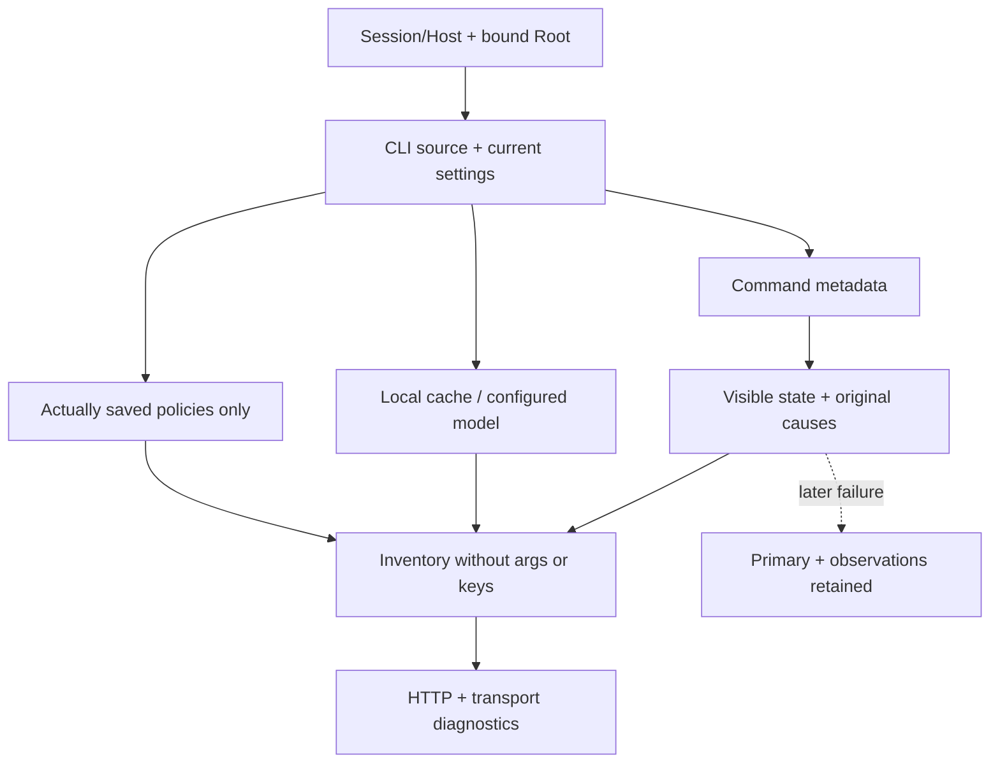

# Native CLI provider inventory

`GET/HEAD /api/v1/providers/admin` exposes the authenticated local operator’s CLI inventory: one source digest, providers, actually saved policies, declared model options and command metadata. Go fields `version`, `digest`, `providers`, `export`, `scope` are retained. The command path is intentional Admin data; arguments, environment and keys are not exported.

No provider policy or vendor model list is invented. Missing policy remains `null`, `saved:false`; export includes saved policies only. Codex options come from compatible visible local cache entries under the resolver’s same effective environment and saved file cap. Equal IDs merge declared efforts like runtime selection, which accepts any matching announcement. An argv-configured model may also appear as an unauthenticated declaration. This establishes no account access, applied effort or model identity.

Missing, relative, nonregular or mode-nonexecutable commands are visible in their row. Observed mode bits prove neither ACL, execution nor confinement. Tool-free adapter preparation unavailability is separate: a custom CLI may be executable without that adapter. No program, model call or probe runs on load.

Original causes for partial observations follow the DTO through transport diagnostics. If reading, encoding or close fails later, they stay joined to the primary failure. Malformed sources/catalogues or invalid stored policy shape cause server errors, never successful empty catalogues. Unexpected body/query or wrong methods refuse; visible refusals and recovery are covered by `provider-admin-http-rust`.

This CLI inventory does not replace [effective resolution](NATIVE-PROVIDER-RESOLUTION.md) and its CLI/API namespace guard. [Policies](NATIVE-PROVIDER-POLICIES.md) save through preview/digest/token. API connections, assistance calls and their full native interface remain separate plan surfaces.

Shared form fields retain a saved value absent from the catalogue as an explicitly marked “Saved value not in the list” option. Empty values remain empty choices; booleans and numbers use their DOM string representation. Refreshing options preserves these values until an explicit selection changes them. Engine validation remains mandatory: retaining a declaration grants no authority. Navigation selectors retain their separate contract. The `form-select-preservation-ui` recipe exercises actual historical source functions, translations, keyboard and themes. These functions and providers.js are not embedded in the current Rust server: native UI integration remains open. This component fixture establishes neither installed native UX nor full cockpit acceptance.

