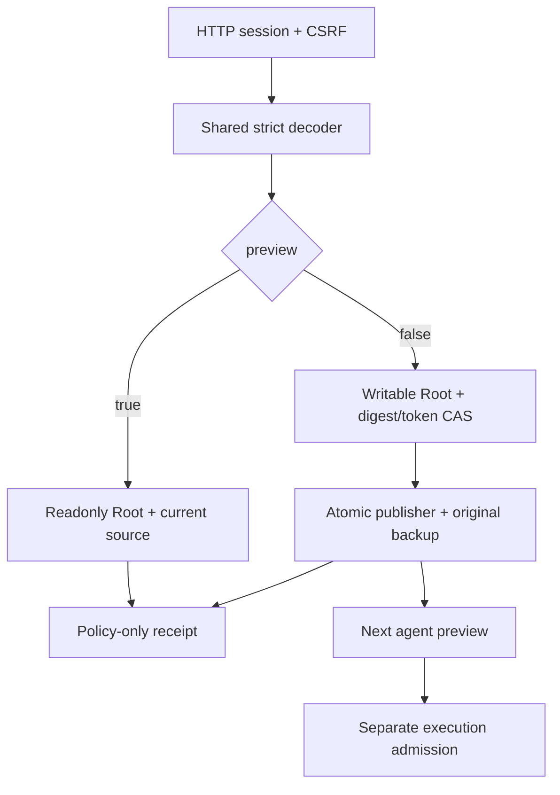

# Native provider policy API

`GET/HEAD/POST /api/v1/providers/policies` shares its decoder and Root operations with `providers policies export|preview|apply`. Reads return `version`, `digest`, `policies` from one verified source. Portable CLI export keeps only `version` and `policies`. Provider commands, environment and secrets are not exposed.

POST accepts `version:1`, `expected_digest`, `policies`, `preview` and, for application, the current preview’s `preview_token`. The inherited decoder retains Go null, case and duplicate-key merge semantics. simple/standard/exigeant are protocol levels; no 32-provider or 65,536-byte policy ceiling is added. Existing transport and file limits apply. Models and default levels remain explicitly saved operator choices; no model default is invented.

HTTP session and CSRF guard entry. Root checks its instance, saved settings, unverified local catalogue, digest and token. Preview creates no backup or reservation. Application uses the existing atomic publisher and retains the original backup. It starts no provider, modifies no Work and resumes no mission. The next agent preview consumes the new choices; admission remains separate.

Malformed input returns 400; stale digest/token 409; unsupported method 405; corrupt saved sources or read/close failures remain server errors. Causes and known/uncertain publication survive close and encoding. Read back after an uncertain outcome rather than blindly retrying. GET refuses implicit policies or an empty export instead of hiding remaining migration work.

This slice does not yet port `/providers/admin`, API connections, their resolution or the full provider form. Execution evidence and status belong to the migration plan; this page defines the adapter contract, not overall acceptance.

An unchanged application also confirms synchronization of the existing file. Configuration/policy CLI adapters and the policy HTTP adapter preserve that knowledge (`configuration_may_be_recorded:true`) through output/close errors and native observation. This claims neither new bytes, a new snapshot nor fresh acceptance; `changed:false` remains unchanged. The `configuration-noop-state-rust` recipe checks both closed stdout cases and HTTP observation, with source, snapshot references, Work and reservations unchanged.

