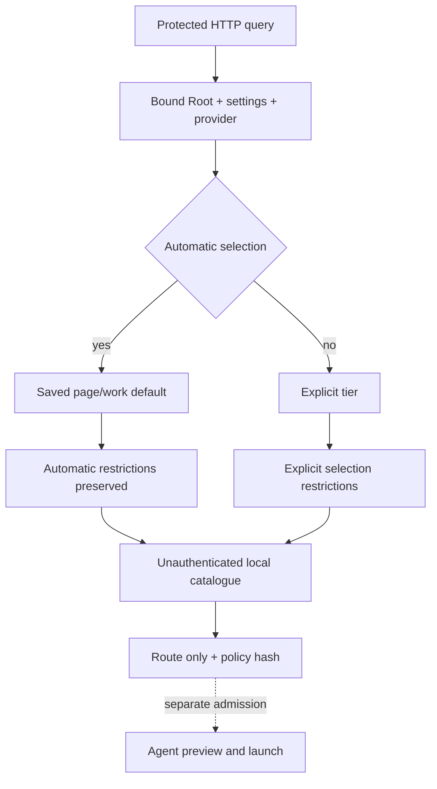

# Native provider model resolution

`GET/HEAD /api/v1/providers/resolve?provider=IDENTIFIER&purpose=PURPOSE` returns `{"route": ...}` from the CLI configuration and current Admin restrictions. `level` is optional; absent, empty or `auto` retains automatic selection. Inherited purposes are `work`, `page`, `brainstorm`, `preparation`, `planning`. Pages select saved `page_level`; other purposes select `work_level`. No model name default is invented.

The common resolver retains automatic selection when checking allowed automatic tiers. An explicit tier uses its own restrictions without escalation or fallback. Existing agents keep the `work` purpose and the same route/source representation. The local catalogue is an unauthenticated declaration; a successful read proves neither account availability, actual executed model nor permission to launch.

The protected read checks session/Host and Root binding, then reads settings, provider and catalogue under a read reservation. It exposes no command, arguments, environment or secret; it creates no Agent, cost reservation or process and modifies no Work. Denying unverified contexts for execution still allows metadata consultation; agent admission remains separate.

A null route is reserved for an already configured custom CLI with no model policy. Unknown providers, invalid requests or denied selections never become empty success. Unknown/duplicate fields, nonempty bodies and invalid selections refuse; names/tiers/purposes use shared engine ASCII vocabulary. Implicit stored policy for a known adapter, corrupt source/catalogue, IO and close failures remain server errors. API connection resolution explicitly reports unported. Restore the source and read again without launching a provider or bypassing rules.

This slice ports resolution alongside the [policy API](NATIVE-PROVIDER-POLICIES.md). The full provider Admin form and API connections remain open in the plan. Execution evidence and delivery status are separate from this contract.

Selection reuses the common CLI/API catalogue reader: an active connection and CLI entry sharing `api-IDENTIFIER` are a source conflict, including reads of another provider. A disabled API entry does not shadow a CLI provider. A selected active API provider remains explicitly unported; it never silently routes to a CLI.

