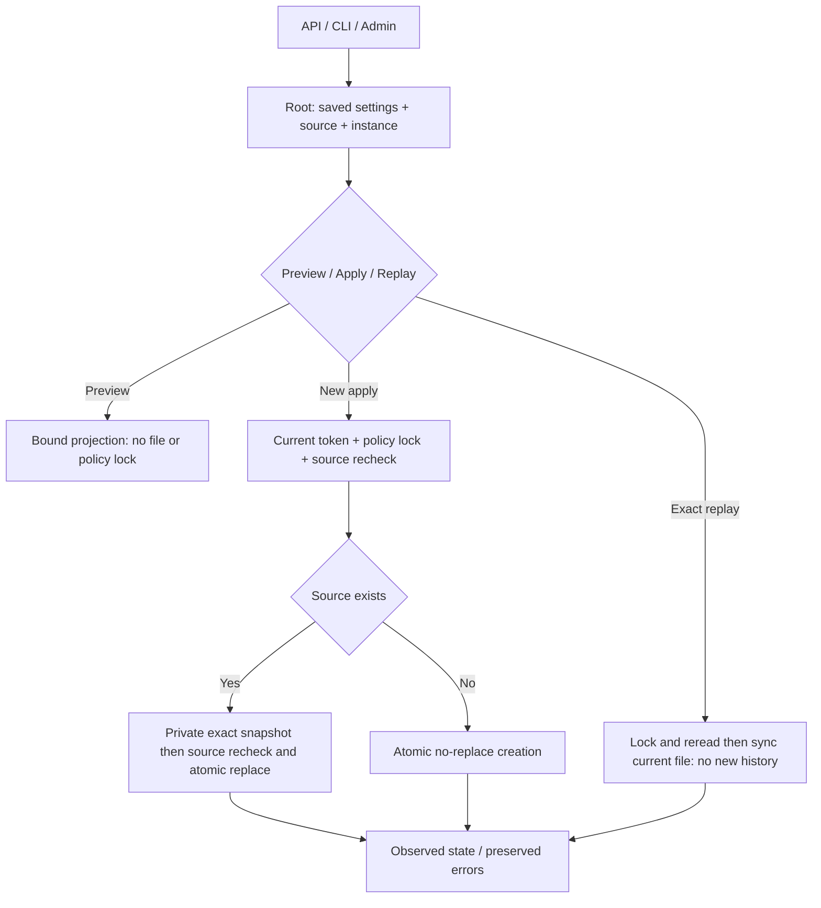
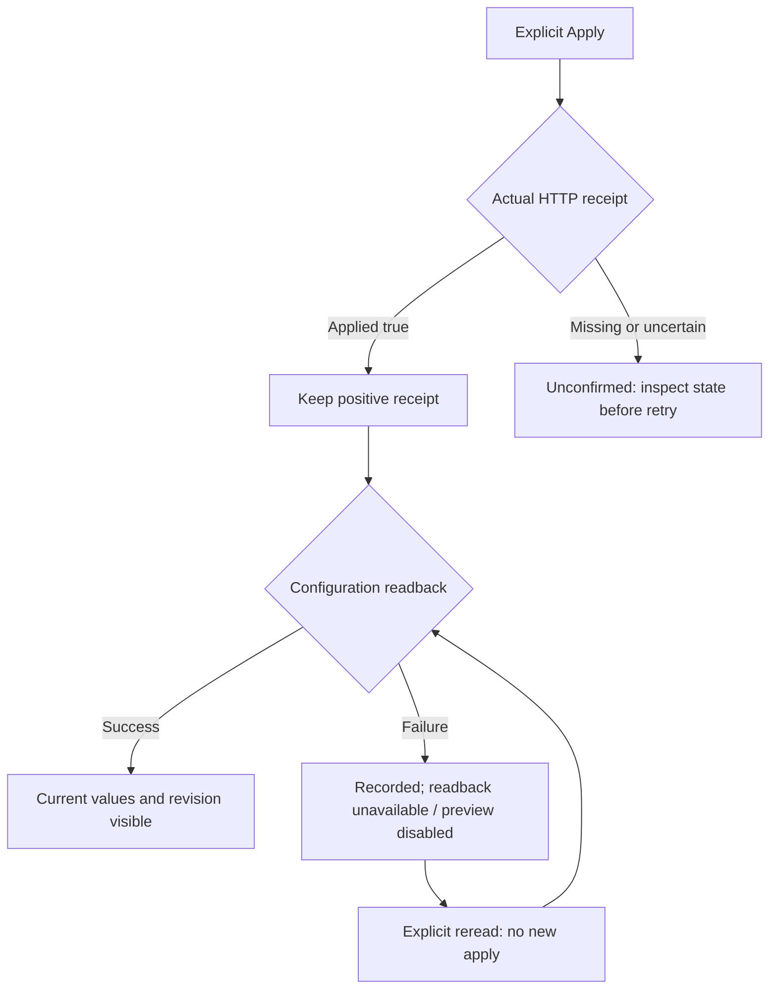

# Native provider-wait compatibility

Compatible policy and native Admin installed and checked on163. Twelve API/CLI groups and four browser journeys pass, including confirmed-save/readback failure and recovery. API connection probes remain unported; these retained settings are not the native preparation call policy.

The Go schema1 provider-wait.json stays a distinct compatible file. Reads retain its original revision/history and identify stored-file versus actual versioned defaults from config/provider-wait.json. Native structured CLI planner settings remain distinct; no merged history or equivalence is invented.

Silence and maximum duration are independent timers: zero disables the corresponding timer. Planning lease controls ownership, never total provider duration. New leases use saved native planning action bounds; historical positive leases remain historical even after bounds change. Go duration representation is limited to i64::MAX / 1e9 whole seconds. Operator reason/history/lease ceilings are not copied; current provider configuration byte policy governs saved files.

GET/HEAD /api/v1/provider-wait, POST /preview and /apply; CLI run-limits provider-wait show|history|preview|apply. Preview does not create the policy lock/file/snapshot. A new application requires a current preview binding actual source bytes, Root instance, saved settings and original Change; commit timestamp is excluded. The native token is never persisted in Go history. Actor metadata is empty/unverified for new native rows; timestamps are actual local engine observations, not authenticated acceptance.

Exact event replay synchronizes current file durability, returns current configuration and does not append or roll back later rows. Different reuse and stale revisions refuse. Publication uses checked Go-compatible lock, exact private snapshot on replacement, atomic no-replace for first creation and atomic replacement later. Retained snapshots can survive a subsequent refusal; they are not proof of application. Visible/uncertain publication and late errors require readback; structured state survives CLI/HTTP output and cleanup. No provider, Work, budget or agent is launched by these policy operations.

The native Admin integration must expose source, units, zero semantics, current lease bounds, history and an explicit preview/apply modal. Exact decimal projections derive from typed config; they are not a second persisted truth. Interface verification and installation remain open in the evidence plan.

A positive apply receipt remains recorded even if the next read fails. The modal must retain that fact, disable stale previews and offer an explicit configuration reread. The browser regression models this client-network failure after a real POST; it does not inject a storage failure. Original user reasons are rendered literally, never translated as labels.

## Historical read compatibility, current correction

The executed Go/native comparison found an extra native rejection for a Go-valid history row with null Change. Stored rows now follow Go read acceptance: schema, revision/history length, row sequence, row/current value validity and current/last equality. Original Change/actor/at metadata remain typed and unverified; missing/null or inconsistent Change and repeated event ids do not invalidate an otherwise readable file. New requests remain strictly validated. Exact replay uses the first matching stored event id; a different request for that first id refuses, including when a later duplicate would match. No historical metadata grants rights or proves prior authorization.

Thirteen executed differential scenarios pass on candidate167, including import, null/case/duplicate fields, read/refusal, first-match replay and append after historical metadata. New-row generated actor/time and native source/preview projections have explicit limited comparison exceptions. Twelve native public groups and nine connection-write regressions also pass; the retained correction review and installation169 are verified by twelve binary/API/asset assertions and fourteen FR/EN Version dialog checks. No global Go parity is inferred. Native operator leases outside old Go bounds may make the old Go reader refuse rollback; R6/R7 must check history and retain originals, never truncate it to manufacture compatibility.
