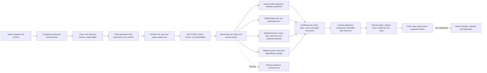
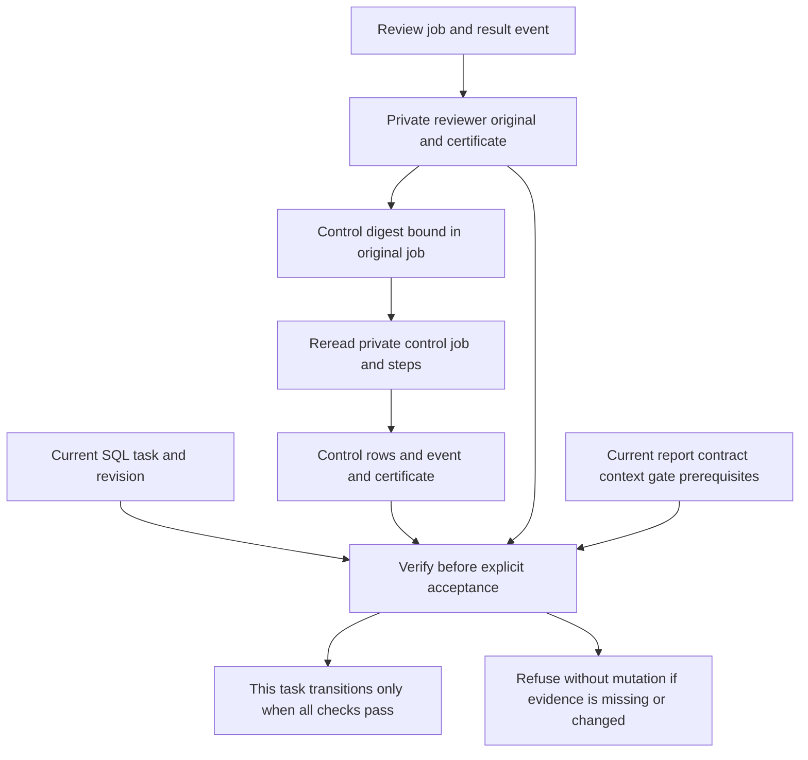
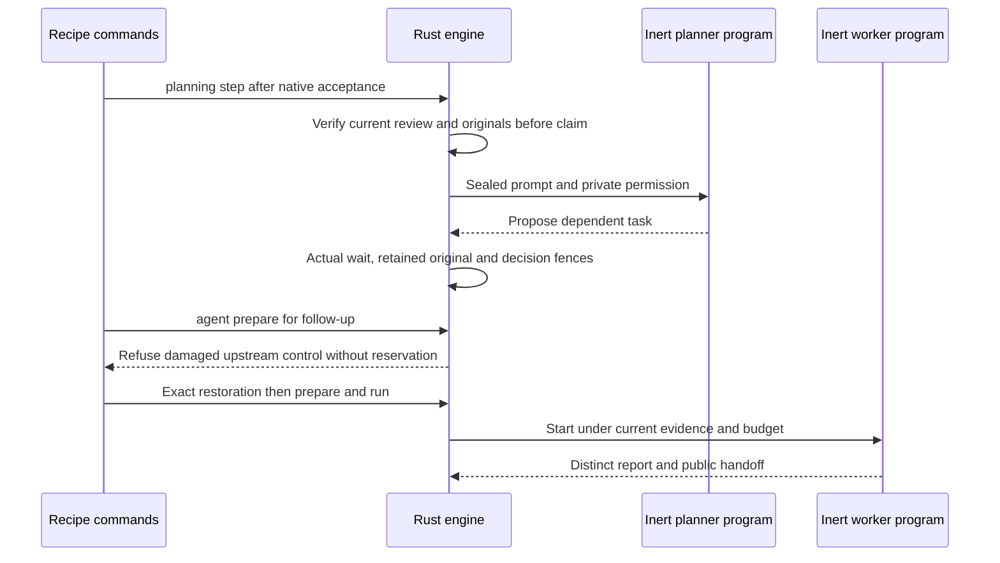
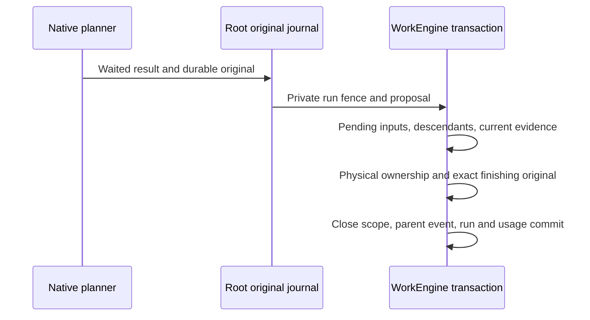
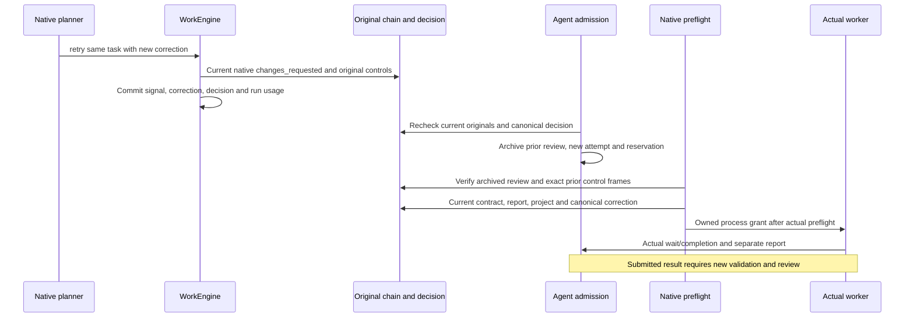
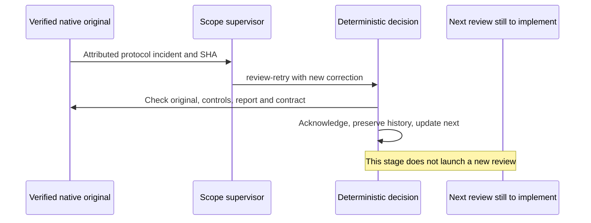
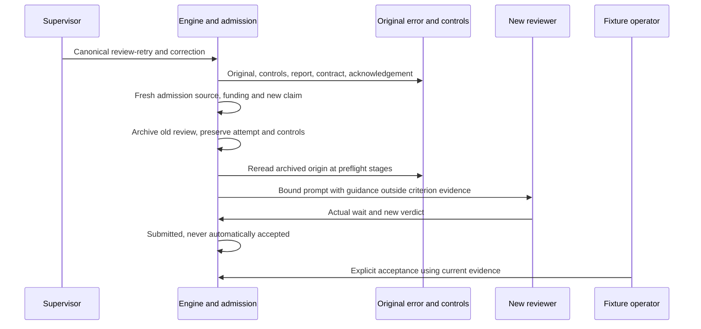
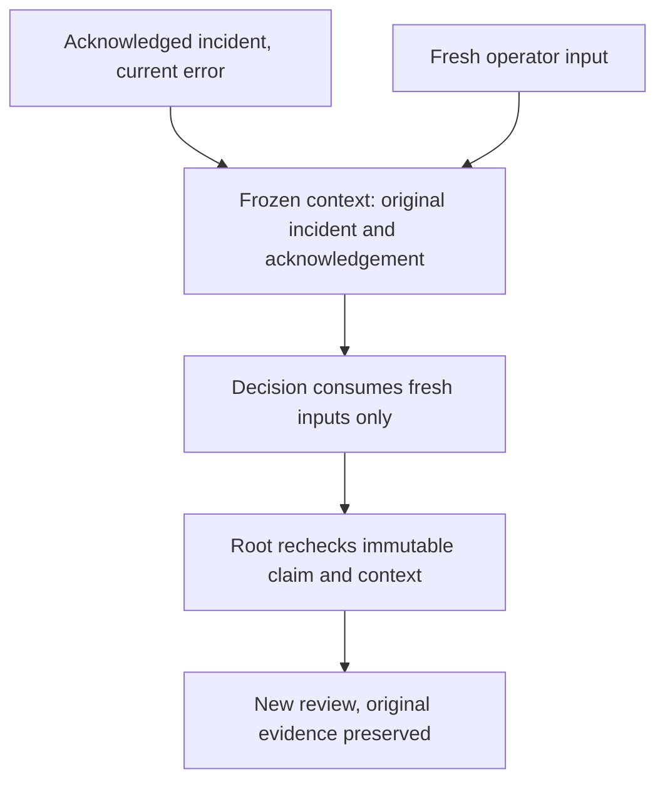
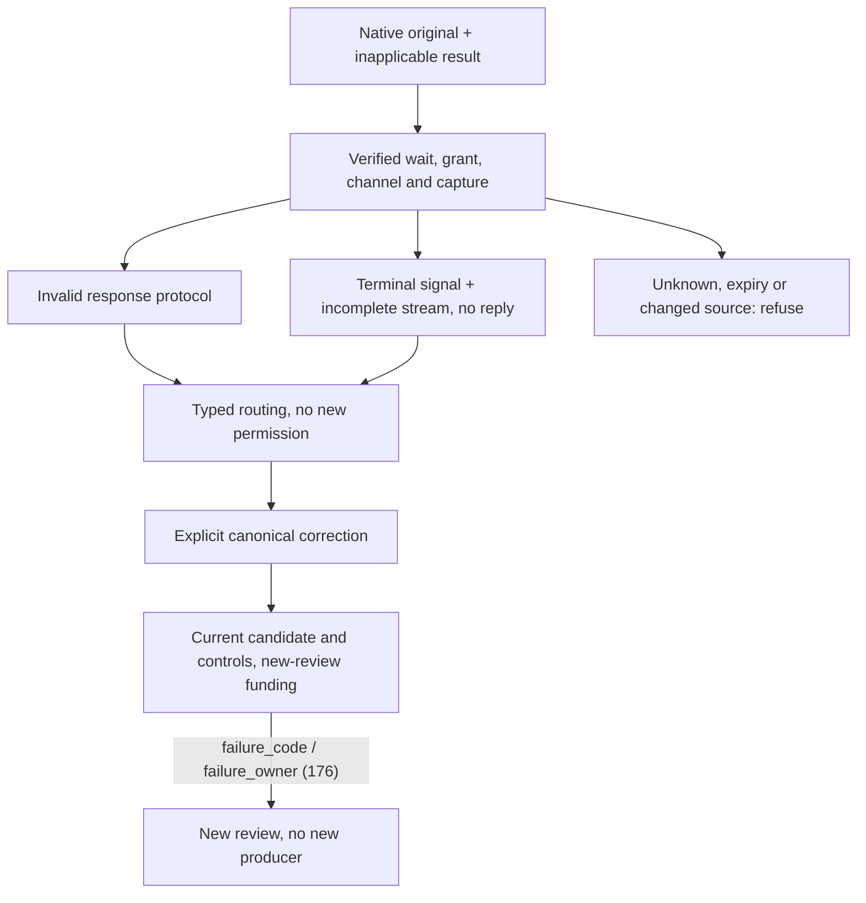

# Native Rust reviewer: current contract

The native evidence below targets Linux; cross-platform equivalence is not established.

## Actual availability

Previews, reviewer controller, context reader, publication and reconciliation
compile in the normal Rust profile since increment162. `task review` invokes the
configured provider through the same executable's private helper; tests use only
owned inert programs. Web reviewer launch routes remain unported. Native planning
can act on a current verified passed review (increment165), close native scopes
under increment166 evidence, and retry the same task from a current native
correction verdict (increment168). The global conductor, other retry routes and
other protocols remain partial. This establishes no user installation, real independent judgment,
authenticated model identity or acceptance of real user work. Explicit native
task acceptance is verified on owned fixtures in increment164 below, separately
from global acceptance. Qualification162 covers frozen
compiler inputs and excludes concurrent telemetry changes preserved in the
shared checkout and the installed interface.

| Flow | Actual behavior |
| --- | --- |
| `task review-preview` | Read-only native control provenance/current configuration |
| `task review-inputs` | Read-only complete originals, private prompt and digests |
| `quotas show/preview/apply` | Mission limits/reviewer deadline; explicit apply writes |
| `engine-settings show/describe/preview/apply` | Saved global policies; preview is pure |
| `ReviewOutputStream::from_saved_settings` | Saved-policy decoding, no process |
| `planning claim` then `planning call-preview` | Selection and preparation of verified normal context, no model |
| `planning decide` with native review | Existing actions require current passed evidence; historical/non-verdict and other specializations grant no action |
| `task review WORK --input FILE` | Claim/reservation then one private invocation, original and verdict/non-verdict; never acceptance |
| `task review-reconcile REVIEW_ID` | Apply a known original or replay history; no new invocation |
| `task review-retire-stale REVIEW_ID` | Explicit non-verdict for a successful original that became stale; no new invocation |

Both task previews accept `schema_version`, `event_id`, `expected_revision`,
`task_id`. Caller-supplied actor or command assertions grant no authority. Public
preview refuses an ongoing review; internal readback permits only the exact review
attached to its normalized job.

## Originals, policies and capture

The prompt contains the selected task, canonical submitted report, a different
explicit Markdown deliverable under `docs/` when applicable, native control receipt
and explicitly shareable complete outputs. Markdown links are not traversed;
unauthorized private output is not added. Changed reports, missing declared files,
required PNG/JPEG images or unported positive client windows refuse. Partial outputs
remain attributed as partial, never complete quotation sources. Material count/bytes
include separately quoted outputs as well as their receipt; prompt accounting
includes workflow and JSON escaping. Content is never clipped to pass a cap.

| Policy | Saved source and semantics |
| --- | --- |
| Reviewer context/files/sources | Mission quota editor: zero removes the additional cap; absence requires configuration |
| `review_delivery_max_bytes` | Global settings: zero forbids nonempty files; null removes the cap |
| `review_response_max_bytes` | Global v29 Quality/review group: zero forbids nonempty replies; initial null explicitly unlimited; legacy absence requires adoption |
| `review_timeout_seconds` | Mission quotas, root request field: zero removes total duration; omitted/null preserves current value |
| `agent_capture_max_bytes`, `agent_capture_max_lines` | Global combined stdout/stderr retention; zero retains no content, null removes that cap |
| Poll, grace, drain, startup and storage | Common saved global policy, no second local reviewer ceiling |

These policies use existing common validation and Admin/API/CLI surfaces; adoption
measures neither actual price nor model capacity. Browser exact-integer limits do
not become API/CLI business ceilings. Unrepresentable clock durations refuse.

Capture retains prefixes under combined budgets while counting/hashing every
observed byte, including after intentional truncation. Unfinished lines continue
between chunks per pipe; the combined budget follows observed order, without
inventing a global stdout/stderr timeline. Representation/allocation/IO/parser
failure differs from truncation. Every stdout byte feeds the decoder under its
separate response cap, even with zero raw retention; stderr stays outside JSONL.
Flush proves neither EOF nor fsync.

The exact libtest header filter and finite evidence Vecs are SDK devices. Product
transport strips no header and inherits none of their fixture sizes.

## Candidate lifecycle and private evidence

Claim atomically reserves the review record, call and financial estimate. The
`native_review_jobs` ledger uses scalar columns; this does not migrate the main
Work BLOB. The last reserved call remains usable (`0 < calls <= max_calls` with
verified job/funding), without permitting another exhausted claim. A committed
permission can never return to runnable state.

Root/dev/inode coordinates differ from workspace and host/environment scope.
Owner/child derive from actual OS and Unix peer observations, not JSON PIDs.
Registration and permission are separate commits. The channel is CLOEXEC; unnecessary
parent Stdio copies close after spawn; sealed transport is consumed once by exec.
EOF alone proves no success. Private host preparation creates, syncs and removes
a workspace probe; its IO/cleanup effects survive SQL rollback. Public previews
perform no probe and establish no OS confinement.

Total BOOTTIME begins after spawn and includes helper admission. The original TTL
protects admission; it is neither renewed nor reused as provider duration/result
expiry. TTL expiry during an otherwise successful review is not a measured scenario
in current evidence. Once the leader exits, admission/total timers stop and only
saved drain remains. IO/checks are cooperative, not real-time; observations retain
maximum check latency. The controller preserves typed causes, actual wait and any
unreaped Child: serialized JSON cannot replace them.

The framed private receipt is synchronized and **create-only** before terminal SQL.
Version2 requires actual capture; version1 remains readable with unknown capture
and cannot satisfy publication/reconciliation2.

| Field | Meaning |
| --- | --- |
| `process_attempted` | Primitive invoked, not by itself fork/exec proof |
| `grant_attempted` | Grant byte may be exposed, not model identity |
| `waited`, code/signal | Known wait; absence stays unknown |
| `failed` | Call/transport/domain failure, distinct from a valid unfavorable verdict |
| `original_reply` | Exact capped candidate, even invalid; absence differs from SHA(empty) |
| `raw_capture` | Saved policy, prefixes, all-byte counts/hash, separate truncation/failure |
| `provider_facts` | Unverified declarations; absence is not zero cost |

Schema/time/Root/checksum and field consistency are checked. Nontruncated hashes
and line counts must match. Wait without process attempt refuses; partial failures
never become success. These checks establish no business freshness or cryptographic
authenticity. Uncertain write/fsync requires readback, never another provider call.

## Verdicts, errors and reconciliation

`publication::record` rereads receipt2, requires the current original owner and
absent waited child, verifies funding, exact settings generation and complete
materials, then strictly decodes the retained reply. It invents no JSONL/usage/cost.
Work revisions may advance but cannot precede the claim; original intent/hash keep
the original revision. Independent checkpoints remain compatible; changed sources
refuse. Actual dependencies govern freshness. Pause/resume renews the native authority event included in the control source
digest, so old controls remain stale. Scope lease generation is a separate
observation excluded from this digest; an ordinary claim/decision alone does not
revoke unchanged controls.

`passed` leaves the task `submitted`. `changes_requested` blocks it for correction
and keeps `failed=false`: it is not a failed call. No verdict accepts a task.

`publication::reconcile_failed` is distinct: exact failed receipt2, committed
permission, current original owner, known wait and absent child. It preserves
production status, records `error` without applicable criteria and moves the job
to terminal `refused`. An actual second OS process refuses while the original
owner lives; a valid unknown-wait receipt refuses even if the PID appears absent.
It adopts no owner, repeats no provider, refunds nothing and guesses no wait.
Native exclusion ends, but another claim for the same production attempt still
refuses; explicit reviewer retry for that same attempt remains unported.
Complete causes remain private; public reason uses safe diagnostic vocabulary.
Potentially changed sources do not become a fresh verdict.

The compact public certificate has six fields: `schema_version`, `review`,
`work_id`, `task_id`, `source_sha256`, `validation_receipt_sha256`. It excludes
PID/host, raw capture and provider facts. Format2 also omits `review.receipt`
and `review.receipt_sha256`; the complete body SHA256 determines
`.swarm/native-review-public-v2-<sha>.json`, attached after encoding.
The reader also accepts historical format1, named by job hash and containing its
own path (without its own digest). This representation is no operator setting.
Compatibility is verified on immutable15804 inputs: two wire tests, genuine v1
publication and v1 rollback/v2 commit, followed by normal08 public claim/preview
for both formats. Permanent replay: `native-reviewer-certificate-compat.json`. Producer/readers share the format to derive the exact
public read extent, without an arbitrary operator ceiling. Private framed bytes
are still loaded whole, while unused capture arrays are skipped during decoding:
no global memory bound is claimed.

Create-only/sync file, then one Work/inbox/event/ledger transaction: rollback may
leave a certificate without an applicable result. Recovery requires identical
bytes for the same filename. Different format2 bodies may coexist after rollback;
only the reference bound to the committed SQL result is authoritative. Existing
artifacts are neither replaced nor deleted. A second check follows IO, without a
filesystem lease. One connection and
saved storage policy govern mutation. Uncertain commit permits no retry of the
provider; late errors retain known Work revision and original causes. Replay
rereads private original, `review.result`, phase/revision and public certificate;
absent reply digest differs from invalid type. Replay renews no freshness or rights.
Financial estimate remains held; provider settlement is still open.

## Normal consumption and evidence limits

`native_review_context` opens a readonly Root/SQL snapshot and binds terminal ledger,
Root-anchored private original, immutable result, certificate and verdict/error.
Result payload is a review, not a historical Work. Routing matches current inbox,
task owner and original attempt; no historical scope snapshot is invented. Reading
requires no still-live owner and acknowledges/mutates nothing.

Verdict context includes review and complete report reread under saved report cap.
Delivery references contain report/certificate; task projection includes its review
for context freshness. Error context contains review/certificate and explicitly sets
`unavailable_reports[event_id] = native-review-failed-no-applicable-verdict` in both
context and delivery. No current file is loaded as an applicable failure verdict
report. Event/context caps apply without silent omission. Unported managed/legacy
review coordination still refuses.

Normal public claim/preview verifies selection, context digest, actual preparation
and preview purity. `--expected-review-state error|stale` additionally requires state and
inapplicability. This establishes no model reception, decision, application, product
adoption or acceptance. Increment165 separately verifies an active native decision
from a current passed review; preview alone still proves no such effect.

Digests do not protect against a hostile same UID rewriting the entire Root/history.
Authenticated model/human identity, OS confinement, billing, Web routes, active
supervisor decisions, missing/incomplete journals, live/unwaited children and
other unsupported source states remain open. Documentation does not complete them.

## Replay and verification

| Evidence | Retained scope |
| --- | --- |
| [155 final10](../plans/migration-rust/evidence/20261022-155/final10/result.json) | Independent checkpoint, changed-source refusal/recovery, stale pause/resume; no active reviewer during checkpoint |
| [156 final10](../plans/migration-rust/evidence/20261022-156/final10/result.json) | Four actual failed calls, rollback/recovery/replay, real foreign-owner refusal, unknown-wait refusal, explicit incident |
| [156 normal17](../plans/migration-rust/evidence/20261022-156/normal17/result.json) | Normal c546 binary,255archived effective inputs, no fixture feature; not installed |
| [156 public18](../plans/migration-rust/evidence/20261022-156/public-context18/result.json) | Normal claim/preview, error/inapplicability, no model/acknowledgement |
| [153 capture](../plans/migration-rust/evidence/20261021-153/units04/result.json) | Nine capture guards; this module's sources are unchanged by156 |
| [Current plan](../plans/migration-rust/PLAN.md) | Current valid-publication regressions/quality, original failures, limits and next work |

Permanent recipes under `tools/verification/recipes/`:
`native-reviewer-claim-candidate`, `native-reviewer-controlled-process`,
`native-reviewer-private-journal`, `native-reviewer-streaming-capture`,
`native-reviewer-publication`, `native-reviewer-revision-continuity`,
`native-reviewer-failure-reconciliation`, `native-reviewer-departed-owner`,
`native-reviewer-certificate-compat`, `native-reviewer-stale-original`,
`native-reviewer-budget-result`. [Replay instructions](RUST-MIGRATION-REPLAYS.md)
record commands/preconditions. Fixtures are isolated and inert; product deadlines
differ from the absent global watchdog.

SDK/normal executables are qualified separately by features/profile, actual depfiles
and byte hashes, then archived. Concurrent used-source changes refuse qualification.
Use `--sdk-source-root` for the verified retained snapshot; never extract evidence
over checkout, toolchain or a live Root. Relocation and dependency availability are
separate preconditions. Fixture tokens prevent accidental mixups, not hostile UID
forgery. Preserve original refusals; reading historical evidence does not rerun it.
These frozen proofs do not qualify Claude's current shared checkout or installed
server. Detailed chronology stays in PLAN; prior FR/EN pages are retained in
`156/native-reviewer-doc-before14.tar.gz` with their hashes.

## Recovery after owner departure

`publication::reconcile_departed` separates original execution evidence from the
recovering instance. It requires a known-wait original2 on the same host:boot:PID
namespace. The old PID must be absent or have another start stamp, and the waited
child must also be absent. Live owner, changed host or uncertain observations
refuse. No signal, guessed reap, new grant/exec or owner/child scalar replacement
occurs.

A healthy original follows the same complete material/funding/settings-generation
fence, strict decoding and atomic publication as the current-owner path. A failed
original follows failed-call non-verdict finalization. Owner boundary is checked before
preparation and after IO; it is lifecycle evidence, not a disableable operator
policy. Another process also refuses while the original owner lives.
`inspect_departed` is an observation, never a reusable permit. Terminal replay
is historical and reasserts no current departure/freshness.

Recipes observe the applying OS instance, but its agent identity/authority are
not authenticated or durably bound to the business result. I157-ACTOR remains
required before a complete traceability claim. Missing/legacy originals, unknown
wait and live children still refuse. Permanent replay:
`native-reviewer-departed-owner`; exact evidence/scope are in the plan.

## Successful original becoming stale

`retire_stale_departed` is explicit under the same confirmed-departure guard; it
does not replace verdict publication. A successful/waited receipt2, committed
permission, actual child absence, funding and exact running review are required.
Canonical submission and original attempt must match. Preparation requires an
observed change: settings generation (existing strict verdict contract), inactive
authority, successfully read report with a different hash, recomputed native
source, or successfully observed complete inputs. Unreadable data, invalid policy
and other errors still refuse; no catch-all becomes a result. Closed scopes and
incompatible task states may still refuse before complete observation.

A second check after IO precedes atomic publication of `stale`, without criteria
or applicable report artifact. Task status, original timestamps and financial
estimate remain. Normal context uses `native-review-stale-no-applicable-verdict`.
The non-applicable certificate2 may coexist with a rolled-back verdict candidate.
Replay proves the recorded historical outcome; restoring the report does not make
that old outcome applicable. No new execution, automatic retry, acceptance,
settlement or authenticated agent identity is established.Four variants15909 and their public contexts passed: report, settings, pause and
renewed authority. Six recoveries12, four errors11, eight publications13, three
scope units15 and Clippy/Rustdoc14 passed. Inputs are immutable15904; normal08
SHA9c20b0 compiles255sources identical in04 (proof10), without fixtures or
installation.

The stale outcome retains its cause family and original bindings, not a separate
signed snapshot of changed sources. The reader verifies recorded integrity, not
that historical cause against current files. Persistent comparison evidence and
actual applying identity/authority remain part of I157-ACTOR before a complete
traceability claim. Missing/legacy/unknown-wait originals still refuse.

## Result reservation versus a new start budget

An already executed original needs no new reservation at today's tariff. Result
validation requires one correct work/scope/job row within the caller transaction,
a finite nonnegative stored amount and estimated/unobserved state. Preserve that
stored amount: no repricing, debit, refund or invoice inferred from provider text.
Missing/invalid reservation and SQL/type/close errors refuse, never empty success.
Trust in the authoritative SQL row proves no independently signed historical
price or actual settlement. Already observed/settled rows remain unsupported by
this conservative result guard.

`result_inputs` and `retirement_frame` use historical result validation; applicable
verdict source/settings checks remain. Admission, new start and live observation
retain current tariff/limit checks. Admin/CLI budget changes govern later calls
without rewriting reservations or granting execution. The reviewer uses this guard in the normal profile since162. The result financial guard also serves the
normal supervisor-original path since161; common financial reads/start
validation remain normally compiled. Web wiring and active decisions remain open. 16002 reproduced the counterexample;
two results/public contexts09, five normal start guards07, four stale10, eight
publications11 and Clippy/Rustdoc12 passed on05. Normal06 SHA cc2e88 compiles255
effective sources identical in05 (08), without fixture features or installation.

## Run and recover through the normal CLI

`task review WORK --input FILE --root ROOT --json` accepts the four preview fields.
Its `event_id` must differ from a validation or another mutation; exact replay keeps
this ID and never reruns the model. The engine selects its own `_reviewer_gate`
image; callers supply no executable. Unix socket, observed OS identities, sources
and sealed permission are checked before exec. Regular stdin refuses without
writing into that file. No libtest header filter processes provider stdout here.

A `passed` verdict leaves the task submitted; `changes_requested` blocks it for
correction. A failed invocation remains a CLI error even if its original permits
recording an `error` non-verdict. Explicit
`task review-reconcile REVIEW_ID --root ROOT --json` may acknowledge this historical
outcome with `verdict_applicable=false`; that does not make the initial invocation
successful. Replay renews neither freshness nor authority.

Before nonterminal application, the caller must be the exact original owner or
prove its departure on the same host; no live foreign owner is adopted.
`task review-retire-stale REVIEW_ID` requires a successful waited original and an
observed changed dependency; unknown IO is not staleness. Insufficient grant/wait/
journal evidence continues to refuse recovery, preserves the reservation and
never implicitly permits another exec.

Permanent replay `native-reviewer-normal-cli.json` checks seven normal cases,
retains original frames, certificates, programs and channels before PASS, and
checks corruption refusal then exact restoration. An inert program and observed
Linux identity authenticate no agent or human. I157-ACTOR, Web integration,
acceptance and settlement remain open.

## Explicit native task acceptance: verified scope164

The normal CLI can prepare `task update WORK --input FILE --root ROOT --json`
with `schema_version`, a distinct decision `event_id`, current `expected_revision`,
task `id`, `status: "accepted"` and optional `next`. This separate path does not
add acceptance to the worker API restricted to running/blocked. It requires a
submitted worker task in an open scope, with no contract, owner, blocker or
attempt-outcome edit. A changes_requested/error/stale review never suffices.

Root verification rereads the task/current SQL revision, review job/result event,
private original and exact certificate. It also uses the control digest bound in
that original to reread private control job/step frames, rows and control result
event/certificate. This digest comes from the verified Root reader, never acceptance
JSON. Certificate namespace selection only chooses a protocol: declared/malformed
names cannot fall back to ordinary supplied reviews. The API without current
settings refuses native data.

Current report, artifacts, contract, project context, quality policy, gate and
prerequisites remain required; review data is checked again after preparation IO.
The shared current reader applies the same native verification to dependencies.
Historical control evidence is revalidated as a recorded original, without granting
a new execution under current settings. Ordinary/managed read paths gain no
authority; their hierarchical acceptance is outside this native path.

This transition creates no call, refund, invoice, mission acceptance or human
identity. Current local access proves no authenticated human or agent authority;
I157-ACTOR remains open. Tests use inert programs/owned fixtures, without user
installation. Recipe `native-reviewer-task-acceptance.json` must require a valid
control, private/public corruption refusal at both stages and changed report,
exact restoration, non-verdict refusal, and reservation/counter/original retention
before PASS.

The existing protected `POST /api/v1/action` route with kind=task uses the same
Root check. Two actual HTTP fixtures verify acceptance, 400 refusal on a changed
reviewer original without mutation, restoration and historical replay without
invocation; only their owned servers were started/stopped. Replay acknowledges
history without new validation or authority. No browser workflow is claimed:
this increment changes no layout/UI.

## From review to follow-up work: verified scope165

An independent_review event is no permission. Before existing active operations,
the engine rereads the exact scoped inbox event, native result, both stages of
originals/certificates and current passed evidence for the same task/attempt.
It also reads the explicitly referenced report under its saved cap, without
pretending it is a handoff event. Existing task, requirement, delegation, budget,
artifact, lease and commit guards remain. The recipe exercises task creation;
it is not an exhaustive delegation campaign.

Context preparation already validates this evidence when selecting the current
passed review, before a new claim or invocation. Archived reviews and error/stale
incidents remain attributed observations for diagnosis, without action rights;
changes_requested is no favorable verdict. Explorations, run observations and
other unported protocols refuse.

Dependent worker admission rechecks accepted-task evidence including private
reviewer/control originals: an old accepted status alone cannot authorize start.
The follow-up remains submitted; no implicit acceptance or human identity is
created. Recipe commands and inert programs drive this flow; it proves neither
global conductor autonomy nor model intelligence. Scope closure still needs a
true physical completion boundary, distinct from an expired lease or request flag.

Recipe: `native-reviewer-active-decision.json`. Planner/new-worker originals,
programs, prompts and reports are retained before PASS. work show rendering may
itself refuse unreadable accepted evidence; the recipe compares read-only
revision/reservations during refusal and complete Work after restoration.
Partial observation improvement I165-OBSERVE remains planned; no empty success
or fictitious freshness display is introduced.

Two active negative variants also run a real inert planner and retain its original:
changes_requested and a reviewer protocol error refuse follow-up creation. Reading
them grants no action; refusal preserves existing reservations and reruns neither
reviewer nor worker.

### Native scoped closure

The `close` implementation is verified on the frozen normal fixture graph in migration lot166 (three public flows, eleven named tests, Clippy and Rustdoc); this is not an installed delivery. It is a sole operation: task/delegation edits cannot be combined with closure. All pending scope events must be consumed, children closed, descendant tasks accepted with current original review/control/report/gate/dependency evidence, and own requirements covered. Prompt `closure_unavailable` describes structural eligibility only, never a physical completion permit.

WorkEngine checks registered native planner, review, validation and worker ownership in its decision transaction. A default-deny internal fence admits only the finishing planner whose healthy durable original, exact source/owner, hash and observed absent child are verified. Unknown wait, live foreign work or changed original refuses. No body flag, expired lease or caller PID authorizes closure. The applied run/usage and closed scope share one commit; parent receives `scope_closed`. This does not establish escaped descendant containment, authenticated human/agent identity, full migration acceptance or autonomous orchestration.

An unconfirmed physical closure guard remains a typed incident, not a terminal business refusal. It must preserve the original and ownership for reconciliation; missing grant observation cannot release a run. Lot166 retains the pre-fix counterexample separately.

### Scoped worker restart gate

A blocked scoped worker cannot start another attempt without the persisted engine retry signal. The common lifecycle and public admission share this guard, preserving the task attempt maximum; review error/running/queued requires review recovery. This signal is not authenticated supervisor evidence and cannot be supplied as a launch-request override. Native changes_requested production retry uses only the verified correction path below; other review/protocol/managed recovery routes remain unsupported. Manual task behavior is unchanged. Lot167 distinguishes the public branch refusal (no demonstrated bypass) from the reproducible missing common lifecycle precondition.

### Native production retry (migration lot168, fixture verification)

The common reader separates passed acceptance from a current native changes_requested verdict used only by same-task `retry` operations. Private reviewer/control frames, canonical events, public certificates, report/contract/project and current attempt remain mandatory. A retry changes only the persisted correction/signal; it preserves attempts, review and consumption. A signalled start additionally requires the stored planning.decide retry to match task/scope/correction/original review input. Missing or overwritten evidence refuses. The normal CLI fixture verifies a real second worker on the same task after this decision; review protocol errors/managed recovery grant no production retry.

The native worker retry path in increment168 includes a historical-original check at every native execution preflight: exact archived review and preceding completed attempt, canonical correction decision, current report/contract/project, and original control ledger/private slots/public event remain bound. It selects the control by the verified review body's SHA, work and task, and verifies prior producer/attempt; it never fabricates a current validation/preview. The current acceptance readers still require exact current validation data. A complete healthy control and fault/recovery case verify actual execution, refusal before preparation, and refusal at queued preflight after archival; restoring the same original lets the same queued agent run.

The canonical correction remains in task.next through native admission and preflight; the worker prompt includes it. The normal lifecycle archives the old review and clears its validation/gate when it records the new attempt; it creates no successful new review. The fixture preserves handoff.md and submits retry-report.md separately. The second report remains submitted and unaccepted, with no second reviewer/control claimed. Review protocol recovery remains unfinished; worker failure without review is verified separately in lot169.

Replay: `native-production-retry.json` runs a healthy actual control before negative cases. It verifies an unsupported public scoped edit refusal, then a fixture-only negative canonical event corruption, damaged control before admission, and damaged prior control at queued preflight. Exact restoration precedes resumption, and both planning-call and worker-reservation ledgers are checked separately. The same preflight function is wired at all native stages; this recipe injects the execution fault before owner claim, not between registration and grant. SHA/receipt/SQL checks still authenticate no semantic agent or human and provide no same-UID hostile-writer or escaped-process containment guarantee.

Worker termination without review and the exact readonly original completion contract are described in [Native worker recovery](NATIVE-WORKER-RECOVERY.md); lot169 is verified on isolated native fixtures.

A producer launch while a review is error/running/queued refuses with `scoped-worker-review-recovery-required`, even without a production retry signal. The diagnostic grants neither a new review nor production: explicit reconciliation/recovery and original evidence remain required. A native error may keep its report submitted; this diagnostic fabricates neither a blocked transition nor a new producer attempt.

## Native protocol retry — decision verified on fixtures (lot172)

The route distinguishes an original typed `review_fragment_protocol` failure with known wait/grant/channel, exit0, healthy capture and no duration/drain/source interruption from an applicable verdict. The latter stays false. The shared reader also verifies current report/contract/project and original controls; other failures/stale/unknown results remain unavailable for active operations. Context carries only task/review/attempt IDs, reviewer_protocol ownership, correction type and private original-body SHA (SR1 framing verified separately), plus the actual verified report within saved limits. candidate_commit stays empty for this non-Git route. Free-form error text grants no authority.

`review-retry` proposes a new reviewer correction on the same task and its current delivered event. The decision preserves report, attempt, error review, controls and spending, updating only next/decision/acknowledgement. Persisted capacity, applicable fields, scope, evidence and absence of concurrent owners are checked. It launches no worker or new review, refunds nothing and creates no acceptance or future success. A second reviewer execution and already acknowledged incident recovery still need implementation/verification; this stage is not complete recovery. Decision only is verified172; complete recovery remains open.

## New review after correction — verified on fixtures (lot173)

Native recovery observes either the current error before a new claim, or the immediate archived same-attempt error behind a checked running job. It binds private/public/event originals, canonical correction/acknowledgement, current report/contract/project and original controls. No copied Task or fabricated preview removes the error to pass guards. The old review is archived only after checks, with normal new reservation and call accounting.

`TaskReviewInputs.admission_source_sha256` is an additive observation: the current source/admission-authority digest. It stays distinct from `preview.validation.source_sha256`, the original control execution source digest. A new supervisor generation does not rewrite those controls; new admission never reuses their old grant as fresh authority. Job and guards bind current admission and the original receipt separately. The `review_recovery` directive enters the actual JSON/prompt and its SHA; saved prompt limits cover it, it supplies no criterion evidence and it grants no permission. Source/project/registry/funding/host/preflight are rechecked; instructions must satisfy current policy too.

173 verified: actual second reviewer, four pre-admission faults refused/restored, new result initially submitted then separate fixture operator acceptance. Already acknowledged incidents on a fresh activation, transport/source failures and changed source remain separate contracts. This binding establishes no semantic actor identity, hostile same-UID protection or OS confinement.

An ordinary decision/claim does not revoke control authority: source_authority tracks enable/pause/resume events, not every display generation. Both SHA values may therefore match for unchanged authority/candidate. The173 public pause/resume control proves the distinct case: new admission digest, original control digest/receipt preserved, actual second verdict followed by separate fixture operator acceptance. This establishes no human authentication. Fixed framing describes recovery as attributed response-method/format guidance, outside criterion evidence and without extra tools or permissions.

## Recovery after acknowledgement — verified on fixtures174

Acknowledgement records reception and does not resolve an error. On a fresh activation, the candidate separately includes still-current acknowledged review incidents, their original SHA and verified report. These never become input_events. Saved context, event and report limits still apply; overflow explicitly refuses. The new decision consumes only fresh inputs. Before admitting a new review, Root reads the immutable native_planning_claims context, its canonical claim event, scope/holder/generation/revision bindings and actual acknowledgements. The old decision remains intact. Verified on normal12 (47a701,274 sources without fixture features): full control22, seven exact-restored refusals and public context cap23, same attempt/report/controls/spending. The actual prompt receives the new correction ID and SHA, distinct from the preserved old acknowledgement; replay starts no process. Fixture operator acceptance remains separate and proves no human identity. Tests33/Clippy/Rustdoc10, final documentation14, regressions16/18/19/20. Original failures remain retained; no installation or full migration completion.

175 verified on fixtures: a terminal signal with confirmed wait with incomplete stream/no reply, healthy capture and typed stopped-stream cause can classify as review_fragment_interrupted/reviewer_runtime. Unknown/expired duration, drain or source, broken capture and EOF alone remain unqualified. Classification grants no rights; unchanged current evidence, explicit correction, capacity, budget and fresh admission remain required. Signal15 is fixture input, not operator policy or product cutoff. Normal07 d6f5d6/274 sources without fixture features,34 tests/Clippy/Rustdoc05. Full flows08/10, four exact-restored faults09 and seven11 plus restored public context cap PASS: pending then acknowledged incident, actual new reviewer receives canonical correction/digest, same attempt/report/controls/spending and old acknowledgement; new reservation/call counted, result initially unaccepted then separate fixture operator acceptance, no-exec replay. Protocol regression12 PASS. Actual original failure01 and refusal02 remain retained; no installation, authenticated identity, unknown-wait recovery or global migration completion established.

176 verified on fixtures: review_recovery adds failure_code and failure_owner built from the same verified private-original classification. These observations explain the cause to the new reviewer; they are neither request inputs, arbitrary error text, authenticated identity nor permission. Eligible classes and admission checks from175 stay unchanged. Normal04 c8810c/274 sources without fixture features and34 tests/Clippy/Rustdoc02. Actual prompts05/07/pending09 assert both exact code/owner pairs; nine faults06/08, including wrong kind and wrong owner with recomputed hash, refuse before claim, restore then succeed. Same history/canonical/controls/report/spending, public cap preserved and no-exec replay. Both fields count toward the existing persisted prompt limit. No new permission profile, identity or installation.

177 verified on fixtures: root judge/continue and renew are separate from independent candidate review. One verdict per cycle, renewal only after continue under saved cycle quota (0 unlimited), no activation/decision/spending reset. Root context carries complete JudgeState/history under the existing context cap and its freshness binds this contract; children receive no root history. New reasons use planning_decision_max_reason_bytes; durable consistency must not reapply an old4000byte policy. Judge end still refuses without native managed-candidate contract. Contract, diagram, policy and evidence: [native global judge](NATIVE-GLOBAL-JUDGE.md). Normal06/47tests/control11/faults12/child13/legacy14; no full conductor or installation claim.
