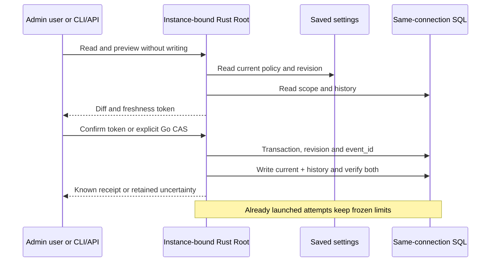

# Rust execution-limit administration

G9 uses the existing `run_limits_config` and `run_limits_history` tables for future starts. It does not change limits already frozen into attempts or give the deterministic engine business completion authority.

## Public flow

The Admin card opens an accessible scope dialog: project, mission, role or task. Load the scope, edit, preview without writing, then confirm. Readback establishes the recorded state; a positive receipt followed by failed readback remains visible and requires reload. Historical actor/time fields are recorded metadata, not authenticated identities.

GET `/api/v1/run-limits?scope=project` returns current entry, descending history (null when empty), saved defaults/ceilings, diagnostics and an exact decimal browser projection. GET `/api/v1/run-limits/effective?mission_id=…&role=…&task=…` resolves administrative hierarchy only. Provider, mission-contract and previous-attempt admission remain actual launch responsibilities. POST `/preview`, `/apply`, `/rollback` and native `/rollback/preview` share that prefix and the bound Root. Common session, Origin and CSRF protection applies.

CLI: `run-limits show|history SCOPE MISSION KEY`; `effective MISSION ROLE TASK`; `preview|apply SCOPE MISSION KEY --input FILE`; `rollback-preview|rollback SCOPE MISSION KEY REVISION --input FILE`. A dash represents an empty identifier. Change JSON uses schema_version, event_id, scope, mission_id, scope_key, expected_revision, values and reason; rollback uses to_revision. Preview tokens are transport-only and never enter recorded requests.

## Policy, concurrency and errors

Zero inherits. The five fields are silence_seconds, tool_seconds, max_tool_calls, max_repeated_calls and max_consecutive_errors. Operator choices come from saved RuntimeLimitPolicy in engine settings, editable through its Admin dialog; historical Go ceilings are not copied as Rust policy. Signed 64-bit integers are a technical representation. Observation mode requires mission scope and an explicit reason.

Without a token, explicit expected_revision CAS preserves Go recovery and can replace an unreadable current body. With a token, apply additionally binds inspected source, instance and settings. Stale revision refuses without mutation, with no automatic business retry. The existing storage retry policy and a single-connection transaction are reused. Both rows are checked after writing; commit/output failures retain known or uncertain effects.

An existing event_id compares canonical request bytes without rejudging historical data against current ceilings. Exact replay returns the CURRENT entry. Rollback appends a new revision and preserves history. Go reads do not acquire retrospective metadata/policy gates. SQL/JSON failures never become successful empty results.

## Evidence state

The targeted CAS repair regression was reproduced before correction and passes afterwards. API/CLI, browser, delivery and qualification evidence is tracked under `docs/plans/migration-rust/evidence/20261027-run-limits-admin-ohyyq12v`. Compilation alone establishes neither global Go parity nor installation; unverified stages remain open there.

Closing restores focus after summary readback when the opener is enabled again; if that read fails, the Reload control remains available.

Local delivery178 is observed:13 installation checks,14 FR/EN Version assertions, served assets match the build and five works remain unchanged. Public9 and Go6 are retained on177; G9 producers remain identical in178 except comments/tests, and the Nix dependency change affects process guards outside this flow. Browser4 on178 covers computed contrast,320/1440, invalid input without contact, positive receipt with a synthetic readback failure, actual recovery and settled close focus. The first complete collector remains FAIL due to focus; its API/Go PASS steps and verified integrity are preserved, followed by the corrected PASS browser recipe verified separately. Actual Rust tests: codec10 and Root2; an initial zero-test selection remains insufficient evidence. GLM review is static and bounded, without global acceptance. Live settings were not silently adopted.

Reopened after discovery182: dialog confirmation is strengthened through NATIVE-POLICY-RECEIPTS; earlier delivery proofs remain historical, not evidence of the new guard.

