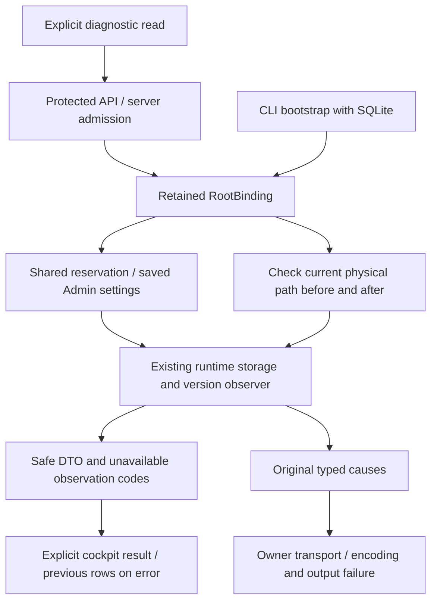

# Native storage diagnostic

Delivered locally in207. Permanent recipe2steps PASS/integrity VERIFIED: Go/Rust API7 and browser4 FR/EN×themes320/1440 with AA contrast and real saved Admin thresholds consumed. Material regressions2, runtime6, targeted Rustdoc/i18n. Installation27+Version14, verified embedded resources and5Works unchanged. No global acceptance. [RETEX](../plans/migration-rust/evidence/20261027-runtime-health-x97n_o9u/RESULT-RETEX.md).

Protected GET/HEAD /api/v1/runtime-health requires empty body and no query. Native runtime-health --root ROOT --json reuses the producer, initially opening SQLite to acquire a real binding then closing it. The already-started server retains RootBinding descriptors and does not reopen SQLite for health. Cold CLI bootstrap availability differs from an existing bound HTTP service.

RootBinding.runtime_health checks current directory/database O_PATH identities against retained witnesses before/after under the shared settings reservation. It reuses mission_status_runtime.observe and persisted runtime_storage_stop_bytes, runtime_storage_warning_bytes and runtime_storage_stop_inodes, validated/editable through the engine Admin modal. No implicit adoption/new fallback. Existing command/Git policy applies to source version observations; store/temp paths are actual project/process observations.

ready/warning/blocked and launch_allowed concern storage only: no SQL integrity, launch permission, provider readiness or business completion is established. Probe failure gives unknown/blocked; historical zero DTO counters are not rendered as measured zero in this UI. observation_errors adds safe families, while original typed causes reach owner-observed transport. Encoding, post-check, release and output/flush failures also retain ancillary causes. Missing/malformed settings, changed physical instance or unavailable clock refuse.

The cockpit offers an explicit disclosure/read/Admin link, no polling or automatic retry. Diagnostic reads are independent of Admin initialization and the browser request deadline being repaired, following existing recovery transports; server admission remains authoritative. Invalid/source responses preserve earlier observations and show an error. Text is escaped; measurements unsafe for exact browser representation are labelled. Threshold choice, current measurement and actual launch rights remain distinct.

These checks cover RH1–RH5 and local delivery RH6. GLM review is static with retained context/limits; review coverage for22compiler inputs is complete but20foreign/note axes remain open. Earlier global qualification issues are not closed. Actual JSON keys are next_step and volumes[].available_bytes/available_inodes: the first206UI rejected valid data, reproduced then corrected with key and browser regressions. Faults affect only owned fixtures, never a live mission database.

