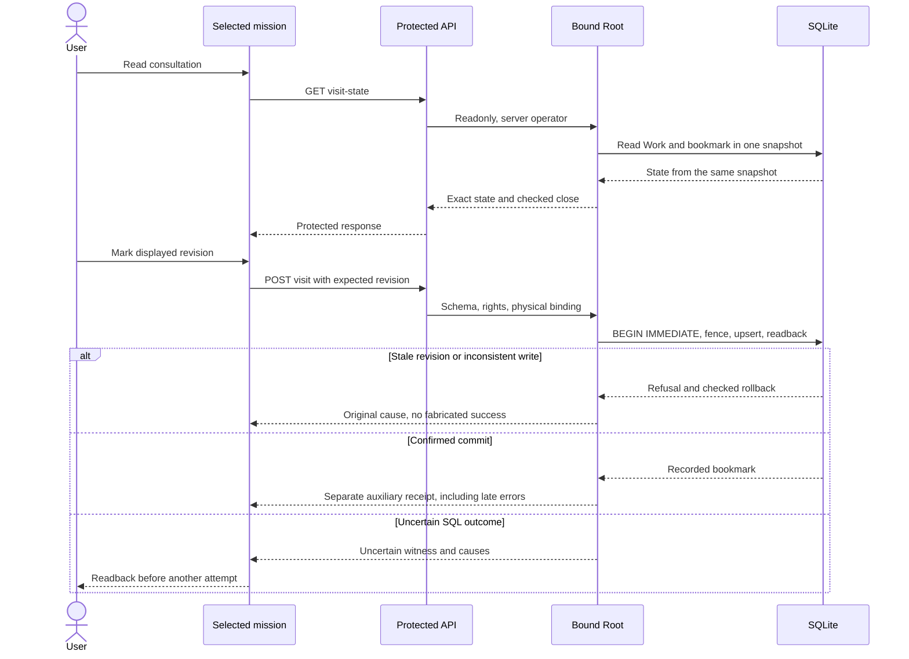

# Local mission consultation — Rust contract

The native path is available on Linux: protected API, CLI and explicit cockpit
action. The [active plan](../plans/migration-rust/PLAN.md) retains recipe/install
evidence and limits; this path implies no global migration acceptance or agent
autonomy. [French contract](../architecture/NATIVE-SESSION-VISIT.md).

`POST /api/v1/visit?work=WORK` retains Go semantics: record the current Work revision
and server time for the local host/UID operator. This bookmark accepts no task,
completes no mission and proves no human identity. No provider, permission,
reservation or consumption is created.

An empty historical body means current-at-call. Native
`{"schema_version":1,"expected_revision":"3"}` adds an optional freshness fence:
a stale revision refuses with409 and no bookmark change. A present revision must
be canonical nonnegative decimal i64 text. Null, JSON numbers, duplicate/unknown
keys refuse before mutation. Schema1 and i64 are protocol representation invariants,
not operator ceilings. No timeout, attempt ceiling or automatic retry is added.

The response extends `saved:true` with `state`: exact current revision, `exists`,
`visit` (`revision`, `at`, `operator`) and `exact_visit_revision`. Separate native
`GET/HEAD /api/v1/visit-state?work=WORK` is readonly; GET `/visit` stays refused.
CLI: `visit show WORK --root ROOT --json` and
`visit mark WORK --root ROOT --input INTENT.json --json`. Without input, mark uses
the historical semantics. Actor and time come from the server environment.

A negative stored revision is inconsistent data: the reader returns a server
error without changing the row or returning a successful state. Public marking
can replace this bookmark with the validated current revision; it accepts no task.
This recovery is tested on an isolated Root.

IMMEDIATE SQL reads Work and upserts the bookmark in one transaction. Exactly one
affected row and matching readback are required. An error does not imply no effect:
typed auxiliary `session_visit` receipts distinguish `recorded` and `uncertain`,
separately from Work/configuration/agent effects through close, encoding, output,
flush and HTTP owner observations. An uncertain receipt describes an attempt and
requires readback; it grants no retry permission. Missing receipt is no rollback
proof. Browser closure proves neither cancellation nor receipt by the peer.

The UI requires explicit reading and marking, compares the selected Work revision
with the server, preserves previous observations on error and requires readback
after an unconfirmed write. No automatic retry. High revisions retain their exact
numeric wire lexeme; unknown JavaScript representation refuses marking. Copies
can lose weak metadata and must be read again. Existing saved network settings
remain authoritative.

SQL/transport fixtures establish neither agent autonomy, independent acceptance
nor every platform. Registered typed wrappers retain witnesses and secondary
causes; opaque external wrappers without a traversal contract add no evidence.

### CLI compatibility: `mission seen`

`swarm-rust mission seen WORK --root ROOT --json` calls the same writer as
`visit mark`, without an input document. It returns historical fields
`revision` (integer), `at`, `operator`. Without `--json`, it prints the FR/EN
confirmation. Only the current local operator bookmark changes; no Work, task,
cost, permission or process is accepted or launched. The operator label does not
authenticate a human. Output failure retains the auxiliary receipt; read back
with `visit show WORK` before recovery. Use `visit mark --input FILE` for an
explicit revision fence; that native contract remains distinct.
