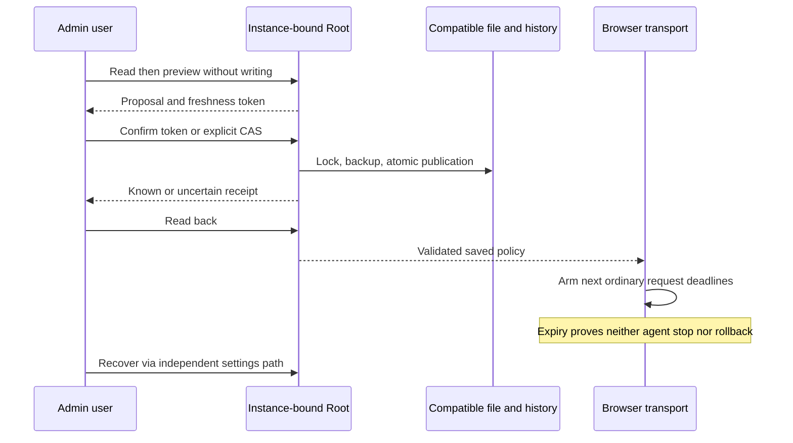

# Rust browser waiting policy

G10 ports the Go web-requests.json APIs. Browser expiry establishes neither agent cancellation nor business-operation failure. The native-runtime journey is installed and verified on local version187; other browser transports remain separately unqualified.

## Source and operations

The general_ms, snapshot_ms and connection_test_ms fields are exact integer milliseconds; zero disables the corresponding browser expiry. Actual file absence uses versioned config/web-requests.json. An unreadable, refused or malformed source never becomes defaults. Already armed requests keep the policy loaded when they started.

GET/HEAD /api/v1/web-requests reads current configuration/history. POST /preview and /apply share that prefix and the Root producer used by `swarm run-limits web-requests show|history|preview|apply --input FILE --json`. Preview creates no policy lock and writes nothing. Apply preserves explicit Go expected_revision CAS; a supplied preview token also binds source, instance and settings. Exact first-event replay returns CURRENT config without a new revision or rejudging historical metadata. The token never enters recorded changes.

GET/HEAD /api/v1/web-requests/script.js emits only typed revision and three durations, with JavaScript MIME after successful authorization/Root read. Refusals retain JSON diagnostics/status and never become successful empty scripts.

## Bounds and recovery

2^53−1 is the exact Go/JavaScript representation bound; timer segments0x7fffffff are a browser technical constraint. Actual waiting durations are persisted operator choices. The existing agent_provider_config_max_bytes key now explicitly covers providers.json, models_cache.json, provider-wait.json and web-requests.json source reads and full serialized policy history. The same validation and Admin/API/CLI setting apply. null removes the cap; zero refuses nonempty files. No second Go1MiB/16KiB bound or8..2000 reason-length policy is copied. New change reasons remain nonempty.

Session bootstrap, engine settings and this policy's editing have an explicit recovery path independent of the deadline being repaired. Other operations through native-runtime's shared transport require the actual loaded policy, with no fallback duration. A failed reload invalidates the loaded policy for future ordinary requests until repair/reload; already armed requests and agents retain their independent contracts. This lot does not claim every other native page transport is connected: that inventory and recovery remain open before global closure.

Admin loads, previews, confirms and reads back. A positive receipt followed by read failure remains recorded with unavailable readback; inputs lock until reload. Closing restores focus after summary reload. Historical text is literal recorded data, not authenticated actor evidence.

Writes hold settings custody and Go-compatible lock, retain the original privately, check freshness and atomically publish. Replay synchronizes existing bytes. Rename/durability/close/encoding/output failures retain known or uncertain publication rather than claiming rollback. No Work, budget, counter, provider or frozen attempt limit changes.

## JSON fidelity and evidence

Every present values occurrence must contain all three nonnull fields, even an earlier duplicate later overwritten. A wholly absent values object retains Go zero defaults. Raw occurrence checks precede shared Go projection so duplicates cannot disappear. Null history and historical changes without valid business headers remain Go-accepted typed metadata.

Evidence in [the slice retrospective](../plans/migration-rust/evidence/20261027-web-request-policy-jnok5wvr/RESULT-RETEX.md): public CLI/API8, preview/application size3, actual Go6 groups/16 raw cases, browser4 FR/EN/both themes, shared receipts12 journeys and Unicode2. Installed187 is bound by18 process/assets/public-read assertions and14 Version dialog assertions. Historical failed collectors remain failed; unchanged passing steps are reused only within their recorded scope.

Preview includes local actor/time observations in its complete size check, like Go. These metadata can change before apply; they establish neither authenticated identity nor publication.

The shared receipt guard now correlates request, recorded change and readback before success (NATIVE-POLICY-RECEIPTS).

