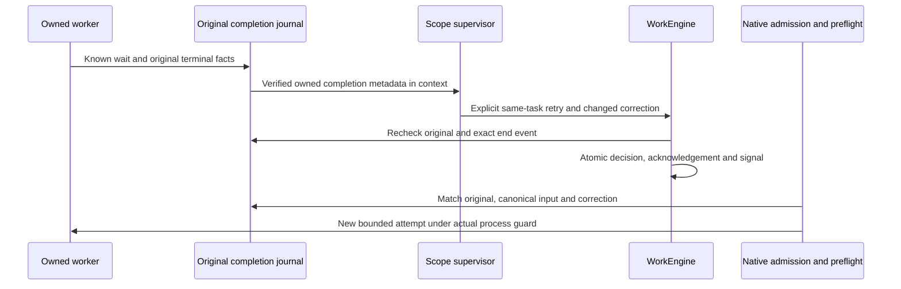
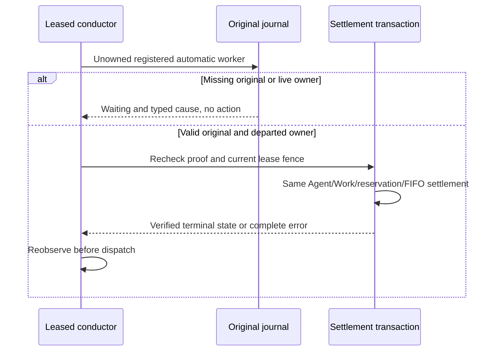
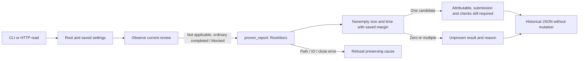
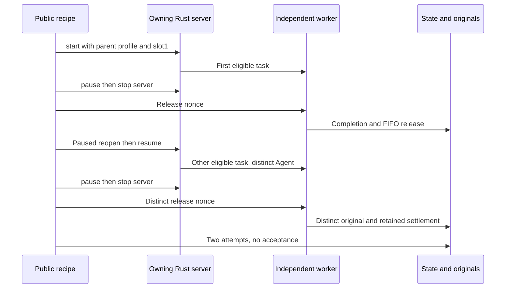
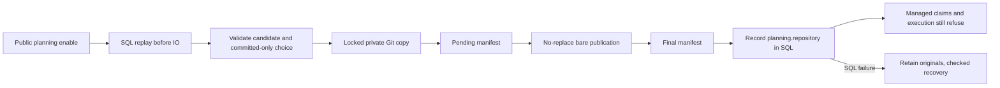

# Native worker completion and retry

Linux implementation verified on isolated native fixtures in migration lot169. The existing terminal completion journal is a private local trust boundary, not cryptographic actor identity or hostile same-UID writer protection. A dead/missing PID, expired lease or end-event message is never enough to authorize retry.

The readonly observer shares the existing recovery terminal Agent/reservation projection; it does not call recovery, write state or refund an attempt. It checks the original Root identity, full terminal row, normalized ownership, native snapshot/context, recorded kernel reap, workspace release and explicit gate/output disposition. Unknown wait/release or unresolved/draining execution refuses. Known logical output failure can be described for correction, never quality acceptance. A known helper refusal is distinguished from possible provider start; no provider execution is guessed.

`attempt_ended` is matched exactly to the current/prior original attempt, agent outcome and owning scope. Safe `worker_completions` in the selected model context contain event/task/attempt/agent IDs, outcome, original SHA and observed output/start flags; they contain no raw prompt, capture or host/PID stamps. Their bytes participate in the existing context hash and result freshness fence. Older events retain the existing historical acknowledgement-only contract.

Only explicit supervisor retry with a new correction and saved task attempt capacity can set the persisted signal. Original completion and canonical decision/input acknowledgement are rechecked before admission and before native execution after the new attempt is recorded. Previous review recovery remains distinct; an unrelated older review cannot authorize retry after a later failed worker. No new task or counter reset bypass is permitted. Lot169 evidence separates the exit0 control, actual exit17, native supervisor decision, second exit0 worker and submitted report. Five pre-model faults (wait, gate, terminal projection, invalid JSON and missing original), then unknown wait at preflight refuse without mutation/call/reservation/execution; exact restoration runs the same queued agent. History and originals are preserved, and the new report stays submitted and unaccepted. Interruption, known pre-exec refusal and known logical output failure are represented by the contract, without claiming a positive native scenario for those variants here. No installed delivery or autonomous scheduling is claimed.

Fixture constructors now create their evidence directory and publish unique Root birth attribution before CLI initialization. Binary/output accept path or string; the binary hash is read before temporary Root creation. The marker authenticates no actor and grants no permission. An initialization failure retains its Root path and original channels; an empty temporary directory can remain if the birth-marker write itself fails. This applies to future imports/invocations, not already running Python processes or old unattributed roots; never adopt/delete a root merely by prefix or mtime.

Evidence: [normal profile16](../plans/migration-rust/evidence/20261022-169/normal16/result.json), [full retry19](../plans/migration-rust/evidence/20261022-169/control19/result.json), [refusal/restoration23](../plans/migration-rust/evidence/20261022-169/faults23/result.json), [public recovery21](../plans/migration-rust/evidence/20261022-169/completion21/result.json), [29 tests/Clippy/Rustdoc17](../plans/migration-rust/evidence/20261022-169/quality17/result.json). The permanent recipe is `tools/verification/recipes/native-worker-failure-retry.json`. Tests use inert local programs; authenticated semantic actors, hostile same-UID writers, full concurrent-checkout integration and final cutover remain separate requirements.

Binary qualification: lot170 builds the current shared checkout without the historical telemetry exclusion in a fresh target, then verifies the retry flows above and protected HTTP actions on the same binary. Prior depfiles never preauthorize paths: declared current source/resource producers define candidates; the actual closure must remain identical before/after and be archived. Cargo reporting a cache as fresh does not prove that binding. Recipe: `native-profile-cache-integrity.json`, with a synthetic origin guard reproduced red then green, separate from the actual native build. This proves neither console/telemetry visual behavior, installed delivery nor full parity.

## Candidate1232: conductor lease-fenced completion recovery
CLI/web conductors may inspect registered automatic workers without a local
child handle; they never relaunch them. Missing receipts and a live original
supervisor return explicit waiting with retained typed causes; invalid originals
remain errors. Recovery rechecks original proof and actual owner departure, then
checks the current lease inside the shared Agent/Work/reservation/FIFO settlement
transaction. Terminal success/replay proves neither a new commit nor acceptance.
Continuation is reobserved before dispatch. Generic queued cancellation is never
called. Owned workers retain their original lifecycle; its failure is not hidden.
This ports native completion journal recovery, not planning.repository managed
settlement, which remains explicitly refused. Public qualification is pending;
no installation, restart or independent acceptance is established.

Lease-guarded settlement also records provenance for the new task.update event
and rechecks the lease after readback, within the same transaction. No new
operator policy: cadence, storage retry and lease use existing persisted settings.
The terminal Agent is boxed as a Rust representation, with no JSON change.
The maintained `mission-worker-completion-recovery.json` recipe covers a real
healthy control, SQL refusal, missing original, kernel_reaped=false, incomplete
output, wrong Agent/version and exact restoration. Historical HTTP status still
refuses blocked/completed pairs without a current review; HTTP show and native CLI
status are distinct readable surfaces. Repository settlement, acceptance and
installation are not established by this evidence.

Local verification1256: [evidence and limits](../plans/migration-rust/evidence/20261024-worker-recovery1230/decision1253/result.json).
202 targeted Rust tests pass (one additional optional test is ignored because its
dedicated ledger fixture was not supplied); engine/CLI/web Clippy and Rustdoc pass.
Recovery/registered/web recipes pass with verified evidence archives. Normal
profile1249 has no fixture feature; no installation or independent acceptance.
A departed original supervisor and present journal never suffice: the settlement
producer revalidates the entire Agent and its resources before mutation. Waiting
authenticates no owner and grants no permission.

## Historical status of an unsubmitted result (candidate1263)
A nonmanaged planned blocked task with a completed Agent can now be presented
without a current review, excluding incomplete delivery. Historical CLI/HTTP
status observes Root docs reports, matching Go; it does not substitute the Agent
workspace. A single nonempty sufficiently recent candidate is attributable, with
no authorship or quality proof. Missing/old/ambiguous candidates remain unproven
results with explicit reasons; path/IO/close failures remain errors.
The margin uses persisted, validated agent_report_clock_skew_seconds, editable
through existing Admin/API/CLI settings. Zero requires mtime at/after start;
a larger value may admit an older report. Status never submits a report, changes
a task or grants execution. Reviews, incomplete deliveries and repositories
retain their own contracts/refusals. This port supersedes the1256 completed/blocked
limitation above; qualification is pending and nothing is installed. Historical
1256 evidence is preserved.

Local verification1283: [evidence and limits](../plans/migration-rust/evidence/20261024-status-unsubmitted1260/decision1281/result.json).
105 engine status tests and44CLI tests, Clippy and engine/CLI/web Rustdoc pass.
Two public recipes (recovery+attribution and reviews/explicit acceptance) pass
with verified evidence integrity. Ten CLI/HTTP reads prove result classification
and saved margin0→2 without mutation. Public mission stop quiesces the fixture
before these reads: a concurrent heartbeat may still refuse the coherent snapshot,
as retained1269 demonstrates. Normal profile1279 has no fixture feature and is
not installed; independent/global review remains open.

## Two successive tasks using a saved parent profile

The permanent `native-two-task-mission` recipe launches two real inert processes
through the Rust HTTP server, without manual Agent preparation. Public planning
explicitly delegates two tasks; `mission start` saves the parent profile and
`resume` reuses it. The fixture uses one slot and a shared workspace: this proves
controlled sequential execution, not concurrent workers. Planning is paused using
its public operation.

For each task the test authenticates the Unix peer, processes and Root, pauses
the mission, stops its owning server, and releases the worker with a distinct
nonce. It requires one completed attempt, the retained estimated reservation,
exactly one FIFO release, and a completion original bound to the same
Agent/task/attempt/lease. The remaining task must still be `todo` without an
attempt before `resume`. A final paused reopen preserves both Agents without a
third launch. Local provider markers are retained byte for byte before removing
those fixture files for the next cycle; no consumption or business state resets.

Both tasks remain `blocked`: process completion and resource settlement establish
neither delivery of declared deliverables, submission, review nor acceptance.
Reports are fixture markers. Provider-reported inert cost is neither an invoice
nor model authentication. No paid call, SQL write, global watchdog, Go or
installation is used. The test reuses normal1279 with unchanged effective build
inputs. Evidence and exact state: [increment1300](../plans/migration-rust/evidence/20261024-two-task1300/PLAN.md).

## Managed repository bootstrap: recorded commit only (candidate1317)

On Linux, public `planning enable` accepts `repository: {"path":"source",
"committed_only":true}` with absent/empty `include_dirty`. Server and CLI share
the same Root mutation. After full candidate validation, the engine reads HEAD
and copies objects into `.swarm/managed/<work>/repository.git` without checkout,
source/index writes or inclusion of uncommitted files. The pure in-memory API
still refuses: only Root observes the actual repository. Initial `base_commit`
and `candidate_commit` identify the same observed commit.

`repository.json.pending` precedes no-replace bare publication and final
`repository.json`. Reuse requires matching request/paths, coherent manifests and
actual canonical commit objects. A missing final manifest can be restored from
its pending original when the bare exists and validates. Pending without bare,
orphan repository, divergent proofs or missing objects refuse with originals
retained; no replacement clone discards prior evidence. Filesystem preparation
survives SQL rollback; public recovery revalidates it. Already recorded SQL events
replay before any IO. Private directories are opened without following symlinks,
held by descriptors and locked; this is not confinement against the same UID.

Git uses saved `git_command_timeout_seconds` and existing Admin/API/CLI validation,
without an inherited90second deadline. Commands are local, with hooks, fsmonitor
and inherited Git variables disabled. Typed errors retain private outputs without
public rendering. No new operator ceiling is introduced. Post-rename sync errors
preserve publication uncertainty; these barriers alone do not prove hardware
crash durability.

This configures the copy only. Dirty snapshots, managed claims/decisions, worker
copies, Git settlement, managed controls and acceptance still refuse. Enablement
launches no model. Planned permanent recipe: `managed-repository-bootstrap`;
source and counterexample: [increment1310](../plans/migration-rust/evidence/20261024-managed-bootstrap1310/PLAN.md).

Local verification1330:7public CLI/HTTP assertions,2storage tests and6planning tests,
nonmanaged provider bootstrap, Clippy and Rustdoc pass. Final-manifest publication
refusal preserves bare/pending originals; public recovery restores the manifest,
without publishing Work on refusal. SQL trigger1320 was rejected during open and
did not exercise that path; its original proof and PATH-selection fault1323 remain
retained. Normal1319 has no fixture feature, is not installed;
[evidence/limits](../plans/migration-rust/evidence/20261024-managed-bootstrap1310/decision1330/result.json).

## Native planning on a prepared repository (candidate1345)

The planner can now acknowledge inputs, delegate and create tasks on a prepared
managed repository. The engine reobserves manifests/baseline and commit objects
at claim, before call permission and at decision. Scoped context and its freshness
comparison bind the same candidate revision, project subdirectory and implemented
`delegate`/`task` operations. Source/storage paths and unavailable Git list/read
tools are not advertised. Existing budgets, leases, delivered inputs, workflows
and organization guards remain authoritative; matching holder fields is not an
authenticated principal.

This supersedes1330's unported repository claim for this branch only. Other
managed decisions, worker copies/launch, settlement, controls, review and acceptance
still refuse. The operation list describes implemented protocol capability, not
hidden operator policy. Prompt metadata is neither OS access nor future permission.
Local qualification pending: [increment1340](../plans/migration-rust/evidence/20261024-managed-planning1340/PLAN.md).

`included` list equality follows its Go JSON contract: empty and omitted lists
are equivalent; nonempty ordering stays intact. Normalization is in memory and
preserves original manifest bytes. Counterexample1358 showed recovery refusal
with `include_dirty: []`; shared fix1359 also covers equivalent final/pending
manifests. The bare copy contains the parent Git repository's objects/history;
`project_subdir` identifies the project directory within that repository.
Historical Go-prepared repositories still require permission/lock qualification;
the current journey covers Rust-prepared copies without implicit adoption.
See [legacy scope and resumption](../plans/migration-rust/evidence/20261024-managed-planning1340/LEGACY-SCOPE.md).

Local verification1365: both permanent recipes pass (14named assertions), along
with3storage/manifest tests and5scoped tests; Clippy, Rustdoc and nonmanaged preview
pass. The empty list first reproduced refusal on1354;1361 then recovers the same
Root/event/original without replacement mission or proof rewrite. Normal1361 has
no fixture feature and is not installed.
[Exact evidence and limits](../plans/migration-rust/evidence/20261024-managed-planning1340/decision1365/result.json).
Worker copies and their settlement chain remain unported; no independent/global
acceptance follows from these results.

## Initial status of a managed repository mission
Historical status can present the saved automatic profile for initial `todo`
tasks without attempts. Following Go `profileFor`, occupancy uses
`<storage>/copies/<task>-1/<project_subdir>` rather than the parent profile workspace.
The first ordinal is an addressing invariant, not a new attempt limit or timeout.
Existing saved slots, cost, budget, dependency and pause controls remain authoritative.
Invalid path metadata refuses without returning a partial status.

This read neither verifies nor creates the prospective copy, starts a worker, nor
reserves budget. Recorded consent without an active conductor remains visibly
waiting. Historical classification grants no launch permission: managed worker
launch and settlement still refuse. Maintained recipe: `managed-native-planning.json`,
including two actual tasks, absent copies/agents, and unchanged Work, spending and
provider markers. Qualification and limits: [increment1370](../plans/migration-rust/evidence/20261024-managed-status1370/PLAN.md).
