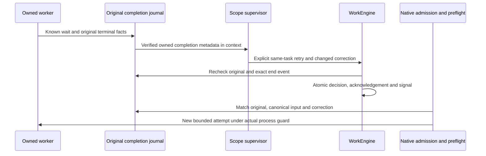

# Native worker completion and retry

Linux implementation verified on isolated native fixtures in migration lot169. The existing terminal completion journal is a private local trust boundary, not cryptographic actor identity or hostile same-UID writer protection. A dead/missing PID, expired lease or end-event message is never enough to authorize retry.

The readonly observer shares the existing recovery terminal Agent/reservation projection; it does not call recovery, write state or refund an attempt. It checks the original Root identity, full terminal row, normalized ownership, native snapshot/context, recorded kernel reap, workspace release and explicit gate/output disposition. Unknown wait/release or unresolved/draining execution refuses. Known logical output failure can be described for correction, never quality acceptance. A known helper refusal is distinguished from possible provider start; no provider execution is guessed.

`attempt_ended` is matched exactly to the current/prior original attempt, agent outcome and owning scope. Safe `worker_completions` in the selected model context contain event/task/attempt/agent IDs, outcome, original SHA and observed output/start flags; they contain no raw prompt, capture or host/PID stamps. Their bytes participate in the existing context hash and result freshness fence. Older events retain the existing historical acknowledgement-only contract.

Only explicit supervisor retry with a new correction and saved task attempt capacity can set the persisted signal. Original completion and canonical decision/input acknowledgement are rechecked before admission and before native execution after the new attempt is recorded. Previous review recovery remains distinct; an unrelated older review cannot authorize retry after a later failed worker. No new task or counter reset bypass is permitted. Lot169 evidence separates the exit0 control, actual exit17, native supervisor decision, second exit0 worker and submitted report. Five pre-model faults (wait, gate, terminal projection, invalid JSON and missing original), then unknown wait at preflight refuse without mutation/call/reservation/execution; exact restoration runs the same queued agent. History and originals are preserved, and the new report stays submitted and unaccepted. Interruption, known pre-exec refusal and known logical output failure are represented by the contract, without claiming a positive native scenario for those variants here. No installed delivery or autonomous scheduling is claimed.

Fixture constructors now create their evidence directory and publish unique Root birth attribution before CLI initialization. Binary/output accept path or string; the binary hash is read before temporary Root creation. The marker authenticates no actor and grants no permission. An initialization failure retains its Root path and original channels; an empty temporary directory can remain if the birth-marker write itself fails. This applies to future imports/invocations, not already running Python processes or old unattributed roots; never adopt/delete a root merely by prefix or mtime.

Evidence: [normal profile16](../plans/migration-rust/evidence/20261022-169/normal16/result.json), [full retry19](../plans/migration-rust/evidence/20261022-169/control19/result.json), [refusal/restoration23](../plans/migration-rust/evidence/20261022-169/faults23/result.json), [public recovery21](../plans/migration-rust/evidence/20261022-169/completion21/result.json), [29 tests/Clippy/Rustdoc17](../plans/migration-rust/evidence/20261022-169/quality17/result.json). The permanent recipe is `tools/verification/recipes/native-worker-failure-retry.json`. Tests use inert local programs; authenticated semantic actors, hostile same-UID writers, full concurrent-checkout integration and final cutover remain separate requirements.

Binary qualification: lot170 builds the current shared checkout without the historical telemetry exclusion in a fresh target, then verifies the retry flows above and protected HTTP actions on the same binary. Prior depfiles never preauthorize paths: declared current source/resource producers define candidates; the actual closure must remain identical before/after and be archived. Cargo reporting a cache as fresh does not prove that binding. Recipe: `native-profile-cache-integrity.json`, with a synthetic origin guard reproduced red then green, separate from the actual native build. This proves neither console/telemetry visual behavior, installed delivery nor full parity.
