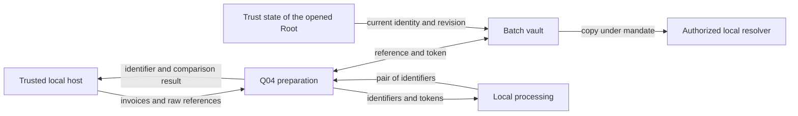

# P02 tokens and correspondence vault

[Français](../architecture/P02-TOKEN-VAULT.md)

The Linux Rust engine exposes `RootStore::open_p02_vault` to a trusted local
host. The host owns one vault per batch, substitutes the selected field before
handing data to the agent, and sends only the authorized projection.
For the Q04 invoice draft flow, the host calls
`RootStore::prepare_p02_invoice_batch`. The adapter prepares input and drafts
in memory. Transport, draft publication and pilot execution require separate
decisions. Raw values stay within the local Rust API.

- **Open and issue.** An authenticated I3 Trust administrator selects the logical
  project, batch, audience and current local resolver. The issuer supplies a
  positive lifetime, a total alias limit and a maximum value size in bytes.
  Terms are local to the vault. They add no global settings, defaults or
  persistence. Opening a vault grants no BLP clearance.
- **Mapping.** The issuer submits the value before agent exposure. The same
  value in one active vault receives the same alias. A fresh alias encodes
  32 bytes of OS randomness as unpadded base64url. Other vaults own their
  mappings. Deduplication scans the bounded table under host control.
  Collisions, entropy failure and limit violations reject issuance.
- **Resolve.** The engine reauthenticates the principal and checks the instance
  mandate, exact context, current Trust revision and monotonic deadline.
  Authorization and copying take place under the opened Root's Trust
  reservation. Only the resolver receives the copy, which is zeroized at drop.
  Debug hides the contents and length. The caller must use explicit `as_bytes()`
  access to read the bytes.
  The trusted host owns the physical destination's identity and use of the
  returned copy. The issuer has lifecycle authority and must be named as
  resolver to obtain a copy.
- **Withdraw and reopen.** The authenticated issuer can withdraw one alias or
  revoke the mandate. A withdrawn alias leaves a value-free entry within
  the total alias limit to prevent reissue. Rust's exclusive borrow orders
  vault mutations. The Trust reservation orders configuration changes.
  Closing the vault or process destroys its mapping. Vault-owned buffers
  are zeroized at drop. Past resolutions, caller allocations, process memory
  and reidentification require separate assessment.

Resolution returns typed errors without raw values. A reservation close failure
withholds the copy. After expiry or a Trust revision change, the issuer can
withdraw values if still authorized, or the host can drop the vault. Reopening
requires a new mandate and new associations. Resolution grants no publication
authority.

## Preparing the reconciliation draft

The host approves invoice identifiers for disclosure, supplies sensitive
account references, bounds the number of rows and provides the P02 mandate
terms. Invoice identifiers must be valid and unique. An invalid row or Trust
refusal drops the partial vault. `project_for_agent` returns only
`invoice_id` and `account_token` to the issuer under a current mandate.
Token equality is visible within the batch.

The processor proposes two distinct invoice identifiers. The host calls
`prepare_draft` with the context and authorized resolver. The engine checks both
aliases under one Trust reservation and computes equality. The draft contains
only `invoice_id` and `account_matches` for the mandate audience. It triggers
no delivery or PAEA settlement. The host retains responsibility for release
authority and for the actual receiver.

`resolve_account` remains a separate local operation. Account withdrawal
covers all invoices sharing an alias. A later full projection and affected
drafts refuse. Mandate withdrawal or a change of the Trust revision also
refuses operations requiring the mandate. Recovery creates a fresh batch
from data the host remains authorized to use.

## Verification

The [p02-token-vault recipe](../../tools/verification/recipes/p02-token-vault.json)
exercises the public Rust API with fictional invoices in an isolated Root. It
requires Linux, locked Cargo, an admitted build target and qualified scratch space.
It covers alias scope, principal/project/batch/audience mismatches, expiry, alias and
mandate revocation, stale Trust revisions and reopening. The P02 DAT and
directives D03, D06 and D10 retain the original proposal and pilot conditions.
The draft test checks both serialized schemas, shared and distinct aliases, the
computed result, refusals without delivery to an inert receiver, and recovery
from a partially prepared batch.
