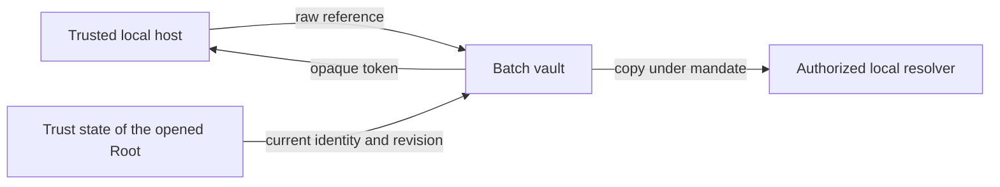

# P02 tokens and correspondence vault

[Français](../architecture/P02-TOKEN-VAULT.md)

The Linux Rust engine exposes `RootStore::open_p02_vault` to a trusted local
host. The host owns one vault per batch, substitutes the selected field before
handing data to the agent, and sends only the authorized projection. A business
adapter must supply the last two operations. Invoice ingestion, provider calls
and publication have no vault integration, and values have no HTTP or CLI route.

- **Open and issue.** An authenticated I3 Trust administrator selects the logical
  project, batch, audience and current local resolver. The issuer supplies a
  positive lifetime, a total alias limit and a maximum value size in bytes.
  Terms are local to the vault. They add no global settings, defaults or
  persistence. Opening a vault grants no BLP clearance.
- **Mapping.** The issuer submits the value before agent exposure. The same
  value in one active vault receives the same alias. A fresh alias encodes
  32 bytes of OS randomness as unpadded base64url. Other vaults own their
  mappings. Deduplication scans the bounded table under host control.
  Collisions, entropy failure and limit violations reject issuance.
- **Resolve.** The engine reauthenticates the principal and checks the instance
  mandate, exact context, current Trust revision and monotonic deadline.
  Authorization and copying take place under the opened Root's Trust
  reservation. Only the resolver receives the copy, which is zeroized at drop.
  Debug hides the contents and length. The caller must use explicit `as_bytes()`
  access to read the bytes.
  The trusted host owns the physical destination's identity and use of the
  returned copy. The issuer has lifecycle authority and must be named as
  resolver to obtain a copy.
- **Withdraw and reopen.** The authenticated issuer can withdraw one alias or
  revoke the mandate. A withdrawn alias leaves a value-free entry within
  the total alias limit to prevent reissue. Rust's exclusive borrow orders
  vault mutations. The Trust reservation orders configuration changes.
  Closing the vault or process destroys its mapping. Vault-owned buffers
  are zeroized at drop. Past resolutions, caller allocations, process memory
  and reidentification require separate assessment.

Resolution returns typed errors without raw values. A reservation close failure
withholds the copy. After expiry or a Trust revision change, the issuer can
withdraw values if still authorized, or the host can drop the vault. Reopening
requires a new mandate and new associations. Resolution grants no publication
authority.

## Verification

The [p02-token-vault recipe](../../tools/verification/recipes/p02-token-vault.json)
exercises the public Rust API with fictional invoices in an isolated Root. It
requires Linux, locked Cargo, an admitted build target and qualified scratch space.
It covers alias scope, principal/project/batch/audience mismatches, expiry, alias and
mandate revocation, stale Trust revisions and reopening. The P02 DAT and
directives D03, D06 and D10 retain the original proposal and pilot conditions.
