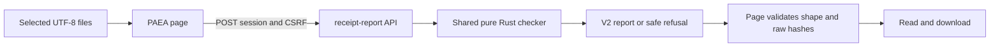
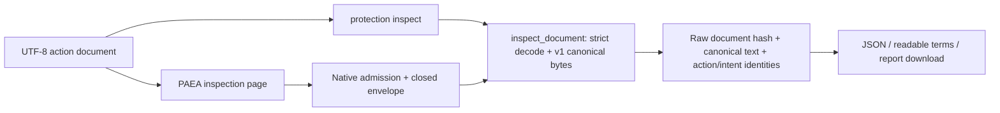

# PAEA v1 data contract

[Français](../architecture/PAEA-CONTRACT.md) ·
[Plan and execution state](plans/actions-confiance/PAEA-APEX.md)

## Current capability

The [PAEA plan](plans/actions-confiance/PAEA-APEX.md) retains delivered versions,
evidence and limits for every increment. The **Version and what's new** dialog
and actual process hash establish the local identity to verify.
[Increments60](plans/actions-confiance/paea/INCREMENT-60.md) and
[61](plans/actions-confiance/paea/INCREMENT-61.md) describe atomic process/pidfd
creation and canonical single-packet response: library-verified and locally
delivered alongside existing native journeys. They establish no protected daemon
or complete peer admission.

Private preparation, operator-package creation/recovery and service export are
tracked in increments54–57. They create no OS account, human identity or current
business mandate. Actual account separation, confinement, protected effect services
and end-to-end acceptance remain open; PA02 is partial and the17global invariants
are not established. See [Linux prerequisites](PAEA-LINUX-PREREQUISITES.md) for APIs
and remaining conditions. Historical evidence below retains its dated scope.

## Historical increment15 evidence

On October 26, 2026, the user authorizes compilation and push, lifting the earlier
restriction. Eight PAEA Rust targets (45 tests) and five schema tests pass,
including native HTTP. Browser verification exercises the real executable and
embedded resources: 12 configurations, 237 assertions, 24 expected refusals,
no unexpected diagnostics. This establishes the correspondence journey, without
protected authority/approval, receipt authenticity or business effect. Delivery
identity is tracked in [increment 15](plans/actions-confiance/paea/INCREMENT-15.md).
“Source-only/uncompiled” statements in dated stages below describe historical
evidence and do not represent the current qualification state.

`swarm protection canonicalize --input FILE|- --json` checks `{proposal, context}`
and computes canonical bytes, action digest and business-intent identity. It is
**offline**: no Root, credential, mandate, approval or effect. A `--root` other than
`.`, `--server`, nonempty `--output`/`--task` and a phase other than `delivery` refuse. `--lang fr|en` affects
diagnostics, not JSON codes or data. Output explicitly states
`authority:"not-established"` and `scope:"offline-data-only"`.

Caller-supplied context stays unauthenticated. Protection API, effect services
and activation are not implemented by this increment. `protection commit`,
`approve` and `config-apply` refuse. The shared `swarm-protection-contract` Rust
crate has no engine dependency or OS access and changes no historical Trust bytes.
Delivery 15 qualified these commands on the native profile and installed dev80.
The historical build restriction was lifted; earlier evidence retains its
original scope.

## Representation and validation

`schemas/paea/contract-v1.schema.json` describes document/proposal/context/approval/
receipt shapes. Raw decoding and semantic validation additionally require:

- Schema1; unknown/duplicate fields refused at every nesting level, including
  Unicode-equivalent decoded field names.
- Valid UTF-8/Unicode escapes; no floats/exponent notation in numeric fields.
  Existing parser nesting protection remains; no operator size policy is added.
- Existing identifiers: 1–100 ASCII alphanumeric/hyphen/underscore bytes. SHA256
  digests are 64 lowercase hexadecimal characters.
- Positive payment amount as an exact canonical decimal string, no sign/leading
  zero, at most `9223372036854775807` for the existing i64 representation. This is
  not a monetary policy. Three uppercase currency letters establish no ISO support.
- Direct `refs/heads/` branch grammar; nonzero distinct same-algorithm lowercase
  SHA1/SHA256 OIDs. The future service must check physical repository and symbolic
  references separately.
- Positive i64 mandate/policy revisions; existing I0–I3 integrity representation;
  policy-defined confidentiality labels grant nothing. Duplicate source/version
  keys or labels refuse.

JSON Schema alone cannot prove invoice existence, semantic equivalence, a decimal
string's i64 bound, OID algorithm equality or source/version key uniqueness. The
decoder enforces additional representation invariants. Protected consumers owe
all actual authority/resource/effect checks.

## paea-json-v1 canonicalization

Dedicated profile, not an RFC8785/JCS conformance claim. ASCII schema keys sort
lexicographically; no insignificant spaces; serde_json UTF-8 string escaping;
exact integers and ordered arrays. No implicit Unicode/URL/path/alias normalization.

Canonical body contains `schema_version`, `canonicalization`, `action`, `context`.
Transport `request_id` is excluded. Context source order is significant; source
confidentiality labels are a sorted set. Action digest is SHA256 of the exact bytes.
Changed amount/account/version/candidate/source/principal/instance/mandate/policy/
manifest changes approval-bound content.

Intent is SHA256 of `paea-intent-v1\n` plus canonical JSON:

| Domain | Derived business key |
|---|---|
| `payment.settle` | project, kind, invoice ID |
| `repository.promote` | project, kind, repository, direct ref, expected old OID |

New request keys, amounts, invoice versions, policies or candidates do not create
a new intent for the same key. A different project or expected Git base does.
**Computing this key enforces no uniqueness**: the future effect service must
reserve it and resolve differing-content conflicts. Resource identity remains an
unproven claim until resolved by its protected owner.

`matches_approval` compares valid binding action/policy digests only. No signature,
approver authority, separation, expiry, attention, current mandate or effect check.
Decoded receipt bytes authenticate no observation.

## Lifecycle and future interfaces

Pure transition checking refuses UNKNOWN→DENIED, UNKNOWN→COMMITTED and
UNKNOWN→COMMIT_REQUESTED. Only explicit reconciliation observations reach
RECONCILED_COMMITTED/RECONCILED_NOT_COMMITTED. Terminal states cannot mutate;
reading historical results is separate. Constructing a Rust event proves nothing.

PA-01 reserves future common CLI/API operations: `show`, `inventory`,
`config-preview`, `config-apply`, `mandate-create`, `mandate-delegate`,
`mandate-revoke`, `request`, `approve`, `commit`, `reconcile`, `export`, `verify`.
These are unavailable in today's `protection` namespace. Both UIs/API must consume
the same protected producers; caller-selected Root/storage must establish no authority.

## Verification limits

Fourteen retained vectors in `tests/fixtures/paea/contract-v1.json` were generated
from the specification by Python before Rust execution. This local canonicalization
comparison is not the independent second effect boundary required for E3. PA-01
tests prove no distributed T01…T22 campaign, confinement or global assurance level.

Permanent recipe: `tools/verification/recipes/paea-contract.json`. Errors keep safe
static diagnostics and typed causes. CLI input reuses existing technical limits;
output/flush failures stay nonzero with no project effect to reconcile.

### Public recipe without compilation

`tools/verification/recipes/paea-public-existing-binary.json` runs fourteen
public tests on an **already built binary**, without Cargo, build or restart.
The caller explicitly supplies `SWARM_PAEA_TEST_BINARY`, its SHA256 in
`SWARM_PAEA_TEST_BINARY_SHA256` and a fresh `SWARM_PAEA_TEST_TRANSCRIPT` path.
Missing prerequisites refuse before collection. The transcript retains original
input/output bytes and exit codes for every invocation; binary bytes are checked
before/after the recipe. This establishes neither its compiler graph nor installation.

All fourteen vectors use stdin/file inputs in FR/EN. Sixteen raw mutations cover
duplicates, Unicode-equivalent keys, ambiguous numbers, trailing JSON, forged
authority, mixed OIDs and Git no-op. Each fault has a valid control and recovery
in the same isolated root. Equivalent representations keep exact expected bytes.
`/dev/full` exercises nonzero output failure. This recipe requires Linux with that
device available.

Internal GLM decoder review is a targeted static contribution, with no model-run
checks or E3 independence. Suggested cases are adapted to the actual schema and
verified by the principal. See the
[increment 02 record](plans/actions-confiance/paea/INCREMENT-02.md).

The recipe also checks both domains in FR/EN: unavailable active operations and
incompatible root/server/output/task/phase options must refuse. Explicit
`--root . --phase delivery` remains accepted. Missing inputs, directories and
empty JSON (stdin/file) preserve refusal codes with valid control and recovery.
No server starts; routing checks do not establish protected-project mediation.
See [increment 03](plans/actions-confiance/paea/INCREMENT-03.md).

Eight additional tests cover `compare` and `check-receipt`: full reports in both
domains/languages, intent/transport variants, all permitted receipt outcomes,
invalid inputs and bindings, UNKNOWN/terminals, incompatible runtime options and
public write failures with recovery. Every remaining input byte and filename is
checked. Diagnostics match the exact producer field `failure.code`. Input files
and original streams are retained in the transcript. Injected Rust writer flush
failure is separate from public `/dev/full`; this Python recipe does not execute
those Rust tests.

### Separate verification of the offline result

A [correspondence tool](PAEA-CANONICAL-VERIFIER.md) reads document/export, recomputes
canonical bytes/digests/intent and binds consumed files by SHA256. This is a separate
offline consumer, without E3 independence, authentication or semantic admission.
The runtime `protection verify` command remains unavailable.

### Rust comparison under development

Library sources expose `compare_documents`: two strictly validated documents,
value-free changed paths, byte identities and separate content/intent/transport
observations. No approval or effect established. Three Rust tests written, not
executed in this workstream. The CLI adapter exists in an already built candidate;
public observations without a new build are tracked in increment 09. API/UX remained
open at that increment; the current connection is described in increment 19. See [increment 05](plans/actions-confiance/paea/INCREMENT-05.md).

### CLI comparison in source (not qualified)

`swarm-rust protection compare BEFORE AFTER --json --lang en` reads two regular
files using existing transport rules. No stdin for this operation; `./-` denotes
a file named `-`. Incompatible runtime options refuse before reading. Output
contains `scope` and `comparison`; authority/effect/approval-validity markers stay
`not-established`. Descriptive schema: `schemas/paea/comparison-v1.schema.json`.
Sequential reads establish neither atomic snapshot nor freshness. Read/close/
validation/write/flush failures preserve existing error contracts. Four new CLI
Rust tests are written, unexecuted; new build/Rustdoc remain deferred. The public
recipe uses an already built candidate without claiming installation. API/UX not
connected at that increment; the current connection is described in increment 19. See [increment 06](plans/actions-confiance/paea/INCREMENT-06.md).

### Receipt/lifecycle binding — unqualified source

`check_receipt_transition(action, receipt, expected_sink, previous)` validates and
matches exact action/intent/sink, then reuses `State::transition`. UNKNOWN only
accepts explicit reconciliation outcomes; terminal states cannot replay. The pure
check returns a proposed state without mutation/IO. Shape, expected-sink, binding
and lifecycle errors use static codes; no partial report.

Supplied inputs do not become trusted. Matching forged receipts can pass:
signature, independent observation, actual artifact, protected order, last-use
authority and uniqueness remain the protected owner's responsibility. No active
command added. Four Rust tests are written/unexecuted; no new build/install here.
Existing receipt shape/policies unchanged. See
[increment 07](plans/actions-confiance/paea/INCREMENT-07.md).

### Receipt CLI (global qualification open)

`swarm-rust protection check-receipt ACTION RECEIPT SINK PREVIOUS_STATE --json
--lang en` consumes two named regular files: a `{proposal, context}` document
and a receipt in the existing format. `SINK` is the case-sensitive expected
identifier; `PREVIOUS_STATE` uses exact serialized `State` labels, such as
`COMMIT_REQUESTED` or `UNKNOWN`. Reads are sequential, with no atomic snapshot
or freshness proof. `-` and nonempty `--input` refuse; `./-` remains a filename.
Existing incompatible runtime options and state-label syntax refuse before
document reads. No default prior state is chosen.

The adapter recomputes the canonical action, strictly decodes the receipt and
calls `check_receipt_transition`. Output fields are `schema_version`, `scope`,
`action_digest`, `intent_id`, `previous_state`, `proposed_state`, `authority`,
`receipt_authenticity` and `effect`. The final three markers always remain
`not-established`; scope is `offline-data-only`. Sink and observation values are
not copied into the report. Descriptive output schema:
`schemas/paea/receipt-check-v1.schema.json`; schema validation establishes neither
correspondence nor lifecycle validity, which belong to the Rust checker.

Malformed JSON or an invalid state label returns `protection-document-invalid`
with its cause retained. Receipt representation, expected sink, binding and
lifecycle retain their existing codes. Invalid invocation syntax uses the
existing CLI `command_failed` code; read failures retain shared-reader codes.
Write/flush errors can follow partial or complete output, remain nonzero and
establish no protected effect. No project or receipt is mutated and no approval
is activated, even when the report is consistent.

Four targeted integration tests are written in `protection_receipt`: both
domains in FR/EN, refusal/recovery, routing and write/flush failures with retained
causes. Output injection runs in an isolated test process so even an accidental
default-Root opening cannot reach the caller checkout. **No Rust tests executed
or new build** under the user's reconfirmed instruction. API, protected services,
installation and qualification remain open. Public observations on an already
built candidate are tracked in [increment 09](plans/actions-confiance/paea/INCREMENT-09.md).
Historical source record: [increment 08](plans/actions-confiance/paea/INCREMENT-08.md).

### Exact-input receipt report — source-only output schema v2

`swarm-rust protection receipt-report ACTION RECEIPT SINK PREVIOUS_STATE --json`
provides a separate output from `check-receipt`. Both inputs stay schema v1;
only the new report uses `schema_version:2`. `check_receipt_documents` strictly
decodes both inputs, recomputes the canonical action and calls the same binding/
lifecycle checker before constructing output. It reuses `DocumentIdentity` and
the existing SHA-256 dependency; no policy, signature, authority or state write.

The nine v2 output properties are:

- `schema_version:2` and `scope:"offline-data-only"`;
- `document`: exact first-file `document_sha256`, canonical `action_digest` and
  business `intent_id`;
- `receipt_sha256`: exact second-file bytes;
- supplied `previous_state` and the checker's declarative `proposed_state`;
- `authority`, `receipt_authenticity`, `effect`, always `not-established`.

Descriptive schema: `schemas/paea/receipt-report-v2.schema.json`. Formatting,
transport-key or observation-digest changes remain distinguishable in their raw
input identities even when canonical content, intent or proposed state is unchanged.
Hashes prove no signature or truth of a receipt; retain originals and establish
protected provenance separately. Sequential reads give no atomic snapshot or
freshness. No raw business field or sink identifier is added to output; hashes
still need an authorized recipient.

Legacy `check-receipt` keeps its nine v1 properties without implicit additions
or version change. Both routes share framing/state/read/binding/lifecycle errors
and output/flush cause preservation. Output version is a protocol identifier,
not an operator setting or permission. Prior errors produce no report; failed
publication may follow visible bytes without a project effect.

The extension was written without a build in [increment 10](plans/actions-confiance/paea/INCREMENT-10.md).
Since [increment 12](plans/actions-confiance/paea/INCREMENT-12.md), its CLI route is
observed on a **preexisting dev77 candidate**, frozen by SHA256: 18 public tests,
973 invocations including 268 expected refusals. Seven PAEA source inputs match
the retained effective build archive; no build was performed here. Exact raw
receipt/document distinctions and preserved v1 output are checked. These Python
checks do not execute the four library Rust and three CLI Rust tests, which remain
unlaunched. Historical dev75 evidence remains retained. Installation, authenticity,
authority and actual effects are not established.

### UX checks — source integration

The PAEA screen returns directly to the cockpit (`/`); delivery does not depend
on the Biba/Trusted actions module. The cockpit exposes its own entry; adjacent
modules can also link to PAEA.

The Rust cockpit menu and **Trusted actions** page link to **PAEA checks**
(`/paea.html`). Select the action JSON document and receipt, enter the expected
service identifier, choose the previous state and press **Check correspondence**.
No service/state is inferred. Files come from the material under examination;
protected production remains a PA-02/03/09 dependency. This screen neither runs
repository tests nor activates project protection.

The result shows structural correspondence, the state **declared by the receipt**,
four digests and a downloadable v2 report. `UNKNOWN` stays uncertain and permits
no further commitment. Authority, authenticity and actual effect remain not
established. Errors/refusals stay visible with selected files. Editing, refusal
or a new attempt invalidates the earlier report; loading disables inputs and
duplicate submissions. Recovery requires an explicit gesture.



Source integration, without authority or an effect service in this flow.
`POST /api/v1/protection/receipt-report` requires `Content-Type: application/json`
and the closed `http-receipt-check-v1.schema.json` envelope: `schema_version: 1`,
`document`/`receipt` as **strings containing original UTF-8**, `expected_sink`,
`previous_state`. Duplicate/unknown fields, invalid state/version/method, query
or content type refuse. JavaScript never parses inner JSON, preserving large
integers. Invalid UTF-8 refuses locally without replacement; a BOM is preserved
and may subsequently be rejected by the shared decoder. Before export the page
matches raw report hashes against selected bytes. Hashes do not authenticate
the service.

Existing Host/session/origin/CSRF admission and shared technical transport bound;
no new quota, deadline, retry or Admin policy. The API calls
`check_receipt_documents`, as CLI `receipt-report` does, without per-request Root,
mutation or effect. JSON/PAEA causes stay typed, static `failure.code` never echoes
inputs; 400 for data refusal, 403 admission, 405 method and 413 oversized transport.
HTTP delivery failure never becomes success. FR/EN assets for `etat`/`sombre`
belong to the private embedded inventory.

**Native route and actually served bytes remain uncompiled/unexecuted/uninstalled**
under the active instruction. Two `swarm-web --test paea` tests join
`paea-contract`, without launch. Browser verification uses workspace assets with
an explicit HTTP double and does not qualify the native service. Replay without
compilation into fresh directories with existing parents:

```sh
SWARM_PAEA_UI_EVIDENCE=/existing/parent/new-browser \
  python3 tools/verification/recipe.py run \
  --recipe tools/verification/recipes/paea-ux.json \
  --output /existing/parent/new-recipe
python3 tools/verification/recipe.py verify --evidence /existing/parent/new-recipe
```

The recipe covers FR/EN, themes, 1440/1024/760/390/320 px, primary-button contrast,
keyboard, empty/loading, refusal/recovery, UTF-8/hashes, invalidation, export and
unavailable session. No global watchdog or provider call.
Evidence/limits: [increment 11](plans/actions-confiance/paea/INCREMENT-11.md).

### Screen connected to the actual checker without compilation

A second `paea-cli-ux.json` recipe connects workspace screen assets to the existing
CLI through an **HTTP fixture bridge**, separate from the native service. Checker
responses are not fabricated: 174 assertions and 48 actual calls (36 successes,
12 expected refusals), FR/EN, both domains, binding, lifecycle, invalid JSON,
`UNKNOWN`/reconciliation and raw-byte distinctions. No live Root, provider or
effect; each call retains input files and original streams.

Supply `SWARM_PAEA_TEST_BINARY`, its observed `SWARM_PAEA_TEST_BINARY_SHA256` and
`SWARM_PAEA_UI_EVIDENCE` naming a fresh directory, then use the permanent launcher
with `--recipe tools/verification/recipes/paea-cli-ux.json` and a fresh `--output`;
check retained proof with `verify`. No Cargo or global watchdog. The bridge has a
test session and proves neither native Host/session/CSRF admission nor embedded
asset delivery. Two HTTP Rust tests and the actual native journey remain open
under no compilation/restart. After a concurrent catalogue change outside PAEA
labels, the component was separately replayed on current bytes: 219 assertions
and 40 simulated requests PASS. The bridge retains its archived catalogue; see
[increment 12](plans/actions-confiance/paea/INCREMENT-12.md).

## Offline debt resolution — increment 16

`swarm protection resolve-payment REGISTRY REQUEST --json --lang en` uses the
shared pure Rust module. Two named regular files are required; stdin and
incompatible runtime options refuse before reads. Versioned examples are
`tests/fixtures/paea/payment-registry-v1.json` and `payment-request-v1.json`.
Schema: `schemas/paea/payment-resolution-v1.schema.json`.

The registry contains `schema_version:1`, `project_id`, positive i64 `revision`,
and `debts`. Each debt supplies `debt_id`, `supplier_id`, nonempty
`invoice_references`, `invoice_version`, `amount_minor`, `currency` and
`beneficiary_account_id`. The request supplies `schema_version:1`, `request_id`,
`project_id`, `supplier_id`, `invoice_reference`, `expected_registry_revision` and
`expected_invoice_version`. All objects are closed; duplicate JSON keys and floats
refuse. Names and settlement terms use the existing v1 grammar with no new
operator ceiling. The entire snapshot is validated before selection: unique debt
IDs and supplier/reference pairs, including unrelated rows. No fuzzy lookup,
normalization or automatic merging.

The v1 report contains `proposal` (v1 proposal with `invoice_id=debt_id`),
`registry_revision`, exact SHA256 `registry_sha256`/`request_sha256`,
`scope:"offline-data-only"`, and `authority`, `registry_authenticity`, `effect`
all set to `"not-established"`. The proposal has no context: a protected producer
must check the project and bind its registry observation into context before
canonicalization/approval. Hashes establish neither signatures nor freshness.
Corrected terms retain `debt_id`, change exact content and preserve v1 intent.
The v1 hash is unchanged.

Safe codes: `protection-registry-identifier`, `protection-registry-ambiguous`,
`protection-registry-project-mismatch`, `protection-registry-stale`,
`protection-registry-reference-unknown`, `protection-invoice-stale`, plus shared
representation errors. Refusal yields no proposal; obtain attributed current data,
correct and explicitly rerun. Read/write/flush retain their causes; output failure
may expose partial/complete JSON, never a settlement. Independent snapshots prove
neither ID continuity nor absence of semantic duplicates with disjoint references.
Protected PA-02/03 remain open.

## Invoice resolution in PAEA checks — increment 17

From the cockpit: **PAEA checks → Resolve an invoice reference** opens
`/paea-payment.html`. Select the registry/request files above, then **Resolve
reference**. Collapsed help explains their roles. Results show debt, invoice
version, integer amount in minor units/currency, beneficiary account, revision
and hashes. Downloading the raw report creates no admission context, approval
or settlement. Links between these views preserve language/theme; an explicit
return keeps receipt correspondence available.

`POST /api/v1/protection/resolve-payment` requires native Host/session/origin/CSRF,
JSON, no query and the existing transport bound. Closed envelope:
`{schema_version:1, registry:String, request:String}`. Strings are original UTF-8
JSON, never parsed objects or server paths. Schema:
`schemas/paea/http-payment-check-v1.schema.json`. The route returns the exact
`payment-resolution-v1` report from the same resolver as the CLI. Transport/JSON/
resolution failures preserve typed causes and safe codes; no partial report or
per-operation Root mutation.

The browser uses fatal UTF-8, preserving BOM/input numbers. For the report i64
revision it retains the numeric lexeme through JSON decoding context; this text
is internal to presentation. Incapable browsers refuse and suggest the CLI.
Downloads preserve original JSON, with integer `registry_revision`. Amounts stay
integer strings; no currency scale is inferred. Closed shape, v1 representation
bounds, non-authority markers and both raw file hashes are checked before
rendering/downloading. Refusal retains file selections, clears stale results and
requires a new explicit gesture. No retry, browser document persistence, operator
setting or additional business ceiling is introduced.

This does not deliver a protected registry: authenticity, ID continuity, freshness,
human approver and actual commitment remain PA-02/03.

### JSON refusals and original input bytes — maintained checks

Envelope version must be an integer; duplicate fields refuse even when values
conflict or JSON escapes spell the key. Public error messages and refusal bodies
retain a safe code; internal consumers keep the typed JSON cause without exposing
received values. A revision beyond i64 refuses without rounding. The browser
does not strip an initial BOM: transported unchanged, it is refused by the JSON
decoder. `paea-glm-regressions.json` and `paea-invoice-encoding.json` retain these
cases, valid controls and recovery; see [increment 18](plans/actions-confiance/paea/INCREMENT-18.md).


## Compare two actions in PAEA checks — increment 19

From the cockpit: **PAEA checks → Compare two actions** opens
`/paea-compare.html`. Choose two UTF-8 JSON documents, each containing a v1
proposal and its context, then **Compare actions**. Collapsed help describes the
format; links retain language and theme. Results show changed field names (never
their values), before/after identities, and canonical-content, intent and request-key
change flags. The download button preserves the original JSON report.

`POST /api/v1/protection/compare` requires native Host/session/origin/CSRF guards,
POST JSON, no query and the shared technical transport bound. Its closed envelope
`{schema_version:1,before:String,after:String}` carries the original texts, never
server paths or parsed JSON objects. Admission schema:
`schemas/paea/http-comparison-check-v1.schema.json`. Output is exactly
`protection compare BEFORE AFTER --json`: v1 envelope, `scope:"offline-data-only"`
and v1 `comparison`. The shared pure comparator neither reads nor mutates Root
and adds no operator policy.

Each side retains the raw-byte SHA256, action digest and intent ID. Whitespace
and key order may change the raw hash without changing canonical content; source
order is significant. A different request key alone changes neither canonical
content nor intent. Authority, effect and approval-validity markers remain
`not-established`: equality validates no approval, identity, origin or effect.

The browser preserves UTF-8 bytes and input integers without parsing them.
Before rendering/export it validates closed report shape, versions/markers,
SHA256 identities, known sorted unique paths, flag consistency and both uploaded
file hashes. Field names render as translated text. Refusal retains selections,
clears stale output and requires an explicit new gesture; no retry or document
persistence. JSON/semantic errors retain their internal cause and a safe public
code; partial output is never displayed as success.

`paea-comparison-http.json` covers two schema tests and the seven shared HTTP
tests. `paea-native-ux.json` separately qualifies all three views on an identified
native binary, FR/EN, both themes and three widths. Browser-only corrupt-response
injections stay distinct from actual service responses. Results, delivery and
limits: [increment 19](plans/actions-confiance/paea/INCREMENT-19.md).


## Try all three pages with examples — increment 20

Each page has collapsed **Download fictional examples** help. Expand it, download
the files for one domain, select them in the form and explicitly run the check.
Downloading neither fills fields nor starts a check. Files are fixed fictional
data, containing no project content, authenticated approval or actual-effect proof.

- Correspondence: `payment-document.json` + `payment-receipt.json`, or
  `git-document.json` + `git-receipt.json`. Enter `sink-paea-example` as expected
  service and select `COMMIT_REQUESTED` as declared previous state. The receipt
  declares `COMMITTED`, without establishing an actual commitment.
- Resolution: `payment-registry.json` + `payment-request.json`. Expected result:
  debt `debt-17`, with authenticity/authority/effect not established.
- Comparison: the earlier action document as before, then `payment-after.json`
  or `git-after.json` from that domain as after. Terms change; intent and attempt
  key remain identical.

Eight exact `/paea-examples/v1/<name-above>` routes are embedded in the executable
and use the pages' native admission. GET returns versioned JSON bytes, HEAD the
type without a body. Production does not look up files on disk or produce them
from Root. No free path or new operator ceiling. These downloads require the
native session; their fictional content is not a business secret.

`python3 tools/paea/make_examples.py` regenerates them from named contract vectors
and the existing registry/request fixtures; `--check` compares all eight exact
outputs without writing. IO failure is visible; replacement is atomic per file,
not across all eight. After interruption, regenerate and check before building.
`paea-example-assets.json` checks generation, shapes/links and native admission;
`paea-native-ux.json` checks completed downloads then actual uploads/checks.
Results and limits are separate in [increment 20](plans/actions-confiance/paea/INCREMENT-20.md).


## Inspect an action — increment21

**PAEA checks → Inspect an action** opens `/paea-inspect.html`. Select one
`{proposal,context}` document then **Inspect action**. Results expose exact terms,
declared context and ordered sources. Mandate/policy revisions retain exact i64
text; amounts stay integer minor-unit strings, with no currency scale inferred.
Empty sources are explicit. Help/examples stay collapsed; existing fictional
examples for both domains are reused without implicit loading.

The shared pure `inspect_document` report is consumed by `protection inspect
--input FILE|- --json` and `POST /api/v1/protection/inspect`. Closed HTTP envelope:
`{schema_version:1,document:String}`; native Host/session/origin/CSRF, POST JSON,
no query and the common technical transport bound. CLI keeps incompatible
Root/server/output/task/phase refusals and opens no Root. Schemas:
`http-inspection-check-v1.schema.json` and `inspection-v1.schema.json`.

Closed v1 output: `schema_version`, `scope:"offline-data-only"`, `document`
(raw file SHA256/action digest/intent ID), `canonicalization:"paea-json-v1"`,
`canonical` (exact UTF-8 text), plus `authority`, `effect`, `approval_validity`
all `not-established`. RawValue validates text without number conversion; its
technical crate feature is explicit and introduces no fixture. Canonical bytes,
action/intent preimages and existing canonicalize output stay unchanged. Request
key stays outside canonical content while changing raw file identity.

The browser never parses the supplied document. It validates closed report shape,
markers, uploaded-byte hash and canonical-text hash, then its structured shape.
Canonical revisions use JSON numeric lexemes for exact display; incapable readers
refuse and offer CLI. Terms/context/sources render as text, never HTML. Canonical
content/raw report use separate disclosures; `paea-inspection.json` preserves raw
report bytes. Editing/refusal clears old terms/sources/canonical/export, retains
selected files and requires a new explicit gesture.

Decoding/semantic/read/write/flush/HTTP failures preserve existing causes and safe
public diagnostics; partial output never becomes success. No operator policy,
retry, current authority, human approval or effect is added. Values may be
sensitive: a report/hash does not authorize a recipient or authenticate context.
`paea-inspection.json`, four-view native journeys and actual local evidence:
[increment21](plans/actions-confiance/paea/INCREMENT-21.md).

Delivered flow:




## Compare a supplied approval — increment22

**PAEA checks → Compare a supplied approval** opens `/paea-approval.html`.
Select the `{proposal,context}` action document and a v1 approval-shaped object:
`schema_version`, `action_digest`, `policy_digest`, `approver_id`. Disclosures
explain limits and offer fictional pairs for both domains, with no automatic load.

`check_approval_documents` reuses `decode_document`, `decode_approval`, v1
canonicalization and `CanonicalAction::matches_approval`. CLI:
`protection check-approval ACTION APPROVAL --json`, two named regular files,
no shared stdin or incompatible Root/server/output/task/phase options. API:
`POST /api/v1/protection/check-approval`, closed envelope
`{schema_version:1,document:String,approval:String}` under existing native
Host/session/origin/CSRF and POST/JSON/no-query/technical input guards. No authority,
signature, clock, persistence, account or effect lookup.

Closed v1 report: `schema_version`, `scope:"offline-data-only"`, `document`
(original/action/intent hashes), `approval_sha256`, `binding_matches`,
`mismatched_fields`, `authority`, `approval_authenticity`, `approval_validity`,
`effect`. All four markers remain `not-established`. Different field names are
unique and ordered: `action_digest`, then `policy_digest`. Both equalities are
required for a match; changing the declared approver can still match, because
identity is not verified. Request key/format changes affect raw hash only.

A mismatch is a **negative data report**, CLI0/HTTP200 with `binding_matches:false`,
explicit differing fields and “No approval validated”. It is not an authorization
denial. Invalid inputs refuse without report (CLI2/HTTP400), retaining typed causes
and safe public diagnostics. Browser validates closed shape, markers, boolean/list
consistency and exact original hashes before text-only rendering and exact
`paea-approval-report.json` export. Editing/error/new attempt clears stale result
and export, preserves selected files, and never retries implicitly.

Ten public fictional files are generated by `tools/paea/make_examples.py`; eight
previous files keep exact bytes. Two new `*-approval.json` files are unsigned and
use a fictional approver_id, which is not copied into the report. Schemas:
`http-approval-check-v1.schema.json`, `approval-report-v1.schema.json`. Authenticity,
current rights,expiration,revocation,separation of duties,human attention and effect
still require PA02/03/08,never data equality. [Results and limits](plans/actions-confiance/paea/INCREMENT-22.md).

PAEA primary buttons use shared semantic pairs and switch foreground/background
together across themes. The inherited crossed transition produced a temporary
1.28:1 contrast; it is removed on the common primary component in all five views.
The recipe observes actual frames for two theme changes, without disabling
animation in the test or adding a timed wait.


### Laboratory campaigns — increment23

Verification menu → Laboratory campaigns exposes scenarios and this explicit
repository command (Python/Git, existing exact binary, fresh output with existing parent):

```sh
python3 tools/paea/run_pilot.py --binary /PATH/BINARY --sha256 SHA256 --output /FRESH/DIRECTORY
```

No hidden build, provider, retry or watchdog. Live storage and source trees are
refused. The maintained recipe must PASS and verify before `paea-lab-report.json`
is exported. Failure retains originals and produces no success report; correct
the cause and resume in another fresh directory. Verify originals with
`python3 tools/verification/recipe.py verify --evidence /FRESH/DIRECTORY/recipe`.

The page reads an explicitly selected report locally and exports its exact bytes,
without upload or business request. Closed shape/eight named tests are checked;
authenticity and original evidence are not. Hashes link the binary, recipe result,
declared source inventory and call/oracle index, without signing them. The raw
alias test passes by observing two effects: uniqueness is refuted. Simulated
authority, same UID and separate oracle process with the same author establish no
protected guarantee.0/17invariants,E2/E3 and browser-triggered execution remain open.
[Slice results and limits](plans/actions-confiance/paea/INCREMENT-23.md).
