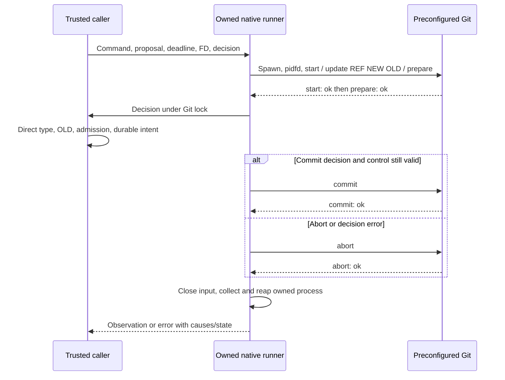
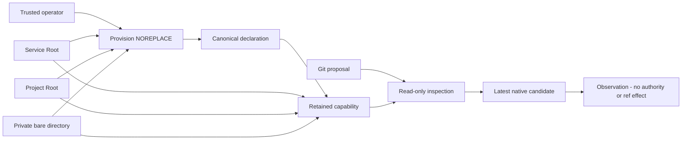

# PAEA Git transaction primitive

[Français](../architecture/PAEA-GIT-TRANSACTION.md)

Linux library API qualified in fixtures: `run_git_reference_transaction`.
It composes the owned native runner with nonblocking input and strict Git ACK
parsing. It provides no PAEA effect service, protected repository, admission,
durable intent or public Git publication workflow.

## Inputs and caller responsibilities

The trusted caller supplies a preconfigured Git `Command` (executable, options,
cwd and environment), validated v1 Git proposal, its already selected monotonic
deadline and optional borrowed readable cancellation FD. Deadline `None` means
none. No executable or path comes from proposal data. The primitive appends only
`update-ref --no-deref --stdin`. The native consumer must use existing persisted
Admin policies; no duration default, retry, grace or operator ceiling is added.

The synchronous callback runs once after prepare, under Git's retained lock. It
must establish direct reference type, exact OLD, current authority and durable
intent, retaining repository witnesses and reservations. The primitive does not
perform these controls on its behalf. The callback must honor control/deadline;
it is not preempted. A validated proposal remains data, never a permission.

## Sequence

`update-ref --no-deref` alone can overwrite a symbolic reference. A preflight read
is racy; inspect the original while Git retains its prepared lock.

## Outcomes, errors and recovery

`GitReferenceObservation` distinguishes `NotRequested`, `CommitRequested`,
`CommitAcknowledged` and `AbortAcknowledged`. NotRequested applies only to this
call, not history. ACK is neither an independently observed ref nor executable
attestation. Channel loss after sending COMMIT requires reconciliation before
another publication. Exit0 without terminal ACK refuses.

`GitReferenceError` retains primary cause, independent cleanup causes, possibly
partial private streams and actual owned-process recovery. `source()` supplies
the first branch; `branches()` supplies all. `find()` follows the existing concrete
Box/IO/Root graph, including secondary cleanup, without merging separate calls.
`process_error_mut()` retains access to an unreaped Child when the runner owns
one. Public Display/Debug do not render paths, command, stderr or private diagnostic
text; `output()` requires explicit access.

`exit_status` is the actual reaped status when available. `timed_out` is the
optional runner observation; None after runner failure does not establish that
no deadline was reached. An IO TimedOut cause can remain separately. A decision
error attempts explicit abort and retains its original cause.

Cancellation/deadline observed before sending prevents COMMIT; checking time and
writing are not a real-time atomic operation. Forced termination can leave a Git
.lock. The primitive never removes it. Future service recovery must establish
custody and actual ref state before resuming; this is not wired yet. Nonblocking
input refuses partial transport/WouldBlock rather than blocking outside the
process observer.

A stateful Write sink must never return retriable Interrupted after consuming an
ACK. The boundary preserves that cause behind a nonretryable error so write_all
cannot replay consumed state and bypass the owned-process observer.

## Verification and limits

`tools/verification/recipes/paea-native-git-reference-transaction.json` verifies
nine named native cases and strict Rustdoc, without a global watchdog. Real Git:
CAS/abort, stale OLD, symbolic ref, competing writers, decision errors, cancellation,
deadline and real publication followed by SIGKILL before ACK. The last case keeps
CommitRequested although the ref changed. Error wrapper shapes are exercised.

The one-second deadline is an expiry fault after a measured valid control under
the same duration, not a recipe cap or product default. Only the disposable
fixture removes its lock after retained inode and confirmed reap to observe
recovery. This does not establish protected service cleanup.

The Python `paea-git-reference-transaction.json` recipe separately retains six Git
primitive experiments. Evidence69 binds sources, actual Git and test ELF; normal
build222 and Version/UI have their own ELF. No public server caller invokes the
generic body yet. Admission, mandate/approval, separate UIDs, confinement and
independent acceptance remain open.

[Decisions, original evidence and remaining work69](../plans/actions-confiance/paea/INCREMENT-69.md).

## Durable Git intent reservations

`RootStore::paea_initialize_git_intents` explicitly provisions the journal with an
immutable project/digest pin. `paea_reserve_git_intent` persists canonical bytes
under the project/repository/ref/OLD business key before a future publication.
It returns `New` or `Existing`; the latter preserves the original candidate and
context even when the transport key or content changes. `Existing` prohibits a
new publication: the future service must reconcile. `paea_read_git_intent` reads
independently after restart; `None` means no reservation, never no Git effect.
Malformed schemas or inconsistent canonical records refuse.

Failed SQL COMMIT remains `Uncertain`, retaining its cause and rollback failure;
no Git call may follow that error. Native diagnostics also traverse cleanup.
Contention uses existing persisted Admin settings, without new timeouts or caps.
The maintained `tools/verification/recipes/paea-native-git-intent.json` covers
persistence, refusals, real contention and corruption on disposable Roots, plus
strict Rustdoc.

This journal publishes nothing, attests no declared context and checks neither
grants, candidate/review/cohort, repository nor reference. The caller still owes
separately held storage, repository binding, current reserved authority, durable
intent before Git COMMIT and compatible reconciliation after interruption. This
component exposes no HTTP effect service or terminal effect receipt.

## Reading the latest cumulative candidate

`RootStore::current_managed_git_publication(work_id)` observes the last native
publication under a SQL snapshot, saved-settings reservation and physical Root
association checks. No caller-supplied task/candidate selector can choose an old
candidate. The authoritative existing reader verifies the chain, review and
validation originals, worker result, controls and complete current cohort. Missing
or inconsistent evidence refuses with typed causes; snapshot/material/close
errors remain retained.

The result includes actual Work/settings revisions, event/task/review, OIDs and
digests without private paths. `repository_request_digest` is recorded planning
data, not a service `repository_id`. That association still needs explicit
provisioning; no service identifier is invented here. This observation grants no
held repository capability, current authority, effect receipt or promotion permit.
The effect service must recheck under its own commitment barrier. This reader
neither starts a provider nor publishes an effect.

`tools/verification/recipes/paea-current-managed-git-publication.json` requires
`SWARM_PAEA_CURRENT_PUBLICATION_FIXTURE` identifying actual retained inert output
from `tests/rust_native_cumulative_publication.py`, with explicit `--binary`,
`--profile` and `--output`. Never supply a user mission. The positive SDK test is
ignored without explicit `--ignored`; the recipe requires its name and assertions,
never a zero-test success. Faults affect only that fixture, restoring exact bytes
before asserting refusal.

## Private service repository binding

`paea_provision_git_repository` requires an explicitly initialized journal70,
a physically separate project and a private bare Git child prepared by the trusted
operator. The ID derives from the actual service Root and repository inode, never
a proposal path. A private canonical declaration uses atomic NOREPLACE; duplicate
creation refuses without adopting or replacing prior state.
`paea_open_git_repository` compares exact expected bytes and retains service,
project and repository descriptors. The read bound is the exact expected frame
extent, not operator policy. Changed instances need explicitly authorized
reprovisioning, not implicit restoration of authority.

`PaeaGitRepository::inspect` checks that binding and the actual latest native71
candidate; wrong ID/pin/project/candidate, rebinding, symlink or altered declaration
refuse. No raw path or mutable Command is exposed. The hardened Git probe starts
in a descriptor-derived cwd then uses `--git-dir .` in the child's own cwd: no
ancestor discovery or parent-FD dependency after an unreaped-process error.
Process/storage/close causes survive; a known declaration remains accessible after
late failure, while uncertain publication requires explicit open/read, never a
blind publication retry.

This establishes no human operator, UID separation, confinement, current mandate,
object transfer, OLD/direct-ref condition, last-use barrier or Git effect. The
protected effect service and reconciliation remain unwired. Retain the capability
and explicitly close it even after refusal.

## Actual writer and object-format preconditions

The internal effect reader requires SQLite main transaction state Write on the
Root's own opened connection. A deferred/read transaction or a supplied boolean
cannot replace that fence. The native chain/original/cohort body is shared with
the public observation; no nested BEGIN, alternate connection or approval bypass.
Settings/Trust/plan/mandate reservations through commitment remain the effect
owner's responsibility. This helper alone grants no authority or Git effect.

`inspect_object_format` reads the actual private bare Git storage representation
and requires the reviewed candidate's existing40/64 hex representation to match
SHA1/SHA256. Unknown/non-bare/mismatched format refuses before any transfer,
intent or ref change. It does not prove object presence or perform transfer.
See `recipes/paea-git-writer-format.json` under tools/verification: requires a
newly owned inert first-publication fixture via SWARM_PAEA_WRITER_FIXTURE.

## Pack protocol qualification (fixture only)

Recipe `paea-git-pack-protocol.json` exports the native candidate actually read
by the normal CLI using `pack-objects --revs --stdout` directly to a disk file,
then imports using `index-pack --stdin --fix-thin` into a fresh bare repository.
Python never captures the entire pack in memory. Each child owns its input file;
neither command requests a reference update. Six assertions cover exact commit
presence/connectivity, unchanged refs, repeated import, incompatible format,
corruption/truncation with recovery and missing OID. Failure file inventories,
channels and partial artifacts are retained; refusal does not imply no writes.

This is an experiment on a small inert engine-born fixture, not a native transfer
API. Source/destination capability custody, process/error ownership, budgets,
current authority and durable-intent reference commitment remain service work.
The protocol alone proves none of these obligations, confinement or large-volume
capacity.

## Native pack streaming primitive

`run_git_pack` runs only export `pack-objects --revs --stdout` or import
`index-pack --stdin --fix-thin`, without a refspec. Hardened command construction
and saved Git deadline are shared with the managed runner. Three distinct regular
files at position zero, outputs initially empty, are checked before spawn.
The child owns stdin; outputs stream to files and both sync even after failure,
retaining independent causes. The pack is never collected in a Vec.
`GitPackError` retains observed status/timeout, possible writes, native error
branches and any unreaped process ownership. Private diagnostics stay in the
caller's files; Display exposes only a fixed label.

The caller still owes cwd/source/destination capability custody, private creation,
checked output close, OID/format checks and current authority. Input File/Stdio
ownership is consumed with standard drop; no separate checked-close receipt is
claimed. No business journal, mandate or public service consumes this primitive
yet. Success does not establish publication or confinement.

Pack sync failures now retain a `GitPackSyncError` identifying `Stdout` or
`Stderr` with the original IO cause. Native traversal follows these envelopes
through Box/IO without exposing paths. Command failure stays primary; both sync
attempts and their separate causes survive. If the command succeeds but sync
fails, observed exit/timeout remain available without successful-transfer claims.
The kernel regression uses read-only proc output sinks after a valid control;
sync after successful command is explicitly synthetic unit composition, not an
actual fsync fault injection.
