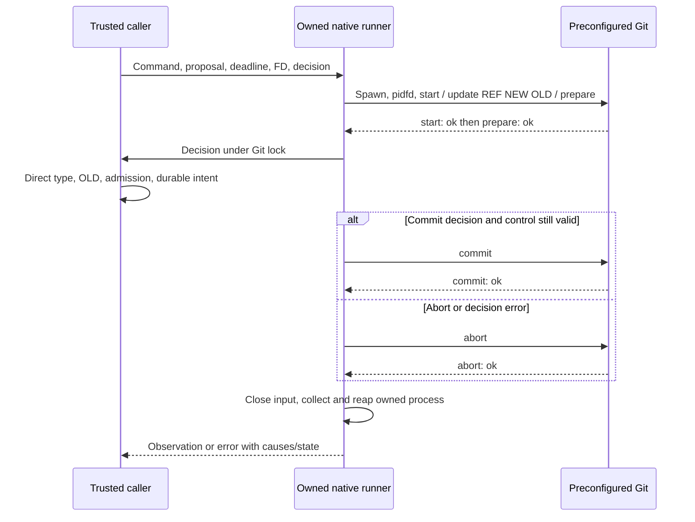
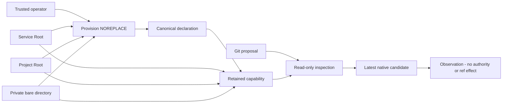

# PAEA Git transaction primitive

[Français](../architecture/PAEA-GIT-TRANSACTION.md)

Linux library API qualified in fixtures: `run_git_reference_transaction`.
It composes the owned native runner with nonblocking input and strict Git ACK
parsing. It provides no PAEA effect service, protected repository, admission,
durable intent or public Git publication workflow.

## Inputs and caller responsibilities

The trusted caller supplies a preconfigured Git `Command` (executable, options,
cwd and environment), validated v1 Git proposal, its already selected monotonic
deadline and optional borrowed readable cancellation FD. Deadline `None` means
none. No executable or path comes from proposal data. The primitive appends only
`update-ref --no-deref --stdin`. The native consumer must use existing persisted
Admin policies; no duration default, retry, grace or operator ceiling is added.

The synchronous callback runs once after prepare, under Git's retained lock. It
must establish direct reference type, exact OLD, current authority and durable
intent, retaining repository witnesses and reservations. The primitive does not
perform these controls on its behalf. The callback must honor control/deadline;
it is not preempted. A validated proposal remains data, never a permission.

## Sequence

`update-ref --no-deref` alone can overwrite a symbolic reference. A preflight read
is racy; inspect the original while Git retains its prepared lock.

## Outcomes, errors and recovery

`GitReferenceObservation` distinguishes `NotRequested`, `CommitRequested`,
`CommitAcknowledged` and `AbortAcknowledged`. NotRequested applies only to this
call, not history. ACK is neither an independently observed ref nor executable
attestation. Channel loss after sending COMMIT requires reconciliation before
another publication. Exit0 without terminal ACK refuses.

`GitReferenceError` retains primary cause, independent cleanup causes, possibly
partial private streams and actual owned-process recovery. `source()` supplies
the first branch; `branches()` supplies all. `find()` follows the existing concrete
Box/IO/Root graph, including secondary cleanup, without merging separate calls.
`process_error_mut()` retains access to an unreaped Child when the runner owns
one. Public Display/Debug do not render paths, command, stderr or private diagnostic
text; `output()` requires explicit access.

`exit_status` is the actual reaped status when available. `timed_out` is the
optional runner observation; None after runner failure does not establish that
no deadline was reached. An IO TimedOut cause can remain separately. A decision
error attempts explicit abort and retains its original cause.

Cancellation/deadline observed before sending prevents COMMIT; checking time and
writing are not a real-time atomic operation. Forced termination can leave a Git
.lock. The primitive never removes it. Future service recovery must establish
custody and actual ref state before resuming; this is not wired yet. Nonblocking
input refuses partial transport/WouldBlock rather than blocking outside the
process observer.

A stateful Write sink must never return retriable Interrupted after consuming an
ACK. The boundary preserves that cause behind a nonretryable error so write_all
cannot replay consumed state and bypass the owned-process observer.

## Verification and limits

`tools/verification/recipes/paea-native-git-reference-transaction.json` verifies
nine named native cases and strict Rustdoc, without a global watchdog. Real Git:
CAS/abort, stale OLD, symbolic ref, competing writers, decision errors, cancellation,
deadline and real publication followed by SIGKILL before ACK. The last case keeps
CommitRequested although the ref changed. Error wrapper shapes are exercised.

The one-second deadline is an expiry fault after a measured valid control under
the same duration, not a recipe cap or product default. Only the disposable
fixture removes its lock after retained inode and confirmed reap to observe
recovery. This does not establish protected service cleanup.

The Python `paea-git-reference-transaction.json` recipe separately retains six Git
primitive experiments. Evidence69 binds sources, actual Git and test ELF; normal
build222 and Version/UI have their own ELF. No public server caller invokes the
generic body yet. Admission, mandate/approval, separate UIDs, confinement and
independent acceptance remain open.

[Decisions, original evidence and remaining work69](../plans/actions-confiance/paea/INCREMENT-69.md).

## Durable Git intent reservations

`RootStore::paea_initialize_git_intents` explicitly provisions the journal with an
immutable project/digest pin. `paea_reserve_git_intent` persists canonical bytes
under the project/repository/ref/OLD business key before a future publication.
It returns `New` or `Existing`; the latter preserves the original candidate and
context even when the transport key or content changes. `Existing` prohibits a
new publication: the future service must reconcile. `paea_read_git_intent` reads
independently after restart; `None` means no reservation, never no Git effect.
Malformed schemas or inconsistent canonical records refuse.

Failed SQL COMMIT remains `Uncertain`, retaining its cause and rollback failure;
no Git call may follow that error. Native diagnostics also traverse cleanup.
Contention uses existing persisted Admin settings, without new timeouts or caps.
The maintained `tools/verification/recipes/paea-native-git-intent.json` covers
persistence, refusals, real contention and corruption on disposable Roots, plus
strict Rustdoc.

This journal publishes nothing, attests no declared context and checks neither
grants, candidate/review/cohort, repository nor reference. The caller still owes
separately held storage, repository binding, current reserved authority, durable
intent before Git COMMIT and compatible reconciliation after interruption. This
component exposes no HTTP effect service or terminal effect receipt.

## Reading the latest cumulative candidate

`RootStore::current_managed_git_publication(work_id)` observes the last native
publication under a SQL snapshot, saved-settings reservation and physical Root
association checks. No caller-supplied task/candidate selector can choose an old
candidate. The authoritative existing reader verifies the chain, review and
validation originals, worker result, controls and complete current cohort. Missing
or inconsistent evidence refuses with typed causes; snapshot/material/close
errors remain retained.

The result includes actual Work/settings revisions, event/task/review, OIDs and
digests without private paths. `repository_request_digest` is recorded planning
data, not a service `repository_id`. That association still needs explicit
provisioning; no service identifier is invented here. This observation grants no
held repository capability, current authority, effect receipt or promotion permit.
The effect service must recheck under its own commitment barrier. This reader
neither starts a provider nor publishes an effect.

`tools/verification/recipes/paea-current-managed-git-publication.json` requires
`SWARM_PAEA_CURRENT_PUBLICATION_FIXTURE` identifying actual retained inert output
from `tests/rust_native_cumulative_publication.py`, with explicit `--binary`,
`--profile` and `--output`. Never supply a user mission. The positive SDK test is
ignored without explicit `--ignored`; the recipe requires its name and assertions,
never a zero-test success. Faults affect only that fixture, restoring exact bytes
before asserting refusal.

## Private service repository binding

`paea_provision_git_repository` requires an explicitly initialized journal70,
a physically separate project and a private bare Git child prepared by the trusted
operator. The ID derives from the actual service Root and repository inode, never
a proposal path. A private canonical declaration uses atomic NOREPLACE; duplicate
creation refuses without adopting or replacing prior state.
`paea_open_git_repository` compares exact expected bytes and retains service,
project and repository descriptors. The read bound is the exact expected frame
extent, not operator policy. Changed instances need explicitly authorized
reprovisioning, not implicit restoration of authority.

`PaeaGitRepository::inspect` checks that binding and the actual latest native71
candidate; wrong ID/pin/project/candidate, rebinding, symlink or altered declaration
refuse. No raw path or mutable Command is exposed. The hardened Git probe starts
in a descriptor-derived cwd then uses `--git-dir .` in the child's own cwd: no
ancestor discovery or parent-FD dependency after an unreaped-process error.
Process/storage/close causes survive; a known declaration remains accessible after
late failure, while uncertain publication requires explicit open/read, never a
blind publication retry.

This establishes no human operator, UID separation, confinement, current mandate,
object transfer, OLD/direct-ref condition, last-use barrier or Git effect. The
protected effect service and reconciliation remain unwired. Retain the capability
and explicitly close it even after refusal.

## Actual writer and object-format preconditions

The internal effect reader requires SQLite main transaction state Write on the
Root's own opened connection. A deferred/read transaction or a supplied boolean
cannot replace that fence. The native chain/original/cohort body is shared with
the public observation; no nested BEGIN, alternate connection or approval bypass.
Settings/Trust/plan/mandate reservations through commitment remain the effect
owner's responsibility. This helper alone grants no authority or Git effect.

`inspect_object_format` reads the actual private bare Git storage representation
and requires the reviewed candidate's existing40/64 hex representation to match
SHA1/SHA256. Unknown/non-bare/mismatched format refuses before any transfer,
intent or ref change. It does not prove object presence or perform transfer.
See `recipes/paea-git-writer-format.json` under tools/verification: requires a
newly owned inert first-publication fixture via SWARM_PAEA_WRITER_FIXTURE.

## Pack protocol qualification (fixture only)

Recipe `paea-git-pack-protocol.json` exports the native candidate actually read
by the normal CLI using `pack-objects --revs --stdout` directly to a disk file,
then imports using `index-pack --stdin --fix-thin` into a fresh bare repository.
Python never captures the entire pack in memory. Each child owns its input file;
neither command requests a reference update. Six assertions cover exact commit
presence/connectivity, unchanged refs, repeated import, incompatible format,
corruption/truncation with recovery and missing OID. Failure file inventories,
channels and partial artifacts are retained; refusal does not imply no writes.

This is an experiment on a small inert engine-born fixture, not a native transfer
API. Source/destination capability custody, process/error ownership, budgets,
current authority and durable-intent reference commitment remain service work.
The protocol alone proves none of these obligations, confinement or large-volume
capacity.

## Native pack streaming primitive

`run_git_pack` runs only export `pack-objects --revs --stdout` or import
`index-pack --stdin --fix-thin`, without a refspec. Hardened command construction
and saved Git deadline are shared with the managed runner. Three distinct regular
files at position zero, outputs initially empty, are checked before spawn.
The child owns stdin; outputs stream to files and both sync even after failure,
retaining independent causes. The pack is never collected in a Vec.
`GitPackError` retains observed status/timeout, possible writes, native error
branches and any unreaped process ownership. Private diagnostics stay in the
caller's files; Display exposes only a fixed label.

The caller still owes cwd/source/destination capability custody, private creation,
checked output close, OID/format checks and current authority. Input File/Stdio
ownership is consumed with standard drop; no separate checked-close receipt is
claimed. No business journal, mandate or public service consumes this primitive
yet. Success does not establish publication or confinement.

Pack sync failures now retain a `GitPackSyncError` identifying `Stdout` or
`Stderr` with the original IO cause. Native traversal follows these envelopes
through Box/IO without exposing paths. Command failure stays primary; both sync
attempts and their separate causes survive. If the command succeeds but sync
fails, observed exit/timeout remain available without successful-transfer claims.
The kernel regression uses read-only proc output sinks after a valid control;
sync after successful command is explicitly synthetic unit composition, not an
actual fsync fault injection.

## Owned native source guard

`PaeaGitRepository::retain_source` owns an opaque `PaeaGitSource`: actual Root/DB
witnesses, managed/work parents, source bare directory and shared managed lane.
Storage must exactly match the native definition; opens are descriptor-relative.
The native snapshot is observed before acquisition. No Git process starts after
lane acquisition in the constructor, so partial-open cleanup releases no new
asynchronous dependency.

`source.inspect` checks Root identity, each parent/bare inode, current lock inode
and the complete native publication, with a final physical recheck. Substitution
or changed snapshot refuses without adopting another lock/repository. The source
keeps its lane on refusal and after repository capability close. `source.close`
checks every handle close and unlock, preserving independent errors. Neither the
type nor Debug exposes a path or command.

The internal transfer job below retains this guard with dependent processes/errors,
resolving its child before close. This type alone cannot enforce that lifecycle;
it transfers no objects, grants no mandate and establishes no same-UID confinement.
Recipe `paea-native-git-source.json` uses a new native fixture for physical fault
injection; historical71 evidence stays read-only.

## Source inspection inside a writer and context revision

Internal `PaeaGitSource::inspect_for_effect` shares physical/snapshot checks with
the public observer, requires actual main WRITE on the project connection and
uses the repository reader for that state. It opens or releases no transaction;
the public deferred observer stays distinct. The future service still retains
settings/Trust/plan/mandate reservations and owned guards through commitment.

Applying identical configuration values through public preview/apply creates a
new validated revision/history. The native candidate remains valid, but a source
guard holding the old snapshot must be renewed. No policy is relaxed and no
consumption is reset. Recipe `paea-native-git-source-context.json` separately
checks the actual writer and persisted context recovery on a new owned inert
native fixture.

## Private pack files (internal prerequisite)

Internal owner `GitPackFiles` creates a strictly new directory and five exclusive
private files, retaining originals and parent. Revision input is written/synced
once; the pack is hashed in chunks. Import input is opened relative to the held
parent, compared to the original pack inode, and retained with output files.
Symlink, hardlink, existing directory, revision rewrite and pack substitution
refuse without adoption. Failure after mkdir can leave a directory, whose name
the caller must retain. Close attempts every file then directory without deleting
artifacts.

This component starts no process. Borrowed streams alone cannot prove Source,
repository or child lifetime; the internal job below combines these owners,
while protected service exposure still requires current admission and confinement. Real-Git component tests explicitly retain these owners until
reap. They are cfg(test) unit evidence, separate from the fixture-free delivery
profile and the absent service. Files establish no quota, permission or approval.

## Owned object-preparation job (internal)

`GitTransferJob` takes ownership of Source, private destination and pack files
before its first native observation. It runs once: current source, distinct
inodes and object formats, saved settings, streamed export/import, exact commit
object and unchanged destination refs, then source revalidation. A receipt is
preparation evidence only. Any failure stays in the job with its attempted phase;
partial imported objects/files are retained. A second call refuses without
replacing the original cause. No business grant, intent or ref commit is issued.

Checked close returns the entire owner while the native error graph contains an
unreaped or ownership-lost child. Nonblocking recovery polls actual Child handles
through the listed Root/launch/Git/custom-IO/concrete-box wrappers, retaining every
independent IO error and real reap status. Unknown mutable wrappers remain outside
this recovery adapter; the full read-only graph still blocks release. ECHILD
records loss of ownership, never a signal capability. Reaping a leader does not
prove escaped-descendant containment. Recovery never retries export/import.

This remains crate-internal preparation; protected admission/current reservations,
intent-before-commit, exact OLD and terminal reconciliation remain required.

Ref metadata uses the existing Vec-based metadata runner, with no new volume
cap; only pack bytes stream. Service resource confinement/quotas remain required
before protected exposure. Tiny fixture tests establish no volume guarantee.

Normal internal construction is now `GitTransferJob::from_repository`: it checks
actual service/project/declaration bindings, opens `SourceCustody` with canonical
managed parents/bare and shared lane using only FS/SQLite observations, and creates
staging relative to the retained service Root. No Git starts during construction.
The job starts Pending; its first native observation occurs while those owners
already live in the job. Errors keep Pending custody and the actual cause; success
completes a `PaeaGitSource` without reopening its witnesses. Close/reap rules apply
to both phases. Pure preflight failures checked-close all acquired owners; partial
mkdir artifacts remain under the chosen name. Wrong service and existing staging
refuse without fallback/adoption.

The old ready-source job constructor is now cfg(test)-only, not a normal-build
bypass accepting arbitrary private files. Public `retain_source` keeps its legacy
observation-first contract and is not this protected-builder entry; its unrelated
reader consumers remain outside the new lifecycle claim. No public protected
service, business admission, intent or ref commitment is added here.

Normal Root factory `paea_open_git_transfer_job` also reopens the declared private
repository through FS-only custody, checking the existing canonical frame. Thus
it starts no Git before the Pending job owns both endpoints and staging. Actual
bare/format verification is deferred to that owner. Legacy public provision/open
still validate bare Git before returning and are not this factory's entry path.
A malformed bare refuses inside the owned job before any pack write, never by
first-request adoption. Unit and normal-library format checks stay separate.

The actual opened service Root must be writable both at factory/staging creation
and at one-shot execution. Passing a newly opened read-only handle for the same
physical datastore refuses before Git, even for an already created job. This is
an existing Root access-mode invariant, not an operator retry policy or OS UID
isolation, human enrollment, current business grant or independent approval.

## Guarded Reconcile preparation consumer

`RootStore::paea_git_transfer_call(project, proposal, context, work, child, pin,
staging)` prepares a guarded call once: distinct writable service and project
roots verified through physical instances, `Action::Git` required, frozen
canonical action, nonce and both root digests folded into the permission root
via `Request::new(GitPromotion, Reconcile, …)`. The exact permission is
`effect.execute` on
`paea-action-v1/<root>/<service>/<operation>/<action>`; `prepared.request()`
and `prepared.proposal()` expose it for separate enrollment. No ref effect
occurs at preparation.

`RootStore::call_paea_git_transfer(project, prepared, authority, context, head,
password)` consumes that authority under `with_paea_action`: Reconcile operation
rechecked, physical service/project bindings reverified through
`RootBinding::matches`, current effect role read under the Trust reservation
(current trust revision, non-disabled identity, matching
`enrollment_principal`, Biba integrity dominated by I2 Invoke). Then the native
job runs once: real current-publication observation, pack export/import and
postchecks. The frozen receipt `PaeaGitTransferReceipt{candidate, pack_bytes,
pack_sha256}` records preparation; it is neither a ref effect nor a commit right.

`PaeaGitTransferCallError` preserves Personal(`AfterUse`)/Authority/Action/
MissingAction, `known_receipt()` and independent branches; `find()` goes through
the native graph, which now also covers `TransferFailure` (phase label and
source cause). A wrong-root `paea-git-transfer-root-binding` refusal consumes
nothing. Diagnostics export safe codes and causes only.

Why Reconcile and not Commit: preparation changes no ref. The real COMMIT
requires direct OLD, durable intent and `run_git_reference_transaction`
(CONTINUITE-80); that wiring stays a separate increment, never exposed as an
accepted service without its real prerequisites (UID separation, human
enrollment, independent approval still pending).

Verification: `tools/verification/recipes/paea-owned-git-transfer-reconcile.json`
runs the job's nine native states (`--lib transfer::tests`), both
`paea_git_transfer_call` integration tests and Rustdoc `-D warnings`, against
the writer78b fixture (SOURCE, regenerated 2026-10-29, live root) and the
current71c fixture (CURRENT, cumulative publication regenerated 2026-10-29,
live root), without a global watchdog. The fixtures are recipe-owned (the
native receipt binds the real inode, no copy can substitute them); the explicit
effect Trust configuration is applied there through the public
`trust config-apply` operation, like the existing context recipes.

## Guarded CLI consumer (interactive two phases)

`swarm-rust paea transfer-call SERVICE PROJECT WORK CHILD PIN STAGING
DECLARATION --input REQUESTFILE` consumes the prepared call above from a real
CLI process, using the same interactive pattern as `trust enrollment-call`:
the service and project roots are opened writable and the prepared call keeps
its memory witnesses alive while the operator provisions the exact permission
out of band. The CLI emits one public `paea-transfer-prepared` line (service,
operation, root_digest, action_digest, exact permission, `authority:false`,
`restart_reusable:false`), then reads a private stdin frame
`swarm-trust-source-v1\n<pin64>\n<password>` (the pin is the operator's
provisioned protected declaration pin, never the Git journal pin passed as a
public argument) and starts the enrolled authority on DECLARATION. The frame
is refused (`paea-transfer-call-frame`) before any declaration open or
preparation consumption when the header, minimum length, separator or hex64
pin is invalid; the password stays inside the zeroizing allocation and never
appears on stdout/stderr. The result is one `paea-transfer-result` line
(candidate, pack_bytes, pack_sha256). The prepared operation stays Reconcile:
no ref effect. Every error closes service, project, prepared call and
authority while retaining each close cause (paired RootCleanup); no auto-grant,
account or remote adoption occurs — provisioning is an out-of-band operator
act.

Verification: `tools/verification/recipes/paea-transfer-call-cli-rust.json`
runs the two real CLI tests (exact one-shot consumption; invalid-frame refusal
with no consumption and no Trust mutation) against the writer78b fixture,
without a global watchdog; the binary's FR/EN help lists the command.

## Guarded reference promotion consumer (CONTINUITE-80 wiring)

`RootStore::paea_initialize_git_promotions(project_id, project_digest)` creates
the effect journal `paea_git_promote_meta` + `paea_git_promote_effects`
(intent_id PK, action_digest, target_ref, new_oid, JSON receipt) on the service
root in one explicit transaction. It requires the pre-existing intent journal
(`paea_initialize_git_intents`) and refuses any existing or partial schema: no
implicit history adoption.

`RootStore::paea_git_promote_call(project, proposal, context, operation, work,
child, pin)` prepares a guarded promotion call once, mirroring the settlement
contract: distinct writable service and project roots, `Action::Git` required,
frozen canonical action, nonce and both root digests folded into the permission
root via `Request::new(GitPromotion, operation, …)`. For `Operation::Commit`, the
declared context's policy fields are attributed from the actual Trust under
`reserve_trust(false)` (revision + `paea-trust-policy-v1` fingerprint) before
canonicalization; `Operation::Reconcile` keeps the historical context as-is.
Both preparations therefore share the same canonical digest only when Reconcile
reuses the Commit's attributed context.

`RootStore::call_paea_git_promote(project, prepared, authority, context, head,
password)` consumes that authority under `with_paea_action`: exact
permission/service/operation, reverified physical bindings, current identity
plan read (V1/V2 projection, stamp, scope) and current effect role under the
project IMMEDIATE transaction + shared Trust reservation (current revision,
non-disabled, Biba I2 Invoke, `require_separation`/`role_separation` refused at
Commit, policy freshness at Commit). Then:

- Commit: non-expired human authority checked; durable intent reserved BEFORE
  any Git (`paea_reserve_git_intent`); replay without Git when an identical
  effect already exists (crash recovery); opened custody
  (`paea_open_git_repository` + `inspect_for_effect`: actual current candidate
  under the project writer); `run_git_reference_transaction` with the decision
  under the Git lock — exact OLD required (`rev-parse --verify`), creation only
  when OLD is absent (zero), ref already at the candidate → Abort + recording
  (recovery), different OLD → `paea-git-promote-old-changed` refusal; actually
  observed OID after the protocol; effect recorded on the service journal;
  uncertain SQL COMMIT preserved as `paea-git-promote-commit-uncertain`.
- Reconcile: pure service-journal read. No Git, no publication. Missing intent
  or missing effect → explicit `ReconciledNotCommitted`; compatible stored
  effect → `Recorded{replayed:true}`.

`PaeaGitPromoteOutcome` distinguishes
`Recorded{intent_id, action_digest, target_ref, new_oid, replayed}` and
`ReconciledNotCommitted{intent_id, target_ref}`;
`PaeaGitPromoteReceipt{target_ref, old_oid, new_oid}` witnesses the real Git
effect. `PaeaGitPromoteCallError` preserves Personal/Authority/Action/
MissingAction, `known_outcome()` and independent branches. A wrong-root
`paea-git-promote-root-binding` refusal consumes nothing. No accepted service is
provided: UID separation, human enrollment, independent approval and global
closure remain pending (CONTINUITE-80 boundary).

Verification: `tools/verification/recipes/paea-owned-git-promote.json` runs the
four `paea_git_promote_call` integration tests (real commit under OLD fencing
after the prior qualified transfer, replay + reconciliation, negative
reconciliation before commit, wrong-root refusal) and Rustdoc `-D warnings`,
against the same live writer78b/current71c fixtures, without a global watchdog.
The tested business flow is the real transfer (increment 82) → promote order:
without importing the candidate pack first, Git refuses the ref write with a
nonexistent object.

## Guarded CLI promote consumer (interactive two phases)

`swarm-rust paea promote-call commit|reconcile SERVICE PROJECT WORK CHILD PIN
DECLARATION --input REQUESTFILE` consumes the prepared call above from a real
CLI process, using the same interactive pattern as `paea transfer-call`: the
service and project roots are opened writable, the prepared call keeps its
memory witnesses alive while the exact permission is provisioned out of band,
then the private stdin frame `swarm-trust-source-v1\n<pin64>\n<password>`
starts the enrolled authority on DECLARATION (refused as
`paea-promote-call-frame` before any declaration open or consumption when the
header, length, separator or hex64 pin is invalid; the password is never
emitted). The result is one `paea-promote-result` line:
`outcome:"recorded"` (intent_id, action_digest, target_ref, new_oid,
replayed) or `outcome:"reconciled_not_committed"` (intent_id, target_ref) —
the explicit negative result, never an empty success. For Commit, the real
reference transaction with exact OLD fencing runs (the reference observed
after the call names the candidate); for Reconcile, no Git process and no ref
change. Every error closes service, project, prepared call and authority while
retaining each cause (paired RootCleanup); no auto-grant or implicit
provisioning occurs.

Verification: the three real CLI tests (`paea_promote`) run in the
`tools/verification/recipes/paea-transfer-call-cli-rust.json` recipe (one-shot
commit with OLD fencing verified through rev-parse; negative reconciliation
before commit; invalid-frame refusal with no consumption and no Trust
mutation), against the writer78b fixture, without a global watchdog.

### End-to-end composed scenario (same root, same candidate)

`promote_call_cli_chain_transfer_promote_replay_reconcile_once`
(`paea_promote.rs`, `--ignored` test) chains, on the same owned roots and the
same candidate: the real qualified transfer (imports the candidate object, no
ref effect), the guarded `commit` CLI promotion (exact seeded OLD, reference
created at the candidate, `replayed:false`), an identical second CLI
invocation (replay of the same durable intent: `replayed:true`, identical
`intent_id` and `action_digest`, no second publication — the rev-parse
observed reference stays at the candidate), then the public `reconcile-effects`
CLI reconciliation against a fresh separate ledger: `git` reports
`consistent`/`effectCount:1` with the chain's `intent_id`/`action_digest` and
`verified:true`, and `settlement` stays explicitly `uninitialized`. The
composition is proven in a test environment only: explicitly simulated agent
identity (existing auth fixture), no UID separation, human presence or
accepted service.

### Revoking current authority between preparation and consumption

`promote_call_cli_revoked_current_authority_refuses_without_effect_then_recovers`
(`paea_promote.rs`, `--ignored` test) verifies the real current-authority
window of the guarded promote CLI: after the public `paea-promote-prepared`
event (physical witnesses held by the CLI process, no reservation), a Trust
`config-apply` — the supported public operation, through the same operator
surface — disables the project's effect identity and advances the current
revision. The still-signed grant then refuses twice under the current state
re-read at consumption (`policy::current_actor`), with no Git effect, no
durable effect line and no additional mutation:
`paea-git-promote-trust-revision` (preparation revision ≠ current), then
`paea-git-promote-effect-role` (revision-matched grant, disabled effect
identity); the CLI JSON diagnostic projects these typed causes. After the
public restore `config-apply` (same set enabled again), the explicitly
re-provisioned current grant consumes the same prepared call exactly once:
`recorded`, `replayed:false`, reference at the candidate, exactly one durable
effect line. Configuration event ids carry the targeted revision as a
suffix: each run on a retained root creates fresh events without replay
conflict. The harness serializes its possession of the shared project root
with an in-process mutual-exclusion guard (`shared_project_root_guard`): the
five mutator tests cover their whole root acquisition — from `owned()` to the
final witnesses — instead of running against each other's `config-apply`
windows and revision reads. The guard is harness-local only: no product lock,
no `--test-threads` requirement, no product-refusal bypass; the combined
`--ignored` suite runs with default parallelism, and the
`shared_project_root_guard_admits_one_holder_at_a_time` test (default lot,
not ignored) detects any regression to the race. Limits unchanged: authority
stays the explicit simulated fixture; no real identity revocation, UID
separation or human presence is proven; the current change is that of the
owned fixture, never a real operator right.

## Guarded web consumer (increment 90)

The web wiring follows the proven single-intent mechanism of the
`TrustEnrollmentSource` (v49), not a settings field: a prepared call
(transfer or promote) carries living physical witnesses (instances of both
roots + nonce) that cannot be persisted — a setting would only name a path
and would recreate implicit adoption.

Construction: `swarm_web::PaeaGitCallSource::new_transfer|new_promote(
PREPARED, SERVICE_PATH, PROJECT_PATH)` retains the prepared call and BOTH
trusted startup paths (never request data). `PaeaGitCallSource::open(
DECLARATION, PIN)` starts the enrolled authority on the provisioned
declaration; on startup refusal the owned prepared call is closed and its
cause retained (`PaeaGitCallSourceError`, fixed Display
`paea-git-call-source-failed`, independent branches). No account is created,
no permission is minted.

Bind: `NativeHttpService::open_git_call` / `NativeHttpServer::bind_git_call`
check BOTH prepared witnesses (`PaeaGitTransferCall::binding_matches`, added
on the engine side for this transport check only) against the roots actually
opened (the bind service root + the project root opened read-only from the
startup path) BEFORE any session publication; on refusal the supplied
authority is closed explicitly. This check precedes and never replaces the
recheck of both witnesses performed by the engine consumers under the held
authority (`paea-git-transfer|promote-root-binding`).

Consumption: `POST /api/v1/paea/git-call?call=transfer|promote`, under the
ordinary session/Host/CSRF guard, with a single
`Authorization: Enrollment <base64url(password)>` header (zeroizing, non
empty) and body = the exact canonical action bytes
(`check_command_input_size` applied; sha256(body) compared with
`action_digest`). With no bound source, the route answers
`paea-git-call-source-unavailable` without opening any root. The route opens
BOTH roots writable, rechecks both witnesses, consumes the one-shot call
(`call_paea_git_transfer`/`call_paea_git_promote`), then closes them (paired
closes, no cause lost). The JSON v1 reply `paea-git-call-result` carries
`call`, `outcome:"prepared"` + the transfer receipt (candidate, pack_bytes,
pack_sha256) or `outcome:"recorded"` / `"reconciled_not_committed"` + promote
data. Errors are typed through the new `RootStoreError::PaeaGitTransferCall|
PaeaGitPromoteCall` variants (code(), source(), branches of the existing
native diagnostic). A second exact call refuses: the prepared call is
one-shot. The `paea_git_call` field is closed with the service (`close()`
joins both sources without losing a cause).

Observation (increment 91): `GET /api/v1/paea/git-call`, behind the same
session/Host/CSRF gate, returns the JSON v1 `paea-git-call-status` view —
`bound:false` with a null capability when no source is bound, otherwise the
public startup capability (`scope`, `call`, `service`, `operation`,
`root_digest`, `action_digest`). The observation performs no Root IO, no
consumption and carries no secret: the operator distinguishes
configured/applied/observed without spending the one-shot prepared call,
on the `identity_authentication.held_enrollment` pattern of the trust show
view.

Verification: `tools/verification/recipes/paea-git-call-web-rust.json` (3
steps, evidence `docs/plans/actions-confiance/paea/evidence/
20261029-git-call-status-mvfdts57`) runs the no-source refusal (explicit
`bound:false` observation), the bind refusal on a wrong root before
publication and the full exact consumption on the writer78b native fixture
(capability observed without consumption, wrong password/body refused
without consumption, second call refused).

## Guarded CLI consumer of the settlement call (increment 92)

The third guarded PAEA call receives its public CLI consumer:
`swarm-rust paea settlement-call commit|reconcile PROJECT LEDGER DECLARATION
--input REQUESTFILE`. The PROJECT (writer of the IMMEDIATE closure fencing
the current plan) opens first, the LEDGER (the consuming root of the real
effect) second; both stay open inside the process through the whole
preparation. Preparation via `project.paea_settlement_request(...)` is
followed by the public `paea-settlement-prepared` event (service
`payment.settle`, `operation`, `root_digest`, `action_digest`, permission,
`authority:false`, `restart_reusable:false`): the operator provisions exactly
this permission out of band, then answers with the private stdin frame
`swarm-trust-source-v1\n<pin64>\n<password>` (same grammar as
transfer/promote call; non-terminal stdin required, the secret never appears
on any output). Consumption via `ledger.call_paea_settlement(...)` runs the
real transaction: commit = one exact OLD-fenced ledger effect (`recorded`
receipt with `replayed`), reconcile = a pure journal read
(`reconciled_not_committed`, never a new grant). Every refusal closes
prepared/project/ledger in order and chains each close cause into
`RootCleanup`; CLI code `paea-settlement-action` carries preparation refusals
(including `paea-settlement-separate-ledger-required`), while frame refusals
(`paea-settlement-call-frame`/`-input`) and startup refusal
(`paea-settlement-call-startup`) refuse before any consumption.

Verification: `tools/verification/recipes/paea-settlement-call-cli-rust.json`
(3 steps, evidence `docs/plans/actions-confiance/paea/evidence/
20261029-settlement-call-cli-mvfdts57`) runs the real two-phase CLI against
two physically distinct roots: exact commit published once (durable effect
counted, `replayed:false`), negative reconciliation before commit
(`reconciled_not_committed`, zero effect rows) and a wrong frame refused
without any consumption (project Trust state unchanged, zero effect rows).

## PA-09 reconciliation verifier for real effect journals

`RootStore::paea_reconcile_effect_journals(&ledger)` (module
`paea_effect_reconcile.rs`, read-only) reconciles the REAL durable journals of
both effect domains: the settlement ledger (separate root, `ledger` parameter)
and the current service's Git journals (intents + promotions). Correlation is
established by recomputation, never by trusting an agent report, a caller
declaration or the stored digest alone:

- Schema: each table is checked against its producer's exact DDL via the
  authoritative auxiliary verifier. Absent → explicit `Uninitialized` (never an
  empty success); altered/partial/extra objects → `Corrupt{codes}`; no row is
  read and no repair is attempted in that state.
- Settlement: the stored receipt is strictly re-decoded, the paea-json-v1
  canonical action re-derived from durable bytes, then bound by recomputation to
  the effect digest, the `intent_id` (project+invoice business key), the
  `Action::Payment` invoice, the exact provisioned debt terms
  (`paea_settlement_debts`) and the shape of authority metadata (enrollment,
  digests, sequences, RFC3339 timestamp). No freshness is established: shape
  does not attest authenticity.
- Git: each promotion effect is joined to its durable intent
  (`paea_git_intents`, bytes reserved BEFORE any Git), re-canonicalized, bound
  to the effect digest and intent identity, the receipt columns
  (`target_ref`, `new_oid`) must equal the effect row columns, and the durable
  intent's `expected_old_oid` must equal the pre-promotion `old_oid` recorded in
  the receipt (`paea-effect-reconcile-git-old-oid`): the promoted transition
  must start from the reserved state.

The serializable v1 report distinguishes, per domain,
`PaeaEffectReconcileJournal::Uninitialized | Consistent{effect_count, findings} |
Corrupt{codes}`; each `PaeaEffectReconcileFinding` carries the `intent_id`,
`action_digest`, `verified` and the exact refusal codes of every failed check.
Incompatible rows are reported, never repaired, deleted or replayed;
`verified=true` establishes only recomputed correspondence, not authenticity: a
malicious same-UID writer can rewrite all rows consistently (UID separation,
external anchors and immutable storage remain open prerequisites). No authority,
publication, policy mutation, provisioning or public transport exists in this
API.

The public CLI consumer (increment 85) is `swarm-rust paea reconcile-effects
LEDGER --root ROOT --json`: read-only, no effect and no authority, it opens both
roots, applies the separation guard, then publishes the JSON v1 report. Two
physically distinct roots are required
(`paea-effect-reconcile-separate-ledger-required` when the instance identity —
directory or database — coincides): one store cannot provide both sides of the
cross-check, otherwise a compromised store would fabricate both of its own
witnesses. Close errors are paired with the result (`RootCleanup`) and the
report of a successful reconciliation is withheld if the ledger close fails.
Runtime options (`--server`, `--task`, `--input`, `--output`) are refused without
opening any root.

The public web consumer (increment 86) is `GET /api/v1/paea/reconcile-effects`
(swarm-web, authenticated session required): same read-only contract, no effect
and no authority. The separate ledger root is not inferred from the service root:
it comes from the persisted setting `paea_settlement_ledger_root` (schema version
49, operator policy — persisted source, canonical absolute path shape validation
`settings-paea-ledger-root-invalid`, explicit adoption required of older
installations). With no adopted setting, the call answers
`501 settings-paea-ledger-root-not-configured`; a shared root answers
`409 paea-effect-reconcile-separate-ledger-required` (same instance identity);
any disallowed method or payload (POST, body, query) is refused without opening
any root. A designated but uninitialized ledger yields an explicit
`uninitialized` report, not an error. The Admin interface presents the field in
the “Stockage et Git” group; the FR error label accompanies each refusal.

Verification: `tools/verification/recipes/paea-effect-reconcile.json` runs the
four `paea_effect_reconcile` integration tests (consistent journals + explicit
`Uninitialized`, refusal of single-root self-reconciliation, altered effect
digest detected as an unverified finding in both domains, missing durable intent
detected), the three `paea_reconcile` CLI tests (explicit report without
mutation, shared-root refusal, runtime options refused without opening), the
three web `swarm-web paea_reconcile` tests (uninitialized report through the
authenticated API with no disk mutation, 409 shared-root refusal, 403 refusal
without a session and of malformed payloads) plus the settings library
(17 unit tests including the v49 policy) and Rustdoc `-D warnings`, against the
same live writer78b/current71c fixtures. Corruption is injected by direct SQL on
owned test storage, never on a live base.

## Browser surface for effect states (increment 93)

`/paea-effects.html` + `/paea-effects.js` (swarm-web, in the “Vérifications
PAEA” family alongside `paea.html` and `paea-lab.html`) is the read-only
browser consumer of the two public observation surfaces: the guarded Git-call
capability (`GET /api/v1/paea/git-call`, increment 91) and the effect-journal
reconciliation (`GET /api/v1/paea/reconcile-effects`, increment 86). The page
consumes NO one-shot call, exposes no effect button and circumvents no guard:
POST and the enrollment header remain contracts of the preparation surfaces,
never of this observation page.

Displayed behavior: each domain explicitly distinguishes loading, empty state
(unbound Git call, `uninitialized` journals), consistent report (durable effect
count + findings per `intent_id` with `verified` and exact refusal codes),
corruption (exact codes) and real refusal (exact error code displayed, never an
empty or fabricated success). The capability detail shows `bound`, `scope`,
`reason`, `service`, `operation`, `root_digest` and `action_digest` when a Git
call is prepared. The full raw report is collapsed in a native `details`
element. A without-session refusal (403 `web-access-refused`) stays visible.
FR/EN through the i18n catalogs (FR→EN keys generated by `npm run i18n:build`),
etat/sombre themes, touch targets ≥ 44 px, verified mobile widths, keyboard
navigation (skip link as first tab stop).

Placement choice (argued reversible decision): the page joins the “Vérifications
PAEA” family rather than the cockpit — (a) product coherence: both consumed
endpoints are PAEA verification/observation surfaces, not piloting commands;
(b) reuse of the family's already-qualified UI contract (themes, i18n,
keyboard, mobile); (c) a reversible, strictly read-only surface that cannot be
mistaken for an operator action. The `paea.html` hub links the page.

Verification: `tools/verification/recipes/paea-effects-ui.json` — synchronous
i18n catalog (`--check`), `swarm-web paea_effects_page` Rust page tests (served
under session, 403 without session, no POST in the script, hub links, EN keys
present), fresh binary rebuild (re-touching the embedded asset table to
guarantee the served byte), then real browser qualification
`tests/paea_effects_ui_recipe.py` on a fresh binary and a 0700 fixture root:
explicit empty states without fake success, exact visible PA-09 refusal, FR/EN,
both themes, keyboard (skip link first, ≥ 44 px target), no horizontal overflow
at 1280 and 390 px, screenshots, anonymous 403 refusal for page + API, no
unexpected diagnostic in the evidence. Limits: the page mirrors real reports;
it establishes neither journal authenticity (recomputation only, see PA-09),
nor enrollment, nor acceptance.
