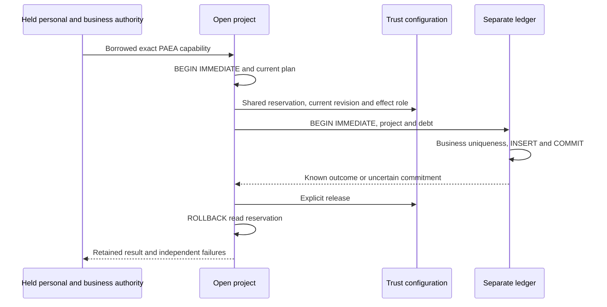

# Separate PAEA fictitious settlement kernel

[Français](../architecture/PAEA-SETTLEMENT.md)

This Linux library kernel records fictitious settlements in a RootStore physically
separate from the project. It performs no real payment. It does not yet provide a
daemon, service protocol, payment UX, agent-context attestation or separated Linux
profile. Current qualification/delivery: [increment66](../plans/actions-confiance/paea/INCREMENT-66.md).

## Storage and provisioning

`RootStore::paea_initialize_settlement` is trusted provisioning, never first-request
adoption. An independently protected, initialized Root receives explicit project,
pinned context digest and debt terms from its owner. All data are validated before
one SQL transaction. Duplicate debts, existing or partial schemas refuse. Debts
are immutable in this kernel; no update endpoint is added. This entry point proves
neither operator identity, OS confinement nor same-UID protection.

Three versioned tables retain project association, exact debt terms and effects.
Unexpected DDL, indexes and triggers refuse. Stable invoice ID identifies the debt;
version, positive integer amount, currency and beneficiary must match the private
registry. Uniqueness covers invoice/business intent independently of transport key.
Neither a new key nor changed content can pay the invoice again.

The i64 amount bound is the existing representation limit. Version1, singleton
and service names are protocol invariants. No new operator timeout, retry, money
ceiling or budget is added. Existing RootStore Admin `storage_busy_timeout_ms`
remains effective. SQLite profile/durability require delivered-environment checks;
a contention test establishes no universal power-loss or malicious-owner safety.

## Request and current authority

`project.paea_settlement_request(ledger, proposal, context, operation)` retains
both opened storage witnesses, canonicalizes the action and binds physical
instances with a nonce. Project and ledger cannot share a directory or SQLite
file. This prepares data for separate authorization, never an execution grant.
`request()` exposes the exact PAEA permission and `canonical()` the reviewed bytes.
Explicit `close()` releases both witnesses, including after refusals.

Canonical context remains declared data except the policy fields described below.
No role, mandate, provenance, label or
approval is inferred from it; future attributed control must establish those
facts before issuing permission. Receipt authority principal/scope come separately
from the held current-account capability. Fixture grants/passwords establish no
real human consent.

Inside `AuthenticatedControl::with_paea_action`, call
`ledger.paea_settle(project, prepared, identity)`. It compares physical stores and
exact permission, fences the current plan with an IMMEDIATE transaction, holds a
shared Trust reservation, rechecks current configuration, canonical effect mapping,
revision, Biba access and expiry, then reserves the ledger. Disabled mapping, old
plan or wrong project refuses before commitment. Claimed canonical context never
feeds these authority checks.

No business write occurs in the project; no two-database write atomicity is claimed.
The fictitious payment is the published ledger row. `commit_requested_at` samples
time before write/COMMIT, not exact publication time. Expiry checks surround use;
no real-time scheduling or OS protection guarantee follows.

## Outcomes and recovery

`Recorded` contains a receipt and `replayed`. First publication has false; identical
canonical action, including a fresh transport key, returns historical receipt with
true. Changed content for the same invoice refuses with the known previous result,
without a second payment. Existing effects are read before comparing new terms.
The receipt is a local observation, not an independent signature or protection
against owner rewriting.

Separately authorized `Reconcile` cannot create an effect. It returns the observed
receipt or `ReconciledNotCommitted{intent_id,invoice_id}` under the ledger reservation.
Observed absence is neither empty success nor a new mandate. After process restart,
prepare and authorize a fresh witness; never deserialize an old capability. Invoice
history remains in reopened ledger storage.

`PaeaSettlementError` retains a safe code, original cause and independent cleanup
failures. Observation distinguishes `NotAttempted` (this call attempted no COMMIT),
`Uncertain` and `Known`. NotAttempted does not exclude historical effects. Failed
COMMIT remains uncertain after rollback; reconcile before another attempt. Explicit
rollback prevents an unreported Drop retry. Late release failures preserve known
outcomes. Future transport, still unconnected, must carry primary cause, cleanup
branches and observation.

Backend result remains nested in `paea_action::Use.action`; business authority and
personal `UseError::AfterUse` may fail later. Never flatten them into no effect.
Witness, RootStore and control closes remain separate checked obligations.

## Verification

`tools/verification/recipes/paea-separated-settlement.json` runs named
`swarm-engine --test paea_settlement` tests without a global watchdog. Signed
journals, password and current plan use isolated fixtures; canonical context is
still declared. Scenarios cover publication/replay/reopen, wrong stores, bad debt
terms, stale plan/mapping, revocation before first consumption of a second grant,
corrupt schema/receipt, real SQLITE_BUSY at COMMIT with reconciliation and competing
independently authorized connections. Evidence66 gives actual status; scenario
names alone establish no PASS or E2/E3 acceptance.

## Observed policy and admission limit

For `Commit`, preparation first validates input representations, then constructs
a separate context with `policy_revision` and `policy_digest` read from the opened
project under the Trust reservation. Original input remains unchanged. The
`paea-trust-policy-v1` digest covers base policy, role-separation policy and control
blocks; configuration revision also fences mapping changes. `prepared.context()`
exposes effective data to review before grant issuance. Other fields, including
sources/principal/instance/mandate, remain declarations without trust promotion.
Invalid representations refuse rather than being silently repaired.

Commit rechecks actual policy and revision under the retained reservation. A newly
signed grant cannot make an old canonical policy current. For `Reconcile`, supply
the exact historical context from the original request/receipt; it is preserved,
while observer account, grant, role mapping and Trust revision remain current.
Policy changes neither relabel historical effects nor authorize new commitments.

The kernel cannot yet establish PAEA participants and approval. It refuses Commit
when `require_separation` is true or enabled role policy imposes incompatibilities.
An empty conflict list imposes none. `paea-settlement-attributed-admission-required`
remains open until attributed admission is connected; it does not complete PA-03.
Reconciliation performs no new effect. Successful settlement fixtures explicitly
disable those requirements through public configuration as a reference profile;
no actual local-instance policy or default is weakened.

`RootStore::call_paea_settlement` composes current account/grant and backend.
`PaeaSettlementCallError` preserves Personal/Authority/Action/MissingAction,
`known_outcome()`, `commit_uncertain()` and independent branches. `find()` uses the
native graph through concrete Box, IO and Root wrappers, including secondary
cleanup. It returns the first envelope without merging independent calls.
Diagnostics expose safe categories/causes, never receipt bytes or passwords.
Authority failure after a known effect retains it and requires an explicit recovery
decision.

## Historical metadata consistency

Receipt reads also check enrollment identifier, RFC3339 time representation,
the ledger project pin and canonical action policy revision. No maximum age or
current-time comparison is added; historical reconciliation remains possible.
Refusal preserves timestamp parsing causes and changes neither receipt nor effect.
The13tests include a valid control before each of four isolated metadata changes
and exact-byte recovery. These detect inconsistencies, not coherent owner rewriting.
No signature, historical mandate/approval or authentication of the declared
principal/instance is established. See increment67.
