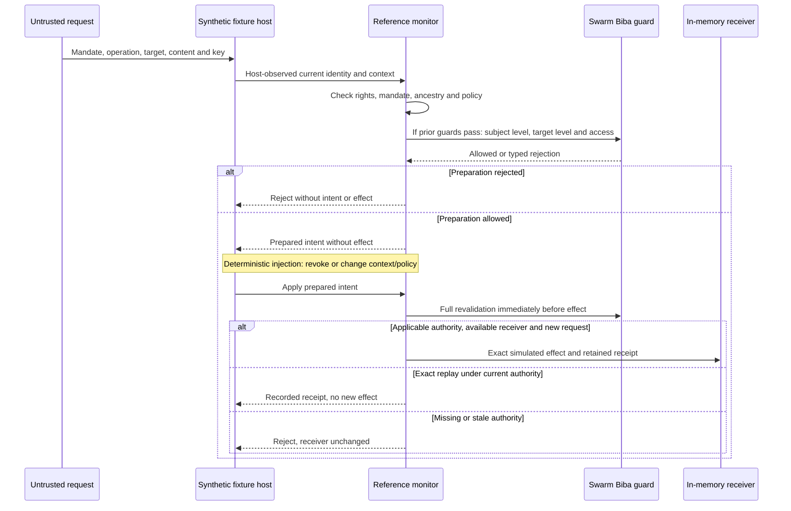
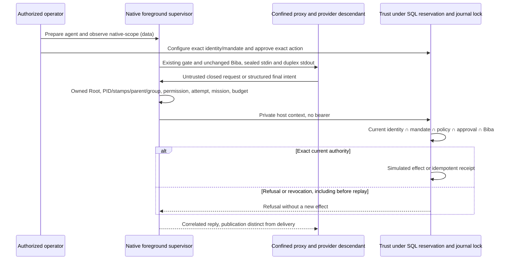

# POC-06 — task- and attempt-bound mandates

[Français](../architecture/POC06-TASK-MANDATE.md) · [Plan and evidence](../plans/actions-confiance/POC06-TASK-MANDATE.md)

This is an **isolated executable reference PoC**, with synthetic identities,
fixture-host-owned context and in-memory effects. It does not activate a guard
in native agents, business CLI operations or Trust connectors. It establishes
neither cryptographic authentication, crash persistence, OS confinement nor
distributed atomicity. Example mandates do not replace existing Trust mandates.

## Executed contract

Every operation must satisfy current identity rights, its mandate, current policy
and the Biba guard together. Mandates bind installation, project, task, attempt,
subject, operation, target, exact content and policy revision. Request fields
`claimed_scope` and `claimed_subject` never select authority: only host registries
and host context do. Permission to read or propose does not permit application.

The example path-includes the actual Swarm `biba.rs` and identifier-contract
sources; their rules are not copied. `Apply` checks Biba `Write`; `Read` and
`Propose` check target `Read`. Mandate admission is a distinct I3/admin host act,
not subject elevation. Its I2 label concerns the mandate object, not the effect
target, which is checked separately at use.



Replay binds `(identity, complete context, key)` and exact request terms. Current
checks run again: revocation may deny replay while preserving its historical
receipt. Delegation retains exact scope and rechecks every ancestor identity and
operation right at each use. Missing/cyclic/revoked ancestors or withdrawn rights
reject. No hidden depth ceiling, timeout or mandate lifetime is introduced.

## Six scenarios and recovery

| Scenario | Executed checks |
| --- | --- |
| `cross_task` | A succeeds; task B, another attempt/project/installation reject; applicable B mandate and recovery succeed. A forged A claim never selects host context. |
| `action_target` | Read/propose do not mutate the target; operation, target, content, identity rights and policy rights constrain use independently; valid recovery. |
| `revocation_replay` | Exact replay retains one effect; disabled identity/revoked mandate reject without erasing the receipt; new attempt needs new authority. Oryh case: A/B against the same operation/target, A revoked across direct/cache/delegation paths, B still succeeds; distinct common-outage control and renewed recovery. |
| `delegation` | Explicit child works; substituted subject, broader scope/action/content/target, self-admission, withdrawn parent right and absent/cyclic/revoked parents reject; applicable replacement recovers. |
| `check_apply` | Valid control before every change between preparation and application: policy, mandate, task, identity and content; no-effect rejection and fresh recovery. Lost response after a known applied effect returns its receipt without double application. |
| `invalid_biba` | Missing/invalid bindings and unauthoritative claims; I1 cannot write I2 and I3 cannot read I2 despite matching mandates; valid controls and recovery. |

Each rejection checks typed outcomes, receiver state, mutation/proposal counts
and receipts. Oryh traces correlate agent, installation/project, task/attempt,
request, mandate, policy revision, revocation event, decision and receiver counts.
Program output retains them durably; these are not external service logs or proof
of universal absence of effect. Only inventoried simulated paths are covered.
External connector uncertainty remains outside this evidence.

## Replay

In the native WIP selection based on
`57647233142982ab8e7e7ed577a89d96c5511b41`, the commands below are not an
available workflow:
`rust/crates/swarm-engine/examples/poc06_task_mandate.rs` and
`tools/verification/recipes/poc06-task-mandate.json` are absent from that base
and excluded from the native packet. They belong to the separately retained
standalone lot. These commands remain its reference; using them first requires
collation and qualification of that lot's sources, report validator and recipe.
Do not implicitly import the example into the native broker or attribute the
standalone's historical results to the broker.

From the repository, select a fresh evidence directory and an existing parent
on a Unix filesystem supporting hard links. The permanent runner uses these
links to publish without overwriting evidence; FAT32 Lexar is unsuitable for
direct recipe output. Stage on Unix, then copy a metadata-preserving archive
to the actually mounted drive, read it back and compare hashes. See
[evidence storage](../../tools/verification/README.md#stockage-usb-préféré--preferred-usb-storage).

```sh
SWARM_POC06_EVIDENCE_PARENT=/EXISTING/UNIX/EVIDENCE/PARENT \
python3 tools/verification/recipe.py run \
  --recipe tools/verification/recipes/poc06-task-mandate.json \
  --output /FRESH/UNIX/RECIPE/DIRECTORY
python3 tools/verification/recipe.py verify --evidence /FRESH/UNIX/RECIPE/DIRECTORY
```

The recipe tests report validation, compiles the example and guard tests with
`rustc`, then executes all six scenarios. No provider, network, live database or
service is involved. Binaries stay on the local Unix disk in `.cache/poc06-build`;
evidence retains hashes, before/after sources, argv, compiler and exact streams.
No global watchdog or retry is configured. A busy build lock rejects without
interrupting another owner. Build/run failures or empty/incomplete output stop
the recipe. Optimized Python (`-O` or `PYTHONOPTIMIZE`) explicitly refuses:
verification assertions must never disappear. Seven separate tests exercise
report validation; they do not replace the 144 assertions in the six Rust
scenarios. Preserve failures and use a fresh directory for recovery.

This standalone profile compiles the guard sources; it does not qualify the
application production profile. Running the PoC needs no server restart. Binding
native identity/attempts, persistent mandates and real effect boundaries remains
separate work.

## Experimental native integration (9 November 2026)

This production integration is separate from the reference executable above.
Code is experimental; production-profile, public-path and local-installation
qualification is retained separately in the plan. It protects Trust `request`, `commit`, `reconcile` operations
with simulated connectors. It does not mediate all provider tools or I0 workspace
writes and establishes no external payment capability.

Prepare an agent, then run `swarm-rust agent native-scope AGENT_ID --root ROOT
--json`. The declarative response contains `root_digest`, `work_id`, `task_id`,
`attempt_id`, `agent_id`. The Root digest derives from the opened directory and
connected SQLite physical identities with a domain-separated fixed-width hash;
neither this JSON nor a pathname authenticates a caller.

Explicitly configure `native_scope` with that exact response in the Trust Admin
identity JSON (or `trust config-preview` / `config-apply`), together with an
authorized subject, roles and integrity. Token and `enrollment_principal` must
be omitted; mixtures and duplicate scopes refuse. An administrator issues a
mandate with the same scope. Task data adds no role or integrity. Mapping values
persist in the existing Trust configuration; no new retry, duration or policy
ceiling is introduced.



Only an explicitly configured native mapping selects the adapter. Its registered
leader is the Swarm proxy; the provider is a descendant inheriting confinement.
The gate appends fixed `native_provider_proxy::INSTRUCTIONS` to the prepared
prompt before sealing stdin. The initial prompt hash alone therefore does not
represent received bytes in this mode. Unconfigured launches keep their transport.

Codex `item.completed/agent_message` and Claude `assistant/message/content/text`
can propose one final assistant text starting exactly with
`SWARM_TRUST_REQUEST ` followed by the closed request JSON below. The proxy waits
for a successful backend exit and finalizes while the registered leader remains
alive. Multiple or malformed intents refuse. This final-intent channel cannot
return the decision to the already terminated model; the audit and supervisor
own the outcome. No real model or interactive MCP loop is qualified by this code.

```json
{"type":"swarm.trust.request","schema_version":1,"id":"call-1","operation":"commit","input":{"schema_version":1,"event_id":"commit-1","action_id":"authorized-action"}}
```

A direct protocol provider writes the reserved `SWARM_NATIVE_TRUST_V1 ` prefix
followed by a JSON line and reads its reply on the same
stdout descriptor, one outstanding request at a time, with a fresh frame ID.
Business event IDs serve replay; these identifiers have different contracts.
Existing event-byte and tool policies remain effective. No extra socket or
inherited descriptor exception is added.

Native admission runs before cached replies: revocation rejects another commit,
reconciliation or replay under that authority while retaining historical receipts
for the operator path. Local bearers cannot execute native-bound effects; they
may prepare requests and approvals within existing roles. Delegation can narrow
an unbound parent to a native scope, but cannot remove or change a parent scope.
Native hashes also bind ancestry; legacy unbound hash preimages remain unchanged.
Storage, close and delivery errors never establish no effect: inspect retained
publication/state before recovery. Agent completion never accepts the task.

The reserved prefix distinguishes malformed RPC frames from ordinary provider
JSON. Finalization uses a fresh nonce; an unread earlier reply cannot acknowledge
it. The host durably logs prepared replies/refusals in `agent logs`, with
Work/task/attempt and publication. `delivered:false` marks a pre-delivery
observation, not proof that later delivery failed. The saved log-detail cap still
applies. Technical failures retain their causes and require process recovery;
proxy diagnostics remain bounded declarations, never privileged gate evidence.

Native scope: manual and verified mission workers using `agent run`. Planning,
validation and reviewer gates acquire no Trust authority through this change.
`tests/native_task_mandate.py` exercises six native groups: coordinates/target,
Biba, delegation, identity withdrawal/readmission, same-Root A/B revocation/replay,
and provider-shaped final intent. The provider is deterministic; real models,
interactive MCP and external-service outages are not qualified.

An unfinalized reserved intent, including an execution without a configured
native identity, explicitly fails worker completion (`native-trust-incomplete`).
It never becomes an empty successful omission and no late effect runs after
process termination. Stale acknowledgment, empty reply and omitted-intent
counterexamples remain separate from the confined native-worker recipe.

The added protocol instructions remain within the existing Admin context limit
(`agent_launch_context_max_bytes`); exceeding it refuses before exec, without a
hidden second ceiling. The recipe compares actual received stdin bytes with the
prepared prompt plus the qualified compiled suffix. Effect authority grants no
object read: native replies contain only a closed status acknowledgment. When a
BLP policy exists, this transport refuses **before effect** until a separate
native egress contract is admitted (`native-trust-confidentiality-not-admitted`).
Neither Biba level, task mapping nor disabled quarantine grants clearance. Future
classified native egress admission remains a separate contract.

### Native qualification and operational limits

The permanent `tools/verification/recipes/native-task-mandate.json` recipe runs
the six groups above and four protocol controls: **64 named assertions** overall.
It requires an immutable image and its qualified build record, and checks the
same compiled input inventory before/after. Providers are deterministic and
Trust effects simulated. Replay instructions are in the
[permanent recipes](../../tools/verification/README.md); exact results and installed
image are retained in the [native record](../plans/actions-confiance/POC06-TASK-MANDATE.md#clôture-bornée-du-raccordement-natif--9-novembre-2026).

Configure group mappings before issuing mandates: a Trust configuration update
increments its global revision and may stale earlier mandates. This change adds
no automatic refresh or autonomous mandate issuance. The recipe qualifies manual
workers; mission-origin guards are reused in code, without qualification of
autonomous issuance and mission operation of these mandates.

Configured native identity information is displayed in the existing settings at
`/trust-actions.html?view=security`, without a native token. Its rendering is
verified on an authenticated fixture using image374: FR/EN, light/dark, widths 1280
and 390, Escape closure and focus restoration. No live mapping was created.
This integration does not mediate I0 commands, files or the CI authority boundary,
which remain separate contracts.

The complementary `tools/verification/recipes/native-task-mandate-web.json` recipe
runs 13 HTTP assertions: version, exact scope without a bearer, no effect,
unauthenticated/wrong-Host refusal, four served assets compared with the qualified
profile's archived bytes, unchanged journal and owned-server drain. Use the same
three replay variables; this recipe does not run a browser. For separate CUA work:

```sh
python3 tests/native_task_mandate_web.py --binary "$SWARM_NATIVE_MANDATE_BINARY" --build-record "$SWARM_NATIVE_MANDATE_BUILD_RECORD" --output /path/to/fresh-evidence --hold-browser
```

`browser-ready.json` supplies the fixture address and private credential file
path, never its contents. Sign in normally at `/login`, open Admin and verify the
native row; never retain the credential in evidence. After read-only checks,
write exactly `finish` followed by a newline to the receipt's
`browser-release.fifo`. The producer rechecks the unchanged journal and drains
its server. This mode waits for explicit handback without a watchdog; it is not
recurring supervision. Assert the actual DOM language/theme, not a screenshot's
name or the earlier theme. Fixture owner-key access does not qualify human sign-in
through the Authority frontend.


### Image380 revalidation

On16November2026, the permanent native and HTTP recipes were rerun against
installed image380:64 native assertions and13 HTTP assertions, all PASS with
VERIFIED integrity. Its default profile and790 archived inputs were checked.
Providers remain deterministic and effects simulated. The eight image374 renders
remain historical: no available browser could qualify image380 rendering or a
human Authority session. See the
[exact evidence and limits](../plans/actions-confiance/POC06-TASK-MANDATE.md#reprise-sans-glm--16-novembre-2026--image-installée380).
