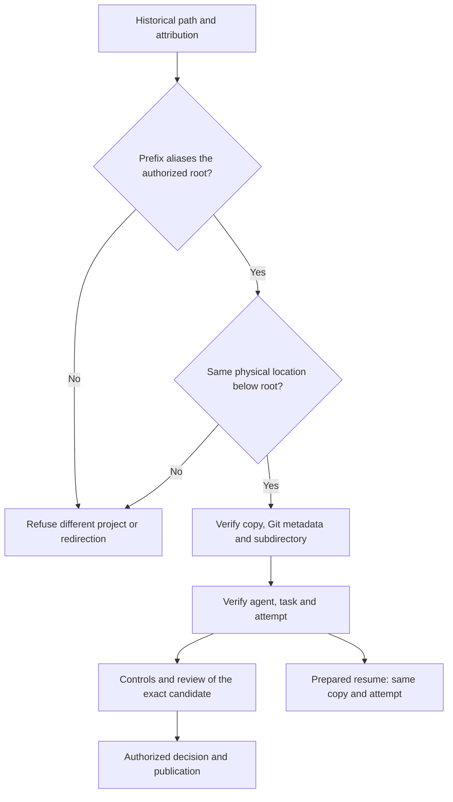

# Project relocation and copy ownership

[Français](../architecture/PROJECT-RELOCATION.md)

## Current source contract

A relocated project may retain its old path as an alias to **the complete same
project root**. Historical repository, copy and agent strings remain unchanged.
The engine checks physical identity before use; it does not rewrite mission
history or evidence to manufacture compatibility. Missing paths or aliases to a
different project are refused. The operator must retain a valid alias; the engine
creates no links elsewhere on the host and moves no mission automatically.
Shared-service interruption and storage migration require their own preflight.

| Element | Required check |
| --- | --- |
| Project root | Physical resolution of the selected root |
| Managed repository | Same root, mission-owned reserved location, compatible manifest and Git revisions |
| Copy | Original agent/work/task attribution, expected copy location, isolated Git metadata |
| Effective workspace | Copy root **plus** project subdirectory; those levels are distinct |
| Handoff | Artifact belongs to the producer workspace; digest and attribution verified |
| Prepared resume | Original identities, contract, settings, copy and attempt; no duplicate |

`canonicalOwnedProjectPath` inspects ancestors from outside to inside. Only a
prefix resolving the entire authorized root can represent its alias. The
remaining path must resolve exactly its expected location below that root.
An internal link to another copy, another directory or even the project root is
refused. An external link to only one copy is not a project-root alias.

`.git`, Git common-directory and effective subdirectory checks remain enforced.
Before retaining a result, stored agent workspace and copy custody are verified;
contradictory caller arguments are refused. Paused results remain pending without
implicit controls, review or publication.

## Evidence and limits

The recipe physically moves a temporary project, retains its old alias, reopens
isolated storage and calls the public bundle-export handler. It verifies handoff,
publication of an existing result, preparation of a new copy and replay without
duplication. Export does not rewrite mission state. Negative cases cover copy
and Git metadata redirection, an external copy-only alias, an internal root link,
a contradictory workspace argument and Git subdirectories.

The 27 targeted tests/subcases pass with race detection. Review/process fixtures
prove neither real-model autonomy nor the historical native server's behavior.
Its serving binary remains unchanged; real access and recovery require an
authorized recipe against the actually installed version.
