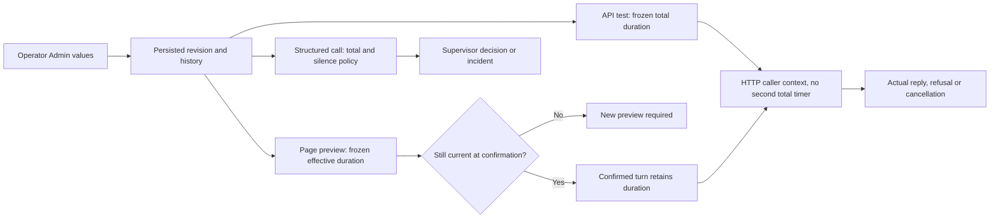

# Planner, reviewer and API waiting policies

[Français](../architecture/PROVIDER-LIVENESS.md)

## Shared configuration

Versioned defaults in `config/provider-wait.json` and saved revisions in
`.swarm/provider-wait.json` supply the authoritative policy. Admin, API and CLI
share validation, preview, revision checks, idempotent events and history.

| Field | Meaning |
| --- | --- |
| `silence_seconds` | Time without recognized productive activity in structured planner/reviewer calls; 0 disables silence monitoring |
| `max_duration_seconds` | Optional total call duration; 0 disables that total deadline |
| `planning_lease_seconds` | Ownership lease renewed during a live planning call, within the public reservation contract |

CLI: `swarm run-limits provider-wait show|history|preview|apply`. API:
`GET /api/v1/provider-wait`, `POST /api/v1/provider-wait/preview|apply`.
Restoring old values creates another revision; history and consumption remain.
Running calls retain their policy. Recognized reasoning/content resets only the
silence timer, never an explicitly enabled total timer. Initialization, retry,
quota and unknown events do not prove productive activity.

The root supervisor handles cross-scope problems; a subplanner handles its own
scope. The engine preserves incidents and verifies permissions, freshness,
ownership and evidence before applying their decisions. Activity or process
exit is neither a verdict nor acceptance. Invalid or revoked ownership cannot
be revived through lease renewal.

## API tests and page assistance

The October 12 source correction also applies **total duration** to API connection
tests and page questions without an explicit provider timeout. Their HTTP client
adds no hidden 60-second total limit. Buffered HTTP tests do not emit the
productive activity events used by structured silence monitoring.

A connection test freezes the current total duration at its start. Its request
context remains cancellable when total duration is zero. The caller's deadline
is passed through to HTTP without a shorter client deadline.

Page assistance freezes the effective duration in its preview. Changed effective
waiting settings require a new preview before confirmation. A confirmed turn
retains its duration. An explicit positive `assistant_timeout_seconds` stays a
provider choice; otherwise the project total duration is inherited. Preview and
execution add no hidden 300-second maximum. Zero installs no timer; manual
cancellation, process termination and lost-supervisor recovery remain available.
Invalid durations are refused instead of being silently replaced.

The [browser request timeout](WEB-REQUEST-POLICY.md) is separate. Its expiry does
not prove that the server canceled a mutation. Upstream refusals and network
failures remain possible; configured waiting does not prove provider health or
answer quality.

## Verification scope

Tests discriminate hidden HTTP deadlines without waiting a full minute by
capturing the effective request context. Local process fixtures verify completion
without a total timer, manual cancellation, explicit timeouts, stale previews
and invalid duration refusal. The browser recipe saves the Admin setting, checks
the page preview and observes expiry/success against a local HTTP fixture in
FR/EN and both themes. No real model call or native installation is implied.

## Structured provider failures

Provider `error` and `turn.failed` envelopes are failures, never validated answers. Parsing covers direct fields and `error.message`/`error.code` without classifying quoted tool content. `provider_capacity` identifies model saturation, `invalid_json_schema` identifies a rejected schema, and `provider_error` retains an unclassified failure. Public diagnostics use bounded labels and do not reflect private content, URLs or credentials. The classified cause survives a nonzero process exit.

Capacity is not an exhausted Swarm budget. The supervisor or operator reassesses availability and may explicitly select a configured route using public preview/application. Pausing, choosing a route or resuming refunds no calls or reservations. Model fallback and unchanged retries are never automatic.
