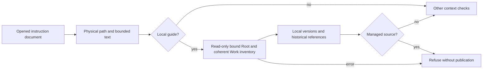

# Swarm technical reference

> Historical Go contract reference. The active CLI is Rust, with no Go fallback. Commands and Go build examples below are retained historical material and are not current installation instructions. Use [installation](INSTALL.md), native help and the active migration plan for availability.


[Overview](../../README.en.md) · [User guide](USER-GUIDE.md) ·
[Installation](INSTALL.md) · [Preparation and revision](PREPARATION-UX.md)

Swarm is a Go companion that retains work across agent sessions. It provides
French and English web/terminal interfaces, Markdown views and versioned JSON
contracts. `work list` and `resume` do not start agents or select work implicitly.

## Standalone repository and build

Use `--root` to target a project independently of the Swarm source repository.
Linux and Go 1.24+ are the tested scope. SQLite is embedded through
`modernc.org/sqlite`; no separate SQLite server or CGO is required. Dependencies
are pinned in `go.mod` and `go.sum`. The first build downloads dependencies; the
compiled application can run offline. Model providers may still require network
access. Web resources are embedded in the executable. Node 22/npm rebuild them.

```sh
make build
./bin/swarm --root /path/to/project init
./bin/swarm --root /path/to/project providers init
./bin/swarm --root /path/to/project web 127.0.0.1:18787
make test
make frontend
make smoke
```

Open the session link printed by the server. Planning, product workflow and audit method resources
belong to the controlled project; the standalone repository does not bundle
private project methods, `.swarm/` state, missions or keys. Installed agents
have their own authentication. Custom API connections use **AI and connections**.

## Language and machine-readable contracts

Web: select Français or English; `?lang=en` also selects and remembers English.
CLI: `swarm --lang en help`, or `SWARM_LANG=en`. The explicit option wins.
French is the default. Language affects presentation, not JSON payloads, enum
values, commands, IDs or stored user content. In particular, do not translate
`besoin`, `simple`, `standard`, `exigeant` or slash commands in requests.

`--input -` reads stdin. `--json` returns machine-readable output without display
translation. Common work mutations require `schema_version: 1`, a unique
`event_id`, and `expected_revision` (0 for creation, current revision thereafter).
Preparation has a distinct `version: 1` envelope; see its dedicated guide.
Dates are UTC. Identifiers use ASCII letters, digits, `_` and `-`.

Shared persisted work readers check the SQL key, positive revision and schema 1
UTF-8/JSON body together. `work show`, `work list` and the HTTP list reject
inconsistency with an error and no partial result. Common mutation and replay
apply the same guard before their callbacks. Consistency proves no author or
rights and does not cover every explicit SQL reader; see the
[Work row contract](WORK-ROW-CONTRACT.md).

```json
{
  "schema_version": 1,
  "event_id": "create-api-1",
  "expected_revision": 0,
  "title": "Update the API contract",
  "objective": "Client and server share the same schema",
  "scope": "Contract, client, server and associated tests",
  "criteria": ["Contract tests pass on current files"],
  "next": "Define the contract task"
}
```

```sh
swarm work create --input work.json
swarm work list
swarm work show WORK --json
swarm resume WORK
```

## Task contracts and revisions

`task add WORK` takes `id`, `title`, `deliverable`, `criteria`, `owner`, optional
`depends` (existing tasks in the same work), and `next`. `task update WORK` takes
`id` and the fields to change; `status` is optional. Contract fields include
title, deliverable, 1–12 criteria, dependencies, `max_attempts` (1–3) and
`max_tool_calls` (1–100). Missing/null lists stay unchanged; `depends: []` clears
dependencies and `criteria: []` is rejected. Empty strings stay unchanged;
whitespace-only text is rejected.

Contract edits require a `todo` or `blocked` task, no simultaneous status
transition, no active agent in the work and no running task. Unknown, repeated or
cyclic dependencies are rejected atomically. Actual contract changes invalidate
gates, overrides and revalidation; plan checks are recalculated. Old plans,
attempts and events remain historical records. The task is the current contract.

`work update WORK` changes title, objective, scope and criteria under the same
revision envelope. All tasks must be `todo`/`blocked` with no active agent.
Validations are invalidated while history remains.

Leaving `running` requires `outcome`: `completed`, `failed` or `interrupted`.
`submitted` requires `completed`; `blocked` requires a reason. Reopen an accepted
task through `todo`, then perform a new attempt and validation.

## Validation policies

The web validation form shows each criterion, structured checks, scope, limits
and exact effect. First request a preview, then confirm it. Editing any field
invalidates that preview. Removing a policy is a separate action. AI assistant
suggestions do not populate authorization automatically.

```sh
swarm validation preview WORK --task t4 --input policy.json --json
swarm validation apply WORK --task t4 --input confirmed-policy.json --json
swarm --lang en help validation
```

The request contains `schema_version`, `expected_revision`, `task_id`, `intent`
(`replace` or `remove`) and `policy` when replacing. Applying additionally requires
`event_id` and the returned `preview_token`. Changed revisions or settings require
a fresh preview. A removal omits `policy`.

`mode: "human"` requires human review and accepts no automatic checks.
`mode: "automatic"` requires 1–8 structured controls. Each defines its exact
command, covered criterion indexes, objective justification, optional relative
working directory and a timeout of 1–300 seconds. Combined timeout is at most
300 seconds. Allowed executables are `go`, `git`, `node`, `npm`, `python`,
`python3` and `pytest`, launched directly without a shell. All criteria must be
covered; required plan checks must have matching control identifiers.

```json
{
  "schema_version": 1,
  "expected_revision": 9,
  "task_id": "t4",
  "intent": "replace",
  "policy": {
    "mode": "automatic",
    "controls": [{
      "id": "api-contract",
      "command": ["go", "test", "./api", "-run", "TestContract", "-count=1"],
      "criteria": [1],
      "justification": "This test fails when criterion 1's API contract regresses.",
      "dir": ".",
      "timeout_seconds": 120
    }]
  }
}
```

Use human review for qualitative judgments without an explicitly authorized,
objective check. A report, AI answer or log cannot authorize commands or prove a
PASS. After an attributable handoff, automatic acceptance also requires an
unpaused, authorized autonomous mission, complete policy and successful checks
against current files. Receipts under `.swarm/validation/` bind attempt, policy,
deliverable and results. Changed evidence invalidates the gate. Failed checks
block dependants, not independent branches. Bounded correction attempts receive
check IDs, exit codes, output hashes and receipts, then rerun all checks.

## Continuous missions and supervision

`mission start` records authorization. A conductor is active only while
`swarm web` or `swarm mission watch WORK` renews supervision. Agents report
activity separately. `mission status WORK` and the cockpit show the last check,
error, next check and recorded conductor action. Authorization alone is not active
supervision. The local conductor is not an external Codex supervisor.

Stopping the web server does not terminate agents. A restart reconciles active
attempts before scheduling; transactional guards prevent duplicate reservations.
Pausing retains checks until resume. `mission preview` reports the first wave
actually possible, not a promise based solely on the requested slot count.

## Agent exchanges and workspaces

```sh
swarm exchange send WORK --input exchange.json
swarm exchange consume WORK --input acknowledgement.json
swarm exchange list WORK --json
swarm workspace status WORK
swarm workspace integrate WORK --input manifest.json
```

Exchanges are `handoff`, `help_request` or `help_answer`, with `agent_id`,
`task_id`, `attempt_id`, `recipient_task_id` and `recipient_role`. Recipients must
exist and match the current plan; messages cannot grant roles or expand scope.
Handoffs require `result_state` and at least one `{path, sha256}` artifact. Hashes
are checked at send and consumption. Consumers must depend on producers.
Consumption binds to the recipient attempt and exact replay is idempotent.
A replaced producer attempt or changed artifact makes the handoff stale.
Help requests require a 1–3600 second timeout. An unanswered request becomes
`escalated` even if it was acknowledged. HTTP exposes the same recorded states
at `GET /api/v1/exchanges?work=WORK`.

A shared or overlapping directory tree permits one writer at a time. Explicit
profiles using prepared, disjoint, non-nested directories can run concurrently.
A durable FIFO queue arbitrates missions waiting for the same tree. Confirmed
completion releases the reservation.

Workspace integration is a separate serialized operation bound to SHA-256
handoffs. Each target supplies `source`, `target`, `base_sha256` (empty means the
target must not exist) and `result_sha256`. A changed base produces a conflict
receipt, exit code 3 and zero writes. This file-integration path does not create
worktrees, merge Git branches or rerun validation automatically. Managed Git
planning is a separate workflow described below.

## Checkpoints, OODA and gates

`checkpoint WORK` requires `summary`; it accepts `next` and `memory` paths to
existing project files. `ooda WORK` requires `observation`, `orientation`,
`decision`, `owner`, `next`; `result` is optional. Record public facts, not private
reasoning or full conversation transcripts.

`gate WORK --input gate.json` uses the mutation envelope with `task_id`, `phase`
and a method-version-2 `document`. Phases are `entry`, `validation`, `delivery`,
`audit`. The document must include actual artifacts, domains, checks and results;
a document containing only `method_version` and `scope_id` is not valid proof.
`evaluate --input evidence.json --phase delivery` computes without persisting.
An audit can contain findings; it is not delivery acceptance. Valid blocked gate
inputs can still be persisted. Consult the command's JSON failure classification;
preparation, validation and lifecycle commands have their own exit conventions.

## Recovery and reliability

An environment failure (permissions, sandbox, mount or unavailable resource)
holds its task without blindly retrying. Independent branches can continue.
Explicit retry names the latest attempt with `previous` and supplies new
`precondition_evidence`: a concise observation from a completed access check.
The same observation cannot be reused after another environment failure. It
neither validates the deliverable nor relaxes limits; the strictest earlier
bounds remain. The UI does not recommend disabling sandboxing or changing mounts.

`work list` and `work show` are reads. `resume` without an ID lists work; with an
ID it regenerates `.swarm/views/ID.md`. Mutations regenerate views too, but render
failure does not undo a committed transaction. `resume` repairs the view.

SQLite is canonical. State and event commit together with revision checking and
event deduplication. Markdown is a dated, revisioned projection. Evidence is checked
again on resume and acceptance; a hash proves file identity, not truth or complete
scope coverage. A recorded running task does not prove a live process.

`.swarm/` is ignored by Git. Keep one local root per project; do not share its
SQLite database through a network filesystem. Do not store raw conversations or
unnecessary secrets in work records. Hooks are project-specific and optional.
Swarm does not install Claude hooks or Codex instructions in controlled projects.

## Export, import and backups

```sh
swarm export WORK --output /tmp/work.zip
swarm --root /other/project init
swarm --root /other/project import --input /tmp/work.zip
```

Export reads state and events in a consistent transaction. It includes explicitly
referenced evidence/memory files with hashes and reports missing files. It does
not copy all source or ignored files. Changed evidence makes export fail. Archives
are limited to 128 MiB expanded; JSON entries to 16 MiB.

Import preserves IDs and rejects collisions, unknown versions, unsafe archive
paths and modified attachments. Attachments go into `.swarm/imports/ID/` without
overwriting project files. Gates are checked against the destination project;
missing or different evidence is invalid. Diverging histories and Git state are
not automatically merged.

## Mission lifecycle

```sh
swarm lifecycle list
swarm lifecycle preview WORK archive --input request.json --json
swarm lifecycle apply WORK archive --input confirmation.json --json
```

Preview takes `schema_version`, `expected_revision`, `action` and, for `purge`,
`retention_days` (1–36,500). Confirmation adds a unique `event_id` and returned
`preview_token`, tied to the revision and lifecycle generation.

- `archive`: creates a ZIP under `.swarm/lifecycle/archives/` and marks the work;
  it does not remove its records.
- `purge`: removes only old agent logs, terminal output and assistant exchanges
  beyond retention. Business events, receipts, verdicts and evidence are excluded.
- `delete`: atomically moves work and related SQLite rows to `mission_trash`.
- `restore`: removes archive marking or atomically restores trash records.

Source files, reports and evidence files are never deleted. Operations reject
active agents, intents, reservations, preparation exchanges, conductors or checks
and recheck under lock. Receipts make resubmission idempotent. Restore conflicts
leave the whole mission in trash. Trash preview and receipt include
`snapshot_sha256`; the token binds exact snapshot bytes, checked again before
writing. Inconsistent Work, foreign dependent rows or replaced content are
refused without partial restore or trash loss. Obtain a fresh preview after any
change. Matching identity/revision attests neither authorship nor usage rights;
see the [snapshot contract](WORK-ROW-CONTRACT.md#dynamic-snapshots-and-restoration).
The web uses the same engine. Deletion also
requires typing the exact mission name; merely opening or closing a preview has
no effect.

## Page assistant and session logs

The assistant reconstructs page facts on the server from view coordinates.
The modal shows exact context and prompt before sending. Citations are inspectable;
proposed actions open normal forms. Stale answers cannot open actions. Structured
references do not establish the truth of an interpretation. The assistant cannot
validate a task, gate, policy or PASS result.

Supported Claude/Codex assistant adapters run without implementation tools in an
isolated directory, with explicit cancellation and configurable
`assistant_timeout_seconds` from 1 to 300 seconds. Unsupported providers are
refused without silent retry. Questions, answers/refusals, context, prompt and
reported usage are retained and exportable. The current UI shows the latest 40
exchanges. Budget reservations are estimates, not invoices.

Agent sessions retain explicit public messages independently of detailed output
capture. Private internal reasoning is not collected. Public messages are bounded
to 2,048 bytes each and 1 MiB per attempt; reaching a limit is reported. Detailed
capture is needed for tool response content. Old uncaptured output cannot be
recovered retrospectively. Session completion is not task validation.

## Providers, levels and hierarchical planning

Provider policy defines explicit model and effort for `simple`, `standard` and
`exigeant`. `auto` resolves the context's default: page questions generally use
simple, work/APEX standard. Demanding is explicit; a refusal causes no silent
fallback. The resolved route is shown before launch and saved with the attempt.
`model_policy_hash` binds the launch to the policy preview. Testing access is
explicit; opening settings calls no model. Exports exclude secrets and commands.

On new work, `planning enable WORK --input activation.json` configures scope
owners, a durable inbox and atomic decisions. `planning step WORK` executes at
most one AI decision; `planning show WORK` exposes state. An authorized supervised
mission may reactivate its owner after agent feedback. The web also supports
managed Git copies, inherited validation and downloading results. CLI commands
`planning history`, `bundle`, `cleanup-preview` and `cleanup` expose these
operations. Use the concrete preview and current contract before cleanup.

See [preparation and revision](PREPARATION-UX.md) for independent reviewers,
responsibility cards, organization guards and API model configuration.

## Validation commands

```sh
go test ./...
go test -race ./...
go vet ./...
npm test
make build
npm run test:i18n-ui
npm run test:connections
```

Browser recipes use isolated projects. The distributed binary does not require
Python; some test recipes and user-configured agent checks do. Historical design
notes describe particular experiments and are not substitutes for current tests.

### Evaluation result statuses

The evaluator accepts exactly one of five statuses: `PASS`, `FAIL`, `PARTIEL`,
`NON TESTÉ`, `NON APPLICABLE`. Combinations (`FAIL|PARTIEL`), unknown values or
surrounding spaces are rejected before any decision. A critical failure cannot
be disguised as a combination to avoid its blocker. Count, evidence and reason
rules still apply to each valid status. The fix requires the normal delivery
path and does not automatically replace an already running binary.

Evaluation weights must yield a finite aggregate in the numeric representation
used. Overflow causes explicit refusal, without a new business ceiling on
weights. If needed, rescale weights while preserving their proportions and
prepare the scoring evidence again. A failed JSON result write also returns
an error, even if the computed evaluation was favorable.

Required plan controls use the same exact JSON keys as score calculation:
`checks`, `id`, `gate`, `mandatory`. Case variants cannot satisfy different
controls from those actually evaluated. Presence alone proves neither results,
artifact freshness nor authority to accept the task.

The repair is verified through the public gate CLI on isolated fixtures; active
service deployment remains a separate operation.

A running task cannot be closed without its recorded current attempt.
Inconsistent state rejects with `attempt_state_invalid`, without inventing
an attempt or clearing history. Repair must establish the missing evidence;
another retry does not replace it.

### Documentary sources — Rust engine

`prepare files ID [SCOPE [QUERY]]` observes admitted names;
`prepare source ID PATH START END` captures UTF-8 inclusive lines starting at1,
with SHA-256 over the full file. Protected GET `/api/v1/preparations/files`
(`id,scope,q`) and `/source` (`id,path,start,end`) share this reader; unknown or
repeated query keys refuse. `prepare source-add ID --input REQUEST` and
`source-remove` use the version1 writer with event_id, expected_revision and
`source:{path,start_line,end_line,sha256}` (removal only needs path). The writer
rereads and compares the digest, stores the timestamped excerpt and invalidates
brief adoption/verdict/plan readiness. Documents, Work and commitments remain.
An exact receipt replays without reopening the file. Removal needs neither the
file nor available source policy. The Sources dialog uses these operations
without model execution.

Admin exposes twelve `preparation_source_*`/`preparation_sources_*` settings:
file/excerpt/total/path/query bytes, lines, source count, directory/file/visit
limits, extensions and excluded components. Settings group44 is complete or
absent; older installations never silently adopt it. Numeric null means
unlimited; zero blocks the corresponding volume. Empty extension lists admit
no format; empty exclusions add no component exclusion. The initial `private`
exclusion protects known private proof directories, without universal private
data detection. Visit/result caps bound neither time nor memory: directory
entries are enumerated and sorted before applying them.

Known private paths, traversal, symlinks, special files, NUL, invalid UTF-8 and
secret-shaped full-file content refuse. Descriptor checks bind .swarm and the
database; this is neither OS confinement nor an atomic snapshot of concurrent
file edits. Preview grants no execution authority. Malformed nested JSON objects
return `preparation-request-invalid`; a decoded monetarily invalid budget returns
`preparation-budget-invalid`. Duplicate/alias/null projection starts at initial
Go-compatible decoding, preserving finite limits.

### Project-instruction status — Rust

`project-profile show` and `project-profile check` observe current metadata for
preparation/planner/subplanner/worker/reviewer. Protected GET/HEAD
`/api/v1/project-profile` returns the same status without query/body. The shared
context reader enforces saved policies, recognizable-secret refusals and the
existing memory guard. Role reads are sequential: they establish neither atomic
filesystem consistency, agent receipt/authentication nor future authorization.

Detection of three known Claude paths checks only contained regular-file metadata;
native settings contents are never opened/imported. Missing/nonregular/outside
paths are excluded; other errors stay errors rather than empty success. The
preparation page reuses the metadata dialog. Profile catalogue/selection/apply
remain migration work. For this read, refusals expose a safe static identifier in failure.reason while
internal causes remain hidden. The interface displays that identifier as text;
control decisions still use stable codes without parsing message wording.

A canonical source under `.claude/field-guide` still refuses with HTTP501 and
`versioned-memory-source-guard-not-ported` until its versioned guard is ported.
The status reader does not bypass this limitation.

`prepare release-review ID` reads the same `{preparation, work}` object as GET
`/api/v1/preparations/release-review?id=ID`. Two sequential observations are not
an atomic snapshot: a later release must bind both revisions again. Work carries
current task contracts, including edits since conversion. This read changes
neither departure locks nor budgets.

### Preparation conversation history — Rust

`prepare dialogue ID` and GET/HEAD `/api/v1/preparations/dialogue?id=ID` read
all retained turns in SQL insertion order. Row status is authoritative; invalid
identity/type/causes refuse. used_in_brief/used_in_plan and stale are recalculated
from current documents and observed method bytes. The private prompt cannot be
serialized by this readonly DTO.

Reading kills/finishes no process and changes no reservation. A pending/running/
stopping turn explicitly refuses501 until its supervisor is ported. Completed
history is readable as text in the existing conversation view; send/stop/use
proposal remain unavailable. No polling, inherited20-turn cap or15s deadline is
introduced. Future calls and policies require their own saved contract.

### Rust preparation AI calls — local pilot

The text API adapter, Admin v46 policy and Rust worker are installed in the local
pilot; evidence and limits are in [the dedicated record](../plans/migration-rust/PREPARATION-AI-CALLS-20261026.md).
Historical installations never enable calls implicitly. CLI-provider adapters and
Work API agent execution remain explicitly unported.

The native text flow exposes `prepare capabilities`, `prepare send ID --input
JSON`, `prepare stop ID --input JSON`, `prepare dialogue ID` and
`prepare use-proposal ID --input JSON`, with `--root ROOT --json`. Matching
protected routes under `/api/v1/` are GET/HEAD `preparations/capabilities`, GET/HEAD
`preparations/dialogue?id=ID`, POST `preparations/send`, POST `preparations/stop`
and POST `preparations/command` for `use-proposal`.

Admin v46 is complete or absent; historical installations never adopt it
implicitly. Initial values: enabled0;8000 message bytes,96000 context bytes,
20 turns,1048576 response bytes;300s timeout/600s maximum;200ms observation and
2000ms refresh; `json` transport;100 HTTP/1 headers and16384 HTTP/2 header bytes
(`u32` representation). All are persisted, validated and editable in Admin.
The four caps accept `null` as unlimited and0 to deny nonempty content/a turn.
Timeout0 requires maximum0 to remove the deadline; intervals stay positive.
Unrepresentable local-clock durations refuse without fallback. SSE uses saved
`agent_provider_event_max_bytes` per event and bounds assembled content; JSON
bounds the entire response body.

Only active configured text API connections are offered. The configured model
is sent verbatim; its display proves neither backend nor provider account.
No redirect, retry, fallback model or tool. Received text must be complete JSON;
SSE reasoning and private prompts are never published. History/data are retained.
Reservations become `estimated` before possible contact and are never refunded
automatically after error, stop, missing usage or worker death. Token counts are
provider declarations; no price or zero cost is invented.

Any change to the settings journal, provider catalogues, selected method or
project instructions invalidates an active call without relaunch; remote billing
may already have occurred. Attached excerpts remain snapshots. Deployment switch
`SWARM_PREPARATION_DISABLED=1` takes precedence. A living server reconciles its
owned worker's death. After CLI exit, an orphan requires explicit `stop` recovery,
without signalling a raw PID. Different host/boot/namespace refuses. Observations
establish neither agent authentication nor OS confinement.

Explicit comparison precedes `use-proposal` with event identity and CAS; version
history and `source_turn` are preserved. Brief adoption remains explicit, and a
plan still needs validation. This flow starts no mission. CLI provider adapters,
legacy active turns and Work API agents remain outside this first integration.
Versioned-memory sources retain their501 guard and static reason; removing it
is not a recovery mode.

Delivered historical compatibility: an exact completed Go turn can be
replayed without native-worker metadata, provider contact or mutation. Parent and
request hash still bind the record; another message conflicts. Legacy active
turns remain explicitly unported (CLI and HTTP501). New calls still accept only
empty/auto levels. See the historical replay migration record.

### Rust project profile selection — local pilot

`project-profile show|check|list` reads observations and suggestions;
`preview|apply --input JSON` takes `{profile, expected_sha256}` and
`select ID --input JSON` takes `{expected_sha256}`. Use `--root ROOT --json`;
otherwise a localized heading precedes the complete document. Protected catalogue
GET/HEAD is `/api/v1/project-profile/catalog`; POST
`project-profile/preview|apply|select` uses shared session/CSRF and transport bounds.
POST select takes `{id, expected_sha256}`.

Profiles reference files and roles, never native permissions. Preview creates no
temporary live profile, call or agent. It validates all five roles under saved
Admin `project_profile_max_*`, `project_context_max_bytes` and
`project_worker_context_max_bytes`. `null` remains unlimited and0 refuses nonempty
content; the form adds no second ceiling. Hashes are observations, not approval
of future contents: applying reads sources again.

Apply compares the current SHA then atomically publishes `swarm.project.json`
using Go-compatible JSON plus newline. An absent configuration uses NOREPLACE.
Cooperating Root writers share an exclusive reservation; external editors are
not confined. Late failures retain `configuration_may_be_recorded`: read and
compare, never assume rollback. The catalogue may report `active_error` with
an invalid active JSON profile's SHA for explicit repair, without calling it valid.

Recognizable secrets are checked in names, paths and text. Actual `.swarm`/`.git`
targets and aliases to non-Markdown/text files refuse; on Unix, multiple hardlinks
and component redirection during open refuse. Evidence concerns Linux, not absence
of every secret, OS confinement or agent attestation. Versioned memory retains
its501 guard. The form keeps draft/original SHA on failure; refreshing never
silently rebases it. Installation selects no live configuration. See the
[migration record](../plans/migration-rust/PROJECT-PROFILE-SELECT-20261027.md).

### Rust preparation into an existing work — local pilot

A preparation created with an explicit `work_id` can materialize its validated
plan into that work. Read-only `prepare release-review ID` and GET
`/api/v1/preparations/release-review?id=ID` return current preparation and work;
reread both revisions after a conflict. The historical route name grants no
departure authority.

`prepare create-missions ID --input JSON` and the shared POST require the plan
SHA, `expected_revision` and `expected_work_revision`:0 creates a work, a current
positive revision appends to the associated target. The form shows its title and
revision before confirmation. Old tasks, plans, budgets, configuration and
attempts remain; only new deterministic task IDs, gates, provenance and held
locks are appended. A collision refuses; no old task is replaced.

Tasks, locks, event and receipt share one transaction and final readback,
including other preparations' unchanged locks. CAS refusals do not write.
Uncertain commit or late-output failures retain existing uncertain/recorded
diagnostics: reread or replay the exact same event. `release-plan` requires a
separate confirmation and current revision; it releases only this conversion's
tasks and preserves other tasks/locks. It may unpause an already configured
conductor, without changing autonomy/budget or synchronously calling a provider.
Initial team setup keeps its pristine contract; existing configured works use
the supported public operations, never implicit organization adoption from a plan.
No new timeout, ceiling or permission is introduced. Locally delivered in179; evidence and limits in the [record](../plans/migration-rust/PREPARATION-EXISTING-WORK-20261027.md).

### Revising a materialized Rust plan — local pilot184

After saving and validating a new plan, `prepare release-review ID` and GET
`/api/v1/preparations/release-review?id=ID` add `revision` only when its hash
differs from the conversion. It contains `plan_hash`, `spec` and ordered `changes`
(Go wire labels: added, modified, kept, retired with history or dependent needing
verification). The view compares the original plan, current work contract and
new contract, exposing manual edits. Preparation, work and settings are sequential
observations, not an atomic snapshot or approval of future contents.

`prepare revise-missions ID --root ROOT --input JSON --json` or the shared POST
`/api/v1/preparations/command` requires `version:1`, `action:revise-missions`,
`preparation_id`, `event_id`, `expected_revision`, positive `expected_work_revision`
and the new document `sha256`. The engine revalidates under current saved Admin
policies and checks both revisions. Active agents, active/unresolved native
reviews and held decisions block; reconcile through their supported public
operations, never by deleting history.

Revision preserves attempts, versions, prior reviews, plans and consumption. It
archives impacted tasks' current reviews and invalidates results, including
external dependents. Retired tasks stay `abandoned`; live dependencies on a
retired task refuse. Changed control meaning, delegated branches or lost
requirements require explicit reauthorization/reconfiguration. A recovery's
stored limit remains when the authored ceiling is unchanged; an explicit plan
reduction applies. This grants no permission, reservation or extra call.

Work body, locks, pause, event and receipt share one transaction and final
readback, including retained retired/foreign locks. New-plan tasks are held and
cockpit/planning paused. `release-plan` remains explicit; it does not clear the
revision's cockpit pause. Mission resumption uses its separate public control.
Creating or releasing a plan attests neither execution nor acceptance.

A Work conflict invalidates the review: close and reopen it for a new intention.
An incoherent200 receipt instead keeps the original event pending for reread or
replay; never invent another event after an unknown outcome. Late errors retain
known/uncertain publication markers. See the
[record and limits](../plans/migration-rust/PREPARATION-REVISION-20261027.md).

### Preparation: Rust CLI adapters (pilot192)

Preparation dialogue can offer configured absolute Claude/Codex executables with a saved model route and the Admin grant for unverified provider context. Custom/harness adapters and required probes remain refused. Individual route unavailability appears in `unavailable_providers` without hiding available API providers; read/decode errors remain failures.

The worker owns its child behind a private channel. Sealed stdin carries the prompt in a private temporary directory with the allowed environment. Existing Admin settings supply deadlines, observation cadence and output limits; a saved zero deadline remains unlimited. Replies require a terminal event, successful process exit and the dialogue JSON contract. Tool restrictions are requested from the provider; their external effectiveness is not certified.

Stopping does not undo remote costs. Attempted reservations stay estimated after failure/cancellation; missing/invalid consumption stays unknown. Documents are never adopted automatically. Changes to settings, configuration, executable, allowed environment or route invalidate the previous confirmation. Active historical Go turns are not adopted.

Known structured Claude/Codex tool call/result declarations also interrupt the CLI stream: a later final answer cannot erase them. This certifies neither unseen events nor absence or rollback of external effects.

### Explicit CLI levels — pilot195

The `simple`, `standard`, `exigeant` levels appear in preparation CLI capabilities with their model, policy and digest, subject to saved announcements and restrictions. Automatic mode keeps its configured route; if denied, a human must choose an allowed explicit mode. No neighboring model is substituted. APIs keep their fixed model and refuse an explicit level. Manual reservations are neither pricing nor invoices.

Explicit sends retain their level in private v2 metadata; API/automatic turns keep v1. An old worker refuses v2 before contact. Terminal receipts and budgets remain retained; finish/interrupt turns using a compatible version before downgrading. A pending event keeps its original payload after capability withdrawal, allowing known-state replay without an implicit new launch.

### Profile sources and versioned memory — pilot201

The context reader checks the physical path of the opened instruction. Within `.claude/field-guide`, local lessons referenced by memory versions and references to them in `index.md` are refused, including after withdrawal. Ordinary guides with no managed reference remain available. Imported and foreign-project versions do not declare local ownership; this rule neither admits nor selects a memory version.

A separate read-only bound Root supplies the coherent Work inventory without borrowing the caller’s writer. Retained directory/database association is checked again. Inventory and close errors prevent context publication instead of becoming an empty list. Existing multiple-link, private-alias and containment refusals still apply. These observations freeze no filesystem and establish no agent permission.



### Explicit recovery of an active historical Go exchange (pilot216)

History also observes `pending`, `running` and `stopping` exchanges without adopting
their processes or applying the former15s automatic termination heuristic.
`prepare stop ID --input FILE --json` and `POST /api/v1/preparations/stop` accept
`{ "preparation_id": "ID", "turn_id": "TURN" }`. The interface exposes
“Request or check stop” even when model calls remain disabled. Pending is fenced
by SQL CAS before claim. For an observed live original supervisor, only `stopping` is recorded; receipt
by that process is not established. Refresh or explicitly stop again after it ends
to settle the turn. Missing/foreign
identity or uncertain process observation refuses terminal settlement. No inherited
signal or restart. Only `reserved` is released; `estimated` remains committed.
An absent/corrupt ledger refuses and rolls back. Provider descendants can survive;
remote termination or absence of cost is not established. Exact send replay of
an active historical event returns its recorded state without dispatch, another reservation or worker adoption.
Evidence/delivery: [plan](../plans/migration-rust/PREPARATION-LEGACY-ACTIVE-20261027.md).

Journal format47 is accepted for initialization and changes under the same
history-chain checks. Reading format46 adopts no value; upgrading to47 still
requires explicit preview/apply. Unknown future versions refuse. The format bound
is a protocol invariant, not a budget increase or automatic settings adoption.

Rust `mission seen WORK --root ROOT [--json]` connects the historical consultation
bookmark to the `visit mark` writer. Historical Visit JSON or FR/EN text; no
`--input` document. Output failure can follow a recorded write: read back with
`visit show WORK`. See NATIVE-SESSION-VISIT.md.
