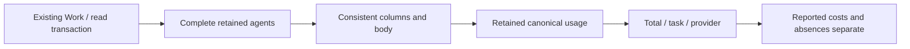
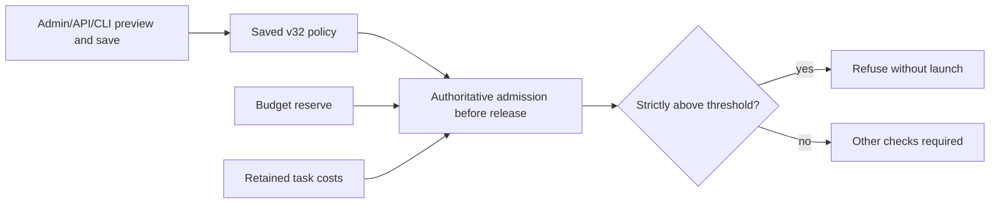

# Reported worker costs

`swarm-rust costs show WORK --root ROOT --json` and `RootStore::reported_costs` observe `Agent.usage.provider_reported_cost_usd` declarations for all retained attempts in one read transaction. Work must exist. Each agent’s authoritative ownership columns must match its body. Incoherent rows, negative/nonfinite amounts, overflow or SQL/close failures refuse the whole read; they never become successful empty totals.

The CLI adds `scope="retained-worker-attempts"` to distinguish this projection from the mission’s other calls. JSON retains `reported_usd`, `attempts_with_cost`, `attempts_without_cost`, `by_task` and `by_provider`. Explicitly reported zero counts as `attempts_with_cost`; an absent declaration counts as `attempts_without_cost`. No attempts means both counters are zero. Any sum with silent attempts remains partial. These declarations are neither authenticated charges nor invoices; reading retained legacy data does not reconstruct authenticity.

No recent200 window, inferred token prices, cumulative session OTLP sum or fallback to a noncanonical last-valid observation is used. Planner/reviewer calls, reservations and budget estimates are excluded, preserving Go costSummary scope. Additions follow retained f64 values in newest-agent order without monetary rounding or a hidden epsilon; overflow refuses. This observation permits no launch and debits no budget. The lot187 candidate admission guard is described below; the complete dispatcher/watch still needs migration.

The CLI opens Root read-only, encodes and closes before writing, preserving independent read/close causes. Write or flush failure is an error even after visible bytes. Reading again requires no consumption reset; the projection never repairs data to make it readable. Consumers must handle read refusal rather than infer zero.

Lot186 is locally verified: three engine tests, one numeric test and two CLI tests pass, with Clippy and Rustdoc. `costs-permanent09` replays all six cases with verified integrity. `worker-permanent21` checks the actual inert native flow:25 simulated reported USD, one attempt with cost and other attempts without cost, followed by normal-binary CLI reading. The initial10 failure was a wrong test expectation about an inherited fixture program; its original Root is retained. `normal06` archives285 inputs without fixture features; SDK20 shares the same187 Rust engine sources. These proofs establish no installation, invoice, independent review or complete conductor migration.

## Automatic admission — lot187 candidate

Saved v32 policy mission_dispatch_cost_reserve_percent compares cumulative reported
task costs with the budget's per-launch reserve. Installation: 200 %. Strictly above
refuses; equality permits. The nonnegative integer percentage has no hidden business
cap at 100 %. Zero refuses positive costs; null removes only this guard. Without
a budget or with zero reserve no derived threshold applies. Legacy absence refuses
automatic admission until explicit preview/save adoption. Admin/API/CLI share the
document and validation; the planning/delegation group exposes the field with FR/EN
help and existing AI advice.

Policy, reserve and history are reread in the authoritative intent/admission
transaction before release. Already released workers keep independent supervision.
Refusal refunds/resets nothing. Read errors preserve causes and never become zero
cost. Missing declarations remain unknown: known totals are lower bounds, never
authenticated invoices. Estimated reservation limits remain separate. Comparison
preserves stored f64 values and integer percentages exactly without floating-point
threshold overflow or integer rounding.

Status: lots187/188 guard locally verified on a frozen candidate, not installed or globally accepted.

Lot188 adds embedded-translation evidence: actual HTTP bytes reproduced the early candidates’ omission; locale-after24 checks both new keys and all previous bundle keys. This complements component Admin verification without claiming complete served-UI acceptance. See [Permanent replays](RUST-MIGRATION-REPLAYS.md).
