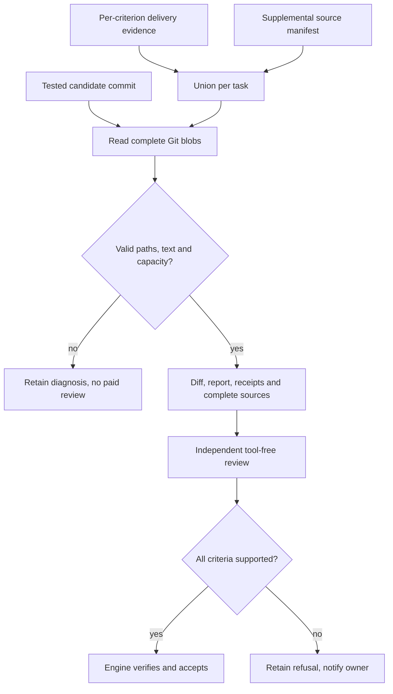
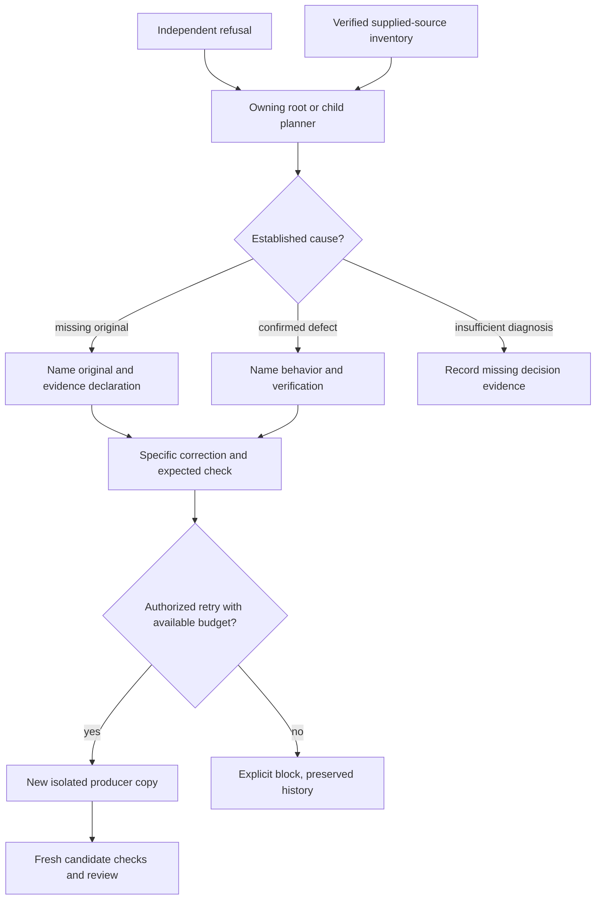
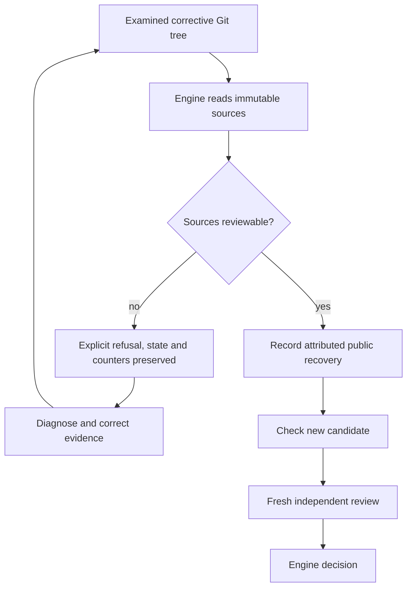
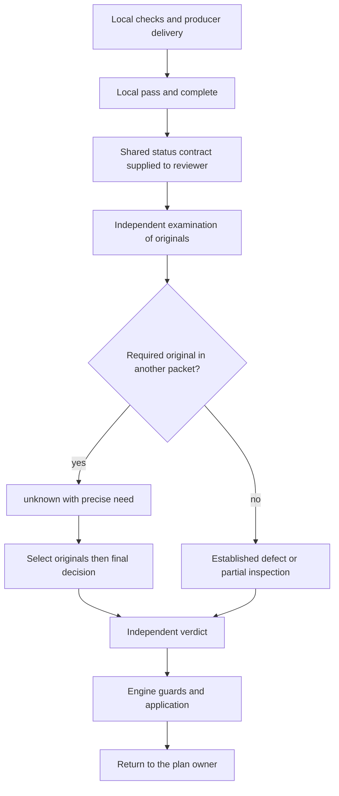

# Review evidence delivery and supervised recovery

The [AI/engine protocol](AGENT-ENGINE-PROTOCOL.md) separates invalid responses,
candidate defects and authorized recovery through deterministic routing.

Global correction dated October 10, 2026. Applies to all managed Git deliveries,
root planners and child planners, without task or provider special cases.

## Engine behavior

Files declared in `delivery.criteria[].evidence` are now attached as complete
text read from the tested candidate commit, even if unchanged. `sources[]`
records path, Git blob, bytes and SHA256. The identified task report is already
present in `tasks[].report` and is not added again through delivery evidence.
The optional `docs/TASK-ID.review-context.json` manifest adds supplemental files;
it does not suppress delivery evidence. Duplicate paths retain task ownership.

There is no live-checkout read or path inference from prose. An original mentioned
only in a quotation must still be declared. [Review policies](REVIEW-POLICIES.md) are persisted and editable in Admin:
defaults are 24 sources and 128 KiB per task, 96 KiB per source;
0 means no policy ceiling. The manifest format retains its 8 KiB transport bound.
Review transports and coordination retain their own capacity checks. Missing,
unsafe, non-text or oversized input prevents a paid review, without truncation.
Binary images are not made visible to a text reviewer by this contract.
Historical attempts without delivery or manifest keep diff/report/receipt input.
Existing reviews are never rewritten. Changed evidence requires public recovery
operations and fresh review.

## Evidence receipt for root and child planners

`planningDeliveryContext` supplies `review_evidence_inventory` for the current
`independent_review` event to its owner. It contains review/candidate identities,
context digest and attached source metadata, without copying source text.
The engine checks archived context bytes against the recorded digest first.
Missing, changed or foreign context yields `unavailable` and no attested sources.
An older refusal never receives the latest review's inventory.

The same receipt accompanies `.git/swarm-recovery.json`. Worker instructions,
the shared contract, replan and the handoff template require the missing original,
its declaration and the verification expected from a retry. Additional producer
quotations do not substitute for the original.

Receipt is not understanding or acceptance. This fix cannot guarantee every
model decision: omitted sources, incorrect analysis and ambiguous criteria may
still produce `unknown` or `fail`. Attempts, budgets and policy deadlines remain
unchanged.

## Update: preflight a repair before replacing a refusal

On October 10, T2 repair preparation reproduced an attachment overflow:
137,112 source bytes against the existing 131,072-byte capacity. Declaring the
packet ready before checking it was an operator-method failure. Check the actual
attachment union without raising capacity or removing criteria. Keep original
judge outputs and interrupted-suite limits. The full English mirrors previously
covered by T1 need not be attached again: their T2 additions remain in the
candidate diff, and the selection is explicitly documented in the evidence index.

`recoverResult` now reuses `managedReviewSources` on the examined Git result before
replacing the retained result, review or recovery refs. Both initial submissions
and corrective revisions check delivery sources and the supplemental manifest.
An error preserves public state, prior refusal, attempts and counters. A bounded
repair then follows ordinary candidate checks and fresh independent review.
This preflight covers the repaired task's sources; complete transport and
cumulative-review preflight still runs after integration.

Verification also found a linked failure: documentation additions exceeded the
32,000-byte embedded workflow capacity for planners and workers. Compact the
shared contract while retaining obligations. `tools/agent-workflows/check.py`
now exercises the engine's actual four role contexts as well as individual files,
without a provider call. Capacity remains unchanged.

The [research update](../publications/20261005-cursor-moteur/dossier-recherche/revisions/20261010-tracabilite-developpement.md)
records verification and installation status. A locally verified fix is neither
proof of deployment into an active process nor acceptance of T2.

## Components and evidence

### Local status, independent review and fragments

A producer delivery uses `status=pass` for locally demonstrated coverage and
`outcome=complete` for local delivery completeness. Neither declares acceptance.
Requiring an already favorable independent review before requesting that review
would create an impossible cycle. The shared review prefix now transmits the same
`deliveryEvidenceBoundary` used by the producer, in ordinary, fragmented and final
reviews. Claims still require evidence; this contract never makes them proof.

A required original absent from a packet remains `unknown` with a precise need
for final selection and decision. It may exist in another packet; absence from
one packet does not establish absence from the dossier. Retain old failed runs
and compare commands, scope, sources and later originals before asserting a
contradiction. A Go package label does not prove a command with `-run` ran the
complete suite.

The October 11 T2 review motivates this fix: local PASS versus acceptance, an old
failed receipt and a short check without its command. The actual adapter/provider
double checks received instructions and retains `unknown`; it does not establish
real-model understanding. The [research update](../publications/20261005-cursor-moteur/dossier-recherche/revisions/20261011-instruction-learning-retex.md)
separately records full verification, deployment and the next native review.

`managed_review_sources.go` resolves evidence declarations;
`managed_review_evidence_inventory.go` verifies context receipts;
`planning_delivery.go` delivers them to the owner;
`managed_recovery_handoff.go` includes them in recovery packets.
Delivery instructions and shared workflow resources explain these boundaries.

The regression first fails without the unchanged source. After repair it checks
complete candidate bytes, digests, immunity to mutable-copy changes, per-task
ownership, and continued refusal by a deterministic reviewer. Negative cases
cover context tampering and source/capacity failures before a paid call. Root and
child planner delivery are both exercised. These protocol fixtures do not measure
real-model decision quality. See the [French architecture and incident diagrams](../architecture/REVIEW-EVIDENCE.md)
and [dated research report](../publications/20261005-cursor-moteur/dossier-recherche/revisions/20261010-correction-globale-preuves.md)
for commands, results and installation status.

### Defect association and protocol recovery

A cited defect requires a `fail` finding for the same artifact. `inspected` or `unknown` with a defect remains an invalid reply, retained with its cost; the engine does not turn it into rejection or acceptance. Citation contract1 permits multiple distinct defects per failed artifact within the shared transport bound; the historical contract requires one entry. Retry diagnostics follow the packet version, retain identities and never write proof into the journal. An allegation can trigger an independent code diagnosis without manufacturing the missing verdict.
