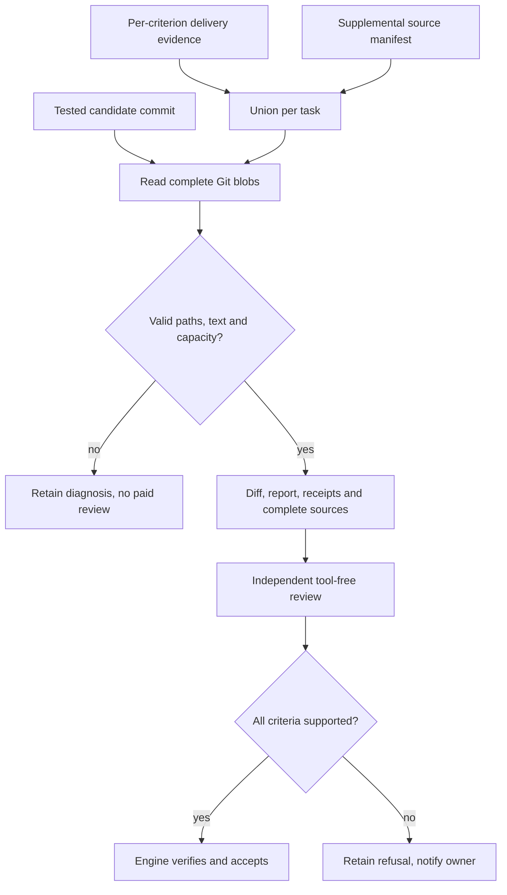
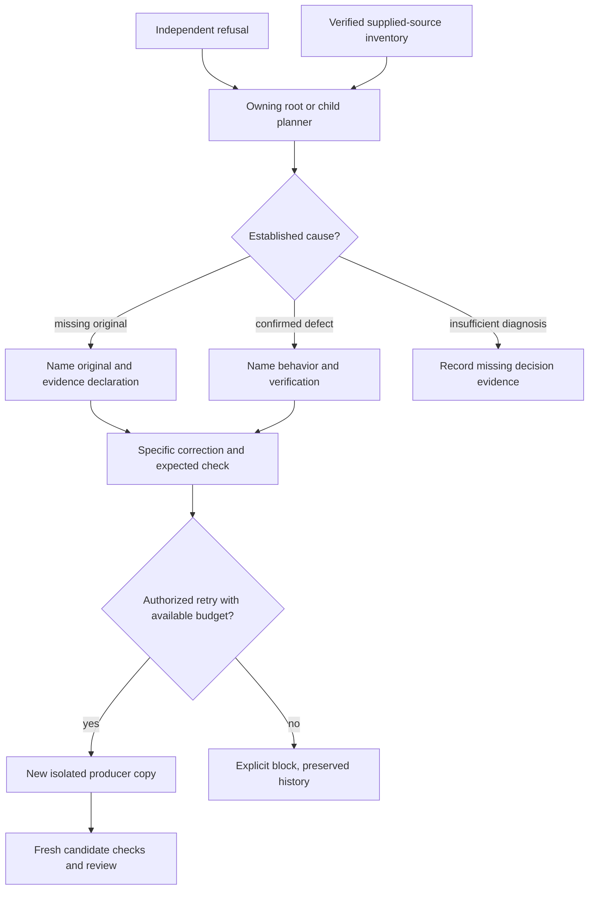
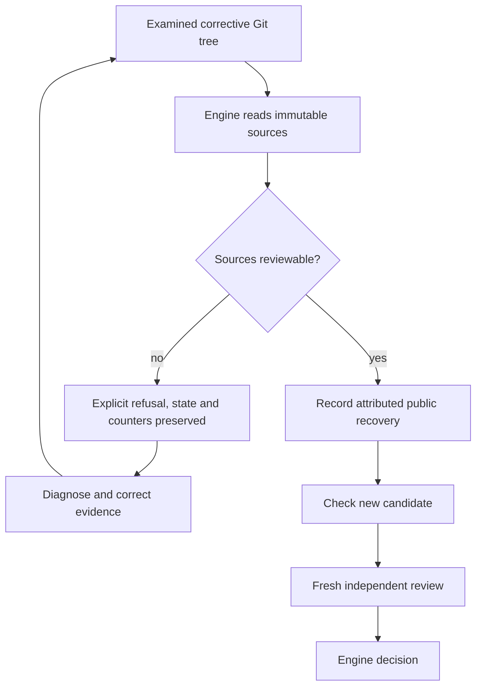
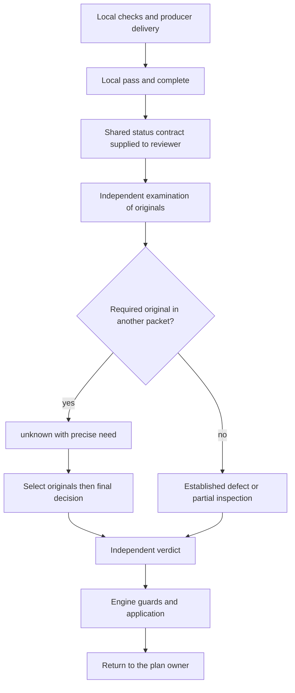
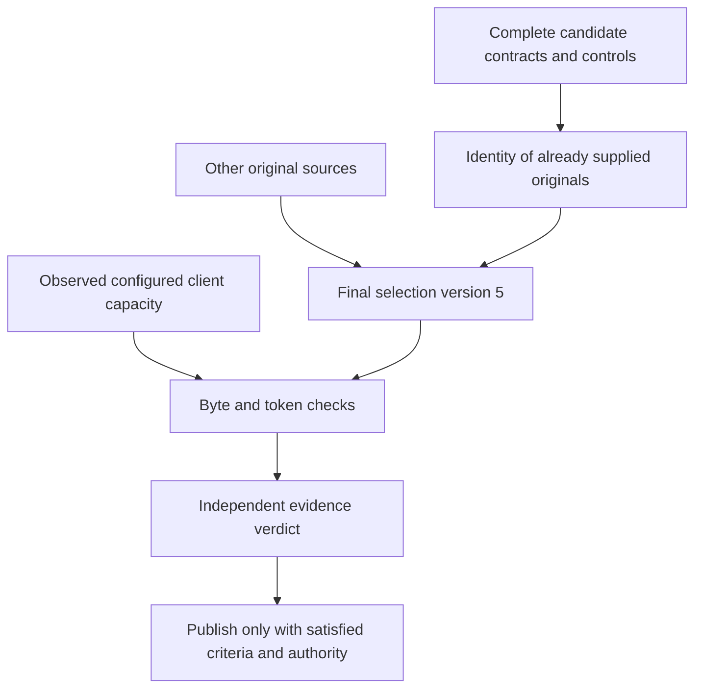
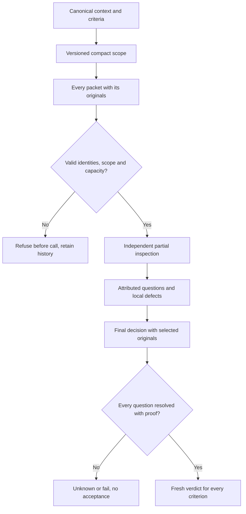
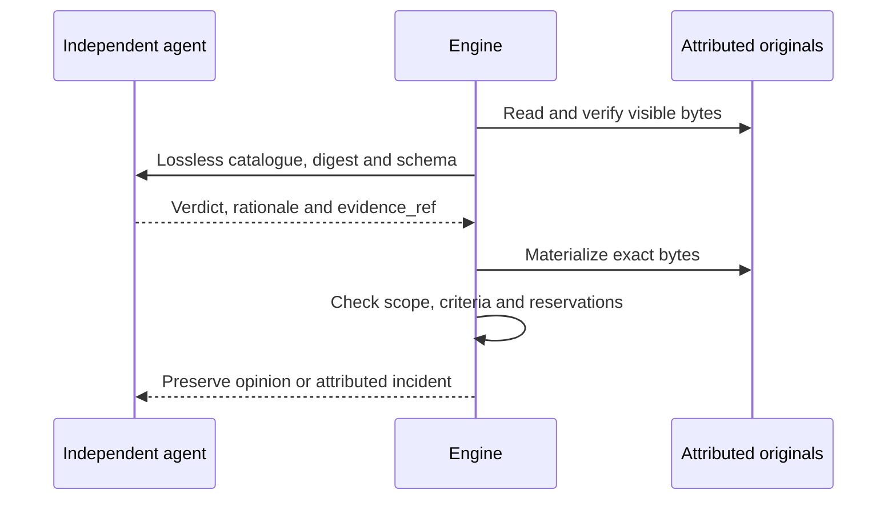

# Review evidence delivery and supervised recovery

Controls authorized with `review_output: true` supply their entire captured
output within the existing technical capture bound of 64 KiB per command. The
intermediate 8 KiB reduction is removed because it could hide a successful
control's final assertions. `output_bytes`, `output_sha256` and
`review_output_truncated` remain bound to the actual control. Output beyond the
capture remains explicitly truncated; missing historical output is never
reconstructed. Source policies and review transport limits still apply before
the provider call. Excess size requires an examinable decomposition, never
acceptance or silently truncated mandatory evidence.

The [AI/engine protocol](AGENT-ENGINE-PROTOCOL.md) separates invalid responses,
candidate defects and authorized recovery through deterministic routing.

Global correction dated October 10, 2026. Applies to all managed Git deliveries,
root planners and child planners, without task or provider special cases.

## Engine behavior

Files declared in `delivery.criteria[].evidence` are now attached as complete
text read from the tested candidate commit, even if unchanged. `sources[]`
records path, Git blob, bytes and SHA256. The identified task report is already
present in `tasks[].report` and is not added again through delivery evidence.
The optional `docs/TASK-ID.review-context.json` manifest adds supplemental files;
it does not suppress delivery evidence. Duplicate paths retain task ownership.

A declared file remains a separate physical original even when its complete content
also appears in a new-file diff. Compaction only removes unchanged diff context.
Diff `+` prefixes do not replace the literal bytes needed for citations; capacity
checks count the actual supplied context. Archived historical contexts retain
their original bytes and validation.




There is no live-checkout read or path inference from prose. An original mentioned
only in a quotation must still be declared. [Review policies](REVIEW-POLICIES.md) are persisted and editable in Admin:
defaults are 24 sources and 128 KiB per task, 96 KiB per source;
0 means no policy ceiling. The manifest format retains its 8 KiB transport bound.
Review transports and coordination retain their own capacity checks. Missing,
unsafe, non-text or oversized input prevents a paid review, without truncation.
Binary images are not made visible to a text reviewer by this contract.
Historical attempts without delivery or manifest keep diff/report/receipt input.
Existing reviews are never rewritten. Changed evidence requires public recovery
operations and fresh review.

## Evidence receipt for root and child planners

`planningDeliveryContext` supplies `review_evidence_inventory` for the current
`independent_review` event to its owner. It contains review/candidate identities,
context digest and attached source metadata, without copying source text.
The engine checks archived context bytes against the recorded digest first.
Missing, changed or foreign context yields `unavailable` and no attested sources.
An older refusal never receives the latest review's inventory.

The same receipt accompanies `.git/swarm-recovery.json`. Worker instructions,
the shared contract, replan and the handoff template require the missing original,
its declaration and the verification expected from a retry. Additional producer
quotations do not substitute for the original.



Receipt is not understanding or acceptance. This fix cannot guarantee every
model decision: omitted sources, incorrect analysis and ambiguous criteria may
still produce `unknown` or `fail`. Attempts, budgets and policy deadlines remain
unchanged.

## Update: preflight a repair before replacing a refusal

On October 10, T2 repair preparation reproduced an attachment overflow:
137,112 source bytes against the existing 131,072-byte capacity. Declaring the
packet ready before checking it was an operator-method failure. Check the actual
attachment union without raising capacity or removing criteria. Keep original
judge outputs and interrupted-suite limits. The full English mirrors previously
covered by T1 need not be attached again: their T2 additions remain in the
candidate diff, and the selection is explicitly documented in the evidence index.

`recoverResult` now reuses `managedReviewSources` on the examined Git result before
replacing the retained result, review or recovery refs. Both initial submissions
and corrective revisions check delivery sources and the supplemental manifest.
An error preserves public state, prior refusal, attempts and counters. A bounded
repair then follows ordinary candidate checks and fresh independent review.
This preflight covers the repaired task's sources; complete transport and
cumulative-review preflight still runs after integration.



Verification also found a linked failure: documentation additions exceeded the
32,000-byte embedded workflow capacity for planners and workers. Compact the
shared contract while retaining obligations. `tools/agent-workflows/check.py`
now exercises the engine's actual four role contexts as well as individual files,
without a provider call. Capacity remains unchanged.

The [research update](../publications/20261005-cursor-moteur/dossier-recherche/revisions/20261010-tracabilite-developpement.md)
records verification and installation status. A locally verified fix is neither
proof of deployment into an active process nor acceptance of T2.

## Components and evidence

### Local status, independent review and fragments

A producer delivery uses `status=pass` for locally demonstrated coverage and
`outcome=complete` for local delivery completeness. Neither declares acceptance.
Requiring an already favorable independent review before requesting that review
would create an impossible cycle. The shared review prefix now transmits the same
`deliveryEvidenceBoundary` used by the producer, in ordinary, fragmented and final
reviews. Claims still require evidence; this contract never makes them proof.

A required original absent from a packet remains `unknown` with a precise need
for final selection and decision. It may exist in another packet; absence from
one packet does not establish absence from the dossier. Retain old failed runs
and compare commands, scope, sources and later originals before asserting a
contradiction. A Go package label does not prove a command with `-run` ran the
complete suite.



The October 11 T2 review motivates this fix: local PASS versus acceptance, an old
failed receipt and a short check without its command. The actual adapter/provider
double checks received instructions and retains `unknown`; it does not establish
real-model understanding. The [research update](../publications/20261005-cursor-moteur/dossier-recherche/revisions/20261011-instruction-learning-retex.md)
separately records full verification, deployment and the next native review.

`managed_review_sources.go` resolves evidence declarations;
`managed_review_evidence_inventory.go` verifies context receipts;
`planning_delivery.go` delivers them to the owner;
`managed_recovery_handoff.go` includes them in recovery packets.
Delivery instructions and shared workflow resources explain these boundaries.

The regression first fails without the unchanged source. After repair it checks
complete candidate bytes, digests, immunity to mutable-copy changes, per-task
ownership, and continued refusal by a deterministic reviewer. Negative cases
cover context tampering and source/capacity failures before a paid call. Root and
child planner delivery are both exercised. These protocol fixtures do not measure
real-model decision quality. See the [French architecture and incident diagrams](../architecture/REVIEW-EVIDENCE.md)
and [dated research report](../publications/20261005-cursor-moteur/dossier-recherche/revisions/20261010-correction-globale-preuves.md)
for commands, results and installation status.

### Defect association and protocol recovery

A cited defect requires a `fail` finding for the same artifact. `inspected` or `unknown` with a defect remains an invalid reply, retained with its cost; the engine does not turn it into rejection or acceptance. Citation contract1 permits multiple distinct defects per failed artifact within the shared transport bound; the historical contract requires one entry. Retry diagnostics follow the packet version, retain identities and never write proof into the journal. An allegation can trigger an independent code diagnosis without manufacturing the missing verdict.

An absent or ambiguous citation can fail decoding before findings are constructed. Recovery then separately verifies the candidate, context, packet and immutable original reply identities, and forwards bounded citation diagnostics. It does not fill a line, repair a quote or convert invalid JSON into a verdict. A different candidate, modified packet or altered reply does not authorize this diagnostic.


## Select originals already received

From version 4, the final selection journal identifies `already_supplied_originals`: full
context artifacts whose bytes and digest exactly match the
`task_contracts_reports_controls` field already supplied to selector and decider.
They do not consume a second selection slot in `cost_rows`. Every other required
original remains selected in full; transport identity proves no compliance.
Changed or differently attributed artifacts are refused. Version 1–3 messages and
journals retain their original reconstruction and evidence.

For the configured Codex client and recognized model, the engine first observes
client version and bundled model metadata, then uses the attested capacity with
exact byte/token counting. A packet fitting historical transport must not hide
this capacity. Reserves and client identity are frozen in the plan. Model,
authorized calls and consumption are not increased. Without established capacity,
the historical route keeps its limits and is not provider-capacity evidence.



Current version 5 also binds the provider schema to the exact inventory. Each
`references.items.anyOf` branch associates one packet index, artifact index and
authorized digest. Candidate, context and plan identities each have one allowed
value. A freely mistyped digest is no longer among the provider's proposed
outputs. The parser remains authoritative for association, duplicates, freshness
and capacity; it never repairs or fills an invalid reply. Preflight byte/token
counting includes the actual outgoing schema before any paid reservation.
Version 1–4 journals retain their original schemas and messages.

Nonempty `review_output` bytes already supplied are also separate originals for
citation validation, logically identified by `controls/ID/output.txt`. Receipt
JSON remains available alongside them. A literal output quotation need not
reproduce its JSON envelope's escaping. Question resolutions use these same
visible originals individually: no concatenation across commands, no data
normalization and no access to missing or unsupplied output. This repairs
transport validation; quoting an output alone does not establish a criterion.

Final reply format failures retain `review_fragment_protocol`, as inspection
failures do: invalid JSON, inconsistent selection references, final citations
and resolutions without evidence. The code reaches the public receipt and
routing to the owning supervisor. `review-retry` still requires a fresh decision,
new rationale, intact originals and available budget. Original-evidence failures
detected before response decoding remain integrity failures; an actual negative
verdict remains `changes_requested`. Typing neither rewrites historical refusals
nor automatically authorizes spending.

## Accepted baseline in a fresh review

After the first accepted candidate, a new context uses the verified previous
baseline even when the complete context would fit the transport. The engine checks
its reviews, criteria, producers, policies, controls and digests, then supplies
the complete diff since that commit. A stale or altered baseline blocks this path.
Every old and new task criterion still requires current checks and a fresh
independent verdict on the new candidate.

Baseline contract version 1 makes this scope explicit in each partial inspection.
Requests for originals must relate to a current criterion, change or specific
interaction. Genuine uncertainty remains `unknown`; a verified baseline does not
approve the delta. Historical version-0 baseline contexts and prompts retain
their original bytes; an unknown version is rejected.

Newly used critical dependencies must still be declared as complete originals.
A dispatcher diff need not contain helpers defined elsewhere in the same file.
Declare the complete file and connect its decoding, limits or output behavior to
the criteria that actually use them.

## Defect bound to its finding

New packets carry `finding_contract_version: 2`. Each finding is indexed by its
supplied artifact and selects one exclusive shape: `inspected` with `v/r/e`,
`unknown` with `v/r/e/n` and at least one missing original, or `fail` with
`v/r/e/d` and at least one demonstrated defect. Each `d` item contains `quote`,
`explanation`, `reproduction` and `expected`. The schema offers neither a global
`defects` array nor an artifact number to recopy inside a defect. The finding key
is its attribution; the engine locates the line from the unique literal quote.

The parser rejects mixed shapes, foreign fields, missing or ambiguous quotes,
duplicates and more than four defects across the packet. It never converts a
contradiction into approval. Inspections remain partial; the final independent
verdict evaluates the candidate criteria. Finding contracts 0 and 1 retain their
historical formats.

Targeted check: `go test -race ./internal/engine -run
'^TestFragmentNestedDefect' -count=1 -v`. Fixtures verify attribution, preserved
opinion, rejection without acceptance, citation diagnostics and explicit restart
with spent calls and originals retained. They do not establish a native review.

## Candidate receipt and context resolution

The engine receipt supplied in `task_contracts_reports_controls.receipt` is also
an original for question resolutions. Its JSON representation is the one
actually transmitted: an exact `candidate_commit` quotation can establish the
binding of controls to the current candidate. The parser does not add the receipt
to implementation sources; the receipt alone cannot justify a business criterion
`pass`. An unsupplied receipt, another identity or a fabricated quote is still
rejected. The fix rewrites no historical opinion.

A rejected resolution quotation now identifies `packet`, `artifact`, `need_index`,
the digest of the complete quote and a bounded JSON excerpt. Missing quoted text
does not establish a missing file. The supervisor must examine this counterexample
and the originals actually received before deciding another retry; a partial
product finding does not replace that diagnosis.

## Quotation attributed to another artifact

A present `quote` field does not establish that its text occurs in the selected
artifact. On failure the engine distinguishes this from an empty field, gives
coordinates and the quotation digest, and searches the other originals in the
same packet for the exact text. Matching indexes and digests are diagnostic data;
the engine never moves the reviewer's finding. The supervisor can request fresh
independent attribution based on that counterexample. Name excerpts are bounded
so the complete diagnostic reaches its owner even with malicious paths.

Historical inspection schemas and messages retain their original bytes. The
diagnostic rewrites no reply, defect or verdict; finding quoted text elsewhere
does not demonstrate the claimed bug.

## Canonical delta and fragmented message

New accepted baselines use `version: 2`. Versions 0 and 1 remain readable and
retain their historical instruction bytes. The new context distinguishes the
complete Git delta, split across packets, from the `diff` field emptied in final
messages to avoid implicitly resending those bytes. An empty value there proves
no absence of changes.

Inventory rows of kind `diff` list every section with its name and digest. The
final reviewer reads complete contents only for selected originals; it may select
sections needed for criteria and interactions, or remain `unknown` when necessary
evidence is absent. `changes_since_observations` is a separate delta: from reused
historical inspections to the current candidate. Its absence without reuse says
nothing about changes since the accepted baseline. The parser does not treat an
inventory as implementation evidence, and a historical opinion never accepts the
new candidate.

## Complete structured reply and human projection

Structured calls now extract the original public final-answer event. The human
16000-byte projection remains separate: its truncation suffix must never enter
review, planning or control JSON. The structured reply's existing technical
limit remains 64 KiB, separate from the stream limit; exceeding it fails with
the observed size and preserves captured text for diagnosis without creating a
verdict. Reasoning events and tool output remain excluded from final answers.

Codex and Claude fixtures exercise the actual subprocess path with UTF-8
originals of 15999, 16000, 16001, 65536 and 65537 bytes. Accepted responses keep
exact bytes and valid JSON; the last case fails without clipping diagnostic text.
The missing tail of a previously clipped file cannot be recovered: retain that
limit and request another answer only after correcting the cause and obtaining
an authorized recovery decision.

## Shared scope for partial inspections

New contexts carry `inspection_scope_version: 1`. Every packet includes a compact
`scope` with task IDs, titles, deliverables, criteria, diff sections and baseline
identities. The engine derives these fields from the canonical context and checks
exact equality before a call; missing, changed or unsupported scope blocks the
plan. Complete prompt capacity includes scope, including token repacking and
historical observation reuse. Historical contexts without this version retain
their original packets and prompts.

Scope frames the assignment; it does not prove implementation. Inspectors connect
missing evidence to a criterion or concrete interaction. The final reviewer keeps
every question and may refute its necessity using a literal current-contract quote,
including irrelevant or circular requests. A scope declaration cannot dismiss a
defect or necessary evidence. Affected unchanged dependencies still require
examination; missing necessary proof stays `unknown`. Contract quotes can resolve
scope questions but never prove business compliance in the parser.



Targeted contract verification:

```sh
go test ./internal/engine -race -count=1 -v -run '^TestManagedFragment(EveryInspectionReceivesCurrentCriteria|RejectsUnknownScopeVersion|ScopeAcrossTokenPackingAndFinalSelection)$'
```

The check must execute three main tests and both repacking subcases; a run with
no executed tests is not successful. This fixture proves transmission and tamper
rejection, not native acceptance.

## Length of evidence requests

New packets carry `inspection_contract_version: 1`. For their `n` requests, the
parser uses the JSON schema's units: 3 to 240 Unicode characters, rejecting
duplicates and invalid UTF-8. Accented and non-BMP characters each count once;
their byte length is separate. Total reply bounds and exact capacity checks still
apply without truncation. Rejection diagnostics identify artifact, need index and
both lengths without changing the text.

Historical packets without this version retain byte validation and original
prompts. A recorded error remains an error: fixing the parser does not insert its
reply into the journal. The public method-change path prepares a complete fresh
review with new reservations while preserving previous consumption. New partial
instructions also explain that an empty `diff` in metadata is a transport omission;
original diff sections remain separate pieces to examine as required by criteria
and interactions.

Targeted verification:

```sh
go test ./internal/engine -race -count=1 -v -run '^TestFragmentUnicodeNeeds'
```

Two main tests cover Unicode boundaries, accents, non-BMP characters, minimum,
overflow and duplicates, historical compatibility and unsupported versions. None
of these tests accepts a business task.

## Citation conventions delivered before recovery

Roles already receive permissions, identities and a JSON schema before each
call. Historical `citation_contract_version: 1` contexts added literal conventions before
the first selection and decision, before any failure; historical contexts without
this version retain their prompts. Evidence selection uses packet/artifact references and SHA-256; final
review then requires literal quotes from visible originals. These contracts
remain distinct: a source declared in the manifest is not automatically a
complete original selected for the final decision.

When a resolution quotes text absent from visible originals, recovery now
supplies version 1 `retry_directive.citation_diagnostic`. It binds the rejected
original reply to its call, review, candidate and SHA-256. The first rejected mismatch
retains question indexes, the rejected quote digest and exact text windows from
already visible originals, with name, SHA-256, line and byte offset. Nearby-line
search may locate a formatting difference; supplied windows preserve original
bytes without normalization. The diagnostic is bounded to four originals and
256 characters per window; truncation is indicated separately without adding
characters to the excerpt. It is serialized once in the directive and targets
the first rejected boundary. All final questions and the complete source reply
remain preserved and require independent examination. These are representation
bounds; complete prompt capacity is checked before any call.

Conventions require exact indentation, spaces, tabs, line breaks and patch signs.
Control output containing JSON remains the captured text: interpreting a nested
field does not create another admissible original. A real line break differs
from the two characters backslash and n. The reviewer may choose a shorter exact
and relevant quote or retain `unknown` with the required missing proof. Diagnostics
never repair the rejected opinion or produce a verdict. Literal admission guards
and independent review requirements remain unchanged.

The same preparation covers supervisor and operator recovery. Diagnostics persist
with the public decision and actual call; validation reconstructs the prompt and
checks its digest. Historical directives without the field retain their bytes.
An altered source reply or foreign candidate blocks preparation rather than
permitting another paid call.

When a final journal already exists, preflight reloads and validates historical
inspections, selection and digests using their original directives. It then
measures the remaining selection or the exact decision with already selected
originals and the new directive. Completed inspection packets are not future
calls to enlarge with this directive. A decision that has become too large is
still rejected before reservation. Initial preparation and inspection retries
retain their complete shape checks.

### JSON and JSONL

Decisions, opinions and journal snapshots are complete JSON objects validated by
the engine. Some output transports, including provider events and Go tests, use
independent JSON lines (JSONL), allowing incremental reading and preserving a
usable prefix after interruption. This never authorizes completing an incomplete
JSON opinion or treating logs as acceptance.
Protection against modification depends on access rights, digests and the
integrity checks of the particular journal.

Verify delivery before the first call and after reopening:

```sh
go test ./internal/engine -race -count=1 -v -run '^(TestCurrentReviewCitationConventionsBeforeFirstCall|TestRecoveryPrefixCarriesLiteralCitationConventions|TestFinalCitationRecoveryReplacesLegacyContractAfterReopen|TestFinalCitationRetryMeasuresRemainingMessage|TestCitationDiagnostic.*)$'
```

The fixture exercises public operator and supervisor recovery, preserves the
initial rejection, checks the prompt actually received by an isolated subprocess
and observes a new review result. This deterministic transport is distinct from
native pilot review. A separate test alters the captured original and requires
rejection without mutation or spending.

## Original references — citation contract 2

New contexts built by the current sources use `citation_contract_version: 2`.
Native qualification and the actually installed binary must be verified
separately; program evidence is retained under `docs/plans/`. Historical
versions 0 and 1 retain their original wire contracts.

Whole-artifact selection keeps its packet/artifact/SHA-256 references. For the
final opinion, the engine builds `citation_catalog` from originals actually
supplied: attributed task reports and controls, visible sources and changes,
and receipts/contracts for scope or binding questions. `catalog_sha256` binds
the catalogue to its candidate and context. A `pass` criterion or `resolved`
reservation uses an admissible integer `evidence_ref` offered by the schema;
`fail` and `unknown` retain an explanatory `evidence`. The independent agent
still owns the semantic judgment and its rationale.

The engine materializes exact original bytes and applies existing checks:
complete criteria/reservation coverage, task, candidate, original evidence,
current changes and evidence rights. Receipts and contracts do not become
business compliance evidence. Unknown references, another catalogue digest,
duplicate fields, mixed text/reference claims and invalid JSON are rejected
without completing the response. Rejected opinions are never repaired or accepted.

Identical fragments are shared, including control output represented inside
JSON control/receipt strings. `originals` records each name, kind, digest, size
and ordered spans. A negative span n inserts quote `-1-n` with JSON string
escaping, without surrounding quotes. Concatenation must recover the exact
original and SHA-256. `the `evidence_encoding` column of `quotes`` identifies the literal form
materialized in the opinion. The 768-byte UTF-8-safe granularity may retain a
tail shorter than eight bytes with its previous fragment; it removes no content
and adds no execution policy ceiling. Exact prompt and schema capacity is checked
before reservation. Existing transport bounds remain distinct: 64 KiB structured
provider replies, 16 KiB fragmented final replies. Internal materialized evidence
is not mistaken for the provider's wire size.

New fragmented reviews also retain their original workflow, attributed method
and prefix with a digest. A favorable historical opinion remains verifiable
after method changes; active reviews retain freshness guards. A contract 2 error
cannot be retried through wording, deadline or budget changes alone. Operator
and supervisor paths reject the operation with `review_precondition_unchanged`.
Changed shared instructions or project guidance alone do not repair contract 2,
even when the textual workflow digest changes.
An effective versioned contract change requires a complete review of the same candidate, after
historical originals are checked; no old inspection or opinion is reassigned.
The preview reports required calls and minimum budget without a provider call
or resetting consumption.



Targeted isolated verification:

```sh
go test ./internal/engine -race -count=1 -v -run '^(TestCitationCatalog|TestReferencedCitation|TestStructuredCitationContract|TestFinalCitationRecoveryReplacesLegacyContractAfterReopen|TestReviewMethodRestart)'
```

These fixtures cover subprocess transport, reopening, refusals and preserved
proof. They establish neither a native independent review nor program acceptance
or release qualification.

Contract 2 reads raw Git stdout, preserving boundary spaces, tabs, CRLF and LF
in reports and diffs, including compact and incremental forms. Stderr remains
separate from content. Versions 0/1 retain their historical normalized strings;
they are not rewritten to pretend that previously omitted bytes were supplied.
Git report validation follows the context's recorded version.


## Configured window for fragmented reviews

`quotas show|preview|apply` and the Admin Engine settings dialog share
`limits.review_context_tokens`, persisted in `ReviewerConfig.input_context_tokens`.
Units are tokens in the total context window: 0 keeps the client default and does
not mean unlimited. A positive value requires observed compatible capacity. A
window too small for reserves or beyond the advertised maximum is rejected
without mutation or a model call. Source quotas, input/output reserves and call
budgets remain separate. An extended window may affect provider pricing and does
not authorize another call.

Capacity contract version 2 records the default, advertised maximum, configured
window, model, client version and executable stamp, provider and capacity digest.
Every inspection, selection and decision receives that exact value through the
Codex `model_context_window` setting. It is added after constructing tool-free
arguments, without carrying over worker permissions. The maximum comes from the
executed client's bundled catalog; another client's cache or an API publication
does not prove that limit. Preview validates this contract, saving rechecks under
lock and stale revisions fail. An unverifiable explicitly requested window never
silently falls back to historical transport. Version 1 contracts retain their
original bytes and historical readability.

A closed error review keeps frozen instructions and original evidence for preparing
a different corrective candidate. Historical reading neither spends a call nor
reuses a verdict or removes the unchanged-retry guard. The new candidate requires
fresh controls and independent review. Complete control output must also fit its
capture. Using a more compact native format with the same executed cases and
verified names differs from truncation; retain the original overflow and complete
new output.

Inspection reuse also compares the actual workflow digest. A different method
requires fresh inspections of a corrective candidate even when the citation schema
is unchanged. Rejecting an unchanged failed retry is a separate contract and must
not be used as the inspection-reuse predicate. This separation grants no implicit
spending or acceptance.
