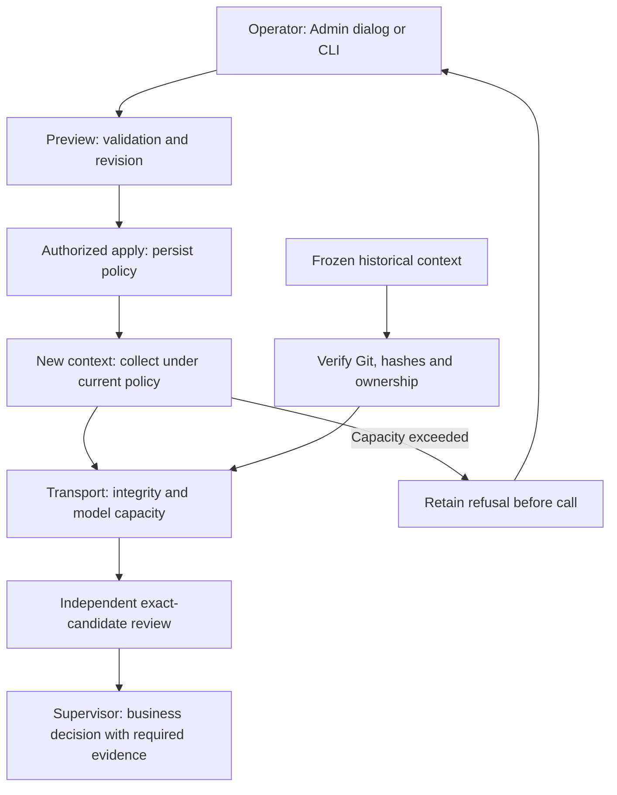

# Review policies

The mission Admin settings dialog, quota API, CLI `quotas preview` / `quotas apply`
and Go share persisted values and validation. Preview never mutates. Apply
requires a fresh revision, reason and event ID. Attempts, consumption and refusals
remain intact. A held planning session or running review prevents changes.

| `limits` JSON field | Unit | Legacy default |
| --- | --- | --- |
| `review_delivery_files` | Diff files and files per coordinated lot | 100 |
| `review_context_files` | Distinct sources per task (manifest and delivery) | 24 |
| `review_source_bytes` | Complete source bytes | 98304 |
| `review_context_bytes` | Total source bytes per task | 131072 |

Zero means no policy ceiling; positive integers set a ceiling. Negative values
fail without mutation. Omitted fields retain current values; legacy configurations
use the visible defaults. Call consumption remains separate. Raising a policy
neither approves a result nor grants provider capacity. The manifest format keeps
an 8192-byte read-only transport bound. Safe paths, regular Git blobs, UTF-8,
hashes and attribution remain mandatory. Model and transport capacities are
checked independently; no evidence is silently truncated.

The engine validates and applies authorized decisions. The root supervisor handles
cross-scope issues; sub-supervisors handle their scope. Changed policy does not
retroactively invalidate paid context: historical checks validate integrity.
Missing or malformed sources remain integrity errors. A valid manifest exceeding
the configured file count produces a capacity refusal, not an invalid-JSON error.

Count the deduplicated union of manifest and delivery evidence; the report
already included in full is not counted twice. Example: a28-source manifest
can become35 distinct sources with delivery evidence, totaling214328 bytes.
Limits must cover35 sources,214328 total bytes and the largest individual source.
Preview, save, reopen Admin and inspect `quotas show`. Use public
`planning retry-review` only for an attributable current unpaid checkpoint with
an ended producer and valid controls. Changed evidence requires public recovered
result repair. Raising policy alone leaves the task blocked: checks and fresh
review still apply. Never reset attempts or manufacture acceptance.

Recipes: `TestConfiguredReviewFilePolicyPreservesCheckpointAndAllowsExplicitRecovery`,
`TestReviewSourcePolicySeparatesValidManifestFromCapacityAndPreservesAllBytes`,
and `tests/review_file_policy_ui.cjs` (binary, isolated provider configuration,
provider ID, evidence directory). Browser verification starts no agent or provider call.
