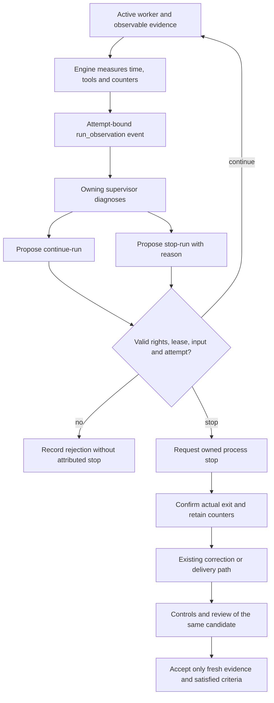
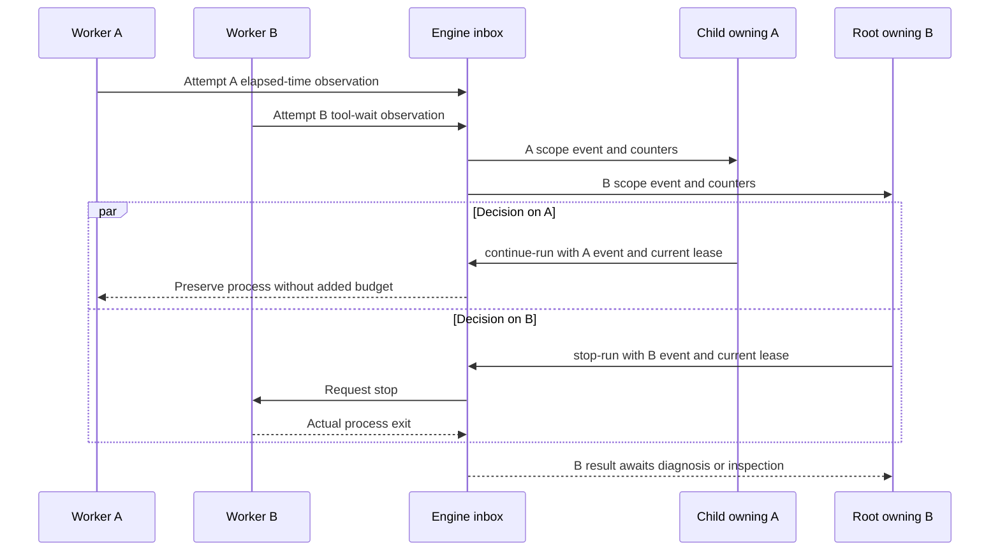
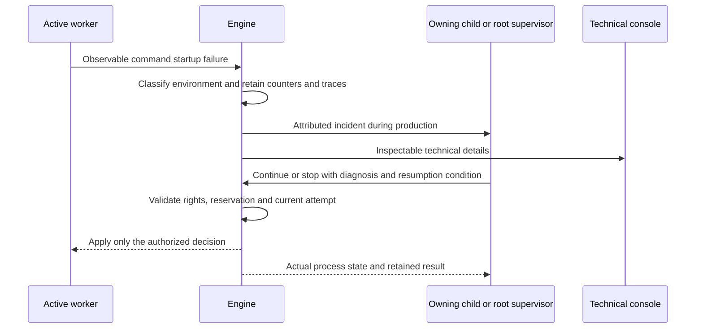

# Agent conduct: AI decisions and deterministic observations

User decision on October 11, 2026, following Cursor T2's interruption.
The owning supervisor judges useful progress and decides how work proceeds.
The engine measures, routes observations, verifies rights and applies attributed
decisions. Elapsed time proves neither completion, lack of progress nor acceptance.

## Communication during recovery

The user explicitly prohibits prolonged silent waits, hours of unmanaged
blockage and claims of a fix without a verified outcome. During active interactive
work, Codex gives a meaningful update at least every 60 seconds: observed state,
cause or uncertainty, action and pending proof. Long response delays are also
prohibited: acknowledge promptly, bound work steps and tool output, and communicate
before an analysis or check finishes. A displayed reconnection does not establish
its cause. Abnormal slowness triggers
`replan` without a human reminder. Changed wording or a raised budget alone
cannot justify repeating a failure.

This obligation is recorded in personal instructions, `AGENTS.md` and the embedded
shared contract. A tool-free native role retains its required JSON and routes
the incident to its supervisor; it must not add chat prose to that protocol.
Verify assembled contexts and identify the binary delivering them. Instructions,
context delivery and scheduled wakeups alone prove neither repair nor effective
supervision. Distinguish local tests, observed runtime effects and overall
acceptance; failed or unverified criteria remain open.

## Incident and decision

Attempt `a-a349f9134d355713576b7166`, agent `auto-f2abbcfe6bed66fd1a5e`,
was interrupted at 08:36:27 UTC, exit 143, `stop_kind: delai`. It was still running
a test, with 78 calls/results observed against an 80-call ceiling. The 1,800-second
total timer stopped it. Its saved stash is retained, without claiming acceptance.

Increasing the timer would postpone the defect. Disabling every limit would also
remove spending constraints. The chosen correction separates time observations
from authority: duration informs the owner; authorized budgets remain binding.
Both automated and terminal/dialogue production lose their automatic duration
stop. Waiting for a structured tool also becomes an observation. Explicit control
command deadlines, structured preparation/review call deadlines and ownership
leases remain separate mechanisms; they do not determine task completion.

| Owner | Responsibility | Cannot infer from a timer alone |
| --- | --- | --- |
| Worker | Implement its scope, preserve evidence, hand back results | Verified criteria or ownership of other tasks |
| Child supervisor | Diagnose its tasks, decide continuation or stop, escalate dependencies | Global acceptance or additional budget |
| Root supervisor | Conduct the objective and its tasks, use child handoffs | That every worker finished |
| Go engine | Measure, route, validate decisions, confirm actual process exit | Useful progress, semantic blockage or completion |
| Independent reviewer | Inspect the candidate and evidence in a separate context | Candidate validity from process termination |

The AI may conclude that work is finished and propose closure. The engine checks
applicable evidence and transitions. That integrity check is not an autonomous
judgment about remaining work.

## Implemented contract

Existing settings remain configurable and frozen per launch: `timeout_seconds`
in the launch profile, `tool_seconds` and `silence_seconds` in Admin with existing
inheritance. The historical JSON name `timeout_seconds` now means an observation
threshold for production processes. No replacement cutoff is introduced. FR/EN
UI labels explain this meaning.

`agent.progress` includes `elapsed_seconds`, `time_threshold_exceeded`,
`tool_wait_seconds`, `tool_time_threshold_exceeded` and existing counters. Silence
retains `unknown` provider vitality. Native terminals report time without
inventing unobservable tool calls or business progress.

For a planned task, `run_observation` is persisted in the work/event transaction
and sent to its `scope_id`. It freezes agent, attempt, trigger (`elapsed_time`,
`tool_wait`, `output_silence`), threshold and counters. Each trigger is emitted
once per attempt; counters continue afterwards. Actual planner context and the
strict output schema include these observations and operations. Active production
no longer blocks its owner from running; controller integration after completion
still fences planning.

`continue-run` and `stop-run` use `planning decide` through the shared CLI/API.
They require task `id`, justified `next`, all other operation fields empty/zero,
current owner/revision/lease/generation, an explicitly processed and actually
supplied current event, the same live worker/attempt, and existing decision and
activation budgets. Reason and decision are persisted with the event.
Continuation preserves the process and counters without renewing budgets. A stop
is applied by the process supervisor as `stop_kind: planning`; actual exit precedes
release. A persisted stop wins the stop/result race. Replays do not spend another
decision; obsolete decisions cannot control replacement attempts.

Tool-call, repetition and error caps, provider quotas, storage integrity, human
stops, permissions and attempt limits remain. This correction removes time
cutoffs; it does not claim AI ownership of every guard. Code correction follows
the existing retry path after confirmed stop; `next` is not arbitrary worker input.

This diagram describes ownership boundaries, not observed concurrent AI calls in
the Cursor mission: it still has one root scope; exercising hierarchy belongs to T3.
If the owner lacks a provider or budget, is paused or fails, no AI decision or
budget is invented. The event remains pending; elapsed time alone does not kill
production. Human stop remains available. Standalone agents expose observations
in public state without inventing a planner. Unchanged thresholds do not produce
repeated paid calls. Periodic renewed supervision would require an explicit policy.

## Verification limits

Isolated tests exercise active processes/terminals past thresholds, pending tools,
root/child routing, public CLI decisions, confirmed stops, continuation, dedup,
reopening and rejection of wrong owner, inactive process or unreceived input.
The original three source files reproduce the old failure. Provider doubles do
not prove autonomous real-model conduct or T2 acceptance. Exact receipts and
installation state are recorded in the [dated research note](../publications/20261005-cursor-moteur/dossier-recherche/revisions/20261011-run-supervision.md).
See [AI/engine protocol](AGENT-ENGINE-PROTOCOL.md),
[recursive recovery](AUTORECURSIVE-RECOVERY.md) and [parallelism](AGENT-PARALLELISM.md).

## Admin values actually received by a launch

### Error diagnosis during each execution

`tool_failure` routes ordinary tool, configuration and check failures to the
exact scope owner during production, with attributed diagnostics and counters.
`infrastructure` retains its separate environment count. Each new category
count is delivered once; polling unchanged state creates no additional event.
Ordinary failures retain the existing guards and spending limits. The owner must
diagnose, correct or route, verify the effect, then resume the original need.
Technical classification is neither a business decision nor acceptance.

Classification examines original output before reducing it. Bounded traces keep
their beginning and end, preserving a long traceback's final cause. Each category
retains at most three traces, including the first and latest; original logs remain
separate. Potentially sensitive values are masked in this projection. Diagnostics
remain observations based on visible provider events.

Stopped managed attempts retain sources as an attributed immutable checkpoint at
settlement, before any retry. Source preservation failure stays in the public
blocker and owner event. Environment recovery requires verified provider-context
preflight and every declared capability; an operator narrative or manual stop
cannot clear an observed environment failure. See [attempt recovery](ATTEMPT-RECOVERY.md)
for protocol version 2 `ready` handoffs and their mandatory controls and review.

Explicit Admin `tool_seconds` and `silence_seconds` values replace provider
default observation thresholds and historical attempt thresholds for a new
launch. An explicitly smaller launch request remains effective. The engine
re-reads these settings in the reservation transaction, preventing stale
preflight settings from entering the new context. Values and command directives
are frozen into the actual agent; subsequent Admin changes never rewrite it.

Tool-call, error, repetition, plan and retry ceilings remain restrictive. Raising
a time threshold adds no call budget and changes no provider account limits.
Without an explicit Admin value, inheritance and historical ceilings remain.
This addresses the measured case where Admin reported900s while a newly created
agent prompt still required300s.

## Infrastructure failure during production

Structured environment failures retain their counters and traces but no longer
consume the worker's consecutive-error streak or identical-failure ceiling. A
command prevented from starting does not establish a defect in the produced code.
While that failure persists, repetition requires supervision rather than a task
completion decision. Success or an ordinary tool failure restores normal repeat
behavior. Authorized tool-call spending, provider waits, storage integrity and
human stops remain enforceable.

For a planned task, the engine delivers an `infrastructure` `run_observation` to
its scope owner while the process is active. It captures attributed diagnosis,
agent, attempt and counters. Each new environmental failure is delivered once;
an unrelated tool error does not re-deliver an old infrastructure incident. The
owner proposes `continue-run` or `stop-run` with an explanation and received
proofs. The engine checks rights and freshness and confirms actual process exit
when applying a stop. Independent tasks can continue. A standalone process keeps
its diagnostic and spending caps; this correction creates no implicit planner.

The UX exposes the environmental incident and pending owner decision in functional
wording, with technical traces available through diagnostic details and the console.
A new label cannot establish recovery or hide an unresolved environmental failure.

Storage contract version 30 protects infrastructure observations and control-retry
budget hashes from older decoders dropping those fields. Public migration creates
a private backup without rewriting work, events or consumption. Stop older processes
before migration and never test against a live mission database. Isolated regression
uses a provider double, a real subprocess and the owner's public decision; it does
not establish autonomous real-model judgment or restore the host's CIFS shares.
