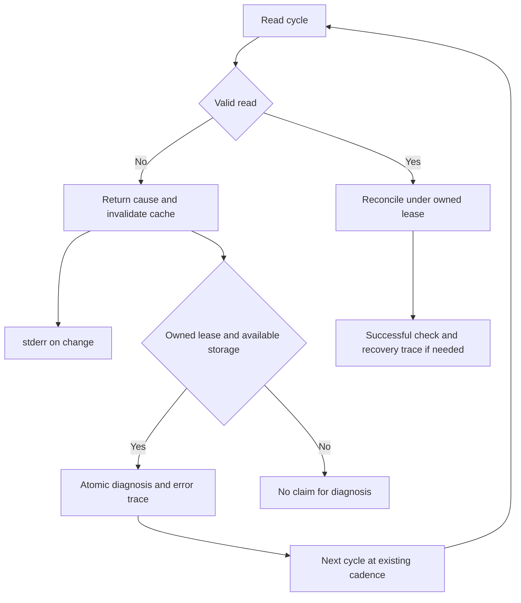
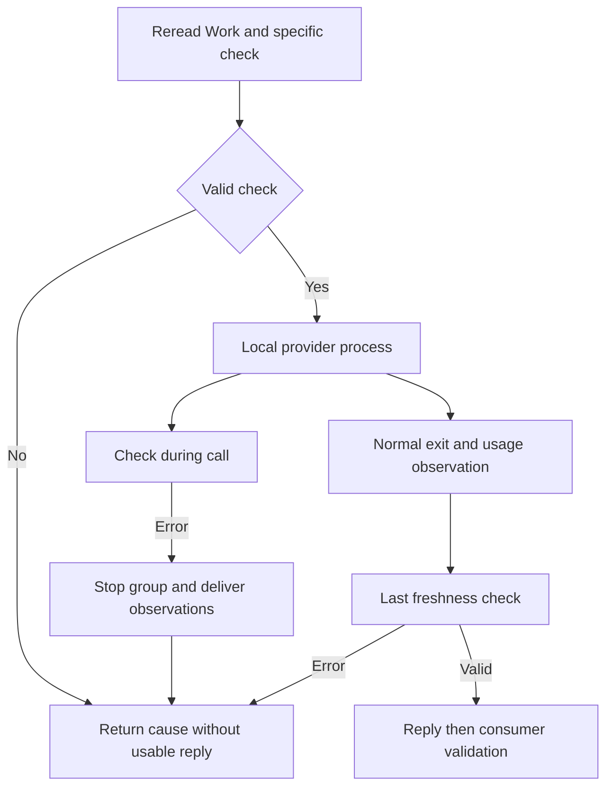
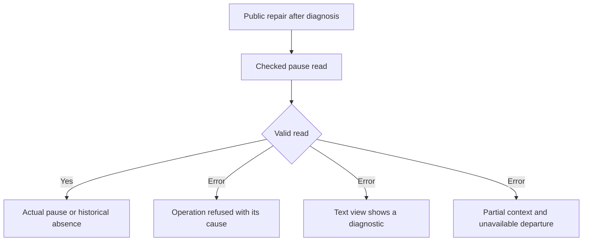
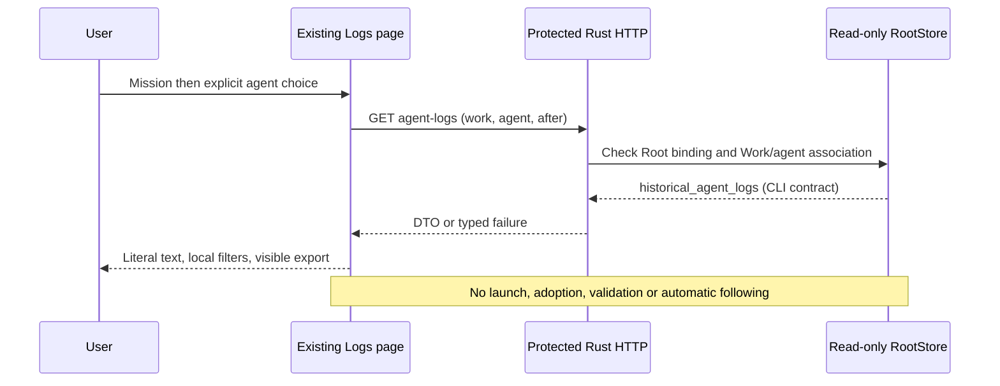
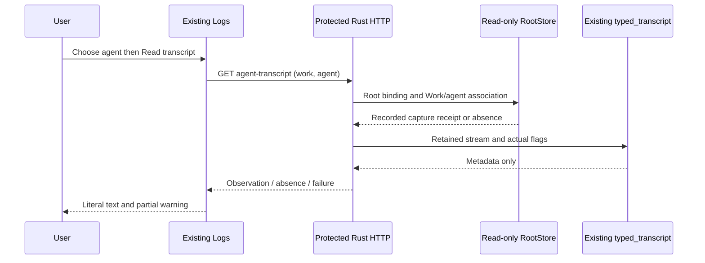

# Machine incidents and mission recovery

A mission is complete only when its results are validated and its owner closes
the work. A running server or passing engine tests do not prove mission completion.

## Storage unavailable

The cockpit displays a global alert with **Storage diagnosis**. This local check
makes no AI call and does not query SQLite, so it remains available when mission
reads fail. **Check again** refreshes measurements without deleting any files.

```sh
swarm --root /path/to/project --lang en doctor
swarm --root /path/to/project --json doctor
```

`doctor` neither creates nor opens the database. It measures the `.swarm` and
process temporary directories. Exit status is 2 when a volume is unavailable or
below the safety margin; otherwise 0. JSON includes paths, available bytes and
inodes. A missing `.swarm` directory is not treated as healthy.

- Warn below 1 GiB available.
- Suspend new launches below 256 MiB or 256 available inodes.
- Failed measurements also suspend launches.
- Agent preparation, supervisor starts, planning activations and independent
  reviews check storage before starting a new call.
- The driver rechecks each cycle and resumes reconciliation and already
  authorized operations after recovery. Rejections, exhausted limits and pauses
  still apply.
- ENOSPC and SQLite FULL map to `storage_unavailable` and HTTP 507. They never
  mean that a command succeeded.

This is a preflight check, not an allocation guarantee. Running agents can fill
a volume between checks. Remote providers and external workspace volumes are
outside these measurements. Identify disk usage before cleanup; rebuildable
compiler caches can be cleaned with their tools. Reports, databases, failed
working copies and history are not caches. Check public state after interrupted
writes before resuming.

## Conductor read failures

An inventory or agent-occupancy read error stops the cycle; a partial list never
authorizes a launch. The conductor reports the cause on stderr when it appears
or changes, then reports cycle recovery once the error clears. Identical errors
are not repeated on every poll. The server uses the same path. A targeted
`mission watch WORK` reads only that Work, so an unrelated invalid envelope does
not block this watch. The global conductor still requires a complete valid list.

For leases it already holds, the conductor publishes `supervision.state=error`,
`last_error` and the next check through `mission status` and the cockpit HTTP
snapshot, provided the target Work remains readable. Otherwise these public
reads return the Work error rather than inventing a usable status. It never claims an unreadable mission just to diagnose it, nor revives
a stopped or replaced lease. A failure before acquisition stays on stderr;
no persisted diagnosis is invented. A blocked storage guard prevents diagnostic
writes by the cycle. When SQLite rejects diagnosis, the returned error also
retains that cause; a previous persisted state may remain visible until expiry.

An empty or control-only error message still produces an explicit error.
A failed first check never sets `reconciled_at`. A prior reconciliation stays
historical during an error. Recovery clears `last_error`; `cycle-error` and
`cycle-recovered` transitions are appended to the coordination journal in the
same transaction as the diagnosis, once per change. Rejected journal writes
roll back this check. Health traces are not conductor business actions. Recovery
neither repairs data nor reauthorizes tasks or proves completion. Lease-stop
errors are returned to the loop instead of being discarded.



See [M31 evidence and limits](../plans/deepagents-integration/RESULTATS-MEMOIRE-27.md).
Other read callbacks still need qualification under MEM-P1.

## Freshness during review or planning

Structured planning, simple review, candidate review, batch review, fragment
review and explanatory diagnostics reread the Work envelope before their specific
check. Read failures retain their cause instead of collapsing to a boolean
revocation. The runner checks before starting, at the existing poll during the
call, and after normal completion before returning a usable reply. A fast reply
therefore cannot bypass the last check.

A missing check refuses the call without panic. Pre-start rejection launches no
process. Cancellation during a call uses the existing process group. A freshness
error returns no usable reply to the consumer. Usage observations from an already
started process are delivered to the existing recorder; reservations, activations
and history are not removed or refunded. Recorder write failures are not
qualified by this increment. Existing Admin deadlines and policies remain in effect.

Pauses, replaced attempts or leases and changed evidence remain rejections.
For the five paths that already consulted pause, an unreadable flag is an explicit
error: its cause stays accessible without exposing its stored value. Fragment
begin/reservation/finalization and transactional planning guards share this checked
reader. Work, file and provider errors retain their cause through the check. A simultaneous
cooldown no longer replaces the initial cause; both may be retained. Business
persistence still rereads current state. If the Work stays unreadable, it returns
that error rather than inventing a passed review, accepted task or usable diagnosis.

Historical boolean callback functions are adapted for compatibility. They can
report revocation but cannot supply a read cause. The six consumers above use the
error-returning contract. This check creates no memory usage or identity rights.



See [M32 evidence and limits](../plans/deepagents-integration/RESULTATS-MEMOIRE-28.md).

## Unreadable pause in operations and views

The boolean reader that discarded pause errors has been removed. Operations and
the 19 affected calls use the same checked reader: historical absence means not
paused; an unreadable value is an error, without implicit repair. Launch, role
model, contract revision, automatic validation, settlement and automation
transactions retain their own validation and propagate the safe cause. An invalid
read becomes neither launch permission, empty success nor merely “authorization
missing”.

CLI/HTTP snapshots reject the read instead of publishing paused=false. Text views
show the diagnostic. In partial task-page context, the suspension_departs fact
is omitted, Missing attributes the unavailable data to its Work, and departure
becomes unavailable with its reason. A boolean eligibility predicate can therefore
refuse; it is not an SQL reader claiming to know the pause state. A failed cycle
retains its previous fingerprint and follows its existing diagnostic path.

Repair uses the public pause operation after diagnosis. It refunds no calls or
reservations and grants no additional rights. Paths that did not consult pause
when their option was disabled retain that contract. Joined kernel-observation
reads and the supervision SQL predicate still require qualification with their
linked envelopes; MEM-P1 remains open. Backend fixtures with frozen embedded
resources do not qualify the current browser UI or the existing server.



Recipe, evidence and limits: [M33](../plans/deepagents-integration/RESULTATS-MEMOIRE-29.md).

## Exhausted attempts

**Mission blocked — attempts exhausted** appears when no task is running and a
blocked task has used its allowance. **Inspect attempts and rejections** opens
retained facts, the latest independent review and links to task reports.
**Save the diagnosis** downloads JSON containing the revision, task, attempts and
review. This flow does not call an AI provider.

`swarm mission status WORK` shows the same facts. JSON task fields include
`attempts_used`, `attempts_allowed` and `attempt_limit_reached`.

After three attempts, **Prepare one corrective attempt** opens a proposal based
on the latest independent rejection. Explicit confirmation authorizes one extra
attempt with history and independent review preserved. See
[bounded recovery](ATTEMPT-RECOVERY.md) for requirements, limits and the CLI.
If unavailable, the action explains the reason; an earlier exceptional grant,
a missing or running review, or an exhausted reviewer budget cannot be bypassed.

This recovery capability alone does not prove a real mission will succeed.
Completion requires an effective correction and its evidence.

## Resume summary in the Rust cockpit
**Resume work** reads the engine's current calculated summary for the selected
mission, in FR or EN, as literal text in the existing block. It establishes no
previous-visit difference, agent identity or new acceptance. OODA and visit marking
remain unavailable in this connection. Saved evidence/current state in a summary
never authorizes a later action.
GET/HEAD `/api/v1/work-resume?work=ID&lang=fr|en` requires both explicit parameters,
no duplicates/unknowns, behind session/Host/capacity and the bound Root. The engine
uses `inspect_work_view` to read saved data, policies, events and file/Git
observations. It publishes no view file (unlike `render_work_view`). Existing saved
Git policies still apply. No AI/control command, launch, visit or budget change occurs.
Open or explicit refresh rereads; changing mission clears old content. Late replies
are ignored, failed/malformed reads show a diagnostic and allow explicit recovery,
with no automatic retry or polling.

```mermaid
sequenceDiagram
    actor U as User
    participant I as Existing Resume page
    participant H as Protected Rust API
    participant R as Root and saved evidence
    U->>I: Open or refresh selected mission
    I->>H: GET work-resume, explicit Work and language
    H->>R: inspect_work_view without publication
    R-->>I: Revision, language, calculated Markdown
    Note over I: Literal text; old reply ignored after selection
    Note over R: No view file, visit or OODA recorded
```

When the calculated projection is not yet ported (HTTP501), its refusal remains
visible. **Read recorded data only** explicitly calls the separate protected
`/api/v1/work-recorded-resume` read, with the same explicit Work/language query.
The DTO identifies `observation: recorded`, and the text warns that validation
has not been recalculated. This never removes the full projection guard or claims
acceptance. Managed batched-review projections remain outstanding. No automatic
fallback or retry occurs.

The scrollable summary is explicitly keyboard-focusable and labeled for screen readers; it does not rely on browser automatic scroll-container focus.

Known migration limit: historical mission status may still refuse with `mission-root-unavailable` wrapping `agent-mission-provenance` / `mission-agent-binding-required`. This wrapper does not establish missing Root storage or a missing Root role. The new summary does not repair that binding or authorize execution; native/legacy provenance adoption remains a separate verified contract.

## Historical agent logs — Rust cockpit

The **Logs** page keeps its existing controls and plain-text reader. Select a
mission, open the page, then explicitly choose an agent. Recorded state and
messages establish neither authenticated identity, current liveness nor execution
rights. This read does not depend on legacy missions’ calculated status.

`GET /api/v1/agent-logs?work=ID&agent=ID&after=0` (also HEAD) requires all three
parameters exactly once, safe identifiers and a canonical signed i64 cursor.
Bodies, unknown/duplicate keys, ambiguous cursors and cross-Work agents refuse.
Session, Host, capacity and physical Root binding remain enforced. Read-only
Root access changes no visit, mission, business reservation, provenance, budget
or provider command. Read/encoding/close errors never become empty success.

The DTO contains `schema_version`, `work_id`, `agent_id`, `after`, `rows`. Rows
match `agent logs ID CURSOR --json`: zero selects the latest200 ascending; negative
selects the first200; positive continues strictly after that sequence. This
existing transport pagination is neither retention nor execution policy.
**From the beginning** then **Next page** traverse history; empty pages are stated
explicitly. The browser refuses sequence numbers outside JavaScript’s exact
integer representation; use the i64 CLI for those histories, without rounding.

Exact text and kind filters apply only to the loaded page. NDJSON export contains
only visible rows. Content remains literal text; no remote console or automatic
following starts. Errors clear old text and disable export; explicit reselection
or **From the beginning** retries a read. Mission changes reset the source and
discard delayed responses. Supervision journals and live following remain open.



Engine-produced opaque observations (final capture and provider facts) use their
persisted wire spelling before strict comparison and journaling. HTML characters
and Unicode separators follow Go JSON escaping while duplicate keys and numeric
lexemes remain intact. This fixes a post-execution persistence refusal; it does
not automatically repair older incomplete receipts or loosen any guard.

Returned pages contain historical agent lifecycle/command records; program
output capture and transcripts are separate and are not exposed by this route.
The Logs page does not request calculated mission status. Opening another view
requests it normally and preserves refusals, including unported terminal branches.

## Typed transcript from Logs — Rust

Select an agent, open **Typed transcript — content hidden**, then **Read typed
transcript**. This reuses `typed_transcript`, already consumed by Live, without
modifying that independent interface. It shows event kinds, tool names/IDs, byte
lengths of omitted content and declared tokens. No assistant text, prompt, tool
input/output or raw capture is returned. Recorded identifiers establish neither
authenticated identity, liveness nor authority. Claude/Codex format is inferred
from event shapes, not the configured provider name.

`GET /api/v1/agent-transcript?work=ID&agent=ID` (also HEAD) requires both keys
exactly once, safe IDs and an empty body. Session, Host, capacity and owned Root
binding remain checked; the agent must belong to the explicit Work. DTO fields:
`schema_version:1`, `observation:recorded`, `work_id`, `agent_id`, `recorded_status`,
`state`, `reason`, `capture_truncated`, `capture_invalid_utf8`, `output_complete`,
`transcript`. Missing receipt (`receipt-absent`) or missing capture
(`capture-not-retained`) yields `unavailable` with explicit null transcript/flags.
A valid empty capture yields `available` with zero events.

The v1 native_execution_result receipt requires its actual completeness flags.
Missing/wrong-type/duplicate known fields or unsupported versions stay server
errors, never implicit false defaults. Invalid requests remain HTTP400, methods405
and denied access403. Read/encode/close causes survive. Retention truncation,
replaced UTF8, incomplete output or truncated JSON produce a partial-read warning.
The existing parser’s notes retain unknown events/non-JSON tails; they do not
establish that all input was understood. No execution/retention bound is added;
the existing capture remains subject to Admin `agent_capture_max_bytes`.

Only an explicit click reads metadata: no polling, visit, launch or Work/agent/
budget mutation. Text is literal, scrollable and keyboard accessible. Mission/
source changes clear it and invalidate in-flight replies. Missing/error states
never retain prior content; the button allows explicit recovery. This projection
does not expose the interactive terminal or export hidden content. Lifecycle logs
keep their separate reader, cursor and export.


