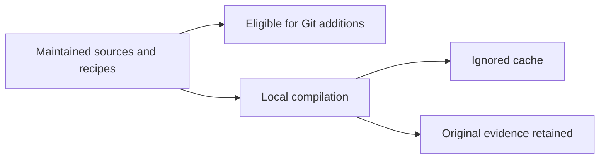

# Rust caches and Git captures

The repository excludes `/.cache/` and `/rust/target/` from ordinary Git additions. This covers local builds and frozen input fixtures, including caches nested within snapshots. Maintained sources and recipes remain under `rust/`, `tests/` and `tools/`; original evidence remains on disk. Existing proof-archive exclusions retain their specific rules.

This rule deletes no file, removes no tracked file and does not purge existing Git objects. It establishes neither Codex snapshot behavior with other options nor termination of an already running process. No application process, other owner’s cache or Git history is interrupted/deleted. Recipes do not change the main index.

The `local-build-cache-ignore` recipe checks actual parent/nested cache rules and source/recipe eligibility, then demonstrates retained data and tracked-file preservation in an independent disposable repository. Failure preserves that repository. Results and disk-saturation history belong to PLAN lot186. Clean only identified, regenerable, authorized caches after retaining relevant proof and hashes; exclusion itself grants no cleanup authority.

## Moving compiler input lineage: inspect effective paths

Lot188: Cargo could report fresh artifacts after an owned cache moved into a new immutable source root while depfiles still named the old root. Qualification refused profile-input-absent-or-external; normal08 retains that failure. Do not bypass refusal or assume relocation rebuilds everything. The unqualified executable and hash were retained, then only local workspace packages in our owned target were invalidated with cargo clean -p; registry and foreign targets stayed intact. Normal11 recompiles and qualifies actual paths. Immutable source inputs must also include changed assets: testing the current shared component does not check older embedded resources. Permanent embedded-settings-locale binds actual HTTP bytes to effective inputs and catalogue keys.

Translation updates in an immutable fixture must match its frozen consumers. For an additive setting, retain previous keys and add new ones with the existing generator; do not import a key deletion from a parallel UI change whose consumer is not compiled here. A minimal proof bundle authorizes neither shared-checkout rewriting nor unverified combined delivery.
