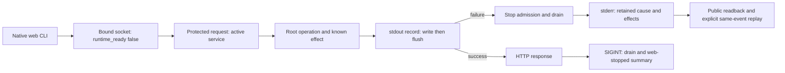
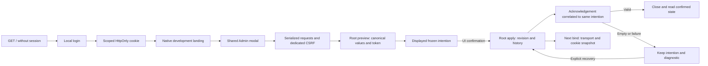
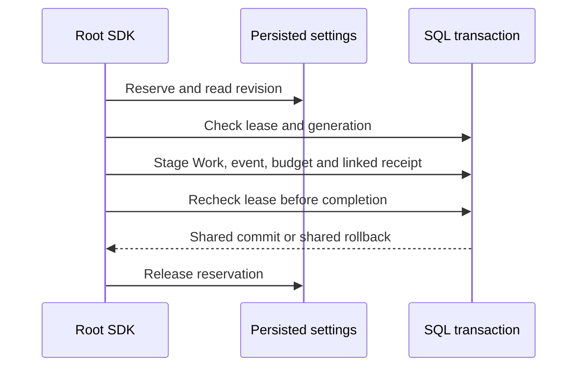

# Retaining and replaying verification recipes

Historical evidence references marked “original unavailable” below cannot be replayed or reused as current proof. Their identifiers and previously reported outcomes are retained; no restoration is claimed. Current source archives and151 evidence are separate.

The permanent entry point is [`recipe.py`](../../tools/verification/recipe.py),
with its [contract](../../tools/verification/README.md),
[runner regression recipe](../../tools/verification/recipes/runner.json) and
[persistent tests](../../tools/verification/test_recipe.py).
`CLAUDE.md` relays the shared `AGENTS.md` rule. These persistent files do not
update embedded native contexts or sessions already running.

The local 1,306-file snapshot (`../plans/migration-rust/replay/20261019-current-tests-recipes-67.json`; original unavailable)
references its neighbouring archive and hashes. It includes unqualified increment67
work, not accepted results. Earlier qualifications retain source archives,
dependencies, commands, output and original failures in `evidence/`. Historical
cache recipes have not all been converted: review their contracts, exclusive output
paths and prerequisites before replay. Never overwrite historical evidence or
extract snapshots onto the current checkout/toolchain.

Storage is local, uncommitted, with no established remote backup. This does not
guarantee every intermediate version or future provider/toolchain availability.
Qualified archives bind results to source; the generic runner inventories declared
inputs, not the effective compiler graph. Overall migration remains partial.
Convert remaining recipes when maintaining them, preserving prior coverage/proofs.

### Pricing and accounting — increment70

Permanent [pricing-accounting recipe](../../tools/verification/recipes/pricing-accounting.json)
retains 17 targeted Go tests. permanent-pricing02 (`../plans/migration-rust/evidence/20261019-70/permanent-pricing02/result.json`; original unavailable)
has stable declared inputs and verified archives; the first capture remains FAIL
because a declared recipe changed during capture, despite passing tests.
The [browser recipe](../../tests/pricing_ui.cjs) covers Admin and Budget, save/read-back,
CLI/API parity, preserved prior quotes and stale forms. browser02 (`../plans/migration-rust/evidence/20261019-70/browser02/result.json`; original unavailable)
passes FR/EN, two themes and five widths, using an observed installed Chrome path
after the missing Puppeteer-cache refusal. Replay commands/limits are in the
[runner guide](../../tools/verification/README.md). This Go increment does not
qualify Rust pricing or the installed server.

## Native agent journey prerequisites

Persistent `tools/verification/recipes/agent-runtime.json` covers15engine tests
(SQL lifecycle, complete history, stop/recovery and silent SQL refusals),4agent
CLI journeys, pricing output regression and common CLI smoke checks. Its declared
inputs include literal Rust SQL/config/context assets. Read-only
`test_rust_recipe_inputs.py` checks all such includes against every Rust recipe.

```sh
python3 tools/verification/recipe.py run --recipe tools/verification/recipes/agent-runtime.json --output FRESH_PATH
python3 tools/verification/recipe.py verify --evidence FRESH_PATH
python3 tools/rust-migration/verify_agent_runtime.py --output ANOTHER_FRESH_PATH
```

Parity covers48Go/native documents/projections. Declared recipe checks establish
neither complete effective-graph qualification nor an executed mission. No
provider or process termination; original72failures remain retained.

Increment73 adds five supervisor-claim and six cancellation tests, including
actual concurrent SQLite connections, partial historical settlement repair and
replay without duplicate events/logs. CLI includes four agent journeys plus
17common and three pricing checks. No provider or full-mission claim.

## Native future-launch limit resolution

`tools/verification/recipes/runtime-limits.json` replays26engine and26CLI tests
with archived declared sources and literal SQL/context assets, no global watchdog.
`agent limits WORK ROLE TASK --root ROOT --input FILE --json` takes schema_version1
with optional provider/mission/prior data. IDs select scopes without establishing
mission existence, eligibility or authority. Replay covers explicit v14→v15
adoption, nullable ceilings/defaults, tightening, recovery, Admin observation,
persisted overrides, malformed JSON/revision/reason refusals and output/flush errors.
Existing `tests/rust_engine_settings_admin_ui.cjs` uses rebuilt binaries/probes;
all ten fields save/reopen and every ceiling refuses then explicitly becomes
unlimited, with observable production-CLI effects. Browser fixture transport
establishes neither HTTP authentication nor provider execution.

## Manual preparation and guard77 — permanent recipe

`python3 tools/verification/recipe.py run --recipe tools/verification/recipes/agent-manual-admission.json --output FRESH_PATH`

48engine and25CLI tests cover preparation, observation, cancellation, contention,
frozen-policy replay and lost-output paths; no provider process or full native mission. `verify --evidence PATH`
checks hashes, outputs and assertions. The recipe grants no launch, paid calls
or changes to real missions.

Focused current journey: `node tests/rust_agent_launch_admin_ui.cjs RUST_CLI_PATH
FRESH_EVIDENCE_DIRECTORY`. Four private FR/EN×light/dark roots, eleven settings,
actual CLI consumer, refusal/recovery, null ceiling, mobile and keyboard; no
provider call. CHROME_BIN selects Chrome. Terminal-state helper regressions:
`node tests/engine_settings_admin_state_test.cjs` covers six cases. Visible
errors must terminate waits as refusals without an arbitrary watchdog; see the
lesson in tools/verification/README.md. These commands establish neither native
HTTP nor authentication nor global mission acceptance.

76 adds current identity, own contract, mapping refusals without fallback and
stale preview/hash recovery. Evidence75 stays historical; run the current recipe
into fresh output to qualify the new bytes.

77 extends the same recipe:48engine tests (21factory+4snapshot+7guard+3trace
+4runtime+6cancellation+3unit) and25CLI tests (4admission/guard+4runtime+17common).
No global watchdog added. Held-writer refusals retain typed causes and unchanged
SQL state; releasing the writer permits recovery without duplicate intention.
Focused Admin now covers11fields, factors1/4/null, refusal0, three intentions
on three private Works and an unchanged older snapshot. Declared traces prove
no execution, termination or acceptance. Retain final sources/results in fresh
output; evidence75/76 is not rewritten for the new scope. permanent04 passes; four lifecycle cases pass again after a test assertion style change.
Final browser04 passes four FR/EN×theme journeys on the current default-feature
binary; its exact digest, source archive and limits are recorded in evidence77.

## Controlled native process78 — integration recipe

`python3 tools/verification/recipe.py run --recipe tools/verification/recipes/agent-controlled-process.json --output FRESH_PATH`

The current recipe selects6owned-runner unit cases,8actual Git consumer cases and
1actual validation-output case. It checks explicit input/control refusals,
termination and final-byte draining, original causes, unreaped-child recovery,
controller wakeups without a global deadline and unchanged existing consumers.
No provider authorization, durable Agent registration or native mission is proved.
Zero global watchdog; verify retained evidence with the same permanent runner.
Qualification of these current inputs is tracked in increment78.

## Native manual path78

`python3 tools/verification/recipe.py run --recipe tools/verification/recipes/agent-native-runtime.json --output FRESH_PATH`

Dedicated recipe without a global watchdog:41unit +21admission +13CLI +30frozen
contract/budget/identity/catalogue cases,3generator tests and translation checks.
Expected counts must be confirmed in retained output, not inferred from this page.
Only private local executables run; no paid model or live mission. It requires
elapsed duration without automatic stop, followed by an explicit operator stop;
the earlier timeout-stop expectation remains historical and invalidated. The
shared core now has8cases, including actual ENOEXEC refusal without shell and
recovery; its smaller recipe covers17cases including Git/validation. Global
acceptance, real-provider usage and crash restoration remain separate.

79 extends the same recipe to provider declarations: missing/zero, separate caches,
unverified models, refusal without empty success, incomplete output and recovery
in the same active process. Metadata errors do not hide valid tools; full valid
preflight precedes each injection of premature output claims. The78hashes and
results remain historical; the new105expected cases require actual execution
before PASS. No invoiced cost or authenticated HTTP service is qualified.

The recipe also includes three pure CLI diagnostics: nested guard cause, both
CLI cleanup branches and a typed source sharing its wrapper's address, with a
real cycle and private-text refusal. Declared total108Rust tests plus3generator
and i18n checks; actual execution remains distinct from this expected count.

Increment80 adds model argv compilation to the same permanent recipe:47unit,
21admission,13CLI,3diagnostics and30contracts =114Rust tests, plus4generator and
i18n. `docs/plans/migration-rust/evidence/20261019-80/permanent03/result.json`
records actual PASS and verified source archive; earlier79counts are historical.
No newly enabled routed launch, paid call or browser qualification is claimed.

81/permanent05 passes121Rust+4generator+i18n after correcting fixture generation
(original03FAILretained). Model-check is read-only with mandatory automatic intent.
Cataloguev3/settings19, historical18 and empty/partial groups are covered. Browser07
passes4journeys/23fields; rendering11 passes4journeys/24captures, text contrast and
literal editor attributes. The Admin README gives the supplement command. No paid
model or routed native execution is qualified.

82 replays six provider_model_arguments::tests cases and the identical81public
program against the rebuilt library:after03PASS, before08REDretained. Default
profile02has no fixtures. No browser rerun is required for this cold argv guard
that native launch does not yet consume.

83: the shared native recipe expects125Rust tests (51engine units),4generator and
i18n. The additional permanent recipe is
`python3 tests/rust_agent_model_route.py --binary DEFAULT_CLI --output FRESH_PATH --case all`.
It qualifies8named local journeys and retains requests/streams/roots and binary
hash, with no watchdog. Build/verify the default feature graph before these
journeys; an all-features workspace does not qualify the delivered image. Cases
cover actual argv/stdin/estimate, changed cache/recovery, Admin rules/unrelated
revision, corrupt/FIFO/capped cache, hash/default/probe/API refusal, effective
environment, configured-only/no-invented-effort and preserved generic -mode.
No commercial Codex or real spend is involved; codex is a named local fixture.

83/permanent14,qualification15,native16,browser17 PASS:125Rust+4generator+i18n,566workspace,8native,4Admin. Archives and limits:83/result.json.

84: shared recipe expects128Rust (54engine units). Python `--case all` has nine journeys; `--case api-catalogue` isolates namespace/refusal/recovery. The566workspace83 tests are not a fresh84 run.

84/permanent03 PASS128Rust+4generator/i18n; native05 PASS9, identical empty-catalogue01 before/after, Clippy/Rustdoc/default04 and targeted Go contract PASS1. Sources/ELF archived; UI83 remains historical and explicitly scoped.

85 adds `providers config init|show` and create-only publication. Shared recipe expects140Rust (57default units,4fixture-storage,3Root-config,2CLI added to prior contracts),4generator/i18n. Python all has10journeys; provider-configuration is selectable. Retain03compilationFAIL/zero tests and04PASS3Root; distinguish test-fixtures from the normal CLI.

85/permanent07 PASS140Rust+4generator/i18n; all-features workspace08 PASS593named (test profile); default08/no fixtures and native09 PASS10. Sources/ELF archived, identical before01/after09 passes, original03FAIL retained.

85-cache:886Cargo example artifacts archived/verified before reclaiming cache copies; inventory/retained archive in85/example-cache-recovery10.json. Normal CLI/source unchanged, no data/process/test interruption; retained archive is proof, not disposable cache.

86 expects150Rust shared-recipe tests (59default,6fixture storage,7Root config,4CLI),4generator/i18n; Python all has12journeys. Selectors configuration-update-restore and configuration-repair exercise stale queued route/reservation/real restoration and corrupt-source repair with originals retained. No watchdog added; product preflight freshness remains active.

86-scope:150tests06/12native08 predate the target-scope correction. RootA→RootB09 actually succeeded (RED). Corrected recipe expects151Rust/8Root,13native, replaying the identical counterexample plus permanent configuration-scope. Do not promote pre-fix receipts.

Local qualification86 verified:151named Rust permanent-recipe tests,4generator
tests and i18n; workspace/all-targets Clippy and private Rustdoc pass. The rebuilt
normal CLI has no test-fixtures in its73artifacts. All13native journeys pass,
including exact configuration restoration and recovery of the same queued intention/
reservation, malformed-source repair and cross-Root token rejection. The identical
public preview01 and scope09 programs pass after correction. Original150tests06/
12native08 and scope09RED remain historical; pre-fix ELF07 is retained separately.
Eight Root, six storage and four CLI tests cover12backup/replacement fault variants
and output/flush errors. Explicit no-change apply really fsyncs file and directory.
No new count/retry/deadline policy; existing Admin per-file cap is unchanged and the
public token binds source/settings bytes and the actual Root descriptor.
Sources/ELF/profile/review: `docs/plans/migration-rust/evidence/20261019-86/result.json`.
The593workspace85 tests and four Admin83 journeys are scoped historical evidence,
not fresh86 runs. No new Mermaid render or independent review, installation/cutover,
HTTP/auth or authenticated identity is established. APIs/probes, default-model
installation UX, hierarchy and crash/drain recovery, existing data migration,
global qualification, single cutover and RETEX remain open. Overall migration partial.

87 adds two strict request/selection units (155Rust expected) and Python task-model journey (14native expected); actual receipts pending, local actor is not authenticated.

Local qualification87 verified:155named Rust permanent-recipe tests,4generator
and i18n;10supplemental WorkEngine tests pass, including SQL failure/rollback/same-
event recovery. Workspace/all-targets Clippy and private Rustdoc pass. Normal
profile has no test-fixtures in its73artifacts; all14native journeys pass. The
process really receives the task's simple choice while provider/default auto
would choose standard. Choice/replay/reopening, conflicts and policy drift before
admission/after queueing, active-change refusal, retained reservation and exact
source restoration/recovery are observed. Inherit removes only choice, retaining
attempts and consumption. Only the supplemental Python fixture changed after15/16;
compiled inputs stay byte-identical (rust-evidence-reuse18.json). Identical public before01/after18 and compat-before12/
after17 programs pass. Extracted Go definitions compile as oracle13 and confirm
scalar nulls/case/duplicates; common projection preserves those while refusing
unknown/type/multiple-JSON input. Cli04FAIL1/2 remains: the fixture changed protected
schema, so Root refused before the transaction. Corrected CLI/WorkEngine tests
prove their separate contracts without disabling guards. Original Clippy10FAIL
item ordering remains, corrected without suppressing lint.155tests09 are pre-codec,
not final qualification15. Sources/ELF/review: `docs/plans/migration-rust/evidence/20261019-87/result.json`.
No installation/cutover, new browser/Mermaid-render proof or independent review.
Task choice authenticates neither actor nor model and grants no launch permission.
APIs/probes, initial/default-model UX, hierarchy/selected memory, crash/drain recovery,
HTTP/auth, existing data migration, global qualification/single cutover/RETEX stay
open. Overall migration remains partial.

88 permanent recipe expects161Rust (65engine units and2policy CLI tests),4generator/i18n; Python all has15journeys. policy-import covers35providers, a file above64KiB, preview/Admin rules and separate execution denial/actual local child. Rendered submission fixture: node tests/rust_provider_policy_submit_ui.cjs NORMAL_CLI FRESH_OUTPUT; actual CLI bridge, not native HTTP/auth. Final receipts pending.

Local qualification88 verified:161named Rust recipe tests,4generator and i18n;
workspace/all-targets Clippy and private Rustdoc PASS. Normal profile has no fixture
feature in its73artifacts; all15native journeys PASS. Explicit policy preview/apply/
export works for35providers and a99037Bfile without hidden32/64KiB cutoffs. Go DTO
command/env fields are preserved, exact original snapshot bytes retained; invalid
input/cache/rules/stale-token refusals and recovery are observed. Policies can be
stored while execution is denied; separate admission refuses and the actual local
child runs only after explicit restoration of that policy. No paid model call.
Four FR/EN×theme browser journeys pass on that same CLI: actual submission/native
token, visible no-write refusals, save/reopen, retained demanding choice and narrowed
Admin rule refusal/recovery. Import/editor captures at320/1440, focus/Escape and
console/request failures checked. This is a component/fixture CLI bridge, not full
cockpit/native HTTP/auth. Eight legacy tokenless bodies also pass actual extracted
Go strict/PolicyChange; no legacy Go server is launched. Identical before01/after19
passes. Browser11RED retained (demanding shown as simple), fixed without a frontend
policy ceiling; release14RED aggregation retained then corrected Published/causes
PASS, modeling a late release refusal rather than an actual OS failure. Native06
JSON-vs-canonical-DTO verifierFAIL is retained and corrected07 without dropping
exact snapshot checks; browser09 fixtureFAIL remains. Sources/binary/review:
`docs/plans/migration-rust/evidence/20261019-88/result.json`.
No implicit named model, Claude catalogue/installation/HTTP/auth or model/account
identity is established. Export includes saved policies only; an old Go reader may
still reject >32. Unsupported catalogues refuse, never become available by fiat.
Same-session review, not independent; diagrams checked against code, no new Mermaid
render or exhaustive WCAG audit. Old translations are preserved; historical Admin83
styles/assets match except separately verified additions of3translations. The
serving app remains Go; overall migration, data, hierarchy/recovery, full acceptance,
single cutover and RETEX remain open.

89: common `tools/verification/recipes/agent-native-runtime.json` has169named Rust
checks +4generator/i18n (`permanent16`). Actual child complement:
`python3 tests/rust_manual_mission.py --binary NORMAL_CLI --output FRESH_DIRECTORY`
(single line),4scenarios. Isolated roots, exact commands/inputs/diagnostics/sources;
no global watchdog, paid model call or live DB. The actual child produces its report;
gate/operator acceptance are controlled fixture decisions, not independent review.
The alias branch injects/removes one added malformed fixture row only; it never
removes real history or budget. Normal profile18 has no fixtures;15routing,4mission
journeys, corrected counterexamples, Clippy and Rustdoc pass. Results/hashes/limits:
`docs/plans/migration-rust/evidence/20261019-89/result.json`. Original failures and
pre-fix proofs remain distinct from final evidence. Serving app stays Go; overall
migration, HTTP/auth, hierarchy/recovery, data and cutover remain open.

90: the same permanent recipe includes `swarm-web`, late-failure Root/CLI cases
and datastore binding. Verified192named Rust tests, including69engine units,6CLI
units and17HTTP tests;4generator/i18n separate. HTTP requests are typed/in-process
with actual isolated Root, not a TCP/browser server. Actual IPv6 is unavailable
(evidence06), never counted PASS; the synthetic address unit is named separately.
RED08/15/17 and original sources remain; final common qualification is pending in
`docs/plans/migration-rust/evidence/20261020-90`. Persistent AGENTS.md rules are
relayed by CLAUDE.md without changing already-started prompts/processes. Cache14
archive is retained proof, not disposable cache: only29verified old owned rlib/rmeta
copies were removed, preserving all sources/binaries/earlier proof archives.

HTTP90 locally qualified: recipe32 PASS192named Rust tests,4generator and i18n;10additional WorkEngine tests,15native routing and4manual missions PASS. Clippy and private Rustdoc PASS. CLI/HTTP-library builds33 have no transitive test-fixtures; no listener, persisted session or installation. Final proofs: evidence/20261020-90/result.json;23–27 are historical before IO fix30. Actual IPv6 remains unavailable/open; synthetic IPv6 formatting is separate. Same-session Codex review only. Next: secure session creation/reuse then native HTTP transport. Serving application remains Go; global migration and RETEX stay open.

91: permanent recipe extended, expected202named Rust tests (71engine units,19HTTP,5persistence and1publication fixture). Actual Root/listener supplies the persisted key; TCP/login/expiry remain unimplemented. Publication faults are separate from normal profile. Compile failures01/02/05 and fixture-data error03 retained, not evidence of a product security defect. Local qualification recorded below.

Session91 locally qualified: recipe07 PASS202named Rust tests,4generator/i18n;10additional WorkEngine tests,15routing and4manual missions PASS. Clippy/private Rustdoc and normal profiles08 without test-fixtures PASS.5public session tests plus2new engine and2HTTP units cover creation/reuse, refusals/recovery, forced concurrency and bootstrap.1compile-gated test covers6publication faults, not6actual OS incidents. Source/binary/review/limits: evidence/20261020-91/result.json. Persistent session is wired to the typed service, without TCP server/login/expiry or installation. Same-session review, Go still serving. Authorized next: Admin/API journeys then native HTTP transport with persisted policies and actual consumer; global cutover and RETEX stay open.

92: permanent recipe extends to206named Rust tests, including7CLI diagnostics and3settings-output tests. Actual witnesses before write/flush, FR/EN×JSON/text, init/apply/replay, pre-write refusal and read-only operations without false publication markers. Qualification pending; RED01/02/03 retained.

Output92 locally qualified: recipe06 PASS206named Rust tests,4generator/i18n;10WorkEngine tests,15routing and4manual missions PASS. Clippy/private Rustdoc and normal builds07 without test-fixtures PASS. RED01/02/03 now pass: init/apply/replay retain known state after write/flush, while refusals/show/preview do not claim saved operations. Output doubles/close aggregation are separate from actual OS faults. Source/binary/review: evidence/20261020-92/result.json. Initial test01 retained from its generator and identical captured03 prefix with explicit provenance. Go server unchanged; migration/HTTP/Admin/cutover/RETEX stay open. Next: settings API then native transport and persisted policies.

93: permanent recipe expects211named Rust tests,24HTTP including5units/3settings tests. Native settings routes use the Admin/CLI contract and actual Root with known state separate from body; no HTTP listener/browser connection. Original missing-routes01 and runtime-status03 failures retained. Local qualification recorded below.

API93 locally qualified: recipe05 PASS211named Rust tests,4generator/i18n, including24HTTP (5units,7access,9service,3settings). Clippy/private Rustdoc and normal builds06 without test-fixtures PASS. WorkEngine10,15routing and4manual missions from92 explicitly reused, not reexecuted:1211relevant inputs and CLI ELF/profile identical. Native Admin routes, saved cap consumed, replay/refusal/replaced Root and state independent of body verified; no network/browser hookup. Source/binary/review: evidence/20261020-93/result.json. Cache archives01–03 retain102obsolete own native tests,926567800B, SHA-read back before removing only derivatives; sources/data/prior proofs preserved. Free space recovered near1GiB; no further cleanup needed. Next: persisted/Admin network policies and real transport. Migration/cutover/RETEX stay open; Go still serves.

94: permanent recipe extends to220named Rust tests, including6network-policy and3actual library-constraint tests. Dedicated browser command `node tests/rust_web_policy_admin_ui.cjs NATIVE_CLI OUTPUT`: FR/EN×etat/sombre,5widths, refusal/recovery then save/reopen. CDP/CLI bridge, not Rust TCP; global/page/protocol watchdogs disabled, terminal errors handled. Original browser12 retained;14 passes4cases. Shared qualification pending.

Network94 locally qualified at configuration/Admin level: recipe15 PASS220named Rust tests,4generator/i18n,10WorkEngine,15routing and4manual missions. Clippy/private Rustdoc and profiles16 without test-fixtures/test-util PASS. Browser14 PASS4 FR/EN×2themes,5widths/4captures; two mobile captures visually inspected. Normal ELF13=16, original19journal byte-identical. Source/binary/actual dependency bytes/review: evidence/20261020-94/result.json. No TCP enforcement/restart consumer proven. Method limit retained for95: new browser finally may mask a primary error when browser.close fails; not observed14, reproduce/fix before transport faults. Go unchanged, migration/cutover/RETEX remain open.

Transport95: permanent recipe expects230Rust and6Node cleanup tests. New sources:
rust/crates/swarm-web/tests/server_{bootstrap,transport}.rs and session_bootstrap.rs.
Replay via the common native recipe. Actual read-only TCP uses100-continue barriers,
no global watchdog. Qualification in evidence/20261020-95; network mutation/login
and cutover are not established.

Queued refusal diagnostics now retain their connection reservation until the owner consumes them, including after client-future drop. Local ownership regression guard; final qualification pending.

Transport95 locally qualified for reads: composed230Rust proof (193unchanged from
PASS permanent29,37HTTP requalified33 after truthful-capability repair),4generator/
i18n,6cleanup assertion cases; browser04 reused4CDP/CLI journeys with identical input
hashes. Clippy/private Rustdoc/normal web profile34 and embedded-context check34 PASS;
normal profiles exclude test-fixtures/test-util, CLI30 ELF identical94. Dependency31
capture verifies85packages/5236actual files. Source/artifacts/review: evidence/
20261020-95/result.json. No network POST/login/global acceptance or installation.
Open criteria and mutation96 follow-up retained; Go still serves, cutover/RETEX open.

Transport96 locally qualified: recipe13 PASS240named Rust tests, including47web
and8TCP cases,4generator/i18n and6cleanup assertion cases. Clippy/private Rustdoc/
profiles14 PASS; normal graph has no test-fixtures/test-util. CLI14 ELF matches95;
dependency graph unchanged and5236actual source files for85packages rehashed
against31. Source/artifacts/review: evidence/20261020-96/result.json. Task/settings
mutations and effect observation verified; CLIweb command, native login/Admin,
progress-safe sink and precision of Root errors without a document remain open.
Go was not restarted; no global acceptance/cutover/RETEX. Authorized97 continuation:
public CLI consumer with output/shutdown handling, without false readiness or
treating written output as durable receipt.

CLI97: public driver `tests/rust_native_http_cli.py` passes both scenarios using
normal binary08 (97/public10 evidence). Bound-before-runtime announcement, protected
session, read-only preview, actual apply/exact replay, separate CLI readback and
SIGINT summary are verified. Real broken stdout after commit preserves observer
failure, exact receipt and safe causes in stderr; explicit same-event recovery
does not duplicate history. Pre-Root refusals use fixed-code text/plain; Root
responses use JSON. web-stopped is emitted and its output failure retains known
effects. The stream is not a durable journal; non-returning Write, native UI/login/
Admin, global parity and cutover remain open. Static/permanent qualification97/11–12
is pending; serving Go is unchanged.

CLI97 locally qualified: recipe11 PASS244named Rust tests (48web and2bootstrap),
4generator/i18n and6cleanup assertions;2actual process/HTTP journeys public10 PASS.
CLI/web Clippy, private Rustdoc and normal profile12 PASS; binary12 matches08
exercised by public10, no fixture/test-util features. Retained95dependency sources
rehash successfully (5236files), no new registry package. Method check14 PASS with
isolated Go cache; interrupted13 remains incomplete evidence. Persistent source/
binary archives and SHA-bound semantic review are in97/result.json. Global migration
remains incomplete: native login/Admin, progress-safe output, autonomous supervision,
other routes, global acceptance/cutover/RETEX remain open. Serving Go is unchanged;
no installation/publication/independent review.



Login98 under development: canonical embedded page/assets use a GET/HEAD allowlist
with exact Host; login POST requires one exact Origin and constant-time key content
comparison, without a preexisting cookie/CSRF. Strict percent/UTF8/unique form fields;
generic401 excludes the key while typed causes remain inspectable. Scoped cookie
uses HttpOnly/SameSiteStrict/Path/ and saved v20 lifetime at startup; null means
browser-session cookie. No hidden4096/year policy bound. Local redirects, JSON or303.
FR/EN/themes reused; full cockpit/Admin routes remain unported. Legacy Go
web-session.json needs explicit migration/arbitration before cutover; no key expiry
or agent authentication proven. Typed/TCP/browser checks pending; serving Go unchanged.

Native login98 browser recipe (separate from typed tests):
```sh
python3 tests/rust_native_login_browser.py --binary "$PWD/rust/target/r97/debug/swarm-rust" --output FRESH_DIRECTORY
```
The actual CLI starts on a new0700Root; Chrome receives the key on stdin, never
argv/logs. Outcomes are drained during resource loads. All owned processes close;
failed fixtures survive. Check cargo artifacts for a normal non-fixture profile
before use. Every emitted raw artifact is scanned for the exact key; the private
Chrome profile remains outside evidence. No global/page/CDP watchdog. The recipe
sets next=/api/v1/works to exercise protected access; the / cockpit remains
unported (the form's default redirect is still /).

Login98 locally qualified:53fresh web +10targeted CLI tests,2actual HTTP14 scenarios
and4real browser15 journeys PASS; Clippy/private Rustdoc/normal profile13 PASS, no
fixture/test-util. Prior186kernel/non-web checks remain historical on unchanged
relevant inputs, not a new full recipe run. Binary13 is exercised by14/15;8final
screenshots match09inspected images; measured verified text contrast minimum7.89
light/9.10dark. SHA-bound review/source/binary archives and limits:98/result.json.
Original favicon404, snapshot mix and template400 evidence retained; recovery
verified. Serving Go unchanged. Next99: protected landing/shared Admin modal via
actual native HTTP; the form defaults to / whose cockpit remains unported. The98
recipe chooses /api/v1/works and does not prove that default landing journey.

Landing99 under development: / without a session displays only login (exact Host;
ambiguities refused). A valid session opens the native development landing and
shared settings modal; /native-runtime.html and its assets remain private. Login
preserves language/theme. This instance serializes Admin reads without raising
server capacity; preview/apply use dedicated CSRF and existing Root validation.
Other cockpit/Admin views remain unported. Actual Admin verification pending;
no installation or cutover.

Native landing/Admin99 recipe:
```sh
python3 tests/rust_native_login_browser.py --binary NORMAL_ELF_PATH --root-workers 1 --scenario admin --output FRESH_DIRECTORY
```
One worker is private fixture input persisted through CLI, not a product default.
CLI readback confirms state/revision; only our fixture server restarts to observe
the session cookie without Max-Age. No Go server/live mission is stopped.21ACK,
5adapter and2helper-failure guards have permanent test files and remain distinct
from actual HTTP journeys.


UI confirmation does not authenticate a human/agent or business decision.

Landing/Admin99 locally qualified:26step recipe PASS253selected Rust tests (57web),
21ACK,5adapter and6cleanup cases, generator/i18n. Two test assertions were clarified
after Clippy19:18units rerun20, production bytes identical and other inputs unchanged;
reused scope is explicit. Clippy/private Rustdoc20 PASS. Separate0500normal-dev ELF
without fixture/test-util, SHA
00e75fb09fb21ba972582c9241444c4cad306192604661a6a88c7087d3a9efe9,
is exercised by2HTTP22journeys,4native Admin23variants(Root1),4component/CLI24
variants and2helper-error25guards. CLI readback and next bind prove null cookie
omits Max-Age; client loss after actual publication replays without duplication.
Empty ACK keeps the dialog; program canonicalization comes from Root. Source/
artifacts/review/profiles:99/result.json. Serving Go unchanged; no installation or
optimized release/performance claim. Supervision, other journeys, complete identity/
authorities, restore/global acceptance/cutover/RETEX remain open. Non-progressing
synchronous Write remains an open limit.

Batch100: `agent-native-runtime.json` adds9native mission lease tests, without a global watchdog. Native Admin journeys also exercise saving and CLI readback of all3v21 settings. Lease evidence does not establish business mutation fencing or conductor-loop integration.

Supervision100: native claim/renew/stop and3v21 settings locally qualified.
27steps/262selected Rust tests(57web) PASS11; after Clippy11 only two commit-cause
representations changed to owned Boxes, without lint suppression. The9mission
tests passed again17;253others reuse byte-identical relevant inputs, not a new
full recipe. All-target Clippy and private engine/CLI/web Rustdoc17 PASS. Separate
normal-dev ELF without fixture/test-util, SHA
4e29d533de6e5c9fd6ef5b3ae2ce14450d840afe22bce09a4b0d014185bd48e7:
4actual Admin19FR/EN×themes journeys(Root1),3v21 values saved/read back by CLI,
2HTTP20journeys PASS. Evidence/source/review:100/result.json. OS account remains
trusted; this lease authenticates no model/human. Cycle journal, recovery reader,
fencing within every business transaction and conductor loop remain open. Kernel
close failures/uncertain commit not injected; no global error-handling conformity
claim. No installation/server replacement, paid calls/commit/push/orchestration.
Global R6/R7 and RETEX remain open.

Reader101: permanent mission-supervision-leases step now14tests (9retained lease+5reader cases), SQL/clock causes and absence without mutation; qualification pending. No historical runtime RED claimed for a previously absent API.

Reader101 locally qualified:14lease/reader tests PASS08, including explicit native
Present witness then a view collision at the reserved name, malformed clocks, real
SQL refusal/recovery and readonly no-schema-creation. Initial RED02 had incomplete
source binding; derived07 is byte-bound, removes only the kind guard and restores
it exactly, retaining targeted RED and14GREEN. No exact historical binary claim.
Engine/CLI/web Clippy03, engine08 after stronger test, private Rustdoc03 PASS.
Separate normal-dev CLI without fixture, SHA
369c7d956653a63b7bf88d2c574cbffccad2e07f93a3bba9b68e0126de6b7ceb,
2HTTP05journeys PASS; production source bytes unchanged after derived replay.
No new global recipe:100evidence retained, Admin journeys not rerun because their
sources/contracts did not change. Evidence101/result.json. Trusted Root library
read only, no approved HTTP DTO, authenticated identity or guessed policy revision.
Business fencing, cycle journal/conductor, globalR6/R7 and RETEX remain open.
Serving Go/user data preserved, no installation.

102: mission-supervision-leases now18tests, including4fenced Work cases with exact refusal causes, channel-controlled race and budget rollback. Rerun the runtime recipe for the shared transaction change. No global watchdog.

Work fencing102 locally qualified:27runtime steps/271named Rust cases plus22
standalone Work/budget cases (293selected, not the full workspace). Includes18
lease/reader/command cases, exact refusal causes and Send mobility. All-target
Clippy and private engine/CLI/web Rustdoc09 PASS. Separate normal-dev CLI without
fixture/test-util, SHA
c3d81b69e65a989d99f377f258871b7d935745d84194c9f8879696b8d8a0a810,
2HTTP11journeys PASS; actual compiler inputs covered before/after. Assisted stop
run04remains invalid;09 completed autonomously after changing only the fixture
signal rendezvous,2variants. Production runner prefix byte-identical. Negative
Send compile-contract06 and positive09 retained; no lint allow or timed guard.
Evidence102/result.json. Scope is Root SDK and supported controls; separate agent
launch/stop/process paths, per-action journal, persisted policy provenance and
complete conductor remain open, alongside R6/R7/RETEX. Go/user data preserved;
no installation, paid calls, commit/push or orchestration.


### Persisted provenance and command traces — increment103

Each new native claim stores a normalized receipt in the lease transaction:
generation, declared conductor, process observations, frozen policy and exact
settings revision. Old v1 leases retain an unknown revision. Inconsistent known
proof refuses reading instead of becoming absence. These local observations do
not establish authenticated agent identity.

`RootStore::read_mission_work_receipts` returns validated links between Work
events and generations. A new fenced command stages its link in the same
transaction as Work, budget and events, before the final lease check. Replay
preserves original attribution. Claim and command settings revisions remain
distinct; reading validates each link and exact settings history. The settings
reservation remains held until SQL snapshot rollback. Admin application refuses
without publication during that reservation; an explicit operation after release
can recover. An empty list means no trace of this type, not no activity.



SDK paths only insert receipts; this does not protect storage from modification
by the same OS account. The SDK DTO is not an approved HTTP DTO. No new operator
policy, limit or timeout. Cycle journaling, agent processes and the conductor loop
still need integration. The updated recipe expects72engine unit tests and23mission
cases; full103 local qualification is recorded below. Original negative proofs cover a
missing epoch anchor and premature settings-reservation release.

Provenance103 locally qualified:27steps/277named Rust cases plus22Work/budget
(299selected),23mission cases and72engine units. Engine/CLI/web all-target,
all-feature Clippy and private Rustdoc08 PASS. Isolated normal-dev binary without
transitive fixture/test-util, SHA 6cda663924c7650dae07c059c962d693175453c5c00c32e207e355e78580c4ff. Two real CLI/HTTP11
flows PASS; effective compiler inputs covered. Original RED03/05 retained, refusal
without mutation and recovery verified. Evidence103/result.json. This does not
establish authenticated agents, a complete conductor or installation/cutover;
R6/R7 and RETEX remain open.

104:26mission cases expected, including3cycle cases (diagnostic transitions/nonduplication, refusal without mutation and actual INSERT failure/recovery). Targeted shared-owner qualification, no watchdog. Local results recorded below.

104 locally qualified:26mission and22Work/budget cases PASS02 (48targeted tests,
not a new full recipe run). Equal/changed errors, recovery, first reconciliation,
refusal without mutation, real INSERT fault/recovery and reopen verified. Engine/
CLI/web all-target/all-feature Clippy and private Rustdoc02 PASS. Isolated normal-dev
binary SHA 4fb6946117966dc3d76839a3595819812f66e5b24854d3c7f91bdb8928895d32, no transitive fixture/test-util;
2actual HTTP11 flows PASS,5embedded-context tests/subtests and diff checks PASS.
Evidence104 (`../plans/migration-rust/evidence/20261020-104/result.json`; original unavailable). Cycle status
is caller-reported only. Autonomous conductor, agent identity/processes, R6/R7 and
RETEX remain open. No installation, user data or Go modification.

105:manual admission under a lease,3new cases;24agent_launch tests expected. Shared factory changed: rerun full runtime recipe, no watchdog. Operator origin preserved, automatic consent not established.

105 locally qualified:27steps/283named Rust cases plus22Work/budget,305selected
(not the full workspace),24admission and26mission cases. Preview/all-table rollback,
ledger failure, expiry after staging/recovery, foreign Root and replay under a
later generation verified. Engine/CLI/web all-target/all-feature Clippy and private
Rustdoc04 PASS. Isolated normal-dev binary SHA 5adb5bc819911cead437dbc471554db578cf73837d857cb9b049ca7f67aa9ab4,
no transitive fixture/test-util.2actual HTTP11 flows and5embedded-context tests/
subtests PASS. Evidence105 (`../plans/migration-rust/evidence/20261020-105/result.json`; original unavailable). This qualifies a
manual intention under a lease. Automatic consent, lease-fenced execution gate/
process/stop and complete conductor remain open, along with R6/R7 and RETEX.
No installation.

106:29mission cases expected,3new consent/control readers. Also rerun3lease-admission cases and snapshot reservation because read rollback is shared. No global watchdog or automatic authorization.

106 locally qualified:29mission cases,3leased admissions and1snapshot reservation,
33targeted tests PASS03; no new full recipe run. Missing/revoked/malformed consent,
no fallback to older authorization, corrupt controls, SQL fault/recovery/reopen
and no read mutation verified. Engine/CLI/web all-target/all-feature Clippy and
private Rustdoc03 PASS. Isolated normal-dev binary SHA 181d0249f4a01de591631de4bf8527057b32ade6814ef5eea6ea8a607352c87c,
no transitive fixture/test-util;2actual HTTP11 flows and5embedded-context tests/
subtests PASS. Evidence106 (`../plans/migration-rust/evidence/20261020-106/result.json`; original unavailable). Declared facts only,
not authenticated consent or automatic authority. Configuration/capacity, complete
conductor, lease-fenced execution, R6/R7 and RETEX remain open.

108:3organization/capacity contracts and1new Root planned-refusal flow;25admission cases expected. Canonical witness before faults; unported origin/branches remain explicit. Pure Go reference uses effective source proof/baseline107, no watchdog.

## Native planning and publication replays118–122

The following permanent drivers use `--binary NORMAL_RUST_BINARY --output FRESH_DIR`
and owned inactive Roots. They start no provider/model. Optional legacy binaries
must be the retained actual versions, not synthetic stripped current documents.

| Driver | Observable contract | Last local qualification |
| --- | --- | --- |
| `tests/rust_planning_call_preview.py` | Pure fences, sources, saved caps; `--legacy-binary` actual pre-binding v25 binary116, distinct from a settings schema label |120 preview11 |
| `tests/rust_planning_call_contract.py` | Owned next/blocker changes refuse; restoration preserves immutable inputs |121 contract24 |
| `tests/rust_planning_output.py` | Offline CLI consumes saved response0/finite/null, strict UTF8 and actual v25→26 adoption (`--legacy-binary`120) |121 output23 |

`planning_proposal`, `planning_response_policy` and `planning_output` are permanent
Rust integration test targets: respectively9/4/9named tests in the native recipe.
The native Admin browser driver uses `--scenario admin`;121Admin22 covers actual
save/reopen/help/consumer2048 in FR/EN, both themes and3widths. Review its documented
Chrome/npm prerequisites; no global watchdog, paid call or real server restart.
These prove data/policy transactions, not a live planner gate or authenticated
agent. Conductor, process registry/gate/recovery, full migration and R6/R7/RETEX remain open.

The [publication guard](../../tools/verification/go_publication_inventory.py) uses Git/Python only, with 10 isolated regression tests.
Its [unit recipe](../../tools/verification/recipes/go-publication-guard.json) does not replace the real-index check.
It inventories candidate index bytes, never deletes originals or erases history.
Go source snapshots retained locally may be absent from the latest published tree;
recorded hashes/blobs preserve provenance. Existing evidence links are local,
not an assurance of remote backup/public availability. Recheck after final staging.

123: `tests/rust_native_parent_death.py --binary NORMAL --output FRESH` runs a healthy control then kills only its owned supervisor. Linux pidfd/subreaper/socket credentials bind the actual child; PASS requires SIGKILL reap, not socket closure. No model account. Reservations preserved; crash settlement and descendants unproved. Qualified parent17 on normal16.

124: `tests/rust_planning_context_evolution.py --binary NORMAL --legacy-binary PRE124_NORMAL --output FRESH` checks real older context, pure refusal and explicit resume/new claim without evidence rewrite or reservation reset. A new activation is charged; no provider starts.

125: shared transport is consumed by the actual worker gate.95 library tests include4 transport guards, plus13 snapshot/runtime/claim guards. Normal07 manual09/recovery10/parent11 PASS; the last requires actual SIGKILL/reap. RED04 preserves Root compound-error classification. Planner remains unconnected.

126: permanent `tests/rust_planning_wait.py` uses a normal binary and actual normal125 for native26→27 adoption. A valid control precedes each of five refusals; files/state remain unchanged, invalid private input is absent from diagnostics, history survives and explicit lease9 differs from default8. The correct lease origin is `last_model.at`, produced at the same instant as `lease_until`, rather than later binding publication. Targeted wait09 records129 Rust test executions including five new wait guards. No provider or real timer is qualified. Actual Admin replay checks FR/EN labels and all four saved/reopened values.

127: three `planning_boot_clock` tests compare BOOTTIME with surrounding direct kernel reads, observe an actual past absolute timerfd, verify flags/single consumption/disarm and representation refusal preserving the armed timer. No sleep or global deadline. Future60s is an immediately cancelled fixture input, not a watchdog. Actual suspension and runner/lease wiring remain unproven.

128: exact filter `validation_run::` selects9 tests across tests(3) and controlled_process_tests(6). The new kernel-wake test requires actual silent-child KILL/reap, refused/cleaned HUP, then successful recovery. owned02 covers only3 older tests; owned03 requires6 named controlled tests including the new path. Normal CLI manual/completion-recovery/parent-loss drivers cover existing fdNone callers. No planner or global timeout is added.

129 — `python3 tests/rust_planning_native_run.py --binary /path/swarm-rust --output /fresh/directory`. Linux default binary without test-fixtures, isolated inactive Roots and inert Python provider. run24 verifies only the normal route; extended28 is checking applied replay, cap0/regular transport refusal, held control/SQL-lock recovery and same-claim renewal. No global watchdog, actual provider account or user server. New branches remain pending until both driver and recipe result.json qualify them.

129 local closure: permanent `rust_planning_native_run.py` (eleven routes),
`rust_planning_call_preview.py`, manual/completion_recovery/parent_death workers
and `rust_native_login_browser.py --scenario admin`. Scripts retain successful
fixture Roots. Outputs, original sources, recipes and hashes are in129; verified
fixture-data44 excludes session keys/Chrome profiles. Rerun scripts for fresh
fixtures; archives are forensic data, not portable active authority. Missing old
folders are not current evidence. Three waiting controls have a verified runtime
consumer; automatic-claim default lease wiring remains pending.

130: `python3 tests/rust_planning_step.py --binary NORMAL --output FRESH`
replays four inert Linux scenarios: changed Admin lease7/idle without spending,
exact claim replay followed by rejection after lease expiry with live owner and
provider, child-before-root FIFO, pause/resume and refused-generation blocking
without reinference. `--case step|guard|fifo|state` isolates diagnosis. There is
no global watchdog; guard waits only for the product lease expiry. Roots and
original failures remain retained. The multi-call case keeps create-only
per-process witnesses without deleting the129 single-call witness.
130/late-release-red04 and fixture-repeat-diagnosis11 retain counterexamples;
typed-assertions21 validates all four scenarios and their originals. No provider account, user service
or global acceptance is exercised.

131: `python3 tests/rust_planning_rejection_recovery.py --binary NORMAL --output FRESH`
retains four groups: diagnostic delivery and corrected task, equivalent repeat
without another call, tamper/cap0/restoration, and omitted operation ID. Explicit
six-activation fixture budgets are not product policy; no global watchdog.
`regression09` also replays step (4) and run/recovery (11). Business refusal now
delivers an input: the old130 unchanged-Work/same-generation assumption no longer
applies to this branch. Receipt recovery also verifies the delivered artifact.
Original RED: red-recipe01.

132: `python3 tests/rust_planning_failure_recovery.py --binary NORMAL --output FRESH`
retains five inert-provider groups: null missing proposal, correlated cause and
receipt, no proposed operation/ACK, receipt recovery without inference and actual
corrected task; unchanged repeats cannot spend. Reportcap0 refuses publication
without settling usage; restoring the observed saved value enables atomic
delivery. Native renewal waits past original expiry using pidfd/saved cadence,
without fixture SQL readers during the call; afterwards assert decision, final
generation+1, original native row and renewed requests. Other cases retain live
owner reconciliation refusal. No global timeout. Original FAIL05/06/08 are kept;
public10/regression11 qualify the final132 executable.

133: `python3 tests/rust_planning_unadmitted_recovery.py --binary NORMAL --output FRESH`
requires strace. A healthy traced control precedes injected clone/fork EAGAIN;
withdraw admission without claiming absent fork/reap, retain safe errno/stage,
then correct the task without re-inferring the first call.
`python3 tests/rust_planning_unadmitted_legacy.py --binary NORMAL --original OWNED_OLD_RED --output FRESH`
checks the original132 RED fixture: missing embedded observation must stay
refused without mutation or launch. Verify the retaining recipe first; never
supply a live mission. Retained-fixtures07 archives104referenced Roots131–133
privately with readback, no original removal or live restoration authority.
Permanent test sources and retained data are distinct from execution permission.

134: `python3 tests/rust_planning_worker_public_flow.py --binary NORMAL --output FRESH`
runs public delegation, explicit worker, then exact handoff delivery/acknowledgement;
missing controls refuse without mutation. No SQL/Go seed, executed validation
control, independent review or acceptance. Fixture budgets use public persistence;
omitted declared-control timeout comes from saved settings, not a test watchdog.
Public-final09 exercises the final help-updated binary. Launcher tests:
`python3 -m unittest tools.verification.test_recipe -v` (7tests), including
absolute/relative/PATH/relative symlink-directory aliases. Resolved target SHA
is separate from preserved argv0; original RED06 remains intact.

135: `cargo test --manifest-path rust/Cargo.toml --offline --locked -p swarm-engine --lib native_diagnostics::tests::`
runs five projector tests. The134public delegated flow now requires the static
missing-control reason. Private text is checked through typed error projection,
never arbitrary Display dumping. RED01 is a retained collection FAIL (panic
in stdout); typed-red02 verifies originals then public RED without rerunning
the unchanged unit. Public04/profile05 qualify the current default binary.
115catalogued units are distinct from5targeted units executed here.

136: native preparation: `python3 tests/rust_native_task_validation_preview.py
--binary /absolute/swarm-rust --output /fresh/directory` retains argv, outputs,
hashes and assertions for a real worker followed by preview/refusal/recovery,
without Go or paid calls. The catalogue binds source, not automatic execution.
`rust_native_task_validation.py` retains the complete target, still RED until
task validate is implemented and verified; it is not a passing acceptance check.

## Native role-context checker138

`python3 tools/agent-workflows/check.py --evidence NEW_DIRECTORY` runs seven Python
guards then nine actual Rust integrations through permanent
`tools/verification/recipes/agent-workflows-native.json`. Native02 PASS with verified
archive; original checker failures/signal counterexample remain separate. No Go
is executed. Old Go delta evidence stays historical; --evidence-baseline explicitly
refuses reusing it as native proof. The broad native recipe now names nine workflow
cases but was not executed in full by this increment.

## 141–142 — native verification and tool-free planning refusal

141/coverage10 links41 positive checks with bounded source-verified reuse;
original failed components stay failed, no one-shot/hermetic claim. Versioned
generation avoids Go reads/tools; separate legacy08 records32 types, exact
rustfmt-normalized regeneration and five native guards.

142/unit-red03 reproduces the defect, unit-green04 passes13. public-quality06
passes7 steps under uninvoked Go traps:13 stream tests,8 control units, normal
build, six public control scripts, healthy planning plus four refused event
families, strict Clippy and Rustdoc. Source-compat08 preserves137 preview values/
hash without mutation. profile05 observes110 artifacts, four non-test empty-
feature core artifacts, binary e947257be4f3b27f99bd372ffff4a506f9a31c17e580a4543a058dcde315adb0.
workflow07 measures four roles below the unchanged32000 cap. Fixtures freeze
executed bytes; no installation/project acceptance or absence of unreported tools.

## 143 — reviewer data adapter

source01 retains4/5 and the incorrect assumption about Go last-field-wins.
source02 and quality03 pass five new plus four historical tests, strict Clippy
and Rustdoc under uninvoked Go traps. Native duplicate/noncanonical keys, absent
quotes/wrong indices, missing EOF, IO loss and tool events refuse. Domain refusal
retains declared usage; IO loss leaves incomplete/null canonical usage and history.
profile04 observes110 artifacts, four non-test empty-feature core artifacts,
binary6f0d2c107267057a17fda7e4727639bb6d384e6eb3a7eccdfc4a5bbee40ff31f.
Local review05 binds exact bytes. No provider invocation or Root review lifecycle,
reservation or acceptance;42 declared recipe steps are not claimed as a fresh
whole42 run for this increment.

## 144 — registered control evidence before Root review

public03 retains a fixture SQL-observation lock failure;04/08 use post-Root-close
stdout readiness without polling. quality05 preserves six passing control
scripts then failed Clippy; final06 passes eight units/build/preview/strict Clippy/
Rustdoc under uninvoked Go traps. Streaming selection replaces full Rust history
collection. profile07:110 artifacts, four non-test empty-feature core artifacts,
binary3b8fb7414e237505cb8fb9e1c6a4dadf734f3a6c77603f873d164fc2c86098f7.
public-policy10 passes current-job selection across two publications, fault/
restoration cases, rejected actor, /dev/full without mutation claims, saved/reopened/
effective/restored workflow cap and actual live published owner with no transfer.
scope11 bounds reuse to unchanged old control consumers/their original binary.
FR/EN help and15 ignored local Go originals checked09, no GitHub publication.
No reviewer call, complete context, invocation permission or acceptance; CLI only.

## 145 — Native quotas and saved v28 reason policy

Versioned recipe: `tools/verification/recipes/native-mission-quotas.json`,12 declared
steps with persistent `tests/rust_native_quotas.py`, `tests/rust_native_quotas_ui.cjs`
and the existing browser driver’s `--scenario quotas`. Wrappers freeze each binary
before its flow. No provider, live Root, Go or global watchdog is required/authorized.

Actually executed PATH-Go-trapped proofs:145/quality25 PASS9 steps (26 named Rust
tests,5 JS guards, build/Clippy/Rustdoc); public27 PASS CLI/HTTP, mutation-free
refusals, effective saved policy and output failure; browser29 PASS4 flows/8screens,
153 observed HTTP jobs,4 settings saves/4 Work updates, no transport/console failure.
Admin saves/reopens min9..12, actual quota consumer refuses8bytes. Sampled normal
text contrast minimum6.68:1, Tab/Escape/focus, empty state and unsafe JS integers
covered; no exhaustive WCAG audit. profile24:110 artifacts,4 core artifacts with
empty features/testfalse, SHA
cb1bbc2f6673aa8a02c8bcf2ee6e349e96f0292a6fa4eb3e4ec3b64bc6d2281a.
Only the quota browser script changed after quality25 and was actually executed
by browser29; build dependencies remain unchanged, see review30. The full12-step
recipe was not freshly replayed as one run. Original failures remain in145.
No user-service installation, reviewer execution or global acceptance established.

146A — `tools/verification/recipes/native-review-inputs.json`:8 declared steps,
components executed separately. public20 PASS (actual originals, quotas/policies,
refusal/recovery, privacy, truncation, explicit unported requiredPNG); public10
PASS for historical review-preview144 regression coverage. No reviewer/paid
provider or acceptance. red01/red13 and fixture failures remain under
docs/plans/migration-rust/evidence/20261021-146. See plan for normal binary profile
and separate three-axis review.

147 — `native-review-response-policy.json`,7 declared steps/components separately
verified: green03(14 tests),public05(v28→29 and actual consumer),browser08(4 language/
theme flows,positive/zero/null,8 views),quality07(lint/doc/i18n),normal profile04
SHA57fee0c9… without fixture features. Library/preparation only, no reviewer call,
reservation or acceptance. red01missingAPI and green02nullable-catalog failures retained.

148–149 — `native-reviewer-claim-candidate.json`: nine declared steps: five normal
profile collector guards, three storage tests (both borrow modes), four ledger
tests, one original TTL test, one coherent
context test, two planner material tests, new/reserved availability, SDK/public
fixture with an actual Unix child, then inert exec at the final reserved call. The final step creates new .cache/native-review-claim-* evidence and
uses the collector's immutable binary. SDK stays cfg(test); no reviewer is started.
Standalone collector: `python3 tools/verification/verify_native_profile.py --output
NEW_PATH`. It verifies actual .d build inputs and Cargo features/artifacts, then
retains a SHA-addressed binary without installation. No global watchdog. Original
claim23/guard25 failures remain in the plan. The full six-step run passed in evidence/20261021-148/replay30; normal profile
evidence is retained in profile30. The candidate remains outside production.

149: storage01 (3 named cases across borrow modes), record02 and transitions03
(two SDK flows) passed. Current nine-step replay remains pending; replay30 was
an earlier six-step run. Eight-step replay40 stopped when a metrics source changed
during build, leaving its binary unqualified. SDK controllers remain test-only.

149/replay05: all9 steps passed; default binary SHA2afec2de… (110 artifacts/four
feature-free non-test core targets), two SDK flows. public07 CLI scenario passed,
wrapper failed on unrelated locale/i18n drift; original retained. public08 inputs
and preview passed with the immutable binary and consumed Python/fixture inputs.
It does not rebuild current sources. Frozen flow: public `rust_native_review_inputs.py`
and `rust_native_review_preview.py`, with `--binary QUALIFIED_PATH --output NEW_PATH`;
build/source qualification stays separate. Fifteen static local imports were reviewed.

150-B: permanent native-reviewer-controlled-process.json qualifies one normal oracle and four library SDK process cases (complete/duration/source/output-error), not public task review. controller11 is the isolated input-fixture execution (four PASS); quality12 has four schedule units, retention13 has4copies+invalid marker refusal. Profiles, actual sources and original process observations retained. See NATIVE-REVIEWER for stable-checkout and explicit snapshot replay prerequisites. The full default recipe is provided for subsequent replay; it is not relabelled as the isolated controller11 run.

151-A: native-review-original-retention.json and tests/rust_review_original_retention.py persist three original-reply guards. permanent03 executed the CLI with the explicit retained source fixture and actual test-profile/source-archive qualification; default checkout mode is distinct. Original invalid/incomplete reply data remains evidence, not successful review.

151-B: native-reviewer-private-journal.json requires a private receipt across six cases, including valid changes-requested (call success, no task acceptance). journal10 executes six isolated-SDK cases; required11 tests explicit requirement, missing-receipt12 rejects successful historical exec without journal. rust_review_required_receipt_guard.py distinguishes fresh execution from existing-evidence readback14. Corrupt/contradictory/create-only/read-only variants and original restoration are checked; no Work/ledger terminal update or paid provider. Stable-checkout default recipe and retained-source replay remain distinct.

Reviewer raw capture152: [permanent CLI](../../tests/rust_review_raw_capture.py), [recipe](../../tools/verification/recipes/native-review-raw-capture.json). Seven named pure tests, no provider/Go/database/watchdog; qualify the actual SDK profile and compiled bytes. The recipe defaults to a stable checkout; the CLI accepts --sdk-source-root for the retained immutable fixture. Isolated results and limits remain in PLAN, with no implicit qualification of the installed server.

153 — [live capture and receipt2](../../tools/verification/recipes/native-reviewer-streaming-capture.json), [eleven-case CLI](../../tests/rust_review_streaming_capture.py). Six lifecycle cases and five policy variants saved through preview/apply/reopen; six datagram barriers prove feed before provider exit, without sleeps. The normal recipe qualifies its oracle then current SDK inputs; isolated runs use --sdk-source-root and retain that distinct scope. The [historical guard](../../tests/rust_review_required_receipt_guard.py) supports --raw-capture: an older successful SDK with a journal but no capture must fail for this exact reason. Raw capture now has nine unit tests; phase152 retains its historical seven.

153: historical guard `--existing-run` uses verified copies without requiring a `/tmp` Root. Actual archive readbacks08/09 are tracked in PLAN; four permanent integrity tests use `python3 -m unittest discover -s tests -p rust_review_retained_evidence_test.py -v` (no provider/Root). Changed bytes, missing witnesses, path escapes and symlinks refuse. Historical readback never claims another SDK execution.

154 — [original-based publication](../../tools/verification/recipes/native-reviewer-publication.json), [eight-case CLI](../../tests/rust_review_publication.py). SDK --publish-review requires --execute-reviewer --require-raw-capture; outcomes distinguish actual publication from refusal. Four publications and four refused failed calls are expected; SQL rollback, changed public/private originals, rejected source/domain, then recovery without provider invocation. Phase153 markers remain for non-publication mode; phase154 no longer announces NO_PUBLICATION. Private observations made before publication are distinct from verified final state. The default recipe needs a stable checkout; --sdk-source-root selects archived verified isolated compiler inputs.

### Replay154 — native context and source archives

`native-reviewer-publication.json` now sequences default-profile qualification, eight inert cases, `tests/rust_review_public_context.py` on their `complete` fixture, three `tests/rust_review_context_units.py` tests and two synthetic `tests/normal_profile_archive_test.py` guards. Required step markers are asserted without a global watchdog. Healthy public certificate witnesses precede modification and exact-extent overflow, then restoration. Archive units do not invoke the engine.

For immutable-source replay, explicitly supply `--sdk-source-root` to both SDK drivers and build the normal binary using `verify_native_profile.py --root <sources> --target-dir <sources>/rust/target/<owned-cache> --output <new-proof>`. SDK test and qualified normal executables are distinct. Public context verification requires the normal binary, its profile `result.json`, an existing `fixture.json` and matching private marker; it actually reserves a planner call in that fixture without running it or acknowledging the review event. Use a fresh fixture for another run; never reset budgets. If a moved owned cache has a depfile pointing to its prior path, retain that file and allow regeneration rather than weakening external-input rejection. These immutable proofs do not establish a full recipe run on Claude's shared current tree.

New source11 results: campaign24 passed8cases (4publications/4refusals), oversized-public refusals and recovery31, normal profile26 qualified255archived effective inputs, public preview28 passed,3scope units29 and strict Clippy/Rustdoc30 passed. Complete inputs and distinct executables32 are retained under the plan. The normal profile is frozen, without fixture features and not installed. Active planning.decide operations from independent_review still refuse: preview does not establish model reception, decision or application. Failed/departed-owner reconciliation and financial settlement remain open.

### Phase155 — continuity after an independent checkpoint (verification pending)

The intended contract preserves identical reviewer inputs after a public checkpoint updates unrelated mission summary/next fields. `tests/rust_review_revision_continuity.py` claims a review on actual public worker/control originals, then requires source continuity and changed-report refusal with recovery. No reviewer process runs, so this does not yet establish live-process continuity. The guard remains unchanged for the initial counterexample; no fix is claimed. The plan retains original channels, source profile and history under phase155.

Candidate155 preserves the original ledger intent and permits a current Work revision at or after the claim, only with complete task/attempt/contract, original sources/controls, workflow/prompt/provider and reservation checks. The global settings generation must still match exactly; snapshots older than the claim refuse. This is an SDK contract not wired into production. Counterexample03 and passing witness05 establish continuity after an unrelated public checkpoint, with changed-report refusal and restoration. Case06 adds public pause/refusal/resume, with final status tracked in PLAN. Secondary retention failures preserve the original cause.

Permanent replay: `native-reviewer-revision-continuity.json`, normal oracle qualification followed by source continuity and eight affected publication cases. The checkpoint witness runs no reviewer; the separate eight cases exercise inert processes. These separate proofs do not establish concurrent updates during a live call. Retained failure01 concerned derived view publication and a fixture reservation, not source invalidation; the already committed checkpoint recovered by exact public replay after lock release, without a second Work mutation (recovery02).

155: case06 disproved the test's automatic-restoration assumption after pause/resume. Root/child generations advance2/4→3/5→4/6; task bytes remain identical, but the control source digest changes and `review-native-controls-stale` correctly rejects reuse. Source05 changes only the test oracle: independent checkpoint allowed, changed report refused then restored, pause refused, public resume allowed but earlier controls still refused. No freshness guard is weakened to pass the recipe. Resuming that old review requires new controls/evidence and appropriate reconciliation, never implicit transfer of its old permission. Final checks remain tracked in PLAN.

Phase155 verified: final10 passed (independent checkpoint; changed-report refusal/recovery; pause and stale-control resume refusal), eight cases08 and strict Clippy09 passed. Four synthetic retention units11 passed; driver success now requires14copied originals first. Inputs/SDK12 are archived; the255effective inputs of normal profile15426 match snapshot05, without installation. The checkpoint witness does not establish a concurrent mutation during an active reviewer. Failed/departed-owner reconciliation and production wiring remain open.

### Candidate156 — explicit failed-call finalization (verification pending)

`publication::reconcile_failed` is separate from verdict application. It requires an exact failed receipt2, previously committed permission, this original OS owner, a known wait and absent child; it does not adopt an orphan process. Preparation claims no fresh verdict over sources that may explain the failure. It preserves task production status, prepares an `error` review without applicable criteria and shares the Work/event/inbox/ledger transaction with ordinary publication. The terminal job is `refused`, the financial estimate remains held, and complete causes/provider declarations stay private and unverified. Recording never accepts a task.

The normal reader distinguishes `recorded`/verdict from `refused`/failed call, bound to the original receipt/event/certificate. Context explicitly exposes `unavailable_reports[event_id] = native-review-failed-no-applicable-verdict` with the error review; it does not load a current file as a verdict report or infer action permission. The certificate is still verified and referenced. Shared compact encoding continues to derive the exact public read extent; unused private arrays remain skipped during decoding. These are candidate changes: counterexample02 retains an actual waited duration failure; verification03 and replay status remain in PLAN. No production command or installation is inferred.

Permanent156 replay: `native-reviewer-failure-reconciliation.json` and `tests/rust_review_failure_reconciliation.py`. Four fresh Roots exercise duration/source/output/domain inert failures; every original reaches `error` through rollback/recovery/replay without another provider exec. A structurally valid unknown-wait receipt must refuse; an actual second OS process must refuse while the original owner lives, and is then waited. SDK child counts cover its gate/reviewer child and that helper, separately from public setup processes. Private/public originals, error context and refusal proofs are retained with byte hashes.

Public `rust_review_public_context.py --expected-review-state error` requires the state, absence of a report artifact and declared report inapplicability in the scope delivery, with pure preview and no provider process. Claim only a fresh fixture; never reset budgets. Four final cases10 and public previews07/09 passed; valid-publication regressions/quality remain in PLAN. Source05 differs from03 only in SDK helpers: the255normal inputs06 still identify qualified reader c546. Departed owners, missing receipts, live/unwaited children and stale successful originals remain separate open needs.

Final156 validation:4failed calls10,8publication regressions11,3scope tests13 and strict lint/docs12 passed on05;06 changes two Rustdoc comments only, with quality20 and normal profile17 passed (same c546 binary). Public previews18error/19changes_requested passed without model/acknowledgement. Sources/executables21 and review22 are under PLAN; departed owners and product wiring remain open. Control source hashes bind native enable/pause/resume authority events, not the informative lease generation; ordinary claims/decisions alone do not revoke unchanged controls.

## Recovery after owner departure — candidate157

`publication::reconcile_departed` separates original execution evidence from the
recovering instance. It requires a known-wait original2 on the same host:boot:PID
namespace. The old PID must be absent or have another start stamp, and the waited
child must also be absent. Live owner, changed host or uncertain observations
refuse. No signal, guessed reap, new grant/exec or owner/child scalar replacement
occurs.

A healthy original follows the same complete material/funding/settings-generation
fence, strict decoding and atomic publication as the current-owner path. A failed
original follows non-verdict156 finalization. Owner boundary is checked before
preparation and after IO; it is lifecycle evidence, not a disableable operator
policy. Another process also refuses while the original owner lives.
`inspect_departed` is an observation, never a reusable permit. Terminal replay
is historical and reasserts no current departure/freshness.

Initial complete path04 passed with actual distinct processes and retained
originals; six cases/regressions remain tracked in PLAN. Normal reader inputs
are unchanged (255hashes match profile15617). The recipe checks applying OS
identity without claiming authenticated agent identity or a persistent applier
trace bound to the business result: I157-ACTOR remains required before claiming
complete identity provenance in product wiring. Missing/legacy receipts, unknown
waits, live children and stale successes remain open; no real model, installation
or acceptance is established.

157 verified: six originals05 recovered after actual confirmed owner departure (2valid verdicts,4failed calls), live-owner06 refused from parent/helper,8publication regressions07 and strict Clippy08 passed. Original job scalars remain identical except terminal/hash/revision; each case has one provider exec and none during recovery. Public previews10passed/11error pass with unchanged normal binary15617 (255identical sources, scope09). Permanent `native-reviewer-departed-owner.json`, `rust_review_departed_owner.py` and `rust_review_departed_owner_cases.py` retain originals before PASS. Qualification covers explicitly selected immutable inputs, not Claude's shared tree or installation. Confirmed departure is neither a guessed wait nor authenticated agent identity. I157-ACTOR and stale-success/missing-journal handling remain open before product completion.

Phase158: permanent `native-reviewer-certificate-compat.json` runs two wire units (including actual captured v1 bytes), two genuine originals followed by v1 publication or v1 rollback/v2 commit without a new exec, then qualified normal public claim/preview for each. Explicit immutable sources and actual profiles are retained; the recipe against the current shared checkout is not claimed executed. No model reception, acknowledgement, acceptance or settlement is established.

158 verified: two wire units05, genuine v1 publication06 and v1 rollback/v2 commit07 passed on source04, without a recovery exec. Normal08 (SHA578697) qualifies255effective inputs with no fixture features/testfalse, not installed. Public previews10v1/12v2 pass. Six recoveries13, four failures14, eight publications15, three scope units17 and strict Clippy/Rustdoc16 passed.323source inputs/SDK18 and a distinct normal binary are retained. The permanent recipe is structurally validated; its individual steps ran on immutable inputs, not Claude's concurrent tree. Applying actor/I157-ACTOR, stale success, missing journal/unknown wait, production wiring, decisions/acceptance/settlement and parity/R6/R7/RETEX remain open.

159 candidate: permanent `native-reviewer-stale-original.json` uses four genuine
Roots (changed report, public settings preview/apply, public pause, public
pause/resume renewing authority). Each waited original is reread without another
exec; fresh/missing/unreadable refusals, verdict then non-verdict rollback,
corruption/recovery/replay and financial estimate preservation are required. A
qualified normal binary then prepares explicit stale context through public
claim/preview; paused fixture is explicitly resumed first. No model decision,
acceptance or settlement. Evidence is still ongoing.

159 verified: four non-verdict originals09 and four public stale claim/previews passed (report, settings, pause, renewed authority). A fresh original precedes every fault; still-applicable, missing/unreadable report refusals preserve state. Verdict then non-verdict rollback, private/public corruption, recovery/replay without extra exec, task state and estimated reservation are verified. Normal08 SHA9c20b0,255archived sources identical in04 (10), not installed. Six recoveries12, four errors11, eight publications13, three scope units15 and Clippy/Rustdoc14 passed.325source inputs/SDK16 are retained. Permanent recipe structurally validated; individual steps exercised immutable inputs, not the whole concurrent tree or model reception/acceptance/settlement. I159-FUNDING is next to reproduce; I157-ACTOR, missing journal/unknown wait, still-refused paths, product wiring and parity/R6/R7/RETEX remain open.

160: `native-reviewer-budget-result.json` runs five existing reserved_planning_start_
cases against the actually compiled normal library, then two genuine originals
(verdict/stale report) after public budget apply changes the future reserve. SDK
requires start/foreign/missing/corrupt-usage/no-transaction refusals, exact old
reservation preservation and normal public context. Integration-test and SDK
libtest profiles are distinct from the normal binary. No recovery provider exec
or settlement is established.

160 verified: genuine original/public budget change failure02, actual1→2values diagnosed03 (provisional note corrected). Source05 distinguishes result application from start permission without another reservation or rewriting history. Two cases09 (verdict/stale) and two public contexts passed; foreign/missing/corrupt-usage/no-transaction reservations refused, exact estimated amount/state retained and new start still refused. Five normal start guards07, four stale10, eight publications11 and Clippy/Rustdoc12 passed. Normal06 cc2e88,255archived sources identical in05 (08), not installed.327source inputs/SDK14 retained; recipe structurally validated, no whole concurrent-tree claim. I160-PLANNER-FUNDING needs reproduction; I157-ACTOR/persistent comparison, missing/unknown-wait original, settlement, product wiring/parity/R6/R7/RETEX stay open.

161: `planning-result-budget.json` uses a qualified normal binary without fixtures.
Three actual inert calls: control/new tariff each reconcile one original once;
post-original pause refuses application without another exec. Actual private
frames/programs/proposals/observations and scalar rows are retained with hashes
before PASS. Root/binary markers are required; cross-Root collection refuses
before copying. This is no restorable DB export, invoice or authenticated identity.

161 verified: public counterexample02; normal04 e7c023/255archived sources without fixture features, not installed. Strengthened06 passed: control/new tariff each apply one decision once, third post-original pause refuses; three actual originals retained before PASS, no recovery exec/acceptance, reservations unchanged. Previews07, native08 recovery/renewal/stops, five normal financial guards10 and Clippy/Rustdoc09 passed. Shared nonfinancial body identical11;327source inputs/binary12 retained. Audit13 failure diagnosed (no run schema for unadmitted case; initial marker work differs from planning work); audit13-fixed captures this native08 invocation's10expected frames without reconstructing/replaying proof or changing history. Common retention needs generalization before R7. Result guard now compiles normally for this consumer; reviewer remains candidate. I157-ACTOR/persistent comparison, unknown original, settlement, reviewer wiring/acceptance/parity/R6/R7/RETEX stay open.

Recipe added174: `native-review-protocol-acknowledged.json` qualifies the normal profile, then runs a healthy full control and seven pre-claim faults. `--acknowledged` saves four child activations at delegation, without resetting existing counters. Structure validated; full execution remains in progress, not a PASS claim.

174 verified: full22/faults23 on normal12, seven pre-claim faults plus public saved cap refusal/restoration without consumption. Actual second reviewer receives the new canonical correction ID/digest; old acknowledgement remains immutable and replay starts nobody. Schema validated; steps exercised on frozen profile, not a one-shot recipe invocation against concurrent checkout.

175 adds `native-review-interruption-recovery.json` and `--interrupted`. A real self-SIGTERM of the inert reviewer replaces malformed response, with original controls/report preserved. Cover pending and acknowledged inputs, healthy full control before faults; recipe structure validated, native outcomes still pending.

175 verified on normal07: actual interruption08/09 then acknowledged10/11, four then seven restored refusals and public cap, new reviewer on unchanged production with new call/reservation and preserved history/no-exec replay. Protocol regression12 PASS. Schema validated and steps exercised separately on frozen sources; not a one-shot recipe run against concurrent checkout.

176 adds `native-review-recovery-cause-context.json`: actual new reviewer receives verified-original code/owner for acknowledged protocol and interruption. Current method adds wrong-kind and wrong-owner routing with recomputed context hash: nine pre-claim faults plus public cap. Historical174/175 seven-fault evidence stays unchanged. Schema validated;176 execution is still being qualified.

176 verified: normal04, both actual cause classes05/07 plus pending09, nine faults06/08 and restored public cap.34tests/Clippy/Rustdoc02 on exact source01. Schema validated; steps exercised separately on frozen binary, no one-shot invocation or installation claim.

177: durable `native-global-judge-cycles.json` control/faults/child recipe. Normal06/47tests; control11/faults12 seven refusals and legal recovery, child13 with nonempty root history absent from child prompt. Legacy14: use `tests/rust_native_planning_judge_legacy.py --binary NEW --profile NEW_PROFILE --legacy-binary OLD --legacy-profile OLD_PROFILE --output OUT` with two qualified profiles; old unexecuted claim remains exact, resume without refund/backfill. Old in-flight result not covered; reconcile/drain before R7. Supplemental exact14frame check starts no process, and future replays assert the same framing. No actor authentication or global mission acceptance.


178: same recipe extended with direct commands and live native ownership. `rust_native_planning_judge_direct.py` covers fourteen refusals, preserved inbox/counters/spending and replay under a lowered cap. `rust_native_planning_judge_held.py` refuses judge/renew while an actual inert provider waits on its socket, then releases/waits that provider and requires its original result. Arguments --binary/--profile/--output, frozen normal05 profile; direct06/cycles07/held08 PASS, no global watchdog, identity or installation claim. HTTP planning remains unported.


179: native-planning-http.json; tests/rust_native_planning_http.py --binary BIN --profile PROFILE --output FRESH and shared HTTP driver. Normal11/276inputs, quality09/18tests, HTTP14 eightcommands+16refusals+HEAD/capabilities/canonicalevents/replay, driver13normal/EPIPE PASS. Server precondition: same isolated catalogue environment as CLI through Server(environment=owned.environment), never mutate the host catalogue to manufacture admission. Original05/06/12 failures retained; no global watchdog. Manifest validated, steps executed separately on frozen binary, no browser/installation proof.


180: native-mission-controls.json and public rust_native_mission_controls.py/rust_native_mission_pause_held.py. Normal08 25674010/279inputs;40actualRusttests04 (originalCLI17 qualified after method repair without rerun), Clippy/Rustdoc06, public09/held10/HTTP11PASS. Real socket-held planner, publicpause/native revoked-lease termination/knownwait/original without fixture signal, canonicalrefusedphysicalrow, unpause/newclaimpreview withno extra model/refund. Workerpreview/pause/refusal/recovery; savedAdmin17slots preserved undernewcap4; no true consent. test_sdk_artifact_depfiles.py retains4qualifierregressions: companionbin requiresuniquehashedsameinode, neverstaletoplevel.d. Manifestvalidated, frozenstepsexecutedseparately; nofullconductor/installation.


180 final: normal16/2e3c5199,42 unique Rust tests (19 unchanged engine04,22 CLI13+1 web14),4 Python guards05, engine06/CLI13 Clippy/private Rustdoc. Public18/held19/HTTP20/EPIPE17 PASS. EPIPE17 retains typed JSON recorded_work/revision and checks replay/state/finance; original-root21 replays the actual Root12 original request without reset/duplicate event. Common formatter covers all three typed wrappers and never fabricates unknown effects. Recipe now includes rust_native_mission_output.py. Historical08–12 are retained, not promoted into final-fix proof.


180 original-root22: permanent rust_native_mission_output_replay.py requires the exact existing canonical event before replay; actual Root12 Work/events/controls/finance compared. Missing Root refuses, no invented restoration; availability/full backup remains R6. Included in manifest;22 executed separately.

Local cleanup on 22 October: only inactive incremental intermediates in `.cache/rust-build-live/debug/incremental` were removed under the exclusive Cargo lock, after a SHA256 inventory. Binaries and replay proofs were retained; selected witnesses were compared before/after. Observed free-space increase: approximately8.2GB. The next affected compilation regenerates this cache and may take longer. `docs/plans/migration-rust/evidence/20261022-cache-cleanup/` retains the method, inventory, space observations and witness checks. Cleanup runs no application recipe and does not change historical qualification.

22 October consolidation:51 old immutable source-only snapshots (lots150–175) are preserved in `docs/plans/migration-rust/evidence/20261022-cache-cleanup/snapshots03/source-snapshots.tar.gz`, with `index.json` (paths, SHA256, modes) and `archive-verified.json`. Every archived payload was read back and checked; two snapshots were restored before removing32877 unpacked files. Lots177+ and snapshots containing targets/binaries/extra content remain present. No significant disk saving was observed because many source files already shared inodes; this reduces active file count. Historical paths in proofs require explicit restoration before reuse. From the repository root, with an absent destination:

```sh
python3 docs/plans/migration-rust/evidence/20261022-cache-cleanup/snapshots03/method.py restore --archive docs/plans/migration-rust/evidence/20261022-cache-cleanup/snapshots03/source-snapshots.tar.gz --index docs/plans/migration-rust/evidence/20261022-cache-cleanup/snapshots03/index.json --snapshot rust-sdk-source-150-11 --destination .cache/rust-sdk-source-150-11
```

The command checks archive and payload hashes, refuses overwrite and runs no compilation. Restore any missing historical lineage parent from its indexed entry too. CLI restoration after removal and rejection of an existing destination were checked (`restore-cli-result.json`). Keep method, `editlib.py`, index and archive together. Initial method02 was interrupted before removal because hardlink target lookup was quadratic; its original archive and incomplete result remain retained. Method03 streams members and resolves already-read links. Historical proofs were not altered; this is not renewed application qualification.

Targeted `deps` cleanup on22 October: `.cache/rust-build-live/debug/deps` decreased from approximately22 to11GiB after removing462 older compilation variants (12039622656 allocated bytes, approximately12GB decimal). Exclusive Cargo lock held; newest family/type variants, hardlinks, observed open/mapped artifacts, depfiles and unknown names retained. SHA256 checks confirmed413 retained artifacts and external binary/proof witnesses unchanged. Inventory: `docs/plans/migration-rust/evidence/20261022-cache-cleanup/deps04/before.json`, with method and result beside it. Process inspection was limited by OS permissions (386 denied inspections); no global absence-of-references claim is made. No user process was interrupted and no build or restart ran. The remaining cache is not qualified as complete for any profile; Cargo rebuilds missing dependencies on the next build. Removed artifacts are regenerable intermediates, not archived historical executables; sources/tests and historical proof outside this cache were retained.

182: start/resume configure profile and consent, not the watch loop. Normal04 d3ce0fa5/280inputs without fixture feature;48 named Rust tests, engine/CLI Clippy/Rustdoc, CLI start13 and controls06/held07/output08/HTTP09/review-pause10/replay11 PASS. Real SQLite API atomicity24 is repeated by permanent tests/rust_native_mission_start_atomicity.py (atomic-replay25);183 engine inputs match normal and helper strict Clippy23 passes. Intermediate qualification refusals and incomplete start12 remain retained. Contract/replay commands: docs/en/NATIVE-MISSION-START.md.

## Automatic workers — lot183
Permanent recipe `tools/verification/recipes/native-mission-worker.json`: two steps, qualifier guards then actual lease-bound worker. `evidence/20261022-183/permanent31/result.json` passes with verified integrity; normal26/SDK28 are archived. Instructions and limits: `docs/en/NATIVE-MISSION-WORKER.md`. Original18/21 failures stay FAIL and retain verified integrity; no acceptance, installation or full watch.

183 supplement: integrated candidate normal41/SDK43, permanent44 two steps PASS with verified integrity; integration-quality45 has seven passing settings tests. Original35/review39 retained, no overall UI41 qualification. Claude’s files are preserved and the running server was not restarted.

## Conductor cycle — lot184
Recipe native-mission-cycle.json: seven cycle tests plus one real provider-lock conflict, cycle-permanent22 PASS with verified integrity; its panic diagnostic is expected and caught. Updated worker recipe: permanent17 PASS on normal14/SDK16, two planners then actual heartbeat-maintained worker, no acceptance. quality19 has thirteen named tests/Clippy/Rustdoc; planner-held24 verifies actual pause/recovery. Original01/02/03/04/10/12/18 errors and sources remain archived. FR/EN architecture NATIVE-MISSION-CYCLE.md; complete conductor/watch remain open.

Lot185: native-mission-cycle adds two structured failure projection tests (ten required names in total), without inferring Work revisions from the successful generic value. See NATIVE-MISSION-CYCLE and PLAN lot185 for evidence and limits; this does not establish an installed watch driver.

186: `costs show` and `RootStore::reported_costs` separate reported/absent costs across complete history. See REPORTED-COSTS FR/EN; the worker recipe also checks normal CLI cost reads after a real inert worker. No Admin/dispatch threshold is applied yet.

186 results: costs09 PASS6named cases, ignore16 PASS3named cases, worker21 PASS2steps including actual inert-process partial cost declarations; all three recipe integrities verified. Worker10 FAIL retained (expected0 despite inherited program declaring25), without replaying the already changed Root. Normal06/SDK20 are qualified separately. Gitignore purges neither history nor existing objects and does not establish Codex capture internals.

Lot187: reported-costs replays nine named tests (read/CLI, exact boundaries, catalog and historical absence/null). native-mission-worker now checks saved thresholds and pre-grant rereads with no paid provider. reported-cost-admin consumes SWARM_REPORTED_COSTS_BINARY (qualified binary) and covers eight FR/EN × themes ×390/1280 combinations, readonly preview, save/reopen, help/focus and overflow. The shared component uses the real CLI; no HTTP authorization or installed delivery is established. Permanent sources are under tests/; fresh evidence and npm/Chrome runtime inputs are retained with no global watchdog.

reported-cost-admin: valid loaded witness then injected JavaScript error → immediate refusal with retained cause, no watchdog; fresh healthy eight-path execution follows. Independent cleanup failures are retained. Admin17 PASS and integrity verified.

Lot188: launch-profile-level consumes SWARM_PROFILE_LEVEL_BINARY pointing to a qualified binary. Three named cases: intentional inheritance, explicit level, task-specific model choice. Each checks readonly preview, task/Work profiles, reopen and replay without duplicate reservations; no provider process. Before02 retains a passing inherited witness then the real lost-standard defect; before01 is a separate recipe mistake about the reserved state label. Failed evidence remains failed.

Embedded resource check: embedded-settings-locale consumes SWARM_EMBEDDED_LOCALE_BINARY and SWARM_EMBEDDED_LOCALE_PROFILE (qualified profile result.json). After a valid protected API witness it reads the actual served English script, compares its hash with after.json and requires cost-setting label/help translations. Current workspace files alone are insufficient. The earlier188/normal03 candidate fails this check, with original evidence retained; no installation is claimed.

embedded-settings-locale also requires SWARM_EMBEDDED_LOCALE_BASELINE: retained English bytes actually served by the previous candidate. This additive change must preserve all its keys. Locale-compat-before18 fails for mixed new translations/older Live consumer. Final fixture188-02 retains5092 previous keys and adds only the two cost-setting keys, generated with scripts/i18n/build.cjs; concurrent canonical Claude sources stay intact. Normal21 is this frozen candidate, not the combined current checkout build. Locale-after24 and profile-after25 PASS on the final binary.

Increment189: mission-task-profile uses four qualified paths through
SWARM_TASK_PROFILE_NORMAL_BINARY, SWARM_TASK_PROFILE_NORMAL_PROFILE (result.json),
SWARM_TASK_PROFILE_SDK_BINARY and SWARM_TASK_PROFILE_SDK_PROFILE (profile.json).
It exercises a healthy first inert worker, a failure in a fresh Root, a native
retry decision and public model choice. The SDK checks task profile precedence,
Binding v2, pre-grant refusals after parent/task audit actor corruption, then an
actual automatic worker under heartbeat. Registry triggers remain active and
the real projection UDF is registered on the negative connection. No watchdog,
paid model, acceptance or live mission mutation. Results and limits remain in
PLAN increment189; failed original evidence stays retained.

Increment190: mission-legacy-intent requires SWARM_LEGACY_NEW_BINARY and
SWARM_LEGACY_NEW_PROFILE (normal189), SWARM_LEGACY_OLD_PROFILE (normal188),
SWARM_LEGACY_SDK and SWARM_LEGACY_SDK_PROFILE (example qualified against188).
Normal profiles are result.json, SDK profile is profile.json. Older inputs are
intentionally frozen; this is not a current-production example build. Actual
v1-to-new-binary worker witness precedes fresh-Root negative EOF, without
watchdog, paid provider or acceptance.

Increment191: mission-task-order requires SWARM_TASK_ORDER_BINARY and
SWARM_TASK_ORDER_PROFILE (qualified normal result.json). It creates Work/tasks
through CLI, checks depth/ID order then extreme signed i64 fixture priorities,
refuses invalid SQL type and orphan task, restores and checks exact recovery.
All-table snapshots surround reads/refusals; no provider or event is created.
Fixture priority rows confer no launch right or native setter implementation;
UX/CLI editing and executable selection remain open. Before01 retains the older
normal Usage refusal for mission order after valid public graph creation.

Increment192: mission-priority consumes SWARM_PRIORITY_BINARY/PROFILE
(qualified normal result.json) and SWARM_PRIORITY_AUDIT_TEST_BINARY/PROFILE
(frozen mission_control executable + sdk.profile.json). Two named steps: actual
post-UPSERT SQL audit failure on already-open Root, rollback/recovery/replay;
then persisted CLI exact i64 priorities, invalid/stale/conflicting requests,
reopen/replay, neutral zero and unchanged consent/claims/finance/agents. Bounds
are representation only, no new0..9 policy. Eight distinct Rust tests and
Clippy/Rustdoc complement the recipe without paid provider or watchdog.
flow adds optional return_fixture only with before_worker, retaining actual
fixture environment rather than reconstructing it.
mission-legacy-intent now requires ready-v2 fixture SDK carrying the actual
public mission.start request. New CLI replay preserves Work/audit/consent before
actual v1 worker then negative EOF. legacy13 retains a verification-method
failure (internal receipt is not public input); never count it PASS or weaken
input validation. SDK15 is qualified against188, normal192 is separate current
production candidate. Concurrent Live sources stay intact; no combined checkout
acceptance or installed delivery.

Increment193 — workspace-root-overlap: two steps consume a frozen named Rust
test and its sdk.profile.json through SWARM_WORKSPACE_GUARD_TEST_BINARY/PROFILE,
and the qualified normal executable/result.json through
SWARM_WORKSPACE_GUARD_BINARY/PROFILE. Both actual agent/integration SQL queries
are covered by the unit projection. The native flow creates a genuine disjoint
queued intent before negative '/' metadata injection in its owned fixture: no
mutation on refusal, exact restoration, then ordinary admission. This establishes
neither a legitimate filesystem-root project nor native integration execution.
Before01 retains the former incorrect preview success. Permanent07 two steps
PASS/stable/integrity VERIFIED; quality05 three named tests, Clippy and Rustdoc
PASS. Worker10 replays native-mission-worker with SDK09 and normal04 sharing the
actual default core, two steps PASS. FIFO/global acceptance remain open.

Tracking194: tools/rust-migration/probe_cli_surface.py --inventory FILE
--binary BINARY --binary-sha256 SHA --expected-code CODE --output FRESH_JSON.
Reads absent CLI names, verifies refusal in an empty fixture and binary stability.
CODE must come from the qualified source contract, never a fallback. Normal193
expects command_not_ported; historical command_failed probe failure is retained.
27 cases PASS; no positive/HTTP parity or effort estimate.

Tracking195: migration-behavior-matrix.json uses SWARM_MATRIX_INVENTORY and SWARM_MATRIX_NORMAL_DIRECTORY, fresh output. Three named tests refuse stale source/duplicate entries/empty inventory then collect137 entries plus45 overlapping operation rows. Historical reference incomplete, bounded scanner, no positive parity claim. See RUST-MIGRATION-BEHAVIOR-MATRIX.md.

196: workspace-queue-observation.json requires SWARM_QUEUE_BINARY/PROFILE (normal04/result.json), SWARM_QUEUE_TEST_BINARY/PROFILE (queue-tests + quality06/root-guards/sdk.profile.json). Two steps:5+1projected tests and native no-mutation refusal/restoration flow. parallel-migration-inventory.json uses SWARM_HTTP_INVENTORY;9+4tests and38CLI operations/93HTTP contracts. source-reference-capture.json uses SWARM_SOURCE_REFERENCE_EVIDENCE pointing to source15; witness/added-file refusal/recovery and exact887-member archive. Limited source01 and original red13 retained. No Go/provider/watchdog/install.

### Native FIFO lifecycle —197

`workspace-fifo-lifecycle.json` binds a retained default-profile Rust unit binary
and an owned SDK example to the qualified normal engine. Set SWARM_FIFO_BINARY,
SWARM_FIFO_PROFILE, SWARM_FIFO_SDK_BINARY, SWARM_FIFO_SDK_PROFILE,
SWARM_FIFO_TEST_BINARY and SWARM_FIFO_TEST_PROFILE to the retained files. Run:

```sh
python3 tools/verification/recipe.py run --recipe tools/verification/recipes/workspace-fifo-lifecycle.json --output FRESH_EVIDENCE
python3 tools/verification/recipe.py verify --evidence FRESH_EVIDENCE
```

The two steps assert5 writer+2candidate+3binding tests and a public two-Work
fixture: true process leases, concurrent Root connections, refusal/rollback,
owned journal ordinal exhaustion, pause cleanup/acquired retention, cancellation,
requeue, inert worker completion and reopened CLI queue. No global watchdog,
paid model, SQL-created permission, installed delivery or task acceptance.
Original failures and exact profiles remain in 20261022-fifo-197. permanent25
passes/stable/integrity VERIFIED on SDK19 before further SDK-only extensions;
never present old evidence as executing modified test inputs. Extended final
proof and historical v2 compatibility have separate retained outputs.
`mission-legacy-v2-intent.json` uses SWARM_LEGACY_NEW_BINARY/NEW_PROFILE and
SWARM_LEGACY_V2_OLD_PROFILE/V2_SDK/V2_SDK_PROFILE. Its SDK must be compiled
against retained engine192 to create a genuine Binding2. New197 cannot manufacture
that historical witness. v1 keeps the existing mission-legacy-intent recipe.
Both use actual live owner heartbeat, exact public request replay and EOF refusal;
neither gains retroactive FIFO protection. Helper --binding-schema 1|2 is an
explicit fixture selector, never a product/operator default.

Final197 retained outputs: final43 FIFO (2steps), final44 worker (2steps),
final45 v1 (1step), final46 v2 (1step), all PASS with verified integrity on
normal39 and SDK40/41, plus separately qualified historical SDKs. quality21's
17 named Rust tests bind pre-comment source19702; five final Rustdoc-only edits
are explicitly compared in doc-only-equivalence37. Changed executable hashes
in binary-equivalence42 caused all public recipes to be replayed. final-quality47
checks final Clippy/Rustdoc. This is scoped candidate qualification, not installed
delivery, full migration or combined concurrent Live/telemetry acceptance.

Additional permanent recipe `workspace-fifo-completion-recovery.json` consumes
SWARM_FIFO_BINARY/PROFILE and SWARM_FIFO_COMPLETION_SDK_BINARY/PROFILE. It
asserts real inert completion, failed SQL settlement with retained ownership,
live-owner refusal, post-exit public recovery, exact release/replay, missing
release-proof refusal and exact restoration. No paid model or global watchdog.
normal65/SDK68: completion-after70 PASS and integrity VERIFIED; final71–74 cover
worker, genuine v1/v2 and FIFO with10 unit guards (18 distinct Rust tests overall
in quality69). Retained nested outputs have their own checked archive/inventory
retained76; recipe verify alone does not include them. Failed52/60 remain original.
`native-production-retry-bound.json` reuses the maintained production retry
control/fault scenario with explicit SWARM_FIFO_BINARY/PROFILE, without rebuilding
the concurrent checkout or using another owner's r97 target. production-retry61
PASS/stable/integrity VERIFIED on normal55; unchanged observer code, not a final65
rerun. Full conductor/watch, unknown/no-receipt crash and global acceptance open.

### Increment198 — next admission

Permanent recipe `mission-worker-dispatch.json`: set SWARM_DISPATCH_BINARY/PROFILE to normal-native24/normal24/result.json and SWARM_DISPATCH_SDK_BINARY/PROFILE to sdk-profile26/sdk-binary and profile.json under198 evidence. Run then verify into fresh evidence. Public28 PASS/integrity VERIFIED checks4scenarios and3original conflicts (7cases grouped into5SDK markers). SDK starts no provider; public setup uses inert exit0/17 programs, retained simulated cost and genuine native retry, with no positive SQL authority seed. Runner does not automatically archive REPLAY_EVIDENCE; retained29 preserves116verified nested outputs without Root databases.

The20 tests10 are reused on identical executable bodies; the final change is Rustdoc only (doc-only22). Both final binaries match previous bytes (binary-equivalence24), while profiles and Rustdoc/Clippy27 bind current documented inputs. No actual EPIPE/BUSY injection is inferred.

Retention before cleanup: profiles do not retain executables themselves. Incident198 and the original before04 failure remain in the plan. before-retained13 rebuilt the original executable hash; before-test13 and unit-tests10 remain outside Cargo targets. Verify existence+SHA of promised binaries BEFORE cleaning only owned targets; retain original source, argv and causes. The pre-clean guard ran in the doc198 method archived in cache23. This grants no cleanup of others' data/evidence and does not establish a universal automated guard.

## Increment199 — independent worker after conductor exit

Recipe `mission-watch-worker.json`: set `SWARM_WATCH_BINARY` and
`SWARM_WATCH_PROFILE` to qualified normal198/24 files, then
`SWARM_WATCH_SDK_BINARY` and `SWARM_WATCH_SDK_PROFILE` to SDK199/10 files.
Run `python3 tools/verification/recipe.py run --recipe
tools/verification/recipes/mission-watch-worker.json --output FRESH_EVIDENCE`
on one line, then `verify --evidence FRESH_EVIDENCE`. With concurrent work, use
`tools/verification/snapshot.py` with actual compiled inputs and frozen helpers;
effective build profiles remain separately required.

Public23 PASS/two steps, VERIFIED integrity: twelve guards, then graceful exit
and SIGTERM after actual provider entry. Completion originals are copied with
hash and public-output comparison; PID/stamps/session, survival, CLI waitpid,
settlement, FIFO release and replay are checked without acceptance. Retained24
preserves all 115 nested outputs; `verify` alone does not archive REPLAY_EVIDENCE
directories. No global watchdog or paid call. Proof SDK only, not product watch;
the eventual safe product bootstrap needs its own compilation/runtime proof.

## Increment200 — same replay, unsafe-free product bootstrap

`mission-watch-worker.json` now consumes normal200/05 (normal-native05 and
normal05/result.json) and SDK200/10 (sdk-binary and profile.json), through the same
SWARM_WATCH_BINARY/PROFILE/SDK_BINARY/SDK_PROFILE variables and run/verify above.
Public14 PASS/two steps, VERIFIED integrity: fourteen guards, four public refusals
before any provider, then the same graceful/SIGTERM survival, FIFO/reservation
settlement and completion originals. Retained15 preserves 129 outputs.

Ordinary private-helper spawn replaces archived199 pre_exec, retaining session
pending until actual provider entry. Five CLI06 and three SDK11 Rust tests,
Clippy/Rustdoc12 and effective profiles are separate proofs. Normal03 compiled
but qualification refused 41 older-fixture paths in depfiles; original evidence
and the unqualified executable are retained. When moving an owned Cargo target,
invalidate all workspace packages after preserving promised executables; cleaning
only CLI leaves prior-root compiled paths. External registry cache can remain.
No new test deadline, installed service or product watch-driver proof.


## Increment201 — identity and compatibility with explicit qualified profiles

- `mission-root-instance.json`: normal65/SDK77, Binding4 and probe schema2;
  witness before directory/DB-only replacement;88/89,16 guards, real bootstrap
  refusal before provider, restoration and public cancellation.
- `root-bootstrap-busy.json`: initializer45 + normal65, candidate role;
  12 guards then observed Prepare92 and recovery, without a time threshold.
- `mission-watch-worker.json`: same65/77,14 guards and actual graceful/SIGTERM98;
  129 outputs retained99. The product driver is still unfinished.
- `mission-legacy-intent.json` / `mission-legacy-v2-intent.json`: new65,
  currentSDK77 as fresh v4 control, mandatory old binaries/profiles and bundle95;
  11 guards, actual old grants refused, reading/cancellation/replay/reopening
  and EOF103/104;367+367 outputs105. This establishes neither old completed nor
  v3 behavior. Historical Roots originate from the old normal; current default
  settings would be incompatible with those SDKs.
- [`mission-legacy-v3-intent.json`](../../tools/verification/recipes/mission-legacy-v3-intent.json):
  fresh v4 control with normal65/SDK77, then a Root created by normal200/05 using
  bundle106’s 11 exact public14 PASS helpers; unchanged SDK201/probe04 remains
  linked to that old normal200 and pauses after a real FIFO3 queued dispatch.
  [Run118](../plans/migration-rust/evidence/20261022-root-instance-201/legacy-v3-118/result.json)
  is PASS with stable sources, 12 named guards and a successful public flow:
  CLI65 refuses `agent run` with exit2 and `mission-agent-instance-required`,
  without business mutation or historical worker launch. While the owner lives,
  stop records intent only; reconcile cancels, releases the exact acquired turn
  and reservation, and preserves binding and journal prefix. Cancellation replay
  and reopening are verified. Intentional EOF before any resume yields the typed
  `watch-fixture-input-protocol` action refusal, actual nonzero reap and separately
  observed persisted lease stop; no CLOSED/graceful success is inferred. Legitimate
  cycle completion can append audit; whole SQL equality across that finish is
  not claimed.
  [Retention119](../plans/migration-rust/evidence/20261022-root-instance-201/legacy-v3-retained119/result.json)
  archives and verifies 169 nested outputs, without cloning Roots or executing
  another replay. The canonical start is retained; public mission.start replay
  is unproven because the old SDK does not publish its public request. Old
  completed recovery, new generation, admission under a dead lease and independent
  acceptance remain unproven. See the
  [v3 contract](../plans/migration-rust/evidence/20261022-root-instance-201/legacy-v3-contract106.md).

Exact safe environment values and argv are retained in increment launch JSON;
permanent201 contracts document their variables. A recipe snapshot does not
qualify compiler inputs, and verify alone does not retain nested outputs.
Refusals80/60, zero-test35 and before defects08/26/61 remain historical. Inspect
final commands, counts, profiles and promised effects before deriving a recipe:
an inherited false phase flag was reproduced and corrected before92. Optimized
Python is refused for the assert-based historical setup adapter.

[Contracts and evidence201](../plans/migration-rust/evidence/20261022-root-instance-201/PLAN.md).


## Continuation ledger — proof separate from the SDK example

Permanent recipe `tools/verification/recipes/mission-worker-continuation.json`:
seven Python guards followed by one explicitly selected ignored libtest on a
fresh inert Root. Supply `SWARM_CONTINUATION_BINARY` and
`SWARM_CONTINUATION_PROFILE` for the normal CLI, and
`SWARM_CONTINUATION_TEST_BINARY` / `SWARM_CONTINUATION_TEST_PROFILE` for the
default libtest containing the named test. Its profile must declare
`COMPILED_DEFAULT_TEST_ARTIFACT`, profile.test=true, features=[] and the actual
binary hash; a normal CLI profile cannot substitute for it.
The harness refuses zero tests, wrong names, inconsistent profiles and existing
outputs. It creates its fixture through the CLI; never supply a user mission DB.
Evidence185 and retention186 establish two observations of all actual typed rows,
a positive target reservation, unchanged public projections and total_changes;
release is observed separately after comparison. SDK's
reservation_rows_verified=false remains unchanged. Harness cause-transmission
defect188 is a separate targeted correction;185 does not qualify its diagnostics.
These results establish neither product watch, crash recovery, independent review
nor whole-migration acceptance.


## First contract differential bench

`tools/rust-migration/differential_bench.py` requires two explicit binaries,
two distinct marked inert Roots and a fresh evidence directory. Corpus
`differential-corpus.json` covers work list/show and requires the expected Work;
two matching empty successes fail. It compares typed JSON, exit code, stderr,
the complete works table and binary stability without a global watchdog.
Allowances require an exact path, both expected values and a reason; none are
currently allowed. This does not compare every table, file or process effect.
[Handoff192](../plans/migration-rust/evidence/20261022-root-instance-201/differential-bench192.md):14 tests with doubles PASS.
[Actual witness194](../plans/migration-rust/evidence/20261022-root-instance-201/differential-public194/bench/result.json):2 real read scenarios PASS without
differences and with unchanged works. Go is prebuilt bin/swarm, hash/metadata
identified but without a VCS revision; its source reference remains unqualified.
No independent acceptance or parity for commands outside this corpus follows.


## Initial public conductor — mission-watch-public

Supply SWARM_PUBLIC_WATCH_BINARY and SWARM_PUBLIC_WATCH_PROFILE for the same normal
CLI without fixture features. Permanent mission-watch-public.json checks initial
workflow body fit, typed schema refusal, ten projection guards, then three real
missions with inert providers. Pause+SIGINT/SIGINT/SIGTERM require authenticated
provider entry, survival after conductor exit0, helper reap0, receipt, released
FIFO/reservation and no task acceptance. Planning setup calls are explicit; no
paid provider is involved. Evidence213 has three steps (before typed guard214
was added), all PASS, verify0 and nested outputs retained216. Guard214 is checked
separately with control/refusal/recovery; no fourth executed213 step is claimed.
Failures205 (oversized context) and211 (harness desired omission/cleanup) remain
archived, never rewritten PASS. Replay paths designate fixtures only. The32k cap
is unchanged: APEX conditionally routes the migration reference and actual
planning/worker bodies fit initial policy. Missing reference for a tool-free role
remains an explicit limit. Old queued recovery, Go status JSON, web and automatic
roles are outside the213 success scope.

### W2 worker restart — verified recipe224

`tools/verification/recipes/mission-watch-restart.json` verifies eight guards,
eight API/refusal/replay checks on one Root, queued restart on a separate fresh
Root, then three W1 journeys on the new binary. Five Roots, four actual inert
provider journeys. [224](../plans/migration-rust/evidence/20261022-g3-watch-restart/public224/result.json)
PASS with verified integrity; [outputs225](../plans/migration-rust/evidence/20261022-g3-watch-restart/retained225/result.json)
are retained. Failure223 remains: pause/unpause does not refresh frozen context.

Declare six qualified absolute paths: `SWARM_WATCH_RESTART_BINARY`,
`SWARM_WATCH_RESTART_PROFILE`, `SWARM_WATCH_RESTART_SDK_BINARY`,
`SWARM_WATCH_RESTART_SDK_PROFILE`, `SWARM_WATCH_RESTART_REFUSAL_SDK_BINARY`,
`SWARM_WATCH_RESTART_REFUSAL_SDK_PROFILE`. Both SDKs must bind identical engine
sources to the normal profile; their example names are mission_watch_restart_seed
and mission_worker_adoption_refusals. SQL only observes actual rows, never private
seeding. Refusals retain causes; public snapshots do not replace individual ledger
checks, and adoption grants no execution permission. See [W2](../plans/migration-rust/evidence/20261022-g3-watch-restart/PLAN.md)
for limits and independent review, without global acceptance or installation.

### W3 watch plans then launches — recipe244

`tools/verification/recipes/mission-watch-planning.json` consumes
`SWARM_WATCH_PLANNING_BINARY` and `SWARM_WATCH_PLANNING_PROFILE` (normal232/result.json).
Run `tools/verification/recipe.py run --root ROOT --recipe MANIFEST --output FRESH`,
then `verify --evidence FRESH`. Three steps verify16 planning guards,12 shared
public guards and three isolated Roots: watch performs root→child→task→worker,
then an Applied SQLite copy refuses/restores; two other Roots cover a saved
failure with settlement control, copy refusal before feedback and restored recovery.
The first setup never steps planning. No SQL seed, paid provider or global
watchdog. Fixture renames never create hardlinks; targeted guards cover error
restoration. [244](../plans/migration-rust/evidence/20261022-g3-watch-planning/public244/result.json)
PASS with verified integrity; [237](../plans/migration-rust/evidence/20261022-g3-watch-planning/retained237/result.json)
retains original234/235/236 outputs without Root databases. Native profile232
has no fixture feature;25 targeted231 tests are reused and Clippy/Rustdoc233 pass.
Later docs/version notes are not claimed embedded. See [contract and limitations](NATIVE-MISSION-WORKER.md).

Additional affected regression [243](../plans/migration-rust/evidence/20261022-g3-watch-planning/public243/result.json)
passes eight W2 guards, eight actual adoption API checks and queued restart, then
three W1 pause/SIGINT/SIGTERM journeys: five fresh Roots. SDK241/242 bind the
same204 engine inputs as native232. The legacy event validator now accepts exact
idle planner records only; applied or malformed records still refuse. Its
before-fix counterexample and source gap are retained in replan240/HANDOFF-recipe.
[244](../plans/migration-rust/evidence/20261022-g3-watch-planning/public244/result.json)
replays W3 with16+12 guards and three fresh Roots. Both recipe integrity checks
pass. [Outputs245](../plans/migration-rust/evidence/20261022-g3-watch-planning/retained245/result.json)
retains341/215 output files without Root databases. Earlier236/239 remain scoped
historical proofs; final byte review and independent verdict are in the W3 plan.

## W4 — historical-report readers and projections (partial)

`tools/verification/recipes/mission-status-contract.json` consumes four qualified
paths: `SWARM_STATUS_CONTRACT_BINARY`, `SWARM_STATUS_CONTRACT_PROFILE`,
`SWARM_STATUS_CONTRACT_SDK_BINARY`, `SWARM_STATUS_CONTRACT_SDK_PROFILE`. The SDK
is the `mission_status_observation` example, never the product executable.

The recipe creates an inactive Root through `init`, `work create`, `task add`
and checks both read APIs and spending projection,11 pure refusals and7
read/refusal observations bracketed by all typed SQLite tables and file hashes.
It restores the marker before recovery. No positive SQL, provider, agent, visit
record or acceptance is fabricated. Legacy `mission status --json` remains
explicitly Unsupported; this is asserted.

[262 PASS](../plans/migration-rust/evidence/20261023-g1-status-contract/public262/result.json),
[integrity](../plans/migration-rust/evidence/20261023-g1-status-contract/public262-verify.json),
[68 retained outputs without Root databases](../plans/migration-rust/evidence/20261023-g1-status-contract/retained263/result.json).
Fixture-free native260 and SDK261 share210 identical engine inputs.48 tests255
and1 new Root guard258 are distinct from this API recipe. Go comma timestamps
and repeated JSON keys retain counterexamples; originals remain in the
[W4 record](../plans/migration-rust/evidence/20261023-g1-status-contract/PLAN.md).

## Material association with the opened database — lot201

`tools/verification/recipes/mission-material-path.json` replays the public
`mission_material_path_refusals` example on two API-created inactive Roots; no
caller Root, positive SQL seed, provider or reviewer permission is used.
Set `SWARM_MATERIAL_SDK_BINARY`, `SWARM_MATERIAL_NORMAL_PROFILE` and
`SWARM_MATERIAL_SDK_PROFILE` to qualifier outputs. The driver checks the example
name, fixture-free normal profile and actual SDK bytes, then retains argv,
timestamps, streams and before/after hashes without a global watchdog. Both
markers require a valid control, substitution, no-effect refusal and recovery;
a nonzero exit or missing marker fails. Originals264/267 establish the reader defect, not a writer exploit.

Corrected qualification: normal profile279, fixture-free SDK280 (211 identical
engine inputs), [recipe282](../plans/migration-rust/evidence/20261023-g1-status-contract/public282/result.json)
PASS with verified integrity. Gate/review cover replaced Root, missing Root and
replaced DB only, no-effect refusal and recovery. Existing writer refusal remains.
Affected report recipe284 also passes; outputs285 retain4+68 files without a DB.
Refusal283 ran no test: its snapshot lacked the declared driver, then added
byte-for-byte from the maintained driver already verified262.

### Ordinary results and saturated-output extension —299

Qualified SDK298 (212 engine inputs identical to normal profile292) now consumes
`mission_status_results`. The recipe requires13 guards and11 fully SQLite-hash
bracketed reads/refusals: CLI-recorded gate, stale evidence with Gate cause,
`/dev/full` preserving Gate and ENOSPC, restoration and recovery. Optional gate_id
is checked against the saved gate.name; no key is ignored. Only spending.observed_at
is excluded from recovery equality because this is a new time observation.

[Red296](../plans/migration-rust/evidence/20261023-g1-status-contract/red296/result.json)
retains the original defect; [green299](../plans/migration-rust/evidence/20261023-g1-status-contract/green299/result.json)
and integrity pass. [301](../plans/migration-rust/evidence/20261023-g1-status-contract/retained301/result.json)
retains100+100 files without a DB. `/dev/full` is Linux fixture transport, not a
timeout or engine policy; its retained stdout witness is empty by construction.
Evidence consists of argv/transport, actual error and before/after state. No
provider call, fabricated Agent, acceptance or complete CLI status is involved.

## Preparations: create/save and explicit v42 settings adoption

`tools/verification/recipes/preparation-writes-rust.json` requires the exact
`SWARM_PREPARATION_WRITES_BINARY`, frozen sources and a fresh output directory.
It covers 44 public CLI/API assertions, 8 historical-key cases and two SDK tests
covering two transaction fault variants and current-receipt consistency, after a valid Root has opened.
Each Admin journey has 45 FR/EN browser assertions.
`preparation-upgrade-rust.json` also requires
`SWARM_PREPARATION_BASELINE_BINARY`, a retained real binary creating v41 Roots.
It checks refusal before explicit adoption, preserved history, and writing after
Admin adoption. No live database is used. Run `recipe.py verify --evidence DIR`.
[Evidence and limitations](../plans/migration-rust/PREPARATION-WRITES-20261025.md):
private fixtures and verification binaries establish neither installation nor
independent acceptance.

Preparations: `preparation-writes-rust` now includes CLI/API method selection, refusal without mutation, preserved history and same-event recovery after repairing only fixture sources.

`public-brief-adoption` adds CLI/API adoption, stale brief/need, historical receipt, output failure and recovery, without provider accounts or live datastores.
