# Replacing the Go engine with Rust

Current local launcher: [Rust-only build/version/service](NATIVE-LOCAL-LAUNCHER.md), installed for development; this does not close global migration journeys or acceptance criteria.

[Français](../architecture/RUST-MIGRATION.md). User decision on 17 October 2026:
complete replacement with **one final cutover**, without a deployed hybrid engine.
The [plan and evidence](../plans/migration-rust/PLAN.md) retain scope, dependencies,
criteria and limits. Development targets Rust; global cutover and the user-service version remain distinct from the isolated recipes below.

## Public historical status for ordinary missions

`mission status WORK --json` now reaches the complete historical DTO (21 fields
when cooldowns are absent) for empty/todo Work without profiles/Agents/planning,
and ordinary blocked tasks after a failed/interrupted terminal Agent. The verified
public journey is manual preparation followed by cancellation before launch:
original Agent/attempt identity, retained profile, stopped_early result and unknown
usage separate from released reservations. Other branches refuse explicitly.
Native text and `status-native`
remain distinct conductor observations; this scope is not the complete cockpit.

Actual retained inputs, controls, freshness, spending, guidance and phases are
assembled with real `.swarm` and temporary-volume probes, then data and datastore
association are checked again. Sequential checks do not create an atomic whole
snapshot or OS confinement. Original typed causes survive later refusal, Root
close and CLI output/flush failure.

Settings schema38 adds `runtime_storage_stop_bytes` (268435456 bytes),
`runtime_storage_warning_bytes` (1073741824 bytes) and
`runtime_storage_stop_inodes` (256). Saved values are validated and included in
the Admin catalogue; zero disables that threshold, warning must be at least the
stop threshold. Historical absence requires explicit adoption, with no fallback.
Unknown storage measurements block. Storage health alone never authorizes an
Agent. SQLite schema remains37.

Compiled identity remains `devel`/unknown until Rust metadata injection is
qualified; actual embedded history is validated. Observed source HEAD never
stands in for the executable commit. Visited windows beyond200 events refuse
without truncation until pagination is ported. Public recipe309 PASS:13 guards and17 readonly/refusal observations with
unchanged SQLite, saved threshold consumption, ENOSPC and recovery. Default
normal308 has no fixture features; SDK308 shares214 identical engine inputs.
Engine60PASS304 (aggregate rechecked308), CLI5PASS305, settings6PASS307, strict
Clippy/Rustdoc308 PASS. Final independent review and its limits are retained in
the W4 follow-up. Installed service, browser Admin interaction and global Go
parity are not established.

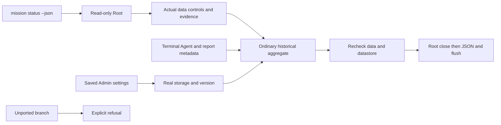

Terminal journey325 passes13 guards/22 readonly/refusal observations, integrity
verified; independent review approves production320/recipe325. Reader18 tests,
strict Clippy/Rustdoc320 pass; normal320 and SDK320 qualify with matching engine
inputs. Replay325 reuses unchanged production320 bytes without rebuilding the
engine for harness corrections.

Report discovery reads metadata under docs without a silent count ceiling. It
accepts selected file links to a regular contained project target, including a
target without read permission; it never traverses directory links and refuses
actual project escapes. Sorting uses the link's lstat timestamp. No new UID rule
is imposed on docs/reports; Root/.swarm guards remain. Traversal errors retain
causes and refuse, instead of the Go defect's successful empty listing. A found
report remains partial_possible without completeness/attribution evidence. The
typed test checks OutsideProject; CLI exposes the safe GateContractError envelope
(gate-evidence-invalid), without private paths.

Active Agents, completed/submitted results, historical review, planning, active
cooldowns and trace clipping beyond600 remain to port. Failed classification has
targeted coverage; the verified terminal CLI journey325 is interrupted. ForeignUID
runtime, Admin browser interaction and installation are not inferred. The next
active journey covers the completed worker and report submission.

The following sections retain historical stage evidence; their limits describe
the named earlier sources and do not establish global qualification.

## Historical mission report preparation — W4

`mission status WORK --json` remains refused until its historical aggregate is
assembled and verified; `status-native` keeps its separate contract. W4 adds
historical output types, pure task/spending/guidance/coordination projections and
a transactional read of retained Work, complete Agents, events, the explicit operator's visit,
nonreleased planning reservations and structured exchanges. Reading marks no visit
and changes no budget, lease, exchange or agent state.

There is no implicit 200-row window or replacement of absent measurements with
zero. Missing usage stays absent; malformed payloads refuse the entire read while
preserving causes and finalization/rollback errors. Private inputs cannot be
serialized directly: the public aggregate must deliberately select exposed fields.
Actual activity, validation freshness, storage health and effective version still
need their own connected producers.

The result connection and cause preservation through flush are verified in the
scope below; full report composition and its CLI connection remain open.

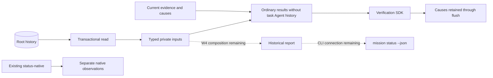

The `mission_status_inputs` and `mission_status_freshness` APIs are exercised
by a separate verification example. Freshness reads actual evidence and retains
its causes; observations are sequential, not one atomic whole-status snapshot.
Before and after material reads, the used pathname must name the same datastore
as the retained descriptors. Descriptor equality alone does not prove this
association; a missing or replaced Root refuses. This creates neither a pathname
lock nor same-UID confinement.

On frozen source258:48 targeted tests255 plus the new Root guard258 pass;
strict Clippy/Rustdoc259 pass, with fixture-free native profile260 and SDK261
sharing210 identical engine inputs. Recipe262 covers one public inactive Root,
11 pure refusals and7 read/refusal observations without SQLite mutation. It does
not establish a complete report, runtime producers or acceptance. The shared Go
parser preserves comma timestamp fractions; opaque JSON reaches the codec without
a `Value` conversion that could erase repeated keys. Counterexamples remain guards.

Propagation to older APIs revealed a separate defect: a gate reader could
validate the opened Work using evidence from another Root placed at the same
pathname (264 and267, the latter on the normal engine). The tested writer already
refuses without recording; this does not establish protection for other writers.
The verified shared correction covers gate, review, managed review
receipt/anchor/Git, task validation and Work validation readers. On Linux it
retains the opened instance, checks the pathname before/after under reservation,
preserves primary/secondary causes and explicitly closes witnesses. Other Unix
targets retain their historical reservation-only contract without physical
association evidence. Views and other file readers remain audit candidates;
coverage of every material consumer is not claimed.

Coverage includes79 targeted tests (269/277), strict Clippy/Rustdoc278, normal
profile279 and examples280/281 with211 identical engine inputs. Recipes282
(substitution/refusal/recovery) and284 (partial report) pass with verified integrity;
outputs285 are retained without Root databases. Older review fixtures remain
deliberately incomplete: their `planning-policy-invalid` refusal does not establish
authorization checks on valid planning. Original264/267 defects and269/283
verification-method failures are retained.

The next verified connection, still partial: `mission_status_results` reads Work,
saved settings and Agent history, checks before/after consistency and projects
ordinary results without Agent history for the task. Stale-evidence causes stay
in a nonserializable sidecar; a late material-guard failure must preserve them.
Agent SQL/body ownership is checked on both reads. Hierarchical Work and task
Agent history requiring a real classifier explicitly refuse, without invented
activity or a successful empty report scan. The SDK selects published results
and safe diagnostics; this still does not implement the full product CLI JSON.

Four API tests290 and strict checks291/300 pass. Normal profile292 and SDK298
share212 identical engine inputs without fixture features. Red296 reproduces
a lost cause on saturated output; green299 verifies13 guards,11 no-mutation
reads/refusals, a current then stale gate, preserved Gate and ENOSPC causes
together, and restoration/recovery. All100+100 outputs301 are archived without
a Root database. The module late-finalizer control remains simulated: no real
close/clock/encoding injection or corrupt-Agent fixture is claimed. The shared
ownership verifier runs on both reads. A successful observation carrying an
error sidecar must retain it through its final consumer; handling only `Err`
returns does not preserve those causes.

The [W4 record](../plans/migration-rust/evidence/20261023-g1-status-contract/PLAN.md)
separates code, tests and outstanding parity. This increment replaces no installed
server.

## Live agent observation — LIVE-UX-01 (read-only)

Off-critical-path improvement requested on 21 October 2026: follow agents of
**every** mission live and open a harness window on demand. Fully native Rust
(`swarm-web`, module `service/live.rs`); no Go route.

| Route | Methods | Contract |
|---|---|---|
| `/api/v1/live/overview` | GET/HEAD | Every recorded Work, its agents (light view, newest first), per-status counts and totals. A read failure refuses the whole page, never a partial view. |
| `/api/v1/live/agent?agent=&work=&logs_after=&terminal_after=` | GET/HEAD | Agent view, reply, next page of `agent_logs` and `terminal_events` (100 rows, parity with Go `/api/v1/logs`), `next`/`more` cursors. |
| `/live.html`, `/live-session.html`, `/live/*` | GET/HEAD | Embedded pages/assets; protected session required. |

Refusals: `live-query-invalid` (missing, unknown or duplicate key; query on
`overview`), `live-cursor-invalid` (negative/non-numeric), `live-agent-unknown`
(404), `live-agent-work-mismatch`. POST is refused. The light view excludes prompt,
workspace, contexts and preflight. PTY text is the recorded UTF-8 with
`invalid_utf8` set on replacement; the browser strips ANSI sequences and renders
via `textContent`. No input, lease or stop is offered.

The dashboard polls every 2 s (Go cockpit display cadence, not an engine policy),
pauses in hidden tabs, keeps 3 min of local active-agent history (sparkline),
global and per-mission status bars and a per-mission `parent → child` graph.
Clicking opens the harness: status, role, provider, activity, duration, last
signal, tokens, diagnostic, recorded log and terminal, polled every 500 ms while
the agent is active.

Push (`GET /api/v1/live/events`, SSE): connection-owned stream, no lane held
while idle. Every 1 s a `GET /api/v1/live/fingerprint` probe (SHA-256 of Works,
agents and log/PTY cursors) goes through the normal job channel (`try_acquire` on
the Root lane, observed like any job, authorized with the client's cookie).
Events: `retry: 2000`, `change` (id = fingerprint, resumed via `Last-Event-ID`),
`: busy` when the lane is saturated, `refused`/`closed` then end. An open stream
uses one operator connection slot. Outside the owned HTTP/1 transport (typed call)
the route answers 501 `live-events-transport-required`. The browser reloads JSON
on `change` and falls back to polling (2 s / 500 ms) when push is unavailable or
refused; the mode is displayed.

Provider states: each agent exposes `provider_facts` (`usage_state`, `model_state`,
counters and first error codes; history omitted). Agents without observed usage
are counted and flagged; no silent zero.

Terminal: read-only xterm (bundle `web/lib/terminal/live-terminal.js`,
`frontend/build-live-terminal.mjs`, three `<style>` elements patched for the nonce).
`/live-session.html` gets a fresh per-response nonce in its CSP and in the
`swarm-style-nonce` tag; an invalid template is a 500. Text fallback if the bundle
fails. No input is relayed.

Indicators (LIVE-UX-02): each agent view adds `limits` (the agent's own
limits), `context` (bytes, included/excluded files, memory and reference counts —
never content) and, on Linux, `resources`: RSS, cumulative CPU time
(`/proc/PID/schedstat`, ns) and threads of the supervisor and of the provider
process with its descendants. A PID is read only when its `/proc` starttime and
the host tuple equal the recorded identity; otherwise the state says so (`ended`,
`identity-mismatch`, `not-recorded`, `unavailable`, `other-host`) with no number.
The overview probes active agents only; the agent view adds `context_memory`
(memory id and version). The browser computes CPU as "% of one core" between two
reads, re-reads every 3 s while live resources exist (display cadence), flags
"Needs attention" from engine marks only (thresholds exceeded, error limit,
errors, invalid usage, unverifiable identity) and animates links, active nodes
and changes (off with `prefers-reduced-motion`). Series colours are validated
(contrast, colour blindness) per theme; values stay written as text.

Limits: no access to a live Go root; the fingerprint reads all agents (O(agents))
per probe; no independent review. Plan, tasks and evidence:
`docs/plans/migration-rust/PLAN.md`, entry LIVE-UX-01.

### Provider telemetry — LIVE-UX-03, increment E2E-1 (local, verified)

Native OTLP/HTTP **JSON** receiver: `POST /api/otel/v1/logs` and
`POST /api/otel/v1/metrics` (`swarm-web/src/service/otel.rs`). They are the only
routes exempt from cookie/CSRF and require a machine exporter:
1. before the body is read: exact Host, POST, `Content-Type: application/json`,
   no `Content-Encoding`, `Authorization: Bearer <64 hex>`;
2. in the Root job, before decoding: the token digest exists unrevoked in
   `.swarm/telemetry.db` **and** its agent is still active in the mission
   database (finish/stop/abandon = implicit revocation, also after a restart).

Records attach to the **token's** agent, never to body attributes.
Normalization (`swarm-engine/src/telemetry_normalize.rs`): known names only
(`claude_code.`/`codex.` prefixes removed), a per-name allowlist of scalar
fields (≤ 128 characters); prompt, response, tool parameters/output and error
text are never kept; unknown names are counted. Storage (`telemetry_store.rs`):
a **separate** `.swarm/telemetry.db` (own schema v1, 0600 file of the same user,
NOFOLLOW, zero SQLite busy wait); mission schema 37 shared with Go is unchanged.
Tokens: sha256 digest only. Idempotence: per-agent sha256 digest (replay =
ignored duplicate). Totals: deltas summed, cumulatives = newest value per
series, never mixed (`value: null`, temporality `mixed`).

Replies: `{}` or `partialSuccess` (`rejectedLogRecords`/`rejectedDataPoints`);
401 `telemetry-token-invalid` (unknown, revoked, inactive or missing agent, no
store: indistinguishable), 415 `telemetry-format-unsupported` (protobuf,
compression), 405 `telemetry-method-invalid`, 400 `telemetry-body-invalid`
(cause kept), 413 beyond `web_http_body_max_bytes`, 503
`telemetry-store-unavailable` (nothing kept, replay safe).

Console: `/api/v1/live/agent` adds `telemetry` (state `no-token` / `waiting` /
`received` / `unavailable` + code, provenance `provider-declared-unauthenticated`,
latest 100 `api_request` calls, tool aggregates, decisions, totals, unknown
names, rejections); the live fingerprint includes a store marker, so telemetry
arrival is pushed to open windows. The harness shows the "Provider telemetry"
panel (FR/EN, both themes, mobile).

**Instrumented launch (E2E-2)**: Admin setting v30 `agent_telemetry_providers`
(list, empty default = disabled; only `claude` accepted, `codex` and duplicates
refused; requires v29). At start, `swarm-rust web` publishes
`.swarm/telemetry-endpoint.json` (bound address, PID, start stamp, host; 0600,
atomic write) and retracts it at stop if still its own. In a **worker**
execution gate, after every guard and `fresh()`, when the provider is enabled
and the record names a live process on this host: a token is issued (digest
only) and variables are appended without ever overriding an inherited one
(`CLAUDE_CODE_ENABLE_TELEMETRY`, `OTEL_{METRICS,LOGS}_EXPORTER=otlp`,
`OTEL_EXPORTER_OTLP_PROTOCOL=http/json`, `OTEL_EXPORTER_OTLP_ENDPOINT=http://ADDRESS/api/otel`,
`OTEL_EXPORTER_OTLP_HEADERS`, informational `OTEL_RESOURCE_ATTRIBUTES=swarm.agent_id=…`).
No or stale server: no variable. Setup failure while enabled: launch refused with
`agent-telemetry-setup-failed` (cause kept). Export intervals: provider defaults.
Evidence: real launch of a fake `claude` provider (Python) through `agent
prepare/run`, OTLP POST 200, live view `received`, disabled relaunch without
variables, endpoint retracted (`tests/rust_native_telemetry_launch.py`).

**Harness (quick wins, October 22)**: activity timeline in **lanes** (one per
group: messages, model calls, tools, lifecycle, errors): position carries the
category, colour supports it; `api_request` calls get their own lane (reference
yellow `#eda100`/`#c98500`). A "Declared − telemetry gap" row (input+output, two
declarations, never reconciled; "partial" beyond 100 calls). Shortcut `m` →
telemetry panel (`t` stays the dashboard theme key). Finding: in dark mode, blue
`#3987e5` and violet `#9085e9` (LIVE-UX-02) are too close all-pairs (ΔE 9.8 < 15);
fixed for the timeline by lanes, still to review for other charts.

**Plan linked to agents (October 22)**: `/api/v1/live/overview` adds `plan` per
Work (tasks recorded by the initial phase: title, owner, deliverable, criteria
count, dependencies, status, blocker, next step, attempts, planned
role/attempts/tools/model; no instruction or memory) and `/api/v1/live/agent`
adds `planned_task`. Dashboard: a "Plan (initial phase)" graph above the agents
(dependency columns, dashed arrows, not-started task flagged, click → agent
node); harness: a "Planned task" panel (planned / actual, overrun flagged).
Fixed defect: resizing erased the plan arrows (one painter for both graphs).
**Action animations** (off under `prefers-reduced-motion`): floating "+N
tokens" / "+K tools · name" chips and a ripple when served counters grow between
renders, an activity EKG per active agent (last 32 deltas, display window), a
flowing arrow into an active task, sliding highlight of new log rows and new
model calls.

**Dark theme and plan readability (October 22)**: an exhaustive search of
4-hue sets from the reference palette passing all pairs in both themes found two,
both with a green close to the light "Completed" status green (`#18753c`), so
they were rejected. Decision: the timeline (the only multi-series legend) keeps
blue/magenta/yellow (all-pairs validated, light and dark) and lifecycle becomes
neutral ink (a background category); violet now only serves labelled
single-series charts (tool meter, CPU). Plan: arrowheads, tasks ordered by the
barycentre of their dependencies (fewer crossings), hover/focus on a task
highlights its upstream and downstream chain and dims the rest.

**Waterfall, blockers and pulse (October 22)**: the telemetry view exposes
`tool_calls` (latest 100 `tool_result` events: declared time, tool, duration,
success) and the harness draws a waterfall of the latest 20 (bar from (time −
duration) to time, failures red with "✗", animation on new calls only).
Dashboard: a per-mission "What blocks" panel computed from the served plan
(unfinished task waiting on unfinished dependencies, chain head, explicit
blockers; finished = `accepted` or `waived`; no duration estimate); "pulse" =
observed changes per minute (growing tokens, tool calls) over 10 minutes,
redrawn every 5 s so it decays without a network request.

**Cache health — LangWatch L3 (October 22)**: Admin settings **v31**
`agent_cache_miss_ratio_percent` (default 50) and `agent_cache_min_input_tokens`
(default 1000), values from LangWatch `token-timeline.ts` (Apache-2.0); complete
group required, percent ≤ 100, requires v30. `/api/v1/live/agent` adds
`cache_policy` (null before v31). Harness: per call, total input = input + cache
read + cache creation; a judged call (total ≥ minimum) whose cache-read share is
below the threshold is "re-read" (context re-read, paid twice): "N re-read of M
judged", a total-input-per-call curve (compactions visible), a "Cache read"
column marked "re-read". Display only: nothing is blocked or billed;
provider-declared data.

**Typed transcript — LangWatch L2 (October 22)**: `swarm-engine/src/agent_transcript.rs`
derives at read time, with no new persistence, a typed transcript from the
provider stream already retained in `native_execution_result.capture` (bounded
by `agent_capture_max_bytes`). Formats recognized by shape: Claude Code
`stream-json`, Codex `exec --json`. Kinds: session start, model call (declared
tokens), message, tool, tool result (name taken from the call), tool rejected
(`permission_denials`, `declined`), note (result, errors, counted unknown types,
truncated capture). No content is served: only kinds, tool names, ids, error
flags, lengths and tokens. `/api/v1/live/agent` adds `transcript` (null while
the attempt runs: the capture only exists at the end). Harness: a "Typed
transcript" panel with kind filters (toggle buttons, counts). Limits: these
streams carry no per-event timestamp (no duration), no live transcript during
the attempt (would need persistence in supervision, Codex's area).

**Supervisor alerts — LangWatch L5 (October 22)**: six fixed rules
(`swarm-engine/src/live_alerts.rs`) read only marks the engine already computed
under its settings: agent failed, error limit reached (critical), duration
threshold exceeded, long tool wait (active agents), usage invalid or incomplete,
task blocked (warnings). No new threshold or setting. Terminal rules (failure,
error limit, usage) target only the latest attempt of a task that is neither
accepted nor waived: a retry (a newer agent on the same task, by `started`) or
acceptance clears them; an unparsable `started` is never guessed (the alert
stays). Durable history lives in `.swarm/telemetry.db` (schema **v3**: `alerts`
table in v2, `resolution` column in v3; one open alert per rule and subject).
Migration only happens on a write path, under the lock, re-reading the version
inside the transaction; reading an older schema never changes it.
`GET /api/v1/live/alerts` is a pure read (at most `LIVE_PAGE_ROWS` open and
resolved, `open_more` / `history_more`). `POST /api/v1/live/alerts/evaluate`
(session + CSRF, empty body or `{}`) computes conditions from the mission store
and reconciles the history: idempotent, deduplicated conditions, no write when
nothing changes (no contention with OTLP ingest in steady state), otherwise an
`IMMEDIATE` transaction. Mission read and reconcile are serialized in the server
(an evaluation of an older state cannot land after a newer one). Qualified
resolution: `cleared` (condition gone, subject present) or `gone` (agent or task
disappeared). Refusals: `telemetry-store-busy` (503, another writer),
`telemetry-store-unavailable` (503), `live-clock-invalid` (500). Dashboard: an
"Alerts" panel (open; collapsed history with resolution duration and kind;
engine event time when known; harness link). Each console notifies the open
alerts it had not seen yet (same tag: the browser shows one), whichever
console's request recorded the transition; a page's first evaluation is
baseline; more than three new at once become one summary notification (display
choice). A busy store triggers one re-evaluation after one cadence per failure
streak, never while paused. A purely local "Test notification" button. Limits:
evaluation only while a console is open and not paused; hidden tab: evaluated on
pushed changes, not in polling mode; continuous evaluation without a console
needs a supervision hook (Codex); no history retention purge.

**Deliveries — LangWatch L9 (October 22)**: LangWatch links a session to its
pull request; Swarm has no PR, the equivalent is the task and its reviewed
candidate. `plan_view` (live view and harness) adds `delivery`: candidate
commit, previous candidate, independent review state and date, review count —
or `null` when no review is recorded; never the review report. Dashboard: a
"Deliveries" ledger per mission (tasks with attempts or a reviewed candidate):
status, attempts (agents recorded on the task), declared tokens and cost summed
over observed usage only (others counted apart, never estimated), short
candidate commit. No persistence, no setting. Limits: no public Rust path yet
produces a finished independent review (Codex's reviewer flow in progress): the
commit column is proven only by a projection unit test; reviewer usage is not
added (double-count risk if the reviewer is also an agent of the task); review
state is shown as recorded, untranslated.

**Retention and cap — settings v33 (October 22)**:
`agent_telemetry_retention_days` (installation default 30, editable; null =
keep without limit; zero refused) and `agent_telemetry_max_events_per_attempt`
(default null = no operator cap, the HTTP body limit still applies; zero
refused), complete group, depending on v30, editable in Admin (Agents group).
Console store **v4**: arrival index and one cumulative purge summary row. On
OTLP ingest, cap and purge apply in the recording transaction (failure = nothing
kept, safe replay); points beyond the cap are refused, counted as rejected and
reported to the exporter (`partialSuccess`, `telemetry-attempt-cap-reached`),
never silently truncated; a replay of stored points stays a duplicate. Alert
evaluation also applies the purge (no write when nothing is due). The purge
removes points older than the limit (by arrival), resolved alerts and revoked
token digests; never an open alert or a valid token. A read never purges or
migrates. Visible: evaluation response (`purged`, `retention`),
`GET /api/v1/live/alerts` (`retention.policy`, `retention.last_purge`), a
"Retention" line under the Alerts panel. Before v33: no purge and no cap
(historical absence adopts no default).

**Codex instrumented (October 22)**: `codex` joins `TELEMETRY_PROVIDERS`. A
prior probe on `codex-cli 0.163.0` with no paid call
(`docs/plans/telemetrie-agents/codex-otel-probe-20261022/`) showed that Codex
exports only with an `[otel]` section, does not expand `${VAR}` in headers, but
takes `OTEL_EXPORTER_OTLP_HEADERS` when `[otel]` sets none. At launch the token
therefore goes into the environment only, and exporters are passed as global
arguments inserted right after the program (`-c otel.exporter=…`,
`-c otel.metrics_exporter=…` to `/api/otel/v1/{logs,metrics}`,
`-c otel.log_user_prompt=false`): no secret in `argv`, computed after the
freshness checks (outside preflight digests), like the environment.
Normalization: the `response.completed` response becomes the `api_request` call
(uncached input = input − cached, cache read, cache write, reasoning);
`codex.api_request` (HTTP attempt) becomes `api_attempt`; other stream events
are counted, not stored; Codex's `tool_result` carries `arguments` and `output`
in clear, never kept (allowlist, dedicated test). Proven: normalization unit
test on the observed shape, argument insertion, and a public E2E with a fake
executable `codex` (same `argv` as the real CLI). Limits: one Codex version
observed; Codex histograms not stored (counted as rejected); no real billed
Codex run.

**Telemetry, 10 improvements (October 22)**:
1. *Histograms*: known Codex histograms (`api_request.duration_ms`,
   `turn.ttft/ttfm.duration_ms`, `turn.e2e_duration_ms`, `turn.token_usage`) are
   kept (sum, count, min/max, buckets ≤ 64); read as latencies by name and model
   (mean, median, interpolated 95th percentile) and tokens by type; an unknown
   histogram is "unrecognized", no longer "rejected".
2. *Usage gap*: alert rule `agent-usage-mismatch` (declared **output** tokens vs
   telemetry sum, latest finished attempt of a task not accepted), threshold
   setting **v34** `agent_usage_mismatch_percent` (default 10 %, null = off).
3. *Reviewer and planning*: same injection and opt-in as workers; token bound to
   subject `review:<job>` or `planning:<claim>`; ingest accepts a subject only in
   its job's live phases. Console view: each Work lists its reviews and
   planning runs ("Reviews and planning": type, target, phase, identifier;
   read-only projection of `native_review_jobs` / `native_planning_runs`, absent
   tables = empty list), and the "Telemetry" button opens the harness in run mode
   (`GET /api/v1/live/run?run=review:<id>|planning:<claim>&work=`; refusals
   `live-query-invalid`, `live-run-unknown` 404). Phase changes feed the live
   fingerprint (the console wakes when a run starts or ends). Limits: no
   estimated cost (only the provider digest is persisted for these runs); no
   log, terminal or resources (not recorded for them). The periodic overview
   re-render now keeps keyboard focus (agent, task, run button) and the task
   chain highlighted under the pointer.
4. *Estimated cost*: calls without `cost_usd` priced from the rate catalogue
   (`swarm-rust pricing save`, same provider and model, newest version), exposed
   apart (`estimated_cost`), never mixed with declared cost.
5. *Burn rate and reserve*: tokens/min over the last 5 minutes of calls (display
   choice) and the share of the budget's launch reserve used (declared +
   estimated), flagged beyond 100 %.
6. *Traces*: route `/api/otel/v1/traces`, Codex exports via
   `-c otel.trace_exporter=…`; allowlisted spans kept (run, turn, sampling,
   tools), code locations and internal attributes dropped, hundreds of internal
   spans counted as "span (other)"; indented tree of the newest trace in the
   harness. Claude spans not enabled (shape unverified).
7. *Purge at web server start* (before the endpoint is published).
8. *Useful Codex names* recognized (see 1).
9. *Unrecognized names* listed by name in the harness.
10. *Real `codex` end to end*: script `tests/rust_native_codex_real_otel.py`;
   **blocked** by an earlier Rust launch failure, identical without telemetry
   (reported to Codex in PLAN).

**Remaining evolutions, lots 1–2 (October 22)** — settings **v35**:

- *Server-side alert evaluation* (`agent_alert_evaluation_seconds`, default
  60 s, null = open console only): a web server thread, started after the
  startup purge and stopped then joined before the service closes, runs the
  same evaluation as the console (`evaluate_alerts`); its last outcome
  (`starting`, `running`, `error` with code, `stopped` when the setting goes
  back to null, `off`) is exposed by `GET /api/v1/live/alerts` and the
  evaluation (`server_evaluation`) and shown under the alerts. A failed cycle
  is not rerun before the next cadence. Enabling after start needs a restart.
- *L7 budget* (`work_budget_warning_percent`, default 80, 1–100, null = no
  warning): rules `work-budget-threshold` (warning: the higher of committed
  amounts — reserved estimates of the four ledgers — and declared cost reaches
  the share of the limit) and `work-budget-overspent` (critical: declared cost
  above the limit, the after-the-fact gap that admission on estimates cannot
  prevent), subject `budget:<work>`, zero limit = unlimited. The overview carries
  `budget` per Work (limit, reserve, committed, declared, attempts without
  cost) and a chip in the Work header.
- Evidence: engine tests (rules, v35 settings), web (`budget_alerts_…`), E2E
  `rust_native_telemetry_launch.py` (`server_alert_loop`: server restarted at
  1 s, alert opened with no console request), browser.

**Remaining evolutions, lots 3–8 (October 22)** — console store v5–v7,
settings **v36–v37**; no content (prompt, reply, tool output) is stored or
exported:

- *L11 failure causes*: failed (or limit-stopped) attempts grouped by the most
  specific cause the engine recorded (recovery fingerprint, limit reason, usage
  code, diagnostic item, exit code, stop kind, else "unclassified"); no model,
  no text similarity. "Failure causes" overview panel (`failure_groups`),
  disclosures that stay open across refreshes.
- *L10 annotations*: operator verdict (good, bad, unsure) and note per
  finished attempt (`/api/v1/live/annotations`, GET queue / POST CSRF),
  optimistic revision (`annotation-revision-conflict` 409), note bounded by
  `annotation_note_max_chars` (v36, default 2000, refused never truncated,
  control characters refused except newline and tab). Form in the harness,
  "To annotate" queue in the overview.
- *L8 regression dataset*: `GET /api/v1/live/dataset?work=&select=failed|bad|all`,
  recorded facts only (task, outcome, cause, declared usage, annotation,
  telemetry summary); JSONL export from each Work. A console-store failure
  refuses the export instead of returning a partial one.
- *L4 evaluations*: deterministic evaluators run once per finished attempt
  during alert evaluation (server or console): outcome, limits, tool
  reliability (score without verdict), cache reuse (verdict per v31), usage
  consistency (verdict per v34); on a truncated call page the measure is
  marked `partial` with no verdict. Stable hash sample
  (`agent_evaluation_sample_percent`, v37, default 100, null = off).
  "Evaluations" harness panel. **Model judge not built**: a billed call must
  go through the engine's launch gates and budget reservations (Codex area);
  running it from the web server would bypass them. Resume: an engine-side
  "judge" gate.
- *L6 scenarios*: operator expectations per task (outcome, tool used, tool
  without failure, forbidden tool, maximum tool failures, maximum declared
  cost, usage observed), judged against the task's latest attempt; "not
  judgeable" when telemetry is missing (never guessed). `/api/v1/live/scenario`
  (GET results / POST CSRF, optimistic revision), structured editor in the
  harness, "scenario n/m" chip on the plan task.
- *Claude traces*: probe with no billed call
  (`docs/plans/telemetrie-agents/claude-otel-probe-20261022/`); instrumented
  launches add `OTEL_TRACES_EXPORTER=otlp`,
  `CLAUDE_CODE_ENHANCED_TELEMETRY_BETA=1`, `OTEL_LOG_USER_PROMPTS=0`; five spans
  kept, `user_prompt` and `bash_argv0` dropped.
- Harness of a finished agent: no more polling, but while push is available
  each pushed change re-reads it once ("re-read on each change"); an
  evaluation, annotation or scenario result recorded after the end appears
  without reloading. Without push, the "Resume following" button stays offered.
- Model judge: specification proposed to Codex
  (`docs/plans/telemetrie-agents/JUGE-L4-SPEC.md`).
- Limits found by the independent review: a final telemetry export that
  collides with an alert-loop write gets 503; if the attempt turns terminal
  before the exporter retries, that remainder is refused and the (write-once)
  evaluations lack it — untested; resume: an ingest grace period after the
  end, as an Admin setting. The live fingerprint reads every run on each probe
  and the loop reads the evaluated ids on each cycle (cost grows with history).
- Limits: an attempt is evaluated once, even if telemetry arrives later;
  evaluations, annotations and scenarios are not purged by v33 retention;
  scenarios judge the latest attempt only.

**Remaining**: real emitters not exercised end to
end (real `codex` blocked at launch); purge only during console writes (none without ingest or console).
Limit: a client with a well-formed token makes the server read a bounded body
before refusal. No independent review.

## Provider observations79 — local path verified

Candidate code extracts provider-declared usage/model and exposes
`Agent.native_provider_facts` at heartbeat and settlement. This opaque JSON does
not authenticate an executed model or cost. Canonical `usage`/`reported_model`
require currently valid observations; missing/invalid/incomplete states retain
explicit history and the first safe error code without arbitrary payload text.
Tool attribution continues independently.

The latest terminal declaration replaces the prior one: separate cache fields,
no turn/session sum, absence distinct from0. Wrong supplied types/negative values
refuse; numeric conversion keeps the Go producer's float64 domain without turning
it into a budget or stop. Cost remains provider reported; reservations and prices
are not recalculated here. Timestamps come from the engine. Model Cc/Cf controls
refuse; the existing v18 event cap bounds this channel without a second hidden
200-byte ceiling. Output observations before permission refuse; JSON grants no rights.

The initial79 public test is RED after a valid lifecycle control: missing metadata.
Six extraction tests, nine stream tests and both dedicated CLI journeys pass,
including invalid data then recovery in the same active process. Full preflight
refuses premature output claims without mutation. Current candidate/profile qualification is detailed below;78retains its
historical sources and results.

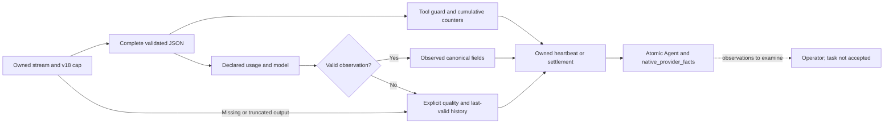

CLI diagnostics now retain typed guard causes within IO, both branches of the
CLI cleanup wrapper, and distinct typed sources sharing a transparent wrapper's
address. Actual cycles remain detected. Three RED→PASS cases verify projection
without arbitrary data `Display`/`Debug`. Engine clock failure has a safe family
and triggers owned cleanup; provider-supplied time never substitutes for it.

The compatible numeric domain is explicit: finite float64 values, integral after
decoding, nonnegative and at most`9e15` tokens. Exceeding it invalidates the
declaration; process duration and execution authority remain separate. This
preserves the Go producer's representation contract, without claiming arbitrary
decimal precision or treating a declaration as an invoice.


Qualification79:549named Rust workspace tests PASS, none ignored;13empty suites
are not counted. The native recipe passes108Rust tests;4generator tests, Clippy
and private Rustdoc also pass. The final CLI without fixtures is separate from
the analysis profile; evidence is retained in the plan. No service installation,
real model, invoice or global acceptance is established.

Usage/model channels retain independent latest declarations; they do not establish
that both concern the same call/turn/session. Future settlement must bind route,
usage, call context and price without inferring that relation from two latest
values. Reservations remain estimated here.

## Native manual execution — partial verification78

`agent run ID --root ROOT --json` now connects an intention created by
`agent prepare`. It supports manual workers and supported local executables.
Unported model routes, dialogue, hierarchy and selected memory context still
refuse. This is not a completed engine migration.

Preflight rereads row/request headers, current Work/latest `recorded` attempt,
context/workflow, provider/environment/workspace, original TTL and existing
reservation. After the actual supervisor claim, the helper stays gated until
PID/PPID/PGID/starttime registration and permission commit. It rechecks lineage
and evidence, closes Root, then execs the provider with exact sealed-memfd stdin.
A private CLOEXEC channel reports pre-exec refusals. Empty EOF remains ambiguous;
it establishes neither successful startup nor provider vitality. The image
is replaced by explicit `execve`, with no shell fallback for plain text files.

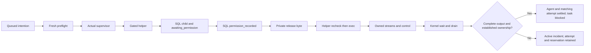

The supervisor applies operator stop and tool guards: TERM, configured grace,
then KILL. Historical `timeout_seconds` is an **elapsed-time observation threshold**,
never an automatic stop deadline. Crossing it sets `time_threshold_exceeded`;
silence, tool waiting and stale heartbeat remain observations, establishing
neither lack of progress nor completion. Configured drain starts after
kernel leader readiness. Capture/event/message caps never reset counters or stop
draining. `agent show` consumes the frozen heartbeat threshold and reports
recent/stale/future/ended without claiming provider vitality. Later settings
changes apply to future execution starts.

Claude/Codex declarations are decoded without recursive JSON trees; duplicates
and number ranges are validated and initial call input survives completion diff
changes. Only explicit assistant text becomes public. Invalid/oversized events
lose visibility; the first typed cause and safe code remain available. UTF-8
retention and Unicode15.0.0 Cc/Cf cleaning are explicit; output hashes cover all
observed bytes, including content omitted from capture.

Atomic settlement covers Agent, its matching latest attempt, event, log and the
exact initial reservation, including legitimate absence without an envelope.
Reserved estimates become `estimated` when the provider may have started;
`released` requires established absence of provider execution. No measured cost,
refund, new attempt or task acceptance is fabricated. Unreaped processes or lost
ownership preserve active state for explicit recovery.

Intermediate78 proofs are retained. `native-cli11` passes10cases, but its
time-triggered stop expectation was incorrect and invalidated by contract review.
The current recipe requires a process still active beyond its threshold followed
by an operator stop. Original evidence and correction remain in the plan. No
service restart, real mission or OS confinement is proven.

Drain refusal or interrupted output now preserves an active `stopping` incident,
without `ended`, attempt settlement or estimate release. Results distinguish
kernel reap from complete output. A helper refusal retains its child wait code
separately, without a fictitious provider exit. Reconciliation after this incident
still needs fresh stream evidence; leader disappearance alone does not authorize
it. OS confinement remains unproven.

CLI JSON failures now include `failure.causes`: classified families/operations,
including both branches of cleanup failures. This projection excludes arbitrary
error text, SQL, context and paths; it grants no retry authority. The specific
cause must still be diagnosed before resumption.

The [v18 Admin recipe](../plans/migration-rust/evidence/20261019-78/browser18-01/result.json)
passes four FR/EN×theme journeys:20fields, including nine supervision settings,
save/reopen/null and actual seven-byte capture from a local cat process. This
private browser transport does not qualify an authenticated HTTP API. All356
engine integration tests pass. An intermittent unit spawn failure retains an
unknown original errno; its witness now creates executable writers outside the
concurrent parent, tests ETXTBSY then recovery and retains kind/errno/stage for
future refusals. This introduces no product retry or retrospective attribution.

## Supervision settings v18 — manual runtime connected

The complete nine-field group is explicit, versioned and exposed by the shared
settings catalogue. Initial values exist only in installation JSON. Historical
v17 stays readable, but the supervision-policy getter refuses until explicit
preview/apply adoption. A partial group refuses. Root API persistence/reopen and
boundaries, actual process consumption and new Admin journeys are verified within
the manual scope above. This establishes neither a native HTTP service nor real
model execution.

| Persisted field | Initial value | Unit | Null |
| --- | --- | --- | --- |
| `agent_supervision_poll_interval_ms` | 1000 | milliseconds | refused |
| `agent_supervision_heartbeat_stale_ms` | 10000 | milliseconds | refused |
| `agent_supervision_term_grace_ms` | 3000 | milliseconds | refused |
| `agent_supervision_output_drain_ms` | 2000 | milliseconds | no ceiling |
| `agent_provider_event_max_bytes` | 1048576 | bytes | no ceiling |
| `agent_capture_max_bytes` | 1048576 | bytes | no ceiling |
| `agent_capture_max_lines` | 1000 | count | no ceiling |
| `agent_public_message_max_bytes` | 1048576 | bytes | no ceiling |
| `agent_log_message_max_bytes` | 2048 | bytes | no ceiling |

Poll/freshness intervals are strictly positive; zero grace requests immediate
escalation only after a stop decision. Zero drain does not wait for an open
post-leader stream; incomplete draining is an incident, not safe closure. Zero
retention omits that channel content without erasing counters or blocking codes.
Unlimited retention may consume unbounded memory/storage. Heartbeat age is an
observation, never proof of death or an automatic stop. Existing attempts and
consumed budgets are not reset by policy adoption.


## Already reserved agent budget — manual runtime prerequisite

`check_reserved_agent_budget` validates the owned reserved estimate and all four
current ledgers without adding another launch reserve. Exact committed capacity
fits. Missing, foreign, released or changed required estimates, corrupt amounts
and newly excessive commitments refuse without mutation. The existing admission
checker still correctly tests a new allocation; it is not replaced. No actual
cost, refund, reset or execution permission is inferred. The manual supervisor
consumes it before releasing the helper. Funded controls verify reserved→estimated,
or released only after a confirmed pre-exec refusal; incomplete drain retains reserved.

## Native execution snapshot — strict storage contract

`Agent.native_execution` retains opaque JSON, including unknown future constraints.
The strict v1 consumer requires policy, settings revision, Work revision, full
context SHA256 and gate phase. Unsupported/missing data refuses without current
Admin defaults. Raw retention avoids silently discarding constraints during other
lifecycle operations. Neither JSON consistency nor this hash authenticates actors.

`awaiting_permission` and `permission_recorded` are protocol phases. The latter
means a provider may have started; it never proves actual execution, safe budget
release or task acceptance. Actual SQL registration, gate release, kernel checks
and settlement are connected by the manual Linux path. Crash/incomplete-drain
recovery remains open. The data decoder alone performs no IO, process start,
permission grant or lifecycle mutation.

## Controlled process78 — manual consumer connected

The Linux runner now accepts explicit stdin and internal hooks for notification
after acquiring pidfd, controller-supplied monotonic wakeups and TERM/KILL signals.
The Git/validation wrapper retains null stdin and its explicit deadline. No polling
interval, grace period, retry allowance or global timeout is added.

Post-spawn notification cannot guarantee that a command has not already executed.
The manual provider path therefore uses a blocked helper before releasing context,
verifies SQL registration and revalidates preparation. Frozen Admin supervision
policies and Root integration are described above. Runner fixtures establish neither
authenticated identity nor authorized provider execution nor task completion.
IO causes and any unreaped children remain retained for recovery. Its17current
runner/Git/validation cases pass; the Root path has11separate CLI cases. The earlier
15case checkpoint remains historical in the increment78 evidence.


## Shared agent contention77 — targeted checks verified

Preparation, supervisor registration, stop intention and unregistered
cancellation share `agent_storage_retry`. It consumes the three existing
persisted storage settings:
`storage_busy_timeout_ms`, `storage_busy_retries`, `storage_busy_retry_delay_ms`.
SQLite wait is refreshed per attempt; retry allowance/delay are reread after
releasing the configuration reservation. Zero retries means one attempt; `null`
may wait indefinitely. Finite policy can legitimately exhaust during another
writer without permitting a duplicate launch.

Only direct SQLite BUSY with confirmed autocommit after refusal is retried.
Commit, cleanup and nested business-layer failures remain explicit incidents;
uncertain commits are never replayed automatically. Exhaustion retains original
SQLite cause, attempt count and policy revision as `agent-launch-storage-busy` for admission and `agent-storage-busy` for
the other operations.
After a known peer commit, explicit replay must find the same intent with no
new attempt/event/estimate. No provider restarts or policy increases occur.
Held-writer refusal, unchanged state, explicit release/recovery, finite and
unlimited saved policies and uncertain-commit exclusions pass targeted tests77.
This is local fixture evidence, not distributed incident acceptance.

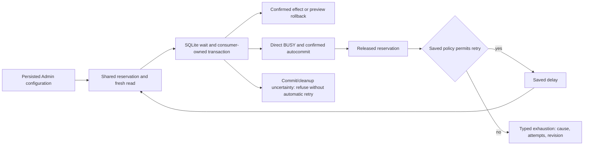

The internal durable/preview boolean describes callback effects, not operator
policy or permission to execute an agent. Commit/rollback/close errors remain
distinct from safe BUSY refusal. Stop already checked SQL epoch after obtaining
its write reservation; an omission hypothesis was falsified, so no redundant
engine protection was added.

## Historical checkpoint77 — guard policy chain

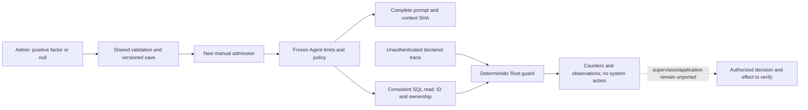

Admin changes affect future admissions; replay never resets consumption or
replaces historical metadata. Solid edges show the local diagnostic at checkpoint77;
its dotted supervision branch was unported then. The manual78 integration is
described at the top of this page. Detection windows are distinct from log retention
and budgets. Diagnostic timestamps are caller supplied, without authenticity.

Intentional differences from observed Go behavior: implicit factor4 becomes an
explicit policy; conflicting content under one ID refuses instead of being
ignored; technical error wording never waives declared failure counts. An actual
infrastructure incident must be attributed by supervision separately from a
provider's message. The first guard reason remains retained while later declared
events continue contributing cumulative facts. This proves neither actual tool
execution nor applied termination. Provider profiles, supervision, distributed
final counters and global acceptance remain unqualified before cutover.

## Diagnostic guard replay — increment77 targeted checks verified

`swarm-rust agent guard AGENT --input trace.json --root ROOT --json` reads
a stored agent and its frozen policy in one consistent SQL snapshot. Missing
historical metadata, row/body-ID contradictions and invalid events refuse;
current Admin values are never a fallback. Output states `preview_only:true`,
`process_started:false` and `event_source:caller_declared_unverified`. No tool
executes, no stop applies, no reservation/task mutates. SQL consistency is not
identity authentication. `process_started:false` describes this diagnostic operation;
it does not observe the vitality of any existing process.

Declared trace example:
```json
{"schema_version":1,"events":[{"call":{"at_ms":0,"id":"A","name":"Read","input":{}}},{"result":{"at_ms":1,"id":"A","failed":true,"message":"permission denied"}}],"final_at_ms":1}
```
`output`, `call`, `result`, `visibility` are exclusive variants with monotonic
millisecond timestamps. Technical wording cannot turn a declared result into an
engine-origin incident or waive its error counter. Visibility loss retains
cumulative counts while resetting unsupported streak inferences. Silence/wait
observations prove no provider death and trigger no automatic stop. The targeted
engine and actual default-feature CLI checks pass; final Admin evidence and its
binary identity are recorded in the plan.

## Native guard77 — frozen diagnostic policy

V17 adds `agent_interleaved_failure_lookback_multiplier`: initially positive4,
or `null` for no expiry. Validated, persisted and presented in Admin. It multiplies
the frozen repetition ceiling in completed results without changing that ceiling
or consumed counters. New intentions freeze policy and revision in additive
native metadata. Old Go bodies lack this field; absence stays historical without
fallback. Metadata establishes no identity, permission or execution proof.

The complete prompt includes frozen policy before SHA. Later edits do not refresh
an existing intention. The DTO generator retains this extension and refuses a
future Go-name collision. Guard consumption is available through read-only CLI
replay; activation through actual provider supervision remains unported.
Unknown native constraints survive storage but refuse guard consumption.
No provider process is enabled.


## Current context76 — component verified

New manual preparation composes after transition: Work, task, agent, new attempt,
count and the candidate revision that will be stored. The original Next remains
the brief's next action; a generic handoff status does not replace it. The latest
own plan contract is reconstructed from records, excluding sibling task bodies
and superseded contracts. Shared manual-plan assumptions and decisions are
declared data, not permission or evidence of success.

Ambiguous/inconsistent mappings, explicit claims with no matching contract, or
a plan task lacking its contract refuse without falling back to an old plan.
Delegated/corrective branches remain unported and refuse. Identifiers are engine
observations, not cryptographic authentication. Historical preparations replay
without rewriting; replay neither authorizes execution nor refreshes context.
Future execution must recheck context and refuse stale evidence.

The digest covers the complete composed prompt. Preview and commit use identical
bytes; changing Work invalidates the old hash even after refreshing the launch
revision. Reviewing a new preview enables recovery. The v16 saved byte cap applies;
no new policy is introduced. The permanent recipe passes14engine and23default CLI tests with a verified
archive. Four FR/EN×theme Admin journeys also verify current identity in the
production consumer and policy refusal/recovery. No provider process or
installation.


## Native manual admission75 — component verified

Public commands: `swarm-rust agent preview|prepare WORK --root ROOT
--input FILE --json`. Strict schema1 JSON supplies `event_id`,
`expected_revision`, `task_id` and `provider`. Zero duration inherits the saved
default; negative duration refuses. Replay compares the original intention
before normalization; changing its content under the same identity refuses.
`created=false` during preview establishes no reservation. Lost output after
commit stays an error: reread/replay without a second attempt or process.

`RootStore::prepare_agent_launch` builds a manual worker intention and context
itself. It observes the actual workspace, configured executable, allowed environment
names and workflow, then rechecks them in the admission transaction. It starts no
provider process. Preview rolls back every SQL write; its temporary local read/write
probe is explicitly removed.

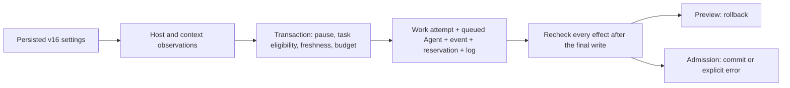

V16 adds ten persisted choices: launch duration and ceiling, byte caps for
instructions/provider catalogue/context, preparation TTL and ceiling, minimum free
space, environment names and compatibility with providers lacking verified context.
`null` removes a nullable cap; zero free space disables that floor only. Initial
compatibility1 preserves Go's optional path;0 requires verified context and refuses
this unported path. Host checks establish no provider capability. Command digests
cover neither libraries nor interpreters nor dependent files.

Hierarchical missions, selected memory, dialogue, API catalogue, model routing and
field-guide context explicitly refuse until their contracts are ported. Refusal
does not count as migrated functionality. See increment75 tracking for regressions
and historical evidence; the manual component is verified within that scope,
without installation, acceptance or global guarantee. Current recipe77 extends
these checks.


## Scope budget integrity — R3bj66 component verified

The shared Go/Rust validators now refuse negative per-scope `activations`,
`max_tasks` or `max_activations`. Zero consumption remains valid; zero local limits
inherit global limits. Positive consumed history above a tightened local limit
remains representable: admission must separately deny new use. No counter is
repaired or reset.

Retained counterexamples show three accepted fields in both validators and a
native CLI fixture mutation committing negative consumption. Refusal belongs to
the common contract before durable acceptance, with safe diagnostics and no new operator
threshold. The corrupted fixture is preserved; restoring a test witness is not
a public repair operation on a real mission. A real invalid state requires
provenance diagnosis and authorized repair; no reset or bypass tool is supplied.
Ancestor budget admission and reservations remain to be ported before claim.

[Qualification66](../plans/migration-rust/evidence/20261019-66/qualified01/result.json):
413 Rust tests,40default CLI tests and30fresh Go/native report comparisons pass;
8437 inputs/73 packages stable with separate production/fixture profiles. Public
refusal covers three fields, preserves DB/settings and permits retry after pristine
fixture restoration. No new66 Admin journey is claimed; policies/interfaces remain
those of65. Global migration is partial, with no installation.

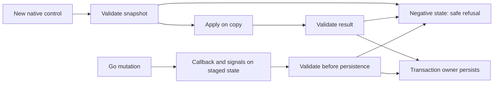

Simplified new-operation flow: durable replay has its earlier transactional guard.
This proves neither authority nor validation before every Go side effect. Refusals
preserve state; no consumed counter is reset.

## Planning reports — R3bi65 component verified

`swarm-rust planning-report --root ROOT --input EVENT.json --json` observes a
supplied event's references. Declared labels are data, not proof of identity,
permission, receipt or claim. Explicit handoff wins. Historical fallback requires
kind=handoff and exactly one artifact ending in lowercase `.md`. No reference
returns `null`; an invalid selected reference fails.

Persisted v14 `planning_report_max_bytes`, initially64000 bytes, is editable in
Admin using shared API/CLI validation. Zero refuses every report; `null` removes
this cap while empty, NUL, invalid UTF8 and changed-digest documents still refuse.
V13 requires explicit adoption even for absent references. This differs from the
16MiB JSON transport, review delivery context cap and model capacity.

Root reserves current settings. The shared reader resolves the path, verifies
containment and regular-file status, reads completely and verifies SHA on the
returned bytes. Contained aliases are allowed; outside-project targets refuse.
NOFOLLOW applies to the resolved path and provides neither OS confinement nor
a future-action lease. Causes and close failures are preserved; truncated text
never becomes valid proof. No event is acknowledged and no business state is
mutated. Delivery/capacity context integration and claim remain unfinished.

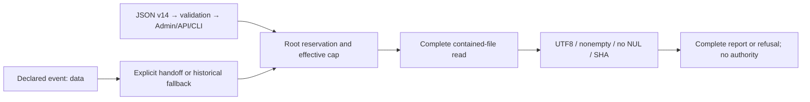

[Qualification65](../plans/migration-rust/evidence/20261019-65/qualified01/result.json):
411 Rust tests,39 default CLI tests,30 Go/native comparisons and four targeted
Admin journeys pass;8437 inputs/73 packages stable with separate profiles. Refusals
follow valid witnesses; contained aliases differ from escapes; write/flush failures
allow recovery. Global migration remains partial; no installation is established.

## Quality-rule transmission — R3bh64

The worker packet also compiles `tools/agent-workflows/templates/QUALITY.md`:
policy review through the actual Admin/API/CLI consumer, FR/EN documentation
and function contracts, preserved error causes and failure handling, actual
build profiles and replan. Other roles do not receive this implementation
instruction. It grants no additional rights or tools. The measured Go base
body is 31955 bytes under its unchanged 32000 limit; the complete prompt is
32155 bytes. The remaining 45 bytes are not a model budget. Future growth
requires diagnosis, never silent truncation.

An isolated test observes these clauses in the prepared prompt, the input
received by a fake adapter and the reopened record. This establishes delivered
bytes, not model understanding/compliance or authenticated identity. Sources
are frozen at build time; existing running processes are not updated. The full
AGENTS agreements are not automatically imported. Claim preparation, capacity
and execution remain open.

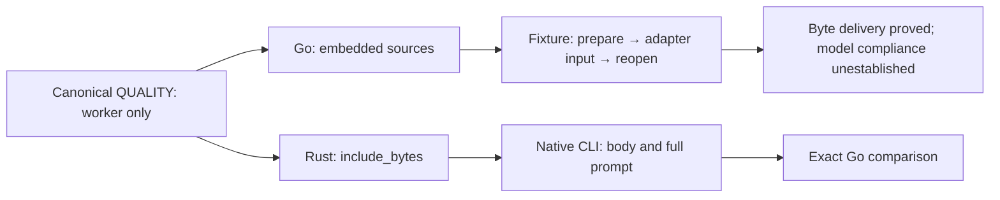

Evidence and limitations: [increment64](../plans/migration-rust/evidence/20261019-64/),
[red](../plans/migration-rust/evidence/20261019-64/quality-red.stdout),
[fixture receipt](../plans/migration-rust/evidence/20261019-64/receipt-green01.stdout).
Full qualification is recorded separately; increment63 below retains its
historical proof.

[Qualification64](../plans/migration-rust/evidence/20261019-64/qualified01/result.json):
404 Rust tests,37 CLI tests,15 Go/Rust comparisons and four targeted Admin journeys
pass;8432 inputs/73 packages stable. Production excludes fixtures and profiles
match. Global migration remains partial; no server was installed or restarted.

## Frozen role framing — R3bg63 component verified

`swarm-rust agent-workflow worker --root ROOT --json` observes role methods on an
initialized native root. Roles are `planner`, `subplanner`, `worker`, `reviewer`.
Canonical sources are compiled into the binary; a worker checkout's skill files
cannot replace them. A descriptor extracted from the actual Go producer fixes
ordering, prefixes and role boundaries. Product Rust never invokes Go. Ordinary
project context is read under its separate saved limits.

Settings v13 `agent_workflow_max_body_bytes` proposes 32000 bytes for the **base
body**, before manifest and project context. Zero refuses; `null` removes this cap.
V12 journals require explicit adoption. Project limits and model capacity remain
separate. Nothing is truncated. Output includes `body_bytes`, `body_limit`, observed
`settings_revision` and `prompt_sha256`. Root reads under one settings reservation.

`Workflow.SHA` follows Go's base/project composition and does not alone bind every
prompt byte. An actual counterexample retained equal metadata with different notice
text. `prompt_sha256` covers the complete prompt; Root `check_agent_workflow` rereads
under current policy and compares text, digest, metadata and count. Tampered data
refuses even when its declared hash is kept or recomputed. This grants no future
freshness lease and establishes neither identity, authority nor agent receipt.

The Go notice now matches Rust: recognizable-secret refusal does not prove absence,
and no permission configuration is imported. Existing prompts remain historical
snapshots. Read/project/policy/encoding/close/write/flush failures preserve causes,
without empty success or private data in public diagnostics.

[Qualified01](../plans/migration-rust/evidence/20261019-63/qualified01/result.json)
passes 404 Rust tests, 37 default-profile CLI tests and
[15 actual Go/native comparisons](../plans/migration-rust/evidence/20261019-63/parity02/result.json)
(13 complete prompts equal, two refusals), including ignored checkout shadow,
project modification, refusal and recovery. [Four targeted Admin journeys](../plans/migration-rust/evidence/20261019-63/admin02/result.json)
across FR/EN and both themes verify save/reopen and real consumer: exact/under/
zero/null, adoption, observed revision, keyboard, five widths and backend error/
recovery. Older UI consumers are not claimed rerun. 8430 inputs/73 packages remain
stable; profiles/binaries are separate and production excludes test fixtures.

Claim, model capacity, agent launch/identity/permissions, managed memory, HTTP and
installation remain unported. The pack embeds CONTRACT/skills; it does not
implicitly import every AGENTS instruction or prove delivery to a running process.

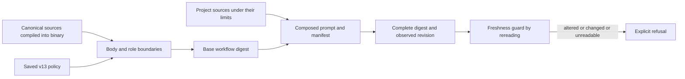

Digests and freshness are content observations; they establish neither agent identity, authority nor autonomous receipt.

## Local enablement — R3bf62 component verified

`planning enable` creates a hierarchy on a new Work with no tasks: root scope,
`req-N` requirements, initial brief and judge cycle 1. Task, decision and activation
budgets are explicitly positive request values; consumption is never reset.
Declared checks are rebound to criterion 1 and normalized under saved settings.
No check or agent runs. This local subset requires no provider or repository and
`max_review_calls=0`; provider/reviewer/managed repository preparations remain unported.

Two v12 policies persist and are editable through shared Admin:
`planning_request_max_bytes` proposes 65536 bytes, matching Go;
`planning_max_requirements` proposes 100 requirements at enablement. Zero refuses
new planning mutations (including pause/resume) or enablement respectively;
`null` removes that cap. The separate transport bound remains 16 MiB. Older
journals stay readable but require explicit adoption for new mutations. Durable
replay precedes the new cap, with conflicting intents and stale revisions refused.
This replay priority intentionally differs from Go's pretransaction size check.

[Qualified01](../plans/migration-rust/evidence/20261019-62/qualified01/result.json)
passes 397 Rust tests, 35 default-feature CLI tests and 26 actual Go/native cases
with 22 valid witnesses. [Six public observations](../plans/migration-rust/evidence/20261019-62/default-cap02/result.json)
verify default/exact/oversize/escaped byte behavior: 65553 bytes of indented source
JSON are accepted when canonical intent is exactly 65536 bytes; HTML expansion
is also exercised. [Four Admin journeys](../plans/migration-rust/evidence/20261019-62/admin01/result.json)
across FR/EN and both themes save/reopen both fields and reach the actual CLI,
including refusal without mutation, replay and recovery. 8423 inputs/73 packages
remain stable; fixture and production binaries are separate and the production
profile excludes `test-fixtures`.

These local proofs establish neither a real provider, caller identity, managed
repository, native execution, HTTP API, installation nor overall cutover.

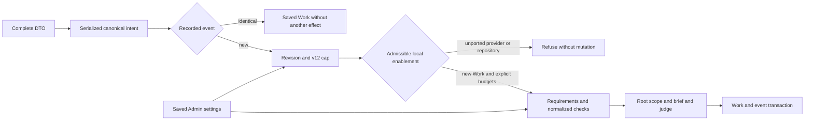

The cap applies to JSON already serialized; it does not establish an aggregate memory bound. Local enablement runs no agent and authenticates no caller.

## Planning controls — historical R3be61 proof

Native `planning show/pause/resume` reads raw Work JSON or applies the control
inside the existing Work/event transaction. Identical-intent replay does not
increment generations again; conflicting intent and stale revisions refuse
without mutation. Every lease is fenced once per new control. This stops no
process and establishes no identity.

In the historical61 profile, settings v11 `planning_resume_max_reason_bytes` proposes 4000 bytes, matching Go.
Zero refuses a nonblank reason; `null` removes this cap. Pause and reasonless
resume remain available with valid older journals; consuming a nonblank reason
requires explicit adoption. Four fresh Admin journeys across FR/EN and both
themes save/reopen and exercise the production CLI: valid witness, zero refusal
without mutation, null recovery/replay, exact four UTF8 bytes and overflow.
Negative generations and representation overflow explicitly refuse.

[Qualified01](../plans/migration-rust/evidence/20261019-61/qualified01/result.json)
passes 391 Rust tests, 34 default-feature CLI tests and 27 actual Go/native DTO
and pure-candidate cases (20 equal data, seven paired refusals). Fixture and
production binaries are separate; matching-profile rebuilds reproduce the tested
hashes. The 8419 effective inputs and 73 packages remain stable. Write/flush
failures after commit explicitly preserve the result and permit identical replay.
The Go hook is also corrected: only `decide` dispatches its SQL operations. The
current Go server has not been restarted. See [Admin evidence](../plans/migration-rust/evidence/20261019-61/admin01/result.json).

The actual Go inventory follows JSON-visible fields and retains custom marshalers;
`PlanningOperation` preserves explicit `depends: []` for `revise-dependencies`.
Generation reproduces the exact Rust from current producers. DTOs confer no
authority. Other hierarchy mutations, native processes, authentication, HTTP,
installation, cutover and overall acceptance remain open.

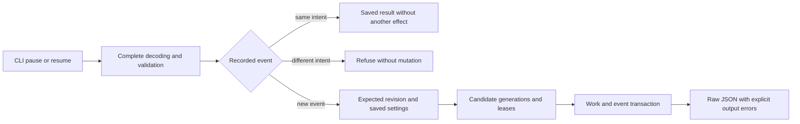
Replay does not consume another generation. An output failure after commit
preserves the result and permits identical replay. This chain establishes
neither process termination nor agent authentication.


## Simple managed projection — R3bd60 component verified

The candidate composition combines the existing current review/Git guard with
controls read from a managed receipt when no automatic record is present.
This fallback is display data only: it does not change Work or repair freshness,
whose guard still requires the original automatic record. Batch and fragment
protocols explicitly refuse in every task state; managed Git reads remain
Linux-only. Receipt/policy/IO failures reach the consumer without empty success. The native
receipt codec requires UTF-8; unlike Go replacement of invalid bytes, it refuses
invalid UTF-8 with its cause preserved.
No new identity proof or task acceptance is established.

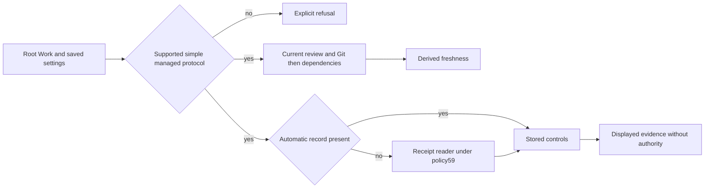

Qualified03 verifies 382 workspace Rust checks, 31 default-feature CLI checks,
60 actual Go/native comparisons (54 equal and six documented stricter refusals),
32 public CLI views and eight public protocol refusals. Fixture and production
binaries are separate and bound to matching build hashes. The production CLI
graph excludes `test-fixtures`. Five additional observations verify saved policy
at this actual CLI consumer: default, exact boundary, just-under-size refusal,
zero and recovery after `null`. See [evidence60](../plans/migration-rust/evidence/20261019-60/qualified03/result.json)
and the [consumer recipe](../plans/migration-rust/evidence/20261019-60/production-cap/result.json).
These local proofs establish no authenticated identity, acceptance or installed
native server. Extended managed protocols remain open.


## Managed machine receipts — R3bc59 component verified

The native reader uses persisted `managed_receipt_max_bytes`, introduced by
settings v10 and proposed through the shared Admin catalogue. The initial
1,048,576-byte value preserves the Go boundary; zero rejects every nonempty
receipt, while `null` disables this cap and permits uncapped memory consumption.
This policy is separate from delivery text size. Older v9 journals remain
readable; the new consumer requires explicit policy adoption. Preview is pure;
saving uses shared validation and revision checks. The native Admin is still a
candidate component, not installed in the Go server.

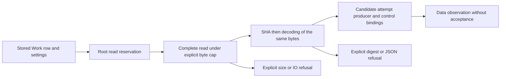

Undeclared evidence differs from partial declarations, corruption and refusal.
Errors retain their cause; truncated evidence is never consumed. Matching IDs
does not authenticate an agent. Batch and fragment protocols still refuse;
complete managed projection remains to be integrated. Qualified03 passed 378 named Rust checks, 31 actual Go/native comparisons
(22 matching data/absence cases, nine explicit stricter native refusals) and four
Admin language/theme journeys on unchanged effective inputs. These are local
component proofs; full migration, deployment and independent acceptance remain
open. See [qualification evidence](../plans/migration-rust/evidence/20261019-59/qualified03/result.json).
The cap applies to the structured receipt reader. Existing historical guards
stream receipt hashes; their machine-context buffer has a separate policy
question tracked in the plan, rather than an implied global read ceiling.


## Ordinary hierarchical projection — R3bb58 component verified

Root reads can now derive task state for a hierarchy without a managed repository.
Freshness requires current review, current gate where required and current
dependencies. A waiver does not bypass the configured hierarchical review.
A configured but missing review is pending, distinct from no review configuration.

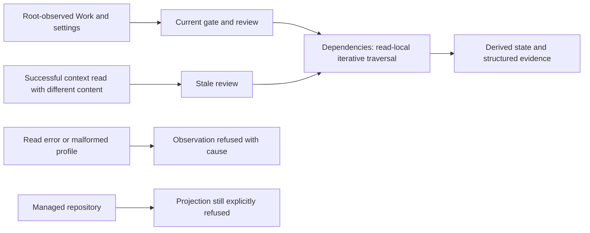

The context producer now classifies a digest/absence mismatch separately from
IO/JSON errors; consumers do not branch on displayed error wording. Expected
business refusals make freshness false. Unexpected review errors refuse the whole
observation with their cause retained. This is stricter than Go projection, which
masks some such failures as staleness; future native API/UX handling must be
verified before cutover. Managed views still refuse pending their receipt/control
projection, even though the57data guard works. Reads grant no identity, authority,
acceptance or future freshness lease. Evidence is under
`docs/plans/migration-rust/evidence/20261019-58/`; qualified02 component verified, overall migration PARTIAL.

## Current managed review — R3ba57 component verified

Root `inspect_review_evidence` now composes existing native checks: current
project context, latest attempt and instruction contract, followed by candidate,
files/context, simple baselines and the actual committed Git report for a managed
review. Root reads and validates settings under its reservation; context, baseline
depth and Git deadlines use persisted values. Managed storage remains inside the canonical Root under the native Git reader; external repositories are not qualified here.
The old ordinary pure function
without settings keeps its managed-case refusal and supplies no policy fallback.

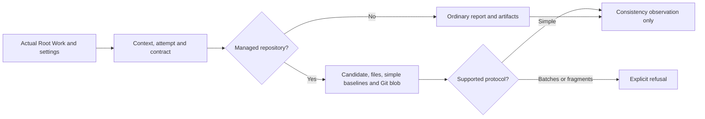

The observation proves neither reviewer identity, authority, an actual independent
review nor acceptance. It creates no future freshness lease and changes no Work,
journal or settings. Errors retain typed causes, including reservation-close
failures. Hierarchical transitions and projections remain refused until their full
contract is ported. Root tests use actual files and a committed report in an owned
fixture; this does not establish agent execution. Evidence lives under
`docs/plans/migration-rust/evidence/20261019-57/`; qualified02:42 Rust tests/9targets and33matching Go/native cases; overall migration PARTIAL.

## Work criteria — R3az56 component verified

The original diagnostics reproduced blank criteria accepted at creation but refused
on updates. Both engines now apply the same rule at creation: every element contains text
under shared Go/Rust whitespace semantics. No volume limit or Admin policy is
introduced. Refusal creates neither Work nor event; corrected requests
reuse their event successfully in the qualified fixtures. Reading or replaying old Work does not repair
it retroactively. See evidence56/qualified-03: component verified, overall migration PARTIAL, no service cutover.

## Applicable request fields — R3ay55 component verified

The CLI diagnostic reproduced eight Go/Rust task creations accepting `max_attempts`
or `max_tool_calls` without storing the requested limit. Explicit `task.update`
persists it and remains the supported path, subject to its validation. The added
guard rejects meaningful inapplicable fields with `unsupported_parameter` without
persisting a new mutation or echoing private values. The shared
`contracts/work-request-fields.v1.json` defines an API protocol; Admin cannot
expand this list to make unimplemented parameters effective.

Embedded protocol decoding errors must preserve their typed cause, including
a failure after the first JSON value. The corruption test replaces bytes only
in its isolated process and then restores the valid protocol; it changes no
persisted source or mission database.

Zero, empty string and false keep legacy scalar omission semantics; explicit empty
collections retain intent. `outcome` requires leaving a running attempt. Hierarchical
revision parameters require a hierarchical Work definition amendment, without
replacing permission, pause or freshness checks. Native hierarchical mutations
remain unported.

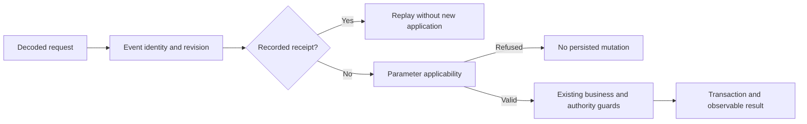

A previously accepted receipt stays replayable; its ignored limit does not become
retroactively effective. The owner must examine affected historical task contracts
and consumption before an explicit correction. Evidence lives in
`docs/plans/migration-rust/evidence/20261018-55/`. Diagnostics and targeted tests do
not establish installation or full migration acceptance. The plan retains actual
verification status and remaining limits; no cutover is announced.

## Default manual phases — R3ax54 component verified

The Rust candidate introduces persisted v9 `task_manual_required_gate_phases`.
Installation proposes entry, validation and delivery; an explicit empty selection
retains criterion checks. Phase selection is policy; wire phase names are protocol.
Root must consume the selection for new tasks and require explicit adoption of
older settings lacking it. Admin uses checkboxes and labels in catalog order, independent of wire-set
sorting. Functional and visual checks pass on the fixtures described below.

Adopted requirements survive edits: changing defaults or a title must neither
remove nor reintroduce phases into an existing mapping. Retained Go keeps its
compatibility creation defaults and shares the mapping-preservation fix; it does
not consume this new Rust setting. Historical migration and acceptance authority
remain separate from the presence of a mapping. Sources are under verification;
no installation, cutover or global guarantee is claimed.

Presentation catalog v2 announces choice groups; settings journals use v9. The
client accepts catalog1 without this new type and catalog2. Choices advertised
as catalog1 or malformed/unknown/duplicate values refuse loading and keep editing
disabled. Reloading actual data recovers without mutation.

Publishing phase defaults advances the settings journal revision even when the
quality policy is unchanged. Compare quality generation, digest and values
separately; `settings_revision` provenance must not be frozen across unrelated
settings publications.

Qualification [54](../plans/migration-rust/evidence/20261018-54/qualified-05/result.json): component PASS, overall migration PARTIAL.361Rust tests from03 and46Go cases from02 are reused after exact source/graph/embed/environment checks;05 reruns all four Admin journeys.60public comparisons and4gate replays agree,8387inputs/73packages remain stable. Missing/stale/open reviews refuse closure;05 has a complete declaration, not an exhaustive semantic guarantee. [Eight screenshots](../plans/migration-rust/evidence/20261018-54/visual-review.json) inspected at320/1440; interactions also cover1024/760/390. Malformed transport, real v8 settings, empty selection, refusal without mutation and recovery are covered. No provider, server replacement, independent review or global acceptance.

```mermaid
flowchart LR
  A[Admin or CLI selection] --> B[EngineSettingsDocument v9]
  B --> C[Root-observed TaskDefinitionLimits]
  C --> D[New task: plan_checks]
  D --> E[Criterion checks remain required]
  F[Existing task] --> G[Adopted requirements preserved]
  B -. does not rewrite .-> F
```

Ordinary edits preserve adopted requirements. Explicit validation-mode changes follow the automatic contract below: synthetic manual-template checks may be replaced by preauthorized commands, without dropping custom requirements. A mapping alone certifies neither historical tasks nor reviewer identity.

## Continuous increment review — method check

Every migration increment is reviewed on four axes: hardcoded policies, function
contracts, error paths and product/method documentation. Persistent rules live in
AGENTS.md and shared personal instructions. `tools/rust-migration/review_increment.py`
compares two effective-input snapshots from the qualification collector. Each
changed local entry needs all four axes, its current hash, a reason and evidence
references whose bytes still match. Removed inputs also need review. Reference
affected pages, diagrams and evolution notes on the documentation axis.

A retained file removed from qualification inputs requires an explicit
`unselected` state, a reason and the same hash as in the preceding snapshot. It
remains preserved and is not called deleted. Changed bytes, missing reasons or
ambiguous states are refused. All four review axes remain required; unselection
cannot omit actual consumers from compiler-derived graphs.

Evidence references are now archived with their exact bytes and hashes before
review closes (`review-reference-originals.*`). Later document edits preserve the
original. Each read is rechecked before archiving; changed references, collisions
or IO errors block qualification. An archive proves neither document correctness
nor execution of the described behavior.

```mermaid
flowchart LR
  A[Exact sources and inventories] --> B[Lexical candidates]
  B --> C[Four-axis review with evidence]
  C --> D{Coverage and hashes valid?}
  D -->|No| E[Refuse declaration and diagnose]
  D -->|Yes| F{Open finding?}
  F -->|Yes| G[Contract blocked: owner and resumption]
  F -->|No| H[Declared review complete]
  H --> I[Behavioral tests and acceptance still required]
```

The script emits lexical prompts, never semantic verdicts. Review classifies values
as test data, protocol invariants, technical bounds or operator choices. Operator
choices require persisted settings traced to their real consumer and Admin. A
boolean test input does not automatically define policy; labeling a constant
“security” does not justify it.

Missing/stale coverage is refused (exit2). Open findings require an owner and
resumption condition and produce BLOCKED (exit1). Exit0 means only that the declared
review is complete and references remain fresh. It establishes neither correct
comments, exhaustive absence of hardcoding, independent review nor acceptance.
The shared collector now requires this check: set
`SWARM_MIGRATION_REVIEW_BASELINE` to the prior effective-input inventory and supply
`source-review.json` in the new evidence directory before its final closure.
Missing baselines refuse before expensive checks; missing, stale or open reviews
prevent qualification. `source-review-result.json` retains the outcome. Runners
bypassing this collector need an equivalent check. This gate covers the declared
increment; historical findings remain in the plan and must be reexamined before
global acceptance. No running-engine protection or automatic independent review
is claimed. Historical evidence retains its scope; revisit affected increments
when a discovery invalidates an assumption.

## Required criteria at task creation — R3aw53 under qualification

New manual tasks created by Go and Rust sources derive the same mapping as
criterion edits: plan-entry/entry, plan-validation/validation, plan-delivery/delivery
and one plan-criterion-N/validation per criterion. These identifiers belong to the
existing gate contract, without a new deadline or ceiling. Edits retain custom
checks and rebuild numbered IDs from the actual criteria.
Lot53 retained this hardcoded manual template in both engines; lot54 above
implements native parameterization. Retained Go remains a compatibility reference
and does not consume the new Rust setting.
`mandatory=false` is a negative test input for an already required check; optional
checks outside the task mapping remain possible.

In automatic mode, mappings use the IDs of commands already authorized by the
operator. Only synthetic manual-template IDs are replaced; custom requirements
remain mandatory. Every criterion still needs an authorized control. Derivation
launches and authorizes no additional command and preserves the coverage guard.
An explicit criterion edit on an open historical task can adopt a mapping even
with identical text; it invalidates the previous gate.

Every criterion must be nonblank. Gates must declare each bound check with its
expected phase and mandatory flag. Rust Root also consumes saved task_max_criteria
on creation as on definition edits; the pure library invents no operator ceiling.
Input cannot override Root settings. Refusal preserves the row/history; saving a
compatible limit permits the same event to recover after reopen.

CLI failures retain stable codes and expose only safe static reasons, such as
`format: task-criteria-invalid`. Check nonblank criteria and saved Admin
`task_max_criteria`; criterion contents and private storage/process causes are
not printed. Tests verify unchanged storage and recovery after policy correction.

Existing historical tasks without mappings are not rewritten or authenticated.
Their explicit adoption/migration remains required before full cutover and new
acceptance; this new-task correction establishes no guarantee for all historical
records. Work criteria and historical data are unchanged by this increment.
Sources remain under verification; no Go/Rust service delivery is claimed.

## Public gate recording — R5f52

`swarm-rust gate ID --root ROOT --input FILE [--task TASK] [--json]` sends the
existing strict DTO through Root. Input contains schema_version, event_id,
expected_revision, task_id, phase, name and document; phase comes from the DTO.
If supplied, `--task` must match task_id before mutation. The quality policy
comes from saved settings. For method3, a changed policy generation invalidates
the previous gate and requires public reorientation before another recording.
This command grants no reviewer authority or task
acceptance.

An allowed recorded evaluation returns0; a denied recorded evaluation returns1
with the complete public envelope. Format, storage, rendering or output errors
return2. A post-commit error retains state and identifies its revision; the same
event/content recovers without duplication. Checks cover method3 and method2
comparison with Go; qualification is in progress.

Targeted recipe: `python3 tools/rust-migration/verify_work_view.py FRESH_DIRECTORY gate`.

Qualification [52](../plans/migration-rust/evidence/20261018-52/qualified-01/result.json): 28 named CLI tests, 60 view comparisons and four Go/Rust gate replays PASS; 8376 inputs/73 packages remain stable. Compilation, Clippy, Rustdoc, translations and method checks pass. Method3/saved policy are fixture-verified; no acceptance or installation.

## Work commands and public rendering — R5e51

The development Rust binary exposes `work list`, `work show ID`, `resume [ID]`,
`work create`, `work update ID`, `task add|update ID`, `ooda ID` and `checkpoint
ID`. Mutations require `--input FILE` (or `-` for stdin), the versioned DTO, event
ID and expected revision. `--json` returns `work`, `validation`, `events`,
`current_gates`, `current_git`, `resume_markdown`; opaque event payloads retain
numeric spellings and Go-compatible bytes. JSON labels and Markdown retain canonical French, as in Go; text mode follows
`--lang fr|en`.
`resume` without an ID lists Work; it starts no task.

Root observes the actual row, saved settings, events and evidence under a
reservation. `work show` writes no view file; resume and mutations atomically
publish `.swarm/views/ID.md`. A changed post-mutation revision refuses publication.
A rendering, close or output failure does not undo an already recorded mutation:
the diagnostic identifies its ID/revision; inspect state and replay the same event
with the same content to recover without duplication. A directory collision keeps
its contents intact; replacing a symlink does not follow its target. Durability
following a synchronization error remains governed by the storage contract,
without an invented rollback guarantee.

The real renderer consumes saved Admin v8 decision-count and width settings after
reopen. History remains complete. A malformed selected OODA event refuses rendering
with its cause retained; unavailable Git fields have explicit diagnostics. An
iterative dependency walk uses a memo scoped to one read: missing dependencies
and cycles remain stale and no authority cache is created. Test counts and debug
measurements establish neither migration percentages nor production performance.

CLI output also checks flush: accepted writes followed by a failed flush remain
an error, retaining the committed revision after mutation. Bytes may already
have been transmitted; the exit status remains necessary.

Hierarchical Work rendering still refuses until its contract is ported. Providers, full supervision, historical migrations, server and final cutover
remain open. No service is installed. Recipe: `python3
tools/rust-migration/verify_work_view.py FRESH_DIRECTORY`; targeted evidence under
[51](../plans/migration-rust/evidence/20261018-51/).

Qualification [51](../plans/migration-rust/evidence/20261018-51/qualified-03/result.json): component PASS, migration PARTIAL. 352 named Rust tests
and 52 public Go/Rust comparisons; product sources match02 (recipe failure
retained), with only the repaired runner and finisher changed. 8375 inputs/73 packages
remain stable; translation/build/method/diff checks PASS. Debug100/500/1000vectors
retain identical outputs; the local1000case measured1.172s before /0.347s after,
without a production guarantee. No deployment.

```mermaid
flowchart TD
    A["CLI: read or mutation"] --> B["Root: actual settings and state"]
    B --> C["Validation, events, files and Git"]
    C --> D["FR/EN rendering: saved Admin limits"]
    D --> E{"show?"}
    E -->|yes| G["Checked close then output"]
    E -->|no| F["Atomic publication with expected revision"]
    F --> G
    F -->|post-mutation failure| H["State retained: diagnosis and replay"]
```

## Controlled Git metadata — R5d50

On Linux, native metadata readers now share checked execution: read configured
filter names without their values; neutralize every clean/process/smudge/required
family; disable hooks/fsmonitor, inherited `GIT_*` overrides, prompts and optional
index writes. This prevents a `git status` read from executing repository/global
filters. Reads remain separate observations, proving neither a Git snapshot nor
actor identity or authority.

`RootStore::inspect_git_metadata` uses saved `git_command_timeout_seconds` per
command. Root creation/checkpoints also pass their locked settings through the
configured environment. Legacy journals without Git policy produce explicitly
unavailable optional metadata without executing commands or inventing a deadline;
the strict reader refuses. The historical library `observe_git` API remains
explicitly unbounded and shares filter neutralization; it does not replace the
configured Root boundary.

Original output stays in private typed causes; public diagnostics expose only
fields, reasons, codes and hashes. A failed command never makes an empty field a
cleanliness proof. Launch/read/protection/cleanup/policy failures remain retained.
The test filter actually executed by unprotected Git is reproduced under50;
[Qualification50](../plans/migration-rust/evidence/20261018-50/qualified-01/result.json): component PASS, 341 named Rust tests and four Admin journeys. Real Git and an isolated shim verify nominal data, prevented filter execution, unchanged index, saved deadlines reaching reads/creation, refusal without mutation then recovery, zero Git launches without policy and history-preserving adoption. All8373inputs/73packages and external Git/Python binaries stay stable; compilation/Clippy, Rustdoc/example, methods, translations and diff pass. Overall migration PARTIAL. No Go service was replaced. Its
legacy `gitState` remains identified work before any complete-cutover claim.

## Work projections and persisted presentation v8 — R5c49

`RootStore::inspect_work_validation` derives `TaskEvidence` and validation state
from the stored Work, actual current files and checked history under reservation.
Acceptance without a current gate stays stale; a reviewed report proves no
execution. Neither `unknown` nor an empty list becomes `passed`. Current and
historical controls stay separate; measured durations use stable sorting.
Historical SQL/JSON errors refuse the entire observation. Human-control mismatches
stay visibly stale with a safe reason in `limits`, explicitly extending Go.

| Admin v8 setting | Default | Meaning |
| --- | --- | --- |
| `evidence_longest_measured_count` | 5 | Measured controls displayed; 0 none, null all |
| `work_view_recent_decisions` | 10 | OODA decisions displayed; 0 none, null all |
| `work_view_wrap_characters` | 80 | Unicode characters after tab expansion; positive or null without wrapping |

These settings delete no receipt/event and limit no execution. Journals1..7 remain
readable/replayable; adopting the complete v8 group is explicit. New installations
receive v8 defaults. Output retention still uses the existing Admin setting.
Callers provide no freshness flag to the Root consumer.

Recipe: `python3 tools/rust-migration/verify_work_projection.py FRESH_DIRECTORY`.

[Qualification49](../plans/migration-rust/evidence/20261018-49/qualified-01/result.json): component PASS, 337 named Rust tests, 138 Go/Rust comparisons across 23 FR/EN scenarios and four Admin journeys with36fields. All three settings save/reopen with observable effects: actual stored Work for ranking, saved-policy helpers for OODA/wrapping. All 8369 inputs/73 packages stay stable; workspace compilation/Clippy, Rustdoc/example, vet, methods, translations and diff pass. Four new-field captures inspected at1440px; interactions also cover1024/760/390/320. OODA selection and wrapping helpers consume saved
values through the probe; complete public Work rendering still needs integration.
Hierarchical Work explicitly refuses with `command_not_ported` until its authority
is ported. No server replacement, identity evidence or acceptance is claimed.

## Current validation receipts — R3av48

`check_validation_evidence` checks receipt consistency with the latest attempt,
policy digest excluding attribution, ordered commands/results, output sharing and
the actual bytes of every artifact. Automatic mode also recalculates the gate
using the observed quality profile. No configured controls returns explicit
absence; inconsistent data or inaccessible files return errors with their causes.

Only nonempty, complete, policy-shared output becomes a quote source. A consistent
truncated prefix is not a complete source. The UTF-8 byte limit uses Admin's
existing `validation_max_output_bytes`: null is unlimited, zero retains no bytes.
Changing this limit may make an older receipt incompatible with the read policy.
`RootStore::inspect_validation_evidence` reloads the actual task and settings under
reservation, accepting no caller-supplied freshness flag. Successful inspection
checks data; it authenticates no controller URI author, proves no execution
provenance and grants neither review approval nor acceptance.

Recipe: `python3 tools/rust-migration/verify_validation_evidence.py FRESH_DIRECTORY`.
Associated Go source repair: a policy without controls must neither index nor share an older receipt’s results; the case reproduced a panic before correction. [Qualification48](../plans/migration-rust/evidence/20261018-48/qualified-03/result.json): component PASS, 31 named Rust tests, 5 Go tests, 35 scenarios and 111 comparisons with controls/recovery. Changed/missing files refuse then recover; saved cap feeds the consumer after reopening. All 8357 inputs/73 packages stay stable. Compilation/Clippy, Rustdoc/example, Go vet and methods pass. Initial failures remain retained; overall migration PARTIAL. Existing Go service preserved. Tests also cover the real automatic gate/profile,
changed/missing/escaped files, preserved errors and recovery, then saved-setting
effects on a stored task after reopening. The Admin component is unchanged; its
existing exposed cap is consumed here. Public TaskEvidence/validation/rendering
integration remains pending.

## Public Work listing — R5b47

The Rust binary supports `swarm-rust work list --root ROOT --json`.
It opens an already initialized root read-only and returns complete Work objects,
newest first. Only a successful empty read produces `[]`. Storage/decoding and
checked-close errors refuse before any success output; failed output remains a
command failure. This command initializes no root, grants no acceptance and
starts neither Go nor a provider. Unrelated arguments refuse before opening.
FR/EN JSON data match; Unicode separators are escaped and HTML characters kept.

Text mode and other Work commands still require their complete projections;
R5e51 supersedes this initial JSON-only restriction for the commands documented
above; qualification47 remains historical.
Recipe: `python3 tools/rust-migration/verify_work_list.py FRESH_DIRECTORY`.
Three actual-binary tests pass after failing on the missing command: empty/full
lists, damaged private DB refusal with recovery and original preservation, and
arguments/missing-root/output failures. [Qualification47](../plans/migration-rust/evidence/20261018-47/qualified-01/result.json): component PASS, 20 named CLI tests and six actual Go/Rust binary comparisons (FR/EN, empty then two Work objects). Workspace compilation/Clippy, Rustdoc, Go vet and methods pass; all 8352 inputs/73 packages remain stable. Overall migration remains PARTIAL; no installation is claimed.

```mermaid
flowchart LR
    A["work list --json"] --> B["Validate arguments"]
    B --> C["Read-only RootStore"]
    C --> D["Read and decode every Work"]
    D --> E["Check close result"]
    E --> F["Write JSON list"]
    D -->|error| G["Close and retain causes"]
    G --> H["Failure without list output"]
    F -->|output error| I["Failure, possibly partial output"]
```


## Work control history — R5a46

Native `read_validation_control_history` returns controls for attempts owned by
the task, newest receipt first, without retention caps or truncation. It excludes
the current receipt and duplicates; absent measurements stay unknown. Historical
receipts never become current verdicts. `RootStore::inspect_control_history`
supplies the actual stored task and receipt under reservation; caller-supplied
pure-function data grant no authority or identity evidence.

An attempt-free task returns an empty history without querying. Otherwise SQL,
row-reading, decoding and finalization errors refuse the whole observation with
their cause, without mutation or partial success. This explicitly strengthens
the legacy Go reader, which ignores these errors; no Go repair is claimed.
Recipe: `python3 tools/rust-migration/verify_control_history.py FRESH_DIRECTORY`.
The probe reads a marked private SQLite fixture through the actual compiled Go
reader; a separate Root test uses a stored Work and attempt. [Qualification46](../plans/migration-rust/evidence/20261018-46/qualified-01/result.json): component PASS, 24 named Rust tests, 12 valid scenarios with control/recovery, 52 comparisons, four corruption cases and one SQL failure with recovery. All 8349 inputs/73 packages stay stable; compilation/Clippy/Rustdoc/vet/methods pass. Complete public Work CLI validation projections and rendering still
need integration. No Admin or UX change in this increment; visual journeys45
are therefore not rerun.

## Structured replies and Admin settings v7 — R3au45

The native parser reads `reason` and `criteria` through the strict Go-compatible
codec: case matching, null, duplicate keys and slice reuse retain their contracts.
Unknown fields refuse; each index1..N must occur once and criterion count must
match. `pass` requires an original quote under guard44; `fail` or `unknown` gives
`changes_requested` without requiring missing-evidence descriptions to be quotes.
The result is structured declared data, not an accepted independent review.

Journal v7 adds three Admin fields (33 catalogue fields):

| Field | Initial default | Unit and effect |
| --- | --- | --- |
| `review_reply_min_text_bytes` | 8 | Trimmed UTF-8 bytes using Go whitespace, rationale and evidence |
| `review_reply_max_text_bytes` | 4000 | Raw UTF-8 bytes per rationale/evidence field; null removes this cap |
| `review_quote_min_normalized_bytes` | 8 | Bytes after Markdown normalization, without affecting literal substrings |

Zero removes a minimum; a zero maximum admits only empty text when the minimum
is also zero. Lower minima can admit weak text or quotes; removing the maximum
increases memory risk. These bounds differ from provider character-length hints
and the shared16MiB transport constraint. The complete v7 group is required and
maximum must not be below minimum. Original v1..6 journals remain replayable;
adoption is explicit without hidden defaults.

`RootStore::inspect_review_reply` rereads the actual task and settings journal
under a settings reservation. Caller-supplied reply/original texts remain
unauthenticated. Observed revisions are no future task reservation. No mutation,
identity or acceptance authority is granted; batch/fragment protocols remain
pending. Refusals use safe diagnostics without private excerpts and retain codec,
allocation and close causes. The pure API requires explicit limits and valid
UTF-8; zero-criterion DTOs follow Go data semantics without granting acceptance.

Current recipe: `python3 tools/rust-migration/verify_review_reply.py FRESH_DIRECTORY`.
Source-bound [qualification45](../plans/migration-rust/evidence/20261018-45/qualified-02/result.json): component PASS, 319 workspace/206 default-engine Rust tests, 75 Go/Rust reply scenarios with control/recovery (225 comparisons), 30 Git and 30 historical-baseline comparisons. Four FR/EN×theme Admin journeys pass with33fields: each new value is saved, reopened and changes parsing against an actual stored task. Supplied text remains unauthenticated; no acceptance is granted. All8347inputs/73packages remain stable. Compilation,Clippy,Rustdoc/executable example,methods,translations,diff PASS. The first recipe remains FAIL: it reused a stale editor after its own CLI change and CAS correctly refused. The corrected recipe reloads the component and propagates unexpected preview/apply alerts without adding a watchdog. Four FR/EN×theme captures inspected at1440/320; interactions also cover1024/760/390. No server replacement.


Current quote/reply/Git qualification runners stream stdout/stderr to fresh
evidence files while a command runs. Final bytes and exit status remain checked
after close; reused names refuse instead of overwriting original evidence.
Two targeted tests use a descriptor handshake without an arbitrary deadline to
verify visibility before completion, original nonzero exit/output preservation,
exclusive-file refusal and recovery. These [runner proofs](../plans/migration-rust/evidence/20261018-45/stream-capture/result.json)
are separate from engine qualification45; product source bytes remain unchanged.
This tooling change installs neither an engine nor a setting.

## Original quotes and code-fence closure — R3at44

Native `review_evidence_present` first checks an exact substring for every artifact
kind. Fallback applies only to `.md` names of kind `source`/`diff`: remove backticks
and normalize Go whitespace within one prose paragraph. It crosses no code block,
diff hunk/header or addition/deletion/context boundary. A closing fence must use
the opening marker, at least its width and a whitespace-only suffix. This
conservative guard does not claim to parse all Markdown.

The actual Go reply parser accepted a nonliteral quote after a false closing
fence: six counterexamples were reproduced, with a valid literal control before
each fault. The shared Go guard is corrected alongside the native port.
Qualification44 retains the original red and recovery results; parsing tests
establish no complete task acceptance.

The normalized minimum is an explicit argument, not an implicit Root default.
Actual Go parser bounds (8..4000 UTF-8 bytes) remain distinct from provider-schema
hints and the citation catalogue. Persisted/Admin policy adoption is still required
before an integrated native parser consumes these bounds. The predicate even
accepts an empty literal quote: its caller must enforce completeness and lengths.
It proves no provenance, identity, authority or verdict. No state changes occur;
allocation failure is an explicit error, never an absent match. Rust inputs are
valid UTF-8 text; this probe does not qualify invalid UTF-8 bytes. Memory follows
the supplied texts without a hidden cap.

Recipe: `python3 tools/rust-migration/verify_review_quote.py FRESH_DIRECTORY`.
It compares an oracle extracted from the actual Go predicate, runs actual Go
reply-parser tests and checks effective input stability. It deploys nothing.
Source-bound [qualification44](../plans/migration-rust/evidence/20261018-44/qualified-01/result.json): component PASS, 23 targeted Rust tests, 6 actually executed top-level Go tests, 47 matching vectors with a literal control and recovery each, and 4 native transport refusal/recovery cases. All 8334 inputs and 73 registry packages remain stable. Compilation, Clippy, Rustdoc, executable example, methods and diff checks pass. This pure guard changes neither Admin nor configuration; browser recipe43 remains historical evidence, not a check of the new code. Complete reply parsing, batches, fragments, identity and acceptance remain open; no server replacement.

## Native historical baselines and Admin policy — R3as43

The review-files guard now traverses historical baselines without Rust recursion.
Every receipt, context and report retains its own path/digest obligation even
when reviews share a context. Context hashing and parsing use the same buffer.
Baseline versions0/1/2, previous/current candidates, passed historical reviews
and immediately cyclic references are checked. Batches/fragments still refuse
at every level until their protocols are ported. These file checks establish
neither acceptance nor identity.

Settings journal v6 adds `managed_review_max_baseline_depth` to the shared Admin
catalogue (30 fields). Its initial128 default preserves the Go number: root
depth0,128 links or129 contexts along one chain. `0` refuses every ancestor;
`null` disables the depth cap and may increase read cost. Original v1..5 journals
remain exact/replayable; explicit v6 adoption is required before baseline
inspection without inventing a fallback. A review without a baseline can still
use its corresponding earlier policy.

With an active cap, depth is part of the memoized subcalculation's key: a subtree
first checked near the root cannot hide a deeper path exceeding policy. Without
a cap, identical contexts are not expanded again. `reviews_checked` and
`max_depth` describe entries actually checked, not acceptance counts or a graph
height recomputed when an already verified subgraph is reused without a cap.

```mermaid
flowchart LR
  A[Admin: depth, preview and save] --> B[Current v6 journal]
  B --> C[Iterative baseline traversal]
  C --> D[Each review: receipt, context, report and protocol]
  D --> E[Context: hash and parse the same bytes]
  E --> F[Consistent historical version and bindings]
  F --> G[Cache after obligations, depth-aware when capped]
  G --> C
  C --> H[File proofs only, without acceptance]
```

The stored Work/Git consumer uses this guard with actual Work and current saved
settings. The browser probe receives supplied fixture review data and real files,
reads the real journal and calls the same guard; it simulates no stored Work,
identity or authorization. Go comparison executes the actual private engine
method through a compiled test explicitly enabled on a marked owned root,
without protocol stubs. Unported branches are not claimed as parity.
Source-bound [qualification43](../plans/migration-rust/evidence/20261018-43/qualified-01/result.json): component PASS, 310 named workspace tests, 197 default-engine tests, 30 Git and 30 baseline Go/Rust comparisons (22 valid, 8 refused), with controls and recovery. Four FR/EN×theme Admin journeys pass with 30 fields; saved/reopened zero then null changes the actual file guard. That probe's review data remains supplied, not authenticated as stored Work. 8333 inputs/73 packages remain stable. Compilation, Clippy, Rustdoc, executable example, methods, translations and rendered/inspected diagrams pass. Overall migration stays PARTIAL: batches, fragments and authority remain open; no server replacement.


## Typed review context and stored Work binding — R3ar42

`RootStore::inspect_managed_review_git` rereads stored Work and current policy
under a shared settings reservation. Repository/review/automatic-validation
candidates and each path/digest obligation must agree. The context is then read
into a buffer whose digest is checked; strict decoding and Git citation selection
use that same buffer. Later file changes cannot alter already parsed bytes;
another inspection rereads current evidence. An observation is no freshness lease.

The codec covers actual Go context, task-context, accepted-baseline, delivery
and delivery-criterion DTOs, using existing proof model types. It preserves key
case matching, null effects, duplicate fields, slice reuse, nil/empty and opaque
receipt JSON, including numbers outside floating-point range. Strict mode
rejects unknown fields in every structured descendant; compatible mode follows
json.Unmarshal. Existing Work decoding retains compatible mode. Decoding data
authenticates neither origin nor authority.

Artifact readers now share checked local/regular opening and close handling.
Ordinary hashing remains streaming; only context bytes needed by the parser are
retained fallibly without truncation or an implicit cap. Conflicting digest
obligations for the same path remain independently enforced.

```mermaid
flowchart LR
  A[Stored Work and current settings] --> B[Candidate and three proof bindings]
  B --> C[Context: read and hash one buffer]
  C --> D[Strict Go decoding of the same buffer]
  D --> E[Citation contract and Git report]
  E --> F[Git digest matches observed report]
  F --> G[Observation without acceptance]
  D --> H[Batches, fragments or baselines: refuse until ported]
```

Batches and fragment journals still refuse. Historical baseline files now
follow the R3as43 guard and its explicit policy. Even a successful observation does
not establish all task criteria/contracts, reviewer identity or current authority.
Managed acceptance remains unported. Initial real-SQL-row tests cover tampering,
unknown fields, wrong candidate/version/Git report, unported protocols, no mutation
and recovery. Source-bound [qualification42](../plans/migration-rust/evidence/20261018-42/qualified-03/result.json): 307 named workspace tests, 194 default-engine tests and 31 codec vectors in both modes (62 Go/Rust comparisons), each preceded by a valid control. Ten real-SQL-Work tampering/refusal/recovery variants pass without mutation or acceptance.8322 inputs/73 packages remain stable. Compilation,Clippy,Rustdoc and the executable example pass; FR/EN diagrams were rendered and inspected. No new browser journey was run: settings/frontend retain their increment 41 evidence. Complex protocols and authority remain open; overall migration stays PARTIAL.


## Native Git reads and configurable deadline — R3aq41

Settings journal v5 adds `git_command_timeout_seconds` to the shared Admin
catalogue (29 fields). Its explicit initial default is 90 s from Go; `0` expires
immediately and `null` disables the deadline and may wait forever. This product
policy differs from a verification watchdog: recipes impose no arbitrary global
deadline. Journals v1..4 remain readable/replayable without inventing Git policy;
explicit v5 preview/apply adoption is required for this consumer. History,
reservations and consumption are preserved. The running Go service still has
its previous behavior.

`RootStore::inspect_git_report` reads actual saved policy under a shared
reservation, then natively hashes a `candidate:report` blob in a root-relative
local bare repository. Only full 40/64 hexadecimal object IDs and relative Git
paths are supported. Citation version 2 hashes exact stdout; legacy 0/1 merge
stderr and apply Go Unicode TrimSpace without repairing invalid UTF-8 bytes.
Other versions refuse.

The Linux runner shared with validation retains pidfd, a dedicated process
group, an unreaped leader until cleanup, wait4 and read/write/close causes.
Both streams drain; leader exit triggers group signaling. The fixed read adds
no shell, pager or text conversion. Inherited GIT_* overrides are removed to
prevent redirecting the named repository. This is not Git confinement: local
configuration and alternate objects still require a protected repository
contract. Path resolution grants no authority.

All bytes contribute without truncation or a hidden output ceiling; memory
therefore follows output size. Refused allocation or incomplete output remains
an error. Original failure bytes remain available for explicit diagnosis, while
Debug/Display exclude their contents. Refusal never becomes a successful empty
report.

```mermaid
flowchart LR
  A[FR/EN Admin: preview and save] --> B[v5 journal: Git deadline]
  B --> C[Root: shared reservation and current policy]
  C --> D[Native Git: pidfd and dedicated group]
  D --> E[Exact or historical blob digest]
  D --> F[Error: cause, private output and cleanup]
  E --> G[Observation only: protocols and identities still required]
```

This component grants no managed acceptance. Current Work binding, review
protocols, batches/fragments/baselines and identity/authority remain required.
`git_report_probe` requires a marked owned fixture and is no agent/HTTP API.
Qualification results are retained in the migration plan.

[Evidence](../plans/migration-rust/evidence/20261018-41/qualified-01/result.json). Source-bound qualification: component PASS, 304 named workspace tests, 191 default-engine tests, 30 Go/Rust Git comparisons,five refusal/recovery cases and four FR/EN×theme Admin journeys with 29 fields.8321 inputs/73 packages remain stable. Compilation,Clippy,Rustdoc and the executable example pass. Saving Git deadline0 then null in Admin changes the actual Git outcome without mutating settings during reads. Original v4 journals remain exact and replayable. Supplementary checks cover SHA256 Git repositories and effective removal of inherited GIT_* redirects; diagrams were rendered and inspected. Overall migration remains PARTIAL; no server replacement or independent review execution.


## Available implementation

The rust/ workspace contains seven native libraries: swarm-identity-contract
(identifiers, text, digests, principal, scope and permissions) and
swarm-enrollment-proof (challenge and signed response), swarm-wire-json (shared
Go string compatibility) and swarm-enrollment-state (signed SQLite journal verified on isolated fixtures), plus
swarm-enrollment-authority (documents and authenticated consumer, verified on fixtures),
then swarm-enrollment-config (formats, protected Linux Store and coordinated witness),
and swarm-enrollment-bootstrap (declaration and protected load; qualification below). Their own code forbids
unsafe. The first has no external dependencies with its optional serde feature disabled; the second uses locked dependencies
for SHA-256, Ed25519, system randomness, base64 and Serde. Valid data grants no
authority; a signature establishes neither business rights nor current state.
swarm-engine adds the data, projections and transactions documented below,
including Work assembly on a supplied connection. Together with those seven
protocol libraries it is the eighth native library. The development CLI
executable exposes bootstrap checking, initialization and engine settings. Fresh
root/settings are native; old migrations, Work CLI, server, launcher and login
remain pending.
Go sources are neither replaced nor called by these libraries.

tools/rust-migration/oracle is exclusively a Go comparison tool. The future Rust
product must implement its own behavior without executing Go. Probes and their
fixture protocol are not public product interfaces.

## Build and verification

From the repository root, using the installed Rust tools:

```sh
cargo test --manifest-path rust/Cargo.toml --offline --locked --workspace --all-targets
cargo fmt --manifest-path rust/Cargo.toml --all -- --check
cargo clippy --manifest-path rust/Cargo.toml --offline --locked --workspace --all-features --all-targets -- -D warnings
python3 tools/rust-migration/inventory.py /path/to/inventory-evidence
python3 tools/rust-migration/verify_identity.py /path/to/fresh-run-evidence
python3 tools/rust-migration/verify_proof.py /path/to/fresh-proof-evidence
python3 tools/rust-migration/verify_enrollment.py /path/to/fresh-journal-evidence
```

The comparator refuses to replace an existing result, retains sources, commands
and outputs, then compares validation with Go over a corpus and the Unicode
scalar domain. Fixture binaries are built in a temporary directory. No active
project or AI provider is used. No global watchdog is added; Go runs with
-timeout=0. Cargo.lock is retained. R2.1 used cached crates; R2.2 fetched new SQLite
dependencies, whose locked archives and actual sources are recorded.
Measured toolchain: Rust/cargo 1.96.0 on this machine; other versions are not qualified.

Offline recipes require cached dependencies. On another machine,
`cargo fetch --manifest-path rust/Cargo.toml --locked` can retrieve them first;
R2.2 performed this operation before its offline qualification.

R1 retains its differential evidence. R2.1 passes 44 Go names, two under race and
21 Rust tests with fixtures; 825 exchanges and 1,243,136 JSON string cases agree
with Go. Actual source/dependency inputs are bound to the evidence. This establishes
neither workflows, human authority nor whole-application compatibility.
Review is not independent.

## Available proof protocol — R2.1

The system CSPRNG creates a challenge bound to an independently pinned public
key, project and complete-request digest. Its v1 Ed25519 response covers the
context and opaque payload. A challenge produces at most one local Statement:
clones share consumption, including concurrent calls. Invalid input does not
consume it; a valid response can recover. Returned payload/request data is owned
without writable aliases.

The received envelope rejects duplicate, unknown or case-folded keys, missing
or non-string fields and trailing values. Whitespace and field order remain
permitted, as in Go. Signed bytes reproduce Go escaping, including HTML and
U+2028/U+2029; Go UTF-8/UTF-16 substitutions occur before schema/base64 checks.
Do not reuse this permissive decoding for future documents requiring exact
canonical bytes.

test-fixtures is disabled by default; only it exposes entropy injection and
the comparison probe. The controller compiles a valid consumer before checking
that the fixture helper is rejected in a normal build. No new timeout, retry,
quota or business cap is added. Rust mutex failure is rejected without a partial
Statement.

Private keys are typed; importing/provisioning them remains unimplemented.
Go-compatible signature mathematics differs from enrollment checks on a strong
key and its provenance. A signed statement may be historical: the protected
consumer must still establish rights, revocation, final freshness and human
control. This protocol replaces none of them.

```mermaid
flowchart TD
  P["Independent public pin and project"] --> C["CSPRNG: shared challenge and bound request"]
  D["Complete-request digest"] --> C
  C --> S["Public request: signing selected bytes<br/>no rights decision here"]
  C --> L["Ownership, mutex, unspent state"]
  S --> L
  L --> V["JSON schema, context, Ed25519 and base64"]
  V --> T["Valid: single consumption and owned Statement"]
  V --> E["Invalid: reject without consumption, recovery possible"]
  T --> A["Current consumer, rights and revocation<br/>integration still open"]
```

## Single-cutover conditions

Preserve CLI/API, SQLite data and migrations, transactions, events, budgets,
recovery, authorization, Linux controls, resources and FR/EN UX. Build the distinct
Rust engine, compare using isolated copies, then verify backup and rollback before
authorized cutover. Never run two writers against the database. Observe the
actual active binary and effects afterwards. Open identity/memory requirements
do not become accepted through rewriting. A default local human account and its
UX configuration remain required, without imposing an external identity provider.

Rust provides ownership and static checking rules; unsafe usage still has its
own obligations. These properties establish neither correct authorization,
transactions nor human controls. See the [Rust unsafety reference](https://doc.rust-lang.org/stable/reference/unsafety.html).
Go already manages memory automatically; no performance gain is inferred from
the language change ([official Go guide](https://go.dev/doc/gc-guide)).

```mermaid
flowchart LR
  G["Go retained as reference"] --> T["Comparable contracts and evidence"]
  R["Rust engine under construction"] --> T
  T --> V["Complete parity and verified restoration"]
  V --> B["One authorized cutover"]
  B --> E["Rust active, verified effects and retrospective"]
```

## Native journal verified on fixtures — R2.2

swarm-enrollment-state implements the signed v1 journal with bundled SQLite,
rusqlite 0.40.2 and libsqlite3-sys 0.38.2 (SQLite source version 3.53.2).
Its dedicated schema stays at version 1; this does not migrate engine schema 37.
The pinned public key and Head checkpoint must come from independent protected
bootstrap. Restoring both the file and its witness removes rollback detection.

Connections are operation-local. Open requires WAL; every connection uses
synchronous=FULL and explicitly removes rusqlite's 5000 ms default busy handler
to match Go without automatic waiting or retries. BEGIN IMMEDIATE reloads all
signed rows, including rows beyond the declared head, before protected reads or
append. An exact retry only matches the current last event; revoked IDs cannot
be reactivated. Callbacks must be reversible and must not reenter, close the
journal or wait for another writer: commit can fail after callback execution.

Context exposes explicit cancellation without a new timing policy. SQLite's
progress hook checks it at every VM instruction; this technical granularity
is not a work limit. The hook is removed before rollback so cancellation does
not prevent cleanup. HTTP/process deadline integration remains for later lots.
Signed replies are returned only after commit. Historical authenticity does
not establish freshness when a distributed action is finally performed.

Go string compatibility is shared in swarm-wire-json; each protocol owns its
schema and canonical encoding. ActiveReply requires schema_version=1, padded
standard base64 body, positive enrollment generation and a consistent head.
Format validation establishes neither signature, principal authenticity nor
business authorization. Changes use exact canonical bytes and unpadded URL base64.

Qualification is in progress with native tests and the Go/Rust comparison driver
tools/rust-migration/verify_enrollment.py: exact signatures, rejection/recovery,
JSON and cross-language reopening of disposable files only. No live authority,
UX integration or Swarm engine integration has been established.
Driver reference: [rusqlite 0.40.2](https://docs.rs/rusqlite/0.40.2/rusqlite/).

```mermaid
flowchart TD
  H["Independent key and Head"] --> T["SQLite WAL + FULL: BEGIN IMMEDIATE"]
  S["Canonical signed proposal"] --> T
  T --> V["Verify every signature and the chain"]
  V --> A["Compare-and-append or reversible active callback"]
  A --> C["COMMIT before result or signed response"]
  V --> E["Rejection or cancellation: rollback without partial success"]
  A --> E
  C --> F["Distributed use: freshness and authorization integration open"]
```

R2.2 qualification: 29 Rust tests with fixtures and 28 without; 62 named Go passes
and two race passes reused only after unchanged source/graph checks. Exact parity
on 266 signed proposals, 790 malformed changes with valid controls/recovery,
281 active replies and two cross-language databases. TEXT and BLOB storage classes
preserve the same authenticated event bytes; forged TEXT stays rejected.
Evidence: [final journal result](../plans/migration-rust/evidence/20261017-03/qualified-02/result.json).
This is component qualification, with no engine deployment or global acceptance.

## Authority documents verified on fixtures — R2.3a

swarm-enrollment-authority ports the v1 document producer and authenticated
consumer. It preserves explicit enrollment generation, project, principal,
scope, trust revision, exact rights and delegation ceilings. principal_id and
principal_kind are the actual Go JSON names. Serde support in identity-contract
is opt-in; string/data validation stays unchanged. The data label human alone
establishes neither authenticated identity nor human presence.

Canonical encoding converts timestamps to UTC with nanosecond precision and
keeps an empty delegation list explicit. time 0.3.55 supplies date representation;
no default TTL, issuer/subject normalization or policy cap is introduced.
The validity start is inclusive and expiry exclusive, as in Go. Rights sets use
hash tables as in Go, without a count cap; no performance gain is measured.

DecodeActive checks authenticated payload, ActiveReply schema, independent Head,
enrollment ID/generation, project, principal, plan, trust and complete request
digest, then the explicit observation time. It does not reread storage. An old
statement and old expected checkpoint can still pass after revocation; final-use
serialization, login and engine integration remain open.

Frame errors retain their version cause. Journal history errors now keep the
original rejection (for example duplicate enrollment), while still rejecting the
history as change. Regression RED/GREEN is retained; no invalid record is returned.
Final qualification passes 73 named Go tests, 40 Rust tests with fixtures and
39 without, with 4,334 matching Go/Rust cases and 5,700 unchanged inputs across
65 registry packages. This R2.3a result predates the Publication module below.
[Authority evidence](../plans/migration-rust/evidence/20261017-04/qualified-01/result.json).
See [time 0.3.55](https://docs.rs/time/0.3.55/time/) and the migration plan for evidence.

```mermaid
flowchart TD
  P["Independent pinned key, project and request"] --> S["Authenticated Statement"]
  S --> V["Canonical ActiveReply v1 and journal generation"]
  E["Independently resolved expected context"] --> V
  V --> D["Document v1: principal data, plan, rights and ceilings"]
  D --> T["Explicit UTC validity window"]
  T --> O["Validated data: no engine capability"]
  O --> F["Final source/use reservation still to integrate"]
```


## Immutable publication descriptor — R2.3b

The publication module prepares a canonical request binding project, principal,
session and its explicit validity window, scope, trust revision, exact enrollment
document, snapshot, ordered roots and previous checkpoint. Prepared retains
immutable bytes and their domain-separated digest. Reads return independent copies;
Prepare authenticates neither identity nor session. Bind compares project and
request digest only: proof still verifies the signature and envelope. CheckActive
checks the session window first, then the authenticated document and the exact
digest of its canonical body.

Snapshot bytes remain opaque and unchanged, including outer whitespace, duplicate
keys, huge exponents and imperfect UTF-8 inside strings, as accepted by Go json.Valid.
The shape must be a valid JSON object after bytes.TrimSpace. Maximum nesting 10,000
comes from Go's parser; this is a technical representation bound. Roots must be
unique and retain their order. No business cap or global test deadline is added.

Source-bound qualification passes: 135 named Go cases, including 15 parent tests,
one Go concurrency test under race, 48 Rust tests with fixtures and 47 without.
All 10,990 Go/Rust comparisons match; 5,707 inputs stayed stable, including sources
of 65 registry packages. fmt, vet, clippy and builds pass.
[R2.3b qualification](../plans/migration-rust/evidence/20261017-05/qualified-01/result.json). Trusted-source integration,
freshness at final use and atomic registry application remain open. Declared data
creates no engine rights.
[Preliminary comparison](../plans/migration-rust/evidence/20261017-04/publication-interop-01.result.json).

```mermaid
flowchart TD
  D["Declared data: session, plan, rights, snapshot and roots"] --> P["Immutable Prepared: canonical bytes and request digest"]
  P --> C["Challenge and Statement authenticated by proof"]
  P --> V["CheckActive: valid session and exact expected document"]
  C --> V
  V --> R["Result validated on fixtures"]
  R -. "Future integration" .-> A["Trusted sources, reservation and registry application"]
```


## Installation configuration: pure formats — R2.4a

swarm-enrollment-config ports Pins, Values, Change, Snapshot, View and Projection.
Revisions remain decimal u64 strings, including values beyond JavaScript precision.
Encode checks the whole history: pinned actor, unique events, exact predecessors
and explicit timestamps. Each head binds pins and canonical entry using SHA-256
and domain separation. Returned snapshots and views own their data. Pin validation
checks representation only; its provenance still requires an independent source.

Local mode requires an absolute, clean, non-root path. The 107-byte bound comes
from Linux sockaddr_un, whose 108 bytes include the terminator; it is not an
execution policy. Remote mode remains explicitly refused. These functions add
no default mode, path or deadline.

Decode preserves Go validation order, then requires exact canonical bytes. Unknown,
duplicate, folded, missing and null fields remain refused; version/mode errors do
not arbitrarily turn into format errors. This boundary reproduces Go's historical
time grammar tolerances; those alternate forms never become accepted canonical
configuration. Encoding normalizes timestamps to UTC on a copy. ValidateView rejects
a different input representation, even when it denotes the same instant.

wire-json now shares timestamp encoding through its optional timestamp feature.
The serializer preserving offsets also matches Go for subminute offsets: it keeps
the local clock and truncates the offset, while canonical encoding remains UTC.
The feature is disabled by default in wire-json.

Source-bound qualification passes: 55 Rust tests with fixtures, 54 without,
75 named Go cases (17 parents, including 12 reference Go storage tests), 10,337
matching configuration exchanges and 10,990 matching authority exchanges.
All 5,727 inputs stayed stable; 65 registry packages are archived and tied to the
lock. fmt, vet, clippy and builds pass. Unchanged Go checks were reused after
verifying their sources, graphs and environment; affected Rust comparisons were
rerun. Original failures remain preserved.
[R2.4a evidence](../plans/migration-rust/evidence/20261017-06/qualified-03/result.json).
The regenerable incremental cache was cleaned only after executed probes and
sources were preserved and checked; no fixture or evidence was removed. The protected Store and Coordinator with its independent witness
are ported below. A Projection is preview data: it neither
saves configuration nor applies service state.

```mermaid
flowchart TD
  P["Independent bootstrap pins: provenance still to integrate"] --> C["Change: expected revision, mode, socket and reason"]
  C --> H["Validated history and head bound to pins"]
  H --> V["View: declared saved data"]
  V --> R["Distinct Projection: exact base and replay"]
  R --> O["Pure native formats: no write or authority created"]
  O --> S["R2.4b/c: protected storage, witness and recovery on fixtures"]
```


## Protected Linux Store and error handling — R2.4b

The store module of swarm-enrollment-config opens an existing directory under the
actual service UID. It opens every component without following symlinks, checks
ownership and refuses group/other-writable ancestors except root-owned sticky
directories. The final directory is exactly 0700. Lock and configuration must be
regular service-owned 0600 files with one hard link. Storage paths are OS paths,
separate from local_socket_path. Open may create config.lock, but creates neither
implicit configuration nor an account. Each reservation rechecks open objects.

Store uses Mutex::try_lock and nonblocking exclusive flock. It neither waits nor
retries contention. Close waits for the current operation as Go does: the authorizer
must not reenter or wait for this Store. The callback receives owned copies and must
resolve authenticated authority; returning a principal declared in a request proves
nothing. Even exact replay of the latest event is reauthorized. Reusing older events
is refused. Explicit context starts no timer and sets no duration or retry policy. It distinguishes
cancellation from an external deadline outcome, retaining the first reason. The
calling runtime still owns configured deadlines; no reason resets history. Clones share the handle and closed state.

Writing uses a CSPRNG temporary name, CREATE|EXCL|NOFOLLOW, 0600 validation, full write,
file sync and explicit close before rename. Creation uses RENAME_NOREPLACE; application
replaces atomically, then syncs the directory. A restrictive umask is refused rather
than overridden with chmod. nix 0.30.1 reports close errors; rustix 1.1.5 supplies the
other operations. Dependencies are locked; our code retains forbid(unsafe_code).
Drop releases resources, but callers must call Close to observe its errors. An unlock
error during unwind is retained until Close; poisoned mutex state is refused, then
Close/reopen supports explicit recovery. The original panic remains with the caller;
this is not yet Rust engine incident routing.

| Observed error | Effect and recovery condition |
| --- | --- |
| format/version/mode, pins/path, head/conflict/event | Refused change is not committed; fix approved inputs or resolve an independent head, without learning authority from the suspect file |
| unauthorized/canceled/deadline | No new event; real authority or a valid call context is required, without resetting history |
| busy | Immediate refusal; caller decides recovery under its policy, with no added retry loop |
| storage before rename | Original remains intact; temporary cleanup is attempted, preserving primary and cleanup causes separately |
| indeterminate after rename | Replacement may be visible; reauthorize and exactly replay the current event to complete durability without duplicate history |
| storage during release | Event may already be written; storage alone never proves no mutation. Check state/witness and event before recovery |
| release/close failure | No usable View/Projection is returned, even when writing already succeeded; causes remain accessible |
| closed/state | Closed handle or poisoned mutex refused; explicit close, incident resolution and approved reopening |

Error::source retains the original cause, cleanup_error exposes cleanup, and
contains_code observes both branches. Ordinary Display/Debug expose JSON category
and position or OS kind/errno, without echoing malformed private input or callback
messages. Detailed causes must not be published as public messages. This protection
covers configuration Error; it does not establish migration of every engine logger
or adapter.

Source-bound qualification passes: 71 Rust tests with fixtures, 66 without,
26 named Go storage cases (12 parents) and one Go race test. All 101 compared
operations match, with cross-language read/write/replay in both directions.
The 10,337 format cases and 10,990 authority cases were rechecked. All 5,870 inputs
stayed stable, including sources of 67 registry packages. fmt, vet, clippy and builds
pass. Unchanged Go tests/race are reused under source/graph/environment guards;
checking the changed oracle is rerun.
[R2.4b qualification](../plans/migration-rust/evidence/20261017-07/qualified-03/result.json).
Tests inject partial write, close, sync and
cleanup failures, with valid controls and verified recovery. Injection is local to
the Store and gated by test-fixtures, disabled by default. Its APIs are absent in a
default consumer build. Synthetic injection does not establish a real disk failure.
The shared decoder now enforces Go's maximum JSON depth before schema validation,
without a second local implementation.

Store is a primitive below the Coordinator described next. It does not confine an agent
sharing the UID and file access, authenticate a human or establish final freshness.
The coordinated witness is ported below; service, login and Rust engine integration remain open. No
product adapter should learn its trusted head from config.json alone.

```mermaid
flowchart TD
  O["Existing protected directory and independent pins"] --> L["Nonblocking Mutex and flock"]
  L --> A["Current authorization and CAS, including replay"]
  A --> T["0600 temporary: bytes, fsync and checked close"]
  T --> R["Atomic rename, NOREPLACE for creation"]
  R --> D["Directory fsync and checked release"]
  D --> V["View only when every step succeeds"]
  T -. "Failure before replacement" .-> C["Original retained; cleanup and causes"]
  D -. "Failure after possible replacement" .-> I["Result refused; check state and reauthorize exact replay"]
  V --> W["R2.4c: Coordinator and independent witness on fixtures"]
```


## Coordinator and independent durable witness — R2.4c

`store::Coordinator` opens two protected directories, distinct and non-nested,
under the same service UID. Both paths are validated before opening either; two
objects with the same device/inode are refused. Each operation reserves config
then witness without waiting, releasing both even if a release fails. Storage
phase and original causes remain available; no usable result survives a release
error.

The canonical witness binds pins, committed head and optional intent: the complete
last Entry and its target head. Create/apply reauthorizes the request, persists and
syncs intent in witness.json, atomically writes config.json, then confirms and
syncs the witness. Preview writes neither document. Read requires agreement with
the committed head and syncs both directories before returning a view; it never
learns authority from the file. A config without witness produces witness_missing;
no reconstruction or silent witness initialization from config is allowed.

An outstanding intent produces pending for reads, previews and different requests.
Recover, or an exact retry of the pending request, reauthorizes against current
rights, preserving the original entry, target and timestamp. Config must be the
committed base or exact target; unrelated history is refused. Recovery first syncs
existing intent, then writes missing config or syncs the already visible target,
before confirmation. If confirmation is visible but its fsync failed, Read can
produce indeterminate rather than pending; a successful barrier is required.
A storage error can also happen after replacement or during release. Its code
alone never proves that nothing was written.

| Observed state | Decision and recovery |
| --- | --- |
| Both documents absent | not_configured; explicit authorized bootstrap required |
| Config present, witness absent | witness_missing; recover independent evidence, never guess it |
| Valid intent, config at base or target | pending; reauthorized recovery, no new event or timestamp |
| Config head disagrees with witness | head; never adopt restored history |
| Ill-typed/noncanonical witness | witness; original JSON cause retained, private values omitted from ordinary diagnostics |
| Future version | version; no reset or implicit migration |
| Denied authority or canceled/expired context | Refusal retains intent; valid authority and a fresh context required |
| Write/fsync/cleanup/close failure | Refusal retains phase and causes; inspect intent/state before recovery |

Independence here is logical, across directories belonging to one service.
Restoring both together is undetectable; an agent sharing this UID is not confined.
Human bootstrap, launcher authority, service, Admin policies and engine integration
remain to port. No component creates an account from a `human` label. Library
fixtures establish neither an active protection in the Go server nor a Rust cutover.

```mermaid
flowchart TD
  A["Current authority and two protected reservations"] --> P["Prepare: bound intent, fsync witness"]
  P --> C["Atomic config write, fsync directory"]
  C --> W["Confirm head and remove intent, fsync witness"]
  W --> V["Successful releases, then View"]
  P -. "Interruption" .-> B["Reads and new requests blocked"]
  C -. "Interruption" .-> B
  B --> R["Recover: reauthorize original decision"]
  R --> H["Config must be committed base or exact target"]
  H --> S["Fsync intent; write or sync target config"]
  S --> W
  H -. "Other head or absent witness" .-> E["Refuse; never reconstruct trust"]
  V -. "Integration not implemented" .-> M["Service, human account and Rust engine"]
```

`verify_config_store.py` now covers Store and Coordinator with targeted Go tests
and race checks, all six Rust crates, files exchanged in both directions and an
actual native process exit after intent persistence. Phase hooks and injected
faults are exclusively behind test-fixtures, disabled by default. Synthetic faults
do not prove a real kernel failure. The migration plan retains qualification
results and their limits.


Final qualification: [R2.4c-02](../plans/migration-rust/evidence/20261017-08/qualified-02/result.json).
82 Rust tests with fixtures / 73 without, 57 named Go cases (26 parents) and 2 race
checks, 101 Store + 143 Coordinator operations match. All 10,337 config formats
and 10,990 authority cases remain compatible after rebuilding. 5,873 stable inputs
and 67 registry packages are retained. The final run reuses unchanged Go test/race
results after checking 1,857 inputs and actual graphs; vet, Rust and fixture CLI
flows execute again. Both checked fixture APIs are refused by a consumer compiled
without the feature. fmt/clippy/vet and builds pass. Sources, binaries, outputs and
cross-language documents are retained. Cancellation after intent is PendingCause:
pending and canceled/deadline remain observable, source() retains the context;
cleanup_error identifies only cleanup/release failure. Recovery causes and cleanup
are distinct.


## Bootstrap declaration and protected read-only load — R2.5

Native `swarm-enrollment-bootstrap` separates immutable declaration data from
proof of authentication. Document contains schema_version, pins, service_uid,
controller_uid and configuration_directory/witness_directory. UIDs must differ;
paths must be absolute, clean, non-root and non-nested. Canonical JSON bytes must
match the re-encoded document exactly. A `human` label, public key or distinct UID
is never authenticated authority.

Load receives an independently approved SHA-256 digest. It opens existing objects
only, under the effective UID: bootstrap in its 0700 directory, a regular 0600 file
with one link, then two protected directories distinct from each other and bootstrap.
The file is checked before/after reading; read bytes must match the pin before
decoding. service_uid must equal the actual UID. Every close is attempted, even
after refusal or an earlier close failure; no Document survives a failed close.
Cleanup causes remain distinct. Ordinary diagnostics omit private malformed values;
the original cause remains available to authorized diagnostics.

Load creates no lock, account, credential, Coordinator or service. Its result is a
storage observation at that instant. Bootstrap must remain protected afterwards;
human authentication, confinement and actual launcher authority remain required.
The migration plan tracks qualification; injected faults are disabled by default
and establish no real disk failure.


```mermaid
flowchart TD
  P["SHA-256 approved outside the file"] --> F["Open existing protected bootstrap"]
  F --> S["0600 file, actual owner, one link"]
  S --> R["Read, then recheck file"]
  R --> H["Compare bytes to independent digest"]
  H --> D["Canonical document: pins, distinct UIDs, paths"]
  D --> V["Open and compare three protected directories"]
  V --> C["Close every handle, retain all causes"]
  C --> O["Observation only if no failure"]
  O -. "Not established by Load" .-> A["Human authentication, confinement, startup"]
  H -. "Digest mismatch" .-> E["Refuse without rewriting or learning the pin"]
```


R2.5 qualification: [result](../plans/migration-rust/evidence/20261017-09/qualified-02/result.json).
5 Rust tests with injection / 4 without, 4,017 Go/Rust format cases and 49 protected
loads match without writes. 5,560 stable inputs and 67 registry packages are retained.
The unchanged six earlier libraries reuse 82/73 tests under source/tool/flag/external
lock guards. A default consumer compiles a valid control before refusing injected
APIs. Storage observation establishes neither a human, confinement nor a service.

## First development executable — R5a

`swarm-rust` exposes `identity bootstrap-check`; other commands remain explicitly
unported and refused. FR/EN help states this partial scope. It retains Go's public
check fields: schema_version, bootstrap_digest, bootstrap, storage_verified and
human_authentication_verified, confinement_verified, service_started. Only
storage_verified can be true here. The command runs before resolving a project,
creates no .swarm, lock or service, and neither calls Go nor replaces the active
binary.

```sh
cargo build --manifest-path rust/Cargo.toml --locked --offline -p swarm-cli --bin swarm-rust
rust/target/debug/swarm-rust identity bootstrap-check SHA256_DIGEST --input /absolute/path/bootstrap.json --json
```

CARGO_TARGET_DIR determines the actual directory: qualification uses the owned
rust/target/r24b cache; this recipe without an override uses rust/target. The digest
must come from protected installation control, never be learned from a suspect
file to bypass verification. These commands provision no account. Go flags for
this flow are retained; an option value never becomes a flag. Output failures
produce a nonzero status, with the original cause distinct from diagnostic-channel
failure in RunOutcome. Ordinary diagnostics are sanitized; detailed protected
storage causes remain available to an authorized caller rather than exposed in
JSON. Full help and messages for unported commands remain open. This partial
binary requires UTF-8 argv; an invalid argument is refused before reading.


[R5a qualification](../plans/migration-rust/evidence/20261017-10/qualified-01/result.json)
PASS: 8 Rust consumer tests, Go test of the actual CLI path, vet/clippy, builds and
67 Go/Rust cases with identical successful output. Three unprotected-directory
diagnostics are deliberately summarized in Rust; exit status, classification and
refusal match, while RunOutcome retains detailed causes. This is an explicit
message difference, not complete diagnostic parity. Actual output to /dev/full
is classified storage_unavailable, testing output without filling a disk. Native
execution with empty PATH and strace shows one execve, swarm-rust itself, with no
Go launch observed. 7,852 stable inputs include resources.go and 274 actual assets;
normal/race graphs close, 67 registry packages and two binaries are archived. The
flow is read-only, with no project, service or account created. The remaining
engine/CLI and single cutover remain open.

```mermaid
flowchart TD
  A["OS arguments and FR/EN language"] --> P["Parse options and their values"]
  P --> C["identity bootstrap-check before any project"]
  P -. "Unported command" .-> N["Explicit refusal; no Go fallback"]
  C --> L["Native Load and independent digest"]
  L --> V["JSON: observed storage; human, confinement, service = false"]
  V --> O["Write output and check result"]
  O -. "I/O failure" .-> E["Nonzero status; cause distinct from diagnostic failure"]
  O --> F["No project or service created"]
  F -. "Remaining port" .-> M["Models, transactions, supervision and full engine"]
```


## Request contract and JSON projection — R3a

The native swarm-engine library decodes and serializes Request, ValidationPolicy
and ValidationControl; it does not execute tasks yet. Generation extracts 42
fields from the actual three Go types and checks Request.MarshalJSON as well:
non-nil empty depends is appended at the end instead of simply omitted.
The shared projector preserves duplicate fields, Go case folding, null handling
and slice element reuse across duplicates, including after truncation. Map values
start from zero. Integer token -0 means zero; -0.0 and -0e0 remain invalid in integer
positions. Config and active journal replies share this contract; opaque bytes
are never rewritten.

decode_external_request checks schema_version=1 and clears untrusted origin;
attribution hygiene authenticates no human. Public errors retain original causes
through source() while Display/Debug protect private values. Expanded consumer
qualification passes: the matching 29,662-case corpus is not engine acceptance. Work, Task, transactions, SQLite migrations 37 and supervision remain
unported.


```mermaid
flowchart LR
  G["Actual Go types and MarshalJSON"] --> A["AST extraction and checked generation"]
  A --> D["Rust Request and validation DTOs"]
  J["Untrusted JSON bytes"] --> P["Go-compatible projection: types, duplicates, nulls"]
  P --> D
  D --> E["Native serialization and Go/Rust corpus"]
  D -. "External boundary" .-> O["Schema 1; clear origin"]
  O -. "Remaining work" .-> M["Transitions, transactions and supervision"]
```

### Local performance measurements

The tools/rust-migration/benchmark_request.py harness compares actual Request
codecs without missions or providers. Go uses standard production optimization;
Rust uses release without test-fixtures. Both use the same logical CPU, with
GOMAXPROCS=1, three sizes, encode-only and strict decode/encode. Output bytes are
checked before timing and by digest for each batch; loops verify operation counts
and consume outputs. Pilots determine common iteration counts before seven
alternating pairs are retained.

Reported latency is the batch mean, median of seven batches with range, not
individual request p99. RSS is peak whole-process memory including runtime, imports
and warmup, not per-operation allocation. Shared-machine load and memory are
recorded. These numbers describe neither the entire engine, remote providers nor
languages in general. The fastest batch's 150ms target reduces timer effects;
it is not a deadline and no global watchdog is used. Actual source graphs, embedded
assets, locked dependencies and binaries are bound to the measurements.

The first [local Request benchmark](../plans/migration-rust/evidence/20261017-12/BENCHMARK.en.md) is complete: Rust serialization is faster, compatible decoding needs investigation, and large roundtrips vary. The report retains ranges, RSS scope and host load; no full-engine speedup is established.

[R3a qualification](../plans/migration-rust/evidence/20261017-11/qualified-02/result.json)
PASS: 106 native tests / 96 default, 29,662 compared Requests, affected config,
authority, proof, active reply and storage/CLI contracts rechecked. 7,871 inputs
are stable, actual graphs close and 67 registry dependencies are retained. Fixture
APIs remain absent by default. Work/Task, engine-database transactions/migrations
and full engine execution remain unported.


## Persisted Work/Task models — R3b

The actual compiled Go source closure contains 85 types and 771 fields in 42
files, including memory, reviews, profiles and validation data. 83 new Rust DTOs
reuse ValidationPolicy/ValidationControl. A dedicated iterative arena projector
preserves duplicates, nulls, pointers, slice backing reuse and opaque JSON spans,
without replacing the Request/config projector. Go-compatible float formatting
is under comparison.

decode_work_row checks the column name, UTF-8 and JSON, then schema_version=1,
matching identity and positive revision before returning Work. Unknown fields are
ignored as by Go's persisted-row json.Unmarshal. Work/Task/Event codecs accept
UTF-8 documents; they grant no authority and perform no mutations. The review
journal anchor is recursive: serde_stacker adapts deserialization stacks. Its
generated serializer, chain Drop/Clone/equality and Debug are iterative; the
serialization adapter alone did not protect this case. Go's 10,000 JSON syntax depth remains the
representation contract, with no new execution policy. Public errors protect
private values and retain original diagnostic causes.

Status: R3b data contract passes source-bound qualification. Engine transactions,
migrations, public Rust SQL inspection and supervision remain unimplemented.
Memory/validation data fields do not apply their authorization contracts.


Representation tests cover a 10,000-level anchor, rejection at 10,001, a chain
inside Task, clone, equality, Debug, encoding and destruction. JSON value boundaries
are indexed once to avoid rescanning nested documents at every level. These are
technical codec protections, not operator execution deadlines or policy caps.
The 59,576-case differential corpus and source-bound qualification pass within
this data-contract scope.

Row verification uses an isolated database initialized through the actual Go CLI
and a Go fixture writer with the engine's real SQLite functions. 35 public reads
compare the CLI envelope's work field with the native codec; two malformed bodies
are refused by the trigger before persistence and counted separately. Each case
has a valid control, refusal without partial data, and recovery. Logical database
dumps remain unchanged during inspection. This proves neither a native SQL reader
nor Rust work show. Unknown fields remain in the original BLOB without a read
rewrite; DTO omission follows Go's behavior.

Prerequisites before native mutations include swarm_identity_plan_digest_v1, the
canonical plan projection, triggers and generation counters. They retain relevant
unknown fields without establishing human adoption. Typed memory, validation and
supervision data do not apply their authorization or execution contracts.

```mermaid
flowchart TD
  G["Go CLI and SQLite schema 37, isolated fixture"] --> U["Real Go UDF and triggers retained"]
  U --> C["ID/revision columns and original BLOB"]
  C --> V["Rust codec: name, UTF-8 and Go syntax"]
  V --> A["Indexed boundaries and arena: duplicates, opaque JSON"]
  A --> D["85 types: stack-adapted deserialization"]
  D --> R["Check Work schema, identity and revision"]
  R --> W["Work or refusal without partial data"]
  D --> S["Recursive anchor: iterative serialization and destruction"]
  W -. "Unported" .-> M["Rust SQL reader, transactions, rights and supervision"]
```

[R3b qualification](../plans/migration-rust/evidence/20261017-13/qualified-02/result.json)
PASS: 59,576 comparisons, 19 deep cases, 35 compared Go public reads and 2 trigger
refusals, plus 29,662 Request regressions. 111/100 native tests and 13 Go tests/
subtests pass; seven earlier checks are reused under exact guards, not presented
as rerun. 8,105 stable inputs, 72 registry dependencies, default fixture API refusal.
These data contracts establish no native transaction, authentication or execution.


## Identity plan projection and SQLite component — R3c

identity_plan_digest implements the versioned plan-definition projection. An
iterative generic arena retains unknown fields and exact number lexemes (-0, 1.0,
exponents, integers above 2^53), recursively sorts objects and uses Go string
normalization/escaping. Omission rules and v37 SQL are extracted from hash-bound
actual Go producers. The projection_version/work wrapper counts toward Go's
syntax-depth revalidation.

register_identity_plan_projection attaches a deterministic function to an existing
connection and is required for each new connection. It creates no schema, storage,
timeout, role or authority. IDENTITY_PLAN_HEADS_SQL is only the v37 fragment, to
execute transactionally after prior schemas are validated by the future Store;
it does not initialize a complete database. Component tests cover generations,
definition changes, omitted runtime results, stamp guards, refusal and rollback
of DDL/version/body, including empty BLOBs.

Observed Go reference limit: modernc.org/sqlite v1.36.3 crashes before the callback
for an empty BLOB. The original trace and valid control remain in the plan. A Go
test invoking the actual projection confirms that empty input must be refused;
Rust refuses safely. This deliberate error-handling improvement does not repair
the active Go runtime or turn that driver case into a matching comparison. Other
parameters are compared through Go's real SELECT. Source-bound qualification of the native component is complete; Go-driver parity
remains partial. Five targeted native tests and the Go contract test pass.

Shared collection now binds local literal include_str!/include_bytes!/include!
resources recursively by actual bytes. Unsupported dynamic expressions are refused;
OUT_DIR/concat and other generated inputs require collector support rather than
an implicit coverage claim. Embedded SQL is included. A digest establishes no
human adoption; freshness, permits, delegation and creation authority remain
consumer contracts to port.

[R3c qualification](../plans/migration-rust/evidence/20261017-14/qualified-01/result.json):
native component PASS, overall PARTIAL because the Go driver crashes on empty
BLOBs. 2,795 comparisons match, along with 59,576 Work/Task and 29,662 Request
regressions; 116/105 native tests and targeted Go checks pass. 8,116 stable inputs,
72 registry dependencies, embedded SQL and actual source graphs are retained.
Rust refuses empty BLOBs and recovers on a valid control; the Go reference anomaly
remains open, outside matching comparisons.

Confirmed v1 contract limit: exclusions auto_validation and override do not match
Task's actual automatic_validation and manual_override keys. Those runtime results
change the v1 digest. The compatible port retains v1; a versioned correction with
stamp/generation migration and freshness/history controls is required before the
complete Store and cutover. Do not silently change hashing or reactivate historical
authority. Effects on a live workflow are not established by projection tests.

Lesson: two matching implementations do not validate their specification. Compare
omissions with typed producers and business invariants in addition to byte equality.
R3c proves a data/SQL component, not complete migration, adoption, permits or freshness.

```mermaid
flowchart TD
  G["Go sources: rules and v37 fragment"] --> X["AST extraction, hashes and regeneration"]
  X --> D["Rust: generic JSON arena, v1 omissions and exact numbers"]
  D --> H["Versioned wrapper, depth and SHA-256"]
  H --> U["SQLite function on every connection"]
  U --> T["Fixture: triggers, generations and atomic rollback"]
  D --> C["2,795 comparisons through actual Go SELECT"]
  C -. "Open exception" .-> E["Go driver: empty-BLOB crash; native refusal/recovery"]
  T --> V["v2 and explicit stamp conversion: see R3d"]
  V -. "Integration pending" .-> S["Complete Store and consumer authority"]
```


## Explicit v1 to v2 projection conversion — R3d

`identity_plan_digest` preserves v1 exactly. `identity_plan_digest_for` requires
`IdentityPlanProjection::V1` or `V2`. V2 additionally excludes the actual Task
fields `automatic_validation` and `manual_override`, retaining legacy exclusions.
The hashed wrapper includes the version, so even unchanged definitions have
different v1/v2 digests. Unknown fields, owner, instructions, budgets, number
lexemes and syntax limits retain their earlier rules. The AST audit cross-checks
four omission groups and four nested objects against actual producers. Key
coverage does not prove every desirable omission has been identified.
`register_identity_plan_projection` attaches both versioned UDFs per connection.

`read_identity_plan_stamp` requires the expected projection and recomputes the
joined row's digest. Its result is data; `matches_scope` checks equality only.
It validates no adopted Work, actor, signature, external freshness or permission.
A current v2 consumer must refuse v1; historical v1 reads are no execution fallback.

`upgrade_identity_plan_projection` converts the component inside a caller-owned
transaction with an internal savepoint. Preconditions: global format v37,
foreign keys enabled, the producer's v1 table/three triggers, no third-party
contract referencing the head table. Every old head must match its body and v1,
and every generation must allow an increment. Repeated conversion and unknown
schemas are refused.

The conversion retains old/new stamps in `agent_identity_plan_projection_history`
(SQL UPDATE/DELETE refused), advances every generation, and installs v2 triggers.
History has no foreign key cascading with Work deletion, but is not signed.
Projection, schema, write or release failures attempt to roll back the savepoint. Cleanup and
close causes remain available; safe error messages expose no bodies. The outer
transaction and its prior writes remain the caller's responsibility.

Targeted tests cover the v1 reproducer, corrected v2 behavior, old-scope mismatch
through generation/digest, failures/recovery, DDL rollback after conversion starts,
outer rollback and overflow. Full source-bound and public Go-fixture qualification
is verified; earlier R3c evidence is not attributed to these changed sources.

The component does not change `user_version` and has no user command. The future
Store must select/verify its global migration before exposing the DB, preserve
other contracts and connect registry, permits, adoption and an external witness.
Transaction rollback undoes the conversion; restoring a whole backup can restore
old heads. Local SQL history and increased generations alone do not protect full
restoration or deleted-ID reuse. The targeted Go audit found no public Work
removal/reuse path; final Store/freshness controls must resolve those risks.
Production Go stays on v1; its empty-BLOB driver anomaly remains open.

```mermaid
flowchart TD
  V1["v1 retained: history and actual Go oracle"] --> P["Check bodies, heads, schema and generations"]
  P --> S["Savepoint inside caller transaction"]
  S --> H["v1 to v2 history and advanced generation"]
  H --> V2["v2 heads/triggers: exclude results, bind definition"]
  S --> R["Failure: rollback savepoint, retain causes"]
  V2 --> C["Caller owns commit or rollback"]
  C -. "Integration pending" .-> F["Global Store, registry, permits and external witness"]
```

The stamp reader explicitly selects `main` tables. Conversion refuses TEMP
objects shadowing its table/trigger names; two pre-fix counterexamples are retained.
Ten targeted tests pass. Final qualification also checks a concurrent writer lock
and recovery after release; zero wait is fixture configuration, not product policy.

[R3d qualification](../plans/migration-rust/evidence/20261018-01/qualified-02/result.json):
126/115 native tests, 2,852 v2 cases, 2,795 real SQL v1 comparisons and reference
controls, 59,576 Work/Task and 29,662 Request checks pass. 8,124 stable inputs,
72 registry packages, three bound SQL resources. Actual Go-created fixture DB
conversion/rollback/reopening, writer contention/recovery and legacy-writer refusal
without mutation pass. Overall PARTIAL for the open Go empty-BLOB driver anomaly;
v2 component PASS, global Store and external witness are not implemented.


## Native SQL Work readers — R3e

`read_recorded_work(&Connection, id)` and `list_recorded_works(&Connection)` read
`main.works` using the actual id/revision/body columns. A caller-owned transaction
can dereference to Connection; no second transaction is opened or committed.
Each SELECT keeps its SQLite snapshot. Lists preserve actual `rowid DESC` order.

The shared codec requires UTF-8, schema_version=1, matching row/body identities
and matching positive revisions. Any invalid row rejects the entire list, even
after valid rows. An empty table returns `[]`; a missing work is an error.
Lookup identifiers are validated and bound as parameters. TEMP objects cannot
supply these reads. Data conveys no read permission or other authority.

SQL representations follow actual Go Scan conversions: SQLite integer, int64
text/BLOB decimals (including plus sign and leading zeros), or integral reals
that FormatFloat('g',-1,64) renders without an exponent. Its scientific-notation
threshold at 1e6 belongs to Go representation, not revision/execution policy:
SQLite integer 1000000 remains accepted. The body envelope must still match.

SQL, decoding and finalization causes are retained with safe public messages
that expose no body. Multiple cleanup causes remain distinct. A cleanup error
is not successful restoration; no finalization-fault injection is claimed here.
Readers open no root, migrate nothing, and add no wait, retry, permission or user
command. Full Store and work-show envelope (validation/events/gates/Git/resume)
remain to be ported.

Five targeted tests and 412 SQL comparisons pass at candidate stage. The test
Go reference is generated from actual work_row.go/safeName with engine.Work,
and is not part of native Rust. Untyped conversion-fixture columns expose all
SQLite representations; they do not substitute for the actual engine schema.
Run `python3 tools/rust-migration/verify_recorded_work.py NEW_EVIDENCE_DIRECTORY`
with explicit CARGO_TARGET_DIR. It binds sources, actual normal/race Go graphs,
resources/dependencies and public Go CLI comparisons on an isolated database.
Prior proofs are reused only after identical-input checks. Native qualification
is complete for this component; no cutover or native public Work command is accepted.

[R3e qualification](../plans/migration-rust/evidence/20261018-02/qualified-01/result.json):
31/30 engine tests, workspace compilation, clippy/vet, 412 SQL comparisons (208
controls) and two public Go comparisons pass; 8,132 stable inputs, 72 dependencies.
Reused-proof environment and inputs are identical. The runner's stale-proof guard
was separately verified after this run with six refusal/recovery injections;
native sources remain unchanged.

Overall PARTIAL: Go work list ignores JSON output failure (/dev/full, exit 0).
The native fixture reports it without database mutation. Live Go is not repaired;
the future native command must use R5's checked output path and retain this case.
Full envelope, events, atomic mutations and Store integration remain unfinished.
A retained cleanup error requires caller recovery, never a success claim.

```mermaid
flowchart TD
  C["Caller connection or transaction"] --> Q["SELECT main.works with bound parameters"]
  Q --> R["Go-compatible SQL conversions"]
  R --> V["Shared codec: UTF-8, schema, identity, revision"]
  V --> D["Complete data; lists preserve rowid DESC order"]
  Q --> E["Error: no partial result, original causes retained"]
  R --> E
  V --> E
  D -. "Integration pending" .-> S["Store, rights, events and public command"]
```

FR/EN R3c/R3d/R3e diagrams are rendered and visually inspected. The retained
flowchart recipe uses the installed Mermaid API in one page, avoiding unrelated
math-font preloading that failed in this environment. It does not qualify
diagrams requiring KaTeX or another layout.

Runners retain large fixtures under the repository's `.cache` and record device
and free space. Check the actual Go temporary volume separately: `/tmp` can be a
full tmpfs while the repository disk has free space. A chosen GOTMPDIR/TMPDIR is
process-local verification configuration. Removed temporary binary cache copies
remain recoverable by their preservation/hash manifest; fixture data is retained.


## SQL event reader and raw output — R3f

`swarm-engine` exposes `list_recorded_events(&Connection, work)` followed by
`encode_recorded_events(&[RecordedEvent], escape_html)`. The caller owns the
connection/transaction: no root opening, migration, commit, new name policy,
Work lookup or authorization is performed. A parameterized `main.events` query
orders revisions ASC as Go does. Successful absence yields `[]`; any SQL or
conversion error rejects the entire list.

`RecordedEvent` retains id/work_id/kind/at as bytes, revision as i64 and payload
as `Option<Vec<u8>>`. The actual Go `database/sql` scanner accepts only BLOB into
`json.RawMessage`: modernc v1.36.3 makes empty BLOB nil; TEXT, NULL and numeric
payloads fail. Headers use Go scalar conversions, including
`FormatFloat('g', -1, 64)`, which differs from JSON number formatting. Revision
scanning is shared with the Work readers.

Reading does not parse payloads. Explicit encoding validates Go syntax/depth
(10,000 levels), compacts whitespace and preserves number lexemes, duplicate
keys, UTF-16 escapes and original bytes. Empty BLOB emits `null`. A malformed
payload rejects the entire output with `event-payload`; read failures report
`event-storage`. Original causes and any finalization failure are retained;
Display/Debug do not reveal private data.

Headers replace each invalid UTF-8 byte with `\ufffd`; opaque payloads can retain
such bytes within strings, matching Go RawMessage. Output therefore does not
guarantee strict UTF-8 text. `escape_html` is a transport option: true matches
Marshal, false the Go CLI Encoder. Header U+2028/U+2029 are always escaped;
raw-payload separators are escaped only in HTML mode. Output is compact with no
newline. Data validity establishes no identity, permissions, complete history or
freshness; UX consumers still need a verified rendering boundary.

```mermaid
flowchart TD
  C["Caller-owned connection or transaction"] --> Q["main.events: parameterized filter, revision ASC"]
  Q --> S["Go SQL conversions: headers, revision, BLOB payload"]
  S --> R["RecordedEvent: original bytes, no JSON parse"]
  S --> E["Explicit error, no partial list"]
  R --> J["Explicit encoding: Go syntax and depth"]
  J --> O["Compact raw output, HTML option"]
  J --> E
  O --> F["Consumer and authorization: integration pending"]
```

`tools/rust-migration/verify_recorded_events.py` extracts the actual Go reader,
compares SQL rows and encoded bytes, then reads a database created by the Go CLI.
It checks refusal, recovery and `/dev/full`, and reruns the 412 affected Work
cases. Probes remain gated by `test-fixtures`. From the repository with a fresh
evidence destination:

```sh
CARGO_TARGET_DIR=rust/target/r24b python3 tools/rust-migration/verify_recorded_events.py /path/to/fresh-r3f-evidence
```

Qualification binds actual Go normal/race/root/embed inputs, Rust SQL resources
and locked dependencies. Fixtures and compiler scratch stay on repository disk;
no global watchdog is added. Previous codec proofs are reused only after input,
toolchain, environment and dependency checks. The preliminary absolute/relative
Cargo path refusal is preserved in the [plan](../plans/migration-rust/PLAN.md).

The ignored Go output error remains a CLI-porting concern: reading payloads and
encoding them are separate boundaries. This native reader does not provide the
full Store, mutations, server or public Rust Work command. R3f evidence in the
plan retains actual results and limits; this milestone does not establish cutover.

Source-bound native R3f PASS, overall PARTIAL: 36 engine tests with fixtures /
35 without, 1,684 Go/Rust cases (1,362 valid controls), 412 Work SQL regressions
and two public event comparisons (valid/recovery). Workspace compilation, Clippy
and vet pass; 8,140 inputs and 72 Rust dependencies are retained.
[Result](../plans/migration-rust/evidence/20261018-03/qualified-03/result.json).
The Go CLI on a malformed fixture actually exits 0 with empty stdout/stderr;
the Rust probe refuses without disclosing payloads and refuses `/dev/full`.
This Go anomaly stays open alongside work-list output handling; the active
server is unchanged.


## Writer reservation and replay before mutation — R3g

`reserve_recorded_command(&Transaction, work, kind, event, request)` ports the
SQL prefix of `Store.mutateWithHookOnce`. It validates the event name, reserves
the writer using `UPDATE main.works SET revision=revision WHERE id=?`, then
checks `PRAGMA main.user_version` before querying `main.events`. Reservation
also occurs when no Work matches. This is not a read-only operation: existing
triggers may execute. This primitive does not attest arbitrary database schemas.

The technical epoch `RECORDED_COMMAND_SCHEMA_VERSION=37` is compared with the
actual Go constant during qualification; it differs from identity projection
versions v1/v2. A mismatch reports `storage_version_conflict` before replay.
An existing event must match Work (or an empty Work in a creation request), kind
and exact request bytes. Differences report `event_conflict`. No JSON
normalization is applied.

`Some(Work)` rereads the current envelope-validated state as Go does, rather than
reconstructing the historical event state. `None` means only "event not recorded":
even an invalid request can yield this observation. It grants no authority,
validation or successful mutation. Expected-revision, planning, active-agent,
definition, hook and permission checks, Work mutation and event insertion remain
to be ported.

The caller must retain this same transaction through remaining checks/writes and
explicitly end it, including errors. This function performs no transaction commit
or rollback, retry, sleep or business callback. Errors preserve their causes and
any finalization failure; Display/Debug stay restrained. `sqlite_extended_code`
retains diagnostics and `is_busy` recognizes BUSY (5) without setting retry policy.
BUSY_SNAPSHOT (517) needs a fresh transaction; sleeping within the stale snapshot
is insufficient. Future Store policy still needs persistent product configuration
and Admin integration.

```mermaid
flowchart TD
  T["Caller-owned transaction"] --> N["Valid event name"]
  N --> W["No-op UPDATE main.works: reserve writer"]
  W --> V["Storage epoch = 37"]
  V --> R["Look up main.events by event_id"]
  R --> B["Existing: same Work, kind and request bytes"]
  B --> C["Some: coherent current Work, data without authority"]
  R --> A["Absent: None, no business validation"]
  A --> F["Remaining guards and atomic mutation: integration pending"]
  V --> E["storage_version_conflict"]
  B --> X["event_conflict"]
  W --> Z["SQL error: original cause retained"]
```

The gated probe and `tools/rust-migration/command-reference` extract the actual
Go prefix up to `create :=`, plus the Work reader, name validator and epoch.
This comparator does not replace or establish a complete port of Go business
logic. Qualification retains actual normal/race/root/embed inputs and Rust
resources, then compares public Go CLI creation/update/replay on an isolated
fixture with the native observation:

```sh
CARGO_TARGET_DIR=rust/target/r24b python3 tools/rust-migration/verify_recorded_command.py /path/to/fresh-r3g-evidence
```

No active mission, real project root or public Rust mutation command is changed.
The [plan](../plans/migration-rust/PLAN.md) retains checks and resumption conditions.

Native R3g qualification PASS, overall migration PARTIAL: 43 engine tests with
fixtures / 42 without, 324 Go/Rust cases (166 controls), public Go creation/update/
replay and equal native observation at revision 2. Four named Go tests (plus two
subtests) and one targeted race test pass; workspace compilation, Clippy and vet
pass. [Result](../plans/migration-rust/evidence/20261018-04/qualified-02/result.json):
8,146 stable inputs and 72 dependencies retained. The respective recipes cover
refusal/recovery after conflict, wrong epoch, trigger failure, BUSY, BUSY_SNAPSHOT
and stdout failure. Unix contention fixtures create their own 0700 disk directory
without relying on an existing Cargo cache. Only this Linux machine is qualified;
other platforms, full mutations and product integration remain open.


## Atomic Work/event persistence — R3h

`stage_recorded_change(&mut Transaction, RecordedChange)` stores a final Work
candidate and its event within a savepoint. The caller supplies identity, next
revision and timestamps; this primitive generates no IDs or clock values. It
reuses R3g reservation/epoch/replay before checking the candidate revision.
Identical replay returns `Replayed(current Work)` without reapplying the candidate.

For a new event, creation requires expected_revision=0 and revision=1. Update
rereads the coherent current Work, checks the expected revision and the exact
next revision using checked arithmetic. The body schema remains 1 and its ID
follows the shared contract. The qualified Go-compatible codec supplies the body;
UPDATE compares both id and revision. Every INSERT/UPDATE must affect exactly
one row. Event payload and request retain identical request bytes. Both SQL identities, body bytes and
event values are reread after triggers; ignored or altered writes cannot
be reported as silent success.

`Staged` means "savepoint released, outer commit still pending". The caller must
reserve the writer before business guards and candidate calculation in the same
transaction (an explicit R3g call is possible), then invoke this primitive. Hooks
follow in that transaction before commit/response. A candidate calculated before
reservation does not establish fresh business guards.
Planning, agent, permission, business-value and retry-policy checks are not
provided here. No SQL callback is exposed; an immutable borrowed Work prevents
field mutation after serialization. Arbitrary connection schemas are not attested,
and persisted data establishes no authority.

Failure rolls back the savepoint where SQLite permits, preserving earlier caller
writes. A trigger can nevertheless `RAISE(ROLLBACK)` and end the entire transaction:
`outer_transaction_lost()` reports that observed state instead of promising
impossible preservation. The caller then needs a fresh transaction. Cleanup
errors are retained; failed local rollback is never followed by RELEASE that
could retain partial changes. Drop does not silently retry rejected cleanup.
Original causes remain available without copying private values into Display/Debug.
RAII rollback stays active during execution before explicit cleanup.

```mermaid
flowchart TD
  T["Caller-owned outer transaction"] --> G["Future Store: reserve, business guards and candidate"]
  G -.-> S["Savepoint: reservation, epoch and replay"]
  S --> R["Replay: return current Work"]
  S --> C["New event: envelope and revision checks"]
  C --> W["INSERT or CAS Work, then INSERT event"]
  W --> P["Reread values after triggers"]
  P --> O["Staged: outer commit still pending"]
  W --> E["Failure: local rollback and original cause"]
  P --> E
  E --> L["If SQLite ended transaction: lost context reported"]
  O --> F["Future hooks, commit and response: Store owner"]
```

`tools/rust-migration/change-reference` extracts the actual Go SQL tail from
revision increment through commit. Fixtures supply the clock and candidate;
no stubbed business guard is presented as a complete engine. Ordinary cases and
integrity counterexamples stay separate. Qualification checks v1/v2 stamps,
deferred commit failure, recovery, persistence/reopen on a Go-created schema,
and native writes read by the actual Go CLI:

```sh
CARGO_TARGET_DIR=rust/target/r24b python3 tools/rust-migration/verify_recorded_change.py /path/to/fresh-r3h-evidence
```

Previous Go proofs are reused only for identical actual normal/race/root/embed
sources, producers, toolchains, environment and corpus bytes. Provenance and
hashes are retained, with valid controls, stale-proof refusals and recovery.
The 324 R3g cases rerun natively after the internal Connection extraction; the
public Transaction API stays unchanged. The [plan](../plans/migration-rust/PLAN.md)
retains results, Go anomalies and resumption conditions. This component provides
no full Store, server or public Rust mutation command.

Identity equality is explicit: neither WHERE id=? nor case-insensitive SQL
collation establishes byte equality. Postconditions reread both SQL IDs; the
R3g prefix also rereads the event key before returning replay. Two retained
behavioral regressions (changed identities and false replay under NOCASE) fail
before correction and pass afterwards, with valid controls under the same
preconditions. This does not replace schema attestation or future Store rights.

A Rust Transaction object does not prove SQLite is still in a transaction.
Reservation, staging and projection conversion now reject an already ended
context before any write or savepoint creation. Otherwise savepoint release
could implicitly commit a new transaction. Errors are command-transaction-inactive
and identity_plan_transaction_inactive; refusal requires a fresh transaction.
Regression tests reproduce the defect before correction and verify no durable
mutation plus recovery afterwards. Zero-collected test binaries do not count
as successful tests.

Final native R3h qualification PASS, Go reference/overall migration PARTIAL:
55 engine tests with fixtures / 54 without, 324 replay cases, 65 storage cases
including 58 parity cases and 7 explicit Go integrity counterexamples refused
by Rust (47 valid controls). Workspace compilation, Clippy and targeted vet pass;
original Go/race/vet proofs are reused after guards and 12 stale-proof refusals
with recovery. [Result](../plans/migration-rust/evidence/20261018-05/qualified-04/result.json):
8,155 stable inputs and 72 dependencies retained. Separate RED/GREEN proofs cover
NOCASE identity changes and ended-transaction handles.

On an actual Go-created schema, native Work bodies, events and v1 stamps equal
Go; the real Go CLI reads native writes after reopen. Event refusal/recovery,
v1→v2 conversion rollback/commit/reopen and unchanged refusal at overflow pass.
The actual Go CLI at MaxInt64 instead persists MinInt64 and exits 0, then refuses
the row when reading it: this Go anomaly stays open and the active server is
unchanged. Native stdout failure after commit does not undo the durable effect;
the recipe observes revision 3 and replays the same key without duplication.
The future dispatcher must treat this as an uncertain response, without
fabricating rollback, another event or acceptance.


## Guards before mutation — R3i

`inspect_recorded_mutation(&Transaction, work, kind, event, expected, request)`
ports the checks in `Store.mutateWithHookOnce` preceding `fn(&w)`. It reuses R3g
writer reservation and retains the caller's transaction. Identical replay returns
the current Work before revision, decoding and business checks: a later guard
must not reapply an existing event. An absent event yields `Create` (expected = 0,
ID and clock still pending), or reads coherent current Work and checks revision.
`Existing`, `Create` and `Replayed` are data, never action permits.

Hierarchical planning refuses work.update and task.add at this boundary. Work
updates refuse queued, starting, running or stopping agents. Task update/submit
use Go-compatible internal json.Unmarshal decoding, allowing unknown fields;
the strict public decoder remains unchanged. Empty criteria/depends arrays edit
the definition; null values do not add that edit. Status changes check agents
for that task, definition changes check all Work agents, and metadata-only edits
do not trigger this guard. Other checks in the mutation closure remain pending.

Hierarchical definition amendments require task.update, public pause read from
main.cockpit_controls, confirmation, a reason with at least 16 trimmed bytes and
at most 2,000 original bytes, blocked task without a simultaneous transition,
current contract digest, unchanged criterion count, existing non-closed scope,
and no running independent review. Managed repository contracts remain refused.
Planning.paused does not replace public pause. Missing pause rows mean false;
unreadable tables, columns or values fail with their cause preserved. Boolean
conversion matches database/sql/driver.Bool: integer 0/1 or Go text/blob spellings,
never float or NULL. A running transition checks an unreleased preparation lock
before checking relevant active agents.

`task_review_contract(&Task)` matches Go reviewContract: SHA-256 of the array
[title, deliverable, criteria, depends, plan_brief_hash], then of the first digest
and ordered memory references when present. Nil/empty distinctions, Go encoding
and memory field order are retained. A data digest proves no identity, permission
or independent review.

Queries explicitly address main, including when TEMP shadows a table. Errors
retain causes and finalization failures; Display/Debug do not reveal mission data.
Errors do not end the caller's transaction: callers must explicitly end it on
refusal too. Writer reservation can execute existing triggers. This adds no
commit, clock, ID, retry, budget or policy.

```mermaid
flowchart TD
  T["Caller-owned transaction"] --> R["Writer reservation, epoch 37 and replay lookup"]
  R -->|"Identical"| P["Replayed: current Work, later guards bypassed"]
  R -->|"Absent"| C{"work.create?"}
  C -->|"Yes, expected = 0"| N["Create: ID, clock and creation still pending"]
  C -->|"No"| V["Read coherent Work and check revision"]
  V --> W["Hierarchical immutability; active Work agents"]
  W --> Q["Task: typed request, public pause and amended contract"]
  Q --> L["Starting: preparation lock; relevant active agents"]
  L --> X["Existing: current Work, mutation still pending"]
  N -.-> F["Pending integration: mutation and complete plan validation"]
  X -.-> F
  F -.-> S["R3h atomic storage available"]
  S -.-> H["Pending integration: hooks, commit and response"]
  R -->|"Error"| E["Explicit refusal; caller ends its transaction"]
  V -->|"Error"| E
  W -->|"Error"| E
  Q -->|"Error"| E
  L -->|"Error"| E
  C -->|"Yes, expected differs from 0"| E
```

Dotted edges indicate pending integration, not verified execution. Full hook and
event ordering remains to be ported before cutover. R3h storage does not validate
the business mutation or complete planning state. No public native mutation CLI,
current verified identity or authorization is claimed.

Reproducible recipe on isolated fixtures only:

```sh
CARGO_TARGET_DIR=rust/target/r24b python3 tools/rust-migration/verify_mutation_guard.py /path/to/fresh-r3i-evidence
```

Go bodies and actual helpers are extracted by AST through beforePlanning. Local
fixture types and the scope-helper invocation are adapted; creation IDs and clocks
are fixture values, not native implementations. The comparator covers guards,
not the mutation closure or final validation. The gated probe may inspect an
absolute recipe-created root marked .rust-migration-fixture; injected SQL and
Work bodies are forbidden there and its transaction is always rolled back.
Evidence and limits remain in the [plan](../plans/migration-rust/PLAN.md).

R3i native qualification PASS, overall migration PARTIAL: 66 engine tests with
fixtures / 65 without (including 11 guard tests), 374 Go/Rust cases with 209
controls, 324 replay and 65 storage regressions. Six named Go tests also cover
public hierarchical amendments and pause errors. Workspace compilation, Clippy
and vet pass. The real Go-created database recipe verifies refusals without
Work/event/plan-stamp changes, metadata with an active agent, replay, stale
revision and recovery through revision 4 with four events.
[Result](../plans/migration-rust/evidence/20261018-06/qualified-02/result.json):
8,162 stable inputs and 72 dependencies. Earlier Go evidence is reused only after
exact normal/race/root/embed source, toolchain and environment checks, including
twelve stale-proof refusals and recovery. Full unchanged leaf and codec corpora
are not rerun. No independent review, deployment or global acceptance. Previously
reproduced Go defects remain open.

Business diagnostics also expose a stable `reason()` and typed
`ContractRevisionRefusal`: confirmation, reason, task, digest, criterion count,
other fields, scope or review. Go-compatible public codes remain unchanged.
Display/Debug use fixed labels only, never submitted reasons, digests or titles.
Future adapters must retain this detail for recovery; it grants no permission
or retry policy.


## Planning validation and signals — R3j

`validate_planning_state(&Work)` ports Go's complete durable planning validator:
prerequisites, planning policies and consumption, reviewer context, judge history,
unique scopes, root, parents, cycles, configured depth, requirement coverage and
ownership, executable task roles and event identities. Hierarchical task roles
remain empty or worker. Data validity proves no agent identity, permission or
fresh acceptance evidence.

`validate_requirement_prerequisites` retains the historical absent/empty map
meaning no configured prerequisites. Configured graphs validate references,
duplicates and cycles with an explicit stack. Parent traversal memoizes established
depths without native call-stack recursion or a new depth cutoff. MaxDepth = 0
and MaxScopes = 0 retain Go's unlimited semantics; persisted values remain the
contract source. Judge checks cover cycles, limits, verdict/closure/history,
nonblank reasons up to 4,000 bytes, Go dates, renewals and final end evidence
references. They do not execute a judge.

`apply_planning_validation_signals` validates before traversing ancestry, stages
a Planning copy and validates the result before retaining it. Refusal leaves the
Work unchanged, including duplicate signals. Tasks entering or leaving accepted
emit ordered validation_changed events with the latest attempt when available,
and reopen their owner and ancestors to ready. Unchanged statuses and other
transitions emit nothing. plan- + SHA-256 IDs match Go encoding of the array
[event, validation, task]. Time is caller-supplied and copied, not authenticated.
The function changes no Work revision, SQL database, budget or permission. Full
engine integration must retain guards, apply the mutation, run these checks and
preserve the actual storage/hook/commit order.

`swarm_wire_json::go_rfc3339::parse`, behind timestamp, extracts the existing
configuration algorithm. Configuration retains its error adapter and canonical
comparison: accepting a Go spelling in intermediate decoding does not make it
canonical. The judge uses the same parser, compared with time.Parse(RFC3339Nano),
including single-digit hours, decimal commas, nanosecond truncation and Go-allowed
offsets. A parsed instant authenticates no clock. Engine date parsing introduces
no normal dependency on the configuration Store.

```mermaid
flowchart TD
  W["Candidate Work and prior task statuses"] --> V["Validate prerequisites, policies, judge, tree, ownership and events"]
  V -->|"Valid"| C["Copy Planning and retain the original"]
  C --> S["Acceptance change: ordered signal and ready ancestors"]
  S --> F["Validate resulting plan"]
  F -->|"Valid"| O["Replace Planning in memory"]
  V -->|"Refused"| E["Reasoned error; original Work retained"]
  F -->|"Refused or duplicate"| E
  J["Durable judge history"] --> D["Shared Go RFC3339 parser"]
  K["Existing canonical configuration"] --> D
  D --> V
  O -.-> R["Pending integration: full mutation, transaction, authority, hooks and commit"]
```

The AST oracle extracts actual Go validators and signal helpers; scope method
calls are adapted for local fixture aliases and now is a fixture clock. Ordinary
signal comparisons validate the input tree before invoking the Go helper; this
verification precondition is not claimed as Go product behavior. A separate raw
missing-parent case panics after Go memory changes; native code refuses before
changes. Duplicate signals also expose the memory atomicity difference. These
are explicit counterexamples, not parity cases or proof of a public exploit.
No raw cyclic Go traversal is launched. Refusal and recovery use isolated fixtures.

```sh
CARGO_TARGET_DIR=rust/target/r24b python3 tools/rust-migration/verify_planning_state.py /path/to/fresh-r3j-evidence
```

The public Go recipe creates a Work, enables planning, claims a scope and decides
a task without a provider. Native code validates actual persisted Work and rejects
altered copies without touching its database. This is not a public native planning
or mutation command. The [migration plan](../plans/migration-rust/PLAN.md) retains
results, open Go defects and remaining complete integration.

R3j native qualification PASS, overall migration PARTIAL: 115 tests across the
three affected modules with all features / 106 default, including eight planning
tests. 1,051 parity cases plus two separate Go counterexamples, 113 controls,
10,337 configuration, 324 replay and 374 guard regressions pass. Six named Go
tests, workspace compilation, Clippy and vet pass. Public Go enable/claim/decide,
native validation/refusal of altered copies and Go reopening pass without a
provider. [Result](../plans/migration-rust/evidence/20261018-07/qualified-02/result.json):
8,171 stable inputs and 72 dependencies. Protected fixtures also require ancestors
not writable by group/others; a 0700 scratch under a 0775 checkout is insufficient.
The runner creates and checks private scratch under the actual safe home. Original
fixture failures are retained and protections remain unchanged. No public native
mutation command, independent review or global cutover is established.


## Definition transformations and request identity — R3k

`validate_work_request` ports Go's pre-reservation schema/kind check: schema 1,
then one of six known commands. It applies none. `apply_work_creation`,
`apply_work_definition`, `apply_task_addition` and `apply_ooda` port four memory
transformations with reasoned refusals. They generate no IDs, times, Git observations,
permissions or transactions. Other commands remain pending.

Creation requires nonblank title/objective/scope and nonempty criteria, validates
prerequisites and copies next and supplied Git. Like Go, individual criterion
labels are not validated here. The Store supplies the initial envelope/tasks.
Reframing requires definition fields, refuses task-only fields, requires todo or
blocked tasks, and prohibits prerequisite configuration changes after task creation.
It validates text, criteria and prerequisites; retains tasks, attempts, reviews
and automatic_validation; and clears gate, manual_override and revalidation as
Go does. All refusals retain the initial Work, including invalid new prerequisites.

Task addition requires a safe new ID, title/deliverable/criteria and existing
dependencies, then appends a todo task with attempts:[]. Nil/empty distinctions
and Go's repeated-dependency behavior are retained. OODA requires nonblank
observation, orientation, decision, owner and next; it updates next and optional
result summary. No process or agent runs. These helpers alone enforce no active
agent or hierarchical immutability checks: R3i guards and future Store authority
remain required. Helpers do not advance Work envelopes.

`encode_work_mutation_intent` distinguishes absent fields from explicit empty
criteria, memory and prerequisite maps; depends:[] was already retained. Additional
empty markers are appended to the Go DTO JSON in a fixed order. Public decoding
and encode_request remain Go-compatible. Store integration must use internal
intent bytes consistently for reservation and persistence.

Two public Go counterexamples retain ambiguous replays: Request.MarshalJSON
omits some empty collections, allowing a different typed intention to match a
previous event. Native tests compose the intent encoding with actual reservation/
storage and verify event_conflict for distinct intentions; public integration is
still pending. Ambiguous history supplies no intention to guess. Recovery requires
an explicit change based on current state, never silently changing event_id,
automatic retry, consumption reset or implicit rights.

```mermaid
flowchart TD
  R["Typed Request"] --> C["Check schema_version and command kind"]
  C --> I["Internal intent: preserve explicit empty collections"]
  I --> P["R3g/R3i available: reserve and recognize replay"]
  P -->|"Identical"| E["Return current Work without reapplication"]
  P -->|"New operation"| D["R3k: create, reframe Work, add task or OODA"]
  D --> V["R3j available: planning validation and signals"]
  D -->|"Error"| X["Explicit reason, original Work retained"]
  V --> S["R3h available: atomic persistence"]
  F["Pending integration: full Store, ID, clock, actual Git and authority"] -.-> P
  H["Pending: checkpoint, task.update and hooks before event"] -.-> S
```

The diagram shows available components and intended integration, not an existing
public Store. Recipe clocks/Git are supplied from Go observations; revision/updated
are compared at the post-transformation boundary, without claiming native generation.
The comparator extracts actual Go cases/helpers. Git fixture keys are head/branch/
changes and unknown keys are refused to prevent ignored data becoming false proof.
Four Go partial-memory changes on rejection are separate from parity cases.

```sh
CARGO_TARGET_DIR=rust/target/r24b python3 tools/rust-migration/verify_work_definition.py /path/to/fresh-r3k-evidence
```

Proof archives retain all inputs and metadata using gzip level 1. The actual helper
is compared with level 9 on deterministic fixtures and verifies identical decompressed
TAR bytes. This changes proof representation cost, not product policy, deadlines or
resource retention. Limits and remaining integration are in the [plan](../plans/migration-rust/PLAN.md).

R3k native qualification PASS / migration PARTIAL: 82 engine tests with fixtures,
81 without; 283 parity cases and four separate memory counterexamples, 144
controls, 324 replay and 1,053 planning regressions. Four named Go tests, workspace
check, Clippy and vet pass. Public Go create/update/task.add/OODA, reopening and
ambiguous replay reproduction pass; native candidates match at the transformation
boundary with caller-supplied ID/time/Git.
[Result](../plans/migration-rust/evidence/20261018-08/qualified-01/result.json):
8,178 stable inputs, 72 dependencies. Nonempty Git changes and invalid dirty-key
refusals are actually checked on both sides. Archive helper checks bind their
inputs to hashes. Current authority, public native commands and full Store
integration remain pending.


## Local paths and checkpoint — R3l

`canonical_project_root`, `canonical_owned_project_path` and `local_file` port
Go's actual model.go helpers. Lexical cleaning precedes symlink resolution:
link/../file is cleaned before traversing the link. Entire-root aliases are
allowed; redirected children, even back to the root, are not owned paths.
local_file requires a regular file within the canonical root. IO causes are
retained without echoing private contents. Unix OS paths include non-UTF-8 cases.

Local libc rejects 41 successive links, whereas Go EvalSymlinks permits 255.
The original native counterexample is retained; an explicit Unix walk now matches
Go's bound and link targets containing dot, parent and trailing slash components.
255 is a stdlib compatibility limit, not execution policy or operator timeout.
The non-Unix branch uses standard resolution and is not qualified by Linux evidence.

These helpers observe paths. They grant no authority or content handle protected
against concurrent substitution. Future readers must retain a root handle and
check the actual opening at their boundary; canonical strings alone do not prevent
substitution.

`apply_checkpoint` validates schema/kind, nonblank summary and every memory file
before changing Work. It copies summary, next, memory and supplied Git; absent
and empty lists remain distinct. Refusals retain the original Work. It reads no
file contents and generates no revision, clock, Git observation or transaction.
Three earlier consumers now share Go's exact strings.TrimSpace predicate, with
Unicode boundary checks.

```mermaid
flowchart TD
  R["Supplied path"] --> L["Go lexical cleaning before resolution"]
  L --> S["Unix symlink walk: Go technical ceiling of 255"]
  S --> C["Canonical root and containment check"]
  C --> F["Memory: regular file inside project"]
  C --> O["Owned path: entire-root aliases only"]
  F --> V["Checkpoint: validate every file before mutation"]
  V --> A["Copy summary, next, memory and supplied Git"]
  V -->|"Refusal"| E["Retain cause; original Work unchanged"]
  A --> P["Pending integration: Store, revision and persistence"]
  T["Limit: path observation; no substitution-resistant handle"] -.-> F
```

The recipe compares source-extracted Go helpers with native candidates using
valid controls, files/aliases/escapes, long chains, errors and recovery. The public
Go checkpoint flow checks persistent non-mutation on refusal, then reuses the same
request after creating the missing file. An ambiguous memory:[] replay against
absent memory remains a Go defect; R3k's internal codec distinguishes the intentions,
with full Store integration still pending.

Proof collection now accepts declared additional method scripts. Go reference
reuse follows Imports from compiled normal/race graphs, test variants and embeds,
instead of treating every non-Rust file as Go. Fourteen stale-proof injections
verify refusal and recovery. Extra non-Go scripts no longer imply Go source drift;
new runtime embeds remain detected regardless of filename extension.

```sh
CARGO_TARGET_DIR=rust/target/r24b python3 tools/rust-migration/verify_local_path.py /path/to/fresh-r3l-evidence
```

Results and original failures remain in the [plan](../plans/migration-rust/PLAN.md).
This slice does not close task.update, hooks, full Store integration or cutover.

R3l native PASS / overall PARTIAL: 172 parity cases, 7 memory counterexamples, 75 controls; 88/87 engine tests, four regression corpora, two named Go tests, workspace/clippy/vet and public recovery flow pass. 8,187 stable inputs, 72 dependencies. FR/EN diagrams rendered and inspected.


## Task contracts, policies and instructions — R3m

`update_task_definition` ports the actual Go rules: definition edits require a
todo/blocked task without a simultaneous transition, no running producer task
and no running review on the target. Text, criteria, budgets and dependencies
are checked before replacement. Explicit graph traversal keeps Go's first-ID
lookup semantics, including historical duplicate IDs; missing nodes, repeated
dependencies and cycles are refused without machine recursion.

A changed review contract archives the current opinion without erasing previous
reviews or attempts. Budget-only edits retain it. Effective changes invalidate
gate, automatic_validation, manual_override and revalidation. Custom checks stay;
plan-criterion checks are rebuilt for current criteria. No-ops keep evidence.
Existing policy coverage is checked before rebuilding, in Go's actual order.

`normalize_validation_policy` receives explicit limits for control count,
arguments, proof inputs, justification, default/maximum/cumulative timeouts and
allowed programs. It clears supplied actor/authorized_at; the future Store must
supply verified attribution. DefinitionContext itself authenticates none.
Normalization executes nothing and proves no physical containment of dir/inputs.
Exit codes 1..255 are process representation bounds.

`TaskDefinitionLimits::legacy_go` and `ValidationPolicyLimits::legacy_go` are
explicit fixture compatibility inputs, reproducing existing Go bounds. They must
not become hidden runtime fallbacks. Persisted settings, usable installation
defaults, FR/EN Admin and API/CLI/Rust consumers remain pending, including the
allowed-program list. A valid list grants no authority inferred from agent prose.
Admin must explain units, effective values, defaults, zero/unlimited semantics
where supported and consequences, then verify saving, reopening and actual use.

`composed_task_instructions` puts applied learning in reverse revision order,
then the operator base, while retaining the original base. Updates reconcile
recognizable legacy operator prefixes and distinguish base replacement from
ambiguous learning relocation. Refusals retain the original task.
`apply_task_metadata` composes definition, owner, instructions and blocker on a
candidate and replaces it only after complete success. It refuses state
transitions: launch/acceptance still require the Store and actual evidence,
without caller-supplied permission booleans.

```mermaid
flowchart TD
  R["Task change"] --> G["R3i available: reservation, pause, agents and hierarchical contract"]
  G --> Q{"Definition fields present?"}
  Q -->|"Yes"| D["Definition: task reopened and no active production"]
  Q -->|"No: metadata only"| M
  L["Explicit limits and allowed programs"] --> N["Normalize policy and check coverage"]
  D --> N
  N --> V["Graph: existing unique dependencies without cycles"]
  V --> B{"Effective change?"}
  B -->|"Yes"| C["Changed contract: archive review, retain attempts and history"]
  B -->|"No: keep evidence"| M
  C --> I["Invalidate current evidence and rebuild checks"]
  I --> M["Metadata and instructions: retain base and attributed learning"]
  M --> W["Replace candidate only after complete success"]
  A["Pending integration: persisted settings and FR/EN Admin UI"] -.-> L
  W --> S["Pending integration: Store, transitions and real acceptance evidence"]
```

The Go probe extracts actual helpers and Store.apply's metadata branch. Clock
and actor are fixture inputs, not authenticated. Failed policy normalization
explicitly projects the original policy; this does not claim that the isolated
Go helper leaves shared slices untouched. Partial Work/instruction changes on
refusal remain separate counterexamples. The [plan](../plans/migration-rust/PLAN.md)
retains original probe limitations and failure evidence.

```sh
CARGO_TARGET_DIR=rust/target/r24b python3 tools/rust-migration/verify_task_definition.py /path/to/fresh-r3m-evidence
```

Qualification covers data/refusals, history, nil/empty, deep graphs, policies,
instructions, public Go CLI and native candidates. It does not establish a
shipped Admin UI or complete public native mutation command.

R3m native PASS / overall PARTIAL: 94/93 engine tests; 829 parity cases, 3 memory counterexamples, 416 controls. Ten named Go tests, workspace/Clippy/vet, 179 path and 324 prefix regressions pass. Public Go edits, non-mutating refusal, explicitly corrected same-event request, replay and reopening at revision 6 match native helper candidates. 8196 stable inputs, 72 dependencies. Admin integration and public native mutations remain pending.


## Transactional hook before event — R3n

`stage_recorded_change_with_hook` extends R3h in Go's actual order: reservation/
replay, Work write, SQL hook, event. The no-hook helper shares this path. Replay
returns current Work without invoking the callback. The hook sees immutable Work
already stored within the transaction, before the new event exists. It may update
SQL tables inside the same savepoint; it must neither end the transaction nor
perform external, file or provider effects. This is a trusted internal engine
API, not a callback injectable through requests or unchecked extensions.

Actual persisted bytes, identity and revision are checked before/after the hook
and after the event. Storage epoch is rechecked after the hook. Callback refusal
retains its diagnostic cause without exposing it publicly, rolls back hook and
candidate writes, and preserves earlier outer-owner changes. Staged still needs
that owner's commit. No authority, clock, ID or retry is generated here.

A contract-violating callback executing COMMIT can already make Work durable
without an event. Detecting transaction loss cannot undo it: report the actual
condition, avoid automatic replay and reconcile observed state. Unexpected
ROLLBACK is also detected. Fixtures show Go's tail may continue inserting an
event in autocommit before returning an error. This is a counterexample to the
isolated callback contract, not proven public callback injection. Native checks
refuse silent hook changes to Work or the storage epoch.

```mermaid
flowchart TD
  R["Reservation and replay recognition"] --> Q{"Identical event already recorded?"}
  Q -->|"Yes"| P["Current Work; hook never reapplied"]
  Q -->|"No"| W["Validate envelope then write Work"]
  W --> V["Verify actual stored bytes, identity and revision"]
  V --> H["Trusted internal SQL hook; event still absent"]
  H --> C["Check active transaction, epoch and unchanged Work"]
  C --> E["Insert event and verify all postconditions"]
  E --> S["Staged: outer commit still required"]
  H -->|"Error, transaction still active"| F["Roll back savepoint; retain outer owner writes"]
  C -->|"Transaction lost"| U["Reconcile actual state; no blind retry"]
  H -->|"Transaction lost"| U
  X["Outside contract: external effects or ending the transaction in hook"] -.-> H
```

Comparison retains all 65 R3h cases and adds hooks, totaling 111 cases, controls
before faults and actual persisted-row snapshots. Go integrity counterexamples
are separate from parity. Native tests also cover no-hook replay, local rollback,
outer-owner preservation and same-operation recovery after repair. Full Store,
transitions and Admin integration remain pending.

```sh
CARGO_TARGET_DIR=rust/target/r24b python3 tools/rust-migration/verify_recorded_hook.py /path/to/fresh-r3n-evidence
```

Archive checks now use tools/rust-migration/check_archive.py with an explicit
fresh destination, preventing old-report rewrites. Non-mutating reuse refusal,
fresh recovery and four actual invocation paths are checked. R3k's qualification
report copy remains in qualified-01/archive-equivalence.json; the shared report
rewritten by older runners must not be presented as its original. The [plan](../plans/migration-rust/PLAN.md)
retains the incident, hashes, reconstruction limits and evidence.

R3n native PASS / overall PARTIAL: 99/98 engine tests, 91 parity cases and 20 Go integrity counterexamples, 71 controls; 324 prefix regressions, four named Go tests, workspace/Clippy/vet pass. The actual Go-created database recipe checks native writes, Go reopening, refusal/recovery, output loss after commit, duplicate-free replay and v2 conversion. 8,200 stable inputs, 72 dependencies. Four archive-helper call paths and historical preservation are checked separately.


## Transaction-owning Work assembly and native environment — R3o

`WorkEngine::execute_external` now assembles a native path on a supplied SQLite
v37 connection: strict external DTO decoding with origin cleared, safe intent
encoding, transaction, reservation/replay/guards, transformation, plan validation,
checked revision increment and persistence/commit. work.create, work.update,
task.add, checkpoint and ooda are connected; task.update covers metadata and
definitions. Unported status transitions return command_not_ported without Work
mutation. No agent starts. Root opening/migrations, transport authority and public
native Work commands remain pending. The constructor explicitly receives root,
connection and effective limits, without a legacy_go fallback.

A Work is returned after confirmed commit. Replay reads current state, explicitly
rolls back its transaction and invokes no clock, ID generator or Git inspection.
Native events consume R3k's intent codec: adding an explicit empty collection can
no longer match an absent intention under the same event_id. This reconstructs
none of Go's lost historical intent. Refusals/environment failures explicitly
roll back. Failed commit followed by confirmed rollback is command-commit-refused;
lost transaction or unreconciled commit remains uncertain. No automatic retry,
event renaming or consumption reset is introduced.

`SystemEnvironment` uses system CSPRNG, twelve bytes and 24 lowercase hex digits
as Go does, plus civil UTC time with RFC3339Nano fractions. ID width is a
cryptographic representation, not an Admin execution ceiling. Negative nanoseconds
normalize; dates outside time's representable range return errors without
truncation/panic. Unix hostname/real UID matches Go's observer helper; it does not
authenticate a human. None replaces monotonic timing or authorization.

Git uses the actual three Go commands and arguments while retaining each spawn/
command failure separately. GitState reproduces legacy display data; issues
separates unavailable fields from known values. Empty changes alone does not
attest a clean repository. Public consumers must show unavailability. Creation/
checkpoint validate fields/paths before Git observation. Its output establishes
no fresh acceptance evidence.

Invalid UTF-8 OS bytes become one U+FFFD per byte, matching public Go JSON values.
Go may encode \ufffd while native strings contain a literal valid U+FFFD: decoded
values match, initial representation bytes differ. Originals/counts are retained.
Byte equality remains required for IDs/times and valid UTF-8 text, without changing
valid-string codecs. Future direct signatures over these bytes need an explicit
contract rather than assuming byte equality.

```mermaid
flowchart TD
  R["External input: schema, fields and cleared origin"] --> I["Encode intent with explicit empty collections"]
  I --> G["Transaction: reservation, replay, revision and guards"]
  G -->|"Identical replay"| P["Current Work; explicit rollback; no environment reexecution"]
  G -->|"New command"| N["Creation: native ID/time; otherwise existing Work"]
  N --> D["Create, reframe, add task, checkpoint, OODA or metadata"]
  D --> E["Git where needed: values and errors separately"]
  E --> V["Validate plan and check revision increment"]
  V --> S["Timestamp then persist Work and event"]
  S --> C["Explicit outer commit"]
  C --> O["Return after confirmed commit"]
  D -->|"Refusal"| X["Explicit rollback; retain error and causes"]
  C -->|"Failure"| Q{"Rollback actually confirmed?"}
  Q -->|"Yes"| X
  Q -->|"No or transaction lost"| U["Uncertain outcome: observe and reconcile"]
  F["Pending: root, migrations, transitions, Admin and CLI/API"] -.-> R
```

The recipe separately compares environment representations and transaction effects.
Two isolated Go-initialized roots use actual native ID/clock/UID/Git observations
and native database mutations. Business-state comparison normalizes generated
root IDs/times only, whose formats are separately checked. Go reads native data;
non-mutating refusal, recovery, ambiguous intent and response loss after commit
are checked. Probe protocols remain fixtures, not public native Work commands or
human-authentication evidence.

New time/getrandom/nix dependency edges use already locked versions. Changed graph/
features require fresh workspace tests and a fresh Go reference/race run here;
existing reuse guards remain strict. Task/control policies are explicit parameters;
persistence, installation defaults and Admin UI remain mandatory before closure.

```sh
CARGO_TARGET_DIR=rust/target/r24b python3 tools/rust-migration/verify_work_engine.py /path/to/fresh-r3o-evidence
```

The [plan](../plans/migration-rust/PLAN.md) retains reference, encoding variations,
incidents, evidence and pending integration.

R3o native PASS / overall PARTIAL: 210 workspace and 108 default engine tests executed in qualified-01, reused in qualified-02 after exact comparison of 4,303 native inputs, tools and resolved graph/features; qualified-01 remains FAIL for the Go probe. Ten stale-proof faults refuse and recover. Fresh Go reference/race, 324 prefix, six Git cases and 65,759 environment values match; 18,525 encodings agree bytewise and 47,234 invalid-UTF-8 lexical variations are retained explicitly. Actual native environment/database commands, Go reopening, ambiguous-intent refusal and duplicate-free replay after response loss pass through revision 9. 8,212 stable inputs, 72 dependencies. Probe success establishes no public Work CLI/API or Admin integration.


## Native root and persisted settings — R3p in progress

`RootStore` initializes a fresh local root in Rust with SQLite schema 37: 76 objects
and 49 empty tables derived from isolated Go initialization. No identity or authority
rows are copied. Versions 1–36 and future versions refuse instead of resetting data;
old migrations remain pending. This library is not the public Work CLI or server.

Installation defaults come from `rust/crates/swarm-engine/config/engine-settings.json`
and persist in `.swarm/engine-settings.json` with revision, reason, attributed actor/time
and digest-linked history. Counts use exact decimal strings. Explicit `null` means
unlimited only on supported fields. Zero additional retries means one execution;
zero retry delay means no waiting. Definition caps never reset consumption or existing
reservations. An allowed program is not permission to execute an individual control.
SQLite/platform representation bounds remain distinct from operator policy.

Preview is pure. Application checks its token and revision under an exclusive
reservation before atomic publication. Exact replay returns current settings without
rewriting history or observing the environment. Work mutations hold a shared settings
reservation throughout their transaction and consume those effective settings. Only
SQLite BUSY with confirmed cancellation may retry, using persisted count/delay, reloaded
between attempts. No provider or agent is retried by this mechanism.

Only first initialization imports a valid Go `storage-retry.json`, preserving operator
values. Existing native settings subsequently take precedence. Legacy validation,
including its observed 4,096-byte format bound, is retained. Publication uses a private
temporary file, file sync, checked close, atomic rename and directory sync. Failures
before rename preserve the original; failed directory sync after rename explicitly
reports uncertain durability. Cleanup causes remain attached to the primary error.

```mermaid
flowchart TD
  D["Versioned defaults and optional Go import"] --> I["Explicit native initialization"]
  I --> S["Persisted settings and history"]
  A["Pending: FR/EN Admin dialog and authorized API"] -.-> P["Pure preview"]
  S --> P
  P --> C["Exclusive reservation, token and revision"]
  C --> W["Atomic publication and durability check"]
  W --> S
  S --> R["Shared reservation and effective settings read"]
  R --> M["Work transaction using effective limits"]
  M -->|"Cancelled BUSY, policy permits retry"| R
  M --> E["Outcome with settings revision used"]
```

Admin acceptance remains open until save, reopen, edit and actual consumer effects
are observed in FR/EN, both themes and keyboard interaction. Local digests cannot
prevent whole-backup rollback or same-UID attacks. Filesystem initialization and
SQLite cannot co-commit; recovery preserves completed steps. Intermediate evidence
is retained in the plan’s `evidence/20261018-13`; full R3p qualification is in progress.

The development CLI now connects `init`, `engine-settings show`,
`engine-settings preview --input FILE` and `engine-settings apply --input FILE`,
with `--root ROOT`, `--json` and `--lang fr|en`. These call RootStore directly and
close storage before writing the response, preserving cleanup causes. Output is
JSON for these new commands, including without `--json`. Input is EngineSettingsChange:
schema_version=2 for the current catalogue (v1 remains readable/replayable),
event_id, decimal-string expected_revision, complete values,
nonblank reason and the preview token for apply. Lost output after publication
requires replay of the same intent, never a consumption reset. Local CLI authority
is the Unix process authority, not human authentication for a future API. Public
Work CLI and server remain pending; Admin acceptance is separate and open.

Installation program defaults explicitly add cargo/rustc for Rust project controls.
Go parity fixtures keep the observed historical allowlist. This configurable list
executes nothing and grants no individual control permission. Change reasons must
be nonblank; no arbitrary minimum reason length is imposed.

Six publication faults are local test-fixtures injections: partial ENOSPC write,
file sync, close, rename, directory sync and cleanup. They verify propagation
and recovery without filling shared storage; they do not measure physical
filesystem limits. SQLite contention uses a real exclusive lock on an isolated
database, with no global test watchdog.

R3p native PASS / overall PARTIAL: 227 workspace and 121 default engine tests
execute with exact named-inventory checks. Four Go reference tests, writer race,
compilation and Clippy pass. Native initialization matches 76 schema objects /
49 empty tables; Go reads and mutates the isolated native root. Real CLIs verify
pure preview, missing-token refusal, save/reopen, replay/conflict and settings
preservation after repeated initialization. WorkEngine consumes the changed cap.
8,219 stable inputs, 72 dependencies. [Result](../plans/migration-rust/evidence/20261018-13/qualified-02/result.json).
Work operations still use fixture transport. Admin, HTTP and old migrations remain
open. No running server was replaced.


## Settings catalogue and shared Admin dialog — R3q in progress

`engine-settings describe` supplies installation defaults and metadata for every
setting: labels, units, unlimited support and consequences. It reads/creates no
project. Tests compare catalogue coverage and nullability to actual validation.
`frontend/engine-settings` provides a reusable preview/edit dialog, reason/history,
visible errors and focus restoration. Counts remain exact strings; the form adds
no Number conversion or hidden business cap. Translations use the existing EN
locale catalogue and presentation uses shared semantic styles.

Browser integration currently targets an isolated recipe using the native CLI.
It is not yet the authenticated Rust server’s Admin screen or a new Go server
route. RM06 still requires public integration with authorization, session and
CSRF verification. The CLI request reader still has a Go input-contract gap,
retained in the plan for correction.

The candidate covers all fifteen current fields, disclosed help, fixed title/actions
and a scrolling body. Settings errors preserve structured reasons and translated
messages; stale edits keep user input without silently rebasing. Preview/errors
become visible and receive focus. `tests/rust_engine_settings_admin_ui.cjs` uses
four private roots and actual Rust CLIs: FR/EN×themes, five widths, exact values
beyond 2^53, explicit null, non-mutating refusal, replay after lost response,
reopening and actual WorkEngine effects. This proves the component with a CDP
test transport, not the authenticated native server.

```mermaid
flowchart TD
  C["Rust catalogue: defaults, units, nullability"] --> U["Shared FR/EN Admin dialog"]
  U --> T["Isolated recipe: CDP to native CLI"]
  T --> P["Pure preview"]
  P --> V["Visible proposed values; retained token"]
  V --> H["Operator confirmation"]
  H --> A["Apply same intent, token and revision"]
  A --> S["Persisted publication and history"]
  S --> R["Reopen confirmed settings"]
  R --> E["Actual WorkEngine effect"]
  A -->|"Conflict"| X["Refuse overwrite; preserve user input"]
  A -->|"Lost response"| I["Replay same intent without duplicate"]
  I --> S
  F["Pending: Rust server, authorization, session and CSRF"] -.-> P
  F -.-> A
```

R3q native/component PASS, overall PARTIAL: 229 workspace and 122 default engine
tests with exact inventories, fresh Go reference/race, compilation/Clippy,
generated translation checks and four browser journeys pass. Browser binaries
match backend qualification; 8,223 stable backend inputs, 72 dependencies, stable
frontend sources/membership. [Bound result](../plans/migration-rust/evidence/20261018-14/qualified-01/result.json).
Final captures and FR/EN diagrams were inspected. Supplemental rendering stores
a malicious HTML reason and displays it as text, with no injected image or
execution, and verifies a 3 px keyboard outline. Measured samples (input, action,
label, title) exceed 9:1 in both themes, not a global WCAG certification.
[Rendering/contrast](../plans/migration-rust/evidence/20261018-14/rendering-01/result.json).
Native authenticated server, installed Admin and other execution policies remain
explicitly open.

```sh
CARGO_TARGET_DIR=rust/target/r24b python3 tools/rust-migration/verify_settings_admin.py /absolute/fresh/evidence
```


## Reading requests — R3r in progress

The native reader retains Go readInput’s transport boundary: 16 MiB per document,
reading one extra byte only to detect overflow. The read-only Admin catalogue
exposes this document constraint separately from the fifteen editable execution
policies. It creates no timeout. Root also checks external frame size before
starting a transaction.

Named files open without blocking, then their descriptor must identify a regular
file. Size, reading and close are checked. Named FIFOs, devices and directories
refuse explicitly without reading their content. This is a declared hardening
difference from Go opening, while retaining its byte boundary. Symlinks to
regular files remain supported. This establishes neither confinement nor identity
authority. `--input -` explicitly selects stdin for settings requests; its producer
must finish the stream. No global watchdog is added. Read/close causes remain
available without private-content echo; refusal/recovery must preserve state.
Targeted checks pass; full R3r qualification is being prepared.

```mermaid
flowchart TD
  I["Explicit request source"] --> F{"Named file or stdin?"}
  F -->|"stdin"| B["Borrowed stream; producer must finish sending"]
  F -->|"File"| O["NONBLOCK open and descriptor inspection"]
  O --> K{"Regular file and admissible size?"}
  K -->|"No"| C["Refuse; checked close; state preserved"]
  K -->|"Yes"| R["Bounded read: 16 MiB plus one detection byte"]
  B --> R
  R --> V{"Read and framing valid?"}
  V -->|"No"| E["Preserve cause and associated cleanup"]
  V -->|"Yes, file"| L["Checked close before processing"]
  V -->|"Yes, stdin"| D["Decode complete request"]
  L --> D
  L -->|"Error"| E
  D --> A["Command contract; no partial input mutation"]
  M["Admin: read-only transport boundary"] -.-> R
```

R3r native/component PASS, overall PARTIAL: 236 workspace and 127 default engine
tests, exact inventories, Go reference/race, compilation/Clippy pass. Real CLIs
verify the exact 16 MiB boundary, overflow refusal and finite stdin; Go retains
one Work/event and native preview writes nothing. Named FIFO/device/directory
refusals have controls/recovery, and regular aliases remain supported. Oversized
Root frames refuse before environment/transaction. 8,226 stable backend inputs,
72 dependencies, frontend sources archived before execution. Four browser journeys
pass, including read-only transport disclosure. [Result](../plans/migration-rust/evidence/20261018-15/qualified-01/result.json).
Supplemental rendering also passes on these sources: malicious text, keyboard
outline and contrast samples. These are development proofs, not a deployed hybrid
engine or installed authenticated server Admin.


## Admin program names — R3s in progress

Allowed programs are one name per line. Internal spaces reach authoritative
validation: `cargo fmt` is an invalid name, never implicit permission for two
programs. Enter `cargo` and `rustc` on separate lines to allow both executables.
Empty lines are separators; an empty list remains an explicit decision. The
backend retains common validation.

Browser verification explicitly sets launch/CDP/page/navigation deadlines to zero
and observes error states. No product deadline changes. Installed npm sources,
lock and Node/Chrome versions/binary hashes are retained. The OS, system libraries
and fonts are not fully snapshotted. R3q/R3r proofs retain historical parameters:
no global watchdog did not mean no default 30 s/180 s transport deadlines.
Targeted checks pass; full R3s qualification is being prepared.

R3s component PASS, overall PARTIAL: four browser journeys refuse a compound
program name without mutation and save two names on two lines. The 236/127 native
tests and four Go/race checks are reused after exact compiled-input, tool, feature,
command and inventory comparison; they are not claimed rerun for frontend-only
changes. Fourteen proof/context faults refuse with controls/recovery and intact
originals. [Result](../plans/migration-rust/evidence/20261018-16/qualified-02/result.json).
All 4,341 npm archive entries match their manifest contents/links; verification
settings are explicit. The collector rejects optimized Python so assertions stay
active. Authenticated server, installed Admin and full migration remain open.


## Existing-root SQL contract — R3t in progress

`user_version=37` and `quick_check=ok` do not prove required tables exist. Root
opening now compares required application objects with the native contract
derived from Go before reporting initialization. Inspection is read-only; missing
storage is never silently recreated with lost history. Errors retain causes.

Objects are keyed by type and name: a table cannot hide a same-named trigger.
SQL tokens tolerate layout/comments/keyword case while retaining literal and
constraint differences. Arbitrary SQL equivalence is not claimed. Unexpected
indexes/triggers on engine tables refuse; unrelated objects are not deleted.
Identity projection profiles v1 and v2 with immutable history remain distinct
from global schema version 37.

Opening-time inspection authenticates no human, cannot prevent same-UID editing
and does not replace transaction freshness. Old migrations 1–36 and native
server integration remain open.

```mermaid
flowchart TD
  R["Existing root; checked opening"] --> V{"Supported global version?"}
  V -->|"No"| X["Diagnosed refusal; data preserved"]
  V -->|"37"| A["Actual SQL objects: kind, name, table, definition"]
  A --> P{"Projection v2 history present?"}
  P -->|"Yes"| E2["Complete v2 contract in private in-memory database"]
  P -->|"No"| E1["V1 contract in private in-memory database"]
  E1 --> C["Compare required objects and SQL tokens"]
  E2 --> C
  C --> T{"Objects, constraints and triggers match?"}
  T -->|"No"| X
  T -->|"Yes"| O["Usable root under remaining controls"]
  N["Preserve unrelated objects; refuse core-table extensions"] -.-> C
  X --> H["Diagnose then restore a verified source"]
  H -.-> R
```

## Explicit settings evolution and output retention — R3u

New installations use settings document v2. `validation_max_output_bytes` is an
exact decimal byte count; zero retains only the count, `null` retains all output
(memory exhaustion risk). The initial 65,536 value is in the shared versioned
defaults file, never hidden in the collector. Shared Admin edits the same field
and describes its unit and effects.

V1 journals remain readable with unchanged entries, digests and exact replay.
An absent field means unconfigured, never unlimited or silently adopted defaults.
Admin visibly proposes new initial values; pure preview and CAS/token application
append v2 without rewriting prior entries. Downgrade refuses; exact old replay
still precedes that check.

The native collector retains the first stdout/stderr bytes under this policy and
counts all received bytes, including discarded suffixes. Bytes remain distinct
from UTF-8 and process lifetime. Unadopted v1 refuses this new consumer. Automatic
process launch and authorization remain pending; collector verification alone
does not establish the full executor.

```mermaid
flowchart TD
  O["Preserved v1 journal"] --> A["Admin: unconfigured field; visible proposal"]
  N["New v2 installation; versioned defaults"] --> P
  A --> P["Pure preview; intent and revision"]
  P --> C{"Valid CAS and token application?"}
  C -->|"No"| R["Refuse without publication; reload and recover"]
  C -->|"Yes"| H["Append v2; preserve old entries and digests"]
  H --> S["Effective settings after reopening"]
  S --> B["Capture configured bytes; count all output"]
  O -.-> X["Exact old replay recognized without a new write"]
```

R3u [corrected qualification](../plans/migration-rust/evidence/20261018-18/qualified-02/result.json)
passes the component: 244/135 native tests, Go/race reference and four 16-field
Admin journeys, including FR/EN v1 adoption and saved/reopened 5/zero/null
retention. Old history/replay remain unchanged; the sink consumes persisted
policy. Original clippy failure is retained. Authenticated native HTTP Admin
and the full migration remain pending.

## Linux control primitive — R3v under verification

`run_validation_control` consumes a validated settings journal, normalizes the
control under its policies and resolves the actual directory inside the project
before launch. It creates a dedicated Unix group and waits on pidfd/output using
OS poll. Stdout/stderr share a channel drained during execution under persisted
retention; no implicit shell. A monotonic deadline comes from the declared,
normalized control timeout, with no periodic polling or hidden native WaitDelay.

The leader remains unreaped while signalling group cleanup to preserve its
numeric identity. Refusal preserves the initial cause, cleanup causes, received
output and owned child handle for recovery. Exit, deadline, output-drain deadline
after leader exit, retained-prefix hash and wall time remain distinct. UTF-8
review removes invalid bytes like Go without changing the retained-byte hash.
User + system CPU duration comes from wait4 for this child, through locked
wait4 0.2.0, never other children’s cumulative usage. After reaping, Child is
dropped without another wait or signal. ECHILD or notification without a
waitable child yields only diagnostic identity, never a stale signalling handle.

This library primitive grants no execution authority: current identity checks,
reservations and supervisor decisions still require integration. Groups do not
confine descendants leaving the session. Path resolution does not prevent later
same-UID substitution. Output draining uses the declared deadline, whereas the
observed Go implementation has a fixed one-second WaitDelay; this deliberate
difference remains in the parity matrix. No new endpoint or daemon is installed.

```mermaid
flowchart TD
  A["Caller: identity, decision and reservations still pending"] -.-> V["Primitive: valid journal, policy and actual directory"]
  V --> S["Launch without shell; dedicated group; pidfd"]
  S --> P["OS poll: stdout/stderr and leader exit"]
  P --> O["Persisted retention; count and retained-prefix hash"]
  P --> D{"Exit or declared deadline?"}
  D --> K["Signal group before reaping leader"]
  K --> C{"Signal accepted without error?"}
  C -->|"Yes"| R["Wait4 and leader CPU; observe descendant termination separately"]
  C -->|"No"| E["Keep cause, output and child; owner recovery"]
  E -.-> A
```

R3v distinguishes `group_signal_delivered` from observed descendant termination.
Accepted SIGKILL can precede actual exit; an instantaneous /proc snapshot does
not establish a leak. Fixtures acquire the live descendant's pidfd before parent
release and observe its exit event without sleep or a new timeout. The primitive
confirms signal delivery and leader exit; full group supervision remains a
separate open criterion. Future owned-cgroup population monitoring requires
verified Linux rights and cannot be inferred from Unix process groups.

R3v [corrected qualification](../plans/migration-rust/evidence/20261018-19/qualified-02/result.json)
passes the component: 252/143 native tests, Go/race, six comparisons of actual
Go functions, refusal/recovery/declared deadline and persisted 5/zero/null
retention in real native processes. Concurrent per-child CPU and descendant
pidfd lifecycle events are verified; four Admin journeys pass. Original failures
and scope limits are preserved. Execution authority, full supervision, native
authenticated server and the complete migration remain pending.

## Versioned quality policy — R3w under construction

New installations use settings v3. Five thresholds become editable in shared
Admin: overall delivery quality, minimum per domain and OK/warning/blocked
bands. Defaults 70/50/80/70/50 come from the common versioned file. Units are
whole points out of 100, distinct from chosen thresholds. Zero is supported;
band thresholds must be ordered. Supported document versions come from the
catalogue, with no hidden frontend policy ceiling or version assumption.

V1/v2 journals and original requests remain readable/replayable without rewriting.
Absent new fields mean unconfigured, never effective defaults. Admin visibly
proposes defaults before preview/apply with CAS and token. Historical method 2
is displayed separately as read-only data describing old evidence, not current
effective policy.

`engine-settings quality-profile --root ROOT --json` reads policy derived from
the local journal: response schema 1, generation, values, digest and observed
revision. It creates no root. A first profile matching historical thresholds
starts at generation zero; a different one starts at one. Each relevant change
advances generation, including reverting to old values. Unrelated settings do
not change the policy digest. `legacy_method2_thresholds_compatible` describes
only these thresholds, not identity, artifact freshness or acceptance.

The digest is binding data, not a signature or protection against complete
same-UID file restoration. The evaluator, gate receipt binding and acceptance
freshness still require implementation. Computing/displaying policy never
reaccepts a task.

```mermaid
flowchart TD
  L["Unchanged v1 or v2 journal"] --> A["Admin: explicit threshold proposal"]
  N["New v3 installation; versioned defaults"] --> H
  A --> P["Pure preview then CAS/token application"]
  P --> H["V3 journal; old entries and replay preserved"]
  H --> D["Reconstruct quality policy changes"]
  D --> Q{"Relevant values changed?"}
  Q -->|"No"| S["Keep generation and digest"]
  Q -->|"Yes, including reverting old values"| G["Advance generation; new digest"]
  S --> R["Read quality-profile: binding data"]
  G --> R
  R -.-> T["Open target: evaluator, receipt and gate freshness"]
  K["Historical method 2; read-only"] -.-> A
```

R3w [configuration qualification](../plans/migration-rust/evidence/20261018-20/qualified-01/result.json)
passes: 256/146 native tests, Go/race and four 21-field Admin journeys, invalid
bands refused without writes, saved/reopened thresholds and generations 1 then
2 after reverting. V1/v2 journals remain exact. Native evaluation and acceptance
freshness remain open. A separate Go result-status validation defect has been
reproduced and still requires correction.

R3x fixes the common Go evaluation-status boundary to five exact values, with
no compositions. [Targeted qualification](../plans/migration-rust/evidence/20261018-21/qualified-01/result.json)
passes 26 named checks, vet/build and real CLI: critical failure still blocks,
`FAIL|PARTIEL` rejects with exit 2, input/artifact preservation and valid recovery.
The observed service is not deployed with the fix; its exact executable copy
still reproduces the issue on a private fixture. No live task is changed. The
Rust port must carry the guard rather than preserve this defect for parity.

R3y [Go numeric/output qualification](../plans/migration-rust/evidence/20261018-22/qualified-01/result.json)
passes 31 named checks, vet/build and real CLI. Unrepresentable aggregation
refuses without a business weight ceiling; large representable weights remain
valid. Real OS output failure propagates and healthy recovery passes, without
filling any disk or changing live state. These guards are required for the
pending native port; the existing service is not implicitly deployed.

### Native gate calculation — R3z

`evaluate --root ROOT --input DOCUMENT --phase delivery --json` calculates
without mutating a task. Phases: entry, validation, delivery, audit. Exit 0
means allowed, 1 is a business refusal with JSON result, 2 is invalid input or
IO failure. Method 2 returns the historical format; method 3 returns
`{evaluation, policy}` with the profile read from the native root journal,
closing the store before calculation. `--input -` accepts finite stdin; the
documented transport bound is distinct from operator policy.

All five quality thresholds come from the persistent, Admin-editable v3 journal:
global delivery, per-domain minimum and three band boundaries. Defaults live in
versioned configuration rather than the calculation. Historical method 2 stays
frozen and separately displayed: compatibility calculation cannot authorize
future acceptance around the current policy. Finite numeric values, JSON format
and regular-file requirements are representation or transport constraints,
not hidden business ceilings.

The iterative arena preserves numeric lexemes for digests and Go Unicode rules.
Calculation carries R3x/R3y exact statuses and finite aggregate guards. Artifact
SHA streams without an arbitrary size ceiling, with regular-file verification
and checked close. Output failure propagates to the CLI. Path/profile observation
proves neither same-UID confinement nor authority/freshness at later acceptance.
`evaluate_gate_with_policy` validates supplied snapshot consistency; its name
does not claim that the profile remains current.

```mermaid
flowchart TD
  A["Admin: editable thresholds, preview then apply"] --> J["Persistent v3 journal; history retained"]
  J --> P["Observed profile: generation, values, digest"]
  D["Method 3 document"] --> E["Rust calculation with observed profile"]
  P --> E
  F["Local artifacts: path, regular file, SHA"] --> E
  E --> R["Result and profile; no task mutation"]
  H["Method 2 document and frozen historical profile"] --> C["Read-only compatibility calculation"]
  F --> C
  C --> Q["Historical result; no authority"]
  R -.-> T["Pending: receipt, current authority, freshness and acceptance"]
```

Initial local checks pass three named engine and two CLI tests; all five settings
change the calculated decision or band and digest. Provisional comparison passes
144 calculations/controls/refusals/recoveries against actual extracted Go,
including depth 9500, invalid Unicode, number lexemes, four phases and statuses.
Full source-bound local qualification is recorded below. Receipt/gate integration, identity,
freshness and task transitions remain open.

R3z [complete component qualification](../plans/migration-rust/evidence/20261018-23/qualified-01/result.json)
passes 261 workspace and 149 default-engine tests with matching inventories,
Go/race, compilation/Clippy, 144 actual-Go calculation comparisons, process
controls and four 21-field Admin journeys across languages/themes. Effective
sources stay stable: 8265 entries and 73 registry packages; binaries and output
are preserved. No native server installation, task acceptance or Go service
deployment is claimed. The subsequently discovered Go required-plan-check
decoding defect at gate admission (R3aa) remains separately open.

R3aa: Go required-plan-check guard now shares the score decoder and exact keys.
Before-fix regression reproduces five case variants and shadowing of valid keys;
14 named checks pass after correction. Source/public-CLI qualification and the
native guard port remain pending. Original incorrect admission evidence is
retained in 20261018-24. No Admin setting changes: this is JSON contract
coherence rather than operator threshold policy.

R3aa [source/public admission qualification](../plans/migration-rust/evidence/20261018-24/qualified-01/result.json) passes 47 named checks, vet/build and 48 public operations. All bypass aliases reject without mutation, with valid controls/recovery. Effective before/after inputs match. The active Go service is not replaced; the Rust guard port remains pending.

### Gate evidence contract — R3ab

`prepare_gate_record` prepares a Task copy without changing its input;
`validate_required_plan_checks` shares scoring's arena and record validation.
`check_gate_evidence` rereads artifacts and compares the complete calculation
with the saved receipt under the supplied profile. It checks required controls,
scope, known staleness, revalidation report/configuration and receipt coherence.
Errors retain safe causes; the existing DTO preserves opaque UTF8 document data.
Unrepresentable input is not silently normalized.

Method 2 crosses this boundary only with an explicitly compatible historical
profile at generation zero. Method 3 binds calculation to the observed generation:
reverting thresholds does not revive an old receipt. A fresh receipt under the
new profile provides a valid control before rejecting the old receipt. No hidden
policy is added: thresholds stay in the Admin-editable journal; keys/statuses/
schema are format rules.

This primitive checks gate evidence under a supplied observation. It proves
neither profile currentness, authoritative Task origin, actor authority, valid
independent review/dependencies nor task acceptance. Store reservation,
transaction and public-operation integration remain pending. Historical Go
rereads gate evidence without comparing the entire saved evaluation DTO; Rust
adds this coherence check, without claiming same-UID rollback protection.

```mermaid
flowchart TD
  T["Supplied Task and saved receipt"] --> C["Required controls: same exact keys as scoring"]
  P["Observed profile: consistent values, generation and digest"] --> E
  C --> E["Reread artifacts and recalculate natively"]
  E --> R["Check scope, revalidation report and saved evaluation"]
  R --> Q{"Same calculation under this profile?"}
  Q -->|"No"| X["Explicit refusal; original Task unchanged"]
  Q -->|"Yes"| V["Consistent gate evidence at this observation"]
  V -.-> S["Pending: Store reservation and transaction"]
  S -.-> A["Identity, independent review, dependencies and acceptance authority"]
  N["Changing then restoring a threshold advances generation"] --> P
```

Three named local tests pass (exact controls, artifact/profile drift and reverts,
historical profile/report and rejection without mutation). The first attempt
used an invalid journal fixture timestamp; original failure is retained and
RFC3339 fixture data corrected. Full qualification under the new build profile
is pending. Only our incremental compiler cache was removed after preserving
binaries/SHA. The new verification profile retains assertions and drops DWARF/
incremental data, without a test cutoff or performance claim.

R3ab [component qualification](../plans/migration-rust/evidence/20261018-25/qualified-01/result.json) passes 264 workspace/152 default-engine tests, Go/race, compilation/Clippy, 144 score comparisons and four Admin journeys. Effective inputs stay stable: 8268 entries/73 packages. The compact build profile is captured; the complete compiled directory measures less than 1 GiB, without claiming engine performance improvement. Store and acceptance integration remain pending in R3ac.

### Gate in the native Root — R3ac

`RootStore.execute_external(..., "gate", raw, ...)` handles a distinct strict
GateRequest: schema_version, event_id, expected_revision, task_id, phase, name,
document. Unknown fields (including caller profile/origin/authority) reject.
The typed envelope follows Go null/duplicate/case rules; the opaque document
keeps number lexemes. The internal score boundary and required controls still
use exact keys.

Root reads its journal and derives policy under the existing shared settings
reservation, retaining it through the SQLite transaction. WorkEngine reads the
actual Work/Task, verifies replay/CAS and gate evidence, stamps only after
validation and records Work/event through the common pipeline. Errors retain
cause/cleanup rather than becoming empty successes. A valid calculation with
allowed=false remains recordable; this is not task acceptance.

`RootStore.inspect_gate_evidence(work, task)` rereads Work/profile under
reservation and returns work_id/work_revision/task_id, evaluation and policy.
It is an observation rather than a promise of future file freshness or a check
of identity, independent review or dependencies. The caller supplies neither
Task nor profile to this Root flow. Lower-level APIs remain transaction-owner
tools without implicit authority.

```mermaid
flowchart TD
  Q["Strict GateRequest: task_id, opaque document, name and phase"] --> L["Root: shared settings reservation"]
  L --> P["Read journal/effective profile; no caller profile"]
  P --> T["SQLite transaction; replay or read recorded Work/Task"]
  T -->|"Replay"| H["Preserve history; no new clock or data mutation"]
  T -->|"New"| V["Required controls, artifacts, scope and revalidation"]
  V --> C["Stamp after validation; record Work and event"]
  C -->|"Commit"| S["End transaction then release reservation"]
  H -->|"Explicit replay rollback"| S
  A["Admin: exclusive settings write"] -.->|"Refuse during reservation; recover afterwards"| L
  S --> O["Inspect: observed profile, Work revision, recalculated evidence"]
  O -.-> U["Pending: full Work/gate CLI, identity, review, dependencies, acceptance"]
```

Targeted checks cover codec values beyond2^53, typed null/duplicates, opaque
numbers, seven named Store cases and gate evidence. Actual OS reservation:
settings write works before the test, refuses with Lock during gate stamping,
then applies after release. Replay uses no clock/Git/operator; refusal changes
neither Work nor events; threshold change/revert cannot revive the receipt.
A provisional30-operation actual-Go CLI comparison passes reads/replay in both
directions, numeric/HTML/JS-separator preservation and artifact refusal/recovery.
Native gate transport is a dedicated fixture, not the full public Work/gate CLI
or authenticated server. Full qualification and the new Admin score72/threshold
75→70 journey remain pending.

R3ac [complete component qualification](../plans/migration-rust/evidence/20261018-26/qualified-01/result.json) passes272 workspace/160 default-engine tests, Go/race/static/builds,144 score comparisons,30 bidirectional Go/Rust gate operations and four21-field Admin journeys. Actual saved threshold75 rejects score72; restoring70 allows with a new digest. Legacy settings refuse before explicit adoption.8273 inputs/73packages stay stable, with binaries/output preserved. Replay reserves SQLite then explicitly rolls back without new mutation/clock; a new recording commits. No native server installation or task acceptance is claimed.

R3ad Go prerequisite: four running-task exits without an attempt reproduce an
index panic. The source guard now refuses with `attempt_state_invalid` without
mutation or invented history. Actual Go CLI reproduces the panic on an explicitly
altered private fixture; ordinary public reachability is not established.
Injection/restoration use the actual Go driver and identity functions without
removing triggers. Fixed source/CLI qualification and Rust port remain pending;
the running service is not replaced.

R3ad [Go integrity guard qualification](../plans/migration-rust/evidence/20261018-27/qualified-01/result.json) passes52 named checks, vet/build, i18n and actual CLI on altered fixture state. Stable failure returns without panic, mutation or event; exact fixture restoration and normal closure then pass.8275 effective inputs stay stable. Pre-existing store.go edits are preserved exactly outside the added guard. No Go delivery or production data repair is claimed; continue native lifecycle port.

### Operator lifecycle without Planning — R3ad native slice

`transition_manual_task` prepares a copy and WorkEngine connects it to Root.
The state machine follows Go: todo, running, blocked, submitted, accepted,
waived, abandoned; not all pairs are legal and selecting a status creates no
waiver. Business prerequisites remain mandatory when task dependencies are
omitted. Required acceptance/start checks reread dependency evidence; traversal
memoization is local without TTL. Errors preserve causes, including prerequisite
proof failure. Root supplies configured journal policy; v1/v2 metadata remains
editable without implicit quality defaults or unproven acceptance.

Leaving running requires outcome/current attempt; absence returns
`attempt_state_invalid` without fabricated history. Starting a new running
attempt archives finished opinions, retains old attempts and records a new
`recorded` attempt with ID/time. It launches no provider and proves no process
activity. Submission requires completed; acceptance requires current gate and
validated dependencies/prerequisites. Reopening stale acceptance retains prior
config/artifacts for revalidation without resetting consumption. Business bounds
remain Admin definition/execution settings; state/attempt integrity are contract
rules, not disableable limits.

This slice explicitly refuses Work with Planning: hierarchy review, roles and
authority guards remain pending. It does not replace independent evidence with
state=passed or claim engine completion. Full Work/gate CLI and server remain open.

```mermaid
flowchart TD
  R["task.update: operator-requested state"] --> P{"Work has no Planning?"}
  P -->|"No"| U["Explicit refusal: hierarchy guards pending"]
  P -->|"Yes"| G["Root: profile under reservation, Work read from SQLite"]
  G --> C["Replay, revision, active agents and launch locks"]
  C --> V["Exact transition, business prerequisites and fresh dependencies"]
  V --> Q{"Acceptance requested?"}
  Q -->|"Yes"| E["Recalculate gate/artifacts under observed profile"]
  Q -->|"No"| A
  E --> A["Validate outcome/current attempt before clock"]
  A --> T["Copy: Started/Ended, archives, reopen/revalidation"]
  T --> B["Commit Work/event; preserve history"]
  B -.-> F["Pending: hierarchy, identity/review, full CLI/server"]
  T -.-> N["Recording running does not prove a launched process"]
```

Local checks cover Root attempt/submission/gate/operator acceptance, stale-artifact
dependency refusal without mutation/new attempt, recovery and persistence; the
current Go integrity guard is ported. Provisional actual-Go comparison passes41
operations including bidirectional running/submitted/accepted replay. These tests
do not validate hierarchy requirements.

A historical fixture probe defect was reproduced on copied data: Work-to-Value
conversion failed on opaque1e999 after commit. The probe now uses RawValue input
and encode_model output without normalizing those numbers. The same event
replays without duplicate mutation and emits a valid response. This repairs
verification transport rather than a production server. Full qualification pending.

R3ad native [operator-flow qualification](../plans/migration-rust/evidence/20261018-28/qualified-02/result.json) passes277 workspace/165 default-engine tests, Go/race/static/builds,144 score comparisons,41 Go/native operations including transitions/replay,4Admin journeys and actual saved-threshold effects.8279 inputs/73packages stay stable, with sources/binaries preserved. qualified-01 is INCOMPLETE because a Clippy result was not read before dispatch; run02 starts from corrected source and executes all checks. Hierarchy/review/identity, full server/Work CLI and cutover remain open.


## R3ae — configurable context limits (October 18)

Settings v4 add seven persisted caps: profile name100 bytes,16 sources, path512 bytes,
profile document16000 bytes, general context16000 bytes, worker context32000 bytes,
and review delivery48000 bytes. The native catalogue drives FR/EN Admin labels
and help; explicit `null` removes the operator cap and `0` means zero capacity.
Path, format and authority protections remain separate. Journals1..3 preserve
exact serialization and replay; complete adoption requires preview and explicit
application, without a hidden fallback.

`project-context ROLE --root ROOT --json` reads the actual journal under a shared
reservation and loads ordinary project sources using saved limits, including the
separate worker budget. Files must be relative, regular, UTF-8 without NUL and
inside the root. Refusals preserve input files and error causes. The review-file
reader consumes its cap but does not establish independent review. Recognizable
secret detection is a heuristic, not proof of absence. Physical managed-memory
sources under `.claude/field-guide/`, including relative aliases, explicitly
refuse until the versioned-memory guard is ported.

```mermaid
flowchart TD
  A[FR/EN Admin: preview seven caps] --> B[Shared validation and token]
  B --> C[CAS application: v4 journal and history]
  C --> D[Root: shared reservation and journal read]
  D --> E[Ordinary profile and sources: effective limits]
  E --> F[Context and hashes; no agent execution]
  D --> G[Legacy journal without family: adoption required]
  E --> H[Managed memory: explicit refusal; guard pending]
```

Targeted context_policy1, project_context3 and CLI1 checks pass; the provisional
Go/native ordinary-source corpus passes155 commands. Full source-bound qualification
and four browser journeys with saved-setting effects are pending. The Go oracle
extracts actual declarations and uses an explicitly ordinary-source adapter;
it does not validate memory authorization. Installed Admin HTTP, full identity/
review, overall migration and cutover remain unproven.

R3ae [full qualification](../plans/migration-rust/evidence/20261018-29/qualified-01/result.json): component PASS,282 workspace/169 default-engine tests,155 Go/native context commands,144 score comparisons,41 lifecycle/gate operations and four Admin journeys across FR/EN and both themes. All28 fields are present; saving a1byte context cap blocks the actual reader, while explicit null restores it. Legacy adoption preserves history/replay.8288 inputs/73 packages stay stable, with source and binary archives. Overall migration remains PARTIAL; installed HTTP Admin and complete memory/review authorization remain open.


## R3af — project-context freshness observation

`check_project_context_freshness` rereads ordinary sources before comparison.
`RootStore.check_project_context` supplies current journal limits and holds the
shared reservation through comparison and checked close. Both absent contexts
pass; creation, removal or a changed digest refuses with `project-context-stale`.
Read/policy failures remain errors, never a successful absent result. Legacy
journals without context policy refuse even when no profile exists. No freshness
cache is retained.

```mermaid
flowchart TD
  A[Saved context and requested role] --> B[Root: shared reservation]
  B --> C[Read journal and effective caps]
  C --> D[Reread ordinary profile and sources]
  D --> E{Read valid and context unchanged?}
  E -->|Yes or both absent| F[Fresh observation]
  E -->|No| G[Preserved error or stale context]
  F --> H[Checked reservation close]
  G --> H
  H --> I[No mutation or agent execution]
```

This guard prepares future resume/review paths; it is not wired into agent
execution or hierarchical acceptance yet. An equal digest proves neither identity
nor authority nor protection against later file changes. Managed-memory sources
remain explicitly unsupported. Root tests cover profile/source/role/presence
changes, invalid JSON, cap1/0/null, persistence and legacy policy without fallback.
Actual-Go guard comparison and complete candidate qualification are pending.

R3af [full qualification](../plans/migration-rust/evidence/20261018-30/qualified-01/result.json): component PASS, 285 workspace/172 default-engine tests, 221 context commands including 26 freshness cases, 144 score comparisons, 41 lifecycle/gate operations and four 28-field Admin journeys. 8290 inputs/73 packages stay stable; source/binary archives are retained. Current AST inspection confirms fields, order, tags and methods for all 85 Work/Task/Event types: score.go alone has a different file digest after function fixes, without a type-contract change. This observation still grants no resume authority or hierarchical acceptance.


## R3ag — document cap read from the Root journal

`RootStore.review_delivery` loads current policy under the same shared reservation
as context readers, then reads the ordinary local file using
`review_delivery_max_bytes`. The installation value is 48000 bytes; zero permits
no bytes and explicit null removes the operator cap. Path, regular-file and
UTF-8/non-NUL text checks remain mandatory. Read/close failures never become
a successful empty result.

```mermaid
flowchart TD
  A[FR/EN Admin: preview and save] --> B[v4 journal and history]
  B --> C[Root: reservation and current policy]
  C --> D[Project-source reader: profile and role caps]
  C --> E[Document reader: delivery cap]
  D --> F[Result or refusal without input mutation]
  E --> F
  F --> G[Checked close; no agent execution]
```

This low-level reader selects no task attachments and grants no disclosure or
review authority. `independentDeliveryDocuments` selection, authorization and
complete review lifecycle remain unported. Two new Root tests cover cap1/0/null/
default, refusal/recovery, missing/invalid files, legacy journals and reopening.
The Admin recipe also saves this cap and invokes the actual reader through a
marked private probe; full candidate local qualification is recorded below.

R3ag [full qualification](../plans/migration-rust/evidence/20261018-31/qualified-01/result.json): component PASS, 287 workspace/174 default-engine tests, 221 context/freshness commands, 144 score comparisons, 41 lifecycle/gate operations and four Admin journeys. A saved1byte document cap refuses the actual Root reader, then null restores it; refused reads preserve source/configuration. All three binaries match their archives; 8291 inputs/73 packages stay stable. Task-authorized attachments and complete review remain unported.


## R3ah — review instruction contract digest

`review_contract(Task)` natively matches Go instruction binding:
`SHA256(JSON([title, deliverable, criteria, dependencies, plan_brief_hash]))`.
For nonempty memory references the result becomes
`SHA256(JSON([first_digest, memory_references]))`. Order is retained; null and
empty criteria/dependency arrays differ, while empty memory references add no
layer. The existing codec preserves Go escaping and encoding failures propagate
as `WorkError`.

This binds data without proving reference validity/currentness/permissions,
reviewer identity or independent review. Status/owner and other excluded fields
are not implicit checks. The complete guard must also validate attempt, current
context, report and receipts. This addition wires no product caller and adds no
operator policy constant. Its reference extracts the actual Go functions and uses
the real compiled `engine.Task` type rather than a replacement. Exact targeted
local qualification is recorded below.

R3ah [targeted qualification](../plans/migration-rust/evidence/20261018-32/qualified-01/result.json): component PASS, one named test and 28 Go/native cases (21 valid, seven invalid), with byte-identical outputs, workspace compilation and Clippy. Covered fields, order, null/empty, memory and type errors are verified. Previous Admin/Root tests are not counted as new execution; the three R3ag-qualified binaries are preserved. Complete review remains open.


## R3ai — ordinary review evidence consistency

`check_review_evidence` selects a unique task from supplied Work and checks reviewer
configuration, declared state, reread current context, latest attempt and recalculated
contract. Ordinary report/artifact files are reread and hashed using the existing
streaming reader; failures retain causes. Transmitted-text budgets remain separate
from file hashing, which adds no new cap. Current-mode checking exposes no switch
that skips freshness.

```mermaid
flowchart TD
  R[Pending: Root reads actual Work and journal under reservation] -.-> W[Supplied Work: data to inspect]
  W --> T[Unique task, configuration and declared state]
  T --> C[Current context, attempt and contract]
  C --> M{Managed repository?}
  M -->|Yes| U[Refuse: dedicated guard unported]
  M -->|No| H[Reread and hash report and artifacts]
  H --> O[Consistency observation only]
  O -.-> A[Identity, rights, independent review and acceptance: unproven]
```

Without planning the result is None, without inventing a review. A plan lacking
a reviewer refuses. Managed repositories explicitly refuse; their receipts and
candidate checks are not replaced. This observation proves no producer identity/
independence or memory permissions/currentness and is not wired into hierarchical
acceptance. Integration must still replace supplied Work with the actual Root row
and retain its reservation.

The oracle extracts actual Go methods and now uses actual compiled profile, context,
Work and Task types. Memory/managed adapters refuse excluded scopes rather than
simulating approval. Fixtures declare a fictional review solely to exercise data
consistency; no actual independent review is established. Full qualification pending.

R3ai [qualification](../plans/migration-rust/evidence/20261018-33/qualified-02/result.json): component PASS; six native checks/compilation/Clippy results from01 are reused after equality of4369 native inputs and build context. Go comparisons run freshly:221 context commands and69 review-consistency scenarios, including saved context policy. qualified01 remains FAIL for Go vet; fixture literals now use field keys derived from actual AST. A deliberately faulted reference copy demonstrates that a matching outside-file digest makes the path test discriminating. Actual Root Work sourcing and review authority remain pending.


## R3aj — review observation from the actual stored Work

`RootStore.inspect_review_evidence(work_id, task_id)` rereads the actual row and
revision. It loads the current journal and retains its shared reservation through
context, attempt, contract, report and artifact checks. Callers supply neither
Work nor effective policy. Results explicitly carry `scope: data-consistency-only`,
Work/settings revisions and an optional observation. Without planning, no review
verdict is fabricated.

```mermaid
flowchart TD
  A[Work and task identifiers] --> B[Root: shared settings reservation]
  B --> C[Read actual Work row and current journal]
  C --> D[Effective policy and consistency checks]
  D --> E[Observation with revisions or error with cause]
  E --> F[Checked close; Work/events unchanged]
  F -.-> G[Authority and hierarchical acceptance remain pending]
```

The reservation stabilizes policy during this read; observed revisions grant no
lease for a later action. Files/Work may change afterwards. This SDK API is not
an authenticated independent review, authority or new HTTP/CLI route. Hierarchical
mutation still refuses even after a positive observation.

Two Root tests use private fixtures: API-created Work/task followed by a fictional
review injected solely for consistency testing with actual UDFs and foreign keys
enabled. Row/file changes, cap1/0/null, persistence and non-mutation are checked;
no actual reviewer call is proven. Transverse Root/Admin local qualification is recorded below.

R3aj [transverse qualification](../plans/migration-rust/evidence/20261018-34/qualified-01/result.json): component PASS, 292 workspace/179 default-engine tests, Go/race/compilation/Clippy, 221 context commands, 144 score comparisons, 41 lifecycle/gate operations and four Admin journeys across languages/themes. Root observations reread actual row/current policy without mutation or acceptance authority. Saved context/document caps affect the actual readers and survive reopening; 8302 inputs/73 packages stay stable. Authenticated server/API, current identity, memory/managed review and hierarchical acceptance remain open.


## R3ak — managed-review candidate and file bindings

`inspect_managed_review_anchor(root, work, task_id)` observes candidate and
three-file bindings only. It requires one unambiguous task, a repository, a review
and automatic validation, with the same nonempty candidate. Receipt, context and
report are reread as regular local files contained by the root, each compared to
its own nonempty digest. Causes of read errors are retained; no file is written.

`RootStore.inspect_managed_review_anchor(work_id, task_id)` reads the actual Work
row and settings journal under a shared reservation and returns their revisions.
Its scope is `candidate-and-file-bindings-only`; `git_report_verified`,
`protocol_verified` and `authority_verified` remain false. Receipt/context JSON,
batches, fragments, historical baselines, report contents in Git, general
freshness, producer and authority are outside this observation. It makes no
provider call or acceptance decision. It reserves neither files nor a future
action. Complete managed review and hierarchical acceptance remain refused.

A reproduced Go defect used file paths as map keys in both proof loops, losing
contradictory or empty digests when proof paths coincided. Both loops now check
all three bindings independently. Equal paths remain valid when every digest
matches. Rust follows the same contract. Reusable lesson: deduplication keys must
not erase independent evidence obligations. The source correction does not
replace the binary serving the existing Go application.

```mermaid
flowchart TD
  W["Actual Work row and revisions"] --> C["Same candidate: repository, review, controls"]
  C --> F["Three path / SHA256 bindings, no deduplication"]
  F --> O["Limited observation, no mutation"]
  O --> X["Git, protocols and authority still unverified"]
  X --> R["Managed acceptance still refused"]
```

The existing Go constants of 90 seconds for Git and 128 baseline levels are not
introduced here. A persisted, validated policy editable through Admin is required
before the corresponding consumer is ported; this increment adds no hidden cap
or replacement default. Existing 28-field Admin policy and consumers are unchanged.
`tools/rust-migration/verify_managed_anchor.py` checks named tests, failure/recovery,
no mutation, comparisons against two phases extracted from actual Go source and
source stability. This oracle explicitly excludes the other guard phases and
cannot prove complete review. Qualification results are detailed below.

R3ak [qualification](../plans/migration-rust/evidence/20261018-35/qualified-02/result.json):
component PASS; 297 workspace/184 default-engine tests and compilation/Clippy
results reused from qualified01 after equality of native inputs, compiler, Cargo
graph, environment and literal assets. qualified01 remains FAIL: the Go oracle
omitted safeReport's actual nonempty dependency; extraction is corrected and
build/vet prerequisites pass. Three Go tests and 29 comparisons (116 commands
including valid controls) run freshly in qualified02; 8305 inputs/73 packages
stay stable. Admin is not rerun here; R3aj remains historical with unchanged UI
sources. Git/protocol/authority checks and the overall migration remain open.


## R3al — evidence integrity during a review-method restart

`prepareReviewMethodRestart` had the same overwrite defect: its receipt/report
map could lose the receipt digest when both paths coincided. A test of the actual
restart preparation, using persisted fragments and a valid control under the same
preconditions, reproduces two missing refusals (empty/wrong digest). The loop now
checks both obligations independently, like R3ak's three bindings. Consistent
aliases remain valid. Refusal preserves Work, decisions/consumption, originals
and history. This fixes the Go reference source without replacing its live service.

Native binding inspection is unchanged, with Git/protocol/authority verification
explicitly false. Complete method restart remains unported in Rust. Go journeys
use a local simulated provider and prove no real provider. The enriched
`verify_managed_anchor.py` targets preview, explicit repair, refusal for semantic/
budget/original-evidence faults and history preservation. Results follow below.
The R3ak diagram still applies; this adds no new flow, policy or API.

R3al [qualification](../plans/migration-rust/evidence/20261018-36/qualified-02/result.json): component PASS; six Go tests and 29 comparisons/116 commands executed freshly. Native297/184 results are reused after checks back to their actual35/01 execution. qualified01 remains FAIL: the initial reuser did not follow an already reused proof. It now follows the chain, refuses cycles and checks inputs, environment, tools and outputs. 8305 inputs/73 packages stay stable. Rust method restart, Git, protocols and authority remain open.


## R3am — cumulative reviewed-task contract

`managed_review_contract(work, selected_task)` ports actual Go `managedReviewContract`.
It visits tasks in stored order and includes the selected identifier and tasks
whose status is exactly `accepted`. Each entry binds task ID, latest attempt ID
(or an empty string), ordinary review contract and validation policy; the full
array is Go-compatible JSON hashed with SHA256. No selected entries hash `[]`,
not `null`.

Changing an older attempt or excluded task leaves this contract unchanged;
changing the latest attempt, an accepted task, order, criteria, memory references
or policy changes it. Go semantics are retained without inventing validation:
missing selection and duplicate identifiers are not rejected by this calculation.
It proves neither the Git candidate nor Work ID/state, owners or current rights.
It is not yet integrated into complete native candidate preparation.

```mermaid
flowchart TD
  W["Tasks in stored Work order"] --> S["Selected ID or exactly accepted status"]
  S --> E["ID, latest attempt, contract, policy"]
  E --> H["Go-compatible JSON array then SHA256"]
  H --> D["Data digest only"]
  D --> O["Check Git, identity and authority separately"]
```

`python3 tools/rust-migration/verify_managed_contract.py FRESH_OUTPUT_PATH` uses a
fresh evidence area, functions extracted from actual Go source, compiled Work/Task
types, named tests and invalid decoding cases. It checks input stability and
preserves sources/binaries/original outputs. It calls neither providers nor Root
and adds no policy. Earlier Root/Admin journeys remain historical evidence; this
pure addition receives targeted verification and workspace-wide compilation/Clippy.
Complete engine and cutover remain open.

R3am [qualification](../plans/migration-rust/evidence/20261018-37/qualified-02/result.json): component PASS; three named native tests and32 Go/Rust comparisons (24valid/8invalid), workspace compilation/Clippy,8308stable inputs/73packages. qualified01 is INCOMPLETE, deliberately stopped before qualification tests after observing a failed Clippy prerequisite (Box::default in a test). No timeout occurred. The recipe now checks compilation/Clippy/build/vet before tests;02 started only after exit0 from the corrected prerequisite. Earlier Root/Admin totals are not counted as freshly executed.


## R3an — function documentation and rule transmission

Rustdoc for the R3ak/R3am contract/observation APIs now describes inputs,
preconditions, results, errors, effects and limits, as do comments on the three
corrected Go functions. The cumulative contract includes an executable empty-cohort
example. No business guard changes. Shared personal rules imported through
`~/.claude/CLAUDE.md` and repository rules require documentation for new/modified
public or nontrivial functions. FR/EN method pages distinguish persistent rules
for later contexts from already running processes and unchanged embedded engine
instructions. Rustdoc generation, doctest and method checks are pending; previous
functional evidence remains historical.

R3an: Rustdoc with warnings denied PASS, doctest1/1 PASS, method checks5 PASS and unchanged non-comment code verified. Personal/project imports and mode600 verified; no running Claude context or embedded contract replaced.


## R3ao — memoize baseline traversal only

`managedReviewFilesIntactSeen` checked a context path/digest once, then skipped
other reviews sharing that context. An actual baseline chain reproduces a second
review's empty/wrong receipt digest being accepted, with matching context hashes
and a preceding valid control. Context identity does not identify all obligations
of a review.

Go now checks each review's protocols, three file/digest bindings and context JSON
before consulting the memo. Only traversal of baselines embedded in that immutable
context is shared. The memo stays local to one inspection; identical reviews and
valid shared contexts remain valid. No Admin policy or new limit is introduced;
the existing Go depth bound remains unchanged. Native baseline execution stays
refused.

```mermaid
flowchart TD
  R["Current review"] --> P["Review-specific protocols, files and context"]
  P --> M{"Context baseline already traversed?"}
  M -->|yes| O["Return after this review's checks"]
  M -->|no| B{"Baseline review to check?"}
  B -->|yes| R
  B -->|no| O
```

`verify_managed_baseline_memo.py` preserves actual normal/race Go graphs, root
sources and embedded resources, named results and before/after input stability.
Receipt, report and unexecuted-batch faults must be refused; recovery must pass
and refusal must preserve originals. Go publication/restart tests use local
simulated providers and prove no real provider, deployment or native acceptance.
Results follow below.

R3ao qualified01: Go component PASS, seven named tests including five baseline fault variants, Go vet and 8308 stable inputs/73 packages. Refusal preserves originals; valid shared contexts and recovery pass. FR/EN diagrams rendered and inspected. Earlier Rust/docstring results are not counted as rerun; no service replacement or native acceptance.


## R3ap — tool docstrings and invalid fixture argument

New review/anchor recipes, Go generators, probes and tests document their
contracts, effects, errors and limits. The cumulative-contract probe used
std::env::args, panicking with exit101 on a non-UTF8 argument. A valid control
passes, then the exact37 archived binary reproduces the fault (SHA checked).
The probe now uses args_os and explicitly refuses non-UTF8 task IDs with the
usual exit2. This affects private fixture transport, not a public command or
Admin policy.

The recipe preserves actual argument bytes instead of stringifying them before
subprocess; the manifest records their hexadecimal value. Three native checks
(missing, extra, non-UTF8 argument), each preceded by a valid control, supplement
Go/Rust contract comparisons. They do not claim Go invalid-argument parity.
Qualification results follow below. Earlier
architecture diagrams still apply; no business flow or acceptance authority is added.

R3ap qualified01 component PASS: three native tests,32 Go/Rust cases (24/8), three native argument checks with preceding valid controls, compilation/Clippy/vet and 8309 stable inputs/73 packages. The manifest records raw argument hex ff, refused with exit2 without panic. Business libraries are unchanged since38 docstrings; no server activation or acceptance.

R3ay55 qualified02:50 fresh Go checks and eight fresh CLI policy cases;364 native
checks reused on identical native source/assets/environment/binary. qualified01
retains four Admin journeys and60views/four gate replays; these were not rerun02.
Overall migration remains PARTIAL; no deployment or independent acceptance.

For manual Work without planning, the observation may contain review=null: this
records an absent hierarchical review mechanism, without verifying a person.

### Retained replayable recipes

The [replay index](RUST-MIGRATION-REPLAYS.md) describes the permanent runner,
maintained recipes under `tools/verification/recipes/`, historical evidence and
limits. Six runner regressions and targeted increment67 budget checks pass through
this path; increment67 is not globally qualified. Local retention does not mean
committed sources or remote backup.

### R3bk67 — numeric scope admission

`planning_budget.rs` provides pure reads after complete durable validation:
selected-to-root ancestry, all descendant task counts (including accepted/failed
history), global activation/decision/task budgets and every ancestor's own guard.
A zero local limit inherits the global value; each parent still applies its guard.
Equality refuses admission. Global consumption already exceeding its cap is invalid
durable state, never a counter reset. A tightened local limit below consumption
remains representable and refuses subsequent admission. Unknown scopes, absent
planning, cycles and invalid counters explicitly refuse. Typed causes survive;
diagnostics omit private identifiers. Iterative traversal adds no depth cutoff;
standard allocation does not guarantee aggregate memory availability.

```mermaid
flowchart LR
  W[Transaction owner supplies Work] --> V[Durable validation]
  V --> A[Ancestor chain]
  A --> C[Global / ancestor counts and limits]
  C --> R[Numeric result or typed error]
  R -. future integration .-> X[Freshness, identity, rights, lease, capacity, reservation]
```

Five targeted Rust tests and49Go/native fixture comparisons pass; effective-input
qualification passes418Rust/40CLI tests on8457stable inputs and73packages. The4096deep-tree case is test data, not product
policy or a performance guarantee. The permanent
`tools/rust-migration/verify_planning_budgets.py --output NEW_PATH` recipe retains
binaries, profiles and outputs without executing claims, providers or live state.
These APIs are not yet wired into hierarchical mutations: success grants no rights,
financial reservation or activation.

### R3bl68 — repeated rejection preconditions

`planning_rejection_state` fingerprints a real scope's relevant preconditions after
durable validation; `planning_rejection_unchanged` compares its recorded wait.
Absent/invalid planning or an unknown scope refuses even without a wait. Included:
owned/descendant tasks, every global task ID, pending own non-diagnostic inputs,
immediate children and explicit model/reviewer/repository/budget policies. Excluded:
lease, scope revision/generation, planning counters, reviewer consumed calls,
unrelated task content and rejection diagnostics. A new global task ID remains
significant for collision prevention. Go struct field order, null/empty and
HTML/Unicode encoding are preserved. Typed causes survive; failure never becomes
an empty hash or successful false result. Input-sized allocations introduce no
business cutoff or aggregate memory guarantee.

```mermaid
flowchart LR
  W[Validated Work and real scope] --> P[Relevant precondition projection]
  P --> H[Go compatible JSON then SHA256]
  H --> C[Compare rejection_wait]
  C --> R[Unchanged or changed data]
  R -. future claim guard .-> A[Other rights, freshness, lease, capacity and reservation]
```

Qualification68 passes423Rust/40default CLI tests and62Go/native fixture comparisons, including HTML/UTF8/null/empty,
policies, branch isolation, invalid-state refusal and recovery. This is local proof,
not diagnostic delivery, autonomous wakeup or provider retry authority. Native
rejection persistence/routing remain to integrate. Permanent recipe:
`tools/rust-migration/verify_planning_rejection.py --output NEW_PATH`.

### R3bm69 — verified estimated envelope and atomic configuration

`budget apply ID --root ROOT --input budget.json` persists native financial policy,
cockpit event and Work revision in the same transaction. Engine actor/time replace
submitted metadata, which is stripped before replay identity. Replays do not reset
reservations or overwrite a later policy. Operator/SQL failures and ignored writes
refuse and roll back; output/close failure after commit reports preserved state.

Positive admission combines agent, assistance, preparation and planning-call
ledgers. An exactly available reserve fits; no rounding or hidden epsilon. Amounts
must be finite/nonnegative; a positive limit requires positive reserve, source and
real YYYY-MM-DD date. Missing/zero policy is the existing unlimited contract;
planning estimate0 then means unbounded estimation, not measured zero actual cost.
Failed queries or invalid active values never become empty commitment. Reservation
functions use their owner's transaction and never commit it; the caller must
handle refusal and remaining claim conditions.

```mermaid
flowchart LR
  R[Validated BudgetChange] --> I[Intent without submitted actor/time]
  I --> T[Work transaction: revision and replay guard]
  T --> P[Policy and cockpit event]
  P --> C[Common commit or rollback]
  L[Four reservation ledgers] --> A[Transactional monetary admission]
  A --> S[Planning reservation]
  S -. future integration .-> X[Full claim: identity, lease and capacity]
```

Eight engine and three CLI targeted tests pass, including preserved state,
two-connection contention, silent SQL refusal/recovery and output/flush failure
after commit. This proves neither authenticated identity, actual spending nor
installation. Native show/preview, reported costs, UI and full claim remain unported.
Go's80%warning remains for the view/Admin policy port, not a hidden native constant.

Qualification69 passes434Rust/43default CLI tests,67Go/native comparisons,
8459stable inputs and73packages, with separate profiles and same-session review.
Graph/archive closure is replayable through tools/verification/close_qualification.py;
it verifies prior proofs without calling them newly executed tests. Overall
migration remains partial; no server was replaced.

## Native pricing catalogue — R3bo71 component verified

`pricing list|save|estimate` observes and appends project versions with no bundled
prices, currency conversion or budget mutation. Save checks the current digest,
reserves `model-rates.lock`, replaces metadata with engine observations and
publishes atomically. Prior quotes retain their version. Anchored reads preserve
private/regular/no-symlink checks and the inherited Go2MiB format guard; closes
and causes are checked. No business price, volume or version-count ceiling.

Generic Go JSON projection now accepts explicit producer-initialized state.
The actual catalogue producer starts schema1/rates[] before merge: omissions and
scalar null retain initial state, rates:null clears the slice. A retained native
counterexample fails before correction and passes after. Ordinary zero-initialized
DTOs keep their contract. This is no Go pricing defect or authority proof.

Current targeted inventory:8engine including injection +3CLI; normal engine profile has7,
with fault devices compiled only under `test-fixtures`. Pre-publication
write/sync/close/rename/ENOSPC failures preserve originals; post-rename directory
sync exposes uncertainty and read-back prevents repeating an old-digest append.
CLI reports preserved configuration after output/flush errors with safe causes.
Component qualification:445Rust tests,46default-profile CLI tests,18targeted Go
tests,101comparisons,8476stable inputs and73packages (`qualified03`, evidence71).
Go/production CLI/probe rebuild identically; production excludes fixtures.
Same-session Codex review, no independent acceptance. Finite quotes preserve the
legacy Go arithmetic order, witnessed against archived69source via overlay; only
an overflowing intermediate product rescales. Earlier results remain historical,
and later documentation updates are recorded without claiming test reexecution. Native HTTP/Admin, automatic variant selection, price-to-
reservation integration and cutover remain open. No existing server restart.

## Native agent journey — full-mission prerequisites

Agent/Launch/Providers data and SQLite reads are native; authoritative SQL
status/desired override historical JSON. Complete retained history is independent
of the UI200 window. `agent show ID` observes storage; active agents expose
`unknown/native-supervision-unported`, and dialogue boundaries remain unsupported.
`agent stop ID [--json]` records an idempotent intention with a command event and
read-back in the same transaction. JSON explicitly returns
`termination_confirmed:false`. Post-commit write/flush failure remains nonzero and
preserves the intention; reread before recovery. This establishes no authenticated
identity, live process or confirmed termination. Preparation, launch, supervision
and a complete native mission remain unported; no server replacement.

## Atomic native supervisor registration

`RootStore.claim_agent` reserves a queued agent for the actual current Linux
process. SQL/body keys, host and storage epoch must agree; starting state, PID,
starttime and heartbeat publish together and are read back. A second claim refuses.
A durable stop intention survives registration and must be handled before launch,
together with context, identity, permissions and admission guards still pending.
Procfs/SQL/rollback/commit causes remain typed, with no empty fallback identity.
The host/boot/namespace tuple and starttime protect against PID reuse, not agent
authentication. SupervisorClaim is registration, never launch authority. No child
is started and no budget is released.

```mermaid
flowchart LR
  Q[Stored queued agent] --> C[Writer reserved, keys and host checked]
  C --> R[Starting and actual supervisor registered atomically]
  R --> S{Stop requested?}
  S -->|Yes| A[Registered-process cancellation: unported]
  S -->|No| G[Context, identity and admission guards: not integrated]
  G -. unported .-> P[Provider launch and supervision]
```

## Native cancellation before registration

`agent reconcile ID --root ROOT [--json]` cancels an unregistered manual agent:
queued, or historical SQL starting/body queued with a durable stop intention.
One writer transaction settles the matching attempt (blocked and interrupted,
never accepted), agent, lifecycle log and estimated reservation together. A newer
attempt stays unchanged. Replay preserves terminal bytes and repairs a historical
partial window without duplicating completed effects. Silent SQL refusals, missing
log or reverted state cause rollback. Post-commit output/flush failures stay nonzero
and report preserved cancellation; reread then replay. Registered processes are
never stopped here: their reconciliation, hierarchical work and launch are unported.

```mermaid
flowchart TD
  Q[Unregistered manual agent] --> W[Writer and SQL ownership checked]
  W --> C{Concurrent cancellation or claim}
  C -->|Cancellation| A[Attempt blocked, agent interrupted, estimate released]
  A --> T[Log and event checked then atomic commit]
  C -->|Claim| R[Actual supervisor registered, reservation preserved]
  R -. unported .-> S[Process supervision and stop]
  T --> P[Idempotent replay or historical repair]
```

Native storage retains logs; the legacy Go2000limit is not copied. Persisted/Admin
retention and its consumer must be ported before delivering complete supervision.
Component evidence establishes neither a complete mission, authenticated identity
nor installation.

Evidence73:15targeted engine and24CLI tests pass in permanent-runtime02
(integrity verified), including historical repair and actual SQLite concurrency.
Three final-review counterexamples remain retained: log deleted after INSERT and
SQL ownership changed after claim/cancellation. Checks reread the exact log and
authoritative ownership; every fault refuses then recovers. Clippy/Rustdoc,
separate production CLI profile and four Go reference tests pass. Same-session
review only; no complete mission or installed delivery is established.

## Effective future-launch limits — v15, development

Persisted settings and the Admin catalogue contain53fields, including ten runtime
default/definition-ceiling fields: silence, tool duration, tool calls, repeated
calls and consecutive errors. Installation values180/300/100/4/3 and ceilings
86400/86400/10000/100/100 come from versioned configuration, with no second bound
in the Rust consumer. Defaults are strictly positive; a null ceiling removes the
definition bound without removing an attempt’s own budget. Provider/mission zero
inherits. Duration thresholds are observations, not test watchdogs.

`agent limits WORK ROLE TASK --root ROOT --input FILE --json` previews limits from
an input such as `{"schema_version":1,"provider":{},"mission":{}}`. The consumer
reads SQLite project→mission→role→task overrides on one snapshot, with saved settings
held under reservation. Supplied provider/prior values are diagnostic data, not
authenticated launch state. A mission may only tighten; observation comes from
mission Admin. Recovery preserves previous call/error ceilings; explicit Admin
durations may replace historical observation thresholds. No counter is reset or
task accepted. JSON returns `preview_only:true` and `launch_authorized:false`.
Read/JSON/policy/close/write/flush failures remain errors. Historical versions gain
no implicit defaults: explicit v15 adoption preserves history and original replays.

```mermaid
flowchart LR
  C[Versioned installation defaults] --> A[Persisted v15 settings and Admin]
  A --> V[Shared default and ceiling validation]
  S[SQL project mission role task overrides] --> R[Snapshot resolution]
  V --> R
  P[Supplied provider mission and prior values] --> R
  R --> D[CLI preview without mutation]
  R -. integration pending .-> L[Native admission and launch]
```

This preview starts no provider. Actual preparation/reservation integration,
SQL override Admin writes, native HTTP and the full mission remain open; no
existing Go server installation is replaced.

Verification74:470named workspace tests pass before a test-only consolidation,
then13affected tests and the current26engine+26default-CLI replay pass. Four
FR/EN×theme Admin journeys check53fields, all ten new values and every ceiling/
null choice at the production CLI consumer. Clippy/Rustdoc warnings denied, i18n,
methods and diff pass. Evidence/source review:
`docs/plans/migration-rust/evidence/20261019-74/`. Same-session review only;
the complete native mission and cutover remain unimplemented.

### Explicit routing arguments80

The engine exposes `compile_provider_model_arguments` to compile an already
selected choice into Codex or model/effort arguments. This pure component reads
no catalogue, selects no tier and starts nothing. It removes old model/effort
flags and `model`/`model_reasoning_effort` config overrides, preserving other
arguments and final stdin `-`. The `--` delimiter, missing flag values, NUL and
control-bearing choices refuse with safe codes and unchanged inputs. Codex effort
is a quoted TOML string; no shell is involved. Conservative ambiguous-argument
refusals are stricter than the historical Go rewriter. No model name, price,
time limit or upgrade policy is introduced. Catalogue, Admin, persisted decision
and fresh pre-execution validation still need integration; routed native launch
continues to refuse. This component proves no provider capability or billing.

### Persisted routing rules81 — verified component

Settings v19 add three explicit lists: `agent_model_automatic_levels`,
`agent_model_restricted_levels` and `agent_model_restriction_rules`. Initial
values live only in `rust/crates/swarm-engine/config/engine-settings.json`. Rules
use literal, case-sensitive `exact:`, `prefix:` and `contains:` operators; no Rust
condition silently classifies named models. An empty automatic list denies
automatic selection; an empty restricted-level list denies all levels for flagged
models; an empty rule list disables flagging. This replaces no availability,
price or rights check. Historical documents remain readable; all three lists need
explicit adoption together, with neither null nor fallback. Admin catalogue v3
adds newline string lists; older clients refuse this new format. The engine
validates level vocabulary, operators and duplicates.
`agent_model_routing_policy().check_selection(...)` consumes these values as a
candidate check, never a launch permit. Native routing, provider catalogue and
fresh execution receipts still need integration. Editing sources installs no
server update.

```mermaid
flowchart LR
  A[Admin / API / CLI] --> B[Persisted v19 settings]
  B --> C[List and rule validation]
  C --> D[Candidate selection check]
  D -. integration pending .-> E[Frozen route then fresh execution check]
```

Read-only public check:
`swarm-rust engine-settings model-check --root ROOT --input REQUEST.json --json`.
Strict request: `{"schema_version":1,"level":"standard","model":"explicit-name","automatic":false}`.
The `automatic` boolean is required. Success reports `allowed_by_saved_rules`,
`candidate_rules_only` scope and settings revision, establishing no availability,
invoice, execution permission or acceptance. Refusal preserves storage and a safe
cause; replay only after an explicit correction.

Evidence81:121Rust recipe tests,4generator and i18n pass; the workspace passes
562named tests, Clippy and private Rustdoc. Four FR/EN×theme Admin journeys save
and reopen23fields. The rendering supplement verifies literal lists, focus,
textarea contrast and mobile layout. Spellcheck, autocapitalization and
autocomplete are disabled without rewriting values; every OS keyboard is not
qualified. Flag-like effort ambiguity in the unconnected argument compiler stays
open in the plan with a reproducer to fix before native routing integration.

82 hardens argument compilation: model and effort values beginning with `-`
refuse before producing a candidate, for both syntaxes. The81/effort-before08
reproducer observed accepted `-c` effort. This corrects argv representation and
adds no tier, price, default or authority. Tests and the same public program must
requalify this change before native integration.

Correction82 verified:6targeted tests, Clippy and Rustdoc pass; the same public
program that failed in81 now refuses the candidate and passes its assertion.
Default CLI rebuilt without fixtures or installation. Workspace/UI81 evidence
remains historical; no routed native journey is established.

### Native routing83 — locally verified, overall migration partial

Manual preparation resolves a request from a saved `model_policy`, v19 rules and
a local/configured announcement. No named model/effort fallback is added in Rust.
Known programs without a saved policy refuse; installation/Admin bootstrap and
migration of old implicit policies remain open global criteria. Unrouted custom
programs retain their old path. Required probes, API connections and unported
hierarchical selections still refuse. Task model choices are ported and verified in87 below.

Codex: Go-compatible `models_cache.json` read from only HOME/CODEX_HOME actually
allowed to the child, with absolute paths. Missing cache may use an already
configured model without invented effort; type/read/format/close errors refuse.
Claude/custom use configured announcements without a fabricated effort catalogue.
Requests/announcements prove neither applied model, account rights nor price.

Provider/cache files share Admin `agent_provider_config_max_bytes`. Initial2MiB
comes from the earlier Go guard and observed399718-byte cache; installed settings
are not expanded and null remains unlimited. Nonregular files refuse; NONBLOCK
open avoids waiting for a FIFO writer. Buffer8192 is transfer representation,
not a second operator ceiling.

Preflight scope binds effective argv, policy, rules and catalogue; the requested
route is stored and included in the prompt. Sources/receipts are reread before
each permission; changed/missing/duplicate input refuses without turning a
candidate into authority. Declared usage/model79 and prices remain independent
until call correlation is demonstrated.

```mermaid
flowchart LR
  A[Saved policy and v19 rules] --> D[Requested choice, no fallback]
  B[Allowed cache / argv announcement] --> D
  D --> C[Compiled arguments and scope]
  C --> E[Atomic preparation with ModelRoute]
  E --> F[Reread and compare before permission]
  F -->|local contract satisfied| G[Guarded native execution]
  F -->|refused| H[Intent and reservation retained by lifecycle state]
  G --> I[Unverified observations and required review]
```

V1 format compatibility: requested models follow `[A-Za-z0-9][A-Za-z0-9._:/-]{0,159}`,
at most160ASCII bytes, matching the existing Go routing guard. This inherited
public format is readonly `engine-settings describe` → `model_policy_format`
metadata, not an operator policy ceiling. Extension needs an explicit versioned
format contract; reported model facts79 and the pure argv compiler retain their
separate contracts. Counterexample13 announced the same malformed identifier in
the cache and native preview wrongly succeeded. Permanent guards must verify
refusal without mutation and recovery with a valid identifier.

Local qualification83 verified:125Rust permanent-recipe tests,4generator and
i18n;566named workspace tests, no failures/ignored tests. Clippy and private
Rustdoc pass. Eight native journeys pass on the default/no-fixtures CLI: actual
argv/stdin, retained estimate, changed cache/rules, malformed/FIFO/capped cache,
v1 format, effective environment and recovery. Original -mode and identifier
counterexamples retain before/after receipts. Four Admin FR/EN×theme journeys
pass with23fields, save/reopen, visible refusal and recovery, at widths
320/375/768/1024/1440. Their fixture transport uses the actual CLI, not an
authenticated Rust HTTP server. The normal binary and sources are archived in
`docs/plans/migration-rust/evidence/20261019-83/`; see `result.json`.
Diagrams were checked against actual calls; no new Mermaid rendering is claimed.
Review is same-session, not independent. Overall migration stays PARTIAL:
provider bootstrap/UX, API/probes, hierarchy, crash/drain recovery, HTTP/auth,
existing data migration, cutover and RETEX remain open. No installation,
authenticated model identity or real invoice is established.

### API-connection catalogue84 — CLI coexistence verified locally

CLI configuration and Go `ai-connections.json` map are read separately under the
same saved Admin per-file `agent_provider_config_max_bytes`. Missing/null/empty
or nonconflicting metadata permits a configured unrelated CLI and grants no API
rights. Every active connection reserves `api-<map key>`; a saved CLI collision
refuses globally as in Go. Disabled entries reserve no alias. Selecting an active
API explicitly refuses until native API execution is ported.

The original JSON document is validated on its own before wrapped projection
through the existing Go-compatible codec. Unknown/type/multiple-document errors
refuse instead of producing an empty map. Endpoint/model/key representations are
checked then discarded; no endpoint is contacted or validated as usable and no
secret is returned. Both source fingerprints participate in admission rereads;
in-flight changes refuse without mutation. This proves neither authentication
nor a file lease. Descriptor ownership/regular-file/close checks come from local
storage; FIFOs and symlinks still refuse.

```mermaid
flowchart LR
  C[CLI catalogue] --> N[Provider namespace check]
  A[Go API map, readonly] --> N
  N -->|collision or invalid document| R[Refuse without mutation]
  N -->|active API selected| U[API execution unported : refuse]
  N -->|valid unrelated CLI| M[Native routing and admission]
  C --> F[Reread fingerprints before publication]
  A --> F
  F --> M
```
UI/settings83 stay unchanged: no new policy, default or hidden ceiling. The Python
recipe now has nine journeys; API-catalogue covers controls, refusals, secret
redaction, cap, FIFO/symlink paths and real CLI execution with valid metadata.
Local qualification84 is recorded below; API execution remains unported.

Local qualification84 verified:128Rust permanent-recipe tests,4generator and
i18n pass, with workspace/all-targets/all-features Clippy and private Rustdoc.
Nine native journeys pass on the normal/no-fixtures CLI, including an API
catalogue coexisting with an actual local CLI fixture. The same original01
program now passes after correction. Conflicts, selected APIs, malformed/types/
unknown fields, secret redaction, caps, FIFO/symlinks and recovery are verified
without Work/agent/reservation mutation. The callback-source-change admission
case also preserves its SQL snapshot. Existing Go TestAIConnectionsLifecycle
runs and passes on its fixture, without Go production edits or a provider call.
Evidence: `docs/plans/migration-rust/evidence/20261019-84/result.json`.
The default CLI and sources are archived. No API execution, service replacement,
identity/invoice proof or overall acceptance is established. All13Admin83 source
assets/settings match; those four browser journeys remain historical, not a
browser run on CLI84. Likewise566workspace83 tests are not a fresh84 execution.
Diagrams were checked against code; no new Mermaid rendering is claimed.
M1 still needs provider bootstrap/configuration, API/probes, crash/drain recovery
and hierarchy; HTTP/auth, existing data migration, cutover/RETEX remain open.

### Provider configuration85 — explicit bootstrap verified locally

`providers config show` reads only CLI `providers.json` and its actual-byte digest;
`providers config init --input FILE` creates it from an explicit Providers v1
document. Initialize the Root first with `init`. Outer schema, fields/types and
saved Admin per-file cap are checked. Nested declarations are retained, not
approved: availability, announced models, format/rights/budget and actual argv
still require admission. No named model/program/sandbox/operator default is
introduced in Rust. Results declare `scope=cli_configuration_file_only_unverified`,
`created` and `provider_execution_started=false`; false describes this non-launching
operation and is not a permission switch. Explicit CLI-file readback can include
private supplied argv; neither operation reads/merges the API secret catalogue.

Publication writes a complete private temporary, fsyncs/closes, then atomically
renames with NOREPLACE. No existing/racing target, including a symlink, is
replaced. Unsupported NOREPLACE refuses without an unsafe fallback. Existing
Root/settings/pricing publications retain replacement mode. Pre-rename failures
preserve the original; visible rename followed by uncertain directory sync is
preserved state requiring readback, not rollback. Output/write/flush failure
after creation also reports preserved configuration. No agent/budget/task changes.

Contract commands, with CLI/ROOT/FILE denoting the owned binary/root/input:

```sh
CLI init --root ROOT --json
CLI providers config init --root ROOT --input FILE --json
CLI providers config show --root ROOT --json
```

FILE uses existing `schema_version`/`providers` keys with explicit command/args/
env_allow/model_policy as needed. Recipes use a local program and synthetic
announcements, not a paid account. Creation proves no executable availability.
Init cannot edit an existing file; Go `providers init` discovery, merged show,
installation/UX default-model profiles remain open; native update/restore is verified in86 below as separate
full-migration criteria.

```mermaid
flowchart LR
  I[Explicit CLI document, checked format] --> P[Saved size policy]
  P --> T[Private temporary, fsync, close]
  T --> N[NOREPLACE rename]
  N -->|target exists| R[Refuse, preserve original]
  N -->|created| D[Directory sync]
  D -->|failure| U[Visible, durability uncertain : reread]
  D -->|success| V[Recorded configuration, no agent]
  V --> A[Separate admission required to execute]
```
Qualification85 is recorded below. Original03 is a verifier compilation failure because
the engine manifest has no tempfile dependency; it was retained and fixed without
adding a dependency.

Local qualification85 verified:140Rust permanent-recipe tests,4generator and
i18n;593named all-features workspace tests, no failures/ignored tests. That test
profile contains fixture devices and does not qualify the normal image. Workspace
Clippy and private Rustdoc pass. The rebuilt normal CLI has no test-fixtures in
its73artifacts; ten native journeys pass, including public file creation/readback,
no-overwrite/cap/schema refusals and an actual local child. The identical original
before01/after09 program now passes. Three Root, four storage and two CLI tests
cover refusal/recovery, concurrent creation, ENOSPC/sync/close/rename/cleanup,
visibility without guaranteed durability and output/flush after publication.
Initial03 remains a compilationFAIL/zero tests; selected original sources/stderr
are retained, with correction04 verified without adding a dependency.
Sources/binary/profiles/review: `docs/plans/migration-rust/evidence/20261019-85/result.json`.
No fresh browser journey: Admin83 source assets/settings match and remain historical
scoped evidence. Diagrams were checked against code without a new Mermaid render.
Review is same-session, not independent; no installation/cutover. Typed configuration
is not an admission receipt and does not make nested declarations executable.
At85closure native edit/restore stayed open;86 verifies them below. API/probes, installation/default-model UX, hierarchy, crash/
drain, HTTP/auth, existing data migration, global qualification/cutover/RETEX stay open.

### Configuration update/restore86 — locally verified

`providers config inspect [SNAPSHOT]` observes digest and outer-format validity;
it does not turn corrupt content into valid providers. `backups` lists unverified
references only. Neither reads API secrets or establishes identity/authenticated
operator history. Strict native `preview`/`apply` documents require schema_version1,
expected_digest and exactly one Providers configuration or restore_reference;
apply also requires the current preview_token. The public token binds before/
after bytes, restoration, the Root descriptor device/inode, settings revision
and actual settings-value digest, not caller authentication.
Unknown/duplicate fields, including nested configuration fields, refuse.

Preview creates no provider file/lock. Apply prechecks, acquires Go providers.lock
and the settings reservation, then rereads CAS/token. Contention refuses immediately
without a new wait/retry/deadline. Exact prior bytes are fsynced into unique
NOREPLACE `providers-before-SHA-snapshot-ID.json` snapshots before replacement;
none is overwritten. Legacy Go `providers-before-SHA.json` references work too.
Restore checks confined name, private regular descriptor, actual hash and format.
A syntactically valid reference is still no capability.

Snapshots preserve content versions, not ordered/signed operator audit. Inspection
lets explicit matching-digest apply repair a corrupt current file while retaining
its original invalid bytes. Malformed/corrupted snapshots cannot become current;
select another verified snapshot or explicit valid configuration. No arbitrary
path, named model, implicit rollback or execution is introduced. The same saved
Admin per-file cap applies; no new count/retention ceiling is invented.

Pre-replacement errors preserve current bytes; visible/uncertain replacement is
preserved state requiring verification. Explicit confirmed no-change apply fsyncs
the existing file and directory: readback alone cannot confirm durability after
an error. It creates no snapshot. Close/output/flush failures remain linked to
the real effect. No agent/consumption/reservation is rewritten. A model changed
after preparation must stale the queued launch; exact restoration lets the same
intention/reservation run.

```mermaid
flowchart LR
  I[Inspect source and format] --> P[Preview before/after/settings]
  P --> C[Apply : lock and reread CAS/token]
  C --> B[Exact unique durable snapshot]
  B --> U[Atomic replacement]
  U --> R[Reread / confirm after visible error]
  S[Unverified snapshot reference] --> V[Check name, FD, SHA, format]
  V --> P
  U --> A[Fresh admission or restored compatible intention]
```
Local qualification86 is recorded below; no deployment or API execution is qualified.

Preview-scope replan86: public counterexample09 actually applied Root A's token to
a different Root B with identical data/revision. Original ELF07/streams remain
retained. The corrected candidate binds the actual Root descriptor and policy
values and adds a permanent cross-Root check; this still is not authentication
and final qualification86 is recorded below.

Local qualification86 verified:151named Rust permanent-recipe tests,4generator
tests and i18n; workspace/all-targets Clippy and private Rustdoc pass. The rebuilt
normal CLI has no test-fixtures in its73artifacts. All13native journeys pass,
including exact configuration restoration and recovery of the same queued intention/
reservation, malformed-source repair and cross-Root token rejection. The identical
public preview01 and scope09 programs pass after correction. Original150tests06/
12native08 and scope09RED remain historical; pre-fix ELF07 is retained separately.
Eight Root, six storage and four CLI tests cover12backup/replacement fault variants
and output/flush errors. Explicit no-change apply really fsyncs file and directory.
No new count/retry/deadline policy; existing Admin per-file cap is unchanged and the
public token binds source/settings bytes and the actual Root descriptor.
Sources/ELF/profile/review: `docs/plans/migration-rust/evidence/20261019-86/result.json`.
The593workspace85 tests and four Admin83 journeys are scoped historical evidence,
not fresh86 runs. No new Mermaid render or independent review, installation/cutover,
HTTP/auth or authenticated identity is established. APIs/probes, default-model
installation UX, hierarchy and crash/drain recovery, existing data migration,
global qualification, single cutover and RETEX remain open. Overall migration partial.

### Task model87 — locally verified

`task-model show|preview|apply WORK` returns recorded choices, previews without
mutation or applies the strict Go request (schema_version,event_id,
expected_revision,task_id,provider,level,model_policy_hash,inherit). Show claims no
available catalogue. Actor/time are local environment observations, not verified
identity. Apply shares Work transaction/revision/event/replay. A running task/
review or queued/starting/running/stopping agent refuses a change. Inherit removes
only selection, preserving attempt history.

Launch binds the saved provider and level/hash; divergent provider, explicit level
or hash refuses. Common resolution rechecks actual policy, Admin rules and current
unverified announcements. Selection is reread inside admission transaction and at
every execution boundary; actual argv uses the resolved model. No new policy/
default/deadline, acceptance or authenticated identity is added. Qualification is
recorded below; this candidate is not installed.

```mermaid
flowchart LR
  C[Explicit choice] --> P[Read-only preview]
  P --> T[Apply : revision, idle task, transaction]
  T --> S[Retained choice and event]
  S --> L[Launch : bound provider and policy]
  L --> R[Resolve and guard every boundary]
  R --> E[Actual argv ; no task acceptance]
```

Task-choice87 decoding preserves Go scalar nulls, case folding and duplicate merge
through the common projector while rejecting unknown/type/multiple-document input.
A queued intention also checks the saved hash without losing its reservation;
restoring the exact source lets that same intention run.

Local qualification87 verified:155named Rust permanent-recipe tests,4generator
and i18n;10supplemental WorkEngine tests pass, including SQL failure/rollback/same-
event recovery. Workspace/all-targets Clippy and private Rustdoc pass. Normal
profile has no test-fixtures in its73artifacts; all14native journeys pass. The
process really receives the task's simple choice while provider/default auto
would choose standard. Choice/replay/reopening, conflicts and policy drift before
admission/after queueing, active-change refusal, retained reservation and exact
source restoration/recovery are observed. Inherit removes only choice, retaining
attempts and consumption. Only the supplemental Python fixture changed after15/16;
compiled inputs stay byte-identical (rust-evidence-reuse18.json). Identical public before01/after18 and compat-before12/
after17 programs pass. Extracted Go definitions compile as oracle13 and confirm
scalar nulls/case/duplicates; common projection preserves those while refusing
unknown/type/multiple-JSON input. Cli04FAIL1/2 remains: the fixture changed protected
schema, so Root refused before the transaction. Corrected CLI/WorkEngine tests
prove their separate contracts without disabling guards. Original Clippy10FAIL
item ordering remains, corrected without suppressing lint.155tests09 are pre-codec,
not final qualification15. Sources/ELF/review: `docs/plans/migration-rust/evidence/20261019-87/result.json`.
No installation/cutover, new browser/Mermaid-render proof or independent review.
Task choice authenticates neither actor nor model and grants no launch permission.
APIs/probes, initial/default-model UX, hierarchy/selected memory, crash/drain recovery,
HTTP/auth, existing data migration, global qualification/single cutover/RETEX stay
open. Overall migration remains partial.

### Policies88 — import/export locally verified

`providers policies export` returns portable version/policies for explicitly saved
choices only. A known provider's implicit defaults require migration; Rust invents
no named model. `preview|apply --input FILE` accepts Go PolicyChange fields plus a
native preview_token; Go null/case/merge behavior is preserved, unknown/type fields
refuse. Apply requires current digest/Root token and preview not true. Import
changes only model_policy on already configured providers.

All three tiers/defaults are checked against saved Admin rules and unverified
local/configured announcements, without calling a provider. Configuration validation
is separate from execution rights: unverified-context and required-probe admission
guards still run unchanged before launch. CAS, exact snapshot, refusal/recovery and
durability use publisher86. No command/env/key/connection is imported/exported.
No hidden32/65536B Go ceiling is copied; existing transport and saved per-file bounds
apply. An old Go reader may still reject an export above32choices. Execution/API/
HTTP/auth, initial profiles and UX are not established by this candidate. Native/
browser qualification is recorded below; overall migration limits remain open.

```mermaid
flowchart LR
  G[Explicit Go version1 export] --> P[Policy-only preview]
  P --> V[Structure, rules, unverified local announcements]
  V --> T[Root token and CAS]
  T --> B[Exact snapshot then publisher86]
  B --> L[Separate admission before any process]
  S[Explicit saved native choices] --> E[Portable export without implicit defaults]
```

The editor shows the complete v1 level vocabulary so a saved demanding default
cannot silently become simple. Saved rules are still checked on preview/apply;
a displayed option grants no permission. Human labels are localized, JSON IDs and
model strings remain unchanged. The client retains native tokens when supplied,
refuses malformed fingerprints and sends no extra field to tokenless Go servers.
Known publication remains explicit preserved state after outer-reservation release
failure, retaining all causes; the aggregation test models this outcome without
claiming a real OS close-fault injection. Import validates existing native model
announcements: a Claude export with differing aliases and no compatible catalogue
still refuses, not a completed port. Implicit Go model defaults/installation UX
remain open.

Local qualification88 verified:161named Rust recipe tests,4generator and i18n;
workspace/all-targets Clippy and private Rustdoc PASS. Normal profile has no fixture
feature in its73artifacts; all15native journeys PASS. Explicit policy preview/apply/
export works for35providers and a99037Bfile without hidden32/64KiB cutoffs. Go DTO
command/env fields are preserved, exact original snapshot bytes retained; invalid
input/cache/rules/stale-token refusals and recovery are observed. Policies can be
stored while execution is denied; separate admission refuses and the actual local
child runs only after explicit restoration of that policy. No paid model call.
Four FR/EN×theme browser journeys pass on that same CLI: actual submission/native
token, visible no-write refusals, save/reopen, retained demanding choice and narrowed
Admin rule refusal/recovery. Import/editor captures at320/1440, focus/Escape and
console/request failures checked. This is a component/fixture CLI bridge, not full
cockpit/native HTTP/auth. Eight legacy tokenless bodies also pass actual extracted
Go strict/PolicyChange; no legacy Go server is launched. Identical before01/after19
passes. Browser11RED retained (demanding shown as simple), fixed without a frontend
policy ceiling; release14RED aggregation retained then corrected Published/causes
PASS, modeling a late release refusal rather than an actual OS failure. Native06
JSON-vs-canonical-DTO verifierFAIL is retained and corrected07 without dropping
exact snapshot checks; browser09 fixtureFAIL remains. Sources/binary/review:
`docs/plans/migration-rust/evidence/20261019-88/result.json`.
No implicit named model, Claude catalogue/installation/HTTP/auth or model/account
identity is established. Export includes saved policies only; an old Go reader may
still reject >32. Unsupported catalogues refuse, never become available by fiat.
Same-session review, not independent; diagrams checked against code, no new Mermaid
render or exhaustive WCAG audit. Old translations are preserved; historical Admin83
styles/assets match except separately verified additions of3translations. The
serving app remains Go; overall migration, data, hierarchy/recovery, full acceptance,
single cutover and RETEX remain open.

### Handoff89 — locally verified manual submission and acceptance

`task submit WORK --root ROOT --input FILE --json` accepts only `schema_version:1`,
`event_id`, `expected_revision`, `id` (task), `agent_id`, relative `report_path` and
canonical `report_sha256`. Submitted status is derived; caller origin/actor/
acceptance claims refuse. The worker must have completed with exit0 and match the
latest completed task attempt. Shared `read_agent`/`list_agents` require selected
SQL key/body ID equality; an incoherent row refuses, never becomes empty success.
This is storage consistency, not actor/model/author authentication.

The actual report must be confined to Root, regular, UTF-8, nonempty and within
saved `review_delivery_max_bytes`. Actual digest must match; old revalidation
content refuses. No new operator cap. Event intent/next retain the handoff without
a synthetic attempt, refund, author registry or conductor authority. Hierarchy,
independent review, historical duplicate repair and reports without a native agent
remain unsupported here.

Revision/event/replay/rollback use the common transaction. Stale revision, active/
old/incoherent agent, unsafe path, cap or digest refusal preserves Work/agent/
reservation. Post-commit output/flush failure reports preserved state; identical
intent replay adds nothing. Different intent under the same event remains subject
to the shared guard. Submission does not accept the task: checks and a fresh
delivery gate precede explicit operator acceptance through `task update`.

```mermaid
flowchart LR
  W[Completed native worker] --> A[Consistent SQL key, agent and attempt]
  R[Relative report and expected SHA] --> F[Bounded read and actual SHA]
  A --> S[Task.submit transaction, no synthetic attempt]
  F --> S
  S --> G[Checks and fresh delivery gate]
  G --> O[Explicit operator acceptance decision]
```

Permanent recipe: `python3 tests/rust_manual_mission.py --binary NORMAL_CLI --output FRESH_DIRECTORY` (single-line command). Four local journeys cover the
complete manual path, refusal/recovery/replay, superseded attempt and incoherent
alias row. Gate assertions belong to the fixture; Rust rollback/output tests use
explicit doubles, distinct from the actual local Python child. Qualification:
169Rust recipe tests,4generator/i18n,10additional WorkEngine,11targeted reader/
cancellation,15routing and4mission journeys; Clippy/private Rustdoc pass. Normal
profile:73artifacts without test-fixtures. Sources, original failures, ELF,
same-session review and limits:
[result89](../plans/migration-rust/evidence/20261019-89/result.json).
No new browser run (no UI change) or Mermaid render; diagram checked against code.
Not installed; serving app remains Go. HTTP/auth, hierarchy/recovery, data migration,
global acceptance, single cutover and RETEX remain open.

### HTTP90 — protected typed Root requests, network not wired

`swarm-web` constructs local authority from an actual bound loopback address and a
bootstrap-supplied capability. Locked `http` types, `cookie` parsing and `subtle`
content comparison are used. A Go-compatible key format proves neither provenance
nor randomness. Session91 wires private creation/storage; rotation/expiry remain open. This does
not authenticate a human account, agent or model. The engine's local actor stamp
still identifies the server process context, not a verified network author.

Protected requests require exact Host/consistent absolute target and scoped cookie
(legacy only if absent), plus exact Origin/X-Swarm-CSRF for non-GET/HEAD. Ambiguous
sensitive headers/cookies and malformed cookies refuse; the latter is stricter than
Go skipping. Quoted values work; no implicit percent-decoding. Public diagnostics
exclude credentials/private input while preserving typed original causes.

`NativeHttpService::open` checks trusted Root configuration during bootstrap and
retains opaque `RootBinding`: owned CLOEXEC .swarm descriptor preventing inode
reuse. Every business Root open is compared before data reads/mutations. Replacing
its path with another project refuses `web-root-binding-changed` (409), then recovers
when restored. Clients cannot choose Root/binding. Access checks precede body decode
and business IO; trusted startup IO is not an unauthenticated request. Owners close
service/binding explicitly. This does not lock project files/pathnames or provide
same-UID process confinement.

Supported typed routes:
- GET/HEAD `/api/v1/works`: actual complete list, `[]` only if genuinely empty;
- POST `/api/v1/action`, only `kind:"task"`: work/task/event_id/expected_revision/
  request envelope; server-derived schema/event/revision/id/origin match Go, while
  Root retains business validation, revision, transaction and replay;
- GET/HEAD `/api/v1/native-capabilities`: limited profile and effective native transport.

Other routes/operations fail explicitly. The Request descriptor comes from the
engine's generated producer without a second copy; Go case/null/merge behavior is
verified on real Root. Native16MiB framing reuses the disclosed CLI codec bound,
without a hidden copy of Go HTTP64KiB. This is a profile delta requiring cutover
qualification, not global cockpit parity. `handle` receives an already buffered
body: future transport must enforce limits before buffering, then handle networking,
cancellation, response/flush and owned request supervision.

Known/replayed Work state survives late Root failure as `WorkRecorded` with ID/
revision; saved/replayed settings or visible uncertain publication retain `Published`.
Pre-write refusals are not labeled as publication; uncertain commit never becomes
known success. CLI and typed HTTP replies retain causes/observed state through
cleanup. These late-failure tests model aggregation, not actual OS close failures.
Read back state before another decision; markers grant no acceptance/retry authority.

```mermaid
flowchart LR
  N[TCP and session not wired] -.-> Q[Typed HTTP request]
  Q --> A[Host, cookie, Origin and CSRF]
  A --> D[Strict route and DTO]
  D --> B[Opened datastore binding]
  B --> R[Root guards and transaction]
  R --> O[Reply or retained known state]
```

Proofs/original failures: plan90 and
[evidence90](../plans/migration-rust/evidence/20261020-90/).
Final common local qualification is recorded below. IPv4 tests observe actual bound socket
addresses; they start no TCP server. Actual IPv6 sockets fail EAFNOSUPPORT here:
open network criterion, distinct synthetic address unit. No new browser run or
Mermaid render; diagram checked against source. Serving app stays Go. Listener/
session, complete Admin/routing, existing-data migration, global qualification,
single cutover and RETEX remain open. Persistent AGENTS.md rules are relayed by
CLAUDE.md; already started prompts/processes are not retroactively updated.

Marker traversal retains an IO custom error via get_ref before source; an IO
wrapper cannot erase observed Work/configuration state.

HTTP90 locally qualified: recipe32 PASS192named Rust tests,4generator and i18n;10additional WorkEngine tests,15native routing and4manual missions PASS. Clippy and private Rustdoc PASS. CLI/HTTP-library builds33 have no transitive test-fixtures; no listener, persisted session or installation. Final proofs: evidence/20261020-90/result.json;23–27 are historical before IO fix30. Actual IPv6 remains unavailable/open; synthetic IPv6 formatting is separate. Same-session Codex review only. Next: secure session creation/reuse then native HTTP transport. Serving application remains Go; global migration and RETEX stay open.

### Session91 — persistent local bootstrap qualified

`RootStore::web_session(&TcpListener)` requires a writable trusted Root and
observes the actual bound address, exactly127.0.0.1/::1. The Go-compatible private
file is `.swarm/web-session-` plus the first16hex SHA256 characters of the address
including port. It contains exactly32bytes: `session-` plus24Go ASCII-name characters.
These numbers describe the inherited representation/namespace, not a new operator
policy, identity or independent strength proof. Creation uses the existing OS
generator and atomic NOREPLACE publication: private temporary, complete write,
fsync, checked close, non-replacing rename and directory sync. One publication
collision reads the winner once, without a retry loop.

Existing regular/private/owned/single-link credentials are reused without rewriting;
symlinks, FIFOs, hardlinks, broad permissions and invalid formats refuse without
automatic repair. Directory-sync failure after rename retains visible publication
with uncertain durability, never a rollback claim. `WebSessionCredential` has no
Serialize/Clone; Debug redacts the secret. `secret()` is sensitive gate/bootstrap
access and must never enter logs.

`NativeHttpService::open_local(ROOT, listener)` obtains the credential from the
same Root it descriptor-binds, constructs the address-bound gate and explicitly
closes startup storage. A later failure preserves causes and known/uncertain
session-state markers without deleting the file or claiming success. No TCP accept
loop, login, expiring cookie, rotation, live revocation or Admin interface exists
yet. No lifetime/execution policy is introduced; future policy needs persisted
source, validation, Admin/API/CLI and verified consumer. Local possession does not
authenticate a human/agent/author/model or replace business guards.

```mermaid
flowchart LR
  L[Actual bound loopback listener] --> B[Trusted Root bootstrap]
  B --> S[Private existing key or NOREPLACE publication]
  S --> G[Cookie Host Origin CSRF gate]
  B --> D[Descriptor-bound datastore]
  G --> H[Partial typed HTTP service]
  D --> H
  T[TCP transport still unimplemented] -.-> H
```

Local qualification: `docs/plans/migration-rust/evidence/20261020-91/result.json`. Injected
storage failures are separately compiled fixtures. Actual IPv6 remains unavailable
on this host and is never counted PASS. Serving application remains Go.

Session91 locally qualified: recipe07 PASS202named Rust tests,4generator/i18n;10additional WorkEngine tests,15routing and4manual missions PASS. Clippy/private Rustdoc and normal profiles08 without test-fixtures PASS.5public session tests plus2new engine and2HTTP units cover creation/reuse, refusals/recovery, forced concurrency and bootstrap.1compile-gated test covers6publication faults, not6actual OS incidents. Source/binary/review/limits: evidence/20261020-91/result.json. Persistent session is wired to the typed service, without TCP server/login/expiry or installation. Same-session review, Go still serving. Authorized next: Admin/API journeys then native HTTP transport with persisted policies and actual consumer; global cutover and RETEX stay open.

### CLI output92 — recorded configuration after late failure

After successful `init` or successful/replayed `engine-settings apply`, rendering,
Root-close, stdout-write or flush failure preserves known saved configuration and
its original cause. FR/EN JSON/text diagnostics request readback before resuming;
failure exit and `retryable:false` remain. The marker does not claim a new replay
write, guaranteed durability after storage reported uncertainty, or rollback.
Read-only show/preview and pre-write refusals are not labeled saved operations.
The shared collector recognizes typed CLI/Root markers through custom IO and
compound cleanup; it never matches error text.

Checks use the real CLI dispatcher and reopened private Root with explicit output
doubles, not actual OS close faults. Original counterexamples/sources/recipes are
retained in evidence20261020-92. Shared qualification pending; Go still serves and
HTTP transport has not been delivered.

Output92 locally qualified: recipe06 PASS206named Rust tests,4generator/i18n;10WorkEngine tests,15routing and4manual missions PASS. Clippy/private Rustdoc and normal builds07 without test-fixtures PASS. RED01/02/03 now pass: init/apply/replay retain known state after write/flush, while refusals/show/preview do not claim saved operations. Output doubles/close aggregation are separate from actual OS faults. Source/binary/review: evidence/20261020-92/result.json. Initial test01 retained from its generator and identical captured03 prefix with explicit provenance. Go server unchanged; migration/HTTP/Admin/cutover/RETEX stay open. Next: settings API then native transport and persisted policies.

### API93 — native Admin settings contract and pre-transmission state

The typed service now provides the shared Admin component's operations:

| Operation | Method/path | Effect |
| --- | --- | --- |
| Catalogue | GET/HEAD `/api/v1/native-settings/describe` | Validated compiled native catalogue |
| Show | GET/HEAD `/api/v1/native-settings` | Actual saved document/history |
| Preview | POST `/api/v1/native-settings/preview` | Validation/proposal/token without publication |
| Apply | POST `/api/v1/native-settings/apply` | `{document,replayed}`, Root publication or replay |

These native routes do not claim an existing Go API. Every request uses common
Host/cookie and POST Origin/CSRF checks before decode/Root access. Strict
`EngineSettingsChange`, revision/event/token match CLI; an extra `root` key refuses.
The served Root remains descriptor-bound to trusted bootstrap; pathname substitution
refuses even catalogue access. Root owns validation/saved values/reservations/history,
without duplicate frontend business rules, hidden defaults, provider calls, usage
resets or authenticated author claims.

`HttpReply` independently retains `recorded_work` and
`configuration_may_be_recorded`. Successful mutation/replay, encoding and checked
close preserve known/visibly uncertain state and primary/secondary causes; errors
also expose the settings-state marker when needed. Missing/false metadata proves
neither data absence nor rollback. Future transport must carry this state through
write/flush errors rather than reparsing its JSON. Revision/token refusals are409,
method405/access403; internal Root Runtime/Storage/Encode failures retain500 instead
of being misclassified as client400. Other existing classifications remain explicit.
No empty success fallback.

```mermaid
flowchart LR
  A[Shared Admin contract] -.-> T[TCP transport pending]
  T -.-> G[Common Host cookie Origin CSRF gate]
  G --> S[Native settings routes]
  S --> B[Bound Root and existing settings API]
  B --> P[Saved document and history]
  P --> C[Actual consumer and readback]
  B --> R[Reply and separate known-state metadata]
  R -.-> F[Future transmission-failure propagation]
```

Qualification pending in evidence20261020-93: typed HTTP/Root journey, saved
`review_delivery_max_bytes` consumed by `review_delivery`, refusals/recovery and
Root-path replacement. Admin is not connected to a Rust TCP server yet; no browser/
network/new Mermaid-render or independent-review proof. Go remains serving. No new
network policy here; persisted validation/Admin editing is required before transport.

API93 locally qualified: recipe05 PASS211named Rust tests,4generator/i18n, including24HTTP (5units,7access,9service,3settings). Clippy/private Rustdoc and normal builds06 without test-fixtures PASS. WorkEngine10,15routing and4manual missions from92 explicitly reused, not reexecuted:1211relevant inputs and CLI ELF/profile identical. Native Admin routes, saved cap consumed, replay/refusal/replaced Root and state independent of body verified; no network/browser hookup. Source/binary/review: evidence/20261020-93/result.json. Cache archives01–03 retain102obsolete own native tests,926567800B, SHA-read back before removing only derivatives; sources/data/prior proofs preserved. Free space recovered near1GiB; no further cleanup needed. Next: persisted/Admin network policies and real transport. Migration/cutover/RETEX stay open; Go still serves.

### Network94 — values v20, catalogue v4 and Admin (qualification pending)

Eleven network settings use the same saved journal as business policies.
`EngineSettingsValues::web_transport_policy()` requires the complete group;
v19 bytes/history remain exact with no implicit new defaults. v20 adoption
keeps v19 prerequisites and needs preview/save. The builder validates configured
values, not active sockets, enforcement or authenticated actor identity.

| Settings | Initial JSON values | Meaning |
| --- | --- | --- |
| Address | `127.0.0.1:0` | Canonical loopback only; port0 is ephemeral |
| Headers |1048576bytes,100fields,5000ms | Includes waiting between keep-alive requests; null disables deadline |
| Body |16777216bytes,10000ms | Deadline after headers; no Root-commit timer |
| Connections |64 | Zero disables HTTP startup; null removes operator ceiling |
| Workers |4Root +1Admin | Positive separate lanes; no implicit queue/retry |
| Idle worker cache |10000ms | Zero removes retention, never cancels an operation |
| Cookie |2592000seconds | Null = browser-session cookie, not infinite bearer lifetime |

Initial values live only in engine-settings.json. Go/library values and pilot
64/4+1 choices are identified in the plan, not measured optima/intrinsic maxima.
Null body cap removes operator policy while retaining native16MiB framing; zero
refuses nonempty bodies. Cookie lifetime does not expire/revoke the persisted
server-side key and has no implicit one-year business ceiling.

Catalogue v4 adds address units, technical maxima, explicit null labels and
`application:server_restart`. Admin uses these in saved/preview/form surfaces:
**Session cookie** never becomes **Unlimited**. Constraints are displayed without
a frontend max attribute or competing clamp; Root remains authoritative. Network
settings apply on the next server start, not merely on save. Existing business
policies retain their own application; saved/active values must remain distinct.

Separate technical limits: HeaderMap usable24576fields, Hyper minimum buffer
ceiling8192bytes (not permanent allocation evidence), native16MiB framing, Tokio
permits and platform representation. Probes check http1.5/Hyper1.12/Tokio1.54;
versions are locked and adding13dependencies changed no preexisting version/
checksum. Address/integer-conversion failures retain typed causes; diagnostics
never echo supplied values.

```mermaid
flowchart LR
  J[Saved journal v1 through v20] --> V[Validation and prerequisites]
  V --> P[Configured network policy]
  C[Catalogue v4 and technical constraints] --> U[Shared FR EN Admin]
  U --> A[Preview then Root apply]
  A --> J
  P -.-> S[Next Rust server startup still unimplemented]
  S -.-> E[Active values and consumption to verify]
```

Migration difference: Hyper header deadline includes idle waiting, unlike Go's
5s header/30s idle pair; native body deadline starts after headers, unlike Go's
global10s ReadTimeout. Explicit differences need R6 qualification before cutover.
Existing Go web-session.json overrides must be imported/arbitrated, never silently
replaced. Browser qualification uses actual component/CLI through CDP; it does not
prove Rust HTTP transport. Go is still serving; no restart.

Network94 locally qualified at configuration/Admin level: recipe15 PASS220named Rust tests,4generator/i18n,10WorkEngine,15routing and4manual missions. Clippy/private Rustdoc and profiles16 without test-fixtures/test-util PASS. Browser14 PASS4 FR/EN×2themes,5widths/4captures; two mobile captures visually inspected. Normal ELF13=16, original19journal byte-identical. Source/binary/actual dependency bytes/review: evidence/20261020-94/result.json. No TCP enforcement/restart consumer proven. Method limit retained for95: new browser finally may mask a primary error when browser.close fails; not observed14, reproduce/fix before transport faults. Go unchanged, migration/cutover/RETEX remain open.

### Access95 — dedicated CSRF and verification recovery (pending)

Protected `GET/HEAD /api/v1/native-session` returns address-scoped HMAC-SHA256 v1 CSRF without exposing the bearer key. POST still needs the actual cookie and exact Origin; using CSRF as cookie refuses. Explicit legacy bearer-as-CSRF compatibility keeps those preconditions. No human/agent/model identity or business authority follows. Recent crypto is isolated from historical engine SHA2; independent Python vector retained. This route alone delivers no login/TCP transport.

Browser verification now attempts all owned cleanup then preserves failed evidence and aggregates primary/secondary/diagnostic causes. Thrown undefined remains failure. Dependent-stage failfast is persistent in AGENTS, relayed by CLAUDE; running processes/embedded contexts are not retroactively updated. Qualification95 pending.

Bootstrap95: NativeHttpServer reads policy/revision and establishes session/binding
from the same opened Root, explicitly closing owned resources. Actual port and
disabled/occupied-bind refusals passed locally (server11:2). Read-only TCP transport
is under construction; network mutations return501 pending verified post-disconnect
state tracking. No serving installation or restart.

### Transport95 — first native TCP consumer, read-only scope

`NativeHttpServer::bind(root, optional_address)` reads policy/revision from one
opened Root, binds real loopback, and obtains session/binding from that same store.
The optional address is a validated transient override, never an implicit save.
A zero connection cap refuses startup before session creation; an occupied address
refuses without changing saved settings. `policy()` exposes the startup snapshot,
not values subsequently saved. The serving Go application remains unchanged.

`serve_until(shutdown_future)` consumes saved header count/bytes/deadline, body
size/deadline after headers, connection cap, separate Root/Admin capacities and
blocking-thread retention. Tokio uses current-thread IO and a shared blocking pool
with separate lane permits. Saturation refuses503 instead of queuing beyond admitted
permits; excess connections close before HTTP parsing. Native framing remains at
most16MiB. Hyper's minimum8KiB buffer ceiling does not replace the operator header
limit. Login/form and delivery of cookies/their configured age remain unimplemented.

Host/cookie authorization precedes body collection and per-request Root access.
Existing protected GET/HEAD routes work over TCP. Other methods passing the access
gate temporarily return501 pending preservation of post-mutation Work/settings
state after a lost response. This does not complete their migration; existing typed
mutation journeys are retained. Shutdown stops admission/IO futures, then drains
admitted observational Root jobs before closing binding/listener. It stops no agent
and adds no global Root execution deadline. Hyper/Tokio socket drops on accepted
connections or consumed descriptors during registration failure are not checked-close
proof. Results retain counts and first typed request/service/parser causes, not an
unbounded history or secret logs. Later failures are counted rather than all retained;
peer receipt is never established by the report.

Actual TCP checks cover valid witnesses,413/431 refusals, connection and Root/Admin
saturation/recovery, and shutdown while waiting for a body.100-continue barriers
observe the actual stage without synchronization sleeps. The departed read receiver
is a local double. Active-mutation drain, actual network deadlines and IPv6 remain
unverified by those checks. Full95 qualification is in progress.

```mermaid
flowchart TD
  R[Trusted opened Root] --> P[Validated policy and revision]
  P --> L[Actual loopback listener]
  R --> S[Private session and binding from same store]
  L --> H[Hyper HTTP1 with saved limits]
  S --> G[Host and cookie gate]
  H --> G
  G --> M{Method}
  M -->|GET or HEAD| A[Root or Admin permit]
  M -->|Other| N[Temporary501 pending mutation tracking]
  A --> B[Bounded body before Root]
  B --> J[Owner-tracked observational job]
  J --> O[Response and typed diagnostics]
  X[Shutdown requested] --> I[Stop admission and IO]
  I --> D[Drain admitted reads]
  D --> C[Close binding and listener]
```

Queued refusal diagnostics now retain their connection reservation until the owner consumes them, including after client-future drop. Local ownership regression guard; final qualification pending.

Over TCP, native-capabilities reports rust-native-http1-read-only, no actions and only settings describe/show. The typed profile retains its mutations; capability reporting grants no business authority.

Transport95 locally qualified for reads: composed230Rust proof (193unchanged from
PASS permanent29,37HTTP requalified33 after truthful-capability repair),4generator/
i18n,6cleanup assertion cases; browser04 reused4CDP/CLI journeys with identical input
hashes. Clippy/private Rustdoc/normal web profile34 and embedded-context check34 PASS;
normal profiles exclude test-fixtures/test-util, CLI30 ELF identical94. Dependency31
capture verifies85packages/5236actual files. Source/artifacts/review: evidence/
20261020-95/result.json. No network POST/login/global acceptance or installation.
Open criteria and mutation96 follow-up retained; Go still serves, cutover/RETEX open.

### Observation96 — core under construction, transport remains read-only

NativeJobOutcome separates status, original failure and known/replayed effects from
response bytes. Its v1 projection excludes bodies, headers, credentials and raw cause
text. observe calls the owner once; IO/panic retains cause and outcome.
NativeObservationFailure.defer retains other admitted outcomes without retrying.
Caller still owes bounded admission, drain and actual onward handoff; these types
prove no durability, HTTP receipt, identity or acceptance. TCP mutation integration
remains required before lifting501.

Transport96 integration under qualification: serve_until now requires an explicit
owner callback. POST task/settings pass access and Root validation. Each job retains
its permit through observation before response handoff. Observer failure stops
admission, keeps cause and later admitted outcomes without retry; queued-not-started
jobs refuse, started jobs drain before close. Capabilities reports the actual
rust-native-http1-observed subset. TCP preview/apply/replay and saved consumption
passed locally05. Fixture Ok callbacks establish no persistence. The callback is
synchronous and must return; progress-safe sink integration and exact configuration
correlation remain required before an installed CLI/journal. Go unchanged;96 open.

RecordedConfiguration (96) adds exact correlation when Root returned a document:
event_id, event_revision, current_revision and replayed come from its validated
history before encoding and travel independently of body bytes into owner/error
records. Replaying an older event creates no new revision. Root publication errors
without a returned document retain uncertainty and no invented revision. This
record establishes neither signed identity nor crash durability.

### Current96 flow — observed mutation, separate client delivery

The mandatory callback receives every completed Root result before response
handoff. `RecordedConfiguration` comes from Root's returned history; Work retains
ID/revision. The synchronous callback must return: it supplies no supervision of
a blocked sink. CLI/journal and progress-safe handoff remain open. The production
server has no implicit success observer; old fixture acknowledgements are explicitly
limited doubles. Only unwinding panics can be captured.

```mermaid
flowchart TD
  H[Host cookie Origin CSRF verified] --> B[Bounded body and Root or Admin permit]
  B --> Q[Admitted message not started]
  Q --> R[Root job owned outside client future]
  R --> E[Outcome and effects independent of response bytes]
  E --> P[Permit retained through observation]
  P --> O{Owner callback}
  O -->|Local ack| S[Response handoff : peer receipt unknown]
  O -->|IO or unwind| X[Stop admission and retain original cause]
  X --> N[Queued jobs refuse503 without Root]
  X --> D[Started jobs drain without cancellation]
  D --> K[Retain admitted results without retrying failed sink]
  N --> K
  K --> C[Close binding listener then return causes and effects]
  R --> M[Returned Root document gives exact event and revisions]
  M --> E
  U[Root error without returned document] --> V[Uncertainty marker without invented revision]
  V --> E
```

Actual TCP checks cover preview/apply/replay and real saved consumer, write/flush
output doubles after a real commit, client close before owner ack/final response,
exact replay and task update with forged inner origin/id/revision overwritten.
The task stays `todo`; update establishes neither worker execution nor acceptance.
An old replay preserves event_revision2 while current_revision3. Pre-Root/parser
refusals still retain first-cause/count summaries, not full incident handoff proof.
Local web11 passes47named tests; static/profile qualification and global migration
remain open.

Transport96 locally qualified: recipe13 PASS240named Rust tests, including47web
and8TCP cases,4generator/i18n and6cleanup assertion cases. Clippy/private Rustdoc/
profiles14 PASS; normal graph has no test-fixtures/test-util. CLI14 ELF matches95;
dependency graph unchanged and5236actual source files for85packages rehashed
against31. Source/artifacts/review: evidence/20261020-96/result.json. Task/settings
mutations and effect observation verified; CLIweb command, native login/Admin,
progress-safe sink and precision of Root errors without a document remain open.
Go was not restarted; no global acceptance/cutover/RETEX. Authorized97 continuation:
public CLI consumer with output/shutdown handling, without false readiness or
treating written output as durable receipt.

97: an observer panic payload is retained behind Mutex so the server error stays Send+Sync and can remain a typed IO cause. Transport never locks/formats that payload; inspectors own lock/poison handling. This does not recover panic abort.

CLI97 under construction: `web [ADDRESS] --root ROOT [--json]` uses saved values
or a validated transient override. `web-bound` announces `runtime_ready:false`;
only a successful protected request establishes active service. NDJSON
`web-outcome` excludes bodies/credentials; checked write/flush failures retain
causes/effects in CLI errors. The synchronous Write must progress; blocked output
and durable journaling remain open criteria. SIGINT closes only the requested
native server, without modifying the serving Go application.

CLI97: public driver `tests/rust_native_http_cli.py` passes both scenarios using
normal binary08 (97/public10 evidence). Bound-before-runtime announcement, protected
session, read-only preview, actual apply/exact replay, separate CLI readback and
SIGINT summary are verified. Real broken stdout after commit preserves observer
failure, exact receipt and safe causes in stderr; explicit same-event recovery
does not duplicate history. Pre-Root refusals use fixed-code text/plain; Root
responses use JSON. web-stopped is emitted and its output failure retains known
effects. The stream is not a durable journal; non-returning Write, native UI/login/
Admin, global parity and cutover remain open. Static/permanent qualification97/11–12
is pending; serving Go is unchanged.

CLI97 locally qualified: recipe11 PASS244named Rust tests (48web and2bootstrap),
4generator/i18n and6cleanup assertions;2actual process/HTTP journeys public10 PASS.
CLI/web Clippy, private Rustdoc and normal profile12 PASS; binary12 matches08
exercised by public10, no fixture/test-util features. Retained95dependency sources
rehash successfully (5236files), no new registry package. Method check14 PASS with
isolated Go cache; interrupted13 remains incomplete evidence. Persistent source/
binary archives and SHA-bound semantic review are in97/result.json. Global migration
remains incomplete: native login/Admin, progress-safe output, autonomous supervision,
other routes, global acceptance/cutover/RETEX remain open. Serving Go is unchanged;
no installation/publication/independent review.

```mermaid
flowchart LR
  CLI[Native web CLI] --> B[Bound socket: runtime_ready false]
  B --> P[Protected request: active service]
  P --> R[Root operation and known effect]
  R --> O[stdout record: write then flush]
  O -->|success| H[HTTP response]
  O -->|failure| D[Stop admission and drain]
  D --> E[stderr: retained cause and effects]
  E --> V[Public readback and explicit same-event replay]
  H --> S[SIGINT: drain and web-stopped summary]
```

Login98 under development: canonical embedded page/assets use a GET/HEAD allowlist
with exact Host; login POST requires one exact Origin and constant-time key content
comparison, without a preexisting cookie/CSRF. Strict percent/UTF8/unique form fields;
generic401 excludes the key while typed causes remain inspectable. Scoped cookie
uses HttpOnly/SameSiteStrict/Path/ and saved v20 lifetime at startup; null means
browser-session cookie. No hidden4096/year policy bound. Local redirects, JSON or303.
FR/EN/themes reused; full cockpit/Admin routes remain unported. Legacy Go
web-session.json needs explicit migration/arbitration before cutover; no key expiry
or agent authentication proven. Typed/TCP/browser checks pending; serving Go unchanged.

Login98: `/favicon.ico` and `/swarm-logo.png` serve the same local PNG bytes
(GET/HEAD with exact Host), including after Chrome JSON navigation.

Login98: cookie and transport consume one validated startup snapshot; later saved
changes do not alter this instance. Restart reads the current value. Unknown
embedded template syntax produces500 retaining its cause, never partial HTML or
a client-attributed fault.

Login98 locally qualified:53fresh web +10targeted CLI tests,2actual HTTP14 scenarios
and4real browser15 journeys PASS; Clippy/private Rustdoc/normal profile13 PASS, no
fixture/test-util. Prior186kernel/non-web checks remain historical on unchanged
relevant inputs, not a new full recipe run. Binary13 is exercised by14/15;8final
screenshots match09inspected images; measured verified text contrast minimum7.89
light/9.10dark. SHA-bound review/source/binary archives and limits:98/result.json.
Original favicon404, snapshot mix and template400 evidence retained; recovery
verified. Serving Go unchanged. Next99: protected landing/shared Admin modal via
actual native HTTP; the form defaults to / whose cockpit remains unported. The98
recipe chooses /api/v1/works and does not prove that default landing journey.

Resources99: empty-ended GET/HEAD local resources wait cancellably for an existing
Root slot under the connection lease; no extra capacity. API/POST/body requests
keep immediate saturation refusal. Closed lanes and pressure retain distinct
Tokio causes. This does not repair a non-returning owner Write.

Landing99 under development: / without a session displays only login (exact Host;
ambiguities refused). A valid session opens the native development landing and
shared settings modal; /native-runtime.html and its assets remain private. Login
preserves language/theme. This instance serializes Admin reads without raising
server capacity; preview/apply use dedicated CSRF and existing Root validation.
Other cockpit/Admin views remain unported. Actual Admin verification pending;
no installation or cutover.

Admin99 checks apply acknowledgements in the shared component for all transports:
exact event/intention/values and decimal revisions. Empty/incompatible replies
keep the dialog and same event. This UI correlation is not a signature or
independent authority/durability validation.

Native landing/Admin99 recipe:
```sh
python3 tests/rust_native_login_browser.py --binary NORMAL_ELF_PATH --root-workers 1 --scenario admin --output FRESH_DIRECTORY
```
One worker is private fixture input persisted through CLI, not a product default.
CLI readback confirms state/revision; only our fixture server restarts to observe
the session cookie without Max-Age. No Go server/live mission is stopped.21ACK,
5adapter and2helper-failure guards have permanent test files and remain distinct
from actual HTTP journeys.

```mermaid
flowchart LR
  G[GET / without session] --> L[Local login]
  L --> C[Scoped HttpOnly cookie]
  C --> H[Native development landing]
  H --> A[Shared Admin modal]
  A --> Q[Serialized requests and dedicated CSRF]
  Q --> P[Root preview: canonical values and token]
  P --> F[Displayed frozen intention]
  F -->|UI confirmation| W[Root apply: revision and history]
  W --> R[Acknowledgement correlated to same intention]
  R -->|Valid| V[Close and read confirmed state]
  R -->|Empty or failure| K[Keep intention and diagnostic]
  K -->|Explicit recovery| W
  W --> N[Next bind: transport and cookie snapshot]
```
UI confirmation does not authenticate a human/agent or business decision.

Landing/Admin99 locally qualified:26step recipe PASS253selected Rust tests (57web),
21ACK,5adapter and6cleanup cases, generator/i18n. Two test assertions were clarified
after Clippy19:18units rerun20, production bytes identical and other inputs unchanged;
reused scope is explicit. Clippy/private Rustdoc20 PASS. Separate0500normal-dev ELF
without fixture/test-util, SHA
00e75fb09fb21ba972582c9241444c4cad306192604661a6a88c7087d3a9efe9,
is exercised by2HTTP22journeys,4native Admin23variants(Root1),4component/CLI24
variants and2helper-error25guards. CLI readback and next bind prove null cookie
omits Max-Age; client loss after actual publication replays without duplication.
Empty ACK keeps the dialog; program canonicalization comes from Root. Source/
artifacts/review/profiles:99/result.json. Serving Go unchanged; no installation or
optimized release/performance claim. Supervision, other journeys, complete identity/
authorities, restore/global acceptance/cutover/RETEX remain open. Non-progressing
synchronous Write remains an open limit.

## Native supervision: lease, provenance, commands and cycles

The Rust local SDK supports conductor lease acquisition, renewal, stop and persisted
reading, lease-fenced Work commands and `RootStore::record_mission_cycle`. Cycle
journaling is implemented in104 and local qualification is recorded below. The complete conductor
loop and agent-process fencing remain unwired. These primitives imply no provider
launch, business acceptance or deployment.

Persisted v21 policy is validated and editable through Admin, API and CLI:
`mission_supervision_poll_interval_ms` (installation2000ms, positive),
`mission_supervision_stale_after_ms` (30000ms, positive, present at equality),
`mission_supervision_future_tolerance_ms` (2000ms, zero permitted). Historical
absence has no fallback. Values freeze at claim; new claims consume saved values.
A cadence exceeding expiry may let a lease expire between cycles; no hidden
relationship is imposed. An unrepresentable next RFC3339 timestamp refuses without
clamping valid operator values or publishing partial state.

`MissionLease` cannot be cloned or deserialized. Open Root, current Linux process
(PID/starttime/host), conductor and persisted generation are checked at relevant
boundaries. An active lease cannot be reclaimed by the same label. A new claim
after stop or expiry increments the epoch. Legacy, future or malformed leases
refuse automatic takeover. Expired renewal refuses; an owner can still stop its
expired lease. Stopped/replaced handles cannot revive ownership. Generation
survives Work-row deletion, but does not protect against database restoration.

Each new claim stores a normalized SQL receipt containing exact policy revision,
declared source and process observations in the lease transaction. Old v1 claims
retain unknown revisions. Inconsistent known proof or a detached epoch anchor
refuses rather than becoming legacy. These facts do not authenticate an agent,
human or clock. The OS account remains trusted; SDK receipt paths only insert,
but do not protect against direct storage modification by that account.

`execute_mission_external` reserves the SQL writer and checks the lease before
staging and again before commit. Expiry or receipt failure rolls back Work,
budget and events. A new event gets a link to generation and two distinct settings
domains: claim and command. Replay retains original attribution. The trusted manual
operator constructor remains separate. The Send+Sync hook preserves worker mobility,
not a configuration switch disabling the mission route's fence.

```mermaid
sequenceDiagram
    participant R as Root SDK
    participant S as Persisted settings
    participant D as SQL transaction
    R->>S: Reserve and read revision
    R->>D: Check owner, epoch and lease
    R->>D: Stage Work, event, budget and linked receipt
    R->>D: Recheck lease before commit
    D-->>R: Shared commit or shared rollback
    R->>S: Release reservation
```

`read_mission_supervision` and `read_mission_work_receipts` are SDK readers, not
approved HTTP DTOs. The former distinguishes absence, unproven legacy, stop,
presence, cycle error, stale and future. Only present/cycle-error leases have an
effective next check, separate from retained raw time. The latter validates every
event and exact settings history, without joins silently hiding broken proof.
An empty list means no such trace, not no activity. Its settings reservation lasts
through SQL snapshot rollback. Concurrent Admin application refuses without
publication and can explicitly retry after release. Readers create/migrate no tables.

### Hierarchical organization and reviewer capacity

validate_mission_organization checks structural prerequisites: planning,
configured declared independent reviewer even when human review is declared,
valid hierarchy, root/parents, planner provider, requirement controls or declared
human review, task ownership and explicitly authorized criterion coverage.
Existing state/coverage validators retain typed causes. Nonempty declarations
never establish authenticated identity or actually performed independent review.

validate_mission_reviewer_capacity separately checks call budget and recorded
failure. Exact budget exhaustion, recorded failure or negative consumption refuses
a new launch without reset/clamp/implicit retry. Structure can remain valid while
capacity is exhausted. Private diagnostics remain available to the trusted caller
but are omitted from Debug/Display. Registry/provider digest/cooldown/account rights
remain necessary IO checks before launch; these pure functions neither prove
them nor mutate/execute/accept anything.

Manual admission consults these guards when Planning exists, then retains its
explicit unported-hierarchical-branch refusal. Missing/exhausted prerequisites
keep their cause without pretending an autonomous conductor.108 locally qualified:30steps,295named Rust cases plus22Work/budget;2HTTP flows and6reference Go tests/subtests PASS. All-target/all-feature Clippy and private Rustdoc PASS; isolated normal-dev binary without fixture/test-util, no installation. Causes and archives: docs/plans/migration-rust/evidence/20261020-108/result.json. Configuration/slots/consent, managed branches and automatic conduction remain open, as do R6/R7/RETEX.

### Observed consent and controls

RootStore::read_mission_controls reads the newest mission-policy event, actual
saved controls and archive presence in one SQL snapshot. Missing rows remain
unknown; enabled=false is explicit revocation. An unreadable newest event refuses
the complete read instead of falling back to earlier authorization. Canonical Go
enabled/actor/at is accepted; duplicate/unknown fields, missing/null/wrong types,
invalid timestamps and empty/control-containing actors refuse.

Stored modes are manuel, assiste, autonome. Positive slot counts are returned
unchanged, without default2 or cap16; this reader does not validate a current
operator capacity policy. Unreadable pause, unknown mode or invalid slots refuse.
Archive presence does not prove external archive bytes. Actor and times remain
declarations, not authenticated facts. The result is not a transferable token or
permission for launch, budget, organization, capacity or business acceptance.
No HTTP DTO is added. Future automatic admission must recheck its own real
transaction and authority.

Lease, receipt and control readers share explicit read rollback, preserving query
and cleanup causes. Receipt reading additionally holds its settings reservation
through that rollback. Control reading consumes SQL facts only and adds no
settings reservation. No new schema, default, cap or operator policy.106 local qualification recorded below.

### Manual admission under a lease

`RootStore::prepare_agent_launch_under_lease` adds a current lease to the existing
manual factory. It preserves operator origin and manual execution preconditions.
It does not validate automatic mission consent and must not serve as an automatic
dispatch shortcut. Persisted consent, pause/autonomy/slots and execution-gate origin
must be integrated together before automatic launch.

Root installs the typed fence; no request JSON can disable it. Replay is read
under the writer with lease checks before and after reading, then rollback;
provider and preflight are not repeated. A new admission checks ownership inside
its actual transaction, stages Agent, attempt, Work, `agent.start` event, budget
and provenance receipt, then observes the lease again before commit. Expiry rolls
all effects back. Preview also rolls back its receipt and newly created auxiliary
table. A later generation can read replay under its current lease; the receipt
retains the original admission generation. A historical replay without a receipt
remains unproven; no retrospective attribution is created. No provider process starts.

Guard/receipt failures preserve the typed mission cause through launch and Root
errors. Nested BUSY does not become an implicit retry. Rollback/commit/release
failures remain distinct. The manual route without a lease remains the existing
trusted operator path.105 local qualification is recorded below.

A cycle accepts `None` for caller-reported completion, or `Some(text)` for a private
error. Shared Unicode terminal cleanup does not redact secrets; callers must
exclude them. An error empty after cleanup refuses without mutation. Current owner
and time are checked under the writer before heartbeat, last check, next check and
first successful reconciliation update. A changed error adds `cycle-error`; clearing
it adds `cycle-recovered`. Equal repeated diagnostics update observation without a
duplicate event. State and journal commit/rollback together. Recovery records the
caller's report, not evidence of supervisor reception, decision or actual repair.

```mermaid
stateDiagram-v2
    [*] --> NoError
    NoError --> Error: nonempty diagnostic / cycle-error
    Error --> Error: equal / no duplicate
    Error --> Error: changed / cycle-error
    Error --> NoError: reported completion / cycle-recovered
```

SQL, validation, clock, commit and release failures preserve causes. Known outcomes
followed by close failure remain marked recorded; uncertain commit does not grant
retry permission. No hidden retry, global recipe watchdog or new policy. Kernel
close/rollback fault injection remains unproven. Fixture recovery and historical
proof are retained in the [plan and artifacts](../plans/migration-rust/PLAN.md).

Locally qualified103 baseline:299selected Rust cases (277in27steps plus22Work/budget),
23mission cases, engine/CLI/web Clippy/Rustdoc and2real HTTP flows. Verified normal-dev
binary excludes transitive fixture/test-util features; this is not a release-profile
measurement or installation.104 adds3cycle cases to the recipe (26expected).
Agent identity, full conductor, R6/R7 and RETEX remain open.

104 locally qualified:26mission and22Work/budget cases PASS02 (48targeted tests,
not a new full recipe run). Equal/changed errors, recovery, first reconciliation,
refusal without mutation, real INSERT fault/recovery and reopen verified. Engine/
CLI/web all-target/all-feature Clippy and private Rustdoc02 PASS. Isolated normal-dev
binary SHA 4fb6946117966dc3d76839a3595819812f66e5b24854d3c7f91bdb8928895d32, no transitive fixture/test-util;
2actual HTTP11 flows PASS,5embedded-context tests/subtests and diff checks PASS.
[Evidence104](../plans/migration-rust/evidence/20261020-104/result.json). Cycle status
is caller-reported only. Autonomous conductor, agent identity/processes, R6/R7 and
RETEX remain open. No installation, user data or Go modification.

105 locally qualified:27steps/283named Rust cases plus22Work/budget,305selected
(not the full workspace),24admission and26mission cases. Preview/all-table rollback,
ledger failure, expiry after staging/recovery, foreign Root and replay under a
later generation verified. Engine/CLI/web all-target/all-feature Clippy and private
Rustdoc04 PASS. Isolated normal-dev binary SHA 5adb5bc819911cead437dbc471554db578cf73837d857cb9b049ca7f67aa9ab4,
no transitive fixture/test-util.2actual HTTP11 flows and5embedded-context tests/
subtests PASS. [Evidence105](../plans/migration-rust/evidence/20261020-105/result.json). This qualifies a
manual intention under a lease. Automatic consent, lease-fenced execution gate/
process/stop and complete conductor remain open, along with R6/R7 and RETEX.
No installation.

106 locally qualified:29mission cases,3leased admissions and1snapshot reservation,
33targeted tests PASS03; no new full recipe run. Missing/revoked/malformed consent,
no fallback to older authorization, corrupt controls, SQL fault/recovery/reopen
and no read mutation verified. Engine/CLI/web all-target/all-feature Clippy and
private Rustdoc03 PASS. Isolated normal-dev binary SHA 181d0249f4a01de591631de4bf8527057b32ade6814ef5eea6ea8a607352c87c,
no transitive fixture/test-util;2actual HTTP11 flows and5embedded-context tests/
subtests PASS. [Evidence106](../plans/migration-rust/evidence/20261020-106/result.json). Declared facts only,
not authenticated consent or automatic authority. Configuration/capacity, complete
conductor, lease-fenced execution, R6/R7 and RETEX remain open.

107 locally qualified:4Python retention/replay tests and29Rust consumers
(24admission+5workflow cases) PASS. After an actual body-size regression, exact
sizes are31970/31973/31970/18605bytes with saved32000cap unchanged.5real Go tests/
subtests PASS on1163project sources plus1generated test-main, retained archives/
original JSON and stable before/after inputs. A second run reuses the base with
zero new files.274previously missing inputs are now covered without rewriting
historical evidence. Isolated normal-dev binary has no fixture/test-util;
2actual HTTP flows PASS, no installation. Unsupported GOFLAGS/overlays refuse
this profile; external C/system hermeticity and independent review are unproven.
Original parent-only false coverage and failures retained in107/result.json.
This evidence correction does not complete migration. Next: hierarchical
organization/reviewer guard, configuration/slots/consent and managed actor/gate
before automatic conduction. R6/R7 and RETEX remain open.

### Mission slots — native v22 contract
The mission_dispatch_default_slots / mission_dispatch_max_slots group is
explicitly saved: installation2/16, null ceiling removes that operator cap.
Both members are required together; default/finite ceiling must be positive and
default no greater than ceiling. Historical absence remains absent and refuses
this consumer until explicit adoption through Admin/API/CLI.
RootStore::read_mission_dispatch_controls holds the settings reservation through
SQL reading and returns revision/policy and selected slots. Absent controls use
only the explicit slot default; no autonomy mode or consent is created. Saved
out-of-policy counts refuse without clamping/mutation. This private observation
is not permission: dispatch, budgets, isolated workspaces and consent must be
rechecked at execution.109 locally qualified:30steps,299named Rust cases plus22Work/budget executions;51targeted cases and4actual Admin flows in FR/EN/both themes with17/33 then null PASS.2HTTP flows and6reference Go tests/subtests PASS. All-target/all-feature Clippy and private Rustdoc PASS; normal-dev binary without fixture/test-util, no installation. Evidence docs/plans/migration-rust/evidence/20261020-109/result.json. Managed execution, runtime verified consent/identity/authority, full conductor and R6/R7/RETEX remain open.

```mermaid
flowchart LR
  A["Saved v22 settings"] --> B["Root reservation"]
  C["SQL controls"] --> D["Read snapshot"]
  B --> D
  D --> E["Explicit slots or refusal"]
  E --> F["Observation only: no launch authority"]
```

### Current identity fragment for hierarchical workers
The internal composer selects the actual task by index in the candidate Work,
then validates hierarchy state/ownership before output. It retains current
work/task/agent/attempt/revision and latest own contract. A child receives its
scope objective and assigned requirements, without root brief, whole-plan prose
or sibling tasks. Root receives an adopted brief when present and shared questions;
without PlanningBrief the Work scope supplies common context as in Go; a
present but empty PlanningBrief remains empty. Invalid index/scope/ownership/
identity/attempt refuses with original cause and no partial text or mutation.
This fragment is neither authenticated identity, a full prompt nor proof of receipt.
Hierarchical launch remains refused: a scoped header, authority/origin/gates and
managed handoff must be connected before activation.110 locally qualified:75library+25admission cases PASS, including3scoped fragments and public unported-hierarchy refusal. Clippy/Rustdoc, normal-dev binary without fixture/test-util,2HTTP and7Go tests/subtests PASS; stable sources, no installation. Permanent recipe updated without claiming a full110replay; no extra budget rerun. Evidence docs/plans/migration-rust/evidence/20261020-110/result.json. Complete hierarchical prompt/launch, runtime verified authority/identity and managed handoff remain to port, followed by full conductor and R6/R7/RETEX.

111 in progress: pure scoped worker running/blocked preparation with explicit
settings and fresh dependency review/gate evidence. It returns a Task copy; no
launch or acceptance is enabled. Manual entries preserve their contract. The
vertical admission/execution/completion/handoff path is not yet verified.

Tasks created by planning.task do not require a manual ApprovedPlan. The scoped
fragment projects only their current assigned fields; explicitly conflicting
manual mappings still refuse.111 verification and the vertical path remain open.

111 also prepares requested tool-free argv for known reviewer CLIs after absolute
path/executable-mode inspection. Only an explicit configured model carries over;
flag support, actual account rights and external isolation are not established.
No provider is called. Root still owes cooldown/digest/actual connection checks.

The native cooldown guard requires valid RFC3339 observed_at and nonempty
cleared_at stamps. Malformed nonempty clearance no longer removes refusal. This
representation check adds no age, quota, attempt or skew bound; expiry/clearance
remain recorded facts, not account rights or health proof.111 checks pending.

Native recovery111 (qualification pending): before SQL settlement the supervisor publishes a private create-only, synchronized `.swarm/native-completion-<sha256(agent_id)>.json` receipt bound to the actual directory device/inode and observed Agent. `agent reconcile ID` retains queued cancellation; registered agents require this receipt, the same host/boot/namespace and original supervisor departure (PID/starttime), then reuse atomic settlement. Task stays blocked, never accepted; the reservation becomes the reserved envelope estimate, not a provider invoice. Repeated success reads the same terminal result. Incomplete output, absent/foreign receipt or changed state refuses without provider replay. Receipts are retained with no implicit purge. Private storage assumes same-user file integrity, not cryptographic authentication. Simultaneous file/SQL failure cannot guarantee persistence; causes remain explicit. No installation or complete hierarchical flow is established yet.

111 scoped flow under qualification: an operator can prepare/run a worker without Parent in a valid retained hierarchy without a managed repository. Child headers omit global title/objective/brief/checkpoint; engine attempt identity, assigned task contract/requirements and its own scope objective remain. Explicit shared profile prose remains operator input with no semantic redaction. Dependencies require fresh review/gate evidence; configured reviewer digest/cooldown/capacity/requested argv are checked without a model call. Completed/failed/interrupted settlement blocks the task and delivers `attempt_ended` to its owning scope. Explicit report/SHA submission remains `submitted`, sends `handoff`, and creates no attempt or acceptance. A closed scope receives evidence without being reopened or permitting another start. Public plan creation/adoption, automatic dispatch, Parent delegation, managed repository, memory/recovery and autonomous acceptance are not established by this slice.

```mermaid
flowchart TD
  O[Operator: assigned worker and task] --> G[Organization, reviewer, dependency and budget checks]
  G --> P[Scope prompt and attempt identity]
  P --> X[Supervised local process]
  X --> J[Durable terminal receipt]
  J --> S[Atomic SQL settlement]
  S --> B[Task blocked and attempt_ended signal to owner scope]
  J --> R[Explicit reconcile after SQL failure and supervisor departure]
  R --> S
  B --> H[Explicit report and verified SHA]
  H --> I[Task submitted and handoff to the same scope]
  I --> V[Supervisor decision: outside this slice]
```

111: public cancellation before scoped worker startup preserves its interrupted attempt, releases only the unconsumed reservation and sends attempt_ended to the owning scope. No provider starts; registered executions still require durable completion proof.

111 recovery: procfs NotFound accompanied by a close failure remains unknown and refuses replay settlement, preserving the combined cause. Clean supervisor absence does not authenticate an agent. Retained receipts are lifecycle evidence with no automatic purge; any future retention policy must be explicit, persisted and editable in Admin while preserving recovery/history.

111 locally qualified: explicitly launched scoped worker, terminal/SHA report delivery only to its owning scope, no automatic acceptance.157 selected Rust names (including80library on31),8Go references,5actual scoped flows,6receipt refusals/idempotent recovery and2HTTP flows PASS. Clippy/Rustdoc and normal profiles without fixture/test-util verified; final32 changes only Rustdoc, public33 exercises the new bytes. Sources and original failures retained in evidence/20261020-111/result.json. No installation. Next112: public plan creation/adoption and conduction, then full parity, data migration, R6/R7 and RETEX.

112 in progress: four initial reviewer defaults are declared in settings v23 (delivery files, context sources, bytes/source, context bytes), only for newly configured reviewers. Zero means no cap in this historical wire; absent/partial sets refuse the builder rather than adopting installation values. Existing reviewers remain unchanged. Public provider bootstrap, consumption of these defaults and actual Admin remain to qualify; declaring them proves no executed review or runtime enforcement.

Bootstrap112: configuring a provider executes no agent. Active cooldown is preserved and does not block recording configuration; it remains mandatory before actual starts. The digest observes a catalogue snapshot, with no lease over future changes or identity proof. Preparing tool-free argv before applying model/effort choices avoids discarding requested effort. Actual CLI flag support and external confinement remain unproven.


### Bootstrap112 — observed configuration and separate execution

Public CLI `work create` followed by `planning enable` records the provider,
its digest, declared model/effort and initial reviewer. Four persisted v23
creation defaults are editable in Admin and affect only the next reviewer;
zero removes the respective cap. A v22 Root requires explicit preview/apply
adoption, with no hidden fallback. An explicit review budget is used; zero
inherits the explicitly supplied activation budget. No agent starts or call
is consumed by configuration.

Local bootstrap13 evidence covers nine refusals and v22→v23 recovery. Admin16
checks four FR/EN and theme variants, three widths, five actual CLI consumers
and preservation of the previous reviewer. Overall112 qualification remains
in progress. Go still serves the application. The user removed Go BLOB repair
from scope; Rust data migration/integrity remain required. Local Go sources
remain a reference; .gitignore prevents new additions without untracking
already tracked files.

```mermaid
flowchart TD
  A[Public CLI creation then configuration] --> B[Persisted v23 settings and actual catalogue]
  B --> C[Readonly preparation then model and effort]
  C --> D[Transaction stores plan and initial reviewer]
  D --> E[Configured state without process or call]
  E -. Future step not established .-> F[Verified identity and authority then admission and conduction]
```

Configuration proves neither model authenticity, account health nor external
confinement. The digest is a point-in-time observation. Future execution must
recheck authority, catalogue, cooldown and required evidence. Enforcement of
these caps during autonomous review remains to port.


User instruction21:929Go sources/modules are now removed from the index; local bytes and history are preserved. Removal is prepared for publication with the Rust candidate at the single cutover. No commit/push; GitHub remains unchanged. Local Rust is still untracked in this checkout, so do not publish removal alone.

112 locally qualified for public provider/reviewer bootstrap and four persisted v23 Admin defaults:9CLI refusals/recovery,22→23 adoption,4actual Admin variants/5consumers without a model,81engine units and remaining selected checks, Clippy/Rustdoc,8Go references and normal profiles pass. Six receipt refusals,5scoped worker flows and2HTTP flows remain verified on the same ELF. No installation/publication; full conduction, runtime identity/authority and parity remain open. Go removed from local index with bytes preserved; publish with the final Rust candidate. Evidence evidence/20261020-112/result.json. Next113: claim/decide, delegation and conduction under verified contracts, then R6/R7 and RETEX.


Git preparation25:366Rust files including321sources, plus the literal closure of
64compile assets, are now staged with Go removal. Staged Rust source/asset blobs
were compared to local bytes; no Go source/module remains tracked. This supersedes
the earlier untracked-Rust observation without rewriting it. No commit/push.
CI and install/build still need porting before coherent publication: the current
CI uses setup-go, make build/test-install, go vet and the Go suite. Do not publish
this as completed migration or remove requirements to manufacture green checks.
Local files, history and evidence archives remain. Single cutover and full
qualification remain required.

### Planning113 — operator claim, orchestration still partial

Rust v24 adds four persisted Admin/API/CLI settings: requested lease duration
min5/max300seconds,8events per activation and65536serialized context bytes.
Caps accept null; zero events/context refuses nonempty activation. Legacy v23
settings require explicit preview/apply adoption without implicit defaults.
Changed bounds preserve existing recorded deadlines.

`planning claim` freezes workflow, context, generation and observed model/source
under revision, pause, lease, global and ancestor budget guards. It starts no
process and acknowledges no event. Child context excludes global brief and
sibling IDs; verifiable reports remain complete, unsupported specialized
artifacts refuse. Here `last_model` means planned/observed metadata rather than
attested execution. A logical holder proves no cryptographic identity or OS isolation.

```mermaid
flowchart LR
  A[Persisted v24 settings] --> B[Claim and revisions]
  B --> C[Scope and ancestor lease and budgets]
  C --> D[Complete owned workflow and context]
  D --> E[Observed source and model without execution]
  E --> F[Deadline rechecked before staging]
  F --> G[Work and counter transaction]
  G -. still unported .-> H[Decision, renewal and orchestration]
```

Evidence113: public11 covers8faults following healthy controls, replay, refusal
without mutation, effective saved policies and23→24adoption. guards14 covers
5tests including expiry during preparation (original RED12 retained). The
pre-staging guard promises neither instantaneous commit nor monotonic clocks;
future operations must revalidate the lease. Admin17 passes four language/theme variants, three widths and five CLI
consumers; save/reopen and unchanged existing leases are verified. No installation, agent authentication or complete orchestration is proved.

The Go `planning renew` contract concerns the global judge cycle; this command
establishes no scope-lease renewal.

### Decisions114 — locally verified operator flows
The pending code adds `planning decide`: holder, generation, revisions and the
current lease fence acknowledgement of delivered events still pending. Task and
delegation operations build a private copy, validate requirements and budgets
and publish atomically. Validation rights derive from originally authorized
requirements, never model suggestions. Any fault or unsupported operation refuses
the whole decision. No process or acceptance starts. Seven v25 proposal caps and
the initial worker attempt default are persisted, described and editable through
Admin/API/CLI; historical absence refuses use without explicit adoption.
Status: public25 verifies15refusals/recovery, multi-operation rollback,
task/delegation, a child task and explicit24→25adoption. Admin21 verifies four
language/theme variants, saved/reopened controls and four created tasks using
the saved attempt default. quality17 passes92tests; static24 passes Clippy,
private Rustdoc and i18n. These are local operator flows; orchestration, judge,
specialized operations, public HTTP planning parity and final cutover remain open.

Review114/10: original validation controls retain their engine stamp after
normalization (RED09 retained). Older contexts declaring delegation unavailable
do not gain it implicitly after upgrade. Unavailable reports allow acknowledgement
without operations only. The worker default must be positive and compatible with
task policy. The corresponding public flows now pass; this establishes no agent authentication
or automatic orchestration.

```mermaid
flowchart LR
  A[Claimed scope and delivered events] --> B[Revision holder generation and lease]
  B --> C[Current saved decision policies]
  C --> D[Private task or delegation candidate]
  D --> E[Original authorized requirement controls]
  E --> F[Final lease recheck and atomic publication]
  F --> G[Event acknowledgement and lease release]
  G -. explicit next operation .-> H[Scoped worker lifecycle already ported]
```

Source-bound originals and limitations: migration plan, evidence/20261020-114.
No Go process restart, live mission change, commit, push or publication occurred.

Final114 replay: normal26 without fixture/test-util; public27, Admin28 and
6planning tests29 pass on recorded profiles/sources. Earlier17/22 evidence keeps
its precise scope. Local result: `docs/plans/migration-rust/evidence/20261020-114/result.json`.

### Recovery115 — candidate in preparation
`planning lease-renew` prepares explicit renewal of a live lease without another
activation or a changed generation/workflow/context. Requested duration follows
current v24 bounds and may shorten the deadline after policy changes. The
original lease must remain live at publication; expired leases cannot resurrect.
No timer or provider starts. `planning renew` still denotes the judge cycle.
An empty inbox differs from a batch disabled by cap0.
Status: first binary/public renewal flows pass; guards11 passes7tests including
persisted mission pause and late expiry. Normal13, lease14 and Admin15 with opened help pass; Clippy, private Rustdoc,
i18n and10WorkEngine callers pass16.

Renewal also checks persisted mission pause, separate from planning.paused.
Malformed controls refuse; a read error never becomes an unpaused state. The
private compatibility test explicitly seeds legacy Go control rows and proves
no Rust public pause writer.

New claims now reserve their configured estimate atomically (116). The estimate
is neither an invoice nor autonomous launch authority; starts must revalidate current policy.

116 now wires mission pause/archive hooks for claim/decide, separate from planning.paused. Local115result: evidence/20261020-115/result.json; no global hook conformance is claimed.

### Admission116 — candidate transaction-hook correction
Counterexamples distinguish pure decision logic from its SQL hooks. The candidate
wires mission pause/archive checks for claim/decide/lease-renew, checks the
selected provider cooldown at claim and reserves planning_calls in the same
transaction as Work/counters. Recorded replay reserves no second call; refusal
before commit leaves Work, ledger and budgets unchanged. An estimate is neither
an invoice nor verified provider consumption. Enable remains non-executing
configuration and is not blocked by cooldown.
Status: quality13 passes111tests (89library,12shared-budget,10WorkEngine),
including late-refusal ledger rollback. Final normal12 is byte-identical to06;
budget14/cooldown15 and four Admin16variants pass. decision09 covers15faults,
recovery and explicit legacy adoption on that ELF. Clippy, private Rustdoc,
i18n and role-configuration checks pass. No paid process, installation, independent
approval or global migration acceptance follows.

```mermaid
flowchart LR
 A[Canonical request and recorded replay] --> B[Current mission pause and archive]
 B --> C[Selected source cooldown and frozen scope inputs]
 C --> D[Private claim candidate]
 D --> E[Financial reservation in the same transaction]
 E --> F[Final lease check before publication]
 F --> G[Work counters and ledger committed together]
 F -->|Refusal| H[Whole transaction rollback]
```

A future planning call must recheck its original reservation against current
budget/source/lease before gated execution. A historical zero estimate establishes
no later finite-budget authorization. Result: evidence/20261020-116/result.json.

### Preparation117 — planning-start funding primitive
The candidate `check_reserved_planning_start_budget` verifies exact work/scope/claim
ownership, unobserved state and4ledgers under current policy, with no additional
reservation or mutation. A historical unlimited-policy estimate0 is not promoted
to finite-budget authority. Financial checks16 pass; no planner start consumes this primitive yet.

The117candidate retains claim inputs in an append-only auxiliary table:
work/scope/generation/claim/revision/holder columns plus immutable UTF8 evidence
documents and hashes. Exact auxiliary schema is checked; historical absence
creates no authority or retroactive prepared call. Binding shares the Work/event/
reservation transaction. No process starts; normal10 and public/rollback tests verify these bindings.

Local117qualification:116tests quality11, inputs12 and decision13 pass; Clippy,
private Rustdoc and i18n pass14. Immutable inputs/funding foundation only; preview,
process identity/gate and inference remain unported. Result: evidence/20261020-117/result.json.

### Preview118 — candidate
`planning call-preview WORK --input request.json` prepares a pure observation
of a native claim: original event/binding, frozen context/workflow/model and
current resources, scope/generation/holder/lease and current reservation. Private
input texts are omitted and execution is explicitly unavailable. Holder matching
authenticates no agent. Compilation/verification pending; real process/gate remain open.

118 preview08 and 116 targeted Rust tests10 pass locally; Clippy/private Rustdoc/i18n09 pass. Saved context caps and real pre-binding legacy claims require additional replay11. No process identity, provider execution or installed cutover is claimed.

Local118 result: evidence/20261020-118/result.json. Preview15 verifies purity, legacy missing-binding refusal without schema creation, saved zero caps and source recovery. No provider starts; runtime identity, gate, planner execution and full cutover remain open.

### Strict planning proposal119 — candidate
The pure `decode_planning_proposal(raw, policy)` accepts only required
`input_events`, `reason`, `operations`, rejects duplicate/unknown/null top-level
fields and engine authority fields. Explicit current decision caps bound counts
and reason UTF8 bytes; no implicit reply-size or retry policy is introduced.
Operations are untrusted data; delivered-event ownership, applicability and live
lease still require the existing authoritative decision transaction. No provider
reader or process consumes this parser yet. Nine contract tests pass on the local candidate.

```mermaid
flowchart LR
  A[Model JSON / JSON modèle] --> B[Strict DTO / DTO strict]
  B --> C[Current caps / Caps courants]
  C --> D[Untrusted proposal / Proposition non fiable]
  D -. Future runtime / Runtime à porter .-> E[Engine fences / Fences moteur]
  E -. Recheck / Revalidation .-> F[Existing decide / Décideur existant]
```

Local119 qualification: nine parser tests05, normal04, preview07/decision08 and static06 pass; result evidence/20261020-119/result.json. No planner process or installed cutover.

### Current scoped contract120 — candidate fix
Input hashes prove immutable historical bytes, not current task instructions.
Preview also compares the shared initial-context projection of owned scope,
requirement texts and tasks, including `next` and blocker. Drift refuses with
`planning-call-scope-contract-changed`; explicit restoration can restore readiness
without rewriting evidence. Unrelated revisions and later pending events do not
alone invalidate the old delivered batch. Public counterexample02 reproduces the
old acceptance; public contract10 and 117 targeted tests08 verify the fix. This is still no execution gate.

Local120 qualification: normal07, contract10/preview11/decision12 and static09 pass. Result: evidence/20261020-120/result.json. Only rendered context fields are compared; broader retry context coverage remains open.

```mermaid
flowchart LR
  A[Claim] --> B[Immutable context / Contexte figé]
  W[Current Work / Travail courant] --> C[Shared scoped projection / Projection propre partagée]
  B --> V[Compare contracts / Comparer contrats]
  C --> V
  V --> P[Read-only preview / Aperçu sans mutation]
  P -. Future fresh gate / Futur gate frais .-> G[Planner process / Processus planner]
```

### Structured reply policy26 — candidate
`planning_response_max_bytes` is an explicit persisted UTF8-byte cap (initial
65536); null removes it, zero forbids nonempty replies. It is separate from raw
capture, which may truncate. Version25 remains readable but cannot obtain this
policy implicitly. Admin/API/CLI expose the same complete setting and require
preview/apply for adoption. Reader and offline CLI consumption are locally verified; actual process consumption remains unported.

`PlanningOutputStream::new(values)` freezes explicit response/event/decision caps
and refuses historical policy absence. It consumes JSONL chunks, Codex completed
agent-message plus turn completion, or a result with raw structured output/result
text. A terminal failure, malformed/duplicate wire fields, overflow, incomplete
JSON or missing terminal refuses finalization. Proposal bytes are preserved for
strict decoding; usage/model remain provider declarations with quality history,
not a confirmed invoice. Finish occurs once after actual stdout EOF. The future
runner must retain write/cleanup errors, settle conservatively and revalidate
fresh ownership/lease/policy before applying. Normal19/output23 and nine reader tests20 verify this locally.

Offline diagnosis: `swarm-rust planning-output check --root ROOT --input FILE`
(or `--input -`) reads retained JSONL using saved policy and returns counts and
unverified provider-fact quality, without private answer text, a process or an
applied decision. CLI uses the existing documented16MiB command transport; the
incremental library reader has no implicit total-stream ceiling. The response cap
covers each candidate text and the final JSON. This diagnostic proves no live
scope/delivery membership, supported operation or runtime permission.

Provider wire events must be valid UTF8 before compatibility decoding; invalid
bytes cannot be replaced into an otherwise valid proposal. Split valid UTF8
across chunks remains supported. Public RED17 reproduced replacement; fix18
is verified by public output23 and reader tests20. Admin14 verifies saved cap2048, FR/EN/help/reopening and
the actual CLI consumer. This remains offline data validation, not a planner run.

Local121 qualification:28 targeted tests20, normal19, output23, contract24,
decision25, Admin22 and static21 pass. Result: evidence/20261020-121/result.json.
The policy is persisted/editable and consumed by the offline CLI/shared reader;
real planner process, gate, recovery and settlement remain unported. Unknown
usage is never priced as zero; no invoice or authenticated model is inferred.

```mermaid
flowchart LR
  S[Saved policy26 / Politique26 sauvegardée] --> V[Typed validation / Validation typée]
  V --> A[Catalogue + API + Admin + CLI]
  V --> R[Root settings]
  R --> F[Shared feed / Lecteur commun]
  O[Retained JSONL / JSONL conservé] --> F
  F --> C[UTF8 + events + caps + terminal]
  C --> D[Strict proposal / Proposition stricte]
  D --> Q[Data-only check / Diagnostic de données]
  D -. Future fresh gate / Futur gate frais .-> G[Planner runtime / Runtime planner]
```

### Go publication preparation122 — local index only
Direct Go/module entries were already untracked112. Inventory122 found105more
Go-source archive/patch copies and one full Git recovery bundle still indexed.
All106were retired from the index and added to rooted literal `.gitignore`
patterns; physical bytes and every other index entry remain unchanged.39other
tracked artifacts pass the scoped guard. Git history remains intact; no commit,
push, install or Rust cutover occurred. Publication uses the complete native
candidate only, after the R7 guard is rerun following final staging.
The permanent tool refuses unknown patch formats and unreviewed nested containers;
it is not a proof against arbitrary encoded source. Old Go archives remain local
with hashes/Git blobs; relative historical proof links do not promise public access.

Local122 qualification:10isolated guards in recipe12 and verified source archive, current inventory13 PASS39;106physical originals still hash-identical. Result: evidence/20261020-122/result.json. No publication or installed delivery. R7 must rerun the real-index guard after final staging.

### Owned provider leader lifetime123 — candidate
The native helper arms Linux parent-death SIGKILL before consuming its private
startup grant. Kernel parent identity is observed before/after; Root registered
parent/child/stamp/permission checks still apply. Public counterexample01 shows
the old leader responding after its supervisor was reaped. The same inert
foreground fixture must now stop/reap without a test timeout. Normal Admin stop
grace is unchanged: owner loss is a lifetime invariant, not a duration policy.
This covers the leader under ordinary exec, not descendants or credentials-changing
executables, cryptographic identity, server-thread ownership or crash settlement.
The scope/task remains unresolved with conservative reservation after abrupt loss.

### Attempt and instruction freshness124
The shared scope projection now includes each owned task's `attempts_used`,
`attempts_max`, `instruction_revisions_count` and `review_coordination`. Changes
invalidate prepared inputs. Counts disclose neither attempt prompts nor revision
text; the attempt ceiling is the existing persisted value, with no new operator
default. Coordination remains data rather than review acceptance. Older contexts
with owned tasks missing these fields require a new claim, without backfill. RED01 retained;
qualification pending. Retry, specialized events and planner execution stay unported.

Local124 qualification:104 selected guards; contract06/preview07/decision08 and real older-context evolution09 PASS on normal04. Static checks05 PASS. No provider execution, installation or global migration acceptance.

### Shared native exec transport125 — candidate
`native_provider_exec.rs` owns exact argument/environment encoding and sealed
anonymous stdin, then explicit execve. Only the existing worker private gate
currently consumes it after Root closure/freshness checks; worker argv conflict
validation remains in that gate. Constructor rejects relative paths, NUL and
invalid/duplicate environment names without shell/PATH fallback. No identity,
permission, provider capability or isolation is established by transport itself.
The planner remains unconnected; no runtime/cutover is implied. Linux seals/
CLOEXEC and legacy diagnostic family are technical contracts, not new policies.

```mermaid
flowchart LR
    G[Worker private gate: identity and permission] --> F[Fresh sources and closed Root]
    F --> T[Shared sealed stdin and checked argv/environment]
    T --> X[Explicit execve]
    P[Future planner gate: unimplemented] -.-> T
```

Transport125 retains Root compound-error classification and original/close causes. RED04 caught accidental AgentLaunchError-layer substitution; corrected05 before final runtime qualification.

Local125 qualification:108 selected guards and actual default normal07 manual09/recovery10/parent11 PASS; static08 PASS. Transport is consumed by the existing worker gate. Planner is still unconnected; no installed/global/independent acceptance. Compound Root errors are covered by the retained RED04 guard.

### Structured-provider wait policy27 — candidate, runtime unconnected
Complete persisted fields: `planning_provider_silence_seconds`300,
`planning_provider_max_duration_seconds`0, `planning_default_lease_seconds`120,
`planning_lease_renew_after_percent`50. The first three preserve Go installation
defaults; the last exposes its former half-lease scheduling. Silence/maximum0
disable their timers; renewal0 disables maintenance and1–99 schedules before
expiry. The positive default lease must satisfy saved lease bounds. It is not
a model-duration cutoff: a live owner can renew without another activation.
No raw Go `provider-wait.json` or history is silently adopted; explicit migration
and ownership-absence checks remain required before final cutover. Rust data
validation/Duration observation grants no process/remote-cancellation proof.
Suspend-aware clock, actual runner renewal/wakes/stop and durable recovery remain
unqualified. The server and legacy source remain untouched.

Local126 qualification:129 selected Rust guards; normal15 public wait19 and actual Admin21 (four language/theme variants, three widths) PASS. Precise safe refusals preserve state/history; settings27 save/reopen and real native26 adoption verified. Clippy/private Rustdoc/i18n16 PASS. Actual runner timers/renewal, Go wait-source adoption and global cutover remain open.

### Suspend-aware clock127 — candidate, runner unconnected
`PlanningBootInstant` reads fallible Linux CLOCK_BOOTTIME without fallback;
`PlanningBootTimer` provides a nonblocking/CLOEXEC absolute timerfd on that same
clock. None explicitly disarms; a past positive deadline becomes readable.
These primitives introduce no product duration, inspection interval or retry
ceiling. The owner must poll the actual descriptor with provider IO and renew
under current identity/lease fences. The timer includes suspended time but does
not wake a suspended machine, guarantee scheduler latency, stop a remote request
or prove billing. Actual suspend/resume and planner integration remain untested.

Local127: three actual-kernel tests clock07, normal04 default-profile build and static05 PASS. CLOCK_BOOTTIME sampling and absolute timerfd readiness/disarm/representation guards are verified locally. Real suspend/resume and runner/lease integration remain unverified; this does not qualify full planner execution or cutover.

Candidate128: the private owned-process controller may lend one readable wake descriptor to the common poll loop. DefaultNone preserves existing workers. ERR/HUP/NVAL refuse through owned cleanup; readable readiness returns to controller observation, not a global timeout. Actual silent-child timer/refusal/recovery verification is pending; planner renewal remains unconnected.

Local128 qualification:9 selected runner guards, including actual silent-child timer/HUP/recovery; normal04 manual06/completion recovery07/parent-loss08 and static05 PASS. Timer wake descriptor is consumed by the fixture controller; existing worker controllers retain defaultNone. Real planner ownership renewal and durable run application remain unconnected; no installed/global cutover claim.

Candidate129 error transport: native-dash and Go-compatible snake codes share
the same strict private refusal decoder. New frames explicitly identify
`known-native-compound-v1` and retain safe observations across listed Root,
launch, Work rollback/commit, storage, process, mission and identity branches.
Legacy frames remain explicitly unprojected. Private Display text is omitted;
typed-object dedup retains transparent wrappers and terminates cycles without a
hidden depth cutoff. CLI Linux uses the same classifier with its CLI/web wrappers.
Diagnostics grant no execution/refund/retry/acceptance authority. Selected engine
prerequisites have13 passing tests; actual CLI-format verification is pending.
Planner run/gate/renewal/journal application remains under construction; unused
module warnings and final Clippy conformance remain open.

Candidate129 remains undelivered: before the syscall, the timer rejects deadlines
at KTIME_SEC_MAX because Linux may silently saturate them. This derived technical
representation boundary does not change operator durations; the next actual wake
must be representable. Reproducer16 and four tests17 PASS locally.
Primary source: https://github.com/torvalds/linux/blob/v6.17/include/linux/ktime.h
The actual planner pipeline (PID registration before grant, durable receipt then
atomic decision/usage) is being compiled; public success and global cutover are
not yet established.

### Foreground Rust planner — candidate129

`planning run WORK --input FILE` consumes an existing native claim. Declared
holder/generation is not authenticated identity. Normalized registration binds
the actual owner and child (PID/starttime/host/parent/group), then commits permission
before releasing one private grant byte. The helper arms parent-death signalling
and verifies the socket peer before sealed transport. Read-only model arguments
do not establish OS confinement.

```mermaid
flowchart LR
  C[Claim and bound inputs] --> R[Actual owner registry]
  R --> G[Registered child and committed permission]
  G --> P[Private gate and provider]
  P --> J[Synchronized create-only private receipt]
  J --> T[Work decision + scalar usage + run state transaction]
  T --> W[Proposed task without execution or acceptance]
  J -->|post-call SQL failure| Q[planning reconcile CLAIM]
  Q -->|same host, prior owner and child absent| T
```

Waiting uses saved settings27 and BOOTTIME: maximum0 is unlimited, silence follows
actual bytes, and the same claim is renewed using its original duration and saved
ratio. This creates no extra activation or estimate. Unknown cost remains SQL NULL;
provider declarations are not invoices and original reserves remain held. Parsing
and raw capture use their persisted policies.

Reconciliation starts no model. It checks framed receipt/registry correlation and
prior process absence. Applied replay checks the recorded event/usage without
repeating mutation. Late output/close failure cannot imply rollback of a recorded
decision. Failed calls become terminal only with actual leader wait evidence;
missing evidence remains unresolved. Checksums do not defend against malicious
same-UID writers or whole-Root rollback. Escaped descendants, cryptographic identity,
Go import, global conduction and final cutover remain open.

Partial qualification: run24 verifies the normal route and repeat refusal without
inference. New recovery/renewal branches, final exact-byte review, Clippy and Rustdoc
still require qualification. The user application remains Go; no global installation
is claimed.

Candidate129 update: extended28 verifies live renewal and post-exec SQL-lock/no-inference recovery. Live-owner reconciliation refusal is added for the final replay. Preview execution_available=true means only that the foreground entry exists on Linux; process_started=false and absence of a permit remain explicit. Definitive business refusals and SQL failures have distinct dispositions. Final qualification and cutover remain open.

Local129 qualification: default binary39 passes eleven planner routes (public40),
including configured silence/max stops, a call surviving its original lease,
terminal business refusal and SQL recovery without inference. Worker42 and actual
Admin43 FR/EN/light/dark (1440/390/320) pass; two1440/320 captures were inspected.
Clippy/private Rustdoc38 pass after111library guards35. Worker parent-death42 proves
leader termination, not escaped descendants. The misleading planner agent/cleanup
message from37 is corrected and replayed40.

The automatic default lease is saved, validated and Admin-editable; its automatic
consumer still needs wiring. Run uses and renews the explicit claim duration.
Complete automatic scheduling, Go import, global data normalization, installation
and global acceptance remain open. Historical originals before129 are absent from
this checkout:129 is new evidence, not restoration of that history. Source/fixture
bundles stay local and ignored for GitHub. Archived data is forensic evidence, not
portable live authority (historical PID/host/paths). The qualified binary has a
durable local copy.

## Native activation130 — local path verified

`planning step WORK --root ROOT --json` selects the first eligible scope in
unhandled inbox order, claims it using the persisted Admin lease default, then
uses the protected `planning run` path. Each invocation requests one activation;
it starts no supervision loop. No open input returns `idle`, without accepting
the workflow. Refused, blocked or corrupt state never becomes empty success.
Retained native call ownership blocks new claims even after lease expiry; exact
claim replay remains possible without spending. A prior refused call in the same
generation blocks automatic repetition; complete causal replan remains pending.
Four inert CLI scenarios pass in130/typed-assertions21. Late failures after a known Work
result preserve that revision and the cause; re-read state before resuming.

```mermaid
flowchart LR
  A[Explicit step] --> B[Persisted settings and FIFO inbox]
  B --> C[Transactional claim]
  C --> D{Prior call retains ownership?}
  D -->|yes| E[Refuse without new spending]
  D -->|no| F[Protected run and durable journal]
  F --> G[Atomic decision, usage and run state]
  G --> H[Partial outcome, no global acceptance]
```

## Rejection feedback131 — locally verified recovery

A parsed but refused proposal is retained in a private immutable JSON artifact
with safe cause, declared operation inventory and receipt digest. One transaction
delivers input to the still-current owner and records usage and refused run. No
proposed operation or original input acknowledgement is applied. Equivalent
problems in unchanged state require a change before repeating. Superseded scope
ownership retains terminal history only; routing remains open. Old Refused rows
without feedback explicitly refuse reconciliation; R6 adoption is required. Raw
provider stream and the exact failed operation index are not established here.


Local qualification: `20261021-131/quality07` (113 engine tests, Clippy,
Rustdoc and default build), `public-recipe08` (four groups) and `regression09`
(four step scenarios and eleven run/recovery paths). The next prompt actually
receives the full diagnostic and the correction creates the expected task.
Tampered content or a saved Admin report cap refuses before another claim/call;
restoring exact bytes and policy enables recovery. An omitted operation ID stays
the codec's empty value, without inventing a failed-operation index. No price,
new attempt policy or refund was added. `binary08.json` identifies the qualified
default build; the isolated UI preview intentionally remains on its earlier
binary, without user cutover. Late OS-close and uncertain-COMMIT faults were not
injected. Increment132 extends delivery to actually reaped malformed/nonzero
responses. Superseded routing and INIT-131 (claim without receipt) remain open.

```mermaid
flowchart TD
  A[Complete receipt and refused proposal] --> B[Immutable diagnostic with original proposal]
  B --> C{Scope still owned?}
  C -->|yes| D[Transaction: supervisor input + usage + refused run]
  C -->|no| E[Terminal history only; routing remains open]
  D --> F[Next context: untrusted diagnostic checked by digest]
  F --> G{New authorized decision}
  G --> H[Corrected task actually created]
  G --> I[Equivalent refusal: wait for change]
```

## Output failures132 — locally verified recovery

The common transactional writer distinguishes business refusal from an actually
reaped failure. Missing proposal stays null, inventory stays empty and the
diagnostic explicitly states raw stream absence; no proposal or retry authority
is invented. Original receipt remains retained. Terminal recovery verifies
digest/usage and delivered artifact without another decision/call. Original
cause and committed Work remain distinct; superseded routing and claim without
receipt stay open. Public counterexamples: 132/red-recipe02, two cases.
Local qualification established by public-recipe10 and regression11; no cutover.

Lease renewal waits for private helper-channel EOF to avoid parent writes during
helper Root reads. EOF proves no exec or success. Startup/lease and operator stop
guards remain active; a slow helper can still be refused. Counterexample:
132/targeted-recipe08; sequencing verified by regression11 on binary10.

Results132: public10 contains five recovery groups (two corrections, two blocked
unchanged repeats, reportcap0/restore/reconcile without a call); regression11
contains four business-refusal groups, four step scenarios and eleven native
paths. Quality09: 113 engine tests, Clippy, Rustdoc. Profile12 verifies four real
non-test default compiler artifacts, features/rustflags and exact exercised
binary digest. Runs05/06/08 remain original failures, never relabelled PASS.
Zero-wait/retry policies can still refuse legitimate external contention; no
unconditional availability is promised. The UI preview keeps its earlier binary.

```mermaid
flowchart TD
  A[Observed native error] --> B{Durable receipt and actual reap?}
  B -->|no| C[No reap: unadmitted proof133 or unresolved state]
  B -->|yes| D[Diagnostic: complete proposal or explicit absence]
  D --> E{Policy permits artifact?}
  E -->|no| F[Retain receipt; restore setting then reconcile]
  E -->|yes| G[Commit: supervisor input + usage + run]
  F --> G
  G --> H[Next prompt and verified corrected decision]
```

## Withdrawn admission133 — locally verified recovery

Receipts now retain private grant_attempted observation and safe structured
causes (static labels, numeric errno/SQLite codes). Legacy absence stays unknown.
No grant attempt, original Claimed row without permission/tuple and correlated
current row allow atomic admission withdrawal and supervisor delivery, without
claiming absent fork or actual reap. The bit is set before the grant write:
failed write/close can never prove no byte was sent. Missing receipts and
uncertain commits stay open. Older strict readers do not understand these
fields; automatic binary downgrade is not established. Actual RED133/red-recipe01;
local qualification established by public03, legacy06, regression04 and profile09.

Qualification133:114 engine tests and Clippy02; final doc/build08 after Rustdoc
correction produces the byte-identical exercised binary, followed by actual
artifact profile09. Public03: healthy traced control, injected syscall failure,
withdrawn admission, delivered causes and corrected task. Legacy06 verifies the
original132 journal without grant observation stays refused without mutation or
call. Regression04: failure5, business4, step4 and native11. Retained causes are
observed before receipt publication; later commit/publication errors keep their
own recovery path. This does not authenticate a malicious same-UID writer.

```mermaid
flowchart TD
  A[Native failure] --> B{Actual wait status?}
  B -->|yes| C[Reaped disposition]
  B -->|no| D{Explicit no-grant observation and original unadmitted row?}
  D -->|no or unknown| E[Keep blocked; no re-inference]
  D -->|yes| F[Revalidate current row and atomically withdraw admission]
  C --> G[Deliver diagnostic and safe causes to supervisor]
  F --> G
  G --> H[Verified next decision; no invented reap]
```

## Public delegated flow134 — integrated verification

The local no-SQL-seed/no-Go flow is verified on binary133: public creation,
enable with explicitly authorized requirement control, root→child decomposition
and task, public budget, explicit worker preview/prepare/run, actual report and
submission, then another child prompt containing the complete exact report and
SHA. Child contexts exclude private root markers. Missing authorized controls
refuse the worker without mutation/reservation. The declared control is not run
by this recipe, and no acceptance or independent review is established. The
third decision acknowledges results; the task stays submitted. Autonomous
conductor and review/closure wiring remain pending. FR/EN help now describes
actual available Rust commands; quality08/public-final09/profile10 qualify that binary.

Flow assertions include actual agent/session/attempt observations, absence of
private root markers in the child prompt, complete handoff decoded from the
exact received context_json, and acknowledgement of both inputs without acceptance.
Budget10/reserve1 and limits6/3 are fixture data, not prices or product defaults.
The third decision leaves the task submitted and consumes no reviewer call.
Cases01/02/03 remain original recipe-precondition failures.

The recipe launcher now preserves the invocation name/path, including symlinks
and relative PATH; resolved target/SHA are separate metadata. RED06, seven tests07,
absolute Cargo08 and actual binary09 verify the fix. Audit07 of149available
steps129–134 found one basename substitution, only in retained FAIL05; missing
older evidence is not restored by this audit.

```mermaid
flowchart LR
  A[Public Work and authorized controls] --> B[Root planner delegates child]
  B --> C[Child planner creates task]
  C --> D[Explicit worker preparation and execution]
  D --> E[Actual handoff and submission]
  E --> F[Child prompt: exact content and SHA]
  F --> G[Decision acknowledges; task stays submitted]
  G -. pending .-> H[Independent review, closure and conductor]
```

## Organization causes135 — locally verified diagnostics

The common projector now retains MissionOrganizationError code and static reason.
Missing requirement controls, exhausted reviewer capacity, invalid counters and
a recorded failure stay distinguishable in structured causes. Private recorded
failure text is never serialized. No refusal, status, counter, budget or right
changes; consumers must still correct the cause and recheck prerequisites. This
updates current structured diagnostics, not complete UX translations. Actual
unit/public RED135/02 established; corrected code/default binary verified by quality03/public04/profile05.

The public flow with authorized controls still passes. Missing controls still
refuse without mutation/reservation, now with
`organization-requirement-controls-missing` in `failure.causes`;
`failure.code=organization_incomplete` stays unchanged. Five targeted projector
tests pass, including budget/counter/private-text variants. Clippy/Rustdoc03,
default executable and profile05 are verified. The catalogue now contains115units
but this increment executes5targeted units; it does not claim115rerun units.
More precise causes imply no acceptance, repaired configuration or extra right.

## Native controls136 — implementation target

The planned operator `task validate` operation is still absent (RED136/01).
Control normalization/capture/result construction is shared with an internal
adapter for a future protected gate. The public primitive still supplies no
authority and must not become an unchecked endpoint. Commands come from the
stored policy, not a client command/origin field. Results imply no acceptance
or automatic-mission consent; a future conductor must still establish its own.

136 — preparation preview: `task validation-preview WORK --input FILE --json`
accepts only schema_version=1, event_id, expected_revision and task_id. It checks
an actual submitted task, canonical latest submission and completed native
producer, authorized covering policy, report and declared inputs. Persisted
settings normalize programs/deadlines; the source digest also retains original
attribution cleared by normalization. No process, event or receipt is created;
execution_authorized=false and task_accepted=false. Preview is no later execution
permit; task validate remains unavailable. File observations are not an atomic
snapshot, authenticated human identity or confinement. A future gate must recheck.

Preview also refuses paused/stopped planning and a closed scope; public resume
requires the current revision. No child is reserved.

```mermaid
flowchart LR
  CLI["task validation-preview: task and revision"] --> SQL["SQL snapshot + saved settings"]
  SQL --> P["Canonical submission → completed native producer"]
  P --> A["Covering authorization + report and inputs"]
  A --> H["Preparation digest; no permit"]
  H -. "future integration, not implemented" .-> G["Private gate then control"]
```

Preview136 is locally verified through seven public-flow groups (report, inputs,
invalid requests, pause/resume, stable preparation and absence of execution).
`task validate`, controller registry, result publication and independent review
remain unimplemented. Local evidence does not install this binary in the UI
preview or establish the complete cutover.

The NV2 control ledger is under construction: one normalized job row and one
row per child, retaining permission and identity. It is not connected to an
execution command; storage tests do not establish real processes, a gate or
autonomous recovery. task validate remains unavailable.

## Adopted task ADM-UX-01 — settings usability and contextual AI advice

Not implemented; requested October21,2026, owned by Codex. Rust migration remains
the priority. Replace the current flat form with logical accordion groups,
modal help and “Help me choose” buttons for relevant groups/settings. The canonical
[task and ADM-G1..G6 criteria](../plans/migration-rust/PLAN.md#adm-ux-01--groupes-admin-aides-modales-et-conseil-ia-contextualisé)
require complete catalogue coverage and retained drafts/focus; help explaining
purpose, unit, saved/draft/known effective values, distinct initial defaults,
zero/null/unlimited, dependencies, consequences and application/restart timing.

AI prompts must include authorized usage context, exact targeted/related keys
and their current contracts, catalogue/config versions and revisions, current
values, units/validation/limits, dependencies, rights/budgets and available measured
facts with provenance. Unknowns remain explicit; exclude secrets and private
out-of-scope content, preserve exact integers and invent no universal optimal
value. Use configured providers/permissions/budgets. Return explained structured
proposals tied to the original revision; the user chooses a diff, then existing
engine validation, non-mutating preview, CAS and history apply. Invalid/stale/empty
advice, cancellation or provider errors preserve drafts and change nothing.
Test the actual model payload, refusals/recovery, save/reopen and real consumers;
also FR/EN, both themes, mobile, keyboard, modal accessibility/focus and browser
errors. No new interface or AI implementation is delivered by this task record.

The private control helper is being integrated: it requires the actual owner's
Unix socket, registered identity and committed permission before executing the
stored command. A JSON identity alone cannot launch it. The job-creation/result-
publication loop is still missing, so these sources do not yet deliver control
execution. The declared timeout includes preparation/helper work; owned-child
CPU measurements will include it rather than claim target-only measurements.
Inherited PATH, local filesystem/UID trust and escaped descendants remain limits.

Source/2 preparation, under qualification, separates configuration audit from
execution authority: unrelated Admin history must not invalidate control source.
It binds native activation/pause/resume events and the generation of consumed settings;
withdrawal/restoration of execution policy or pause/resume invalidates the old
fence even when final values look alike. Saved revisions/history remain visible
and intact; no implicit default or new time limit is introduced. The execution
loop still needs integration.

## Admin — grouped settings and contextual help (ADM-UX-01)

The shared component groups catalogue settings into accordions: tasks/checks,
quality/review, context/memory, planning, models/providers, agents/execution,
storage/Git, server/access, display/evidence. Nested help dialogs distinguish saved
values, drafts, initial defaults and unknown effective process values, using the
actual catalogue contract and technical constraints. Closing a group retains inputs.

“Help me choose with AI” prepares context after the user supplies a goal. The
prompt exports catalogue settings and related fields, never Root history or
session credentials. Do not enter secrets in the goal before sharing it with an
external AI. Direct provider calls are not connected in the Rust server yet.
The current flow is to share the prompt, paste a JSON reply and select proposed
fields. Invalid or stale replies preserve the draft. Selected changes still need
the existing preview and confirmed save; recommendations establish neither an
optimal value nor measured usage. Counters remain exact decimal strings.

Recipe: `node tests/admin_settings_groups_ui.cjs RUST_CLI EVIDENCE_DIRECTORY`.
Uses a real browser and temporary Root/public native preview/apply, without a
provider. This does not establish model execution or a rebuilt running server.
[Tracking](../plans/migration-rust/PLAN.md#adm-ux-01--groupes-admin-aides-modales-et-conseil-ia-contextualisé).

Future direct calls will use **a dedicated configurable Admin budget**, as chosen
by the user. Persistence, reservations, consumption and native call receipts
remain unimplemented. The decision does not make direct advice available. Current
evidence is under `docs/plans/migration-rust/evidence/20261021-admin-ux01/`: browser11
(20 groups), native-http12 (4 actual HTTP journeys), semantic14 (local review).

```mermaid
flowchart LR
  C[Engine catalogue and values] --> G[Groups and help dialogs]
  G --> P[Goal and portable context]
  P --> M[External AI — manual transfer]
  M --> J[JSON reply and human selection]
  J --> V[Nonmutating engine preview]
  V --> D[Draft]
  D --> S[Normal preview and CAS save]
  B[Native Admin budget — planned] -.-> A[Direct AI call — planned]
  P -.-> A
  A -.-> J
```

The dedicated Admin budget is now implemented and locally verified; see the [current contract](ADMIN-AI-ADVICE.md). Earlier UI-increment notes remain historical; direct AI execution is still in progress.

## Native task controls — wiring137 under qualification

On Linux, `task validation-preview|validate|validation-reconcile WORK --root ROOT
--input FILE --json` uses one request: `schema_version: 1`, `event_id`,
`expected_revision`, and `task_id`. Preview creates no process or event. Validate
executes only commands already authorized in the task policy under saved settings;
the request cannot supply a command. Validation-reconcile consumes original
observations after owner departure without starting a process. The same event
replays its recorded result; conflicting intentions refuse. Uncertain execution
remains exclusive and requires its original receipts. Errors after recording
preserve known Work revision and require readback before recovery.

Successful controls await independent review or human validation according to
policy; they never imply task acceptance or authenticated human identity. Public
qualification is in progress; plan137 records actual results. This CLI wiring
does not add web routes or automatic conduct.

Revocation can make observations stale before publication. Explicit
`task validation-retire WORK --root ROOT --input FILE --json` abandons the
original event's observations. It requires owner departure, intact original
receipts and a known wait for every attempted process primitive. EOF, an absent
tuple or no grant cannot prove no fork. Truly unattempted slots state that fact
explicitly. Unknown completion or missing receipts refuse and retain exclusivity.
Atomic retirement retains its intent and Work audit event, marks evidence stale
and releases the job without promoting the result to PASS or accepting the task.
`retired: true` with `controls_passed: false` distinguishes retirement from control
success. Replay has no additional effect. A new attempt requires a new event,
current revision and current authority; planning pause still refuses it.

Private slot receipts use schema2 with required `process_attempted`. Experimental
schema1 receipts lack this proof and refuse in the new controller; retain their
original binary/evidence rather than infer the field or rewrite history. This
increment changes no user installation.

```mermaid
flowchart TD
  Q[Operator request] --> C[Atomic claim and current source]
  C --> I[Kernel helper identity and recorded permission]
  I --> X[Authorized policy control]
  X --> J[Known wait and durable original journals]
  J --> V{Source still current}
  V -->|Yes| P[Atomic publication then review required]
  V -->|No| B[Result refused and job remains exclusive]
  B --> R[Explicit operator retirement]
  R --> K{Owner departed and all attempted waits known}
  K -->|Yes| T[Audit and closure without acceptance]
  K -->|No or missing proof| B
```

Persistent recipe `tools/verification/recipes/native-task-validation.json` replays
targeted guards, normal build, public journeys and static/Rustdoc checks. Public
journeys retain commands/results in a fresh `.cache/native-task-validation-*`
directory announced by the driver. Failed stdout via `/dev/full` preserves durable
state and its known revision, recoverable by exact event replay. This device
injects output failure without filling the user's volume.

Local qualification137: `final32` PASS (eight units, normal build, four public
scripts, strict Clippy and Rustdoc). Control processes are real; models are inert
fixtures. The automatic path reaches pending_review; the public human path and
native independent review still require verification/wiring. No web control route
or user installation is established. Profile/local review33 remain in the plan.

## Ordinary tasks and human validation — wiring139 under qualification

The controller also consumes an ordinary task whose policy was publicly authorized
before production, an actual native producer and its current report. Preview
distinguishes operator-task-policy from planning-task-policy; planning epoch/event/
revision are null for ordinary tasks. No scope or mission consent is fabricated.
Commands, paths, saved limits, process identity and receipts use the same protected
chain; managed repositories still refuse.

Human-mode controls are auxiliary observations. Success publishes pending_human
and human-validation-required while preserving manual gates/checks; no binary
quality gate or acceptance is created. Automatic mode's control-conformity gate
leads to pending_review. Scoped source encoding remains unchanged (Option Some
serializes identically); ordinary source binds absent planning provenance.
Persistent public recipe: tests/rust_native_task_validation_ordinary.py.

Qualification139 passes source02 (eight units/normal build), final04 (strict
Clippy/Rustdoc), and final08 (old/new scoped source compatibility and five public
scripts with final helper sources). Ordinary variants cover human without a
gate, automatic, and human with an existing manual gate. The manual gate remains
stored but human-validation-required prevents acceptance until an explicit
fixture operator renews the gate and requests acceptance. This is neither
independent review nor acceptance of the real project. Replay's task_accepted=false
describes no transition by that controller operation; Work can show a later
explicit decision.

current_gates.valid means calculable, not acceptance-fresh. Effective freshness
is separate in validation.tasks and authoritative guards. Missing gates can omit
the current_gates entry or error blockers while a task is simply submitted.
Original faulty recipes remain retained. Profile/local review09, no installation.

Batch140 adds three actual two-control batches to the permanent native recipe.
Healthy observes ordering; first-control exit7 still runs the authorized second
control and retains failed batch state; revocation stops the first and leaves
the second explicitly unattempted. Original SR1/schema2 bodies and SQL hashes
correlate actual PIDs/channels/witnesses. This is not proof of every interleaving.
No product policy/bound or global watchdog changed. Seven checker guards/nine
context integrations also pass against Root139.

### Native DTO generation — frozen contract141

`contracts/agent-wire-layout.v1.json` retains the historical32-type inventory
for Agent/Launch/Providers and original hashes. Generation checks this provenance
and shared Rust fields without reading Go sources or invoking Go. This is a
compatibility contract, never identity evidence. Exact rustfmt-normalized Rust
regeneration and extension/collision guards run without .go access. Explicit
one-time legacy extraction remains separate in141/legacy-schema08, outside native
verification. Contract changes require review, with no implicit old-engine refresh.

### Tool-free planning responses —142

Planning selects `ProviderResponseStream::new_tool_free`. Known Claude tool_use/
tool_result and Codex command_execution/file_change/web_search/mcp_tool_call
start/completion declarations refuse with `planning-output-tool-event-forbidden`
and latch the stream against later success. Generic transport retains its
tool-bearing use cases. This role invariant proves neither absence of unreported
tools nor OS confinement; requested provider CLI flags do not establish isolation.

### Reviewer response adapter —143, Root lifecycle not connected

`ReviewOutputStream` reuses tool-free transport and strict review decoding. It
freezes saved text/quote limits, criterion count and immutable supplied originals.
An authorized caller must explicitly provide and bind the total response cap to
persisted policy; this module invents no reviewer setting or planning fallback.
Missing historical review limits refuse. Original reply bytes and unverified
provider facts remain separate from parsed verdict data. No source authentication,
independent review, acceptance or provider invocation is established. The future
Root flow still needs identity, budget reservations, context/policy binding, fresh
permission and publication/recovery.

The native review stream rejects noncanonical and duplicate keys, including
criterion members, before Go-compatible projection. The historical data parser
retains Go duplicate/alias semantics;143/source01 preserves the mistaken strictness
assumption. This hardening applies to the new native stream only.

Shared transport retains historical planning-* diagnostics; that prefix does not
identify the caller role. provider_facts() remains available after domain refusal.
IO loss marks observations incomplete and retains valid declarations only as
history, without an invoice or refund.

```mermaid
flowchart LR
    A[Untrusted provider JSONL] --> B[Tool-free transport and saved caps]
    B --> C[Unique canonical native keys]
    C --> D[Criteria and source quotes under review limits]
    D --> E[Decoded data and original bytes]
    B --> F[Latched refusal and unverified facts]
    C --> F
    D --> F
    E -. "not implemented" .-> G[Root lifecycle: identity, budget, permission, publication and recovery]
```

143/source02 passes nine data tests, no provider process. The permanent
review-output-native recipe covers nine cases, Clippy and Rustdoc. The broad
recipe now adds this target:42 steps, separate from historical41 coverage.

### Root review preparation —144, invocation not connected

`task review-preview WORK --input FILE --json` uses the bounded control envelope:
schema_version1, event_id, expected_revision, task_id. One saved-settings/SQL
snapshot checks canonical producer/submission, current source, terminal native
job/original journals/normalized slots, exact public receipt and publication event.
The publishing controller may remain alive: reading never transfers ownership.
Current-owner/recovery paths retain their identity/absence checks.

Current reviewer configuration, remaining capacity and workflow hashes are
observed. native_control_evidence_verified grants no call: complete context/images,
reservation, permission and review publication remain unconnected, with invocation
flags false. These flags are observed operation facts, not hidden operator policy.
No provider, counter, reservation or Work mutation occurs in preview.

144 verified: refusal/recovery after missing original journal, changed public
receipt, inconsistent fixture slot permission and changed report. Two published
jobs select the current receipt while preserving the old one. A real publishing
controller remains alive under stdout backpressure during read, then drains/
waits0 with no ownership transfer. Synchronization waits for post-Root-close
stdout readiness, with no SQL polling/global deadline. Actual /dev/full preview
failure leaves Work unchanged and claims no saved mutation. Public settings
preview/apply/reopen sets workflow cap1, actual review-preview refuses, then API
restoration preserves history and recovers without another control invocation.

validation.receipt_sha256 denotes the original private job journal body; public
artifact hashing is checked separately. Selection streams rows rather than
collecting task history in Rust; time remains O(N), no global benchmark claim.
Normal profile07/public-policy10, no user installation.

### Mission quotas —145, verified native routes

`quotas show WORK --json` reads actual limits and consumption;
`quotas preview|apply WORK --input FILE --json` uses strict envelope
`schema_version:1,event_id,expected_revision,limits,reason,scope_activations?`.
Actor/time are engine environment observations; supplied authority fields refuse.
They do not establish authenticated human identity. Preview returns `before`,
`after`, `settings_revision` without writes. Apply rechecks revision/policy and
returns durable Work through the shared transaction. Exact replay adds neither
an event nor consumption. Output failure after saving retains known saved state.

Native HTTP uses shared session/Host/CSRF admission and configured Admin capacity:
GET `/api/v1/quotas?work=ID`, POST `/api/v1/quotas/preview?work=ID` and
`/api/v1/quotas/apply?work=ID`. Unknown/duplicate query keys refuse, with no
implicit target. Invalid input400, revision/owner409, unsupported window501;
internal errors500. Known publication dominates this classification.

**Mission quotas** opens a mission selector, planning/review/judge/scope accordions,
separate consumption, help dialog, preview and explicit apply. The browser refuses
integers it cannot represent exactly; use the CLI for larger values. This is no
backend policy ceiling. Historically absent context remains unconfigured. Zero
removes an extra context/scope/depth/judge cap; for the client token window it
restores client behavior without promising unlimited context. A changed positive
window is unsupported. Local allocation0 restores inheritance under ancestor caps.
Consumption, reservations, pauses, failures and unlisted allocations survive;
active planners/running reviews cannot be taken over by changing quotas.

Saved v28 settings `planning_quota_reason_min_bytes` and
`planning_quota_reason_max_bytes` initially use8 trimmed UTF8 bytes and2000 raw
bytes. Admin, API and CLI share validation/persistence. Minimum0 removes only that
extra minimum; maximumnull removes its cap; maximum0 with minimum0 blocks nonempty
reasons. A nonblank reason remains mandatory. No truncation or implicit adoption
on old schemas. Catalog readable versions derive from the actual validated default
schema, preventing a divergent second compatibility list.

```mermaid
flowchart LR
  A[Admin / CLI / API] --> P[Preview without writes]
  A --> T[Apply through shared transaction]
  S[Saved v28 policy] --> P
  S --> T
  T --> G[Revision / replay / usage / owners]
  G --> W[Durable Work and event]
  W --> R[Readback and actual consumer]
```

Evidence: [targeted quality](../plans/migration-rust/evidence/20261021-145/quality25/result.json),
[CLI/HTTP](../plans/migration-rust/evidence/20261021-145/public27/result.json),
[browser](../plans/migration-rust/evidence/20261021-145/browser29-case/result.json),
[normal profile](../plans/migration-rust/evidence/20261021-145/profile24/result.json),
[local three-axis review](../plans/migration-rust/evidence/20261021-145/semantic-review30.json).
Four FR/EN×light/dark flows cover1440/390px, empty state, pure preview, save/readback,
Admin reason policy reaching the actual consumer, refusals without mutation,
Escape/Tab/focus and computed contrast for sampled text (normal minimum6.68:1).
This is not a complete WCAG audit. The [permanent recipe](../../tools/verification/recipes/native-mission-quotas.json)
declares12 steps; components were executed separately, not as one fresh12-step run.
Original failures remain in the plan.

Limits: browser proof uses freshv28 settings; old-schema Admin adoption presentation
still needs improvement/replay. Reviewer context values are configurable, but full
native reviewer invocation is unconnected. No reviewer provider, independent verdict,
OS confinement, global acceptance, user-service installation, final cutover or
publication is established.

### Native reviewer original input preparation (146A, locally verified)

`task review-inputs ID --root ROOT --input FILE --json` uses the `review-preview`
envelope (schema_version, event_id, expected_revision, task_id). It performs the
same native provenance checks, then returns private complete texts and prompt with
SHA256, without a call, reservation, debit or acceptance. This is no future launch
permit: freshness must be checked again at invocation.

Materials contain only the canonical submitted report, a different declared
`docs/*.md` deliverable, the verified control receipt and explicitly shared complete
control output. Report links are never followed; a missing declared document
refuses. A truncated receipt remains visibly partial and its partial output is
not a separate quote source. Required PNG/JPEG images and positive client-window
overrides explicitly refuse until ported.

Saved mission caps govern material count, aggregate UTF8 source bytes and final
prompt bytes including workflow, framing and JSON escaping. Every material counts,
including output also present inside its receipt. `review_files` counts additional
document deliverables. Missing is unconfigured and refuses; zero removes only the
additional cap, not global read limits. Global `review_delivery_max_bytes` bounds
each file read. Saved v7 reply limits are supplied in the prompt; this does not
establish model token capacity. Read, quota, codec, close and output errors remain
explicit, without successful empty fallback.

```mermaid
flowchart LR
  A[Canonical submission and native producer] --> B[Admission144 and original controls]
  B --> C[Complete declared texts and saved caps]
  C --> D[Current workflow and reply contract]
  D --> E[Private prompt and hashes: read only]
  C --> F[Refusal: missing original, exceeded cap, unported image]
```

The plan retains146A counterexamples and evidence. Reservation, protected
reviewer jobs, invocation and publication
remain unported. Preparation does not restart any user service.

`report`/`document` materials expose `quote_kind: source` to retain the existing
parser Markdown quote rules; other materials keep their exact quote category.

Native cause projection also retains static context, workflow and control error
families/reasons through launch wrappers; context primary/cleanup branches remain
traversable without rendering private messages.

Public [public20](../plans/migration-rust/evidence/20261021-146/public20/result.json)
and [preview10](../plans/migration-rust/evidence/20261021-146/public10/result.json)
cover complete originals, cap refusal/recovery, inclusive/zero bounds, actual global
read and reply-min policy consumption, private output absence, explicit truncation,
required-image refusal, /dev/full and historical provenance. The
[permanent recipe](../../tools/verification/recipes/native-review-inputs.json) declares eight
steps; validation executed components separately, not as one fresh8-step run.
Production profile qualification remains distinct from these tests.

### Reviewer response policy (147, locally verified)

Schema 29 adds `review_response_max_bytes` in Admin's **Quality and review** group.
Initialization explicitly saves `null`: no additional response cap. This increases
memory risk; existing event limits and process deadlines remain separate. Operators
can save zero to forbid nonempty responses or a positive inclusive UTF8 byte cap.
No planner cap is inherited. Per-criterion text bounds remain a separate policy.
Older installations must explicitly adopt the schema 29 field using preview/save, preserving
their existing history.

`ReviewOutputStream::from_saved_settings` freezes this policy plus existing
event/text/tool limits. `task review-inputs` exposes it as `response_limit_bytes`
and in the prompt contract; historical absence refuses without a fallback.
Exceeding the limit never produces successful truncated output or a refund.
Preparation proves no launch, reservation, billing, independent review or acceptance.

Evidence for phase 147: [green03](../plans/migration-rust/evidence/20261021-147/green03/result.json)
covers 14 named Rust tests. [public05](../plans/migration-rust/evidence/20261021-147/public05/result.json)
verifies the exact initial v28 journal, explicit v29 adoption, history, replay and
saved-cap consumption. [browser08](../plans/migration-rust/evidence/20261021-147/browser08/result.json)
covers four FR/EN × light/dark flows at 1440 and 390 px: four saves, pure preview,
reopen and help Escape/focus restoration, without console or transport failures.
`quality07` verifies strict Clippy, Rustdoc and generated translations. The catalog
now accepts an initial `null` when its metadata permits that value.

The [permanent recipe](../../tools/verification/recipes/native-review-response-policy.json)
declares seven steps. Components were executed separately; the whole recipe was
not freshly replayed as one run. Adoption requires the named frozen v28 binary,
also retained in the `public05` declared-input archive. A clone without that
artifact must restore it and verify its digest first; no historical binary is
silently substituted.

Transport consumption is a library proof. No mission reviewer was launched.

### Protected launch preparation (148, in progress)

Original-input admission can be reused inside a Root-owned transaction. Read-only
commands retain explicit rollback; this internal extraction creates no reservation
or execution permission. Reviewer reservation must use the common recorded-change
primitives and a normalized ledger, as native control publication does. Launch and
reconciliation remain to be implemented and verified.

The reviewer's total duration is editable under **Mission limits → Independent
review**, in seconds. Native `review_timeout_seconds` is a top-level field of
`quotas preview/apply`, separate from the historical `limits` DTO. Omission or
`null` preserves it; zero removes the deadline; positive values specify seconds.
Quota views return the saved value, or `null` without a reviewer. Validation refuses
negative values or durations unrepresentable by the engine's monotonic clock.
The browser retains its exact-integer representation guard; it adds no API/CLI cap.

Existing audited reasons, revision checks and running-review exclusions apply.
Preview is pure; application preserves usage, reservations, attempts and history.
The canonical event retains the field; historical Go `QuotaValues` is unchanged.
The reviewer runtime must still consume this saved value: editing it does not yet
prove its application to a reviewer process.

```mermaid
flowchart LR
  A[Admin / API / CLI: explicit duration] --> B[Shared validation and audited reason]
  B --> C[Mission transaction and history]
  C --> D[ReviewerConfig.timeout_seconds]
  D -. Connection in progress .-> E[Protected reviewer process]
```

[Current native reviewer contract](NATIVE-REVIEWER.md): consolidated flows, settings, evidence and remaining work.

148 — reviewer candidate: reserve/counter/review/ledger transaction verified on a
public fixture, with actual Unix child admission checked without a provider.
Test-only, unavailable through task review; see [NATIVE-REVIEWER](NATIVE-REVIEWER.md).
Normal build qualification is versioned in tools/verification/verify_native_profile.py;
five guards cover new embeds, effective input changes and publication failures.

149 — reviewer controller candidate: one Root connection and the common saved
storage-contention loop. Commit refusal, nested transaction, rollback/recovery
and process/permission identity are checked through the owned SDK. Production
command, durable receipt, enforced deadline and publication remain open. Host
workspace probes are real temporary effects, separate from SQL mutations and
public previews. See NATIVE-REVIEWER.md and plan149.

150-B: test-only native reviewer controller qualified on an immutable SDK input fixture, with four real process scenarios (complete, saved duration/TERM-KILL, source revocation/recovery, sink IO failure retaining cause/wait). Four schedule units and strict library/test Clippy pass; engine Rustdoc passes with warnings denied. Claude sources untouched; this is not current shared-checkout/production/install qualification. Durable receipt/capture/publication and public task review remain open. See NATIVE-REVIEWER and PLAN evidence20261021-150. No Go, paid provider, restart, commit or push.

153: candidate live reviewer capture and private receipt2 remain cfg(test). Nine units and eleven actual-process cases PASS on immutable SDK inputs; six complete cases prove feed before exit through datagram acknowledgement, without sleeps. Shared raw0/null/small caps are saved through public settings and read by the consumer; full replies remain independent of truncation. Current shared-checkout source/profile, public task review, publication/inbox/reconcile and overall migration remain open. Final153 static checks and historical guard are tracked in PLAN; Clippy150 is not implicitly reused for changed bytes. Claude work is preserved, no installed version changed.

154: candidate reviewer publication from verified receipt2 for the actual current owner and fresh sources. Eight qualified SDK cases:4publications (favorable stays submitted, requested corrections block, two zero-capture cases) and4refused failed calls. Atomic Work/inbox/event/ledger, SQL rollback/recovery, public/private originals bound on replay; no new provider or accepted task. Public-replay counterexample preserved then fixed. Financial estimate stays held; settlement, failed/departed-owner reconciliation, public command and production qualification remain open. Final Clippy/source04 are tracked in PLAN; no installed version changed by this phase.

### October 22 recovery — evidence reads and availability

Frozen default profile14 passed public preview18 without a model process or acknowledgement; SDK campaign16 passed eight cases (four publications and four failed-original refusals), and scope units19 passed three tests. Evidence applies to those immutable inputs, not the installed server or Claude's concurrent changes. Clippy21 rejected two comparison allocations; that failure is retained, not declared compliant.

Semantic review improvement (owner Codex): generic private receipt decoding unnecessarily materialized capture arrays, while public certificate reads lacked a prior extent. The selected correction uses required typed metadata, skipping unused capture fields, and one compact format shared by producers and readers, instead of another operator ceiling. Private framed bytes are still loaded whole: no global memory bound is claimed. Public reads use the exact extent derived from the original result; oversized input refuses with its IO cause preserved and no Work mutation. A healthy witness, corruption suffix and restored witness join the permanent replay. New-byte verification is pending; old proofs16/18 are not reassigned. Failed/departed-owner reconciliation, public reviewer command and financial settlement remain open.

New source11 results: campaign24 passed8cases (4publications/4refusals), oversized-public refusals and recovery31, normal profile26 qualified255archived effective inputs, public preview28 passed,3scope units29 and strict Clippy/Rustdoc30 passed. Complete inputs and distinct executables32 are retained under the plan. The normal profile is frozen, without fixture features and not installed. Active planning.decide operations from independent_review still refuse: preview does not establish model reception, decision or application. Failed/departed-owner reconciliation and financial settlement remain open.

Candidate155 preserves the original ledger intent and permits a current Work revision at or after the claim, only with complete task/attempt/contract, original sources/controls, workflow/prompt/provider and reservation checks. The global settings generation must still match exactly; snapshots older than the claim refuse. This is an SDK contract not wired into production. Counterexample03 and passing witness05 establish continuity after an unrelated public checkpoint, with changed-report refusal and restoration. Case06 adds public pause/refusal/resume, with final status tracked in PLAN. Secondary retention failures preserve the original cause.

Permanent replay: `native-reviewer-revision-continuity.json`, normal oracle qualification followed by source continuity and eight affected publication cases. The checkpoint witness runs no reviewer; the separate eight cases exercise inert processes. These separate proofs do not establish concurrent updates during a live call. Retained failure01 concerned derived view publication and a fixture reservation, not source invalidation; the already committed checkpoint recovered by exact public replay after lock release, without a second Work mutation (recovery02).

155: case06 disproved the test's automatic-restoration assumption after pause/resume. Root/child generations advance2/4→3/5→4/6; task bytes remain identical, but the control source digest changes and `review-native-controls-stale` correctly rejects reuse. Source05 changes only the test oracle: independent checkpoint allowed, changed report refused then restored, pause refused, public resume allowed but earlier controls still refused. No freshness guard is weakened to pass the recipe. Resuming that old review requires new controls/evidence and appropriate reconciliation, never implicit transfer of its old permission. Final checks remain tracked in PLAN.

Phase155 verified: final10 passed (independent checkpoint; changed-report refusal/recovery; pause and stale-control resume refusal), eight cases08 and strict Clippy09 passed. Four synthetic retention units11 passed; driver success now requires14copied originals first. Inputs/SDK12 are archived; the255effective inputs of normal profile15426 match snapshot05, without installation. The checkpoint witness does not establish a concurrent mutation during an active reviewer. Failed/departed-owner reconciliation and production wiring remain open.

### Candidate156 — explicit failed-call finalization (verification pending)

`publication::reconcile_failed` is separate from verdict application. It requires an exact failed receipt2, previously committed permission, this original OS owner, a known wait and absent child; it does not adopt an orphan process. Preparation claims no fresh verdict over sources that may explain the failure. It preserves task production status, prepares an `error` review without applicable criteria and shares the Work/event/inbox/ledger transaction with ordinary publication. The terminal job is `refused`, the financial estimate remains held, and complete causes/provider declarations stay private and unverified. Recording never accepts a task.

The normal reader distinguishes `recorded`/verdict from `refused`/failed call, bound to the original receipt/event/certificate. Context explicitly exposes `unavailable_reports[event_id] = native-review-failed-no-applicable-verdict` with the error review; it does not load a current file as a verdict report or infer action permission. The certificate is still verified and referenced. Shared compact encoding continues to derive the exact public read extent; unused private arrays remain skipped during decoding. These are candidate changes: counterexample02 retains an actual waited duration failure; verification03 and replay status remain in PLAN. No production command or installation is inferred.

Permanent156 replay: `native-reviewer-failure-reconciliation.json` and `tests/rust_review_failure_reconciliation.py`. Four fresh Roots exercise duration/source/output/domain inert failures; every original reaches `error` through rollback/recovery/replay without another provider exec. A structurally valid unknown-wait receipt must refuse; an actual second OS process must refuse while the original owner lives, and is then waited. SDK child counts cover its gate/reviewer child and that helper, separately from public setup processes. Private/public originals, error context and refusal proofs are retained with byte hashes.

Public `rust_review_public_context.py --expected-review-state error` requires the state, absence of a report artifact and declared report inapplicability in the scope delivery, with pure preview and no provider process. Claim only a fresh fixture; never reset budgets. Four final cases10 and public previews07/09 passed; valid-publication regressions/quality remain in PLAN. Source05 differs from03 only in SDK helpers: the255normal inputs06 still identify qualified reader c546. Departed owners, missing receipts, live/unwaited children and stale successful originals remain separate open needs.

Final156 validation:4failed calls10,8publication regressions11,3scope tests13 and strict lint/docs12 passed on05;06 changes two Rustdoc comments only, with quality20 and normal profile17 passed (same c546 binary). Public previews18error/19changes_requested passed without model/acknowledgement. Sources/executables21 and review22 are under PLAN; departed owners and product wiring remain open. Control source hashes bind native enable/pause/resume authority events, not the informative lease generation; ordinary claims/decisions alone do not revoke unchanged controls.

## Recovery after owner departure — candidate157

`publication::reconcile_departed` separates original execution evidence from the
recovering instance. It requires a known-wait original2 on the same host:boot:PID
namespace. The old PID must be absent or have another start stamp, and the waited
child must also be absent. Live owner, changed host or uncertain observations
refuse. No signal, guessed reap, new grant/exec or owner/child scalar replacement
occurs.

A healthy original follows the same complete material/funding/settings-generation
fence, strict decoding and atomic publication as the current-owner path. A failed
original follows non-verdict156 finalization. Owner boundary is checked before
preparation and after IO; it is lifecycle evidence, not a disableable operator
policy. Another process also refuses while the original owner lives.
`inspect_departed` is an observation, never a reusable permit. Terminal replay
is historical and reasserts no current departure/freshness.

Initial complete path04 passed with actual distinct processes and retained
originals; six cases/regressions remain tracked in PLAN. Normal reader inputs
are unchanged (255hashes match profile15617). The recipe checks applying OS
identity without claiming authenticated agent identity or a persistent applier
trace bound to the business result: I157-ACTOR remains required before claiming
complete identity provenance in product wiring. Missing/legacy receipts, unknown
waits, live children and stale successes remain open; no real model, installation
or acceptance is established.

157 verified: six originals05 recovered after actual confirmed owner departure (2valid verdicts,4failed calls), live-owner06 refused from parent/helper,8publication regressions07 and strict Clippy08 passed. Original job scalars remain identical except terminal/hash/revision; each case has one provider exec and none during recovery. Public previews10passed/11error pass with unchanged normal binary15617 (255identical sources, scope09). Permanent `native-reviewer-departed-owner.json`, `rust_review_departed_owner.py` and `rust_review_departed_owner_cases.py` retain originals before PASS. Qualification covers explicitly selected immutable inputs, not Claude's shared tree or installation. Confirmed departure is neither a guessed wait nor authenticated agent identity. I157-ACTOR and stale-success/missing-journal handling remain open before product completion.

158 verified: two wire units05, genuine v1 publication06 and v1 rollback/v2 commit07 passed on source04, without a recovery exec. Normal08 (SHA578697) qualifies255effective inputs with no fixture features/testfalse, not installed. Public previews10v1/12v2 pass. Six recoveries13, four failures14, eight publications15, three scope units17 and strict Clippy/Rustdoc16 passed.323source inputs/SDK18 and a distinct normal binary are retained. The permanent recipe is structurally validated; its individual steps ran on immutable inputs, not Claude's concurrent tree. Applying actor/I157-ACTOR, stale success, missing journal/unknown wait, production wiring, decisions/acceptance/settlement and parity/R6/R7/RETEX remain open.

159 verified: four non-verdict originals09 and four public stale claim/previews passed (report, settings, pause, renewed authority). A fresh original precedes every fault; still-applicable, missing/unreadable report refusals preserve state. Verdict then non-verdict rollback, private/public corruption, recovery/replay without extra exec, task state and estimated reservation are verified. Normal08 SHA9c20b0,255archived sources identical in04 (10), not installed. Six recoveries12, four errors11, eight publications13, three scope units15 and Clippy/Rustdoc14 passed.325source inputs/SDK16 are retained. Permanent recipe structurally validated; individual steps exercised immutable inputs, not the whole concurrent tree or model reception/acceptance/settlement. I159-FUNDING is next to reproduce; I157-ACTOR, missing journal/unknown wait, still-refused paths, product wiring and parity/R6/R7/RETEX remain open.

160 verified: genuine original/public budget change failure02, actual1→2values diagnosed03 (provisional note corrected). Source05 distinguishes result application from start permission without another reservation or rewriting history. Two cases09 (verdict/stale) and two public contexts passed; foreign/missing/corrupt-usage/no-transaction reservations refused, exact estimated amount/state retained and new start still refused. Five normal start guards07, four stale10, eight publications11 and Clippy/Rustdoc12 passed. Normal06 cc2e88,255archived sources identical in05 (08), not installed.327source inputs/SDK14 retained; recipe structurally validated, no whole concurrent-tree claim. I160-PLANNER-FUNDING needs reproduction; I157-ACTOR/persistent comparison, missing/unknown-wait original, settlement, product wiring/parity/R6/R7/RETEX stay open.

161 verified: public counterexample02; normal04 e7c023/255archived sources without fixture features, not installed. Strengthened06 passed: control/new tariff each apply one decision once, third post-original pause refuses; three actual originals retained before PASS, no recovery exec/acceptance, reservations unchanged. Previews07, native08 recovery/renewal/stops, five normal financial guards10 and Clippy/Rustdoc09 passed. Shared nonfinancial body identical11;327source inputs/binary12 retained. Audit13 failure diagnosed (no run schema for unadmitted case; initial marker work differs from planning work); audit13-fixed captures this native08 invocation's10expected frames without reconstructing/replaying proof or changing history. Common retention needs generalization before R7. Result guard now compiles normally for this consumer; reviewer remains candidate. I157-ACTOR/persistent comparison, unknown original, settlement, reviewer wiring/acceptance/parity/R6/R7/RETEX stay open.

### Completed/submitted worker journey — October 23 candidate

The historical producer now admits a latest completed Agent when its task is
submitted and has no recorded review. It retains the submitted report and
presents result_to_review/completed/submitted/missing_gate; this branch does not
consume a docs scan or temporal attribution. Unported states still refuse. Verification331/332:19 reader tests, Clippy and Rustdoc PASS, default and SDK
profiles qualified; public recipe VERIFIED/PASS,13guards/25reads. Final independent
review approved this bounded scope; no installation or global acceptance. GLM migration330 proposals remain
separate from this evidence until examined and verified.

### Selected provider cooldowns — October 23 candidate

Historical status reads selected active provider cooldowns through the validated
reader shared with admission. It presents them without removing the launch refusal
and compares a second observation using the same reference time. Expiry or explicit
clearance excludes a record; corruption remains a typed error retaining its cause.
These sequential reads do not constitute an atomic snapshot. Counterexample334
fails after a valid absent-record control. Candidate335 is locally verified:20reader tests,1admission test, Clippy and
Rustdoc PASS; native335 and SDK336 qualified, public recipe336 VERIFIED/PASS
with13guards/31reads, safe corruption refusal and recovery. No installation
or global acceptance is inferred; independent review remains separate.

### Native supervision — candidate from GLM337

Historical status projects native leases through the validated reader and the
policy frozen at claim: active/error, or absent for stale, future and stopped.
A lease proves neither process liveness nor agent identity. Live legacy leases
without verified policy still refuse. Deadlines use the persisted cadence with
exact ms→ns conversion and matching wording; no new delay or operator fallback.
Counterexample338 failed after a real public claim;22reader tests339, Clippy
and Rustdoc PASS, native339 qualified without fixture features. GLM341 returned
bounded approval without running checks. The extended recipe is retained for
journey/lot closure; no full replay this wave and no installation is inferred.

### Diagnostic Unicode width — candidate344

Trace production sanitizes and masks sensitive data before Go-compatible cell
clipping without splitting grapheme clusters. The previous UTF8-byte guard was
insufficient:200U+2E3B occupy600bytes but800cells. Rust ports uniseg0.4.7 state
transitions and Unicode15 tables without adding a Rust dependency.600 remains
the Go presentation contract, not execution policy or a stored-data cutoff.
Unrepresentable width retains a typed cause, never successful empty output.
Permanent table generator: tools/rust-migration/generate_terminal_clip.py;
offline oracle: tests/generate_terminal_clip_oracle.py (explicit source required).
The retained oracle contains615cases and a width SHA over1112064Unicode scalars
for comparison with Rust tests. Counterexample343 failed after a valid control;
23reader tests344 and8Unicode tests pass; trace345/Clippy pass and Rustdoc347
passes after doc-link correction.6tool tests and the whitespace-path offline
oracle pass. Final comment-only edits preserve the tested code/tables exactly
(source-reuse.json), without claiming a behavior-test rerun. Production profile
and final G1 recipe remain open; no installation is claimed.

### Completed history — candidate350

Older completed Agent rows remain history: task projection consumes the first
matching row from descending SQL rowid order. Earlier success replaces neither
the latest result/report nor its attempt identity. Latest-attempt branch guards
and ownership checks on every row remain; active/review/unsubmitted-completed
refusals are unchanged. No launch or acceptance is granted. Counterexample349
failed;23reader tests350, Clippy and RustdocPASS, bounded GLM351approval
without reviewer execution. Multi-attempt CLI evidence and production/global
qualification remain open.

### Status windows — v39 candidate (campaign353/355)

Persisted `work_view_status_recent_agents` and `work_view_status_change_events`
bound recent Agent rows and raw events inspected before category filtering.
Explicit installation defaults200, zero empty view, null unlimited. Missing or
partial groups adopt no defaults and refuse at the consumer. Existing Admin
Presentation and evidence grouping exposes catalogue metadata. The Agent view
borrows recent rows; spending/coherence/ownership keep complete retained data.
`more` signals omitted raw events; visits and history remain unchanged. Tasks
outside the view needing unported readiness still refuse. Complete input reads
remain required; this does not reduce collection memory/IO.

Control354 passes before the201-event original refusal.355–359:24reader and
10settings tests, Clippy/Rustdoc and the201-row outside-window refusal PASS.
Actual served Admin357 passes FR/EN×themes, preview/save/reopen, history,
help/focus and desktop/mobile; protected English asset matches effective inputs.
Initial review context gaps are retained and resolved with actual guards/SQL.
Default native355 is qualified without fixture features; later358 changes only
cfg(test) assertions. Current-byte increment qualification, final G1 recipe,
outside-window readiness,201-agent CLI proof and installation/global acceptance
remain open. These targeted outcomes do not establish full migration parity.

### Submitted result outside the recent window — campaign361/363

A submitted result stays reviewable without a recent Agent: unknown process,
no projected Agent identity; the last retained Task attempt remains visible,
with report and gate read from the Task.
Full retained history still feeds accounting/ownership/coherence. The result
branch does not consume launch readiness, explicitly NotObserved; it establishes
neither active execution nor acceptance. Review/recovery guards remain; other
outside-window tasks needing readiness still refuse. Original362 failure follows
a valid control.24readers, Clippy/Rustdoc and public373 PASS: actual local process
completed, submitted report, zero Agent view, retained Task attempt, no Agent
identity, identical costs and restored settings. Local fake provider declarations
are neither invoices nor authenticated identity. Broader G1 acceptance remains open.

### Helper startup and heartbeat — incident367/370

The helper private channel stays open during pre-exec Root checks. Its parent
then observes the owned Agent/stop intent in a DEFERRED read-only transaction,
retaining schema/ownership/supervisor checks, explicit rollback and causes.
Heartbeat writes resume after channel EOF; EOF proves neither exec nor health.
Signal/budget/refusal rules remain unchanged, with no added delay or process
retry. Bootstrap zero-wait policy remains. This prevents this parent's writes
during its own helper; external contention may still refuse. Valid control369
then an unwanted pending-channel write reproduced.370controller4/storage3 tests
and Clippy/Rustdoc PASS; actual local-process/submitted-window public373 PASS.
A long helper retains its last startup heartbeat; old age is a freshness
observation, never proof the owner disappeared.

### No-Agent abandonment decision — candidate integration

Ordinary historical status admits abandoned tasks without a matching Agent,
planning or unported review/recovery state. It shows abandoned, inspect and no
validation; process stays not_started according to the existing Go/Rust producer,
with no invented identity. Readiness is not consumed and Work, settings, events
and history remain intact. Agent-associated abandonment, accepted, waived and
other unported branches still refuse. Public task.update records the decision
and reopening; the reader creates no additional authority. Permanent recipe:
tools/verification/recipes/mission-status-abandoned.json. Originals381 (Root)
and383 (previous CLI) follow valid controls.25reader tests, Clippy/Rustdoc382 PASS;
normal385 has no fixture features; public recipe388 PASS, integrity VERIFIED.
Reopening retains the decision and current revision in recovery_preview rather
than resetting history. Erroneous assertion386 remains FAIL; recipe387 corrects
that expectation without an engine change. No installation/global G1 acceptance.

### Ordinary active Agent status — candidate
The reader accepts ordinary running tasks with queued/starting/running/stopping Agents, outside planning and review/recovery. Confirmation requires the same host, the recorded supervisor PID/starttime and a recent heartbeat under the execution snapshot policy; missing metadata never inherits current defaults. Missing, remote, stale or future observations remain uncertain. This observes the supervisor, without proving provider progress or actor authentication. Procfs failures retain their cause; invalid snapshots/heartbeats refuse.
Confirmed/uncertain Agent counts differ from ongoing task counts; early report filenames remain unverified. A window hiding an active task’s Agent refuses rather than inventing readiness. Reading never reconciles, launches or renews anything. Targeted qualification400 passed on normal profile398:8 pure reads/refusals, queued prepare, hidden window/refusal/restore, early report, cancellation, reopening, actual local supervisor and submission for review.27 reader tests396, Clippy and Rustdoc pass. Planning/review/validation and global G1 acceptance remain open; candidate is not installed.

```mermaid
flowchart LR
    A[Recorded Agent] --> B{Host + PID/starttime + saved heartbeat}
    B -->|recent and coherent| C[Confirmed supervisor]
    B -->|missing / remote / stale / future| D[Uncertain observation]
    C --> E[Task presentation and separate counters]
    D --> E
    F[Early report filename] --> G[Unverified]
    G --> E
```
Starting/stopping may confirm the supervisor without presenting a running provider execution. The recipe freezes only its own local supervisor after PID/PPID linkage, checks read purity, resumes it and finishes public submission. This is a test fixture mechanism, never an engine policy.

### Accepted results and dependencies — candidate
On ordinary Work without review/recovery, historical status supports an accepted result with a completed Agent or outside the view window. Recorded acceptance alone is insufficient: the freshness producer rereads gate, artifacts and dependencies. Changed proof presents validation_stale and revalidation action while the reader leaves the recorded decision untouched. Dependencies use the complete map before entries are consumed, so task order cannot invent stale prerequisites. This branch consumes no launch readiness. The partial result API reuses these observations. Qualification411 passed on normal profile407:8 pure reads/refusals, changed/restored proof, full costs outside the view window, and waiting_on explanations of an abandoned terminal dependent.28 readers406, Clippy/Rustdoc and final documentation407 pass. Automatic profiled todo readiness was refused in411; the initial connection is described below; this recipe is neither independent review nor global acceptance. Candidate is not installed.

```mermaid
flowchart LR
    A[Recorded acceptance] --> B[Reread gate, artifacts and dependencies]
    B -->|current evidence| C[Validated status / current dependency]
    B -->|stale proof| D[Revalidation / waiting dependency]
    D -->|original bytes restored and reread| B
```
Rereading never changes the recorded decision; the revalidation action remains an operator proposal.

### Pending saved profiles — candidate
Ordinary todo tasks without attempt history can display a saved profile in manual/assisted or paused mode. Missing saved automatic controls remain observed absence, without invented default settings. Dependencies precede readiness; launch_held and the persisted per-task cost threshold retain priority. Pause waits and a manual task never becomes Ready. A saved profile proves neither provider connectivity nor workspace availability; status runs no launch probes. Initial automatic readiness is connected in the final section; managed copies and history still refuse. Qualification418 passed on normal profile416:10 pure reads/refusals and manual→pause→resume, stale/restored proof and full costs outside the view.29 readers414, Clippy and Rustdoc pass. No automatic readiness or global acceptance is established; candidate is not installed.

```mermaid
flowchart LR
    A[Todo without attempt] --> B{Current dependencies}
    B -->|no| C[Wait for prerequisite]
    B -->|yes| D[Held-state and saved cost checks]
    D -->|explicit hold| J[Intervention or typed refusal]
    D -->|checks passed| E{Recorded profile}
    E -->|missing| F[Configure]
    E -->|present and paused| G[Wait for resume]
    E -->|present without automatic mode| H[Manual, no departure]
    E -->|automatic and unpaused| I[Slots, workspace and assistance; managed copies refused]
```
These states are observations. Launch authority, provider probes and capacity are checked at launch; the manual label establishes none of them.

### Taskless organization and planning — candidate
Status accepts an initial hierarchical mission without Agents: a ready/waiting scope tree, structure and controls validated by validate_mission_organization. organization.ready describes configuration and proves no executed review. Public mission start/pause/unpause and planning pause/resume supply observations. authorized does not imply enabled: without an observed active conductor, enabled stays false. Reading launches no provider and creates no task.

Active provider waits are presented with a known UTC expiry or human intervention when no expiry is supplied. A pause stays visible; reading never clears a quota, resets consumed budget or retries. The admission reader excludes expired or explicitly cleared records. Invalid records and dates outside Rust's representation refuse with their cause; no expiry is invented. Runtime blockers keep precedence. Tasks with attempt/review history and closed scopes still refuse.

Qualification430 PASS, integrity VERIFIED on normal profile429 without fixture (SHA 9d2ea867…;323 effective inputs archived):26 pure reads/refusals, including configuration, authorization without conductor, pauses/resumes, unknown/UTC/paused/expired/cleared waits, three invalid inputs and restoration.30 reader tests428, Clippy and Rustdoc PASS. Simultaneous providers, exhausted attempt limits in active planning and this overlay's runtime priority were reviewed in code but are not newly executed journeys. No global G1 acceptance; candidate is not installed.

```mermaid
flowchart LR
    A[Empty mission] -->|public planning enable| B[Configured organization]
    B -->|public mission start| C[Recorded authorization]
    C --> D{Observed active conductor}
    D -->|absent| E[enabled false]
    B --> F[Observable planning pause and resume]
    C --> G[Observable mission pause and resume]
    B --> H[Executed review and automatic readiness unproven]
    C --> I[Observed provider wait, quota never cleared]
```

Taskless, agentless planning also supports public root lease claims and renewal, recorded empty decisions, pause/resume and the saved activation cap. The tree keeps one root and ready/waiting scopes; tasks with attempt/review history and closed scopes still refuse explicitly. Leases require paired holder/date, protocol-valid holder names and a parseable date; they establish no live process, authenticated identity or conductor. Counters at the cap remain readable and explained; only the new claim is refused, without resetting consumption.

Qualification437 PASS:38 pure status reads/refusals on normal435 (SHA4c58abce… ;323 archived effective inputs), three claims and empty decisions, one renewal, pause/resume and a fourth claim refused without mutation.30 reader tests434, Clippy/Rustdoc PASS. RED433 retained;436 failed on an internal-diagnostic assertion, corrected to the public budget_exhausted code before437 without engine changes. Configuration and leases prove neither model execution nor independent review. Candidate not installed; global G1 and its other branches remain open.

```mermaid
flowchart LR
    A[Initial taskless root] -->|public claim| B[Recorded lease, no conductor inferred]
    B -->|public lease-renew| B
    B -->|public empty decide| C[Recorded decision, released lease]
    C -->|reasoned resume then admitted claim| B
    C --> D{Saved activation cap reached}
    D -->|yes| E[Readable status, new claim refused]
```

The candidate now reads first todo tasks created through a public planner decision on a valid tree scope, without Agents, attempts, review or recovery history. Structural validation checks scope and inherited controls. A genuinely missing review stays non-current and never becomes acceptance. Without a profile, the first task remains Configure; its dependent waits for current prerequisite acceptance. Planning pause/resume preserves this distinction and counters without launching agents. Initial automatic readiness is connected in the final section; managed copies still refuse.

Qualification444 PASS, integrity verified in445:43 pure reads/refusals in the existing recipe, including public creation of two dependent tasks then pause/resume;30 reader tests442, Clippy/Rustdoc PASS. Normal profile443 SHA d4b0e203… without fixtures,323 archived effective inputs; candidate not installed. RED441 retained. Five parallel GLM contributors440 returned separate proposals; Root rejected weaker lease/review guards and verified the integration. Model advice is not independent acceptance; global G1 remains open.

```mermaid
flowchart LR
    A[Root claim] -->|public decide| B[Two todos, inherited controls]
    B --> C[First task: Configure]
    B --> D[Dependent: wait for current acceptance]
    C --> E[No invented Agent or result]
    D --> E
    B -->|public pause and resume| B
```

Delegated ready/waiting scopes are now readable before first attempts. Every scope lease is checked (paired holder/date, protocol-format name, parseable date), rather than only the root lease. Existing structural validation still owns root, parents, cycles/configured depth, requirement ownership and task scope checks. Metadata establishes neither authenticated agents nor live processes. Tasks with history and closed scopes still refuse; closure and automatic readiness rules do not change.

Qualification450 PASS, integrity verified451:50 pure reads/refusals in the maintained recipe, including public req-1 delegation from root to child, child lease claim, two dependent todos, pause/resume and preserved counters.31 reader tests448 (new tree witness and12 lease/structure/state faults), Clippy/Rustdoc PASS; normal449 SHA aabbdbf2… without fixtures,323 archived effective inputs, candidate not installed. Five simultaneous GLM contributors446 returned complete responses; proposals were checked against actual producers, without independent global acceptance. Deeper trees and closure are not newly executed public journeys. Global G1 remains open.

```mermaid
flowchart LR
    A[Root owns req-1] -->|public decide delegate| B[Child owns req-1]
    B --> C[Validate tree and every lease]
    C -->|child claim then decide| D[Two todos, no Agent]
    D --> E[Configure first task]
    D --> F[Dependent waits]
    E --> G[Read without mutation or acceptance]
    F --> G
```

### Initial hierarchical task decisions — candidate
An operator can abandon and reopen an unattempted hierarchical worker task without review/recovery history, through task update and the existing event_id/expected_revision fences. Only status and next are ported through this path; contract/owner edits, other states or unsupported history refuse. Current settings and planning structure are validated; within the Root transaction, the existing native guard requires no worker, reviewer or validation controller to own the task. Other platforms remain explicitly unported here. No process is launched/stopped and consumption is never refunded.

Abandonment remains nonvalidated: process_state not_started and validation_state abandoned; a dependent still waits for current acceptance. Reopening restores Configure when no profile exists, without erasing history. Existing-event replay returns current Work and never reapplies the old abandonment. The public path preserves scope, requirement ownership and planning counters.

Qualification458 PASS, integrity verified459:54 pure reads/refusals, abandonment/reopening on root and child, six contract/revision/start refusals without mutation and two replays without reapplication.31 reader tests455 and9 existing lifecycle tests PASS, Clippy/Rustdoc PASS; normal456 SHA1e756ad7… without fixtures,323 archived effective inputs, candidate not installed. RED453 reveals the unported writer;457 retains an incorrect historical-result replay expectation, corrected without changing this binary. Native conflict guards are reused and reviewed; concurrency conflicts are not newly executed public journeys in this recipe. Global G1, attempt/review history and automatic readiness remain open.

```mermaid
flowchart LR
    A[Todo task without attempts] --> B[Root: settings, revision and native owners]
    B -->|admitted task update abandoned| C[Abandoned, nonvalidated]
    C --> D[Dependent waits for current acceptance]
    C -->|admitted task update todo| E[Configure, retained history]
    E -->|replay old event_id| F[Current Work, no reapplication]
```

### Automatic status before the first attempt

The Rust candidate connects ordinary or initial planned todo tasks without history
or managed copies: persisted slots, global occupied workspaces, task-profile
precedence, brief and estimated budget determine the presentation. `mission start`
requires a valid organization, so the public recipe uses initial hierarchical
tasks. Without an active conductor, an otherwise-ready task displays wait/supervise.
An insufficient reserve requests intervention; pause and recovery remain readable
without starting anything. Non-current dependencies keep waiting. This reader
reserves nothing, calls no provider and grants no launch authority. Managed copies
and historical retries remain refused in this new branch.
Local qualification:44 reader tests, Clippy/Rustdoc and60 pure public reads/refusals on normal468; no installation or global acceptance. See [evidence](../plans/migration-rust/evidence/20261023-g1-status-contract/PLAN.md).

```mermaid
flowchart LR
  A[Persisted Work and controls] --> B[Dependencies and reported cost]
  B --> C[Profile then pause]
  C --> D[Observed slots and workspaces]
  D --> E[Brief and estimated reserve]
  E --> F[Projection without mutation]
  F --> G[Wait for conductor or intervention]
```

The public recipe also covers child-owned tasks after explicit requirement transfer:
configuration, saved authorization, pause/recovery, insufficient reserve and restored
reserve. Six child observations preserve ownership, planning counters and absence
of attempts/reviews. The conductor remains inactive. The same normal468 binary now
passes66pure public reads/refusals in recipe475; the prior44reader tests are reused,
not rerun. This additional evidence does not port another product function.

```mermaid
flowchart LR
  A[Public delegation] --> B[Child-owned tasks]
  B --> C[Authorization, pause and budget]
  C --> D[Pure status, no launch]
```

### A delegated worker’s submitted report
The candidate reader now supports a submitted planned task with its actual
completed Agent history, without managed copies or review/recovery history.
The tree, owners, each lease and validation policy remain checked. Eligibility
uses all Agents before the display window; hiding an attempt removes neither
its costs nor consumption and establishes no process identity. The report still
requires examination and receives no implicit acceptance. Active, unsubmitted,
accepted or retry planned histories, closed scopes and managed copies remain
outside this connection.
Local qualification:47reader tests486, Clippy/Rustdoc and normal487 without fixture features; recipe488 PASS73pure reads/refusals, including7new delegated-worker observations. See [review489](../plans/migration-rust/evidence/20261023-g1-status-contract/decision489/review-notes.md) for evidence and limits. Candidate not installed.

```mermaid
flowchart LR
 A[Public delegation] --> B[Completed local worker]
 B --> C[Submitted report]
 C --> D[Full-history eligibility]
 D --> E[Display window]
 E --> F[Result awaiting review, not accepted]
```

The pure guard preserves its previous initial metadata-only read without Agents even when a managed repository is declared; this ports neither managed bootstrap, launch nor submission. RED485 and correction486 retain this distinction.

### A prepared delegated attempt without a confirmed process
The candidate can read a planned `running` task whose Agent remains `queued`
after public preparation. Status reports unconfirmed execution and an uncertain
Agent; it starts no provider and claims neither a live process nor validation.
A report discovered before execution stays early and unverified. The recorded
reservation remains intact until the existing real execution journey.
Eligibility uses full history, then display prerequisites are checked separately:
hiding an Agent required by a running/blocked task produces an explicit refusal.
Completed submitted results can remain visible without projected Agent identity,
while retaining all costs. Planned active observations now use the real reader described below;
retries and managed copies remain outside this journey.
Qualification:49reader tests and Clippy494 reused on unchanged function bodies; Rustdoc498 and normal499 PASS. Binary identical to495 by SHA256, so recipes496/497 are reused:77+8pure reads/refusals. [Review500](../plans/migration-rust/evidence/20261023-g1-status-contract/decision500/review-notes.md). Candidate not installed.

```mermaid
flowchart LR
 A[Public preparation] --> B[Queued Agent, recorded reservation]
 B --> C[Valid full history]
 C --> D{Required Agent displayed}
 D -->|Yes| E[Unconfirmed execution, no validation]
 D -->|No| F[Explicit refusal then restoration]
```

### Observable delegated-worker lifecycle
The candidate reader now covers native active pairs on running tasks and
failed/interrupted pairs on blocked tasks, without review/recovery or managed
copies. Preparation alone stays uncertain. The public journey links an actual
local process to its supervisor through PID/PPID; the reader checks host, process
stamp and heartbeat under saved policy. These observations establish neither
provider progress nor model authenticity. Public pre-start cancellation and a
real local exit7 stay unvalidated, retaining owner, attempt and actual reservation
state. Reading starts nothing and never turns process completion into acceptance.
Qualification:50reader tests505, Clippy/Rustdoc, normal506 without fixture features;
recipes507/508 PASS82+8pure reads/refusals. Evidence509; not installed.

```mermaid
flowchart LR
 A[Delegated preparation] --> B[Unconfirmed queued]
 B --> C[Observed local process]
 C --> D[Actual submitted report]
 B --> E[Pre-start cancellation]
 C --> F[Local failure]
 D --> G[Awaiting review, not accepted]
 E --> H[Interrupted, not validated]
 F --> I[Failed, not validated]
```

### Historical CLI logs — candidate510
`agent logs ID [AFTER] --root ROOT [--json] [--output FILE]` reads an existing
Agent without launching or changing the database. Stdout is always a JSON array,
even without `--json`. Absent/zero cursor returns the latest200 positive rows
ascending; negative starts the first200; positive continues strictly after seq.
Continue from the last positive seq to traverse all history.200 is the legacy
Go per-response pagination, not retention or operator policy. Live API100 is distinct.

`--output FILE` exports the same rows as NDJSON (one object per line, zero bytes
when empty) after Root closes. Exclusive0600 creation never overwrites. Write,
sync and close failures preserve causes and signal a possibly partial file; no
automatic deletion or retry. Parent directory is not synced: crash durability
is not established. Exact fields: `seq,agent_id,at,kind,message`. History proves
neither authentication nor liveness; consumers must escape recorded text.

```mermaid
flowchart LR
  A[CLI arguments and i64 cursor] --> B[Read Root and physical association]
  B --> C[Existing Agent and strict SQL page]
  C --> D[Close Root]
  D --> E[JSON array and flush]
  D --> F[NDJSON create_new0600 and sync and close]
  F --> G[Failure preserves causes and uncertain publication]
```
Permanent recipe: `agent-log-history.json`. Qualification pending; no install
or global cockpit parity is claimed.

Scoped qualification524: default profile518 without fixtures,2reader +2export/diagnostic +7existing cause tests,Clippy/Rustdoc; recipe522 PASS23pure reads/refusals with actual EFBIG/ENOSPC and recovery. The200boundary is tested with250unit rows; public flow has4lifecycle rows. Full assistant-output production remains outside this scope; no global parity/install.

### Favorable final opinion and delegated acceptance — candidate525
The existing native journey produces the worker report, executed controls and
an independent opinion. A `passed` opinion follows Go’s fallthrough and never
constitutes validation. Accepted status separately consumes native originals,
gate, contract, report artifacts and current dependencies. A modified report
must make acceptance stale; restoring it permits another observation, never
implicit acceptance. Non-passed opinions, retries, managed Git and closed scopes
remain refused by this bounded connection.
Recipe `mission-status-review.json`: actual control→passed opinion→explicit
public acceptance→stale report→restoration, comparing DB bytes on each read.
```mermaid
flowchart LR
 A[Actual worker report] --> B[Native controls]
 B --> C[Passed opinion: task still submitted]
 C --> D[Explicit public acceptance]
 D --> E[Status reads actual freshness]
 E --> F[Changed report: stale validation]
 F --> G[Original restored: reobserve freshness]
```
Qualification pending; no install or global acceptance.

### Moving the compiler cache
`tools/rust-migration/move_build_target.py --source SOURCE --destination DEST`
creates the parent before renaming an idle owned Cargo target once. Directory
device/inode must remain unchanged. Existing destinations, symlinks and EXDEV
refuse without recursive copying or deleting the source cache. The caller owns
both paths exclusively and stops Cargo writers: this tool provides neither a
Cargo lock nor atomic rename-noreplace. A post-rename check failure may follow
an applied move; inspect both paths. Created empty parents can remain.
Recipe `build-target-transfer.json` reproduces shutil.move copying when the
parent is missing, then verifies rename and refusal cases. No quantified speed
gain or evidence cleanup is implied.

### Current opinion and event ownership — candidate543–545
A reader connects nonmanaged opinions to the latest attempt and producer,
checking the contained report SHA256, review contract and declared artifacts.
`changes_requested`, `error`, `stale` and recorded `running` phase never accept
the task. Recorded review phase does not establish reviewer process liveness.
Changed reports/contracts present stale evidence; original semantic causes
remain in the sidecar. Unknown IO/close/configuration failures refuse the read.
`passed` retains Go’s fallthrough; only explicit public acceptance with actual
current freshness becomes validated. Missing current controls before first
required review block without erasing previously observed report/receipt IDs.
That branch has pure witnesses, distinct from actually executed native reviewers.
Its reason uses the Rust verifier’s safe diagnostic; verbatim equivalence of
every Go reason is not established.

`review.result` resolves current/previous review identities actually persisted
on the task; `task.auto-validation` resolves its stored attempt. Review/receipt
identifiers never stand in for task identifiers. Resolving old events does not
port retries or previous-review execution. Managed Git/recovery/closed remain open.
```mermaid
flowchart LR
 A[Current attempt and producer] --> B[Report and contract and artifacts]
 B --> C[Unfavorable opinion or review phase]
 B --> D[Stale evidence: intervention]
 E[Review or control event] --> F[Identity persisted on task]
 F --> G[Owning task without name collision]
 C --> H[No implicit acceptance]
```
Extended review recipe: actual changes-requested/error reviewers and changed
report/restoration; qualification pending.

Correction to an earlier483–509 witness: with `reviewer_required=true`, a report
submitted without current controls is `review_blocked`, not ready for review.
The permanent recipe then actually runs controls, preserves submitted task and
budget, and verifies `ready_for_decision` and display-window accounting.
The recipe Driver anchors paths to caller cwd before changing child cwd; its
reproducer and dedicated permanent recipe are retained.

### Candidate574 — automatic handoff relay
The conductor invokes an engine relay after observing finished workers. The engine
selects exactly one current report in the attempt workspace, then uses task.submit
under a lease/provenance/consent/terminal-receipt fence. Selection and report bytes
are rechecked within the transaction. Persisted v40 agent_report_clock_skew_seconds
is shown in the Admin Agents group: installation choice2s;0requires mtime at/after
attempt start. Historical absence refuses relay until explicit adoption. Timestamps
do not authenticate authors; submission is neither validation nor acceptance.
Missing/stale/ambiguous reports wait without submission; unknown IO refuses with
its cause. Output failure after commit preserves known Work/revision: reread.
Candidate under verification, not installed; automatic controls/reviewer remain open.
```mermaid
flowchart LR
 A[Finished worker and original receipt] --> B[Exactly one current report]
 B --> C[Lease and consent and provenance rechecked]
 C --> D[Canonical task.submit]
 D --> E[Submitted task, not accepted]
 B --> F[Missing or stale or ambiguous: wait]
```

Scoped local qualification601: recipe598 verifies automatic report relay on
normal597 without compiled fixture features. Two real inert workers/original
receipts; resumed watch, ambiguity refusal, margin0refusal then2submission,
unchanged producer and spending. Report tolerance is independent of display
settings; each supplied group still validates. Planning.paused is observed before
activation. Admin588 four FR/EN/theme journeys are reused for unchanged UI
inputs; actual597 English bytes and the new field/help are verified599.
Local proof does not close G3: automatic controls/reviewer, Go parallelism and
complete mission acceptance remain open.

### Native automatic controls — locally verified journey659
After relay, `RootStore::run_next_mission_validation` selects submitted tasks
with a saved policy and executes native controls under the owning lease.
`native_mission_validation_bindings` retains job, epoch, consent sequence and
physical instance; its separate source-hash domain prevents deletion from turning
an automatic job into a manual job. The permission writer rechecks the actual
lease; the private gate checks parent, source, epoch, consent and Root. Manual
source hashes remain intact. Controls drain before the publication/dispatch pass
ends; the planner may consume receipts on the next pass. The existing heartbeat
thread stays active. Passing controls imply neither review nor task acceptance.
Exact terminal replay reads the original without a fresh lease or another
process. Active/uncertain jobs require explicit reconciliation.
[Recipes657/658](../plans/migration-rust/evidence/20261023-g1-status-contract/decision659/result.json):
real worker→report→control/receipt and immutable replay; then a held positive
control precedes public revocation stopping the actual child (wait/TERM retained),
with durable claim/uncertainty and no PASS. Profile643,3metadata tests,9CLI tests,
4Python guards; six manual journeys636 on profile634 retain their bounded scope.
G3/global independent review remain open: automatic reviewer, Go concurrency,
complete managed/recovery/web paths and mission acceptance. SIGINT during a
foreground control is still unqualified. No installation occurred.

```mermaid
flowchart LR
 W[Real completed worker] --> R[Canonical report relay]
 R --> S[Submitted task]
 L[Owning lease and current consent] --> P[Permission writer]
 S --> P
 P --> G[Private gate: parent and source and Root]
 G --> C[Saved controls]
 C --> J[Receipt: review required, not accepted]
 J --> V[Automatic reviewer: see702]
 X[Public mission stop] --> Q[Source refusal then TERM then durable observations]
 C --> Q
```

### Automatic reviewer — locally verified journey702
`mission watch` drives planner → automatic worker → canonical report → native
controls → native reviewer. Reviewer claim and permission require the actual
owning lease and current consent, with a normalized `native_mission_review_bindings`
ledger separate from controls. Existing mission reviewer budget reserves and
counts in the same writer; consumption is never reset. Private gate and polling
check parent, epoch, physical Root, producer and consent. The automatic source
hash includes the binding; manual jobs keep their original domain. Deleting a
binding cannot turn an automatic job into a manual job.
A same-attempt result is not automatically retried; running state requires
reconciliation. Control selection leaves review-owned tasks to their review
lifecycle. Receipts publish before the next planner pass; the existing heartbeat
continues in its independent thread. Public replay of the original claim after
conductor exit reads the verdict without a fresh lease, call or reservation.
No task acceptance follows. Diagnostics retain static decoder reasons without
private contents; Root returns the greatest explicitly recorded revision for
the first known Work identity, not guaranteed current state or rollback.
[Evidence702](../plans/migration-rust/evidence/20261024-g3-auto-review/decision702/result.json):
fixture-free profile693; complete journey/replay, real absent-quote refusal,
no report resubmission after failed controls, public revocation with wait/TERM;
six manual control and seven manual reviewer journeys including error/recovery.
Two690 counterexamples fail before692 and pass afterwards;19cause traversal
and9CLI tests pass, with strict Clippy/Rustdoc.
Evidence702 covered automatic producers;730 extends review to manual producers.
First automatic manual-producer controls, other planner-consent paths, foreground SIGINT cancellation,
complete registered/managed/recovery/web paths, Go concurrency and global
independent review remain open. No automatic mission acceptance or installation;
G3 and the full migration remain open.

```mermaid
flowchart LR
 P[Native planner] --> W[Real automatic worker]
 W --> R[Single canonical relay]
 R --> C[Native controls]
 C --> V[Native reviewer]
 L[Owning lease and current consent] --> C
 L --> V
 V --> H[Recorded verdict: task not accepted]
 H --> D[Historical replay without new call]
 X[Public mission stop] --> T[Refusal then TERM and durable journal]
 C --> T
 V --> T
 H -. separate authorized decision .-> A[Explicit acceptance]
```

#### Additional refusals verified709
`mission-reviewer-revocation` holds the real reviewer after permission: a released
positive yields a favorable review, then a fresh Root is publicly stopped during
the same wait. The engine terminates the reviewer (TERM15), retains wait/grant/
closed channel and incomplete reply in its journal, and keeps claim/funding
without a favorable verdict or acceptance. Immediate cancellation is not claimed:
existing source polling may wait on IO and saved policies.
`mission-planner-reconsent` proves an already permitted planner cannot apply its
old decision after stop then a fresh start: actual `stale_lease` refusal. Stop
then plain resume already refuses `mission-consent-required`; no correction was
needed for these cases. This does not establish every consent path or race. The
absent-quote recipe now compares journal `original_reply` with the emitted fixture
reply without rendering private contents publicly.
[Evidence709](../plans/migration-rust/evidence/20261024-g3-auto-review/decision709/result.json),
recipes705/707/708 on693,3steps each with integrity. SIGINT during a foreground
call remains distinct and unqualified; asynchronous Go parity is still open.

#### Public status and explicit acceptance after automatic review —711
The same real watch journey is consumed by `mission status`: a favorable review
still awaits review before an explicit action; no task is already accepted.
An explicit fixture `task update` verifies native evidence and yields validated
status. Changing the actual report makes validation stale; restoring exact
bytes restores validated status. Reads change neither logical/physical database
bytes, consumption nor reviewer invocation. Maintained recipe
`mission-auto-review-acceptance`,711PASS3steps and integrity on693; this proves
neither authenticated human authority nor automatic mission acceptance.

#### Manual producer — automatic review locally verified730
A manually launched worker can now produce an automatic review after a submitted
report and valid native controls. The new reviewer still requires the actual
owning lease, automatic mode, current consent and its own epoch/source binding.
Manual producer origin grants no reviewer rights. The worker permission writer
retains `native_agent_execution_origins`: actual directory and connected SQLite
identity. The child gate requires this provenance; the producer reader also
verifies the current completed attempt and complete original terminal receipt.
Neither Actor nor AgentExecutionSnapshot changes; no historical journal is
enriched afterwards. Legacy absence refuses this new path without adopting the
current Root. Evidence730 used explicit controls;743 verifies first automatic controls.
Manual report submission remains explicit.
[Evidence730](../plans/migration-rust/evidence/20261024-g3-auto-review/decision730/result.json):
716refuses before correction;729real manual→automatic review then a fresh Root
is byte-copied to another SQLite inode in the same directory: exact
`agent-origin-instance-changed` before claim/reviewer/debit, unchanged Work/funding,
both files retained and original restored.725/726 cover automatic-origin
refusal/replay/revocation;727six manual controls and728seven manual reviewers
pass on fixture-free722.3metadata guards, strict Clippy/Rustdoc. Private-module
compile failure718 and optional-table assertion724 remain retained;721/729 fix
preconditions without weakening safeguards. Compilation, recipes and bounded
Root review are not global independent acceptance; SIGINT/async/registered/
managed/web and R6/R7/RETEX remain open. Nothing installed or published.

#### First controls and review for a manual producer — verified743
After a native manual launch and explicit report submission, `mission watch` now
executes the first controls then reviewer without manual `task validate`. Shared
`mission_producer::completed` checks the attempt, original terminal receipt and
physical provenance. Report relay remains automatic-worker-only; controls and
reviewer also accept a verified native manual producer. This is an internal
operation contract; no public flag selects rights. Writers retain the actual
lease, epoch, consent and budget; private source guards recheck freshness.
[Evidence743](../plans/migration-rust/evidence/20261024-g3-auto-review/decision743/result.json):
731refuses before correction;739manual→report→automatic controls→reviewer with
ordered events and receipt bound to the real producer/report, no manual validate.
A byte-identical SQLite copy to another inode in the same directory refuses
before control/review claim or debit. Conductor supervision still acquires and
releases its own lease: only unchanged Work/funding/provider effects are claimed,
not absence of every SQLite write. Both files are retained and the original
restored.740/741/742cover automatic-origin refusal/replay/revocation on fixture-
free737.155mission-family tests pass,2targeted runtime-policy guards, strict
Clippy/Rustdoc. One specialized ledger test remains ignored without its fixture,
so no complete suite is claimed. Six/seven manual journeys727/728 retain their
722scope. Manual report submission remains explicit. Full async/SIGINT foreground/
registered/managed/web, R6/R7 and global acceptance remain open; nothing deployed.

```mermaid
flowchart LR
 M[Native manual worker] --> S[Explicit report submission]
 A[Native automatic worker] --> R[Canonical report relay]
 S --> G[Shared attempt and receipt and physical-origin guard]
 R --> G
 L[Actual lease and current consent] --> C[Automatic controls]
 G --> C
 C --> V[Automatic reviewer]
 V --> N[Verdict: no implicit acceptance]
 X[Another SQLite inode] --> F[Refuse before control or review claim]
```

### Compiled identity and native build preparation
The Rust candidate exposes `version` and `--version`, as text or historical
`schema_version: 1` JSON (`binary`, `diagnostic`). Cargo without an explicit build
declaration remains `devel` with unknown commit/date/modified facts.
`SWARM_NATIVE_BUILD_METADATA` is consumed at compile time only; changing it at
runtime does not alter the binary. Invalid present declarations refuse with typed
causes and safe public diagnostics excluding private JSON.
Candidate Git observation is read-only under actual persisted Root settings.
An absent datastore is an explicit limitation and creates nothing; present Root
failures remain errors. `--server` explicitly remains unported. Equal declared
commits do not prove dirty-source equality, identical binary bytes or agent
authenticity. Profile collection binds declaration presence/hash; the public
recipe must separately verify consumption. The default launcher is unchanged.
Status: implementation under qualification; no installation or cutover claimed.

Explicit native build without installation:

```sh
python3 tools/rust-migration/build_native.py --root "$PWD" --target-dir "$PWD/.cache/native-candidate-target" --output "$PWD/.cache/native-candidate-proof"
```

Output must be fresh and target exclusive; retain failures. Root must be the
actual Git top-level. Default `devel` is an unpublished label; `--version vX.Y.Z`
validates syntax only. The tool observes actual HEAD/dirty status/UTC date before
Cargo, records the profile and checks compiled facts on the frozen executable
even with forged runtime metadata. Before/after Git observations and effective
input archives are not an atomic snapshot, signature or authenticity proof.
`native-version-public.json` is the permanent replay recipe.

Bounded version qualification: `recipe848-native-version` passed2steps and12
public assertions including saved-policy Root, corruption/refusal/recovery and
ENOSPC.904 passed79affected-family tests, all-targets Clippy and Rustdoc;851
retains6runtime/19diagnostics/3identity tests. Build905 must freeze the final
comments/help before the final replay. No installation or actor authentication.

R6 preparation: `cutover_snapshot.py` is a verification helper for caller-owned,
closed inactive fixtures only. It does not establish absence of active writers.
All regular files and directories, including private configuration, retain modes
and hashes; keep evidence private. WAL/SHM, links and special objects refuse.
Restore never replaces an existing Root or transfers physical authority. Failed
staging remains retained. Status920: implementation under review; public journey
and refusal/recovery verification still pending.

### R6: verified cold restore on the native corpus

Permanent `cutover-fixture-restore.json` passed924 on qualified905: SQLite schema37,
50tables compared with preserved types, and9file/directory entries. Work, tasks,
budget, saved settings and a synthetic private file restore correctly; a new
public CLI write succeeds. The original Root retains its post-capture mutation.
Existing-destination/corruption refusal and recovery pass;6guards cover linked
manifest, WAL, overlapping trees and ENOSPC. Original counterexample921 remains.
The corpus contains no agent or active grant: existing-authority restore, hot
backup, Go parity, old schemas, stores outside this corpus, xattrs/timestamps/
hardlink identity remain unverified. Global R6 remains open.

```mermaid
flowchart LR
  A[Closed fixture Root] --> B[Complete modes and hash inventory]
  B --> C[Copy and before/after verification]
  C --> D[Verified private snapshot]
  A --> E[Public CLI mutation of original]
  D --> F[Stage then fresh destination]
  F --> G[Equal public Work and settings]
  F --> H[Equal typed rows in all 50 tables]
  G --> I[New public write]
  H --> I
  D -.-> J[No grant or physical identity adoption]
```

### Stop during a foreground planner (candidate943)
941 reproduced delivered SIGINT followed by inference polling while the provider
remained held, without a watchdog. Candidate943 places signal listening on an IO
thread and scopes a local refusal source to the conductor Root. A separate wake
descriptor preserves the existing policy timer. The planner reuses TERM, saved
grace, wait, failed receipt and feedback. Normal stop requires the actual signal
and an exact durably recorded interruption with no secondary error; publication/
cleanup failures stay CLI failures. Calls/reservations remain retained. The source
is local, unserialized, restores scope after callback/unwind and grants no rights.
Status: under qualification. Foreground controls/reviewer, full Go parallelism and
web integration remain open. Independent workers are unaffected; cancellation
alone is not claimed as full asynchronous parity.

### Foreground controls and reviewer extension (candidate986)
982/983 reproduce deferred stop on949 after valid witnesses. Candidate986 reuses
the same local wake and saved TERM/grace/wait policies. Controls return an
unserialized live observation: transport completion is not publication. The typed
marker is constructed only after originals persist and failed-call Work publication
succeeds. Reviewer response/EOF/process errors stay in the journal and original
error tree; no favorable verdict is published. Local stop and source revocation
have distinct diagnostic reasons. A gate refusal stays fatal alongside stop
(counterexample984); independent errors prohibit a normal watch exit.
Status: code under qualification, not full async parity or global acceptance.

```mermaid
flowchart LR
  S[Observed OS signal] --> L[Acknowledged IO listener]
  L --> W[Local source and independent wake]
  W --> P[Owned role poll]
  P --> T[TERM and saved grace then wait]
  T --> J[Retained failed original]
  J --> D[Failed role publication in Work]
  D --> C[Live marker and actual signal]
  C --> Z[Watch command exit zero]
  P --> E[Independent error]
  J --> E
  D --> E
  E --> F[CLI failure with causes and known Work]
```
Zero closes only monitoring; neither role nor task succeeded. Independent workers
and mission consent remain unchanged.

Intermediate qualification:989/990 verify SIGINT with held reviewer/controls,
watch exit, TERM/wait, failed original, retained funding and unchanged consent.
An independent exit/signal or an already available reviewer response excludes
clean local-stop classification; original response causes remain retained.
SIGTERM and final-profile checks are pending. Exact simultaneous deadline/signal
ordering has not been exercised; see discovery993 in the follow-up register.

An interrupted-event write or flush failure remains a CLI failure and retains
the original cause and the already recorded Work revision. Regression1001
reproduces the former loss; qualification is pending.

Qualification1005–1007: all six real cases (three roles × SIGINT/SIGTERM) pass,
as do the controls/reviewer journey and invalid-quote refusal. All12 watch tests,
all-target Clippy and Rustdoc pass. Permanent recipe:
`tools/verification/recipes/mission-foreground-signals.json`. No installation,
full asynchronous parity or deadline/signal collision proof is claimed.

Resumption fixtures wait for parent-published `running` after actual peer entry:
entry may precede that publication (`starting` observed in1011). The maintained
`wait_running` helper observes DB changes without a watchdog; provider entry alone
is neither canonical lifecycle state nor execution permission.

Resumed watch may retain a registered-worker observation without owning a child
handle. Planning remains deferred and engine resource accounting remains
authoritative. Observation grants no adoption, relaunch, stop or wait authority.
The final `children_still_running` count covers this watch’s own launched
children; native status separately lists registered agents. Reproducer1013;
qualification of the new journey is pending.

The registered recipe also covers allocation refusal: partially opened spools
and notification are closed. After pidfd refusal, only the test’s own unreaped
Popen child is signalled/waited through its handle, preserving original causes.
Stored PIDs never grant this capability. Regressions1021/1022.

Final registered-observer qualification:1030 PASS (four steps), integrity
VERIFIED, on fixture-free native profile1029. The same real worker survives
two watches, retaining resources/funding and producing its final receipt.
All eight selected continuation guards1018 and twelve watch tests1014 pass;
CLI Clippy/Rustdoc1017 pass. GLM1020 reviews are retained analyses, not global
acceptance.

### Asynchronous conductor phases

`mission watch` runs one owned scoped role job at a time: controls until None,
then reviewer until None, then one planner activation. Each job opens its Root
peer under the actual lease, ends its checking snapshot before transactions and
retains the producer guards. Existing heartbeat alone renews the lease; the peer
acquires neither a lease nor implicit execution authority.

Main-thread observation, relay and dispatch continue during the call. Only main
joins and publishes safe JSONL at saved cadence. None invents no successful result;
a close error cannot erase known Work or output. The highest known same-Work
revision survives. Active-worker deferral is observed before dispatch independently
of the selected phase; pending=true cannot launch planning or adopt a registered worker.

```mermaid
flowchart LR
 C[Controls] -->|None after draining| R[Reviewer]
 R -->|None after draining| P[Planner]
 P --> C
 C -->|Work published after join| C
 R -->|Work published after join| R
 M[Main observation and dispatch] -.-> J[One actual-lease scoped job]
 J --> B[Result and safe buffered JSONL]
 B --> O[Main joins and publishes]
 S[Signal or main error] --> F[Local stop and join before lease release]
```

SIGINT/SIGTERM retain the actual reason; a main failure requests only local
ControllerShutdown. Clean stop requires an actual signal and typed durably
published interruption without independent close/output failures. Granted workers
retain their separate lifecycle. Panic payloads are opaque in this diagnostic;
the global panic hook is unchanged.

Local qualification:1067 on profile1066 proves six role/signal pairs and main
progress while each provider stays held. Two completed main timed waits after entry
and dispatch synchronization are source-bound observations, not a stack/SLA proof.
Registered resume1067 and manual/refusal/revocation journeys1070–1071 pass.
Original1064/1067 failures and corrections1065/1069 remain in the plan.
The recipe waits for the requested role receipt, independently of dispatch. No watchdog, retry,
operator policy, budget limit or simultaneous-role execution is added. Full Go
role concurrency, managed recovery, web and global acceptance remain open.
No binary is installed or restarted.

### Native mission HTTP bridge

`/api/v1/mission?work=WORK&action=ACTION` exposes existing mission contracts.
It is a native extension; this does not port Go's historical snapshot/action HTTP
routes. This route alone starts no conductor; candidate1197 of the `web` command adds a server-owned coordinator (see the final section).

| Method | Actions | Result |
| --- | --- | --- |
| GET/HEAD | show (default), order, queue, status | existing CLI readers; HEAD has no body |
| POST | start, pause, unpause, stop, resume, priority | Work from the existing CLI writer/replay |

Work is required; duplicate/unknown query keys and empty actions refuse. POST
requires the exact CLI schema/event/revision/reason envelope. Only start accepts
profile/slots; priority uses the exact canonical priority representation. Shared
Host/session/CSRF, Root lane, physical binding, organization, consent, CAS, budgets
and persisted limits remain authoritative. Unknown Work retains its canonical404.
A client actor label authenticates nobody. Start records local consent/config;
a separate conductor is required to request subsequent agent starts.

Historical status may legitimately expose degraded Git/storage diagnostics in its
DTO, matching CLI. This is neither empty success nor a status-native substitute.
Typed ancillary causes move through response extensions into NativeJobOutcome;
owner records expose safe families only under observation_causes. Before owner
acknowledgement, encode/close/observer failure retains originals and CLI branches.
After acknowledgement retention belongs to the observer, without unlimited archive
or HTTP delivery guarantees.

```mermaid
flowchart LR
 H[Host session CSRF] --> Q[Query and CLI decoder]
 Q --> B[Bound Root and existing Work]
 B --> R[Read or authorized transaction]
 R --> C[Checked close and known Work]
 C --> D[DTO and typed diagnostics]
 D --> O[Owner observation before reply]
 O --> N[HTTP reply, no inferred delivery]
 D --> F[Late failure retains causes]
```

Bounded qualification: fixture-free profile1156, native-http-mission1165 with17
named assertions and4 Python guards;33 web/2 CLI tests1142, final correction3
targeted tests. Clippy/Rustdoc pass; unchanged-source reuse is explicit in1170.
Comparison keeps every state, permission, amount and task field. Only
runtime.observed_at, spending.observed_at and the two free-volume counters are
independent samples; original responses remain intact. Writes use an organization
prepared through existing public inert planning operations; HTTP adds no provider
call, agent or lease and retains original funding. Pause/stop logical revocation,
exact replay, refusals and physical-inode recovery are exercised. No installation,
global Go parity, mission UI or autonomous web conductor is accepted by this proof.
Next: server conductor and managed recovery.

## Native server conductor — candidate1197
Rust `web` owns a coordinator outside HTTP request jobs. At the saved mission
poll cadence it discovers existing Works, checks the server's datastore identity
and starts sessions only for explicit consent, automatic mode, unpaused and
unarchived Works. Sessions reuse mission_watch::drive, lease CAS and existing
role, launch, identity and budget gates. An active competing lease prevents that
session; the next saved tick observes it again without forced adoption. HTTP
start still records its ordinary transaction; any subsequent launch belongs to
the coordinator. Sessions do not occupy the HTTP Root lane for their lifetime.
Internal session JSONL is not exported by this adapter; persisted engine state
and mission reads are the product observations. Session failure stops the server
and preserves typed causes and known effects; no retry or watchdog was added.
Server shutdown cooperatively interrupts and joins its foreground roles/sessions,
releases leases and explicitly closes Root resources, while independently granted
workers survive. Shutdown establishes neither mission acceptance nor managed
recovery. Candidate1197 still needs public tests, independent review and delivered
profile qualification; it has not been installed.

```mermaid
flowchart LR
  H[HTTP start / pause / stop] --> G[Existing guards and transaction]
  G --> D[(Server-bound Root)]
  C[Web-owned coordinator] -->|saved mission cadence| D
  C --> E[Consent + automatic + unpaused / unarchived]
  E --> L[Existing lease CAS]
  L --> W[drive: controls / reviewer / planner + workers]
  S[Server stop or failure] --> I[Local interruption of owned sessions only]
  I --> J[Join roles/sessions / release leases / close Root]
```

A concurrent revision change between read and dispatch is reobserved only when
the engine proves revision phase, no attempted synchronization/preparation and
no resource or secondary cause. The same event_id survives; the next saved tick
rereads the Work. Attempted, committed, unknown or other failures remain fatal.
The actual pause1210 failure and typed regression guard are retained; no refusal
is turned into a launch. Shared CLI traversal now reuses native_error_links to
preserve secondary Root cleanup causes, reproduced by RED1203.

### Local qualification1218
Normal candidate1211 passed13web assertions+4Python guards,44CLI tests,
Clippy/Rustdoc,3CLI journeys and6real role signal cases. The held web planner
case proves responsive HTTP, local ControllerShutdown and its original TERM
failed receipt before lease close, without a fabricated decision. Datastore
replacement stops the coordinator; original restoration and a new server recover
retained state. The permanent recipe is native-http-mission.json; no-conductor
proofs remain historical. Root reviewed the7changed compiler inputs by hash.
Independent candidate review, managed/multi-task recovery and global acceptance
remain open. No installation or UI/browser acceptance is inferred.


### First manual managed worker status

`mission status` observes a first manual managed attempt while queued/active or blocked after completion/cancellation. Before and after projection the reader checks the original request, private manifest and `managed_attempts` row; it changes neither budget nor task and does not require the mutable copy. Process identity uses existing native observations, never SQL state alone. A completed process remains an unproven result: Root reports are not attributed to its copy and no Git result is accepted. The complementary automatic journey is described below; multiple attempts/retries and managed submission/review/integration remain refused. Missing/altered manifests or divergent SQL attribution refuse with the retained cause; restore original evidence rather than manufacture attribution. Permanent recipe: `managed-manual-worker`; original witness and recovery belong to lot1443.


### Managed conductor: first automatic attempt

The native conductor may register an initial managed task in FIFO with a validated future path, then prepare its private copy under the actual engine lease. Synchronization checks the retained candidate and provider/model guards without creating the copy or write-probing a nonexistent path; it guarantees neither host readiness nor permission. Admission creates the copy, observes the host and reserves resources after control/profile/budget/slot/lease/FIFO checks. Binding4 and the action receipt retain the original intention. At Record the receipt does not exist yet: only the engine-created shape is checked; after receipt staging and before commit, the full original chain is verified. Claim/grant retain current instance and authority checks. Completion/cancellation/status reread the original and managed row without requiring a mutable copy. Process completion establishes no managed Git publication, review or acceptance; the task stays blocked and its result unproven. Managed retries and historical lease adoption remain refused. Permanent recipe: `managed-auto-worker`, actual HTTP server with two copies, pause/resume and independent completion.


```mermaid
flowchart LR
  A[Consent and native lease] --> B[Task / budget / model guards]
  B --> C[FIFO: validated future path]
  C --> D[Attributed private copy under fence]
  D --> E[Host / receipt / Binding4 / reservation]
  E --> F[Private grant and worker]
  F --> G[Completion: settlement and FIFO release]
  G --> H[Status: unproven result]
  H -. Not connected .-> I[Git publication / review / acceptance]
```

The internal managed dispatch resource observation differs from full user preview (still refused). Under a settings reservation and rolled-back transaction it rechecks lease, revision, profiles, candidate, overlaps and budget, without fabricating an Agent. A FIFO intention may wait without creating its copy; only actual admission prepares the copy and observes its host.

After checking the completed producer, receipt and original managed attribution, relay returns `managed-result-publication-required` until immutable Git publication is connected. A report in the mutable copy never reaches ordinary submission; the conductor remains available and no acceptance follows. Corrupt proof and SQL/cleanup failures still refuse with their cause. The recipe exercises this continuation with actual report files in both copies.

## Native cockpit — UX journey,24October2026

The Rust landing separates **My missions** from **Administration**. **Live agents**
remains a separate destination. `GET /api/v1/works` supplies the mission list;
search filters names, objectives and IDs locally. Selecting a mission retains its
ID in the `work` query parameter without storing mission data in browser storage.
`view=admin` opens settings directly; language/theme follow the Live link.
User content is neither translated nor interpreted as HTML.

The detail reads existing controls and status through
`GET /api/v1/mission?work=…` and `action=status`. It shows the objective, tasks,
explanations, agent/attempt identity and requested/observed models when supplied.
A refused detailed status remains visible: recorded tasks may be shown but do not
prove execution or validation. Missing observations remain unavailable; no zero
counter or completed state is invented. Controls do not prove that a conductor is
running. Separate reads are not an atomic snapshot; the displayed time records
browser receipt.

Refresh is manual, without polling or mission commands. An older reply cannot
replace a later mission selection. Empty search, empty list, loading, refusal and
manual recovery have distinct messages. Task details are expandable; errors remain
visible. Administration reuses existing dialogs, groups and validation. This slice
adds no mission creation/start, graph or Git integration. Implementation precedes
final verification by user decision; file presence alone is not acceptance.

## Existing cockpit connection —1462
The `/` landing reuses canonical `web/index.html`, its stylesheets and shared
i18n/swarm-shell scripts. The server explicitly selects `cockpit-native-read.js`
and `cockpit-native.js`: historical scripts require a complete Go snapshot, which
is not simulated. The DOM and five navigation groups remain those of the existing
UX. Real works and mission show/status reads provide data; failures remain visible
and missing metrics remain unknown. Stored tasks prove neither current execution
nor acceptance. Separate observations are not an atomic snapshot; revisions belong
to their respective producers.

This first connection is read-only with manual refresh. It records no visit or
command. Connections1466–1467 below add budget, agent and dependency reads.
Preparation, AI dialogues, decisions, writes other than budget and advanced graph interactions
remain unconnected; existing sections retain navigation with explicit limitations
and disabled commands. This profile uses same-origin GET without introducing a
browser deadline, retry or polling; server transport/resource policies remain
unchanged. It establishes neither Go snapshot nor Go client-policy compatibility.
The transitional native Admin remains at `/native-runtime.html?view=admin` rather
than replacing the product landing. Claude’s Live interfaces are unchanged.

### Connection1466 — existing cockpit budgets and attempts
The cockpit uses protected `GET /api/v1/cockpit-read?work=ID` with shared
session/Host admission and Root binding. An explicit existing Work is required;
duplicate/unknown keys and unsafe names refuse. Narrow attempt projections omit
prompts, commands, environment, workspaces and contexts. Recorded IDs, parent/previous
links and states establish neither authenticity, current liveness nor task approval.
USD figures distinguish cap (zero means unlimited), per-launch reserve, committed
estimates and unauthenticated provider-declared costs. Missing cost counts identify
partial totals. Missing policy stays `null`: unlimited budget and unknown amounts,
never invented zeros. Read failures refuse the observation; the browser clears old
data, displays a safe cause and offers manual refresh. Reads across producers are
not one transactional snapshot. No write, visit or provider execution is added.
Budget editing is connected in1468 below. Catalogue, advanced graph interactions and other commands remain to connect; native Admin
remains available at its separate address.

### Graph1467 — recorded projection
`cockpit-native-graph.js` reuses `graph.js` SVG helpers, local dagre and canonical
graph classes; other legacy functions are not called. Actual Work data supplies
prerequisite → task edges, full accessible title/ID and recorded state. Duplicate IDs
and cycles refuse rendering; missing dependencies are visibly reported, never invented.
SVG captions are abbreviated for readability, full titles stay accessible. Geometry
values are presentation, not engine policy. Local keyboard scrolling, no action,
approval or live activity inferred. Filters, inspector, editing, launch and responsibility
organization remain to connect. Failures stay visible; manual refresh permits recovery.

Canonical placement now namespaces every literal identifier with `graphNodeKey`
before dagre, preserving valid names such as `__proto__` in its object indexes.
Agent grouping uses a prototype-free index. Persisted, DOM and command identifiers
stay unchanged; changed geometry signatures invalidate prior caches. Permanent
`graph_identifiers_test.cjs` exercises the actual vendor, plus a browser variant.

### Connection1468 — actual mission budget editing
The Budget button opens the canonical `modal` dialog without a Go snapshot. Fields
read the saved USD cap/reserve, source and reference date. Missing policy leaves
blank fields instead of adopting amounts; a zero cap means unlimited per engine contract.
Protected `/api/v1/work-budget`, `/preview`, `/apply` routes bind an explicit Work
using shared session/Host/CSRF, Root identity and configured Root capacity. GET/HEAD
observe; POST preview validates money/date/revision without writes, reservations or
launch permission. Separate reads are not an atomic snapshot. POST apply reuses
`budget.configure` final validation, CAS, event replay and engine-owned actor/time.
Editing invalidates the proposal; saving requires a second gesture and matching
read-back before success. Preview refusals preserve values. Lost apply responses or
failed read-back remain explicitly uncertain, with no automatic retry; reopening
reads the authoritative state before another edit. Known publication stays in HTTP/UI
`recorded_work` error metadata. Reservations, consumption, history and active agents
are preserved; no provider, launch or mission resume occurs. Catalogue and other
cockpit commands remain separate. Recipes write only their own isolated fixture Roots.

At the budget bridge, typed monetary/date input refusals are HTTP400 and stale
preview revisions HTTP409. Corrupt stored policy, storage, cleanup and clock causes
remain server failures; no global error-text reclassification. A caught refresh must
expose its outcome to the save consumer, preserving known-but-not-read-back effects.

### Connection1469 — cockpit quotas
`native-quotas.js` remains shared: optional existing opener and selectedWork getter
are evaluated only on explicit click. Default Admin mounting keeps its button and
explicit selection. `cockpit-native-quotas.js` supplies existing protected routes,
serializes requests/CSRF and validates actual QuotaView/QuotaPreview DTOs before display.
No quota default, new policy or engine route. Local Admin styles serve these dialogs.
Preview without writes, CAS/replay apply and read-back remain engine operations.
Recipes enable only their own third inert fixture Work through public operations;
no live mission is enabled or changed.

Connection1470: native pricing catalogue reuses pricing.js through hooks. Three protected operations reuse rate_catalogue/save_rate/quote; admission before writable open, concurrent digest, engine metadata and post-publication errors preserved. No new policy/default or budget mutation. Permanent recipe extended; local dev34 verified:321browser assertions,10pricingHTTP checks and budget/quotas/graph regressions;42served assets and running binary compared. Evidence1470, global acceptance open.

Connection1471: existing Version dialog uses a validated native-version hook. Compiled identity/notes only; sources and CLI unexamined, no runtime-health probe/polling. Every open rereads; failed/malformed reads clear old identity and allow explicit recovery. 366browser assertions including45Version PASS; installed actual dialog checked FR/EN,14assertions without POST. Normal profile and44assets compared; no global acceptance or CLI/source comparison.

Connection1472: existing Resume page uses inspect_work_view through strict Work/lang GET. Calculated summary, no file/visit/OODA publication, generation rejects late responses; no new Git/control policy. Dev39:404browser assertions including38resume and16dedicated HTTP checks PASS;21actual resume assertions +14Version,45assets/normal profile compared. Full batch projection and historical agent status without bindings remain open.

1472: unported managed batch projection stays a typed501; explicit separate recorded-data read cannot grant recalculated validation. Full batch projection remains open.

Slice1473 connects existing Logs to historical_agent_logs through protected
Work/agent-bound Root reads. Existing CLI200 pagination is unchanged; no rights
are inferred. See RUNTIME-RECOVERY for the contract and limits, plan for evidence.

Lesson1473: freeze engine-produced opaque observations in their actual persisted
wire spelling before lexical receipt comparison. Escape/compact at the producer;
do not replace readback with semantic JSON equality that loses duplicate keys or
numeric lexemes. Retained HTML capture counterexample, codec test and public CLI
journey cover this fix; older incomplete receipts are not automatically repaired.
Reading history does not require another capability’s calculated mission status;
observe that status on its relevant view and keep any refusal visible.

Slice1474 connects the existing typed transcript to Logs through an explicit
Work/agent-bound Root read, retaining capture flags and omitting content.
Independent Live files stay untouched. Contract/diagram: RUNTIME-RECOVERY; proof: plan.

Lesson1474: check actual emitted keys, including nulls and required flags.
An omitted Option does not satisfy a DTO promising null. Stored receipt failures
belong to server reads, not client input; follow actual error types through HTTP
classification. A missing historical receipt never justifies invented provenance.

Lot1475: ordinary completed/blocked status connected to actual report observations,
without acceptance; absence, attribution, ambiguity and recovery compared over CLI/HTTP.
Legacy provenance and batch review refusals remain separate.

Lot1476: ordinary_incomplete requires Work without planning; explicit
IncompleteReport::Observed(None) precedes review/attribution, following Go order.
Do not confuse report selection with result presentation: currentTaskAttempt
conditions only the managed incomplete-report path, not Go delivery_incomplete
presentation or the absent ordinary report.

Lot1477: ordinary abandonment admits terminal agent history; the GLM producer
returns unconsumed observations before report/review, retaining the existing
consumer and its actual process states/unvalidated decision. Active-task mismatch,
planning and review-history guards remain in place.

Lot1478: vertical preparation read port across CLI/API and Admin policy.
Go models use the shared codec; creation/adoption is not claimed. Historical SQL
fixtures prove readers, not a Rust preparation writer.

```mermaid
flowchart LR
  C[CLI prepare / protected API] --> G[Root descriptor and settings guard]
  G --> P[Persisted read policy v41]
  P --> T[Read transaction and retained Go DTO]
  T --> M[Current method bytes]
  M --> L[Local descriptor read]
  L -->|ENOENT only| B[Bundled source]
  L -->|refusal or invalid text| U[Unavailable reason and original causes]
  M --> F[Recompute plan_ready]
  U --> F
  B --> F
  F --> O[Close and publish readonly observation]
```


## CLI change and spending reads

`swarm mission changes WORK --root ROOT --json` and
`swarm mission spending WORK --root ROOT --json` return the `changes_since_visit` and
`spending` subdocuments of `mission status WORK --json`, using the same
historical producer and its existing refusals. Unknown measurements remain
unknown; observation timestamps belong to each individual read.
Without `--json`, a localized FR/EN heading precedes the complete pretty JSON.
Reads mark no visit, reserve no budget and start no agent. Unsupported missions
still refuse instead of becoming empty successful lists. Read, close and output
errors propagate; bytes already written may have reached the consumer.
Recipe: `tools/verification/recipes/mission-insights-rust.json`. It covers an
isolated Root, DTOs, refusal and recovery; it qualifies neither Biba nor configured
historical missions nor global parity against a Go executable.

```sh
SWARM_INSIGHTS_BINARY=/absolute/path/to/qualified/swarm-rust python3 tools/verification/recipe.py run --recipe tools/verification/recipes/mission-insights-rust.json --output .cache/insights-NEW
python3 tools/verification/recipe.py verify --evidence .cache/insights-NEW
```


## Historical budget Rust CLI

`budget show WORK` returns the historical revision/budget/coverage envelope;
`budget preview WORK --input change.json` computes an advisory financial preview
without writes. `budget apply` retains its existing atomic checks. Reads validate
execution, assistance, preparation and planning ledgers. Agent/planner declared
costs remain separate and null when absent; an explicitly reported zero stays zero.
Reservations are not actual charges.
Warning uses the existing persisted Admin/API/CLI setting
`work_budget_warning_percent`: decimal string1through100, null disables it. The
saved default80matches Go; no additional hidden .8 constant is added. Older
settings missing this field must be explicitly configured rather than defaulted.
Stale revision, invalid money and malformed rows refuse; proposed actor/updated
are cleared. A financially allowed preview does not authorize execution: rights,
limits and transactional reservations still apply. Data shares one SQL snapshot;
external settings are read beforehand, without claiming cross-file atomicity.
Rollback/close, encoding, writing and flush errors propagate. No provider runs.
Recipe: `tools/verification/recipes/budget-history-rust.json`, explicit binary in
SWARM_BUDGET_HISTORY_BINARY. Ledger fixtures prove neither real providers/payments
nor global Go parity.

## Attributed instruction learning — FPA-03

`planning decide` accepts `revise-instructions` for a future task in the scope
currently delivered to its planner. The addition preserves the original and
operator bases, other learning, holder, generation, inputs, decision and before /
after hashes. Original criteria, human-validation policy and rights stay intact.
Managed Work retains repository observation before this metadata change.

`planning reject-instructions WORK --input request.json --json` and protected POST
`/api/v1/planning?work=WORK&action=reject-instructions` share the Root transaction:
`schema_version`, `event_id`, `expected_revision`, `task_id`,
`instruction_revision_id`, `reason`; optional `scope` must match.
An operator rejection carries no holder, operations or input events. The task
must be `todo`, the addition applied, never delivered, with no new attempt.
The transaction also excludes active agents, validation controls and reviews.
Reservation freezes delivered learning. History and base are never deleted;
rejection produces `instruction_rejected`, delivered to the next supervisor.
The same event replays; changed intent or a stale revision refuses.

The cockpit displays additions, details and rejection before delivery under
Control. Positive writes are reread; lost responses stay uncertain and require
manual refresh. Navigation performs no writes. FR/EN and both themes use existing
components. Go compatibility bounds remain 8–2000 UTF-8 bytes for an addition and
4000 bytes for a rejection reason: the historical contract introduces no new
attempt or timing policy. This is attributed instruction learning; it establishes
neither complete versioned permanent memory, confinement nor injection immunity.

Maintained verification: `tools/verification/recipes/instruction-learning-rust.json`.
Delivery status and evidence live in the migration plan; the 24 October audit
remains a historical observation of dev50.

The native prompt also announces this operation and how to handle rejection.
Managed context advertises the three currently accepted operations: `delegate`,
`task`, `revise-instructions`. Saved prompt limits still count complete bytes.
Previously frozen contexts are not rewritten: their freshness must be restored
through existing flows. The recipe checks three inert local planner processes
and the prompts actually received, without a paid model or human identity proof.

The Admin `planning_decision_max_instruction_bytes` cap also applies to additions:
zero refuses them; null stays unlimited within Go protocol bounds. The recipe
changes and restores this setting through public operations, without resetting
consumption or rewriting settings history.

Refreshing the same mission during POST cannot redisplay a revision older than
the acknowledged readback. The host keeps a newer revision, invalidates an older
in-flight read and preserves selection of another mission. The recipe holds a
real POST promise, refreshes, then releases the write and awaits callback
completion without a global deadline.

## Historical memory — FPA-02a

The native `Work.memory` consumer supplies recovery paths to the worker and
retains them in `ContextManifest.paths`. JSON framing separates filenames from
instruction text; file contents are not injected. The `memory_files` guard reuses
the general coherent Work-envelope reader on the launch SQL snapshot. Every
locally version-managed source stays protected, including withdrawn history;
regular-file availability, project containment and physical aliases are checked.
Refusals preserve their causes; inventory failure never becomes absent memory.
Checks repeat before intention publication and at execution boundaries, matching
current paths against the recorded manifest.

This establishes neither file-byte freshness, memory usage rights nor OS
confinement. Existing saved context limits count the entire prompt. Guards on
versioned memory, guide profiles and conversation restoration stay active.
The `memory-files-rust` recipe distinguishes unit checks, the historical Go
predicate with a fixture reader, CLI/HTTP behavior and an inert native process;
these proofs close neither FPA-01 nor the whole FPA-02 finding.


### Preparations: Rust create/save (v42)

`prepare create --input request.json` and `prepare save ID --input request.json`
share `POST /api/v1/preparations/command` and the storage consumed by show/history.
Requests supply version1, action, event_id and expected_revision; save also requires
preparation_id matching ID and document besoin/brief/plan. Creation requires no ID
and revision0. Other transitions and foreign fields refuse rather than disappear. Known zero
Go fields retain canonical omission in the event receipt.

One immediate transaction retains the preparation, document version and event
receipt, checking readback and preserving rollback/commit causes. Replaying the same
event/intention returns its original receipt without another version; a later
preparation revision yields receipt_historical=true. A changed intention under the
same event or stale revision refuses without mutation. Saving invalidates the
verdict without authorizing or launching a mission. An unavailable method still permits a draft with an empty method hash and
retained ancillary causes, without claiming fresh method evidence.

Admin → Preparations and documents exposes the saved0/1 editing switch (disabled
also refuses replays), document/title UTF-8 byte caps (null unlimited; zero refuses
nonempty input) and the default method. Installation choices:1,16000,240,apex;
older installations must explicitly adopt them. Catalogue v5 adds the text unit;
historical settings remain readable. Published transport bounds stay separate; no
extra transport cutoff is invented. The old Go SWARM_PREPARATION_DISABLED variable
is not a second Rust switch: use the saved Admin policy.

After a known receipt, close/output failure retains recorded_preparation(id,revision)
in CLI/API and HTTP owner observation, independently of Work/settings. Uncertain
commit remains explicit; missing metadata never proves rollback. Reread and replay
the unchanged event. This increment adds no preparation editor, provider dialogue,
plan adoption or business-authority evidence. Permanent recipe: preparation-writes-rust.

The title cap applies to input before trimming; the automatic “Nouvelle préparation”
label is exempt. At the current revision, a receipt must match stored content before
projection, otherwise `preparation-receipt-identity-mismatch` refuses the operation.
The current row alone cannot prove historical receipt content. This consistency
guard provides no storage confinement.
