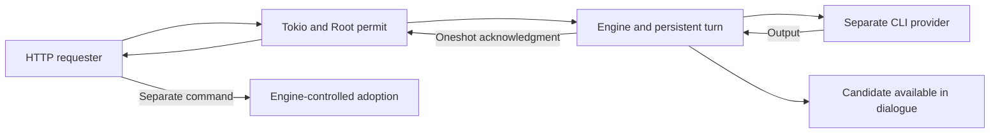

# Tokio orchestration in Swarm

[Français](../architecture/TOKIO-ORCHESTRATION.md) · [Biba plan](../plans/actions-confiance/BIBA-TRANSVERSE-APEX.md) · [Focused qualification](#replay-the-focused-qualification)

## Admission order in the mission conductor

The conductor attempts ready worker admission first. After starting a worker,
it reads current state and waits for startup to cross its revision-bound gate
before attempting the next admission under the same authority. The engine
preserves queue order, task dependencies, workspace
exclusion and configured capacity. A new planner activation waits for a pass
with no admission, valid mission permission and no retained worker context.
Recovering a previously admitted worker preserves its identity. Controls and
review remain separate operations on evidence from the submitted result.

When a native child proposal is refused on scope authority, the original
stays in the child's scope. The same write records a notice for the root
orchestrator. The notice carries the scope identifier and refusal code.
The rejected operation, proposal and attachments stay in the child's
diagnostic. A new claim for that child waits for a root decision to
acknowledge the notice. Resumption uses the existing revision, consent,
authority and budget checks.

## Choose the boundary

Use Tokio for asynchronous coordination between cooperating Rust components that can share process privileges. A typed channel fits when a task must send an operation to one owner or receive a single result. Reuse the existing transport when the operation already has an owner and an admission rule.

A CLI provider or native command that needs a privilege boundary stays in a separate process with the appropriate execution controls. The engine owns the turn and any adoption decision. Messages carry data and references. The authorized consumer verifies the Root instance, identity, revision, applicable labels and decision at the point of effect.

## Apply the model

1. Assign ownership of the resource and the point of mutation. Model requests and outcomes with explicit variants and correlate each request with its attempt.
2. Define the capacity of a new internal queue or identify the existing upstream bound. Choose waiting, refusal or retry according to the caller’s contract. Bind every operator policy to persisted settings, shared validation and the actual consumer.
3. Use `oneshot` for a single response. Preserve durable, queryable state when an operation can outlive its requester. An acknowledgment, a recorded effect and adoption are distinct events.
4. Define termination events for each owner. Specify the effects of channel closure, business cancellation and service shutdown. Verify resource release and how accepted operations settle.
5. Bind assertions to the source revision, profile and exercised binary. Use observable barriers and read back the receiver’s public state. Retain safe raw outputs, event order, identities, digests, errors and limits.

## Native Web preparation

The transport uses an unbounded `mpsc` channel, Root and Admin permits, and a `oneshot` HTTP response. The server acquires its permit before collecting the body. The response to `/api/v1/preparations/send` describes the admitted turn. The CLI provider runs in a separate process. The engine records a candidate response and the dialogue exposes it for readback. Adoption is a separate operation. [Transport](../../rust/crates/swarm-web/src/service/transport.rs#L235) · [Route](../../rust/crates/swarm-web/src/service/preparations.rs#L206).

The engine source resolves a race between stop and finalization through the order of writes to the turn. If stop recorded `stopping` first, finalization records `interrupted` and discards the response. If finalization recorded a terminal state first, stop serves the terminal state under the applicable read control. [Finalization](../../rust/crates/swarm-engine/src/root_store/preparation_call.rs#L1137) · [Stop](../../rust/crates/swarm-engine/src/root_store/preparation_call.rs#L1281).

On dev.380, inert-provider fixtures verified nominal completion, cancellation with provider output held, saturation refusal with explicit recovery, and persistence after disconnection. The focused qualification also observed stop preserving an already recorded candidate, and stop interrupting a turn after provider bytes had drained but before candidate publication. Queue drainage leaves parser completion and the last check before commit unobserved. General D11 coverage requires evidence specific to each boundary.

## Replay the focused qualification

The [preparation-web-stop-order recipe](../../tools/verification/recipes/preparation-web-stop-order.json) selects these two orders. Prepare a qualified native executable, an isolated checkout or source copy with a valid fixture area, and an admitted private output directory. The driver uses Linux, Python 3 and iproute2’s `ss`. Set `SWARM_PREPARATION_UI_BINARY`, `SWARM_PREPARATION_STOP_ORDER_SHA256`, `SWARM_PREPARATION_STOP_ORDER_PARENT` and `SWARM_PREPARATION_STOP_ORDER_RESERVE_BYTES` before using the [recipe runner](../../tools/verification/README.md). Retain the build identity, recipe receipt and HTTP and CLI evidence directory.

## Evidence references for dev 380

The exercised native binary has SHA-256 `f0e92ce3749855bee14f2b6ea68037c0e5532ac58308e36988f76ad6b46678a1`. In the saturation fixture, the harness counts provider launches. Public reads establish the dialogue, budget and adopted brief state. The SHA-256 values below identify the manifests retained in the local research register.

| Observed scope | Manifest SHA-256 |
| --- | --- |
| Nominal completion and stop with output held | `22dde8eb9423105e3f319982a3f2b62c2cf23c388478998d8fba806ac3954fec` |
| Saturation and explicit recovery | `b434df4a8cd6fe90289bd1c508d6b46e1805f7a41b1334214862bd03b1c763c3` |
| Disconnection after admission | `bdab361351aa8af8660bdfc4cefba9b9c9f1d717d133980164ca0448ab46597e` |
| Driver and recipe qualification on the PR base | `4998f37a68257d6b4f576a4cc4364e1efad28160a19cee251a3a039452db6c1d` |

[Tokio channels](https://tokio.rs/tokio/tutorial/channels) · [Graceful shutdown](https://tokio.rs/tokio/topics/shutdown)

## Automatic startup diagnostics in Dispatch

In current mode, **Dispatch** shows the reasons the Rust engine observes for
blocked automatic worker starts. The protected
`GET /api/v1/mission?work=…&action=launch-diagnostics` read returns the mission
revision, affected tasks and engine codes. Missing consent appears at mission
level. A prerequisite, unavailable provider, occupied slot or workspace conflict
appears against the affected task.

The engine reuses the driver's readiness rules and projects FIFO order without
registering a turn. Host checks use metadata and access information. Actual
admission still verifies the workspace write and executable bytes. The read
creates no resource reservation or attempt, and invokes no provider. Actual
admission applies its checks at the current revision. The response excludes paths
and other missions’ data. In history mode, the recorded pause remains visible
without evaluating these checks. The current cockpit also reports when mission
status observes no active driver. Use **Refresh** after resolving the cause.

The [cockpit-launch-diagnostics recipe](../../tools/verification/recipes/cockpit-launch-diagnostics.json)
uses a qualified native binary (`SWARM_LAUNCH_DIAGNOSTICS_BINARY`) and an inert agent
in an isolated Root. It checks the API and the served UI in Chromium with the
native HTTP service running without a conductor (Cargo example
`cockpit_launch_http_fixture`, supplied as `SWARM_LAUNCH_DIAGNOSTICS_HTTP_FIXTURE`).
