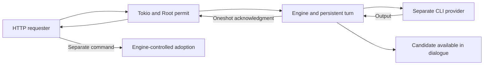

# Tokio orchestration in Swarm

[Français](../architecture/TOKIO-ORCHESTRATION.md) · [D11 tracking and evidence](../plans/actions-confiance/BIBA-TRANSVERSE-APEX.md#tokio--revue-d11-de-la-préparation-web)

## Choose the boundary

Use Tokio for asynchronous coordination between cooperating Rust components that can share process privileges. A typed channel fits when a task must send an operation to one owner or receive a single result. Reuse the existing transport when the operation already has an owner and an admission rule.

A CLI provider or native command that needs a privilege boundary stays in a separate process with the appropriate execution controls. The engine owns the turn and any adoption decision. Messages carry data and references. The authorized consumer verifies the Root instance, identity, revision, applicable labels and decision at the point of effect.

## Apply the model

1. Assign ownership of the resource and the point of mutation. Model requests and outcomes with explicit variants and correlate each request with its attempt.
2. Define the capacity of a new internal queue or identify the existing upstream bound. Choose waiting, refusal or retry according to the caller’s contract. Bind every operator policy to persisted settings, shared validation and the actual consumer.
3. Use `oneshot` for a single response. Preserve durable, queryable state when an operation can outlive its requester. An acknowledgment, a recorded effect and adoption are distinct events.
4. Define termination events for each owner. Specify the effects of channel closure, business cancellation and service shutdown. Verify resource release and how accepted operations settle.
5. Bind assertions to the source revision, profile and exercised binary. Use observable barriers and read back the receiver’s public state. Retain safe raw outputs, event order, identities, digests, errors and limits.

## Native Web preparation

The transport uses an unbounded `mpsc` channel, Root and Admin permits, and a `oneshot` HTTP response. The server acquires its permit before collecting the body. The response to `/api/v1/preparations/send` describes the admitted turn. The CLI provider runs in a separate process. The engine records a candidate response and the dialogue exposes it for readback. Adoption is a separate operation. [Transport](../../rust/crates/swarm-web/src/service/transport.rs#L235) · [Route](../../rust/crates/swarm-web/src/service/preparations.rs#L206).

The engine source resolves a race between stop and finalization through the order of writes to the turn. If stop recorded `stopping` first, finalization records `interrupted` and discards the response. If finalization recorded a terminal state first, stop serves the terminal state under the applicable read control. [Finalization](../../rust/crates/swarm-engine/src/root_store/preparation_call.rs#L1137) · [Stop](../../rust/crates/swarm-engine/src/root_store/preparation_call.rs#L1281).

On dev.380, inert-provider fixtures verified nominal completion, cancellation with provider output held, saturation refusal with explicit recovery, and persistence after disconnection. The focused qualification also observed stop preserving an already recorded candidate, and stop interrupting a turn after provider bytes had drained but before candidate publication. Queue drainage leaves parser completion and the last check before commit unobserved. General D11 coverage requires evidence specific to each boundary. [D11 tracking](../plans/actions-confiance/BIBA-TRANSVERSE-APEX.md#20-novembre--tokio-déconnexion-après-admission-sur-dev380).

## Replay the focused qualification

The [preparation-web-stop-order recipe](../../tools/verification/recipes/preparation-web-stop-order.json) selects these two orders. Prepare a qualified native executable, an isolated checkout or source copy with a valid fixture area, and an admitted private output directory. The driver uses Linux, Python 3 and iproute2’s `ss`. Set `SWARM_PREPARATION_UI_BINARY`, `SWARM_PREPARATION_STOP_ORDER_SHA256`, `SWARM_PREPARATION_STOP_ORDER_PARENT` and `SWARM_PREPARATION_STOP_ORDER_RESERVE_BYTES` before using the [recipe runner](../../tools/verification/README.md). Retain the build identity, recipe receipt and HTTP and CLI evidence directory.

[Tokio channels](https://tokio.rs/tokio/tutorial/channels) · [Graceful shutdown](https://tokio.rs/tokio/topics/shutdown)
