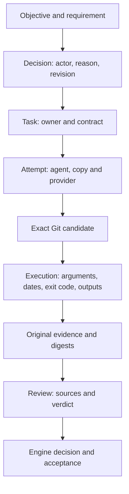
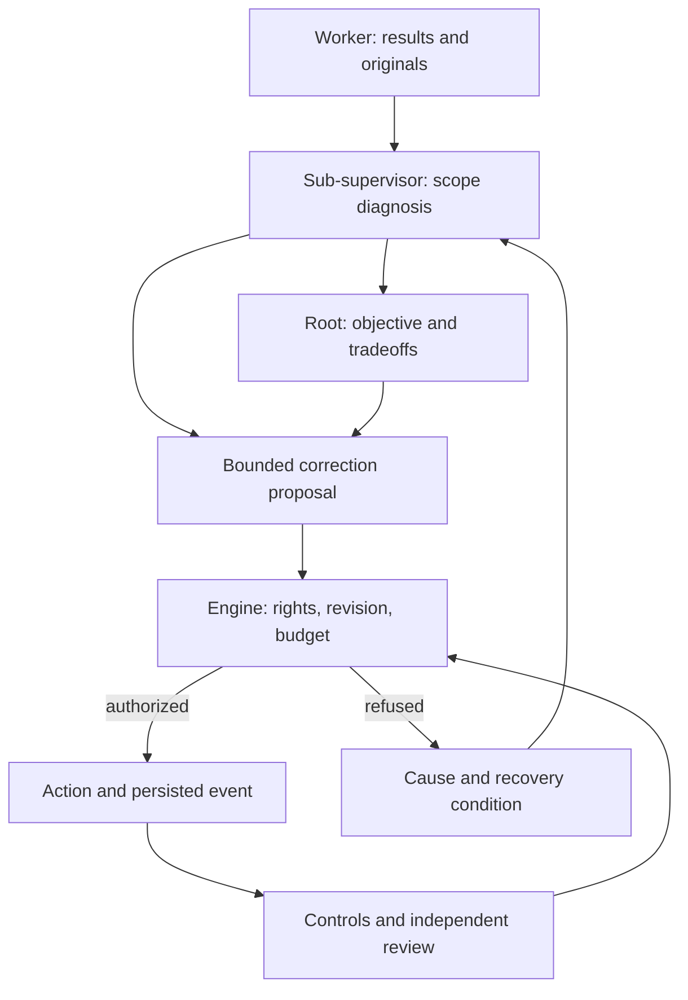
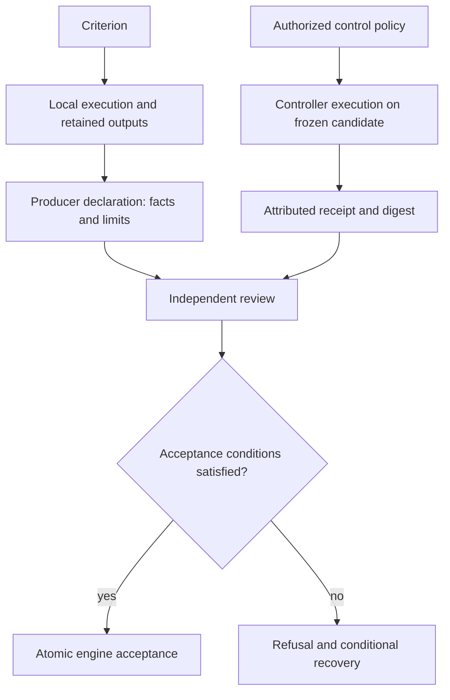
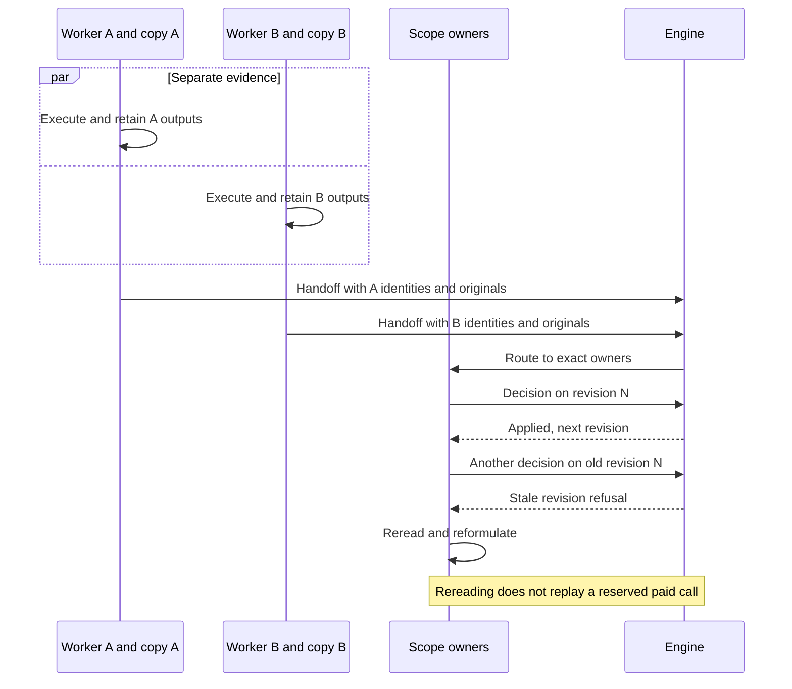
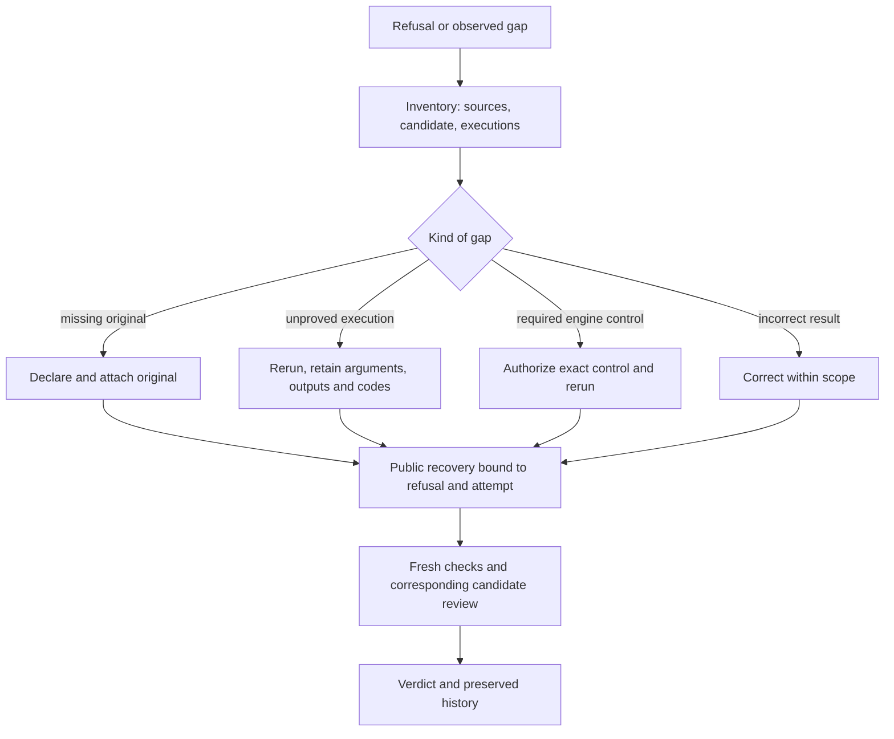
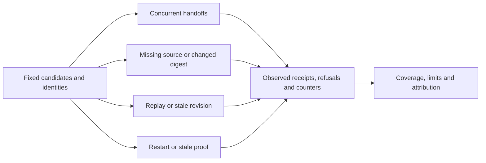
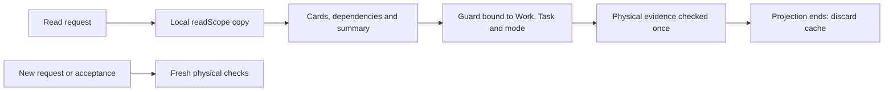

# Traceability: evidence, ownership and concurrent agents

[Français](../architecture/TRACEABILITY.md)

## Purpose and evidence chain

Traceability connects objective, decision, actor, execution, source revision,
observed result and acceptance. It supports diagnosis, recovery, independent
review, cost accounting and attribution. Distinguish incorrect work, missing
evidence, faulty engine rules and provider outages. An announced command is not
an execution; a file is not a read receipt; completion is not acceptance.
Digests verify bytes, not truth or semantic quality.

Read [parallelism](AGENT-PARALLELISM.md) and [review evidence](REVIEW-EVIDENCE.md).
These contracts distinguish inspected mechanisms from unproved target behavior.
Apply [recursive diagnosis](AUTORECURSIVE-RECOVERY.md) to failures in the method,
control and handoff too, then return to the original requirement. Reporting a gap
does not complete its correction.

Preserve durable mission/scope/task/attempt/agent identities, exact command and
relevant environment, start/end times, stdout/stderr, exit codes, original sources,
digests and Git objects, controller receipts and candidate-bound review.
Historical evidence is not made fresh by changing status. Unknown measurements
remain unknown. Provider calls, tools, controls and attempts are distinct counters;
reservation is not proof of sending or billing. PIDs and dates help diagnosis,
but do not replace identities after restart.

## Responsibilities

| Level | Responsibility | Boundary |
| --- | --- | --- |
| Worker | Execute in its copy, retain outputs, map criteria to originals and report limits | No future-controller certification or self-acceptance |
| Sub-supervisor | Diagnose its scope, use handoffs and propose bounded correction/adaptation | No reassignment of another owner's scope |
| Root supervisor | Assess the complete objective, dependencies and cross-scope decisions | No fabricated evidence or replacement of the controller |
| Independent reviewer | Inspect candidate, supplied originals and results; explain verdicts | Source receipt does not imply understanding; no edits |
| Global judge | Decide continuation or closure from objective-level evidence | Candidate review is a different decision |
| Deterministic engine | Reserve, route, check rights/revisions/digests, execute preauthorized controls and publish transitions | Hashes and statuses do not establish semantic correctness |
| Operator | Authorize controls and policies, record explicit external repair | Human intervention remains distinct from autonomy |

**Expected flow:** AI decisions are proposals validated by the engine; workers
do not directly coordinate shared writes.

## Verification levels

Local verification records an actual producer/operator execution in an isolated
copy, with declared origin and conditions. Controller verification runs an
explicitly authorized command on its exact candidate and records a receipt.
Independent review assesses criteria from originals, candidate and evidence;
mechanical success alone is insufficient. Local evidence retains its value and
origin; never relabel it as a controller receipt. A required new controller test
needs explicit policy authorization, not an AI suggestion alone.

## Constraints

| Constraint | Purpose and handling |
| --- | --- |
| Identity and owner | Reject another task/attempt/scope's evidence |
| Candidate and contract | Bind checks, review and publication; recheck relevant changes |
| Revision and event | Atomic stale-state refusal, idempotence and rereading |
| Original and digest | Attach actual source; verify blob and digest |
| Context bounds | Pre-call refusal for missing/oversized sources; supported explicit partitioning |
| Large outputs | Document retained output and bounds; preserve necessary artifacts under policy |
| Budget and reservation | Shared atomic accounting and history; no refunds to force progress |
| Sensitive data | Select authorized evidence and explain necessary omissions |
| Restart | Reconcile processes, leases and effects before recovery |

The engine attaches declared delivery evidence and supplemental review-context
sources from Git. Bounded retained controller stdout does not authorize silent
truncation of review originals. New policies must be persisted, exposed in Admin
FR/EN and used by the engine. Identity, integrity and duplicate-effect safeguards
cannot be relaxed to force acceptance. Host administrators able to edit databases
and executables remain outside the public-operation protection boundary.

## Simultaneous agents

Each agent owns its copy and evidence; avoid one tracking file rewritten by all
workers. Handoffs identify owner, task, attempt and candidate. Preserve events;
arbitrate state changes atomically. **Example, not a mission measurement:**

Timestamps alone cannot order causality across machines; identities, event links
and revisions establish dependencies. Current publication remains exclusive
during checks/review/publication, separate from parallel production. Changing
the candidate can invalidate evidence despite correctly retained local logs.

## Correct missing evidence

Sub-supervisors diagnose their scope; the root handles global dependencies and
decisions. The engine provides verifiable facts and enforces authorized actions.
More citations or artificially changing unchanged files does not supply missing
originals or executions. External repair records actor/reason, preserves refusal
and requires fresh checks. Do not modify a candidate or its proofs during review.
Amended policy invalidates previous evidence; no implicit attempt or acceptance.

## Use the analysis to build the engine

These requirements clarify existing T2–T7 criteria. Each lot maps its changes to
stable IDs, inspects gaps on its own candidate and supplies observable results
and originals. Documentation alone does not implement a requirement.

| ID | Development requirement | Lot and owner | Expected verification |
| --- | --- | --- | --- |
| TR-1 | Bind execution to task, attempt, candidate, arguments, dates, exit code and outputs; declare local/controller origin | T4 handoff/receipt; T6 measurement | Find an announced test in actual output; missing evidence remains unknown |
| TR-2 | Supply decision makers with exact attached/missing source inventory, origin and freshness | T3 supervisor context; T5 instructions | Missing, unchanged and false originals; pre-call refusal for engine-detectable invalid inputs |
| TR-3 | Route findings and gaps to scope owner; root arbitrates across scopes | T3 subplanning; T4 handoff | Two distinct owners process their events; discovery and decision persist after restart |
| TR-4 | Keep separate evidence per agent and arbitrate concurrent decisions atomically | T3 reservation; T4 publication | Simultaneous attributed handoffs; stale decisions and replay cause no duplicate effects |
| TR-5 | Recover through public operations after an identified correction, retaining refusals, usage and old candidate | T4 recovery; T5 API/CLI/Admin | Named changed precondition, corresponding fresh controls/review and accessible history |
| TR-6 | Measure the cost and demonstrated utility of these guarantees | T6 bench; T7 independent recipe | Evidence coverage, unknowns, recovery, central waiting and known/unknown cost; doubles versus real provider |

TR-1 through TR-6 clarify work; they are not newly adopted mission gates. T2's
judge consumes objective-level evidence and cannot turn local declarations into
controller execution. T5 persists new policies and exposes provenance and Admin
FR/EN. T6/T7 distinguish available mechanisms from actual supervisor use.

## T2 case and required checks

The first fragment of `review-8a5b4d26457e4456353da385` inspected judge code/tests
but reported local test results not corroborated by controller receipts.
Preauthorized generic controls excluded new `TestJudge*`/`TestConfigureJudge*`.
This is an intermediate finding, not the final verdict. Recovery prepares an
isolated run on candidate `a27e175eb4f3e38f9cede1c888956a5ca5a0310f`, retaining
outputs, exit codes, dates and digests with explicit operator origin. Any required
engine control must be publicly authorized and executed. Actual outcomes belong
in the research record, not an advance success declaration.

Verify normal flow, refusals, changed-precondition recovery, persistence and
concurrency in temporary roots. Separate doubles, real providers and human
interventions. Intact sources may be wrong and favorable reviews insufficiently
grounded. Evidence also supports auditing supervisors, reviewers and the engine.

## Count managed controls without losing history

`mission spending` and the cockpit read executions recorded in `task.auto-validation` and `managed.integrated`. The first carries a result list; the second carries per-task lists in `controls`. The counter adds each `executed=true` result, passed or failed, once per event for that mission. An unreadable structure remains an error and is not presented as zero.

Example: publish alpha with one control, then publish beta with an alpha recheck and beta control. The ledger reports **3 recorded executions**, while the final candidate has **2 fresh controls**. These are different units; summing only final validations would lose the first control. Controls without a recorded result event are not inferred from worker tests or launch intentions. Missing cost stays unknown, even if a JSON sum is zero with no calls reporting cost.

## Check once per projection and again at acceptance

A mission display builds multiple projections of a task and its dependencies. Managed review guards can reread the full context, batches, historical chain and Git. Repeating this for every card amplifies latency: a retained mission with five tasks and two batches took 41.66 seconds for its public snapshot while storage remained responsive.

`readScope` now creates a read-local copy. The HTTP snapshot and `missionStatus` share it with nested projections. The independent guard memoizes both success **and refusal**, keyed by the complete Work, Task and historical mode. Different contracts, attempts, candidates, reviewer configurations or modes cannot reuse an opinion. Serialization failure remains an error.

This cache lasts only for the projection, like gate digests. The live Store has none: acceptance and every new request reread evidence. Missing or changed files invalidate the next read; no acceptance, consumption or persisted proof changes. Projections remain sequential within each request; this map is not a shared concurrent cache. Post-installation measurements belong to the delivery retrospective; this mechanism promises no universal threshold.

## Detailed ledger and recovery

The [call ledger](CALL-ACCOUNTING.md) attributes reservations, attempts and
known/missing usage. It reads all retained mission history independently of the
200-row recent-agent panel. Ordinary supervisor retries count distinct attempts
while preserving historical links; missing consumption is never inferred from
current configuration. The real refusal → retry decision → correction → fresh
review chain is recorded in the [follow-up retrospective](CURSOR-ENGINE-RETEX-SUITES-20261013.md).
