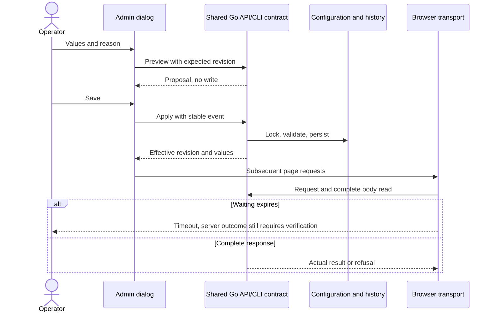

# Browser request timeouts

[Français](../architecture/WEB-REQUEST-POLICY.md)

The operator configures waiting in **Admin → Browser request waiting time →
Configure browser timeouts**. The dialog separates general API requests, state
retrieval and AI connection tests, in milliseconds. `0` disables browser expiry.
Expiry stops no agent, accepts no result and never automatically repeats a
mutation. It proves only that the complete response was not received in time.
For an uncertain mutation, read the public state before another decision and
retain the event ID for any authorized replay.

## Shared source and persistence

| Value | Versioned initial value | Consumer |
| --- | --- | --- |
| `general_ms` | 15000 ms | Other cockpit/preparation/Projects API reads and actions, including version diagnostics |
| `snapshot_ms` | 60000 ms | `/api/v1/snapshot`, with or without query parameters |
| `connection_test_ms` | 65000 ms | `/api/v1/providers/connections/test`, with or without query parameters |

`config/web-requests.json` supplies embedded initial values. Saved configuration
in `.swarm/web-requests.json` includes revision, author, reason and history.
Malformed or symlinked configuration is refused; no hidden client fallback
conceals it. The upper bound published by the API is JavaScript's exact integer
representation, `2^53 - 1` milliseconds, not an operating policy. Long timers use
31-bit chunks without shortening the configured duration. Waiting covers headers
and the complete response body; timers and abort listeners are cleaned up.

Public API: `GET /api/v1/web-requests`, `POST /api/v1/web-requests/preview` and
`POST /api/v1/web-requests/apply`. Equivalent CLI:

```sh
swarm --root ./my-project run-limits web-requests show
swarm --root ./my-project run-limits web-requests history
swarm --root ./my-project run-limits web-requests preview --input change.json
swarm --root ./my-project run-limits web-requests apply --input change.json
```

A change requires `schema_version: 1`, a stable `event_id`, `expected_revision`,
all three values and an 8–2000 character reason. Preview writes no configuration.
Application locks across processes, refuses stale revisions and preserves exact
replay without another revision. Conflicting event reuse is refused.

## Received browser configuration

The authenticated `/api/v1/web-requests/script.js` response uses `no-store` and
supplies revision/values before application scripts under the existing CSP.
`web/web-requests.js` serves the cockpit, preparation, Projects and version
diagnostics. Console frames load the same contract; cockpit-relayed reads use
the cockpit transport. EventSource streams and the unload visit notification
are outside this response-reading timeout.

Loading/saving in Admin updates subsequent calls in that page. Calls already
started retain their policy. Other pages receive settings on reload; instant
cross-tab propagation is not claimed.



## Verification and remaining limits

Targeted recipes cover persistence, preview, replay, concurrency, invalid input,
authentication, received settings and FR/EN in both themes. Browser waiting
probes are intercepted and start no provider. They prove neither a real model
call nor installation of the new binary in the native service.

This fix concerns browser transport. The subsequent source correction removes
fixed server 60-second limits: the [provider waiting contract](PROVIDER-LIVENESS.md)
supplies total duration to connection tests and page assistance. Changing
`connection_test_ms` does not change this server duration. Editor loading wait in
`prephase-editor.js` remains a fixed policy to administer. Launch budgets and
preparation deadlines keep their distinct contracts.
