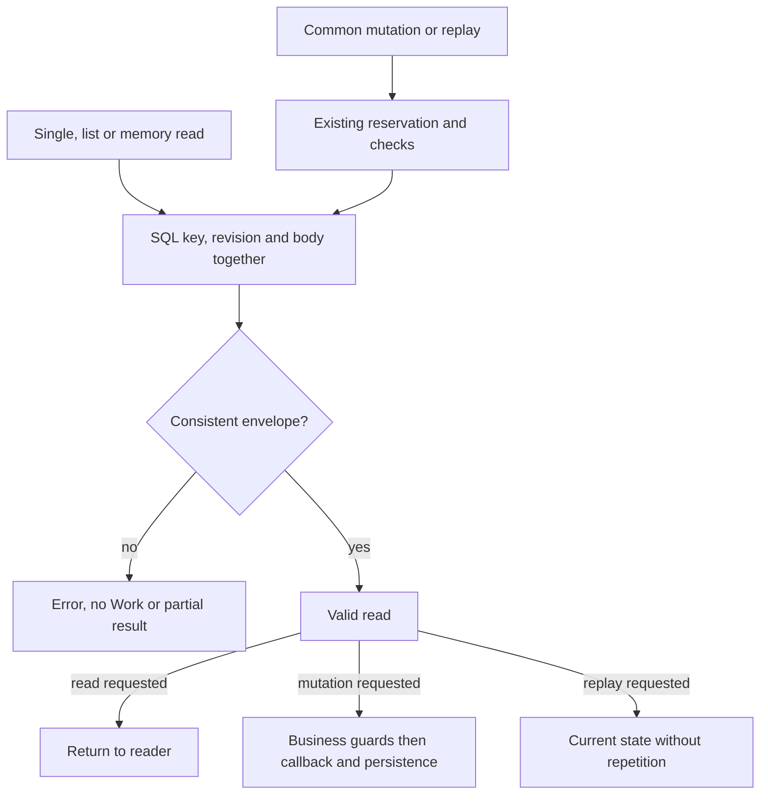

# Consistent persisted work reads

[Français](../architecture/WORK-ROW-CONTRACT.md) · [CLI reference](REFERENCE.md) ·
[Project memory](PROJECT-MEMORY.md)

## Current contract

`internal/engine/work_row.go` provides the shared SQL `works` envelope reader.
`Store.get/list`, mutation and replay reads in `mutateWithHookOnce`, and the
versioned memory readers use it. Other explicit SQL readers have not all been
connected to this module.

Each read obtains `id`, `revision` and `body` in one SQL result. It requires a
key accepted by `safeName`, UTF-8/JSON decodable into `Work`, `schema_version: 1`,
a strictly positive SQL revision, and matching JSON/SQL identifiers and
revisions. JSON schema 1 is distinct from the SQLite storage version checked
by migrations. This check does not revalidate every business field or the
work's complete history. Historical optional fields may be absent; reading
does not rewrite stored bytes or unknown fields in the database.

`readWorkRow` also validates the requested identifier before querying. Row
rejection returns `Work{}` with an error, never a partially decoded work.
Wrapped SQL/JSON errors retain their causes, including
`errors.Is(err, sql.ErrNoRows)` for a missing source. Consistency errors name
a valid SQL key; invalid keys are not echoed.

`listWorkRows` retains `rowid DESC` ordering. A genuinely empty list succeeds
with an empty collection. Query, row, iteration or close errors return no
collection and an error; no partial list is published. The cursor is closed
on every path. Memory wrappers add their error context, and the legacy guide
uses the same row scanner.

## Mutation, replay and creation

Common mutation retains the existing SQL writer reservation, storage version
guard and event/revision checks. Existing work must pass the shared reader
before the business callback and transaction hook. An inconsistent row invokes
neither callback and leaves no business mutation or recorded event. The writer
reservation may have executed a SQL statement without changing a value;
rejection and rollback do not imply that no SQL statement ran.

Exact event replay reads and validates the current work inside the transaction.
It returns that current state, even when its revision exceeds the event's,
without repeating callbacks or the event. Creation uses its own producer: new
work may have revision zero in memory before being persisted at its first
revision. This does not admit a stored row at revision zero.

## Operator effect and recovery

`work show WORK --json`, `work list --json` and `GET /api/v1/works` refuse an
inconsistent row. Fixtures assert empty CLI stdout with exit code 2, HTTP 400,
and unchanged storage. These readers do not repair the database. Preserve
the original database and have its owner diagnose the source; real repair
requires its own scope and verification. Tests restore valid data only in an
isolated fixture, never in an active mission.

SQL/JSON consistency proves neither author, owner, usage rights nor authenticity
against an actor able to rewrite all the data together. It provides no atomic
commitment through an external effect. Identity controls and the ten M20 public
compliance criteria remain separate work.

## Verification and limits

The reproducible recipe, test sources and original receipts are in the
[M28 report](../plans/deepagents-integration/RESULTATS-MEMOIRE-24.md). It covers
rejection, restoration of a valid fixture, error causes, historical fields,
replay, mutation, concurrency and affected memory/CLI/API/archive/plan boundaries.

The report's corrected `callers-current.json` inventories `get/list` selectors and literal SELECT
queries on `works`; it is neither a complete runtime graph nor an audit of error
propagation in every caller. Remaining direct SQL readers (archive, automation,
preparation, organization, identity, etc.) require analysis by module; some
already have their own guards. Follow-up ownership: memory/Store work for memory
sources, identity work for its own readers. Resume from actual paths and their
contracts before extending coverage. Local evidence proves neither independent
review nor an update to an already running server.
