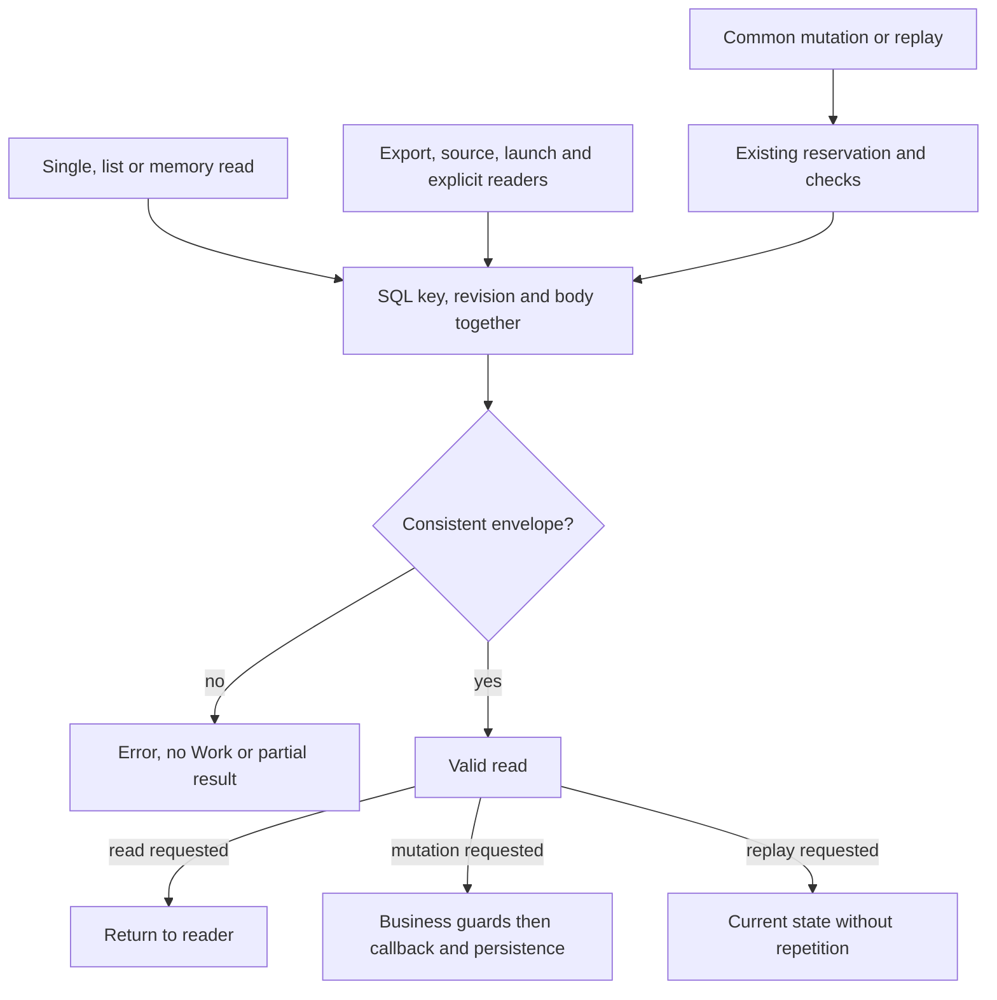
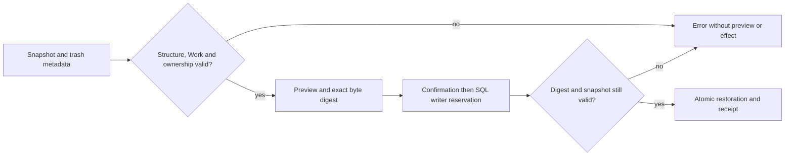

# Consistent persisted work reads

[Français](../architecture/WORK-ROW-CONTRACT.md) · [CLI reference](REFERENCE.md) ·
[Project memory](PROJECT-MEMORY.md)

## Current contract

`internal/engine/work_row.go` provides the shared SQL `works` envelope reader.
`Store.get/list`, mutation and replay reads in `mutateWithHookOnce`, and the
versioned memory readers use it. Explicit readers for summary sources, export,
transactional launch, automation (policy, workspace and causal recovery), graph
preview/application, organization, planner lease revocation, preparation
conversion into existing work, and recovery focus use it too. The lifecycle
inventory join uses `decodeWorkRow`, the same validator after scanning its extra
columns, without opening another SQL reader. Metadata queries, migrations and
identity readers remain distinct in M29's inventory. The identity plan reader
retains its own projection contract.

Each read obtains `id`, `revision` and `body` in one SQL result. It requires a
key accepted by `safeName`, UTF-8/JSON decodable into `Work`, `schema_version: 1`,
a strictly positive SQL revision, and matching JSON/SQL identifiers and
revisions. JSON schema 1 is distinct from the SQLite storage version checked
by migrations. This check does not revalidate every business field or the
work's complete history. Historical optional fields may be absent; reading
does not rewrite stored bytes or unknown fields in the database.

`readWorkRow` also validates the requested identifier before querying. Row
rejection returns `Work{}` with an error, never a partially decoded work.
Wrapped SQL/JSON errors retain their causes, including
`errors.Is(err, sql.ErrNoRows)` for a missing source. Consistency errors name
a valid SQL key; invalid keys are not echoed.

`listWorkRows` retains `rowid DESC` ordering. A genuinely empty list succeeds
with an empty collection. Query, row, iteration or close errors return no
collection and an error; no partial list is published. The cursor is closed
on every path. Memory wrappers add their error context, and the legacy guide
uses the same row scanner.

## Mutation, replay and creation

Common mutation retains the existing SQL writer reservation, storage version
guard and event/revision checks. Existing work must pass the shared reader
before the business callback and transaction hook. An inconsistent row invokes
neither callback and leaves no business mutation or recorded event. The writer
reservation may have executed a SQL statement without changing a value;
rejection and rollback do not imply that no SQL statement ran.

Exact event replay reads and validates the current work inside the transaction.
It returns that current state, even when its revision exceeds the event's,
without repeating callbacks or the event. Creation uses its own producer: new
work may have revision zero in memory before being persisted at its first
revision. This does not admit a stored row at revision zero.
Preparation conversion preserves that distinction. Exact graph draft application
replay still returns its historical receipt; it does not promise to read current
Work state. Envelope validation replaces no business check or permission.

## Dynamic snapshots and restoration

`snapshotMission` rereads Work through the shared core inside the transaction,
then validates the complete snapshot before moving it to trash. Restore preview
also checks schema 1, allowed tables, valid column names without duplicates, decodable cells,
and exactly one Work matching the trash key, positive revision and title. Its
body passes the same envelope validator as current reads.

Every row belongs to the captured SQL scope: the work itself, an agent or
preparation present in the snapshot, or a captured automation request/schedule.
A preparation reservation without a work may remain linked to its captured
preparation; a foreign work is never treated as empty. Older snapshots may omit
empty optional tables. Unknown tables, even empty ones, and foreign dependencies
are refused. This does not revalidate every business field or grant identity
authority.

Trash restore preview adds `snapshot_sha256`. Its token binds the exact snapshot
bytes as well as revision and lifecycle generation. Any change, including one of
equal size, requires a fresh preview (`preview_conflict`). The writer transaction
rereads the digest and validates the snapshot before any insertion, trash removal
or receipt. The receipt retains that digest; exact replay returns the historical
receipt without another effect. Removing archive marking has no trash snapshot,
so the field is absent. Historical receipts without a digest keep it absent; no
retrospective binding is invented. Switching between these states requires a current preview.

Rejection preserves trash and existing data. Preview performs no temporary
writes. Trash lookup is attempted only when active Work is absent; SQL failures
and inconsistent active envelopes retain their cause. Repairing a real snapshot
requires diagnosis and its own scope; tests alter isolated fixtures only. The
digest binds observed content, not authenticity against someone able to rewrite
the database. M20 ownership, attested authorship and usage rights remain separate.

## Operator effect and recovery

`work show WORK --json`, `work list --json` and `GET /api/v1/works` refuse an
inconsistent row. Fixtures assert empty CLI stdout with exit code 2, HTTP 400,
and unchanged storage. These readers do not repair the database. Preserve
the original database and have its owner diagnose the source; real repair
requires its own scope and verification. Tests restore valid data only in an
isolated fixture, never in an active mission.

The extractive source CLI/API and lifecycle HTTP inventory also reject an
inconsistent envelope. CLI export publishes no archive and preserves an existing
destination file. Source, inventory and export/import work again after restoring
a valid fixture. Terminal task selection retains read errors instead of showing
“no tasks”; rendering and dialogs sort tasks from their already read Work.
Automation reserves `unknown_target` for an absent SQL target; read failures and
invalid rows retain their cause.

SQL/JSON consistency proves neither author, owner, usage rights nor authenticity
against an actor able to rewrite all the data together. It provides no atomic
commitment through an external effect. Identity controls and the ten M20 public
compliance criteria remain separate work.

## Verification and limits

The reproducible recipe, test sources and original receipts are in the
[M28 report](../plans/deepagents-integration/RESULTATS-MEMOIRE-24.md). It covers
rejection, restoration of a valid fixture, error causes, historical fields,
replay, mutation, concurrency and affected memory/CLI/API/archive/plan boundaries.

The [M29 report](../plans/deepagents-integration/RESULTATS-MEMOIRE-25.md) adds
explicit reader coverage. Its inventory distinguishes body/metadata SELECTs,
the common core and the identity reader. All inventoried body readers outside
identity now use the common core. This proves neither constructed SQL coverage
nor complete error propagation: supervision loops, freshness callbacks and
supplementary views still need diagnostic qualification. MEM-P1 remains partial,
with paths, owners and resumption conditions in M29's matrix. Memory/Store owns
callers; identity work owns its readers. Local evidence proves neither independent
review nor an update to an already running server. No agent context or web asset
is embedded by these changes.
