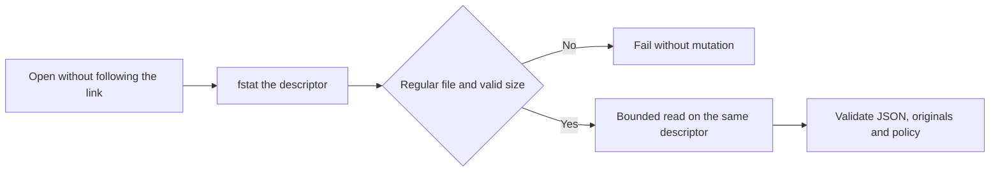
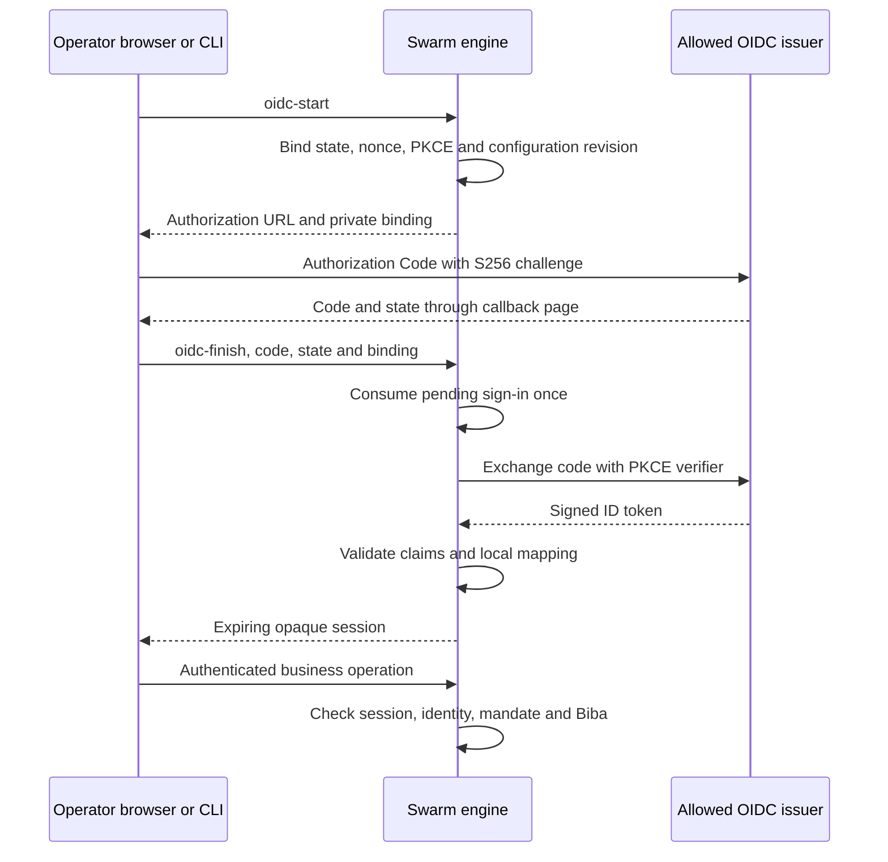
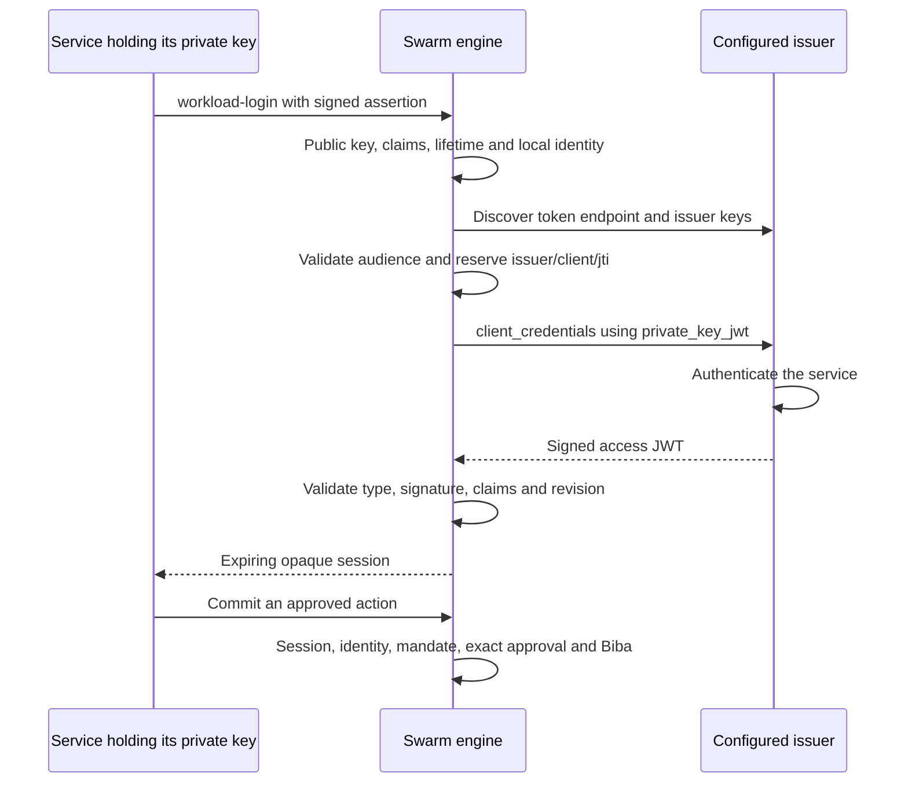
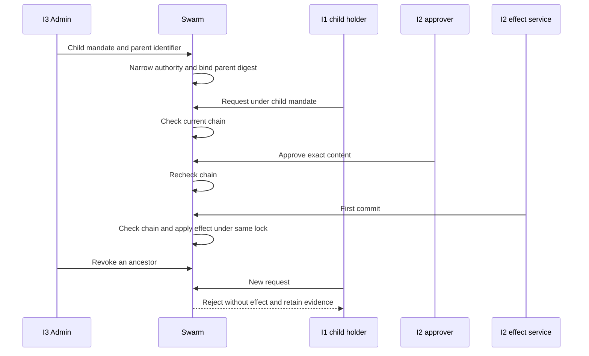
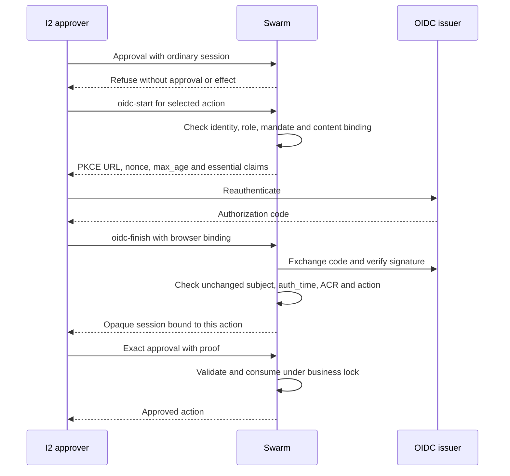
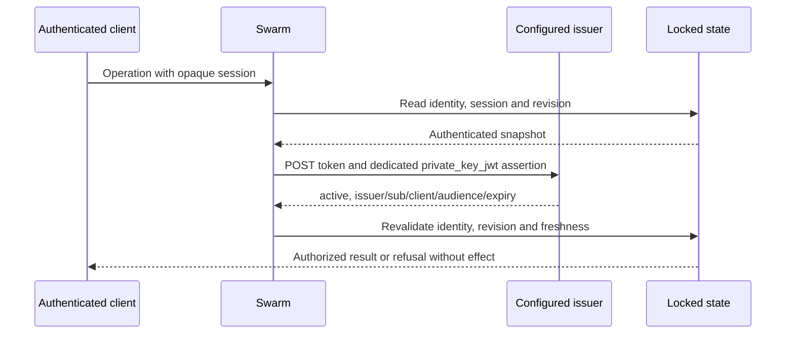

# Trusted actions — T2 pilot

**Rust port:** the local core has its own [contract and verification recipe](actions-confiance-rust.md). This page retains the historical Go pilot; its advanced features and remote client are not implicitly available in Rust. Historical evidence does not qualify the new binary.

This pilot protects a **strictly simulated** settlement with a versioned mandate, exact approval and strict Biba variant. It contacts no bank, deploys nothing, and is neither proof of a real effect nor engine acceptance.

## Public contract

To select the persistent server, use `--server http://127.0.0.1:PORT` and
`SWARM_WEB_SESSION`: [local client contract](actions-confiance-T4.md#cli-access-to-the-persistent-local-server).
This mode never opens the local root, including on server failure.

Use `swarm --root ROOT --json trust OPERATION [--input FILE|-]`. For business actions, authenticated identity comes only from `SWARM_TRUST_TOKEN` on the CLI and `Authorization: Bearer …` on `POST /api/v1/trust-actions?action=OPERATION`; requester-supplied `actor` and `integrity` fields are ignored. Tokens are stored only as digests. Configuration is a local operator operation protected by workspace access and, on the web, the Swarm session and CSRF. It does not require the business token and records the operator identity. Enterprise administration roles belong to T3.

Public operations are `show`, `config-preview`, `config-apply`, `mandate-create`, `mandate-revoke`, `request`, `approve`, `commit`, `reconcile`, `direct-write`, `elevate-integrity`, `export`, `anchor`, and `verify`. Mutations carry `schema_version: 1` and a unique `event_id`. Approval, commit and reconciliation name the protected object with `action_id`.

API and CLI share the Go validation and durable `.swarm/trust-actions.json` state. A process lock and atomic replacement serialize mutations. Reusing an idempotency key with identical content returns known state; changed content returns `idempotency_conflict` without another ledger effect.

## Biba, configuration, recovery and evidence

I3 administrators configure identities and endorse I2 mandates. I2 approvers and the effect service approve the exact digest and invoke the simulated connector. I1 requesters preserve provenance and the original digest. A subject cannot select its integrity. With `require_separation: true`, self-approval, self-elevation, direct protected-state access and changes to approved fields are denied.

The `/trust-actions.html` operator/Admin page is localised through the versioned catalog. Its accessible dialog previews without mutation before applying. `mandate_ttl_seconds` (default 3600; zero means no default expiry), `unknown_reconcile_seconds` (default 0; immediate reconciliation), `evidence_retention_days` (default 365; zero invalid), and `require_separation` (default true) are persisted and revision protected. Stale revisions are denied.

Arbitrary business ceilings are removed. `show.policy_bounds` exposes the technical bounds displayed in Admin: on this 64-bit binary, 9,223,372,036 seconds for a Go duration and 9,007,199,254,740,991 days for an exactly representable browser integer. A 32-bit binary exposes its actual integer bound. API, CLI and UI use the same bounds. `require_separation: false` allows a subject with the required roles and integrity to request and approve; keep `true` for separation of duties. Retention policy persists, while production deletion belongs to T6. Preview does not mutate configuration, history or ledger; it may create the technical lock.

The connector records its deterministic ledger entry and stable receipt in one critical section. A lost response creates `unknown`; after restart, reconciliation reads the receipt and produces `reconciled` without a second effect. Attributed evidence chains intention, mandate, decision, effect and observed result. Export contains no token or key. Anchor and verification key are acquired separately; verification detects tampering, reordering and omission relative to the anchor.

Run the named public recipe with `python3 tests/actions_confiance_t2.py --criterion N --root "$PWD" --timeout-seconds 25` for N=1..4 and the named Go suite with `go test -race ./internal/engine -run '^TestActionsConfianceT2' -count=1 -v -timeout=150s`. Criterion 4 runs `tests/actions_confiance_t2_ui.cjs` against the candidate binary and checks French/English, State/dark themes, 1440, 1024, 760, 390 and 320 px layouts, keyboard, Escape/focus, loading/empty/error/success states, network diagnostics and Admin persistence.

## Limits

Billing service, identities and evidence key are local fixtures. There is no hardware isolation, activated real identity provider, external anchor, bank connector, payment, deployment or certification. Third-party anchoring, key rotation/revocation and production retention belong to T6. API refusal demonstrates the mediated pilot boundary, not a global operating-system sandbox. Local producer checks are distinct from engine controls, independent review and acceptance. The identity sections below describe human OIDC, services and delegations checked with isolated fixtures.

The page loads its complete pilot catalog `locales/trust-actions-en.json`, generated as `web/trust-actions-en.js` by `npm run i18n:build`, then shared translator `web/i18n.js`. The global catalog remains separate from the pilot catalog. CLI and HTTP entry points call the same Go operations; public recipes verify their observable results.

A positive reconciliation delay applies from the unknown state’s last update using current persisted policy. Early reconciliation is denied without another effect; the exact due boundary is admitted. HTTP and CLI share proof verification and reject additional JSON objects before mutation.

Approval applies only to pending actions. It cannot regress committed, unknown or reconciled effects to approved. With `action_id`, an explicitly supplied resource must match the action; omission refers to the resource already bound to that identifier. Legacy `resource` used alone as an action identifier retains documented compatibility.

Engine states and next actions are translated into French and English on a real request. Amounts display minor units and long values wrap on mobile.

Exact configuration replay returns the original JSON response for that event, including after later applications and restart, without rounding large integers. A missing historical response is explicitly refused without replacing current configuration. Business operations authenticate replays as well; HTTP requires a Bearer header with one nonempty token.

The keyboard skip link targets main and actually transfers focus. Controls guarantee 44 px and input fonts 16 px. The recipe retains measurements for twenty viewport/language/theme combinations with long data.

Proof export version 2 includes `originals`, keyed by SHA-256. Values are exact
HTTP/CLI business-command bytes encoded in base64 to preserve whitespace,
Unicode and newlines. Internal Go calls without transport retain canonical
contract JSON. Each admission, denial, approval, effect and reconciliation links
its own input. Identity, key and export fields are refused in business bodies;
authentication credentials stay outside originals. The existing private-store
technical bound remains 8 MiB; excess size refuses mutation.

Verification requires every referenced original and rejects alteration, omission
and unbound additions. Earlier draft states are never reconstructed:
`show.originals_missing` and a visible limitation expose gaps and new business
operations remain refused. Retain their data and proof; their owner must supply
the actual originals before a supported recovery. Historical version 1 exports
do not establish this contract.

Existing transport bounds differ from storage: 1 MiB HTTP bodies, 16 MiB CLI input and 8 MiB private storage. An export beyond the HTTP bound can be verified through the CLI within its bound, without implicit splitting or truncation. The recipe observes loading while a real API response is held, then verifies transition to loaded state.

### Exact values and translation qualification

The public view adds `amount_minor_text`, a decimal projection derived from each
authoritative integer amount. The interface uses this text to avoid JavaScript
rounding above 2^53; storage, commands and proof retain integer amounts. Replayed
responses preserve their original JSON bytes.

`npm run i18n:build -- --check` compares both generated catalogues with their
sources without writing them. Missing or stale output is an error. C4 runs this
check and `npm run test:i18n`, supplies stdout and input hashes, then asserts that
all inputs are unchanged. Normal `npm run i18n:build` remains explicit generation
before qualification. Admin token inputs start empty and require enrollment;
example placeholders are invalid for configuration and authentication.

Approval and the first commit recheck the current mandate under the pilot lock.
A missing, revoked, not-yet-active or expired mandate returns `state: denied`
without changing the action or ledger. The authenticated denial is audited; an
exact approval request cannot restore mandate validity.

### Replay authority and proof key

Business commands retain authenticated authority: subject, integrity and normalized
roles. A different subject, changed rights or a historical entry without that
binding refuses replay without changing history. Rotating a private credential
for the same subject and rights retains the original response; missing historical
authority is never reconstructed.

The HMAC key is created exclusively during initial configuration. Reading rejects
symlinks, non-regular objects, public permissions, invalid size and invalid hex.
A missing historical key is never regenerated: the operator must restore the
original private key to recover its anchors. The pilot lock serializes this
operation. Proof remains local, without third-party attestation.

The twenty viewport observations use a labelled table: `viewport_columns`,
`control_columns`, `control_ids` and `rows`. The recipe reconstructs every
measurement and asserts equality with the complete observations before output.
This preserves all dimensions without truncating Go control output or changing
the operator verifier.

Initial configuration also refuses a preexisting regular file or hard link
without attributed configuration. It serializes and validates the complete state
before publishing a private `.swarm/trust-actions.json.initializing` record. This
record binds the exact authorized state, its digest and private key. Complete
files are synchronized before exclusive publication. Under the pilot lock,
recovery checks any existing originals and finishes the same publication. After
restart, only an operator replay of the exact initial configuration resumes
this attributed state without another key or revision. Business commands with
valid or invalid credentials, previews and reads report pending publication
without completing it. A different configuration is rejected before publication. Invalid,
public or symlinked records, a different key or replaced state fail without
changing originals. A historical key alone without this record still requires
diagnosis and is never adopted automatically.

### Authenticated refusals and pending previews

After authentication and envelope validation, validation errors returned by
`mandate-create` and idempotency conflicts retain their evidence, authenticated
subject and original bytes without business changes. These errors keep their
CLI/API error codes. Replay under the same authority returns the original denial
without another proof; another authority fails.

Policy decisions returned by `trustDenied` explicitly contain `state: denied`,
a reason, next action and `business_mutated: false`. They use HTTP 200 and CLI
exit 0 for the decision response. Clients must inspect that state before
continuing; transport status proves no approval or effect. Missing/revoked
mandates and contradictory resources use this path. Invalid authentication,
malformed JSON and event conflicts return their separate errors without
creating a favorable decision.

Denials for `approve`, `commit` and `reconcile` retain the `action_id` target,
even when absent or the role is insufficient; the legacy `resource` alias still
works. Existing history remains unchanged. Transport, schema, credential and
event reuse errors do not become business audit writes or replace history.

Form input or closing the dialog invalidates its preview and pending responses.
Only the current request may enable application; an older response cannot replace
a newer preview. Browser recipes actually hold an HTTP request to test editing,
reordered replies and reopening, then verify applying and reopening a fresh preview.

The bounds guard also runs with `GOARCH=386`. Unrepresentable integers are
rejected by JSON decoding or shared validation, without prematurely converting
a constant to native `int`. The native portability control records three
targeted tests actually executed; it does not qualify the complete engine suite
or every surface on that architecture.

An explicit resource alongside `action_id` must match the action for `approve`,
`commit` and `reconcile`, including already known states. A mismatch produces an
audited refusal without business mutation. Omitting the resource and the legacy
`resource=ACTION_ID` alias remain supported.

### Approval digest and request idempotency

`approve` requires `content_digest` equal to the complete digest returned by
`request`, together with the exact business fields. A missing or different value
produces an audited denial without changing the action. Example approval:

```json
{"schema_version":1,"event_id":"approval-42","action_id":"ACTION_ID","content_digest":"COMPLETE_RETURNED_DIGEST","mandate_id":"MANDATE_ID","amount_minor":4200,"currency":"EUR","beneficiary":"ACME"}
```

At `request`, a key already bound to different content returns
`idempotency_conflict`, without a second action or effect. The shared lock
serializes concurrent requests. Identical content returns the known action.
An idempotency conflict keeps its evidence and error code; replay does not duplicate it.

New event digests ignore `actor` and `integrity` while preserving original bytes
and authenticated authority. Historical digests remain unchanged: exact replay
works; varying these two fields requires the original whose old digest proves
its content. Without that original, historical normalization fails without
mutation. A business or authority change still fails.

### State reads and discriminating denials

State opens once with `O_NOFOLLOW | O_NONBLOCK`. Type, size and bounded reading
use the same descriptor: replacing the pathname cannot redirect the read.
Directories, FIFOs, symlinks and state beyond the existing 8 MiB technical bound
fail. Controlled fixture openers reproduce substitution after validation and
retaining the opened inode; this does not simulate protection from a kernel
administrator.



Approval denial checks isolate resource, amount and terminal state with a correct
digest and other valid fields. They assert the reason. Three isolated overlays
removing these guards fail their named tests; those mutations are not part of
the candidate. A denial caused only by a missing digest would not prove the
other protections.

Proof verification requires a nonempty export, a positive anchor sequence and a
32-byte key. A valid HMAC over an empty chain proves no event and is rejected.
Native controls use `qualify.py T2 race` (declared 140-second timeout) and
`qualify.py T2 portability` (30 seconds); full output is retained and does not
replace independent review.

### Mandate authorization revision

`policy_revision` binds each mandate to the current configuration revision. Every
applied configuration, including identity or credential changes, requires a new
mandate for new requests, approvals and first commits. The pilot assumes no
compatibility between revisions. Denial preserves the action and ledger; history
and idempotent replies remain attributed to their original execution. An already
committed effect can still be read and reconciled without another effect after
configuration changes. Admin explains this consequence before preview and apply.

## Suspending and reactivating identities

Admin shows a checkbox for each identity under Identity access. Unchecking
suspends its operations; checking explicitly restores access. Preview shows
proposed states without exposing credentials or applying changes. CLI and API
share the optional `identities[].disabled` field: `true` suspends, `false` enables.
Omitting the field preserves the active behavior of earlier configurations.
Null, string and numeric values are rejected.

Suspension persists in configuration and is checked before business replays.
A suspended identity receives `authorization_required` without changes to actions,
the ledger, originals or evidence. Reactivation does not restore an old mandate:
every applied configuration advances the policy revision, so a renewed mandate
is required before a new effect. Local administration remains attributed to
the project operator.

Recipes cover all four roles, restart, preview without effects, replays, invalid
values and the French/English Admin journey. This first lifecycle slice does not
constitute an SSO/OIDC connection.

## Enterprise OIDC sign-in

The pilot supports business OIDC sign-in alongside the existing cockpit operator
session. It uses Authorization Code with PKCE S256 and a public client without
a client secret. In Admin, open Enterprise OIDC sign-in and enter the issuer,
registered client ID and redirect URI. A local fixture uses
`http://127.0.0.1:PORT/trust-oidc-callback.html`. URLs require HTTPS except for
loopback HTTP; configured URLs contain no credentials, fragments or query.
Supported signing algorithms are RS256, ES256 and EdDSA, with a required key ID.

Map provider subjects explicitly, for example
`[{"external_subject":"employee-1","subject":"alice"}]`. The local identity
must exist. Its roles, integrity and suspension determine permissions; provider
groups and claimed privileges grant no authority.

`request_timeout_seconds`, `login_ttl_seconds` and `session_ttl_seconds` must be
positive integers; zero is rejected. Proposed defaults are 15, 300 and 900
seconds. Admin, CLI and API save the same settings. Sessions expire no later than
the provider ID token. Preview performs no provider request. Omitting `oidc` in
a configuration preserves its current value; `enabled:false` disables federation.
Every applied configuration revokes pending sign-ins and earlier sessions,
including when an identity is reactivated.

POST `/api/v1/trust-actions?action=oidc-start` accepts `{}` and returns
`authorization_url`, `state`, `binding`. After authorization, `oidc-finish` accepts
`{"code":"…","state":"…","binding":"…"}` and returns `subject`, `revision`,
`session_token`, `expires_at`, `roles`, `integrity`. The opaque token authenticates
business operations as a bearer. The same operations are available through
`swarm trust` with `--input`; CLI business authentication uses `SWARM_TRUST_TOKEN`.
`oidc-logout` accepts `{"session_token":"…"}` and revokes that session. Keep
tokens out of command arguments and logs.

The existing operator cookie and CSRF boundary remain required. The public
callback page only relays to the local page; it grants no API access. The browser
keeps the temporary binding in sessionStorage and the business session in page
memory. Reloading requires another sign-in; earlier sessions remain subject to
expiry or Admin revocation.

The engine checks issuer, signature, audience/azp, nonce, PKCE, iat, nbf and
expiration. A pending sign-in is consumed once before the network exchange.
Failures require a fresh sign-in. Temporary PKCE secrets stay in private storage;
provider tokens and codes are never persisted. Sessions are stored as digests.
Rejection changes no business mandate, action, effect or evidence. HTTP redirects
and responses larger than 1 MiB are rejected, a technical transport boundary
separate from the three configurable duration policies. Service identities,
delegation and integration with an external provider remain separate criteria.

Run targeted `go test -race -count=1 -run '^TestActionsConfianceT3OIDC' -v
./internal/engine`, the OIDC browser recipe and the pilot public scenarios. The
R13 plan records verification status; implementation alone is not acceptance.



Current local OIDC evidence is recorded in the
[R13 plan](../plans/actions-confiance/verification-identites-20261015/oidc-verification.json).
The browser recipe is `node tests/actions_confiance_oidc_ui.cjs
bin/swarm-actions-confiance-oidc /tmp/swarm-oidc-ui-proof`; it also checks business
request rendering and localized errors. Provider-initiated logout events and
step-up remain unimplemented.

## Service identities

Admin Service identities configures an issuer, resource audience, clients and
their public JWKs. Each client supplies `client_id`, `external_subject`, local
`subject` and `public_keys`. Supported algorithms are RS256 (RSA at least 2048
bits), ES256 (P-256) and EdDSA, with an explicit algorithm and key ID. Private
keys are rejected even while the connection is disabled.

The three policies are `request_timeout_seconds`, `assertion_ttl_seconds` and
`session_ttl_seconds`, in positive seconds. Proposed defaults are 15, 300 and 900;
zero is rejected. Preview performs no discovery. Omitting `workloads` preserves
its current configuration; `enabled:false` revokes sessions. Every applied
configuration invalidates earlier sessions while retaining consumed assertions
until their expiry.

`swarm trust workload-login --input -` accepts
`{"client_id":"service","client_assertion":"JWT signed outside Swarm"}`. The
same operation is available at POST
`/api/v1/trust-actions?action=workload-login`, under the existing operator cookie
and CSRF boundary. The service signs the assertion with iss/sub equal to its
client ID, the issuer token endpoint as audience, iat, exp and a unique jti. Its
lifetime must respect the configured maximum. Signature and dates are checked
before discovery, then audience is compared to the discovered token endpoint.
The issuer must advertise `private_key_jwt`. Exchange exclusively uses
`client_credentials`, without a client secret or Basic authentication. The
configured audience is sent in the OAuth `resource` parameter.

The returned access JWT must have typ `at+jwt` or `application/at+jwt`. Swarm
checks issuer signature, issuer, resource audience, client_id, configured external
subject, iat/exp/nbf and jti. Human ID tokens are rejected. Roles and integrity
come only from the mapped local identity. The reply contains `subject`,
`client_id`, `revision`, `session_token`, `expires_at`, `roles`, `integrity`.
The opaque token authenticates business operations through bearer or
`SWARM_TRUST_TOKEN`; its session expires no later than the access JWT.

`workload-logout` accepts `{"session_token":"…"}` through the same entry points.
Suspension, reconfiguration or logout rejects an earlier session before business
replay. Assertion replay protection uses issuer/client/jti, is reserved before
exchange and survives restart and configuration changes. Failure after reservation
requires a fresh assertion. Business mandates, actions, effects and evidence remain
unchanged. Private keys, assertions and access tokens are never persisted. Session
tokens are stored as digests. A compatible, preregistered JWT issuer is required.

Run targeted `go test -race -count=1 -run '^TestActionsConfianceT3Workload' -v
./internal/engine`, then `node tests/actions_confiance_workload_ui.cjs
bin/swarm-actions-confiance-workloads /tmp/swarm-workload-proof`. Local fixtures
actually verify both signatures and the business effect; they do not establish
external account integration.



## Administered delegation chains

Admin’s maximum delegation depth setting persists `delegation.max_depth`.
The integer counts parent-child links; 0 disables delegation and is the legacy
default. Null, fractional and negative values are rejected. Omitting the object
preserves its current value. Preview performs no writes. Applying configuration
persists the policy and invalidates mandates from the previous revision.

The existing `swarm trust mandate-create --input -` and POST API accept
`parent_mandate_id`. An authenticated I3 administrator issues each child mandate;
an I1 holder cannot create this authority. Additional example fields are
`{"parent_mandate_id":"parent-mandate","subject":"carol"}`. Other required
mandate fields remain required.

The child records the exact parent digest as `parent_content_digest`. Resource,
currency and beneficiary stay identical; the amount cannot increase, actions
must be a subset, and the validity interval must fit inside its parent’s.
An omitted expiry uses the configured duration capped by the parent’s expiry.
An explicitly excessive expiry is rejected. Every holder in the chain must be
active, and every ancestor must remain valid at the current revision. Cycles
and altered digests are rejected.

The engine checks ancestry at request, approval and before the first effect,
under the same lock as the operation. Revoking an ancestor blocks descendants
without rewriting their mandates. Committed effects remain reconcilable. The
page displays mandates, parent links and digests, and blocking reasons. Rejection
creates neither a child mandate nor an effect; its audit evidence is retained.
Correct the amount or dates, renew the chain after reconfiguration, or restore
an identity according to the displayed cause. Existing root digests remain
unchanged. Step-up and provider-initiated revocation remain separate work.

Isolated recipe: `go test -race -count=1 -run '^TestActionsConfianceT3Delegation'
-v ./internal/engine`, then `sh build.sh bin/swarm-actions-confiance-delegations`
and `node tests/actions_confiance_delegation_ui.cjs
bin/swarm-actions-confiance-delegations /tmp/swarm-delegation-proof`.



## Step-up authentication for exact approval

Admin exposes a persisted `step_up` policy, disabled by default. Enabling it
requires OIDC, the `approve` operation and ACR values explicitly agreed with the
provider. An ACR has no universal meaning here and grants neither a local role
nor a Biba level. Other operations keep their existing rules; this slice does
not add reauthentication to Admin configuration changes.

Fields are `enabled`, `operations:["approve"]`, `acr_values`, `max_age_seconds`
and `proof_ttl_seconds`. Maximum age is nonnegative; 0 requires authentication
since this new request began, at the provider claim’s second precision. Positive
values allow earlier authentication within that interval. Proof lifetime must
be positive (initial Admin proposal: 300 seconds). Validity cannot exceed that
lifetime, the session or the provider token. Maximum age is checked at OIDC
return; proof lifetime governs subsequent use. Omitting the object preserves
current policy. Missing or null fields inside it are rejected. Preview performs
no discovery or writes. Disabling OIDC requires disabling step-up as well.

A signed-in approver chooses “Step up my authentication for this action”.
`oidc-start` accepts `{"step_up_action_id":"act-…"}` with the current Bearer,
also supplied through `SWARM_TRUST_TOKEN` for CLI use. Before network access,
the engine checks identity, role, separation and active mandate. Pending sign-in
binds local subject, exact action digest, mandate digest and configuration
revision. OIDC requests include max_age, PKCE, nonce and essential auth_time/ACR
claims. Signed claims must match, preserve the subject and refer to a still
pending action with an active mandate. A failed attempt consumes pending login
and requires a new sign-in; it creates no approval or effect. Provider tokens
and codes never enter evidence.

The opaque session returned by `oidc-finish` includes `step_up_action_id`.
Existing API/CLI approval still requires the complete exact content. A valid
approval consumes proof once under the business lock; an inexact request does
not consume it. Static credentials, ordinary OIDC sessions and services mapped
to an approver cannot substitute for proof. Another action, changed mandate,
suspension, logout, expiry or configuration change prevents its use. Rejection
retains audit evidence without approval or effect. Replaying the same event by
the same authority returns its historical response and renews no proof.

Isolated recipe: `go test -race -count=1 -run '^TestActionsConfianceT3StepUp' -v
./internal/engine`, `sh build.sh bin/swarm-actions-confiance-step-up`, then
`node tests/actions_confiance_step_up_ui.cjs bin/swarm-actions-confiance-step-up
/tmp/swarm-step-up-proof`. Issuers are fixtures and effects are simulated.
Step-up uses [OpenID Connect Core, §2 and §3.1](https://openid.net/specs/openid-connect-core-1_0.html).



## Signed OIDC provider logout

The `oidc_logout` policy is disabled by default. Admin configures positive
`max_age_seconds` (initial proposal300) and nonnegative
`replay_retention_seconds` (proposal600). Zero retains digests without purging;
positive retention must cover maximum age and never ends before signed token
expiry. Current digest count is separate from policy. Omitting the object
preserves policy; missing/null fields and blank durations are rejected. Enabling
requires OIDC. Preview performs no provider discovery.

Admin displays `/api/v1/trust-actions/oidc-backchannel-logout` for registration
with the provider. This dedicated POST accepts a logout_token form without an
operator cookie. Host checks remain; other APIs retain cookie and CSRF checks.
The engine validates signature/algorithm, exact issuer, audience/azp, iat/nbf/exp,
freshness, jti, the logout event and absence of nonce. Sub or sid is required;
supplied values cannot be null or empty. This profile accepts absent typ, JWT
or logout+jwt and rejects incompatible types. This client does not negotiate
encrypted tokens.

Under the lock, issuer/sid targets matching sessions, checking sub too when
provided. Without sid, issuer/sub targets that person’s sessions. No matching
session is an explicit success. Logout preserves services, actions, effects and
evidence. Replay protection survives restart and reconfiguration. Session
references come from verified ID tokens; raw logout tokens are not persisted.
This handles human OIDC sessions and does not revoke service access tokens at
their issuer.

CLI `swarm trust oidc-backchannel-logout --input -` accepts
`{"logout_token":"…"}`. The existing operator POST accepts the same JSON with
`action=oidc-backchannel-logout`. The dedicated URL requires the standard form,
a single token, and ignores unknown parameters. Success returns logged_out and
revoked_sessions; invalid or replayed tokens return HTTP400 there. Check issuer,
dates and registered callback after rejection; do not resend an unchanged
rejected token. Restore access through a new login after revocation, never by
reusing the earlier code. Protected `oidc-session` accepts an opaque session and
returns active without echoing the secret. Refresh removes inactive identity
and requests sign-in while preserving displayed business results.

Qualification recipe: `go test -race -count=1 -run
'^TestActionsConfianceT3OIDCLogout' -v ./internal/engine`,
`sh build.sh bin/swarm-actions-confiance-oidc-logout`, then
`node tests/actions_confiance_oidc_logout_ui.cjs
bin/swarm-actions-confiance-oidc-logout /tmp/swarm-oidc-logout-proof`.
A targeted fence also rejects a login started before logout was received,
including an already running token exchange. A login started after the event
remains allowed. The fence covers configured pending-login and request lifetimes;
finish checks its context and expiry again before writing. Other targets remain
usable. Local before/after recipes verify these outcomes.
Reference: [OpenID Back-Channel Logout 1.0, errata1](https://openid.net/specs/openid-connect-backchannel-1_0.html).

```mermaid
sequenceDiagram
    participant I as OIDC provider
    participant S as Swarm
    participant U as Browser
    I->>S: POST signed logout_token
    S->>S: Validate signature, target, dates and replay guard
    S->>S: Remove matching sessions under lock
    S-->>I: Success and revoked session count
    U->>S: Operation with former Bearer
    S-->>U: Refuse before business mutation
    U->>S: Refresh and check session
    S-->>U: Inactive session; preserve effects
    Note over S: Targeted protection against earlier in-flight logins
```

## Shared identity context (R01/R13)

`swarm trust identity-context` uses `SWARM_TRUST_TOKEN`. The operator API
`POST /api/v1/trust-actions?action=identity-context` requires the business Bearer
and existing web session/CSRF protections. Its body is `{}`; optional `mandate_id`
must belong to the authenticated principal and remain active. Reading changes
no session, evidence or consumption. Caller-supplied actors are rejected. After
OIDC sign-in, the interface offers “View my identity and permissions”.

The `schema_version:1` context supplies the ten `identity-context-v1` fields:
local principal ID, local/human/service kind, verified issuer/external subject,
assurance, local attributes, optional mandate, local authentication time,
expiry and opaque local credential digest. Roles and integrity come from current
local configuration. No permissions are created; active group mapping restricts these local roles.

`authenticated_at` records successful local session authentication. The signed
OIDC `auth_time`, when present, is separate in
`assurance.provider_authenticated_at`. An ACR name grants no inferred assurance
level. Legacy sessions return null for unavailable metadata. Local credentials
use issuer `urn:swarm:local`, current verification time and null expiry; this is
neither an OIDC session nor a step-up proof.

New evidence hashes include this context. Historical context-free evidence keeps
its original hash and remains verifiable by the current verifier; old verifiers
need updating for new evidence. Replay preserves historical attribution.
Suspension, stale configuration, expiration and logout invalidate resolution.

Recipe `tests/actions_confiance_oidc_ui.cjs` checks keyboard access, CLI/API
agreement, read-only state, local permissions, clearing on logout, both themes
and FR/EN on mobile. Named Go guards `TestActionsConfianceT3IdentityContext*`
cover context tampering, historical compatibility and service sessions too.
Execution receipts remain separate from this contract and global R13 acceptance.

Public entry points choose their validation time under the business lock, after
any wait. A session that expires while waiting is rejected before a request or
context read, without mutation. Explicit internal test clocks remain deterministic;
no client field chooses this clock.

## Signed group mapping (R13)

Admin “Groups and local roles” edits `group_mapping`:
`{"enabled":true,"claim":"groups","rules":[{"group":"finance","roles":["approver"]}]}`.
The same object is accepted by configuration API/CLI. All three fields are explicit
and non-null; rules is an array even while disabled. Rules use unique groups and
unique known local roles: requester, approver, effect, admin. Enabling requires
rules and at least one active federated sign-in method. Omission preserves the
policy; legacy configurations without it stay disabled. Configuration revision
versions rules and invalidates old sessions. Preview contacts no issuer and
changes no state.

The configured top-level claim comes from the verified human ID token or service
access token. Client assertion groups are not service access-token groups. After
explicit external subject/client mapping, the union of matching rules intersects
with the principal’s local role ceiling. Integrity stays local; an admin group
cannot promote a requester. Unknown groups are ignored. Missing/null/scalar claims,
invalid elements, empty lists and no effective role deny sign-in without a usable
session. Anti-replay records and login-attempt consumption still apply. Local
pilot credentials retain their separate local authority.

Sessions store derived roles and a policy digest, never the raw group list.
Common resolution checks that digest and revision, then intersects again with the
local ceiling. Context and new evidence carry `attributes.role_mapping_digest`
and effective roles. Legacy sessions without a mapping decision cannot bypass
an active policy. Step-up sign-in and approval use derived roles even when the
local identity has wider permissions. Provider group changes take effect on new
authentication, signed human logout, or local expiry/revocation; no provider
polling is introduced.

Recipes: `TestActionsConfianceT3GroupMapping*` and
`node tests/actions_confiance_oidc_ui.cjs BINARY OUTPUT --group-mapping`.
Browser mode checks a custom claim, keyboard save/reopen, invalid group rejection
and restriction of an admin group, in FR/EN, both themes and mobile. Execution
receipts remain distinct from global acceptance. Sources:
[OIDC Core](https://openid.net/specs/openid-connect-core-1_0.html#AdditionalClaims),
[RFC9068](https://www.rfc-editor.org/rfc/rfc9068.html#section-2.2.3).
Recipe `tests/actions_confiance_workload_ui.cjs BINARY OUTPUT --group-mapping`
also covers services: roles from the signed access token, an exact approved API
effect and evidence bound to the same mapping digest, displayed in the browser.

Data admission and its limits are documented in
[Action data — T4](actions-confiance-T4.md).

## Remote revocation of service sessions

The optional `workload_introspection` policy requires an authenticated RFC7662
query whenever a service session is used. Admin, Go, API and CLI share persisted
validation. Omitting the block preserves it. Inactive defaults are
`timeout_seconds:15`, `validation_window_seconds:5`, `max_sessions:64`,
`max_token_bytes:16384`, `endpoint:""`, `client_id:""`. Every field is explicit;
positive integers are required even when disabled, and zero is rejected. Durations
are seconds and sizes are bytes. `policy_bounds` exposes representation and
transport limits. Admin supports preview, saving and reopening.

The exact endpoint must share the configured workload issuer's origin: HTTPS, or
loopback HTTP for isolated fixtures. No proxy, redirect or business-supplied URL
is used. Enabling this policy does not register an external account. After saving,
an I3 administrator obtains the public key using Admin or
`trust workload-introspection-key --server ORIGIN`, with the existing operator
session and business Bearer. Register only that public ES256 key with the issuer
for the dedicated `client_id`. Its private key stays in the non-dumpable server's
memory. A restart requires registering the new public key and logging in again.

`workload-login` still verifies the signed access JWT and explicit local mapping.
It then retains the provider token only in server memory, bound to the opaque
session digest and revision. Persistent session metadata includes only client,
digest and expiry. Use the remote `trust --server` client: a short-lived local CLI
cannot retain this material. Persisted sessions fail closed after memory loss.



Network I/O runs outside the business lock. The introspection assertion is distinct
from the login assertion, and external roles never become local permissions. A
positive response must explicitly match issuer, external subject, client and
audience; its expiry cannot extend the signed JWT or session. Errors, timeouts,
authentication failures, ambiguous responses and `active:false` deny the use.
Secret grants use this guard too. Static local tokens for mapped service identities
provide no fallback while the policy is active. Committed effects remain intact.

There is no response cache or hidden polling. The decision window limits time
between the response and the local decision, checked under lock. A revocation
after the remote response remains a distributed-system limitation. This feature
does not sandbox providers or qualify sensitive business data. Raw provider tokens,
private assertions and raw responses never enter originals, evidence or exports.
Go cannot guarantee erasure of every temporary copy; swap and privileged tracing
remain outside qualification.

Normative source: [RFC7662 sections 2.1–2.2](https://www.rfc-editor.org/rfc/rfc7662.html#section-2.1).
The R13 plan tracks actual verification; this contract description is not global
acceptance.

The server `show` view and Admin expose `retained_sessions` and
`retained_token_bytes` separately in `workload_introspection_status`. A local CLI
read does not observe server memory; use `trust show --server ORIGIN`. An observed
inactive response also invalidates positive proofs still in flight.

The existing OAuth transport also limits the login response to 1 MiB
(`trustOIDCBody`); an oversized envelope is rejected before session publication,
even when its JWT is small. Introspection responses have the same 1 MiB transport
bound, exposed through `policy_bounds`.

Every new configuration revision also invalidates in-memory sessions and the
introspection key. After applying a change, obtain and register the public key
for that revision before logging in again. A key obtained before the change
does not prepare the next configuration.
