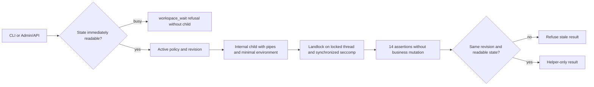

# Action data — first T4 control

## CLI access to the persistent local server

`swarm --server http://127.0.0.1:PORT --json trust show` reads the selected server.
Provide its operator session through `SWARM_WEB_SESSION`, and the business token
through `SWARM_TRUST_TOKEN` for authenticated operations. Keep these values out
of URLs and arguments. POST uses the same Cookie, Origin and CSRF as the browser;
the server API owns permissions and policies. Other operations keep
`--input FILE|-`; `confinement-check` and `identity-context` default to an empty
object. `export` and `anchor` need no input. `show` rejects `--input`.

A loopback IP address and explicit port are required; IPv6 `::1` is accepted.
DNS names, proxies and redirects are refused. `--root` is never opened in this
mode, including on server failure. Without `--server`, the CLI keeps working
locally. Unreachable servers return CLI5, refused sessions CLI4. Structured
errors preserve their code; empty, non-JSON and multiple responses are refused.
There is no fallback or automatic replay. Ctrl-C/SIGTERM cancels transport with
CLI6, but an already committed effect needs reconciliation before retrying.
The client adds no business deadline; network waiting remains cancellable and
server operation deadlines remain authoritative. Material loading uses the
dedicated commands described below.

Isolated recipe: `python3 tests/actions_confiance_remote.py --binary BIN --evidence-dir DIRECTORY`.

The pilot can require a data context before admitting a request. This control
covers the internal simulated ledger. It does not establish operating-system
containment of agents. Files, links, URLs, sockets, external executables and
secrets are unsupported destinations for these business actions. Their confidential/restricted inputs remain denied even when listed. The fixed helper’s secret material uses the separate restricted delivery path described below.

In **Edit settings → Data policy**, enable the control and supply explicit JSON
arrays, for example:

```json
{"enabled":true,"classifications":["public","internal"],"destinations":["local-ledger"],"providers":["swarm"],"tools":["simulated-settlement"],"resources":[{"resource":"invoice/acme","classification":"internal"}]}
```

All fields are explicit and non-null. Duplicate or unknown values are rejected
even when disabled. An empty list denies every new action. There are no numeric
values or special zero semantics. Preview does not write state. Saving persists
the policy and invalidates old mandates like any configuration change. Omitting
`data_policy` from an application preserves its value; legacy state without that
block is disabled. `show.data_capabilities` exposes the supported path and the
remaining containment and secret limits.

A CLI or API `request` adds:

```json
{"data_context":{"classification":"internal","destination":"local-ledger","provider":"swarm","tool":"simulated-settlement"}}
```

Every resource requires an exact operator-managed classification rule in
`resources`. An absent rule denies admission. Caller classification must match
this rule; it cannot downgrade a resource. Resource identifiers are opaque
business identifiers, never resolved filesystem paths. All four context values
must be allowed and match the supported path. Context is part of
the exact action digest. Approval and effect services recheck the stored context;
supplying replacement context on those operations is refused. Authenticated
identity, mandate, separation and other controls still apply. Admission failures
return `authorization_required` before retaining original input, evidence or a
replayable response. Correct and resubmit the request. The diagnostic never echoes
supplied text.

Existing actions and committed effects are preserved. Lost responses can be
reconciled after policy tightening without another effect. Historical replay
retains its original response. With this control disabled, legacy requests
without context remain usable without qualification for sensitive data; explicit
context is refused while disabled.

## Isolated verification

```sh
go test -race -count=1 -run '^TestActionsConfianceT4DataPolicy' -v ./internal/engine
node tests/actions_confiance_data_policy_ui.cjs bin/swarm-actions-confiance-data-policy-resources /tmp/swarm-data-policy-recipe
```

The recipe creates its own root and local identities: read-only preview,
save/reopen, CLI request and exact approval, API commit and visible context,
French/English and mobile. Forbidden destination and tool references must preserve
state bytes and never capture the rejected marker. This does not demonstrate
that an arbitrary process cannot access the host directly. The broker described
below covers only its fixed helper. Provider and external connector containment
remain unimplemented; this slice does not complete R14.

## Check the sealed local process

`trust confinement-check`, its POST API action with body `{}`, and **Check the
sealed process** run the same check in a separate internal child. The API keeps
the usual operator session and CSRF protection. Input cannot select an actor,
path or executable.

Admin **Containment checks** configures
`sealed_execution:{"enabled":true,"timeout_seconds":15}`. Legacy state defaults
to disabled, with15 seconds shown. The duration is a strictly positive integer
within Go representation limits; zero, missing/null fields and fractions reject
the block even while disabled. `policy_bounds` exposes the technical maximum.
Omitting the whole block preserves its policy. Go/API/CLI share effective values,
preview and saving/reopening. Preview does not launch a process.



The timeout bounds the child; expiry or cancellation terminates its process group
and descendants. Busy state is refused immediately without waiting for its lock.
Reconfiguration during checking refuses the result. This operation adds no
business command, official evidence or business data.

The child closes foreign descriptors, verifies its pipes and environment,
disables memory dumps and applies `no_new_privs`, Landlock and synchronized
seccomp. Assertions cover working reads/writes, refusal outside the root,
traversal, outgoing symlinks, `/proc`, executable, TCP/UDP/Unix and an inherited
descriptor. The Linux x86-64 primitive requires Landlock ABI6 or newer; missing
protection refuses without a degraded fallback. ABI constants describe technical
capabilities rather than authorization. Primary sources:
[Linux6.17 Landlock](https://docs.kernel.org/6.17/userspace-api/landlock.html),
[Linux seccomp](https://kernel.org/doc/html/latest/userspace-api/seccomp_filter.html).

The execution model is fixed: one locked operation thread, no caller-supplied
code, extension or arbitrary connector goroutine. Results declare
`scope:sealed_helper_only`, `provider_containment:false` and
`secret_grants_supported:false`. This does not qualify existing providers, enable
confidential actions or provide a general plugin sandbox. This check loads no
material; the dedicated channel below covers only the fixed helper.

```sh
swarm --root PROJECT --json trust confinement-check
node tests/actions_confiance_sealed_ui.cjs BINARY /tmp/swarm-sealed-recipe
```

CLI exit5 means unavailable/busy state; exit6 means interruption/timeout. Correct
the reported precondition before resuming. Raising the timeout does not repair
an unavailable boundary.

## Ephemeral broker for an internal attestation

The broker keeps material in server memory and transfers it only to the fixed
`sealed-attestation` helper, destination `local-attestation`. Its HMAC-SHA256 is
bound to grant, action, exact digest, principal, connector, destination and revision.
No provider or simulated settlement receives a secret. Use high-entropy signing
material; a public attestation is not a password vault. The provider-effect
`data_capabilities.secret_grants_supported` flag stays false.

Admin **Ephemeral secret broker** persists five explicit fields in `secret_broker`:
`enabled`, `material_ttl_seconds` (default300), `grant_ttl_seconds` (60),
`max_material_bytes` (4096), `max_entries` (16). Default is disabled. Zero, null,
fractional and missing internal fields are refused even when disabled. Grant
lifetime cannot exceed material lifetime; durations must be representable and
bytes are bounded by the existing HTTP1MiB transport. Effective bounds appear in
`policy_bounds`. Omitting the block preserves it. Preview has no effect; saving,
reopening and Go/API/CLI validation share values. Status separates consumption
from policy. Sealed execution must also be enabled; its timeout bounds the helper.

The explicit web flow under **Secret grant to the internal helper** loads with an
I3 admin token, selects an approved action, then creates/consumes with an I2 effect
token. Identity comes from the token. Material fields clear after an attempt,
without application browser storage. Only references, metadata and attestations
are displayed; raw material has no read operation. Status does not poll.

CLI `secret-*` commands require `--server`, `SWARM_WEB_SESSION` and
`SWARM_TRUST_TOKEN`. `secret-load --input -` reads raw stdin after successful
preparation, outside business JSON. The dedicated API is
`POST /api/v1/trust-secrets?action=secret-load`, `application/octet-stream`.
Other commands use JSON objects:

- `secret-ready`: `{}`; actual helper check, then server memory made non-dumpable.
- `secret-grant`: `action_id`, `action_digest`, `secret_ref`,
  `connector_id:"sealed-attestation"`, `destination:"local-attestation"`.
- `secret-consume`: `grant_id` only; one attempt.
- `secret-revoke`: I3 admin, either `grant_id` or `secret_ref`.
- `secret-status`: `{}`; metadata, per-grant availability, `loaded_entries` and
  `loaded_bytes`, without material.

Operator session, Origin and CSRF remain required on every route. Preparation
must confirm both `ready:true` and `server_memory_nondumpable:true` before transfer.
Disabling policy does not restore dumpability; it remains restricted until exit.
No system privileges or sysctls change. The [kernel Yama documentation](https://docs.kernel.org/admin-guide/LSM/Yama.html)
distinguishes this from privileged tracing. Swap and system administrators remain
outside qualification. No arbitrary provider code executes in this route.

Grants bind session, revision, exactly approved action and active mandate.
Expiration is bounded by material, session and mandate. Each reference issues one
grant. Refusals retain no material in evidence. The durable state becomes
`consuming` before transfer through a pipe, after all14 helper guards. Cancellation,
expiration, revocation or reconfiguration rejects stale results. Material is
removed and cleared after an attempt; no automatic replay. Restart loses all
material: durable `issued` or `consuming` metadata can remain, while
`grant_material_available` is false. Load new material and issue a new grant; never
reuse the old one. Lost successful replies are read with `secret-status`.
Revocation after transfer cannot withdraw bytes already delivered; this slice
has no external effect.

Isolated recipes: `tests/actions_confiance_remote.py --secret-broker` and
`tests/actions_confiance_secret_ui.cjs`. This capability does not complete R14.

## Process case admission

The separate Process service uses the exact local path
`local-process-state/swarm/process-workflow`, described in [T5](actions-confiance-T5.md).
It requires active admission. Its tool and destination cannot be mixed with the
simulated settlement path. Sensitive providers remain unqualified.

R18 also admits the exact simulated access path
`local-access-state/swarm/simulated-access-grant`, public/internal only, with an
admin-classified resource and a selection bound to the mandate and action digest.
The simulated registry changes no real permission and qualifies no sensitive
provider. See [connectors](actions-confiance-T6.md).

## Fixed-helper image identity

Containment and secret helpers execute from a descriptor opened on the server’s
running image (`/proc/self/exe`), passed to os/exec through `/proc/self/fd/N`.
Replacing or unlinking the server’s named file therefore cannot select a new
helper image. Fixture descriptors retain their positions; the extra image FD
is closed in the child before sealed readiness and sensitive transfer. The
parent closes its descriptor as well. Laboratory and diagnostic helpers share
this mechanism. No policy, limit or permission is added.

This binds execution to the running image; it neither certifies the software
nor provides general provider confinement. The recipe
`tests/actions_confiance_secret_image.py --secret-broker --binary BINARY
--evidence-dir DIRECTORY` starts an owned copy, replaces its path, then verifies
the genuine attestation and that the substitute captured no fixture material.
It changes no existing server and uses no real secret.

## Data policy and secret-material delivery

With `data_policy.enabled`, administered allowlists also govern preparation,
loading, grants and consumption. Material is intrinsically `restricted`, with
destination `local-attestation`, provider `swarm`, tool `sealed-attestation`;
all four values must be permitted. `data_capabilities.secret_delivery` exposes
this sole verified tuple within the fixed helper’s scope. Provider effects
continue to report `secret_grants_supported:false`.

The business action’s resource rules remain separate and are reread at grant
and transfer. An invoice/acme action can remain internal while its signing
material is restricted. Admin must allow internal/restricted classifications,
local-ledger/local-attestation destinations, simulated-settlement/sealed-attestation
tools and swarm provider, with the invoice/acme→internal resource rule.
Allowing settlement alone no longer authorizes material delivery. Missing or
withdrawn permission rejects; clients never select material classification.

Denied readiness prevents CLI/web from sending bytes. HTTP also checks policy
before reading the raw body; the broker checks again before copying into memory
and under lock during grant/consumption. Denial creates no grant, original,
evidence or material. Session, mandate, revision and expiration controls remain.
The calculated grant `data_context` is included in the attestation under domain
`swarm-secret-delivery-v1`, without material or business bytes.

When data policy is inactive, the historical fixed-broker contract remains under
its own policy, without a new data_context or changed HMAC preimage. This
compatibility qualifies no sensitive provider or external destination.
