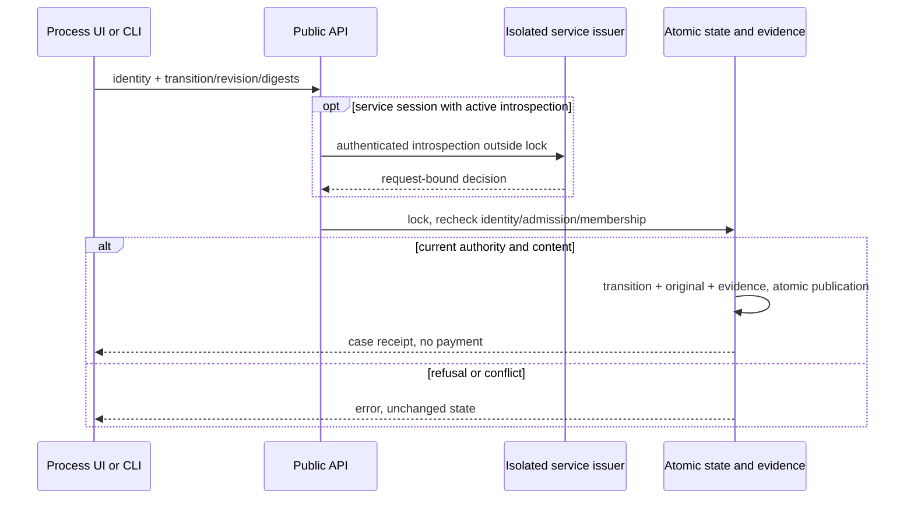

# Business processes — local definitions and cases

This first slice tracks cases against a published definition. A case approval
never creates a payment approval or a T2 commitment. Identity, data admission,
atomic publication and evidence use the shared engine. `processes.html` has its
own journey and independent frontend build.

## Configuration and publication

**Identity** accepts an existing local credential, kept only in page memory.
The operator session cookie and CSRF protection remain required. This local
entry does not replace the SSO journey. An I3 administrator uses **Admin** to
preview and save `process_policy:{"enabled":true}` and the data policy. The
boolean is strict, initially disabled; omission in the general configuration
preserves it. Expected configuration revisions prevent stale writes. Changes
invalidate federated sessions and mandates of the previous revision, while
history and committed effects remain preserved.

T4 admission must be active and allow the exact path
`local-process-state / swarm / process-workflow`, a `public` or `internal`
classification, and an explicitly classified resource:

```json
{"enabled":true,"classifications":["internal"],"destinations":["local-process-state"],"providers":["swarm"],"tools":["process-workflow"],"resources":[{"resource":"invoice/acme","classification":"internal"}]}
```

Resource identifiers are opaque, not filesystem paths. Documents, secrets,
URLs, executables and sensitive data are outside this slice. Available local
paths cannot be mixed: simulated settlement retains its own exact tool and
destination checks.

A definition has `schema_version:1`, `id`, `label:{fr,en}`, `start`,
`nodes:[{id,label,terminal}]` and
`transitions:[{id,from,to,label,kind,roles,minimum_integrity}]`.
Publication by I3 includes `expected_version` (0 initially) and a reason.
Versions and their canonical digests are immutable. Every node is reachable
and has a normal path to a terminal node. Normal cycles are rejected; an
explicit exception edge may reopen a case.

- `advance` requires a locally authorized role and positive minimum integrity.
- `approval` requires an I2 approver, an explicit reason and separation from the
  requester when the shared policy requires it.
- `exception` requires an I3 administrator, an explicit reason and a published edge.

Caller-provided actor, role, scripts or arbitrary jumps never grant authority.
External permissions remain subject to the existing local identity rules.

## Case lifecycle and recovery

A requester creates a case against the explicitly selected latest version,
with active local I2 participants, resource, title, business reference and exact
T4 context. The server assigns owner and identifier. Input content,
participants and version are immutable and digest-bound in this slice.
Publishing v2 never moves a v1 case.

A transition supplies `event_id`, case identifier, expected revision, definition
and input digests, and a named edge. Under the shared lock, the engine checks
identity, membership, local roles/integrity, source, separation and data policy.
Two concurrent transitions on the same revision have one winner. Stale content
requires reloading and confirming again. Refusals capture no original or new
evidence. Exact replay returns the historical result after checking current
authority and admission; reusing an event with different content is rejected.

The inbox includes only cases available to the owner, authorized participants
or an I3 administrator. Withdrawal of policy makes content unavailable.
Attributed history and shared evidence export retain actor, identity context,
transition, reason and digests. Restart reloads definitions and progress from
the same atomic state without replaying a payment.

## API, CLI and independent frontend

`GET /api/v1/processes` reads the inbox; `POST ?action=OPERATION` accepts a JSON
object. The CLI `process` namespace exposes `show`, `policy-preview`,
`policy-apply`, `definition-preview`, `definition-publish`, `case-create`,
`case-show` and `case-transition`. Except for `show`, supply `--input FILE|-`.
`case-show` accepts only `case_id`; mutations add `schema_version:1` and `event_id`.

```sh
swarm --server http://127.0.0.1:PORT --json process show
swarm --server http://127.0.0.1:PORT --json process definition-preview --input definition.json
swarm --server http://127.0.0.1:PORT --json process case-show --input case.json
npm run build:processes -- /tmp/swarm-process-app
```

The remote client uses `SWARM_WEB_SESSION` and `SWARM_TRUST_TOKEN`. A remote
failure never falls back to a local root. Without `--server`, the same public
operations use the selected local root. Service introspection runs outside the
business lock; current authority and freshness are revalidated under it.

The artifact contains only the Process entry, its code/style and local shared
theme/i18n assets. No Project screen or script is imported. Serve it together
with `/api/v1/session` and `/api/v1/processes` on the same origin under the
existing operator guard. Building alone configures neither cross-origin SSO
nor external deployment.

Exposed technical bounds are a 1 MiB command, 8 MiB shared state, and integer
versions/revisions exactly representable by the browser. Consumption is shown
separately. There is no implicit business cutoff or purge. Errors
`authorization_required`, `revision_conflict` and `event_conflict` leave state
unchanged. Correct authority/policy or reload the content before confirming;
unavailability is never converted into a successful empty result.

Isolated recipe:

```sh
go test -race -count=1 -run '^TestActionsConfianceT5' -v ./internal/engine
node tests/actions_confiance_process_ui.cjs BIN /tmp/swarm-process-recipe
python3 tests/actions_confiance_t5.py --criterion 0 --root . --timeout-seconds 120 --binary BIN --evidence-dir /tmp/swarm-process-public
```

T2 effect linkage, version retirement/migration and full R15 qualification are
future extensions. Local evidence does not constitute independent acceptance
or global release qualification.


