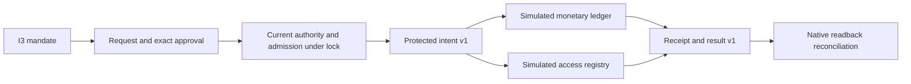

# Durable evidence — signatures, checkpoints and local archives

This slice adds a public key registry and Ed25519 anchors for pilot v2 exports.
Historical evidence, original bytes, HMAC anchors and their verifier are preserved.
It includes two simulated connectors. Third-party immutable storage and global
R16–R19 qualification remain outside this local delivery. Actual local qualification comes from
the verification receipt, not this document alone.

## Key protection and lifecycle

An I3 administrator enables the policy in **Admin — Public signing**.
`evidence_signing` contains strict boolean `enabled` and positive integer
`key_ttl_seconds`. Defaults are disabled and86400seconds; zero, null, fractions
and missing fields are refused even when disabled. The `time.Duration`
representation bound is exposed through `policy_bounds`; no other lifetime is
hidden. Preview leaves state unchanged. Saving and reopening retain effective
values. Omitting the block from general configuration preserves it. As with other
policies, a new configuration revision invalidates previous sessions/mandates and
private runtime material; history and committed effects remain preserved.

**Prepare a key** generates private material only in protected memory of the
persistent server. This new contract imports no private key and stores none on
disk. The registry retains public key, identifier/digest, proposer, validity period
and configuration revision. One live candidate waits for its second administrator;
there is no hidden candidate queue.

**Activate proposed key** requires a different I3 administrator, exact key digest
and expected registry revision. The previous active key becomes retired.
**Revocation** by I3 is immediate, attributed and reasoned, even with the
signing policy disabled: compromise withdrawal
never waits for a second approval. Retirement and revocation are distinct.
Expired, revoked, unavailable or differently configured keys cannot sign.
Restart preserves the public registry but loses private material; another
preparation/activation restores signing. This public flow never falls back to an
old private key or the legacy HMAC.

File permissions alone do not isolate the same UID. Server memory is non-dumpable;
swap, privileged tracing and arbitrary providers remain outside qualification.
The registry is not a hardware vault.

## Anchors and verification

The operator confirms the exact key/registry revision and final sequence/digest.
A schema3 public anchor signs the fixed `swarm-public-evidence-anchor-v1` domain,
key/revisions, sequence/digest, timestamp and canonical digest of the full v2
export. A response contains `export` and `anchor`. Original bytes are preserved;
export hashing uses canonical Go producer JSON, regardless of display whitespace.

The verifier requires a separately supplied `trusted_key` in addition to export
and anchor. Acquire and retain this pin through a trusted channel independent
of the file being verified. An export never supplies its own trust root.
Separately reading a fixture registry is not a production third-party attestation.

Verification checks signature, bound context/digest, originals, ordering and
completeness below the known anchor. A retired pin permits historical verification
within its validity period; a revoked pin refuses acceptance. An old offline pin
does not learn a revocation automatically: refresh its trust source according to
the operator procedure. Historical cryptographic validity does not establish
current trust in a compromised key.

The implementation uses installed Go1.24 standard-library Ed25519, compatible
with [RFC8032](https://www.rfc-editor.org/rfc/rfc8032), without a new dependency.
The [Go interface](https://pkg.go.dev/crypto/ed25519) does not imply a project
toolchain upgrade.

## Public API and CLI

`GET /api/v1/trust-evidence` exposes policy, revisions, public keys, memory
availability and latest sequence/digest. Other operations are POSTs with
`?action=policy-preview|policy-apply|key-prepare|key-activate|key-revoke|anchor|verify`.
Existing operator-cookie, Host, Origin and CSRF guards remain required. Key and
anchor operations require an authenticated I3 administrator, including service
introspection outside the lock when applicable. Public verification uses only
public data and does not require a private key.

```sh
swarm --server http://127.0.0.1:PORT --json evidence show
swarm --server http://127.0.0.1:PORT --json evidence key-prepare --input preparation.json
swarm --server http://127.0.0.1:PORT --json evidence key-activate --input activation.json
swarm --server http://127.0.0.1:PORT --json evidence anchor --input anchor.json
swarm --json evidence verify --input verification.json
```

The remote client uses `SWARM_WEB_SESSION` and `SWARM_TRUST_TOKEN`, never credential
URLs or business arguments. Remote failure never falls back to a local root.
Local verification is pure and does not resolve `--root`. Mutations include
`schema_version:1`, `event_id`, reason and expected revision. Key preparation,
activation and revocation use `expected_registry_revision`; the latter two also
supply `key_id` and `key_digest`. Anchoring supplies `key_id`,
`expected_registry_revision`, `expected_sequence`, `expected_hash`. Policy updates
use `expected_revision` and `policy`.

Exact replay retains its historical receipt without new generation/activation.
Read current status after response loss: an old activation receipt does not prove
that a key remains active or available. `revision_conflict` requires reloading and
confirming; `event_conflict` rejects changed content under the same event.
`authorization_required` rejects invalid authority, state, availability or content.
`operation_pending` reports a live candidate. Emergency withdrawal never erases
committed effects or historical evidence.

Metadata commands have a technical 1 MiB bound; verification input has the same
16 MiB transport bound as the CLI, allowing the shared 8 MiB state export plus
its envelope. These exposed limits are separate from key lifetime policy. There
is no silent truncation or purge.

Isolated recipes without a provider or payment:

```sh
go test -race -count=1 -run '^TestActionsConfianceT6(Evidence|Archive)' -v ./internal/engine
python3 tests/actions_confiance_evidence.py --binary BIN --evidence-dir /tmp/swarm-evidence-public
node tests/actions_confiance_evidence_ui.cjs BIN /tmp/swarm-evidence-ui
```

Signing an anchor does not make every log immutable or every effect mandatorily
signed. The local mechanisms below do not demonstrate third-party immutable storage
or global qualification. Recipes and self-review
are not independent acceptance.

## Comparison against an independent witness checkpoint

A valid signature alone also accepts an older valid export. To detect rollback,
`verify` accepts `trusted_checkpoint`:

```json
{"export":{},"anchor":{},"trusted_key":{},
 "trusted_checkpoint":{"anchor":{},"trusted_key":{}}}
```

Replace empty objects with actual values. Acquire the checkpoint anchor and pin
through a trusted path separate from the candidate bundle, and keep them in a
separate operator-controlled location. The recipe
`tests/actions_confiance_evidence.py --checkpoint --binary BIN --evidence-dir DIR`
uses separate directories and reloads the witness file. A checkpoint may come
from an earlier `evidence anchor` call and a separately read registry; never
automatically take it from the file being checked.

The verifier checks checkpoint signature and key lifecycle, sequence, prefix hash
and canonical digest of the corresponding originals. An extension may use another
explicitly trusted key, but must preserve the known prefix exactly. Older signed
exports, divergent histories and invalid checkpoints fail without writes. Results
include `checkpoint_verified:true`, `checkpoint_sequence` and `checkpoint_hash`.
Without a checkpoint, `checkpoint_verified:false` explicitly identifies signature
verification alone. Null or incomplete checkpoint inputs are rejected.

The FR/EN verification dialog has a separate optional checkpoint field. API and
CLI share validation, including verification without a local root. Reopening a
file does not renew its authority: old pins do not learn revocations automatically.
Independent acquisition and storage belong to the operator; the same UID can
still modify its files. This is neither third-party time nor physically immutable
storage nor an external witness service. Archival and minimum protection are described below.

## Local archives and minimum protection period

`archive-preview` and `archive-create` accept `schema_version:1`, `event_id`,
`expected_revision`, `expected_sequence`, `expected_hash`, `anchor` and `reason`.
The anchor must sign an exact prefix of current history; its key is resolved
from the managed registry rather than imported from the requester. Each copy
contains export v2, exact originals, anchor and public key at archival time.
Its identifier is the SHA-256 of its JSON bytes, published without replacement
in `.swarm/trust-archives`. Preview creates no directory, file or receipt.

`archive-show` takes `archive_id` and checks a private regular non-symlink file,
hash, signature and originals before returning it. Current key status is separate:
an archived pin does not learn subsequent revocations. Historical reads do not
establish current signature acceptance. Storage is not isolated from a hostile
same UID; comparison against an independently held checkpoint remains necessary.

The existing pilot Admin `evidence_retention_days` setting (integer days ≥1,
default365, zero rejected) means **minimum** protection from copy creation.
Creation time and period persist; later reductions do not shorten existing holds.
Elapsed whole days are compared without overflowing multiplication, including
the pilot's exposed technical maximum. No maximum retention or automatic purge
is promised.

`archive-release` requires `schema_version:1`, `event_id`, `expected_revision`,
`archive_id` and reason. Current I3 Admin authority is required; release before
the boundary is denied, and later release is attributed. **Release deletes
nothing**: copy, originals, chain and receipts remain. There is no deletion
operation in this contract. `protected` remains true until explicit release;
`minimum_retention_satisfied` separately reports expiry of the minimum hold.
Physical deletion is outside this slice. The Admin duration persists and reopens through the existing pilot settings modal; archive status shows the effective period.

A crash after file publication but before its receipt may leave an orphan copy.
The same authenticated command adopts only identical bytes without replacement.
Creation replay checks file integrity again: missing or altered copies never
become successful empty responses. Directory descriptors and non-symlink opens
protect path handling. The archive technical size bound matches public evidence
verification (16MiB). All paths require I3 Admin and normal operator/CSRF guards.

The fixed R17 corpus is documented in [Laboratory](actions-confiance-laboratoire.md). Results remain simulated; unrelated providers do not become confined.

## Simulated connectors and effect boundary v1

`trust show` exposes a closed `connector_catalog`: two version-1 local
implementations supporting idempotency and readback. They provide no external
effect, provider containment or secret grant. Client-supplied plugins, commands,
paths, URLs and capability claims are not loaded.

Historical settlements use `local-ledger-simulation`. Omitting `connector`
preserves their representation and digests. An explicit selection is part of the
approved content and must be repeated exactly. `local-access-simulation` writes a
distinct `access_ledger`; it changes no real identity, role or ACL. This models a
sensitive effect in simulation, rather than qualifying a sensitive provider.

Include this selection in the mandate, request and exact approval:

```json
{"connector":{"id":"local-access-simulation","version":1,
  "access":{"subject":"employee","role":"reader"}}}
```

An I3 administrator issues a mandate for `actions:["grant-access"]`, the exact
resource and these parameters. Monetary amount, ceiling, currency and beneficiary
must be zero/empty. Its designated requester creates the action; a separate
approver repeats the mandate, digest and selection; the I2 `effect` service
commits it. Operations remain `trust mandate-create/request/approve/commit/reconcile`
through CLI, API or `trust --server`. The **Simulated connectors** card offers the
access workflow with an explicit identity for each operation.

An enabled data policy must classify and allow the exact resource and tuple
`local-access-state / swarm / simulated-access-grant`, public or internal only.
Settlement retains `local-ledger / swarm / simulated-settlement`. Mixing these
paths refuses before retaining the original. Delegated mandates preserve the
same exact selection throughout their chain.

The common boundary produces `effect-intent-v1`: identifier, action and mandate
digests, approval hashes, connector/version, resource, canonical parameters,
idempotency key and mandate deadline. Current authority, admission and approval
are checked under the business lock. Public `effect_receipts` include this intent
and `effect-result-v1`: stable receipt, state, timestamps, native result digest,
reconciliation requirement and diagnostic. These results are not third-party
signatures.

A lost response yields `unknown`. Another commit does not repeat the effect.
`reconcile` checks the connector's single native entry and digest before confirming;
a missing, altered or incompatible entry cannot return success. Idempotency keys
share one domain across implementations: switching connector cannot reuse a key
with different content. Reopening and reconciliation preserve committed effects
even after mandate revocation. There is no new timeout or budget policy; existing
reconciliation settings still apply.

Public recipes: `tests/actions_confiance_connectors.py` and
`tests/actions_confiance_connectors_ui.cjs`, using an explicitly supplied binary
and isolated fixture roots. Local results do not establish independent acceptance
or release qualification.



The approval form serializes amounts from the server's exact decimal text rather
than a JavaScript Number, including values above 2^53. The representation bound
is int64, not an additional monetary policy. Access parameters remain separate.

## Contextual matrix R19

The [control mappings and limits](actions-confiance-referentiels.md) link twelve
selected controls to historical evidence and relevant source inputs. Validation is
read-only and product loading is explicit. Local tests establish no certification,
global compliance or independent assessment.

## Contexts in new evidence records

New records carry `policy_context` version1: configuration revision, core policy and effective execution controls, without credentials, tokens or secret material. Commit and reconciliation records also carry `effect_receipt` version1: connector, intent, result and exact native observation. Event hashes cover these immutable snapshots; existing schema2 exports and anchors cover them. Reconciliation never rewrites an earlier observation. Historical receipts lacking intent are explicitly marked `legacy_receipt`, without inventing a past intent.

The shared guard verifies originals, ordering, previous hashes, record hashes and context links before a new mutation; the SPI boundary checks this too. An inconsistent chain refuses without a new effect. An already recorded historical reply remains readable under fresh identity and authority, without mutation or a claim that the chain is intact: replay creates no event. Older records without these fields retain their hash preimage and verification; historical records are not recomputed.

New proof validation links results to canonical native observation digests and intents to prior mandates and approvals, preserving captured effective policies. Evidence UI transport, export and pasted verification preserve signed integers beyond Number precision. Browsers missing exact JSON primitives explicitly refuse that flow and point to the CLI. No business policy or limit is added.
