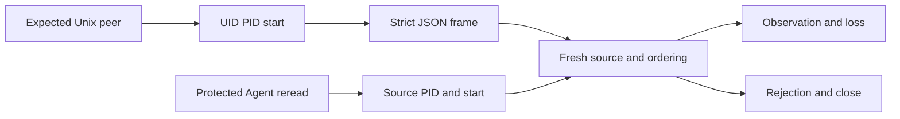

# T7 — internal observation receiver contract

R20 remains open: the explicit collector below has no positive kernel qualification yet.
The local probe observed `BPF_MAP_CREATE: EPERM`, without attachment or collection.
Receiver tests use owned fixture processes and messages.

## Implemented boundary

`internal/engine/kernel_observation_linux.go` defines a local source derived
from an active `Agent`: agent, mission, task, attempt, PID, process start, host
and SHA-256 resource digest. The registry factory derives the digest from registered inputs; neither the public client nor the collector supplies it. Each descendant needs its own trusted
registration; a parent PID alone grants no observation authority.

`kernel_observation_transport_linux.go` authenticates a Unix connection using
`SO_PEERCRED`: expected UID and PID, followed by process-start validation through
`/proc/PID/stat`. Parsing uses the final closing parenthesis of the process name.
Read errors and terminal identities fail closed; an error does not establish
process disappearance. Identity is checked before and after reading, and a fresh
source is required before accepting an event. The explicit launcher uses the live-registry factory and exposes no event injection endpoint.

This diagram describes internal receiver checks; the explicit launcher and backend are described below.

Credentials identify the process at connection time, as documented in
[unix(7)](https://man7.org/linux/man-pages/man7/unix.7.html). They prove neither
kernel origin nor the absence of subsequent descriptor transfer. The fixed collector described below controls its descriptors and executable.

## `kernel-observation-v1` frame

One UTF-8 JSON object per line. All fields are required; unknown, null and
duplicate fields are rejected. The transport bound is 16,384 bytes per object,
excluding the line separator, rather than an observation budget. No raw path,
content, command or secret is accepted.

| Field | Representation and validation |
| --- | --- |
| `collector_boot_id` | 16 lowercase hexadecimal bytes expected by the launcher |
| `sequence`, `ktime_ns`, `cgroup_id`, `lost_before` | uint64 canonical decimal strings; zero allowed only for cgroup/loss |
| `event_type` | `process`, `file` or `network` |
| `pid`, `parent_pid` | integers; positive PID, nonnegative parent |
| `pid_start_time` | positive canonical decimal `/proc` start ticks |
| `mission_id`, `task_id`, `attempt_id` | exact protected-source values |
| `resource_digest` | exact protected-source SHA-256 |
| `probe_set` | closed contract `swarm-minimal-v1`, no arbitrary selection |

The first sequence is `1 + lost_before`; subsequent sequences equal
`previous + 1 + lost_before`. Replay, unexplained gaps, overflow and clock
regression fail without advancing counters. Total loss is explicit. A receive
error closes the connection and marks disconnection. EOF, an empty stream or
loss-free transport never proves complete coverage: `complete` stays false.
The owner cancels a pending read by closing its connection. This internal
contract introduces no new business timeout.

## Internal Linux amd64 backend

`kernel_backend_linux_amd64.go` generates three fixed TracePoint programs:
`sched/sched_process_fork`, `syscalls/sys_enter_openat` and
`syscalls/sys_enter_connect`. They describe process creation, an open attempt
and a connection attempt; they do not establish successful completion. No
syscall argument, path, content or network address is read.

The native backend uses cilium/ebpf v0.19.0, whose
[official module](https://github.com/cilium/ebpf/blob/v0.19.0/go.mod) is compatible
with the project's Go and x/sys versions. No client-supplied ELF, program,
command or probe is accepted. No external compiler or service is required.

The perf descriptor targets only the registered main thread, without inheritance.
A second TGID/TID filter precedes maps and emission. The gate stays inactive
while acquiring resources; the source and pidfd are checked again before
activation. Other threads and descendants are outside scope. This primitive
is neither a public launcher nor a general provider collector.

Ring capacity is an explicit argument: uint32 bytes, a power of two no smaller
than an OS page. This is a representation constraint, with no implicit default
or business budget. The [kernel ring buffer contract](https://docs.kernel.org/bpf/ringbuf.html)
allows emission failure; separate atomic counters retain attempts, emissions
and losses, including final losses without a following event. The reader
rejects invalid sample sizes, PIDs, categories and clocks.

`Stop` disables the gate and perf events. Final statistics require a stopped
backend and reject inconsistent counters; the owner must stop the fixture and
drain records before deciding its verdict. `Close` releases acquired resources
in reverse order, including after partial failure. Cleanup errors remain visible.
No pin, memlock, sysctl or Linux capability change is introduced. Instruction
generation and checks outside the kernel do not establish BPF verifier approval.

## Public diagnostic on an owned fixture

`trust kernel-check` and `POST /api/v1/trust-actions?action=kernel-check` accept
only `{}`. A current I3 administrator is required; the API retains operator
session and CSRF protection. The remote client uses `--server
http://127.0.0.1:PORT`, `SWARM_WEB_SESSION` and `SWARM_TRUST_TOKEN`. No caller PID,
agent, path, command, URL, ELF or probe selection is accepted.

Admin persists `kernel_check:{enabled,timeout_seconds,ring_bytes}`. Defaults:
disabled, 15 seconds and 65,536 bytes. Internal fields are explicit and non-null;
zero is rejected even when disabled. The timeout is a positive integer
representable as a Go duration; the ring is a power of two between one OS page
and 2^31 bytes. Technical bounds appear in `policy_bounds`. Omitting the block
preserves the policy. Preview starts nothing. There is no retry, polling or
provider budget; each synchronous call has the configured timeout and creates
its own fixture.

The parent runs only its fixed executable, with pipe bootstrap, minimal LANG/TZ
environment and a Unix ready/run/done protocol. UID, PID, start time and nonce
are checked. The helper closes foreign non-CLOEXEC descriptors, becomes
non-dumpable and applies no_new_privs; Go's internal descriptors remain private.
Its main thread creates a public file, attempts a Unix connection to the parent
control socket and starts only the same executable in immediate-exit mode. Only
that main thread is targeted, without descendant inheritance. Diagnostic/nonce
attribution does not identify an existing business mission.

Execution and waiting occur outside the business lock. Identity, policy and
revision are checked again before returning. Busy lock, withdrawal, expiry or
reconfiguration reject the result. Cancellation/timeout terminate the group;
parent-thread death kills the helper. The parent waits for its child and removes
its temporary root. Abrupt crashes can leave an orphan temporary directory; no
global cleanup is performed. Cleanup failures forbid positive verdicts.

The response includes effective policy, availability, scope, owned PID,
minimized events, losses, cleanup, revision and fixture verdict.
`global_qualification` stays false. Unavailability is an HTTP200 diagnostic
result with `available:false`; both local and remote CLIs print it and exit3.
Available but incomplete results also exit3. Authority refusal exits4; invalid
input exits2. Protocol/interruption failures never become empty successes.
IPC has a 16,384-byte JSON-object bound: overflow rejects the result rather than
truncating events or creating a positive verdict.

The current environment refuses ring creation with EPERM before program/perf
acquisition. No kernel event is qualified. The library's memlock suggestion is
not an established cause. No privilege, sysctl or memlock change is automatic.
A positive fixture verdict requires all three categories, consistent ordering,
zero loss and cleanup; it qualifies neither business agents, other threads,
descendants nor providers.

Recipes: `tests/actions_confiance_kernel.py --binary BINARY --evidence-dir DIRECTORY`
expects this environment's explicit unavailability;
`tests/actions_confiance_kernel_ui.cjs BINARY DIRECTORY` checks Admin and FR/EN
rendering. Recipe watchdogs are separate from product policy. Go tests named
`TestKernelCheck*` cover parent death, cancellation and empty-positive rejection.
R20 remains open: authorized business-attempt integration, positive kernel
observation, foreign exclusion, real losses and measured overhead still require
an authorized capable environment. No global observation is implicit.

## Internal source derived from the attempt registry

`kernel_attempt_source_linux.go` derives a source without a caller-supplied
digest. One SQL read joins agent, work and pause state. SQL `status`/`desired`
columns override the JSON body; agent/work/task identities must match registry
keys. The task must be `running`, with its latest attempt `recorded` and no
`ended` value. Live PID, start time and host are checked. Pause, stop,
replacement, read errors and inconsistent identity reject the source.

The `swarm-registered-attempt-input-v1` digest binds identifiers, provider, role,
SHA-256 of the registered prompt and registered command/arguments/directory,
plus context/workflow digests when present. Heartbeat/progress do not change
it; registered input changes do. No raw input is returned. It does not establish
the effective executable image, launcher argument adaptations or file contents.
Interactive mode is rejected within this scope.

`newKernelAttemptReceiver` binds the owned peer/nonce and re-reads this source
after I/O before accepting each frame. Withdrawal while waiting prevents return,
marks disconnection and leaves counters unchanged. The SQL read is a freshness
point, not instantaneous kernel notification; the receiver alone does not stop
an attached probe. Tests named `TestKernelAttempt*` use isolated registration,
owned Unix messages and an actual owned fixture process launched then stopped.
These messages are not eBPF events. The factory is internal; there is no injection
endpoint or automatic activation. The explicit collector and policy are described below; the positive real-kernel recipe remains open. The public diagnostic still targets only its own fixture.

## Explicit observation of a registered session

`trust kernel-observe --input '{"agent_id":"SESSION_IDENTIFIER"}'` and
POST `/api/v1/trust-actions?action=kernel-observe` accept only a Swarm identifier
for an active agent in the current project. I3 business authority and, for HTTP,
the operator session and CSRF remain required. No client PID, digest, path,
command, ELF or URL is accepted. The authenticated local `trust --server`
client shares this contract. The interface provides explicit start and cancel;
there is no automatic observation or new mission.

Admin persists `kernel_observation`: `enabled`, `window_seconds`,
`timeout_seconds`, `ring_bytes`, `max_events`. Defaults: disabled, 5 s window,
15 s total timeout, 65,536-byte ring, 128 returned events. Internal fields are
explicit, positive and non-null even when disabled; omitting the block preserves
it. The window must be shorter than the total timeout. Ring: power of two between
an OS page and 2^31; representable durations and event integer bounds are exposed
in `policy_bounds`. Observed consumption is separate. No polling or retry.

The parent rereads authority, revision and registry source before launch,
before arming, for each event and on return. The fixed helper receives policy
and attribution only, without business or provider tokens. Its running image
is opened through `/proc/self/exe` and executed by descriptor; minimal environment
and foreign descriptors are controlled. Unix binds protocol, nonce, UID/PID/start.
Waiting occurs outside the business lock. Changed source, stop, pause, revision,
expired authority or control failure rejects the result. Cancellation and total
timeout close the group; parent death kills the child.

The result separates `attempts`, `emitted`, `kernel_lost` and `omitted` as uint64
decimal strings. `omitted` counts emissions not returned after the window or
limit; no silent truncation. A quiet window may return zero events without
claiming full coverage. Scope: `registered_main_thread`, `complete:false`,
`global_qualification:false`. Results are returned by the call; this slice adds
no durable observation journal. Unavailability returns `available:false`, no
events and CLI code 3; failed cleanup rejects that verdict. Protocol fixtures
are not kernel observations. Positive kernel execution, real foreign exclusion,
recovery and overhead remain unqualified until the environment permits BPF.
No Linux privilege is added.
