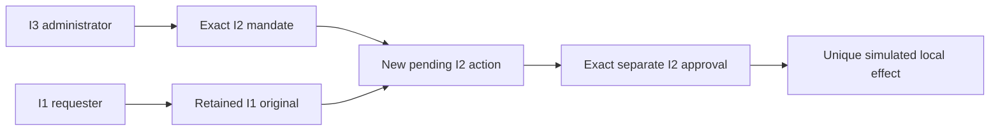

# Biba and trusted actions in Rust

Biba is Swarm’s reference integrity rule. Mermaid diagrams, trust boundaries,
storage contracts and remaining integration gaps are documented in the
[Rust technical architecture](BIBA-RUST.md).

The Rust engine provides the local trusted-actions core through the CLI and
`/trust-actions.html`. Verification and delivery status are retained in the
[BIBA-RUST plan](../plans/migration-rust/PLAN.md). This does not apply Biba to every
Rust mission and is not Linux access control. Effects are strictly simulated.

The 27 October correction in progress applies read mediation to business replies
and replays: an authorized subject receives the I2 object; otherwise the named
`trust-status-ack-v1` procedure returns only `schema_version`, `kind`, `object_id`,
`state`, `content_redacted:true`. This bounds status and identifier; it neither
relabels the object nor grants authority. Effects and evidence remain retained.
Code presence does not establish verification or installation; see the current plan.

## Authority and workflow

The shared monitor uses I0–I3: read requires subject level ≤ object level;
write/invoke require subject level ≥ target level. Configurable local identities
are I1–I3. Unknown tokens never authorize business commands. Caller-supplied
`actor` and `integrity` confer no authority.

Admission is an explicit trusted procedure: an I3 administrator admits a **new**
I2 mandate. An authenticated request within its terms creates a pending I2
object. The original I1 bytes and digest remain intact; the I1 subject is never
promoted. An I2 approver confirms the exact content before an I2 effect service
may commit it. With separation enabled, requester and approver must differ.



CLI bearer: `SWARM_TRUST_TOKEN`; API bearer: `Authorization: Bearer …`. Only its
digest persists. The page keeps the token in memory. Configuration is a local
operator operation; HTTP additionally requires the native session, Host/Origin
and CSRF. It is never authorized by a client level claim. `show`, `export` and
`anchor` are operator audit views; `read-object`/`read-original` are business
reads gated by the strict Biba monitor, including no-read-down.

After initial setup of an unconfigured root, HTTP `config-preview` and
`config-apply`, including replays, require a current I3 identity with the `admin`
role, checked under the Trust lock (shared for preview, exclusive for apply). Cookie alone, I1/I2 or a suspended
identity cannot reconfigure. The modal has a separate Admin token field, cleared
on close. Local CLI remains an owning operator initialization/recovery path,
not delegation to an agent with Root access. Other operator routes and global
isolation are not qualified by this increment.

Unported advanced blocks cannot be edited: null/omission preserve them, and an
existing inactive block may only be resubmitted with identical compact bytes.
Unknown fields, wrong types, misspelled activation and duplicate policy keys
refuse. This compatibility shape check does not port all Go validators/consumers.

## Public contract

The page links to **PAEA checks**, the file-correspondence tool described in the
[PAEA contract](PAEA-CONTRACT.md). Execute and Save use the shared semantic action
foreground/background pair in both themes. Contrast checks await actual CSS
transition completion and sample normal, hover and keyboard-focus states.
`trust-primary-ux.json` exercises real workspace assets with read/preview doubles;
it applies no configuration and does not prove binary-served asset bytes.
See the [record](plans/actions-confiance/paea/INCREMENT-13.md).

```sh
./swarm --root ROOT --json trust show
./swarm --root ROOT --json trust config-preview --input configuration.json
./swarm --root ROOT --json trust config-apply --input configuration.json
./swarm --root ROOT --json trust request --input request.json
```

Configuration supplies `schema_version:1`, `event_id`, `expected_revision`,
`reason`, all four `policy` fields, and every `identity`: `subject`, `token`,
`integrity`, `roles`, optional `disabled`. Roles: `admin`, `requester`, `approver`,
`effect`. Tokens need at least 16 bytes, no whitespace or example placeholder.
Admin previews without applying, then saves and reads back. Tokens are never
read back. The input includes all identities rather than silently retaining
omitted credentials.

| Persisted policy | Default | Zero / technical bound |
| --- | --- | --- |
| `mandate_ttl_seconds` | 3600 s | 0 no default expiry; max 9223372036 s |
| `unknown_reconcile_seconds` | 0 s | 0 immediate; same maximum |
| `evidence_retention_days` | 365 days | min 1; max 9007199254740991 |
| `require_separation` | true | explicit boolean |

Missing fields, null, fractions and out-of-range values refuse. Retention is
recorded, without automatic purge in this core. `show.policy_bounds` exposes
technical formats: state 8 MiB, commands 16 MiB, proof key 32 bytes. These are
representation limits, not business budgets.

`mandate-create` binds subject, actions (`settle`/`grant-access`), resource,
parameters, dates and revision. `request` remains within those terms. `approve`
supplies `action_id`, mandate, digest and every exact parameter; `commit` and
`reconcile` address the protected action. Default connector:
`local-ledger-simulation`. The second, `local-access-simulation` version 1,
accepts `connector.access:{subject,role}` and changes only the simulated access
ledger, never real permissions. Selection is bound to the mandate and approval;
no arbitrary plugin, program or network destination is accepted. The page guides
settlement; the second connector uses CLI/API.

`POST /api/v1/trust-actions?action=OPERATION` shares engine validation;
`GET /api/v1/trust-actions` reads the audit. Read POSTs use `{}`. Historical CLI
remote mode `--server` is not ported here: use local CLI or the protected API,
without fallback to another root.

## Bell-LaPadula confidentiality — policy administration, no runtime control

A Bell-LaPadula confidentiality policy (ordered level + compartments, separate
from Biba integrity) is prepared through the Trust page Admin dialog and the
following operations. **Actual status: administration and diagnostics only.**
No project content is classified and no execution is mediated:
`runtime_enforced:false` and `runtime_authorized:false` are kept in every
response and the interface states it. Do not read them as active protection.

```sh
./swarm --root ROOT --json trust blp-show
./swarm --root ROOT --json trust blp-policy-preview --input policy.json
./swarm --root ROOT --json trust blp-policy-apply --input policy.json
./swarm --root ROOT --json trust blp-check --input diagnostic.json
./swarm --root ROOT --json trust blp-object-attribute --input attribution.json
```

- `blp-show` (read): persisted state, revisioned history and capability.
  Requires a current I3/admin token like every administration operation.
- `blp-policy-preview` (read): validates a complete proposal (`schema_version`,
  `event_id`, `expected_revision`, `expected_trust_revision`, `reason`, `policy`
  with operator-defined `public`→`restricted` levels, compartments and
  clearances). No mutation.
- `blp-policy-apply` (write): revisioned application with attributed evidence;
  a recorded `event_id` replays the retained reply without mutation. A trust
  policy change stales the history: an explicit renewal is required
  (`authority_current:false` signals it).
- `blp-check` (read): diagnostic on **supplied** labels — never a real object
  attribution. Returns the join/refusal and computed output classification,
  without content or third-party labels. `runtime_authorized:false` is NEVER a
  read authorization.
- `blp-object-attribute` (write): current attribution of a classification to
  exact canonical bytes (`canonical_digest` sha256 of the `paea-json-v1` bytes,
  absolute `project_path`, current policy and trust revisions required) by an
  I3/admin operator whose clearance DOMINATES the attributed label
  (`check_read`). Persisted in the revisioned history and RE-READ at every
  consumption; a revision change refuses it (`blp-policy-changed`) until
  re-attribution. It is not a declassification nor a read right: it records the
  classification that authorized control binds to the bytes.

**Reader frontier (PAEA preview/presentation)**: `GET
/api/v1/paea/git-call/preview` and
`GET /api/v1/paea/git-call/approval/presentation` serve a projection containing
classified fields only to a reader authorized by the `paea_reader_verdict`
guard: a valid-shape `Bearer` token, a current policy bound to the Trust
revision, a current attribution of the exact bytes, a dominating clearance.
A policy, attribution or clearance failure keeps the reply
`200 {available:false, reason:paea-reader-*}` with no classified byte —
payload, identifier, digest, error, header, log — even for an enrolled
top-of-catalog reader; an unknown token or a disabled identity instead produces
the typed `authorization_required` refusal (non-success status, 403), also
carrying no classified byte. A bare session stays `200 {available:false,
reason:paea-reader-authentication-required}`: a bare session and enrollment are
never an implicit authorization. `SourceRefJSON` labels and the browser cookie are not
authoritative. A bound-source absence is still answered before the guard (no
classified field exists then). The positive reply carries
`runtime_enforced:false`: prompt-side byte provenance remains the other
actor's open work. The public approval form (`web/paea-approval-form.js`)
connects to this frontier without bypassing it: an ephemeral "Reader token"
input is read at call time, carried as `Authorization: Bearer` on the guarded
read only, then cleared on EVERY exit of the load — success, HTTP or network
error, unbound capability, refused presentation, malformed reply (no storage,
URL or log); `paea-reader-*` refusals stay visible with their exact code and
the "Re-read the presentation" button re-reads the same endpoint after the
credential is corrected; the input carries NO frontend maximum-length cutoff
(the producer-side `credential_valid` shape check enforces a 16-byte minimum,
forbidden whitespace and reserved prefixes, with no maximum — an arbitrary cap
would reject valid tokens; too-short shapes are refused server-side with the
exact typed verdict, never pre-cut); the approval POST stays enrollment-only
(distinct password, never reinterpreted as clearance).

**Reader frontier of the PA-09 reconciliation (`GET|HEAD
/api/v1/paea/reconcile-effects`)**: the reconciliation report is classified —
its findings carry durable effect identifiers (`intent_id`, `action_digest`) —
and the session alone never authorizes it. Three ordered gates: (1) BEFORE any
Root open/settings read/ledger IO, a session without a reader credential
receives the typed 403 refusal carrying ONLY
`paea-reader-authentication-required` (HEAD: empty body); (2) AFTER the service
Root is opened (read-only) and STILL BEFORE any settings read, ledger open or
journal read, a PRESENT credential is decided by the engine's shared identity
precheck (`RootStore::paea_reader_identity_precheck`) against the service
Root's CURRENT trust state: an unknown or disabled token receives the typed
`authorization_required` refusal (403; no settings, ledger or reconciliation
state or error reaches it); an absent trust journal refuses
`paea-reader-policy-required`; a recognized credential proceeds; (3) after the
reconciliation, the current reader verdict (`paea_reader_verdict`) is
evaluated on the exact digest of the report bytes before anything is returned —
it RE-authenticates the credential on a FRESH read of the current state (never
a cached precheck identity) and enforces policy currency, attribution and
clearance; stale policy → `paea-reader-policy-stale`, missing attribution →
`paea-reader-attribution-required`, insufficient clearance →
`paea-reader-access-denied`, all typed 403 refusals without a report byte. No
gate mutates, journals or yields a partial report; recovery goes through the
public operations (policy re-application, re-attribution). Kept counter-example
and fix (2026-11-02, `glm-reconcile-auth-fix-20261102T093323Z`): before this
precheck, a PRESENT but UNKNOWN token observed the ledger-side business error
(409 `paea-effect-reconcile-separate-ledger-required`) instead of the identity
refusal — the exact test
`reconcile_effects_unknown_token_refused_identity_before_ledger_error` (red
reproduced then green, GET+HEAD+non-mutation executed) fixes the contract.
The approval form's real-browser qualification (`tests/paea-approval-form-ui.cjs`)
also affirms this first gate from real Chrome: every page load's bare
reconcile read is classified exactly there (GET method, exact URL, 403,
confirmed body carrying the exact code on both `error` and `failure.code`),
with the observed coded refusals kept verbatim in the proof JSON; the former
HTTP 500 expectation (ledger precondition) is removed there as unreachable
behind this gate.

**Form reception and wiring of the wrong physical root regression
(4 November 2026)**: the supervisor's personal reception
(`glm-approval-observation-completion-20261104T042459Z/supervisor-reception.json`)
— the permanent form recipe
`tools/verification/recipes/paea-approval-form-rust.json` ran run 0/verify 0,
eleven stable steps; real browser: four FR/EN flows without unexpected
diagnostics, four GET 403 refusals carrying the exact reader code kept in
proof; three named HTTP tests of the approval channel then pass on the same
stable test artifact (`bf775a5b…`, a TEST profile distinct from production
331), each 1 PASS exit 0: agreement captured on the project, wrong role then
legitimate recovery, wrong physical root. This last regression
`approval_route_wrong_physical_project_root_refuses_without_effects`
(`rust/crates/swarm-web/tests/paea_git_call.rs`) is now retained by the
permanent recipe
`tools/verification/recipes/paea-git-call-approval-rust.json` — ONE step added
after the positive journey, before the wrong-role step, the eight other steps
and their order unchanged (GLM edit; the run/verify of the fresh recipe
remains for Codex to execute): a same-family approval preparation whose
physical witness targets ANOTHER really distinct project root (never a copy)
refuses the bind typed `trust-enrollment-root` without capturing an agreement
or consuming an effect — the projectA/serviceA Trust stores and the REAL
projectB's, managed refs, the explicit target-ref absence and both services'
effect journals stay byte-identical, no agreement anywhere. No human
Authority approval or enrollment (requested 3 November 2026, never repeated
or bypassed), no OS/protected-services separation, no independent E3, no
global PA00–13/RETEX acceptance is established by these test-profile proofs.

**PA-09 native positive reader witness (real qualified binary)**: this contract
is also proven on the real native ELF by the integration test
`reconcile_effects_native_binary_positive_reader_frontier_empty_ledger`
(`rust/crates/swarm-web/tests/paea_reconcile.rs`, marked `#[ignore]` so the six
default tests stay untouched). It REFUSES a missing qualified binary passed
through the documented `SWARM_ENGINE_BINARY` environment (no hash hardcoded in
the repository; targeted run `cargo test -p swarm-web --test paea_reconcile
reconcile_effects_native_binary_positive_reader_frontier_empty_ledger --
--ignored --exact`, exactly one test executed). The witness starts the real
binary on the configured service Root (port 0, parsed JSON bind event,
really-generated web-session secret read at bind, `/proc/pid/exe` digest equal
to the provided binary's), on two really distinct private fixture roots whose
reconciliation ledger stays explicitly uninitialized, then chains: bare 403
`paea-reader-authentication-required`, known fixture reader before attribution
403 `paea-reader-attribution-required`, public attribution of the exact report
produced by `paea_reconcile_effect_journals`, positive 200 read serving the
expected bytes (empty-body 200 HEAD), unknown 403 `authorization_required`,
recovery 200; the FULL four-file snapshot is compared after EVERY read phase
(pre-attribution refusals included, attribution = the single intentional
public write between two baselines); the two `state.db` files stay
byte-identical across the whole read sequence and the trust journals only move
across the setup's own explicit writes. The child is stopped through a kernel-owned signal channel: a pidfd opened on
the child process identity, with a fallback to the numeric pid of the single
owned, not-yet-reaped child only if `pidfd_open` itself fails (no reusable pid
can then be targeted, the reap is kept in every case, a refused signal is never
masked, never SIGKILL) and asserts the real native shutdown contract: exit 0
and the last stdout line = the `web-stopped` stop-record, with stdout fully
drained AND retained after the bind event. The witness settings request reuses
VERBATIM the revision shown by `engine-settings show`: the `SettingCount`
contract (`rust/crates/swarm-engine/src/engine_settings.rs`) requires a
canonical nonnegative decimal STRING (numbers are refused), so
`expected_revision` is that string itself, never converted to a number — a
numeric conversion produced a schema-invalid request refused as
`settings-request-invalid`. Conservation of the child's raw outputs is carried by the REQUIRED
`SWARM_PAEA_NATIVE_EVIDENCE_DIR` variable: without it the witness refuses to
run (no PASS without retained evidence), with an already-existing path the
reuse is refused BEFORE the spawn (no write, no overwrite of prior evidence),
and the directory is exclusively created 0700 FROM BIRTH
(`DirBuilderExt::mode`, never a 0755-then-chmod window; no ancestor created,
a concurrently created foreign directory can neither be claimed nor
re-permissioned). The test durably conserves the EXACT native stdout/stderr
bytes (`stdout.log`/`stderr.log`: the raw buffer is NEVER searched or
truncated by content — child text resembling a drain annotation stays in the
raw stream), drain failures in producer-side separate states
(`drain-stdout.errors.log`/`drain-stderr.errors.log`, empty on the success
path — any nonempty state there is a hard failure), the REAL exit status
(`exit.json` read from the shared observed-exit slot; `"observed": false`
when the child could not be reaped — never a faked success) and the
binary/argv identity (`spawn.json`, no secret or cookie), on success AND
failure, every file through an exclusive-create 0600 write (private
`.name.partial` temporary, file fsync, EXCLUSIVE `hard_link` publication — an
existing name is never overwritten, a symlink never followed — then
directory fsync and temporary removal; a partial write keeps the original
published file and its cause). On failure, the failure witness reaps the OWN
child through the process-owner Drop (declaration order: the raw witness is
created BEFORE the listener, so the listener drops BEFORE the witness — the
reap records the real exit in the shared slot), joins both drains to EOF
(the pipes close at child death, no blocking), then conserves the COMPLETE
streams and the real exit — the same artifacts as success; if a helper
failed before capture started (e.g. a readiness failure), the witness
conserves what exists and declares the exact frontier (an unwired buffer
means nothing is claimed for that stream), never a full capture that did not
happen. No textual wait, no watchdog, never SIGKILL. On failure, a witness
also prints the retained raw bytes (limit: bytes emitted before the stdout
reader is attached — the pre-announcement window — are outside test capture
and are not claimed). No secret
byte is ever published on those native streams (`web-bound`/`web-outcome`/
`web-stopped` only; the session secret lives only in its file).
The witness's REAL failure path is made exercisable by an EXPLICITLY
TEST-ONLY fault mode owned by this integration test (never the product, the
ELF or any authority): the `SWARM_PAEA_NATIVE_WITNESS_FAULT` variable —
absent = nominal path above, unchanged; the single accepted value
`after-bare-refusal` delivers the `PAEA_NATIVE_EXPECTED_WITNESS_FAILURE`
marker panic after the bare-403 GET+HEAD control and the pre-attribution
refusal snapshot S1 (listener still alive, no report byte served), to
exercise the listener Drop then the witness Drop (graceful SIGINT reap,
drain joins to EOF, complete conservation of the same artifacts); any other
value is refused BEFORE any evidence reservation or spawn; no watchdog,
timer or retry is involved. Evidence for this mode: ACQUIRED — the
supervisor's control run observed the expected 1 FAILED (exit 101) with the
complete retained artifacts (raw stdout/stderr, drain states, real exit,
clean child reap observed). This mode's contract therefore has THREE
outcomes: nominal (variable absent), armed fault `after-bare-refusal`
(expected 1 FAILED, retained artifacts = evidence), invalid value refused
before any spawn. A second, independent TEST-ONLY mode adds the POSITIVE
browser witness: the `SWARM_PAEA_NATIVE_BROWSER_WITNESS` variable — absent
= nominal path unchanged (no browser); the single accepted value `1` = ONE
real headless-browser pass
(`tests/paea_reconcile_native_reader_ui.cjs`, Puppeteer via the same real
install path as `tests/paea_effects_ui.cjs`/`tests/paea_reconcile_reader_ui.cjs`)
against the ALREADY-CONFIGURED native listener, launched after the public
attribution and BEFORE the SIGINT stop; any other value is refused BEFORE
any evidence reservation or spawn — this mode too has THREE outcomes:
nominal (absent), armed witness `1`, invalid value refused before spawn.
The script receives the address, the generated session cookie, the fixture
reader token, a synthetic unknown token, the expected report and its digest
over PRIVATE STDIN JSON (never argv, never a log); a write/flush failure of
that stdin does NOT kill the script: the pipe is closed (EOF), its outputs
and real exit status are collected and conserved first, and only then is
the failure reported with the original IO cause plus the observed exit
(the input is validated BEFORE any browser launches, so no orphan window);
its stdout, stderr and real exit status are conserved as 0600 artifacts of
the evidence directory,
together with a fresh exclusive 0700 subfolder
(`browser-witness-<timestamp>-<suffix>` — never reused, never /tmp) holding
its named assertions and screenshots (never secrets); a nonzero exit fails
the native test, whose unwinding conserves the real native cleanup (graceful
SIGINT + reap, drain joins, raw conservation); the owned browser is closed
by the script's own finally block, event-driven with no global timer and no
arbitrary delay. Real browser assertions: protected effects page served by
the REAL ELF; typed bare refusal with no report byte; fixture token via the
dedicated field + re-read => 200, settlement/git `uninitialized` states
really rendered in the DOM + exact raw JSON, secret field purged; unknown
403 `authorization_required` on the SAME page that just displayed a success
(the purge is thereby proven after a really displayed report, never on a
virgin context) removing ALL report DOM/raw, field purged; exact recovery
200 on that same page; the witness's request ledger retains only the
boolean classification of Authorization headers (presence, Bearer shape,
recognized reader token, known unknown token) — never a value, not even in
a private 0600 artifact, and no post-leak sanitizer exists (the producer
never emits values); FR/EN, etat/sombre, 390/1280 (two justified
combinations), keyboard focus, no console error and no unclassified
network, credentials only on the reconcile GET, no POST and no write from
the browser. The EN capture is taken TWICE: sombre BEFORE the theme toggle,
then etat AFTER it. Evidence for this mode: ACQUIRED on 2026-11-03 on the
qualified ELF (sha e2f0039a…, supervised run: exactly 1 native PASS, Node
exit 0, 14 named checks, 0 unexpected diagnostics, 4 typed 403 refusals, 7
reconcile GETs, classification booleans only, same-page purge after a
visible success, personal visual review of the FR/EN screenshots); the
permanent requalification recipes are
`tools/verification/recipes/paea-native-reader-ui.json` (empty scope,
historical) and
`tools/verification/recipes/paea-native-reader-ui-nonempty.json` (nonempty
scope, distinct id `paea-native-reader-ui-nonempty`, same schema,
environment and i18n check, the same wrapper invoked with
`--report-scope nonempty` requiring marker
`PAEA_NATIVE_READER_UI_NONEMPTY_VERIFIED 14`; execution UNVERIFIED until
Codex personally runs it) (wrapper
`tests/paea_reconcile_native_reader_ui_recipe.py`, managed binary
`{root}/bin/swarm`, evidence parent `{root}/.cache`, explicit report scope
`--report-scope empty|nonempty` (default empty: historically qualified
empty contract unchanged, marker `PAEA_NATIVE_READER_UI_VERIFIED 14`;
nonempty: the dedicated native test
`reconcile_effects_native_binary_positive_reader_frontier_nonempty_ledger`,
kind `paea-native-reader-ui-nonempty-v1`, distinct marker
`PAEA_NATIVE_READER_UI_NONEMPTY_VERIFIED 14`, qualifying the really
rendered settlement finding, the same-page purge of the previously rendered
real identifiers and the identical recovery; an invalid value is refused by
argparse before any directory allocation or cargo spawn); the wrapper runs
`cargo test --manifest-path rust/Cargo.toml --offline
--locked -p swarm-web --test paea_reconcile <test> -- --ignored --exact
--nocapture` with a dedicated CARGO_TARGET_DIR, debug=0, INCREMENTAL=0,
provides SWARM_ENGINE_BINARY and SWARM_PAEA_NATIVE_BROWSER_WITNESS=1, does
NOT create the SWARM_PAEA_NATIVE_EVIDENCE_DIR directory (the Rust `from_env`
requires it nonexistent, exclusive create), conserves the real
stdout/stderr/returncode before any qualification, refuses treating the real
`9 filtered out` as an anomaly, and verifies the two children's artifacts
SEPARATELY at the evidence-dir level: the BROWSER exit metadata
(browser-witness.exit.json, run_dir = the OUTER Rust
browser-witness-<time>-<suffix> dir) and the RUST exit (exit.json + stdout.log
web-bound -> web-stopped last line + empty drain sidecars, the
browser-witness.json living in the nested JS subdirectory); a recipe run is
neither independent review nor global acceptance).
Three opt-in memory guards (`#[ignore]`, no process, no write) exercise the
shared producer loop `drain_to_end`: the raw buffer keeps ALL child bytes
even when the child itself emits the text `\n[stdout drain error:` /
`\n[stderr drain error:` (split across read chunks, non-UTF-8 byte, trailing
line without newline), and a real read error goes ONLY to the separate state
(never into the raw buffer) — the error/content separation is proven on the
real producer code, not a copy.
Only `NotFound`
is an authorized absence for a trust journal (any other error is a hard
failure, never masked). Explicit partial scope: empty report only for the
native test above (the TEST-ONLY browser witness, opt-in
`SWARM_PAEA_NATIVE_BROWSER_WITNESS=1`, exercises the same empty-report scope
on the real rendered page). The native non-empty contract now exists as a
separate dedicated test,
`reconcile_effects_native_binary_positive_reader_frontier_nonempty_ledger`
(same qualified ELF binary via `SWARM_ENGINE_BINARY`, same fresh
out-of-/tmp `SWARM_PAEA_NATIVE_EVIDENCE_DIR` contract): against a REALLY
populated ledger — one settlement effect produced BEFORE any baseline and
before the child through the same public producers (`work.create`,
`config-apply`, `scope_of`, `seed_settlement_effect` on a third private
project root kept open as the work store, the service and ledger staying
two distinct roots) — the test first applies the TEST-ONLY browser-witness
gate under the EXACT contract of the empty sibling (no value is ever
silently ignored): variable absent => the received API-only non-empty
sequence runs UNCHANGED; exact value `1` => ONE real browser witness
(Chromium, shared script `tests/paea_reconcile_native_reader_ui.cjs` in its
CONSISTENT non-empty variant, distinct kind
`paea-native-reader-ui-nonempty-v1`, `report_scope: "nonempty"` metadata,
14 explicit non-empty check names for the mode-specific assertions) runs
between the recovery and the SIGINT stop with the EXACT attributed
non-empty report — the script derives its render model from the report
itself (never invented JSON) and asserts the REAL product render (consistent
settlement sentence, real finding line with the served `intent_id`/
`action_digest`, same-page purge of the previously rendered REAL identifiers
at the unknown refusal then identical recovery); any other value is refused
BEFORE any evidence reservation or spawn, then the test runs the full API
sequence over the NON-EMPTY report:
bare typed 403 with no report byte, known reader before attribution typed
403, the expected report computed by the real public producer
(`paea_reconcile_effect_journals`, settlement destructured as
`Consistent{effect_count:1}` with the finding `verified`, git explicitly
`Uninitialized`, canonical `encode_model` encoding digested in the same
domain as the route), attribution via `blp-object-attribute` on the SERVICE
root with that digest, positive GET 200 with served bytes exactly equal and
fields asserted from the real model (`settlement.state == "consistent"`,
`effectCount == 1`, real `intent_id`/`action_digest`, `verified == true`,
`git.state == "uninitialized"`), empty-200 HEAD, unknown credential typed
403 with no real identifier or state disclosed, recovery 200 with the same
exact bytes, optional browser witness (GET only, between two snapshot
comparisons), SIGINT stop (exit 0, last stdout line `web-stopped`), complete
raw child-output conservation and the four-file witness re-checked after
every read phase. The browser non-empty witness, NOT TESTED at the original lot, is now
backed by a supervisor personal run on pinned ELF320 (fbf41a82…): BOTH
browser witnesses (empty and nonempty) and their exact native tests really
pass (14 named checks each, real settlement finding 1, same-page purge of
the REAL identifiers then identical recovery, Node and native exit 0;
receipt conserved in lot glm-pa09-scope-wrapper-20261103T110700Z);
accordingly the permanent wrapper
`tests/paea_reconcile_native_reader_ui_recipe.py` carries
`--report-scope empty|nonempty` (default empty) and qualifies each scope
through its own kind, exact native test and named-check inventory; the
permanent nonempty recipe JSON now exists
(`tools/verification/recipes/paea-native-reader-ui-nonempty.json`, distinct
id, nonempty marker required) and its execution remains UNVERIFIED until
Codex personally runs it; the wrapper scope increment was personally
received by the supervisor on the pinned actually-active ELF322 (3146c837…)
— both scopes pass, an invalid value exits 2 before any output allocation,
and the retained witnesses refuse the crossed scope (receipt
supervisor-wrapper-receipt.json, lot glm-pa09-scope-wrapper-20261103T110700Z).
The test remains exact `#[ignore]` (never run by
default; opt-in executions only) and the fixture identities remain an
explicit same-UID simulation, never a claimed human enrollment, OS
confinement or acceptance.

**Minimal startup observations (cookie-only status routes)**: `GET
/api/v1/paea/git-call` and `GET /api/v1/paea/git-call/approval` serve ONLY the
`bound` boolean and literal protocol constants (`schema_version`, `event`)
behind the ordinary session; the `capability` field stays `Null` whenever the
source is bound. NO value derived from the prepared request passes — not the
digests, and not the selected `call`/`service`/`operation` either: a closed
vocabulary does not make the value selected by a classified action constant,
and creates no declassification right (BLP-RET-05). HEAD serves an empty body.
The exact metadata stays readable only through the guarded routes (preview and
presentation) under the current reader verdict. The consuming pages
(`web/paea-effects.js`, `web/paea-consent.js`, `web/paea-approval-form.js`)
render this explicit state (never a blank line nor an unknown-shaped value)
and treat a non-null `capability` as an out-of-contract report that visibly
stops the load (`paea-status-out-of-contract` on the form). The consent page
(`web/paea-consent.html`, `web/paea-consent.js`) connects its classified read
to the same frontier without bypassing it: the exact digest and bound operation
pass only through the guarded presentation read and the preview, with the same
ephemeral reader token read at call time, carried as `Authorization: Bearer` on
those reads only and erased on EVERY exit of the load (no storage, URL or log);
a `paea-reader-*` refusal keeps its exact code visible, the "Relire la
présentation" control re-reads the same endpoints after correcting the
credential, and the consent form stays reachable (enrollment authority is never
reinterpreted as read clearance — the out-of-band digest comparison remains the
operator's decision). Every preview exit also renders a typed terminal state on
the approval status: an unavailable or refused preview is never left "in
flight", and the success wording is only set when the exact frozen-command
metadata is actually displayed. A guarded read that THROWS (HTTP 403,
transport, unreadable JSON) renders the same typed refusal pair as the
`available:false` verdict: a `paea-reader-*` refusal stays an `empty` state
carrying the exact code, any other error raises a visible `error` state —
and every load first purges ALL previous exact projections (presentation and
preview lists, the POST result containers) so no value from an earlier
success survives under a refusal or "no data displayed" wording (defect
reproduced then fixed on 2026-11-01: an HTTP 403 re-read after an authorized
read left both previous digests in the DOM; maintained counterexample
`tests/paea-consent-projection-erasure.cjs`, 11 checks on the real page in
real Chrome, red then green runs retained in the evidence dossier). The
`paea-consent-ui-rust` real-browser qualification now resolves the exact test
binary from the Cargo artifact stream (`cargo test --no-run
--message-format=json`, linked tool `bind_cargo_test_binary.py` +
counter-proofs `test_bind_cargo_test_binary.py`) — no more `rm` purge, no
glob, no global watchdog in the driver, whose two raw channels are streamed
and awaited to their real exits. Driver failure/flush contract (maintained
counterexamples `tests/paea_consent_driver_control.py`, 16 checks over 8
variants, red measured on the 2026-11-01 declared-inputs snapshot then green):
every streamer of BOTH children is tracked and joined after their real exits;
a Rust failure while the harness runs fails immediately without waiting on a
live child; the INVERSE fault is covered symmetrically (2026-11-01): a harness
failure while Rust still waits on the phase marker kills live Rust BEFORE any
wait (the harness primary cause is decided before the kill, so a -9 never
masks it), meaning no wait() ever targets a live child on a failure path in
EITHER direction; cleanup
kills only the two owned Popen children; the verdict requires each channel's
EOF marker (partial flush refused) and refuses any PASS without the complete
raw channel. The counter-proof
`status_does_not_discriminate_two_prepared_intentions` shows that two distinct
prepared intentions produce byte-identical replies on these routes.

**Reconciliation report mobile rendering (PA-09)**: the finding rows of both
lists (`#settlement-findings li`, `#git-findings li` in `web/paea.css`) now
wrap anywhere (`overflow-wrap:anywhere`) instead of overflowing the card and
the viewport. Real defect reproduced then conserved (native browser witness,
receipt
`glm-pa09-nonempty-overflow-guard-20261103T052147Z/supervisor-receipt.json`):
on the real page served by the qualified ELF, in EN/390/sombre, the document
overflowed by 260 px (scrollWidth 650 vs innerWidth 390) and the finding row
by 306 px (564 vs 258 available) — the long canonical `intent`/`effect`
digests were clipped at the right edge while the 14 functional checks
passed; the earlier overflow assertion only covered the page BEFORE the
populated report, hence the named post-positive and post-recovery guard
(numeric metrics only, private screenshot before the failure) delivered in
the previous lot. The fix is generic on the real textbox contract: full
wrapping of the identifiers, NO truncation, ellipsis, mask or scrollbar; the
DOM and the technical report keep the exact integral bytes (no product JS
changed), FR/EN, both themes and the semantic tokens stay unchanged.
Recovery path: the supervisor validation run expects the guard green at
both real boundaries (fr/1280 and en/390) with still exactly 14 named
checks, then the empty canonical regression (shared script); no global
acceptance is claimed by this lot.

Each clearance names an existing, non-disabled identity subject; unknown
subjects refuse. The catalog cannot remove or reorder existing levels: that
would relabel history. No declassification exists: a summary, an empty output
or LLM filtering is not one. Cross-cutting protection (classification of real
content, file/network/provider monitors, exact human declassification) remains
open; tracked in [BLP-APEX](../plans/actions-confiance/BLP-APEX.md).

## Refusals, recovery and evidence

`direct-write`, `elevate` and `elevate-integrity` deny bypasses. Business denials
return `state:denied`, retain attributed evidence and leave mandates/actions/
effects unchanged. Schema/authority/conflict failures remain errors: CLI 2,
identity 4, revision/event/idempotency conflicts 3; HTTP 400/403/409 by cause.
An active unported policy refuses explicitly, never falling back to static
identities. Stopping federation does not turn mapped principals into local ones.

**Mandate delegation (ported, 4 November 2026)** — the `delegation` block
(`max_depth`, explicit integer ≥ 0; null, string, fraction, boolean, negative
refuse) is admitted in configuration and carried through the full flow: a
`mandate-create` child with `parent_mandate_id` requires an I3 administrator,
records the parent's identity and current digest, caps the default expiry at the
parent's, then derives the admission chain before insertion — cycle, altered
digest, absent identity, depth ceiling (each link counts), absent/revoked/
inactive/expired/stale-revision parent, stale parent digest and any widening
(amount, resource, currency, beneficiary, actions, window, subject, parent)
refuse with the historical Go reasons, without mutation and with retained
evidence. The same chain re-runs at the `approve`/`commit` boundaries: an
ancestor revocation blocks with « mandat parent révoqué ». The public projection
reports each mandate's effective status (`mandate_status`) and propagates a
stored-state technical error typed. The historical root digest (no connector, no
ancestry) is pinned by a unit test:
`17749c31acf37938ebabe43b794adf5726fbc565905e6c0eb059afdae9ab5ad3`. Mirror
regression of the Go contract:
`rust/crates/swarm-engine/tests/trust_delegation.rs` (10 tests, isolated roots in
`.swarm-fixtures/trust-delegation/`, never `/tmp`). Still closed: remote A2A
creation and `data_context` — any command carrying them keeps refusing.

**Delegated-mandate audience (local T14 D3 subset, 8 November 2026)** — a
mandate's named subject is its use-side audience: an enrolled peer other than
the subject replaying the delegated mandate is refused at read admission with
the historical typed reason « mauvais sujet » (`trust_actions.go:1020`, mirror
`trust/operations.rs`), before any effect and without mutation; the legitimate
audience peer keeps the full `request`→`approve`→`commit` flow and replay. The
recipe
`rust/crates/swarm-engine/tests/trust_delegation.rs::delegation_audience_binds_mandate_to_named_subject`
pins this refusal on both the child and the root mandate (10/10 green, isolated
roots). Networked A2A reception (verification on arrival, typed `a2a-*` code,
linked receipts) stays open, blocked on human enrollment IA3 and real G1
integration — the reception must reuse this refusal, not invent a second one.

**Data context / provenance (ported, 5 November 2026)** — the `data_policy`
block (classified resources, explicit
`classifications`/`destinations`/`providers`/`tools` lists, `enabled` flag) is
admitted in configuration and carried through the full flow, mirroring
`trust_data_policy.go`: typed validation refuses null lists, unknown/duplicate
values and invalid resource rules (historical `format` family, never
`authorization_required`, which stays reserved for admission refusals); the
configuration preview projects the effective policy (supplied or stored,
defaulted when absent) without mutation. Admission follows the exact Go
order — replay, proof, then `data_policy::admission`, then the target
action's stored-context re-admission, then the connector: only `request` may
carry a typed `data_context` (classification/destination/provider/tool,
explicit fields), an active policy requires the exact classified path
(catalogued resource, `public|internal` classification, connector-fixed
destination and tool — `local-access-simulation` derives
`local-access-state`/`simulated-access-grant`, otherwise
`local-ledger`/`simulated-settlement`, provider `swarm`); `approve`/`commit`
re-admit the stored context, `reconcile` deliberately does not (recovery
preserved after narrowing); the `commit` effect re-checks the stored path at
the effect boundary like `trustConnectorCommit`. Every refusal returns
« authorization_required » with the safe reason « données : contexte ou
chemin non autorisé ; aucune donnée conservée », persisting neither the
context nor any supplied data and leaving state byte-identical (sentinel
test). The `TrustError::Data` variant keeps the historical code for HTTP 403
(web) and CLI exit 4. The action store keeps the typed context (Go field
order): the action digest stays identical for a non-canonical input key
order. Mirror regression of the Go contract:
`rust/crates/swarm-engine/tests/trust_data_policy.rs` (7 tests, isolated roots
in `.swarm-fixtures/trust-data-policy/`, never `/tmp`); permanent recipe
`tools/verification/recipes/trust-data-policy-rust.json`
(`tests/rust_trust_data_policy_unit.py`, retained evidence). Still closed:
remote A2A admission, real tools (simulation only) and
`confidential`/`restricted` classifications in input.

**Versioned project memory (native engine, 5 November 2026)** — the Go
`projectMemoryOperation` cycle is ported into the Rust mutation engine
(`rust/crates/swarm-engine/src/project_memory.rs`, wired in `work_engine.rs`,
preview in `root_store.rs`): `memory.admit`, `memory.replace`,
`memory.withdraw` and `memory.select` decode the canonical request
(schema 1, work and reason required, 1 MiB transport cap, per-action shapes —
selection carries only task/versions/reason, admission accepts no implicit
selection, an explicit empty `selections: []` array passes), then apply under
the mutation transaction. Admission requires a safe identity with no expected
digest, `experience`/`procedure` kind, nonempty content and conditions,
recognizable-secret refusal, a `verifie` RETEX and a rechecked fresh verified
source at apply time (the source task's fresh acceptance through real
lifecycle limits, or a recognized dialogue exchange). Replacement and
withdrawal refuse imports, foreign works, altered/stale versions and double
withdrawal; they replay the active-use inventory (`memoryUses`) for the impact
list. Selection targets a future executing task only (status `todo`, not a
subplanner, not brainstorm), refuses while an active attempt already reserved
the instructions, stamps `memory_selections`/`memory_decision` (event,
operator, reason, environment timestamp), projects the "MÉMOIRE DE PROJET
SÉLECTIONNÉE" block and binds everything to the preview token: an absent or
forged token refuses `project-memory-preview-stale` before commit and the
transaction rolls back. `RootStore::preview_project_memory` replays the same
contract read-only under the settings reservation (token, preview, current
version, context, revision, affected uses). Withdrawal never erases versions:
contexts already received stay attributed; an inventory error is never turned
into an empty catalogue (R3). Conversation lineage is now readable: the
`agentMemoryReferences` port (`project_memory_dialogue.go`) walks the
`dialogue_restore` chain — valid receipts, source decoded and re-checked
against its state digest, root and strictly decreasing turn counts — and feeds
the active-use inventory with ancestor selections (deduplicated by full
reference, the same work/id at two versions still reported twice). Broken
lineages refuse with stable codes (`project-memory-lineage-invalid`,
`-source-inaccessible`, `-source-modified`, `-turns-not-decreasing`,
`-root-mismatch`, `-selected-twice`, `-cyclic`); the cyclic guard remains
defense in depth with no constructible case (each hop covers the next receipt
through its digest and turns strictly decrease), matching the Go test that
asserts refusal only. Still closed in this tranche: the dedicated
HTTP/CLI surface, extractive summarization (M20) and read/summarize/transmit/
compact rights. Evidence:
`rust/crates/swarm-engine/tests/project_memory_engine.rs` (6 tests, isolated
in-memory SQL) and `cargo test -p swarm-engine project_memory --lib`
(11 tests).

**Memory catalog read surface (7 November 2026)** — the Go
`projectMemoryCatalog` (`project_memory_public.go`) port exposes project-memory
catalog consultation on all three surfaces: engine
`rust/crates/swarm-engine/src/memory_catalog.rs` (`memory_catalog` pure
assembly + `memory_catalog_from_connection` transactional read, exported from
`swarm-engine`), HTTP `GET /api/v1/project-memory` (read-only, single `q`
query member required, duplicate or unknown member refuses
`project-memory-query-invalid`) and CLI `swarm-rust memory list --root ROOT
[--json]` (delivery phase, read-only). Go contracts preserved: the query is
folded (`foldDialogue` — lowercase first, accent mappings after, œ→oe) before
filtering **and** returned folded in the response
`{"entries", "method":"literal", "query"}`; an entry carries `ref`, `version`,
`status`, `reason`, `work_revision`, `source_title`, `used_by`; the current
version is `active` ("Version courante ; conditions à revérifier") or
`unavailable` with the exact error text (withdrawn, modified source, import
"Mémoire importée ou d’un autre projet : admission locale requise"), earlier
versions are `historical` ("Version historique, non sélectionnable"); the
filter applies over folded body and conditions; `used_by` lists active uses of
the exact reference. R3 preserved: a row read/decode failure refuses the whole
catalog (never an empty result), retained bytes unchanged. Evidence:
`cargo test -p swarm-engine --lib memory_catalog` (5),
`--test memory_catalog_root` (3, real-root `RootStore::memory_catalog`,
external corruption `{"x":1}` refused with no partial catalog),
`cargo test -p swarm-web --test project_memory` (1, GET/HEAD,
`?q=%C3%89TAPE` folded to `etape`, POST refused, state unchanged),
`cargo test -p swarm-cli --test memory` (4); permanent recipe
`tools/verification/recipes/versioned-memory-catalog-rust.json`.

**HTTP/CLI mutation surface (7 November 2026)** — memory previews and commits
are exposed on both operator surfaces with the Go
`projectMemoryOperation`/`projectMemoryPreview` contract: CLI
`swarm-rust memory admit-preview|admit|replace-preview|replace|
withdraw-preview|withdraw|select-preview|select WORK --root ROOT --input FILE
[--json]` and HTTP `POST /api/v1/project-memory?action=…` (the same eight
actions). The preview (`-preview`) is read-only: proposed version, current
version (replace/withdraw), projected context (selection), affected uses, the
token binding them all, observed revision — it calls the same `next_memory`
candidate builder, so it refuses exactly like the commit
(`project-memory-source-unfresh` on an unfresh source, typed revision
conflict on a changed Work). The commit runs through
`RootStore::execute_external("memory.<action>")` — transaction, replay,
preview-token binding and engine guards identical to the Go `mutateWithHook`
route — and reports the recorded Work state (`Recorded`/
`PlanningStatePreserved`) when an encode/close failure follows the commit.
Selection requires a valid preview token: absent or forged refuses
`preview_stale` before engagement. `summary-source` (M20) stays refused
`project-memory-operation-unported` on both surfaces (CLI usage) — a separate
increment. Evidence: `cargo test -p swarm-cli --test memory` (7: preview+
commit selection on an executing task with the stamped decision, identical
unfresh refusals preview/commit, typed revision conflict, usage refusals),
`cargo test -p swarm-web --test project_memory` (2: POST selection
preview+commit, unfresh refusals preview+commit with no entry added,
`summary-source`/unknown-action refusals, state unchanged). Still closed:
extractive summarization (M20) and read/summarize/transmit/compact rights.

**Extractive summarization M20 (7 November 2026)** — `memorySummarySource`
(`internal/engine/memory_summary_source.go`) is ported to
`rust/crates/swarm-engine/src/memory_summary_source.rs` and served on all
three surfaces. CLI `swarm-rust memory summary-source --root ROOT --input FILE
[--json]` (the body is the request; no positional work argument); HTTP
`POST /api/v1/project-memory?action=summary-source`; engine
`RootStore::memory_summary_source(&[u8])` (read-only open, no settings read).
The Go contract is preserved byte-for-byte: strict decode with the 1 MiB
transport ceiling checked **before** decoding, refusals
`project-summary-source-request-schema-invalid` (schema ≠ 1, revision < 1,
unsafe name, empty dialogues), identity
`project-summary-source-work-identity-mismatch`, conflict
`project-memory-work-changed`, unknown task `project-memory-task-unknown`,
brainstorm task `project-summary-source-brainstorm-target`, duplicated
dialogue `-dialogue-duplicate`, missing exchange `dialogue-exchange-missing`
or empty `-exchange-empty`; HTTP refuses the `GET ?action=summary-source`
pairing with 405 before any decoding (Go ordering). The
`swarm_summary_source_v1` packet embeds the serialized work contract
(`encode_model`, escaping identical to Go `json.Marshal`) as the
`current-task-snapshot` source, then one question (`operator_question`) and
one answer (`historical_answer`) source per dialogue with the id derived from
the digest of the serialized reference; the payload is a **string** carrying
its `sha256` (cross-runtime byte verification against Go is possible).
Evidence: engine `cargo test -p swarm-engine --lib memory_summary_source`
(6: decode/validation refusals, identity/revision/task/brainstorm,
duplicate/missing/empty, exact packet — 5 sources with the snapshot carrying
the contract JSON, derived ids, per-source digest, no exchange moved), CLI
`cargo test -p swarm-cli --test memory` (8: exact packet, brainstorm and
stale-revision refusals through the CLI), web `cargo test -p swarm-web --test
project_memory` (3: POST exact packet without mutation, GET pairing 405);
permanent recipe
`tools/verification/recipes/versioned-memory-catalog-rust.json` (5 steps),
evidence `.swarm-fixtures/versioned-memory-catalog-evidence/run-20261107-4`.
Still closed: read/summarize/transmit/compact rights (M20 operator rights, a
distinct increment).

**M20 extractive consumer (7 November 2026)** — the extractive selection is
now consumed by the launch chain, not only produced.
`memorySummarySelection` (`internal/engine/memory_summary_selection.go`) and
`memorySummaryReceipt` (`internal/engine/memory_summary_receipt.go`) are
ported to `rust/crates/swarm-engine/src/memory_summary_selection.rs` and
wired into the Rust engine. Admission (`memory_summary_attachment` in
`agent_launch.rs`) rebuilds the text **from persisted Work** — never from an
external entry — and refuses reserved branches
(`agent-launch-summary-branch-unported`), an incomplete selection or a
missing `context_hash` outside preview (`agent-launch-summary-selection-
incomplete`, `-context-hash-required`), sources changed since the export
(`agent-launch-summary-sources-changed`, a conflict to re-examine) and an
invalid boundary (`agent-launch-summary-selection-invalid`, chained cause).
The text is appended as the last prompt piece, the receipt stamped into
`context.summary`, and Included/Excluded emptied when it is present; the
queue fields (`queued_revision`, `queued_source_sha256`) follow the stage
revision bump. The before-start check (`checked_memory_summary_receipt` in
`record_permission`, `agent_execution_store.rs`) replays the packet from Work
and refuses an invalid receipt
(`agent-execution-summary-receipt-invalid`), stale sources
(`agent-execution-summary-sources-stale`) or changed sources
(`-sources-changed-before-start`), or a reconstruction failure
(`-reconstruction-failed`) — the provider does not start. Codes travel as
`RootStoreError::Launch(AgentLaunchError)` (the `agent_supervision.rs`
wrapper), not in the `Agent` family. On HTTP, admission codes map to 400
(Refused) / 409 (changed sources), the before-start check maps to 409, and
any other variant/operation combination stays 500
(`rust/crates/swarm-web/src/service.rs`, two guard tests); project memory
errors keep their caller states (`project-memory-refused` 400,
`revision-conflict` 409, `project-memory-missing` 404, Row/Sql 500). No
translation was ported: Go remains the reference. Evidence: engine
`cargo test -p swarm-engine --lib memory_summary` (9: attachment/receipt
construction, invalid-boundary refusals, Go field order) and
`cargo test -p swarm-engine --test agent_launch` (31 including 5
integrations: preview without mutation, admission without `context_hash`,
confirmed receipt, drifted sources, reserved branches), web
`cargo test -p swarm-web --lib` (51 including 2 status-mapping guards).
Permanent recipe
`tools/verification/recipes/versioned-memory-summary-selection-rust.json`
(3 steps), evidence
`.swarm-fixtures/versioned-memory-summary-selection-evidence/run-20261107-1`.
Still closed: read/summarize/transmit/compact rights (M20 operator rights, a
distinct increment).

**M25 usage proposal (8 November 2026)** — the usage binding
`memorySummaryUsageBinding` (`internal/engine/memory_usage_binding.go`) is
ported to `rust/crates/swarm-engine/src/memory_usage_binding.rs`. Construction
is pure: no SQL, no identity evaluation, no reservation, no commitment and no
transmission; the digest binds requests, never rights. It rebuilds the
supported M19 pipeline on the caller-owned Work snapshot, refuses an invalid
caller contract (`memory-usage-binding-invalid`: non-absolute or non-clean
root, Work outside schema 1, unsafe names, missing selection, target task
different from the launch task, scope outside the Work, recipient without an
instance) and invalid sources (`memory-usage-sources-invalid`: duplicate or
unknown received ids, the operator snapshot is never transmissible, non-UTF-8
or digest-divergent text, a received id absent from the selected sources).
The `swarm-memory-usage-v2` projection carries the target (scope, task,
recipient), the packet/selection/attachment digests and one exact source per
selected source (`memory:v2:<digest>` derived from the
`swarm-memory-resource-v2` project/work/task/id/kind/role contract); only
sources marked received carry `transmit`. `requests()` produces per source
`memory.read` and `memory.summarize` (+ `memory.transmit` when received),
bound to the complete proposal digest, with event ids derived from the
`swarm-memory-usage-event-v1` contract; these requests confer no right
without the identity kernel (a protected frame and a fresh caller are IA3
requirements). Canonical Go parity is proven by cross digest: a fixed
projection and one event id hash to the Go program's reference digests
(recorded in the `projection_digest_matches_go_reference` test; the scratch
program lived at `.swarm-fixtures/memory-usage-crosscheck` and is preserved
inside run-20261108-1). No public path consumes the binding — as in Go
(M24/M25, library only): at M25 delivery, `evaluateMemorySummaryUsage`
(`memory_usage_decision.go`) stayed unported pending the identity kernel, and
isolated preparation remained the only supported use. No public activation:
M20-U01 to U10 open, P4 criteria required before any activation. Evidence:
`cargo test -p swarm-engine --lib memory_usage` (6: exact sources and
transmission, content change under the same projection,
destination/selection tracking, rejection without partial result,
request scope/grant/digest binding, Go digest parity), the Go reference
`TestMemoryUsageBinding*` + `TestMemoryUsageRequests*` (32) green as the
parity witness. Permanent recipe
`tools/verification/recipes/versioned-memory-usage-binding-rust.json`
(3 steps), evidence
`.swarm-fixtures/versioned-memory-usage-binding-evidence/run-20261108-1`
(PASS, `verify` → VERIFIED). Still closed: read/summarize/transmit/compact
rights (M20 operator rights, a distinct increment) and any public wiring.

**IA2.2 identity kernel + M25 decision node ported (8 November 2026).** The
pure IA2.2 kernel is ported in
`rust/crates/swarm-engine/src/agent_identity_kernel.rs`: the
Principal/Actor/Grant/Instance/Snapshot/Request/Decision types (canonical Go
encoding, JSON names, omitempty, RFC3339 instants), the
`evaluate_agent_identity` evaluator (clock, request, fresh caller,
independent authority frame, digest-anchored snapshot, parent/child delegation
chain — inherited time bounds, decreasing rights and delegable sets, anchored
root, unrevoked instance — exact rights, aggregate expiry at the minimum),
`reuse_agent_identity_decision` (full re-evaluation then comparison, refusal
`agent-identity-decision-stale`) and `validate_agent_identity_transition`
(revision +1, revocations preserved, history unchanged). Kebab-case
`agent-identity-*` refusal codes mirror Go's snake_case codes. The snapshot
carries `deny_unknown_fields` (mirroring Go's strict decode); the
`Authority`/`Caller` frame is not JSON-deserializable — an import cannot
become its own authority. Ported scope = the pure IA2.2 core
(`agent_identity_contract.go` + `agent_identity_authority.go`, ~520 lines);
JSON admission decode (`decodeAgentIdentityRequest/Snapshot` on the Store
consumer side), Trust resolution (`resolveAgentIdentityCaller`) and the
application consumer stay at the Go/IA2.3-IA3 raccord — the Go tests
exercising Trust (`TestAgentIdentityCaller*`,
`TestAgentIdentityInternalConsumer*`) remain Go-only. Eight kernel tests
ported (18 invalid-authority cases without mutation, re-authentication and
exact replay, snapshot=data-not-imported-authority, tampering without
independent refresh, multilevel delegation revocation, transition with
history and revocation preserved, opaque issuer/subject): 9/9 green.
`evaluateMemorySummaryUsage` is now ported in
`rust/crates/swarm-engine/src/memory_usage_decision.rs`: M25 binding
rebuild, frame project-root and recipient checks, requester + recipient
requests (the `swarm-memory-receive-event-v1` event domain, ids
`memory-receive-<hash>`, one `memory.read` per transmitted source),
aggregate expiry at the minimum of both actors, complete previous-proof
comparison before reuse (`memory-usage-decision-stale`) — no partial verdict
escapes. Five decision tests ported (13+3 decisions, all 19 incomplete
authorities refused without mutation, edited/partial previous proof refused,
rebuild and recheck before reuse): 5/5 green. The M25 binding is unchanged
(6/6). No public path consumes the kernel or the decision (library only, as
in Go); read/summarize/transmit/compact rights stay closed (M20-U01 to U10,
P4 criteria). Permanent recipe
`tools/verification/recipes/versioned-agent-identity-kernel-rust.json`
(4 steps), evidence
`.swarm-fixtures/evidence/run-20261108-identity-kernel` (PASS,
`verify` → VERIFIED).

**Memory-loader inventory (8 November 2026).** The G2 clause "all loaders
inventoried" is verified by construction. In Go, recorded-work reads go
through `internal/engine/memory_work.go` (`scanMemoryWork`, `memoryWork`,
`memoryWorks`, error contexts "Source mémoire" / "Sources du catalogue
mémoire inaccessibles"). In Rust, a single shared reader, `recorded_work.rs`
(`read_recorded_work`, `list_recorded_works`, qualified in R3e), satisfies
all five memory read paths — `memory_catalog.rs`, `memory_files.rs`,
`memory_summary_source.rs`, `memory_summary_selection.rs`,
`memory_usage_binding.rs` (via `summary_sources`) — with no per-path loader
and no inventory-error-to-empty-catalogue transformation (R3).

The historical interprocess flock serializes writes. One idempotency key creates
one native entry; conflicting content refuses. `lose_response:true` records
`unknown` after the simulated effect. Another commit cannot duplicate it;
`reconcile` reads the exact native receipt after the configured delay. Observed
revocation prevents a new effect while preserving already committed effects.
After output/close/transmission failure, inspect state with the same identifier.
`trust_publication` preserves known or uncertain outcomes, never client receipt.

The audit counts missing originals rather than assuming their presence.
Historical state, exact originals, v2 exports and schema1 HMAC anchors remain
compatible. Pure `verify` requires `export`, `anchor`, `verification_key` acquired
separately and opens no root. Never trust a key obtained solely from the export.
Reordering, alteration, anchored omission and receipt/parameter inconsistency
refuse. Key loss closes signing without silent regeneration. A pending Go
initialization is preserved and requires explicit recovery rather than overwrite.

This port does not requalify public signatures, federation, sensitive-data
admission, processes or historical laboratories. Their active policies close
mutations. Private files do not isolate the same UID; evidence establishes no
third-party clock, physical immutability or independent acceptance.

Permanent recipe: `tools/verification/recipes/trust-biba-rust.json`, using
`tests/rust_trust_biba.py` and its browser journey. Historical Go evidence stays
historical; only an executed comparison is attributed to Rust.

Companion permanent recipe: `tools/verification/recipes/preparation-dialogue-history-rust.json`
with `tests/rust_preparation_dialogue.py`. Current contract asserted by its checks:
`prepare dialogue ID` and `GET /api/v1/preparations/dialogue` observe historical
active turns (pending/running/stopping) read-only — exact SQL status served,
private prompt never published, SQL snapshot unchanged, CLI and HTTP 200 equal —
with no stop, adoption, signal or provider call; corrupt rows still refuse
without writing. Only a native envelope bound to another Root refuses
(`preparation-turn-owner-mismatch`), a contract covered by the `preparation_calls`
engine tests and out of scope for this core test. The 3 November 2026 fix
replaces the stale refusal expectation
`preparation-dialogue-active-unported`, obsolete since the limit was lifted;
expected core marker `DIALOGUE_PASS 41` (execution: supervisor, after sources
stabilize).

This recipe's browser journey (`tests/rust_preparation_dialogue_browser.py`)
states its fixture precondition: the private provider configuration is
published empty (`providers{}`, atomic write) at owned-Root birth, before the
HTTP server and the witness state — the shared helper would otherwise write a
CLI-eligible fixture provider, and the product keeps the strict history reader
only with no configured provider. Before any browser, the real public
`/api/v1/preparations/capabilities` endpoint is asserted disabled with no
provider; no interception fabricates this result. The configured-calls journey
remains covered by the `preparation-calls-rust` recipe and is not repeated
here.

Reconciliation of 3 November 2026 for the two preparation recipes
(`preparation-calls-rust.json`, `preparation-legacy-replay-rust.json`) on
their shared engine step `retained-root-faults` (`cargo test --manifest-path
rust/Cargo.toml -p swarm-engine --test preparation_calls -- --nocapture`):
the real assertion inventory — not an operator choice — now carries seven
named guards. The expectation moves from `running 6 tests`/`6 passed` to
`running 7 tests`/`7 passed`; the former name
`legacy_active_replay_remains_explicitly_unported`, carried by no test
anymore, becomes `legacy_active_replay_is_readonly_without_native_authority`
— reading an exact active historical replay is an observation without worker
adoption: dispatch and worker claim refuse
(`preparation-call-private-invalid`), the row and its reserved budget stay
unchanged; and the seventh guard
`confidential_admission_is_fixed_authenticated_and_never_dispatchable` joins
the expectation: fixed-context admission is authenticated, attributed and
re-readable, but it is not a provider send (zero turns, zero reservations,
`runtime_authorized:false`). The five other named guards, the commands, the
environment and the other steps stay unchanged; historical failures and
earlier evidence are kept as-is. Ground-truth witness: the supervisor
control run, seven guards PASS, exit 0 (`supervisor-legacy-marker-control/`
in lot `glm-pa09-nonempty-recipe-manifest-20261103T115459Z`). GLM edits: the
reconciled recipes' execution was UNVERIFIED until Codex personally ran
them (`recipe.py run` then `verify`) — personal receipt since acquired, see
the receipt paragraph below.

Memory-fixture prerequisite wiring, same date: the supervisor's personal run
of the full `preparation-calls-rust` recipe on pinned ELF322 failed at the
first stage, before the browser, on `KeyError: SWARM_PROJECT_MEMORY_SEEDER`
(`tests/rust_project_memory_source.py:26` via `seed_lesson` in
`tests/rust_preparation_calls.py:131`); the original failure is retained (lot
`glm-preparation-legacy-recipe-markers-20261103T120909Z`,
`supervisor-full-recipes/preparation-calls-rust/`). BOTH preparation recipes
therefore gain, before their public journeys, the two already-qualified
prerequisites of the `blp-preparation-provenance-public` recipe, taken
verbatim: the `fixture-placement-guard` test (`cargo test --example
memory_source_fixture`, expecting `explicit_fixture_area_guard_retains_refusals`,
`1 passed; 0 failed` — the guard refuses roots outside the configured area,
nested, wrong-prefixed or live, and any /tmp) and the `fixture-memory-sidecar`
build of the native fixture writer (`cargo build --example
memory_source_fixture`). The environment now carries
`SWARM_PROJECT_MEMORY_SEEDER={root}/.cache/blp-verification-target/debug/examples/memory_source_fixture`
— the actual path produced by those steps — and
`CARGO_TARGET_DIR={root}/.cache/blp-verification-target`, a dedicated test
target consistent with the seeder, distinct from the
`.cache/rust-native-version846-target` production builds; no all-features
flag, no production ELF rebuild or substitution, the source binary remaining
supplied externally through `SWARM_PREPARATION_UI_BINARY`. The actually
consumed fixture source `tests/fixture_area.py` joins the declared
inventory. The seven named guards and every functional assertion stay
unchanged; the test scripts are not modified to skip seeding. Execution of
the rewired recipes: first UNVERIFIED
until Codex personally ran them; since personally received (receipt
paragraph below).

Producer count reconciliation, same date: the supervisor's rewired run
really passed the placement guard (`1 passed; 0 failed`), the sidecar build
(exit 0) and then the full public CLI+HTTP+browser journey (real exit 0: 35
named core assertions, including the `browser-public-journey` check, and
the browser marker `PREPARATION_CALLS_BROWSER_PASS 48`); the recipe aborted
(exit 1) solely on the stale `PREPARATION_CALLS_PASS 34` expectation.
Established cause: the producer `tests/rust_preparation_calls.py` prints
`PREPARATION_CALLS_PASS` followed by the dynamic number of named checks
(line 144); the named `browser-public-journey` check (line 143, inside the
`--browser` journey) raises the real core inventory to 35. BOTH recipes'
expectations therefore move to `PREPARATION_CALLS_PASS 35`; the 48 browser
marker and every other assertion stay unchanged. Retained evidence (pinned
ELF322 3146c837…, lot
`glm-preparation-memory-fixture-wiring-20261103T124003Z`):
`supervisor-full-recipes/preparation-calls-rust/` (`step-0003.stdout`,
`step-0003.json`, `result.json`), `supervisor-next-boundary.json` and the
retained witness `supervisor-retained-calls35`. Earlier historical failures
stay intact; at that stage the recipes were not yet fully verified (the
`transport`, `engine-budget-policy`, `retained-root-faults` stages and the
legacy recipe were not executed in that run) — Codex's personal full runs
have since been received (receipt paragraph below).

Engine filter reconciliation, same date: the supervisor's continued run then
really passed `transport` (4 tests) and the `engine-budget-policy` step
itself (exit 0); the recipe aborted solely on the stale `running 7 tests`/
`7 passed` expectation. Real observed inventory (`step-0005.stdout`, pinned
ELF322 3146c837…): 18 named tests, all PASS, 0 failed, 0 ignored, 735
filtered — the `--lib preparation_call` filter now selects six module
groups: 5 `level_tests`, 2 `cli::level_tests`, 3 `preparation_call_budget`,
4 `engine_settings::preparation_calls`, 2 `legacy`, 2
`confidentiality_tests`. The step's expectation moves to `running 18 tests`/
`18 passed; 0 failed` and now carries the complete named inventory of all 18
tests; commands, environment, prerequisites and other steps stay unchanged.
Evidence retained in lot `glm-preparation-calls-count-20261103T132200Z`
(`step-0005.stdout/.stderr/.json`, `result.json`,
`supervisor-next-boundary.json`); historical failure preserved. At that stage the recipe was
still not fully verified: `retained-root-faults` (7 guards) and the full
legacy recipe remained pending Codex's personal execution — since received
(receipt paragraph below).

Personal receipt of both recipes, same date: Codex personally ran and then
verified the two complete recipes (`recipe.py run` then `verify`, four real
exit codes 0) on the pinned ELF322
3146c83791e9cd5e98f264d3d4af0bdf2fc6ee9fb246d145dcc88fd8c4cc313a, with
stable sources and production. `preparation-calls-rust`, 6 steps: placement
guard 1 PASS, public 35 assertions + browser 48, transport 4, engine 18,
retained-root-faults 7. `preparation-legacy-replay-rust`, 5 steps: guard 1,
public legacy replay 33 — exact terminal replay, preserved event conflicts,
READ-ONLY observation of active pending/running/stopping turns with
reserved/estimated ledgers unchanged, no row or ledger write, no provider
contact — then public 35 + browser 48 and root-faults 7; both `verify`
return `integrity VERIFIED, recorded_status PASS`. Evidence retained outside
the cache, lot `glm-preparation-engine-count-20261103T140800Z`:
`supervisor-receipt.json`,
`supervisor-full-recipes/preparation-calls-rust/result.json`,
`supervisor-full-recipes/preparation-legacy-replay-rust/result.json`,
`supervisor-full-recipes/preparation-calls-rust-verify.stdout`,
`supervisor-full-recipes/preparation-legacy-replay-rust-verify.stdout`,
retained journeys under `supervisor-retained-journeys/`. Receipt scope:
owned inert Roots and a local fake provider; neither global PAEA, human
enrollment, independent review, production confinement nor acceptance of the
protected human version dialogue; the foreign admin JS differs, no
whole-workspace equivalence. The intermediate historical failures of the
earlier lots stay preserved as-is.

The public HTTP classification of the four BF-16a dialogue reader refusals
(`blp-dialogue-authentication-required`, `blp-dialogue-policy-required`,
`blp-dialogue-policy-stale`, `blp-dialogue-access-denied`) is regressed by the
test `service::status_tests::blp_dialogue_reader_refusals_are_forbidden_and_cleanup_stays_server_error`
(`rust/crates/swarm-web/src/service/status_tests.rs`): refusals reach the HTTP
layer wrapped by the dialogue route's real adapter
(`root("preparation-read", …)`, service/preparations.rs), so they are classified
in the `Self::Root{operation,cause}` branch of `status()` — the four exact
codes, under the real `preparation-read` operation and the strict
`RootStoreError::Refused` variant, yield 403 with the stable code preserved. A
close/rollback failure carrying the same refused primary stays 500 in its
`root-cleanup` family with both typed causes retained through the wrapper; the
test really inspects those two causes and also witnesses that the same code
under an unrelated operation and a neighbor code (reconcile family) stay 500:
an internal fault is never disguised as a caller refusal, and the dialogue
contract does not leak outside its gate. Honest limit: this is a pure
conversion regression — no Root/DB/process, not a real GET, no end-to-end
producer coverage (the guard's refusal decisions stay covered by the engine
dialogue tests); execution: supervisor, never the editor. The first personal
execution failed before fixture creation (TypeError: the `digest(path)` helper
received bytes), with raw reception retained; the correction was **RECEIVED**
on 3 November 2026 (true exit 0, 33 named assertions, 136 verified artifact
digests, qualified 322 binary; proof: `paea/evidence/20261028-acquisition81-mvfdts57/
glm-bf16-first-boundary-fix-20261103T175700Z/supervisor-receipt.json`). The
incremental reader-matrix extension over the same actual HTTP flow (bare/
authorized HEAD with empty raw-retained body, exact 403
`authorization_required` for an unknown bearer, exact 403
`blp-dialogue-access-denied` for the known `low` reader, authorized recovery
to the same DTO after each refusal, every read bracketed by the full
snapshots) is authored and remains **UNVERIFIED** pending Codex's new
personal run; the historical failure receipt is kept as is. The first
execution of that matrix ran through the bare HEAD (403, empty raw-retained
body, equal snapshots), then failed on the authorized-recovery oracle: the
predicate wrongly forbade any question/answer byte on an authorized 200 body
— a test-oracle cause, not a product regression. The correction of the four
recovery predicates (HTTP 200 + exact same DTO + full before/after snapshots
+ true absence of the assembled private prompt; the 403 negative controls
keep forbidding all secrets, HEAD unchanged) was **RECEIVED** on 3 November
2026: Codex's personal run, true exit 0, 46 named assertions (26 fixed + 20
dynamic explicit sources), 160 artifact hashes verified, 11 identical full
snapshot pairs, qualified 322 binary; exact observed refusal codes: bare HEAD
403 empty body, authorized HEAD 200 empty body, unknown bearer 403
`authorization_required`, `low` reader 403 `blp-dialogue-access-denied`, the
four authorized recoveries 200 with the exact same DTO and private prompt
absent (proof:
`paea/evidence/20261028-acquisition81-mvfdts57/
glm-bf16-reader-recovery-oracle-20261103T182600Z/supervisor-receipt.json`;
qualification limited to the 322 fixture — the shared 323 server is not
qualified by this proof). The original failure is preserved as is.

The permanent recipe `tools/verification/recipes/blp-dialogue-reader-public.json`
was **RECEIVED** on 3 November 2026: `recipe.py` actually ran and verified it on
BOTH images, the 322 fixture AND the active shared 323 server, each time
run+verify exit 0, 46 named assertions, 0 native output, stable source, 160
artifact hashes, 11 identical full snapshot pairs (proofs:
`paea/evidence/20261028-acquisition81-mvfdts57/
glm-bf16-reader-permanent-recipe-20261103T184100Z/supervisor-receipt.json`;
for 323, Codex's personal qualification in
`glm-bf16-reader-permanent-recipe-20261103T184100Z/supervisor-recipe323/qualification.json`:
active ELF v0.1.1-dev.323 sha `ccef210a…` identical to the executed process,
756 verified archive inputs, 4 core artifacts `features []`/`test false`,
effective inputs unchanged across the build, 323 preserved without any Codex
installation). This proof still covers the script as received at 46 checks; the
"322 only" limitation above is therefore superseded for the recipe by the
two-image coverage. The next frontier, public freshness then recovery, is
authored in the script but remains **UNVERIFIED** pending Codex's personal run
and verification. Still open and outside this recipe: the revocation/
poisoned-capsule matrix, `humanVersion` qualification, global PAEA acceptance.

**UNVERIFIED (pending Codex's personal execution)** — First real HTTP boundary
added: `tests/blp_dialogue_reader_public.py` replays, on one owned Root with an
inert local provider double, a genuinely answered turn through the public
producer (prepare create/budget/send), then bootstraps trust and admits the
same intent through public operations (config-apply, blp-policy-apply,
per-slice attribution, blp-preparation-admit). Before the injection, a bare GET
on `/api/v1/preparations/dialogue` must stay 200 (legacy zero-matched path);
after, the same bare GET refuses 403 `blp-dialogue-authentication-required`
without any private byte, and the cleared reader re-reads 200 the exact same
nonempty answer with the private prompt absent; readonly SQL/journal/capsule
snapshots stay identical around each GET. If the public admission refuses the
existing turn, the script stops at that exact refusal with its raw retained
evidence instead of fabricating a success.

**UNVERIFIED (product correction revised after the source review, pending the
normal build then Codex's personal execution)** — After the received matrix, the
script publicly renews the SAME policy (a second blp-policy-apply, revision 2),
requires a valid GET control immediately before, then requires the authorized
GET and HEAD to refuse 403 with the single declared reader staleness code
`blp-dialogue-policy-stale`, empty HEAD body, no private byte, full snapshot
pairs. Codex's first personal execution (3 November 2026, qualified 323 binary
`ccef210a…`) actually passed the 47 named assertions up to the pre-renewal
control (GET 200 to the exact same DTO, equal snapshots), then the first stale
GET observed HTTP 500 with the exact refusal `blp-admission-policy-changed`,
no question/answer served: a first-cause product defect — `read_controlled`
let the internal `Refused` of `preparation_admission::verify` cross the reader
guard while the HTTP layer knows only the `blp-dialogue-*` family (retained
proofs: `paea/evidence/20261028-acquisition81-mvfdts57/
glm-bf16-reader-policy-freshness-20261103T185800Z/supervisor-personal-run323/
{stdout,stderr,exit.json}` and `journey/http-policy-stale-get.json`,
`supervisor-reception-failure.json`; the test oracle, which then accepted the
two documented codes, was corrected to this single reader code — never to hide
the internal code, which no longer reaches the HTTP layer). The authored and
**UNVERIFIED** product correction, revised after the supervisor's source
review (OPEN-before-build verdict, retained:
`paea/evidence/20261028-acquisition81-mvfdts57/
glm-bf16-reader-stale-status-fix-20261103T192700Z/supervisor-reception-review.json`):
the first authored gate `admission_stale`, evaluated BEFORE `verify`, is
removed — its precheck short-circuited `verify`'s validation order and, for a
matched receipt that is both stale and corrupt (wrong Root instance or invalid
record), would have masked a 500 internal refusal under the reader 403;
source-level counterexample, not executed. The replacement correction:
`read_controlled`
(`rust/crates/swarm-engine/src/root_store/preparation_dialogue.rs`) first
calls `preparation_admission::verify` in its original order (principal,
record validity, Root instance BEFORE policy currency, source re-join, output
label) and only then adapts the completed result: the single
`RootStoreError::Refused` carrying the shared stable code
`blp-admission-policy-changed` (the `pub(super) POLICY_CHANGED` constant of
`preparation_admission.rs`, shared by producer and consumer) becomes
`E::Refused(POLICY_STALE)` — typed classification of the exact enum variant,
not free-form wording parsing; every other variant (neighbor refusals
`blp-admission-not-found`, `blp-admission-record-invalid`,
`preparation-root-instance-changed`, Storage/Sql/Trust errors, `TrustPublished`
close wrappers) is returned unchanged, no success fallback, no refusal
suppression; `verify` stays the authority for record validity, Root instance,
source re-join and output label. A focused unit regression of the adapter
(`reader_stale_adapts_only_exact_stale_refusal`, `tests` module of
`preparation_dialogue.rs`) is authored in sources only (exact refusal →
reader code; neighbor refusals unchanged; same code under a wrapper
unchanged; positive result unchanged); the exact cargo execution is Codex's.
Codex's first targeted execution actually failed compilation (cargo exit 101,
three E0433 — in the nested `tests` module, `super` names
`preparation_dialogue`, not `root_store`; raw proof retained:
`supervisor-unit-and-build/` of lot
`glm-bf16-reader-verify-order-20261103T194100Z`, normal build not executed).
The authored correction, strictly limited to `#[cfg(test)]`: the three test
uses import the sibling module by its real crate path
`crate::root_store::preparation_admission` — no visibility widened, no product
behavior changed — UNVERIFIED pending Codex's unit rerun then normal build.
Then the supported public recovery follows:
re-attributing every captured source under revision 2 with new event ids, then
re-admitting the SAME intent as a new admission event (new admission_id,
`policy_revision '2'`, `trust_revision '1'`), then the intended authorized 200
GET to the exact same DTO; the public recovery remains **UNVERIFIED** (the old
matched admission can never pass `verify` again under revision 2 without a
private removal, which is forbidden — the exact recovery failure, should it
occur after the corrected 403, will stay retained as the next frontier's
evidence). No private capsule removal, no policy rollback, no capability
bypass. If the public admission refuses the existing turn, the script stops at
that exact refusal with its raw retained evidence instead of fabricating a
success.

**ACTUAL RESULT (Codex's personal execution, 3 November 2026, qualified 324
binary `663b46…` not installed, run exit 1)** — The normal build passed
(exit 0) and the public execution on the fixture actually observed the
corrected behavior: all 75 named assertions passed through
`renewal-mutations-no-sql-mutation` inclusive — pre-renewal control GET 200 to
the exact same DTO, post-renewal GET and HEAD 403 with the single declared
reader staleness code `blp-dialogue-policy-stale`, empty HEAD body, no private
byte, full snapshot pairs — then the script failed at the expected red
assertion `authorized-recovery-after-policy-renewal` (AssertionError, line
361): the re-attribution under revision 2 and the re-admission of the SAME
intent (new admission_id, `policy_revision '2'`, `trust_revision '1'`)
actually succeeded without SQL mutation, but the final authorized GET stays
403 `blp-dialogue-policy-stale` instead of the intended 200 — exactly the
recovery frontier predicted above. Retained proofs, never replaced by a PASS:
`paea/evidence/20261028-acquisition81-mvfdts57/
glm-bf16-reader-unit-borrow-20261103T201100Z/supervisor-public-run324/
{stdout,stderr,exit.json}` and `supervisor-partial-receipt.json`; native
cleanup 0, shared 323 server preserved without installation. First-cause
product defect established: `read_controlled` required EVERY matched receipt
to pass full `verify` forever — a receipt predating a renewal can never become
current again without a private removal, which is forbidden — so public
recovery was structurally impossible.

**UNVERIFIED (authored recovery product correction, pending the normal build
then Codex's personal execution)** — Correction authored by the delegated
agent on the two allowed modules, with no other product or recipe change:
`read_controlled` becomes a three-pass recovery that keeps `verify`'s
authority order as the sole validation. Pass 1: every matched receipt is
re-verified IN FULL via `preparation_admission::verify` in its original order
(principal, record validity, Root instance BEFORE policy currency, source
re-join, output label) and the completed result is classified once by the new
typed helper `classify_verify_result` (`preparation_dialogue.rs`): `Ok` → a
fully verified CURRENT authority; the exact `Refused(POLICY_CHANGED)` refusal
→ an identity-valid but stale receipt (verify's order proves such a refusal
already validated principal, record and Root); ANY other refusal (invalid
record, wrong Root, source re-join, Storage/Sql, `TrustPublished` wrappers)
propagates unchanged and refuses the whole read even if a current equivalent
exists — no duplicated pre-validation, no error suppression. Pass 2: a stale
receipt is covered only by a fully verified CURRENT admission of the same
principal, same opened Root instance, STRICTLY equal output classification and
byte-identical captured lineage — new shared helper `equivalent_current_covers`
(`preparation_admission.rs`, `pub(super)`): every `AdmissionCapture` field
compared directly (preparation_id, source_revision, provider, provider_source,
request_level, target, context_mode, request_hash, settings_digest, prompt)
plus the `Manifest` provenance compared through its serialized bytes;
`admission_id`, `event_id` and
`request_digest` are deliberately NOT compared (a renewal legitimately
redesigns them); `trust_revision`, `policy_revision`, `policy_digest` are the
very staleness being covered; any uncovered staleness keeps the declared
reader refusal through the exact-typed adapter (`reader_stale` stays
production-used, 403 code `blp-dialogue-policy-stale`) — no global
stale-ignore, no choosing any recent receipt, no mission/date/event-key
exception. Pass 3: every matched admission, current or covered-stale, still
passes the reader clearance `Policy::check_read` against its recorded label →
`ACCESS_DENIED` otherwise; no partial filtered output. Recorded limitation:
coverage requires STRICT label equality — a current admission with a higher
label does NOT cover a lower-labeled stale one (no general higher-label
coverage); a renewal that raises the label keeps the stale 403 until
re-admission at the same label. Added targeted coverage as pure unit tests
(`tests` module of `preparation_dialogue.rs`, no IO, no store):
`equivalent_current_covers_only_same_identity_and_lineage` (equivalent current
recaptured through the real `assemble` producer → covered; unrelated
principal, different opened Root instance on owned fixture tuples — no OS
identity claim —, changed captured lineage, changed prompt with valid
recomputed provenance, different label → never covers) and
`classify_verify_result_propagates_every_non_stale_refusal` (invalid-record,
wrong-Root, not-found neighbor refusals propagate unchanged);
`reader_stale_adapts_only_exact_stale_refusal` kept unchanged. The end-to-end
proof remains the existing public red flow
`authorized-recovery-after-policy-renewal` of `tests/blp_dialogue_reader_public.py`
(which must turn green without weakening any prior negative guard: same
DTO/prompt/snapshots). This correction has NOT been built or executed by the
authoring agent; the red 324 run above remains the last actually observed
result and is NOT replaced by a PASS.

**UNVERIFIED (supervisor source review processed, serialization-cause
correction authored, pending the normal build then Codex's personal
execution)** — The supervisor source review
(`glm-bf16-reader-renewal-recovery-20261103T202800Z/supervisor-reception-review.json`)
established a real defect in the `equivalent_current_covers` helper: comparing
provenance bytes via `match (to_vec, to_vec)` folded an actual serialization
failure into `_ => false`, fail-closed without a cause — fail-closed does not
justify losing the error cause. Correction authored on the only allowed
modules: the helper's return type becomes `Result<bool,E>` — ordinary semantic
inequality (different principal, Root instance, label, captured field or
serialized provenance content) → `Ok(false)`; an actual provenance
serialization error → typed `Err` through the module's existing failure
conversion (`serde_json::Error` → `TrustError` → `E::Trust(Box<…>)`, same safe
context as the other conversion sites, no input bytes in diagnostics). The
Pass 2 caller no longer uses `.any` closures (a closure cannot propagate `?`):
explicit checked `for` loops whose `?` propagates the typed error unchanged —
it is never mapped to non-coverage (which would mask the real cause behind a
stale 403) nor to coverage (which would serve without a decision). The
three-pass business contract, the strict same Root/principal/capture/label
requirement and the deliberately non-compared fields are unchanged; no broader
recency selection. The test
`equivalent_current_covers_only_same_identity_and_lineage` adapts to `Result`
without weakened assertions and gains the wrong-Root non-coverage variant
(owned fixture tuples, no OS identity claim);
`classify_verify_result_propagates_every_non_stale_refusal` and
`reader_stale_adapts_only_exact_stale_refusal` stay unchanged. Recorded
limitation: no serializer-failure injection is invented — a valid
producer-written `Manifest` representation cannot fail to serialize, so the
typed `Err` branch is preserved in code without any claim of having tested
that branch. This correction has NOT been built or executed by the authoring
agent; the red 324 run above remains the last actually observed result and is
NOT replaced by a PASS.

**RECEIVED (Codex personal execution, 3 November 2026, normal candidate 325
`3d9438…`, 3 units PASS, public run exit 0, 75 assertions PASS, native 0,
sources stable, NOT installed — the active 323 server stays in place pending
the remaining checks)** — Run 325 actually observed the corrected freshness
boundary (GET/HEAD 403 `blp-dialogue-policy-stale` after public renewal,
re-attribution + re-admission revision 2 without SQL mutation, then final
authorized GET 200 to the exact same DTO, private prompt absent, 245 artifact
hashes and 15 equal full snapshot pairs):
`glm-bf16-recovery-fixture-format-20261103T211100Z/supervisor-receipt.json`
and `supervisor-public-run325/`. The red run 324 remains retained as history,
never rewritten. No global acceptance.

**RECEIVED (STORED-corruption negative guards verified by Codex on image
331)** — After the received recovery,
`tests/blp_dialogue_reader_public.py` gains exactly two negative guards
(`corrupt_history_guard('wrong-root-stored','root')` and
`corrupt_history_guard('invalid-stored-schema','schema')`) over the fixture's
ONLY OLD stale receipt (first emitted capsule, stale under revision 2), the
valid current receipt staying untouched: (1) an exact authorized GET 200
control with a full snapshot pair; (2) original bytes retained, corruption via
the existing `reframe` of `tests/blp_admission_public.py` ('root' → stored
Root identity altered, SR1 framing checksum preserved; 'schema' →
`schema_version='STORED_SECRET'`) through the existing atomic publish —
explicit fault injection on owned test data, never a production writer nor a
fabricated acceptance; (3) the actual authorized GET must fail 500 — neither
an ordinary reader 403 (a stored fault is a verifier/storage failure, not a
clearance decision) nor a 200 serving any turn — with no
question/answer/private-prompt/STORED_SECRET byte, raw response retained
before any assertion, the error code asserted exactly only when the retained
body actually carries one (explicitly recorded, never a regex success), a
snapshot pair around the fault read on a baseline taken AFTER the mutation;
(4) exact original bytes restored in a `finally` (even on assertion failure),
original+mutated byte-level proof retained, then an authorized GET 200 same
DTO + full snapshot pair. No private capsule removal: restoration is only the
fixture fault cleanup, never an operational recovery substitute. The original
75 positive checks, strict freshness 403 / current recovery 200 and all raw
channels/true cleanup/manifest hashes are kept; two faults only, no matrix or
recipe expansion; no new watchdog/cap/retry. Guards NOT executed by the
writing agent; reception 331 of 4 November 2026: BLP recipe run/verify 0 on
the activated image 331, 93 named checks of the script including these
guards, 268 artifact hashes, 21 complete readonly pairs.

**RECEIVED (Codex personal execution of the guards, 3 November 2026, same
candidate 325 `3d9438…` not installed, active 323 server preserved)** — 93
assertions PASS (the original 75 + the 18 guard checks), 268 artifact hashes,
equal full snapshot pairs, byte-exact restoration verified, native 0, sources
stable; observed EXACT fault codes: `preparation-root-instance-changed`
(wrong stored Root) and `blp-admission-record-invalid` (invalid stored schema)
— `glm-bf16-reader-corrupt-history-20261103T212900Z/supervisor-receipt.json`
and `supervisor-stored-guards325/`. The 7 existing `trust_delegation` tests
also pass on the unchanged Rust sources, without closing the open swallowed
error-path hypotheses in config/state. Anomaly recorded by Codex: the
`fault-<name>-explicit-code` check only verified a conditional nonempty code,
not equality.

**RECEIVED (exact error oracle and recipe contract verified by Codex on
image 331)** — Correction of the anomaly in
`tests/blp_dialogue_reader_public.py`: each guard (`corrupt_history_guard`)
now asserts the MANDATORY EQUALITY of the retained code with the exact
expected oracle of its fault kind — `preparation-root-instance-changed` for
`wrong-root-stored` (wrong stored Root), `blp-admission-record-invalid` for
`invalid-stored-schema` (invalid stored schema), codes actually observed on
the received run 325 — through two checks: the equality inside
`fault-<name>-refuses-500` (a missing, non-string or different code fails;
the conditional nonempty placeholder is removed) and a dedicated check
renamed `fault-<name>-exact-code`. HTTP 500, no-leak
(question/answer/private-prompt/STORED_SECRET), readonly, `finally`
restoration and 200 recovery are unchanged; the docstrings (module, `main`,
guard) are corrected in the same increment — the false "exact code only when
the body carries one" promise is replaced by mandatory equality. The
permanent recipe `tools/verification/recipes/blp-dialogue-reader-public.json`
is aligned: `tests/blp_admission_public.py` (the `reframe` provider) is added
to the declared inputs, and the required fixed names now explicitly cover
freshness (GET/HEAD 403 `blp-dialogue-policy-stale`,
`renewal-admission-same-intent`, `renewal-mutations-no-sql-mutation`,
`authorized-recovery-after-policy-renewal`) and both complete guards
(control/mutation/fault/exact-code/readonly/restore/recovery for
`wrong-root-stored` and `invalid-stored-schema`), while keeping prior
requirements; the final counter stays dynamic
(`BLP_DIALOGUE_READER_PUBLIC_PASS` without a pinned value — 93 received
today, do not pin) and the journey hash is required
(`BLP_DIALOGUE_READER_JOURNEY_SHA256`). Oracle and recipe NOT executed by
the writing agent; reception 331 of 4 November 2026: BLP recipe run/verify 0
on the activated image 331 — 93 named checks including the exact-oracle
equalities, 268 artifact hashes, 21 complete readonly pairs. No global
acceptance.

**RECEIVED (lost cause in mandate projection fixed; Codex targeted test,
build and personal CLI flow done, activated in 331)** — Codex personal reproduction on candidate
325 (`3d9438…`, no live data): with a valid configuration and root mandate,
`trust show` exits 0 with "Mandat disponible"; after replacing the single
stored `starts_at` with `STORED_INVALID_TIMESTAMP`, `trust show` STILL exits 0
with "Mandat disponible", without mutation — the typed timestamp error is
swallowed then presented as availability
(`glm-bf16-guard-recipe-contract-20261103T214400Z/supervisor-receipt.json`,
`supervisor-trust-error-boundary325-valid-identities/`). Source cause:
`rust/crates/swarm-engine/src/trust/state.rs` `State::public` called
`operations::active(...).unwrap_or_default()`, folding any technical error
into an empty string then an available label. General fix on the single
module: the projection now iterates `self.mandates.keys()` in an explicit loop
and propagates the original typed error via `?` (`E::Invalid("date RFC3339
requise")` from a stored timestamp outside the RFC3339 contract,
delegation-hash errors) — a technical
error refuses the whole projection, it never becomes an available success;
business refusals Ok(nonempty) ("mandat absent/révoqué/inactif/expiré/…")
stay displayed as-is. Precision after the supervisor source review: an absent
mandate stays that "mandat absent" business refusal from `active_base`, never
an error; the `E::Integrity("trust-mandate-missing")` branch following it in
`active` is defensive and unreachable: `active` holds a single shared `&State`
for its whole body, so the `mandates` content seen by the defensive get equals
what `active_base` saw — Ok("") from `active_base` already proves the mandate
present. The three
other `active` callers (request, approve,
effect_transition) already propagated `?` and are unchanged; `show` in
`trust_store.rs` already refused the whole operation on an `Err` from
`public()`. Function contracts documented in the same increment (`public`,
`active`, `active_base`). A bounded regression was added to
`rust/crates/swarm-engine/tests/trust_delegation.rs`
(`mandate_status_projection_propagates_stored_timestamp_error`) on an owned
isolated Root, mirroring the reproduction: valid "Mandat disponible" control
under the same preconditions (3+ identity config, root mandate), owned stored
fault (`starts_at` → `STORED_INVALID_TIMESTAMP`), `show` refuses typed without
any mutation of stored bytes, exact restoration of the original bytes then a
byte-identical "Mandat disponible" recovery; on failure the fixture is
retained. Distinct hypothesis since picked up: the delegation depth
read by `delegation_max_depth` with `.ok()...unwrap_or(0)` also swallowed
errors — reproduced by Codex on image330 (isolated root via the public CLI,
config `delegation.max_depth=1`, valid root then child mandates; only the
stored field replaced by the string `INVALID_STORED_DEPTH`: `show` exit 0
with child "délégations désactivées", root available, no mutation, exact
restoration then recovery; proof
`supervisor-depth-discriminant330/result.json`) and fixed in its own
increment: `delegation_max_depth` is now typed `Result<i64, E>` and reuses
the existing admission code `trust-delegation-shape` — no new error code or
ceiling: an explicit zero keeps the legitimate "délégations désactivées"
business refusal, an absent block keeps the historical compatibility
fallback to the registered default, and a non-integer or negative stored
shape — exactly what configuration admission already refuses — propagates
typed via `?` instead of the silent fallback. A named regression was added
to `rust/crates/swarm-engine/tests/trust_delegation.rs`
(`mandate_status_projection_propagates_stored_depth_error`): valid
child/root witness, stored string then negative faults, `show` refuses typed
without any mutation, exact restoration then recovery of both mandates, the
existing zero/depth-chain tests kept. Reception by Codex on 4 November 2026
(`glm-trust-depth-fixture-target-20261104T024053Z/supervisor-delivery-reception331.json`):
the targeted test `mandate_status_projection_propagates_stored_depth_error`
passes with the 8 existing unchanged `trust_delegation` tests reused, and
the normal build is delivered then activated — v0.1.1-dev.331, SHA
`e695ab1cdde2ea3e15094905a5445878f463dfdfac05ddde4b1c5b06159d0c71`, PID
3330501, 756 archive members checked, core artifacts features empty and test
false. Public CLI flow re-verified on this image: a stored string or negative
depth refuses with exit 2 under the public family `trust-proof-integrity` —
the internal Rust reason remains `Integrity("trust-delegation-shape")`, the
first supervisor run's internal code oracle having been corrected by Codex
against the actual error contract — and the explicit zero stays the exit-0
business refusal "délégations désactivées"; three exact restorations without
mutation then recovery observed. No global acceptance.

**RECEIVED (owner-key/authority capability fix built, executed by Codex and
activated in 331)** — Anomaly received
(3 November 2026, image 328 `3ba746a8…`, activation PID 2507781, activated
image not declared installed-and-verified): in owner-key mode, the
`web/native-authority-admin.js` module unconditionally called
`GET /api/v1/authority/me`, a route the real native server does not serve — a
systematic 404 `web-route-unported` in the console and server stream, with no
injected fault (server cleanup 0). The fix is a general capability/consumer
change: the existing native capability document (`GET
/api/v1/native-capabilities`) now discloses the mode of the actually started
access gate under the single added key `access.mode` ("owner-key" or
"authority"; `capabilities_document` helper in
`rust/crates/swarm-web/src/service.rs`, injected into the existing route arm —
both dispatch profiles and every other capability key stay unchanged). This
disclosure is read-only information granting no right: the daemon keeps
authorizing every route independently, and no key material, freshness window,
nonce or ledger record is exposed. The consumer
`web/native-authority-admin.js` reads that capability first: in "authority"
mode the existing flow (GET /me then the card) is unchanged; in "owner-key"
mode the card stays absent WITHOUT any authority request; a refused,
unreachable or malformed capability read stays an explicit visible diagnostic
(resolved mode `error`, message rendered in the host made visible,
`console.error`, stable
codes `authority-capability-unreachable|refused|invalid`) — never a hidden
success fallback nor a silent owner-key fold. After a positive "authority"
mode, a failed, refused or malformed first `GET /me` also refuses explicitly
into a visible `error` mode (diagnostic rendered, `console.error`), never a
"none" fold nor an empty success; only a positive "owner-key" mode stays
"none" without any daemon request. Network and parse failures of the
capability read keep the original cause on `Error.cause`, and the resolved
`error` mode exposes a structured `error` (stable code, optional `status`,
original cause) for consumers; only the safe translated message and stable
code are rendered or logged — no stack, secret or request object.
`web/cockpit-authority.js`
handles that `error` mode by keeping the menu entry visible with the
diagnostic, and its catch of an unexpected mount failure now renders the
visible diagnostic with the cause retained instead of swallowing the error;
`web/native-runtime.js` (second consumer of the mount) no longer silently
hides an unexpected failure: it logs the safe code and renders the diagnostic
in the card, cause retained. Pure regression added
(`capabilities_document_discloses_access_mode_without_gate_secrets`, tests
module of `service.rs`): owner-key shape, purely constructed authority shape
(no IO), witness that only the `access` key differs from both capability DTOs.
Same-increment consumer corrections (code not executed): cause preservation in
`accessMode`, a failed first `/me` refused into a visible `error` mode instead
of "none", visible diagnostics for unexpected mount failures in
`cockpit-authority.js` and `native-runtime.js`. Behavioral contract guard
(authored, NOT executed on the GLM side; executed by Codex in reception 331
below): `tests/authority_capability_consumer_test.cjs`
executes the real sources of the three files inside `node:vm` contexts with
explicit doubles (route-matched recorded fetch with a call log, minimal DOM
element doubles, recording console), loads the real `web/i18n-en.js` table
and reads four targeted keys of `locales/en.json` (catalog/generated parity
checked inside the guard, no catalog pagination); the `PRIVATE_*` sentinels
are unit fixtures (never live data) and no UID, enrollment or acceptance is
fabricated — the first `/me` is counted then refused. Named assertions
received by the supervisor: 90 PASS / 0 FAIL (the real run of 4 November
2026 validated 90 named assertions — the 87 of the FIX lot then three more;
the "89" announced in the runtime lot's FINAL was stale), stable
sources, exit 0. Owner-key ⇒ "none", card hidden, 1 capability fetch / 0 daemon
fetches; authority ⇒ `/me` offered then refused, status 403 preserved; cap
403/network/parse/key absent/unknown mode ⇒ visible `error` with the cause
kept by identity and no `PRIVATE` leak in DOM/console/`reason`; `/me`
malformed/refused/network/parse ⇒ visible `error`, status and cause
preserved; unexpected mount rejection at both consumers, fed a RAW private
rejection (the sentinel itself, not a stable wrapper) ⇒ card visible, entry
not hidden, EN translated message + stable code, original sentinel
reachable unmutated on the stable wrapper's `cause` chain (cycle-detecting
walk, no ceiling, observed through a recording `Error` inside each
sandbox); explicit recovery by a fresh mount on a fresh host with a valid
owner-key capability ⇒ zero auto
retry, zero parasitic `/me`. Safe-renderer lot
`glm-authority-renderer-safe-code-20261104T005700Z` (code authored, NOT
executed on the GLM side — executed by Codex and embedded in the activated
image 331, verified by the JS guard of reception 331 below): the supervisor
discriminant showed the former shared renderer `explain` appended
`(<e.message>)` unfiltered — an unknown daemon code
(`PRIVATE_UNKNOWN_DAEMON_DETAIL` sentinel, `private_leaked:true`) was
rendered verbatim in the dialog state. The shared rendering is fixed in
`web/native-authority-admin.js`: the displayed code is derived (known local
key → itself; safe daemon surface code → itself; unknown or hostile,
including a prototype-inherited key → the generic `authority-refused`
code), the translation stays the generic message's, and the original error
is read, never mutated (message, `status`, `reason` kept for diagnostics);
already-known codes keep rendering (`authority-response-unreadable` and
`authority-config-invalid` added to the safe surface so they do not
regress). The regression guard exercises the dialog-submit path for real:
non-admin mount with a strictly fictitious `/me` DTO declared as unit data
(never a UID, enrollment, session or acceptance); a control route really
answers that first `GET /me` with the DTO — declared after the specific
`/me/password` and `/me/keys` routes, the fetch double matching by
substring — and the positive preconditions (mode `authority` with
`administer:false`, exactly one exact `GET /me` by URL and method,
"Mon mot de passe" button present in the nav) are asserted before the
refusal is injected; an invalid precondition stops the guard with a loud
failure instead of continuing into a fake witness. The renderer lot's
received positive witness was false: the declared DTO was never served
(`meDto` declared, never wired), the unmatched fetch made mount resolve in
visible error mode, and the card-visible check alone mistook that error
mode for a valid witness (real Codex red, exit 1, `own=absent`, Codex
personal proofs kept in the renderer lot's directory); repaired test-only
in `glm-dialog-guard-control-route-20261104T012700Z`, product unchanged.
Opening the "Mon mot de
passe" dialog, POST `/me/password` refused 500 with the unknown daemon
code ⇒ visible "notice alert" refusal, re-enabled button, render = generic
translated message + `authority-refused`, no occurrence of the sentinel in
DOM/console, original error unmutated with status 500 observed through the
admin sandbox's recording `Error`; explicit recovery by flipping the route
to success and really resubmitting the same dialog ⇒ translated success
notice and POST counted 2 (no reload, no reset). The next real run's
assertion total is not frozen (dynamic guard summary). The FIX lot
`glm-capability-safe-error-fix-20261104T001200Z` corrected the three reds
really observed by Codex on 4 November 2026 (exit 1, 84 PASS / 3 FAIL /
87 assertions, stable sources): `/me` transport failure wrapped under
`authority-me-unreachable` (original error unmutated on `.cause`), 2xx JSON
decode failure under `authority-response-unreadable` (decode cause on
`.cause`, flattened to `authority-me-invalid` at the `/me` consumer),
rendering/logging of the single stable code (existing generic translated
message), never mutating the original error to manufacture a success; the
three assertions remain contract obligations (no "expected red" mechanism
remains, every named failure is a red to diagnose). Harness termination is
observed, never guessed: the admin and cockpit scenarios await the actual
promise `mount()`/the captured handler returns; the runtime scenarios go
through the lifecycle the source REALLY offers (`readyState:'loading'` →
the source registers its own global `load` listener, the harness captures
THAT exact handler — exactly one, `{once:true}`, otherwise a loud failure —
triggers it the way the browser would and awaits the actual promise
`start()` returns). The tracked-promise barrier (fetch, body reads, stub
rejections, waves until the tracked graph is quiescent) only drains
detached jobs AFTER that awaited real completion; a graph-empty quiescence
never establishes the product's own untracked awaits (2026-11-04 harness
red: barrier returned before the async startup had scheduled any fetch;
evidence dir `glm-runtime-guard-lifecycle-20261104T004200Z`). Product defect
= diagnosable hang, never a masked PASS; no round ceiling, timer or retry.
Command: `node tests/authority_capability_consumer_test.cjs`.
Limits: no compilation nor
execution on the authoring agent side; the behavioral guard and the normal
build were executed and delivered by Codex — reception 331 of 4 November
2026 (details and links in the recipe below): recipe run/verify 0 on the
activated image v0.1.1-dev.331 (SHA `e695ab1c…`, PID 3330501) with 106 JS
assertions and 56 owned-UI assertions, and the FR/EN version personally
viewed on that same image; the owned UI remains a FIXTURE_UI, not a real
human login; the real Authority
front (human login requested on 3 November 2026, never repeated nor bypassed)
stays a distinct unclosed workstream; the fixture UID 4242 of the existing
authority tests is not reused; the `tests/paea_local_delivery_test.cjs` recipe
is not adapted to ignore errors; every failure name is a red to diagnose.
Execution, hashing and installation: Codex, never the authoring agent. No
global acceptance.

Permanent recipe of the capability/owner-key consumer contract:
`tools/verification/recipes/authority-capability-ownerkey-ui.json` (authored,
NOT executed on the GLM side; executed by Codex on the activated image 331,
run/verify 0 — reception331 below). Four sequential steps under `recipe.py run`:
(1) input binding `tests/authority_capability_inputs.py --binary
$SWARM_BLP_BINARY --profile $SWARM_BLP_PROFILE` — refuses before anything
else if the real ELF's SHA-256 differs from the normal qualified profile's
`sha256` field, if a normal-profile precondition is not exactly the expected
type and value (`status` the string `VERIFIED_DEFAULT_NATIVE_PROFILE`;
`no_fixture_feature`, `all_core_features_empty`, `all_core_test_false`
booleans exactly `True` — false, absent or wrong type = named refusal), or
if any of the seven real workspace consumer inputs (the three consumer JS
sources `web/cockpit-authority.js`, `web/native-authority-admin.js`,
`web/native-runtime.js` and their real `web/i18n-en.js`, `locales/en.json`,
`rust/crates/swarm-web/src/service.rs`, `version_history.json`) differs from
the hash recorded in the profile's `after.json`. A refusal prints
`AUTHORITY_CAPABILITY_INPUTS_REFUSED <cause>` to stderr immediately and
exits 2; (2) the negative guard `python3
tests/authority_capability_binding_negative.py` — valid witness first, then
one minimal perturbation per refusal class (preconditions false, absent or
wrong type; divergent binary `sha256`; missing then divergent input), and
finally the witness re-run (recovery), through the real helper as a
subprocess with no CLI-boundary mock, no copied ELF and no archive — markers
`AUTHORITY_CAPABILITY_BINDING_NEGATIVE_PASS cases=` (informational count,
not frozen) and `AUTHORITY_CAPABILITY_BINDING_NEGATIVE_WITNESS_SHA256`;
(3) the guard `node
tests/authority_capability_consumer_test.cjs`; (4) the real owned UI
`tests/blp_admission_ui.py --binary --profile --output fresh` on the same
image. Step 4 follows the `blp-dialogue-reader-public.json` recipe pattern:
proof output via the explicit `SWARM_CAPABILITY_PROOF_OUTPUT` variable when
set, otherwise
`fixture_area.fixture_root('authority-capability-proof-')/ownerkey-ui` (never
`/tmp`); the existing `SWARM_BLP_BINARY`/`SWARM_BLP_PROFILE` variables are
reused with no new secret. The binding is necessary: the guard reads the JS
from the workspace while the UI reads the image, its
`effective-sources.tar.gz` archive (the helper itself NEVER reads that
archive — it re-hashes the workspace files) and its profile `after.json` —
without it, a guard could validate sources that are no longer the ones
embedded in the image the UI verified. The helper performs read-only hashing
and validation only; no rebuild or activation; it establishes input coherence
at check time, not independent effective-graph or archive qualification, nor
any right. Required named stdout assertions: owner-key (mode `none`, zero
daemon, no retry), capability and `/me` errors with preserved causes, visible
`/me` refusal, both consumers cockpit/runtime, safe dialog and recovery,
final markers `AUTHORITY_CAPABILITY_CONSUMER_GUARD_PASS` and
`BLP_ADMISSION_FIXTURE_UI_PASS 56` / `LIVE_AUTHORITY_UI_OPEN`; the JS counter
is not frozen (the `GUARD_SUMMARY` line stays dynamic). Limits and reception:
the owned UI remains `FIXTURE_UI` (no fabricated `/me` as acceptance); the JS
doubles remain unit ones; the negative guard of 4 November 2026 receives the
anomaly where `all_core_features_empty=false` then `all_core_test_false=false`
were each accepted with exit 0 by the first helper version — fixed by the
strict validation of the four preconditions above; reception330 verified the
106 JS assertions and the
56 FR/EN browser assertions on the same owned image330 (SHA
67a8ec31bee4e5672a185ce2767cac2ccefec259d67087a4d6fd51d915d4df33, PID
3109042, whole embedded history checked through the permitted real native
probe) but demonstrates neither the human Authority login, nor E3, nor any
acceptance; PA00–PA13/RETEX workstreams remain open; the whole set (fixed
helper, negative guard, four-step recipe) remains NOT executed on the GLM
side — Codex personally runs the refusals then a fresh recipe run/verify.

A retained `null` federation block remains absent and grants no authority. Business commands tolerate only the historical all-zero `policy` placeholder (three zero integers and false separation) to preserve Go fingerprints; it configures nothing. Any other value refuses without mutation.
Duplicate keys also refuse at the top level of configuration and state, before extension selection.
Omitting `policy` from a business command is equivalent to the zero placeholder and configures nothing. Null data/group policy internals and null/zero mandatory durations also refuse in their Go producers; they are not valid historical configurations to reactivate.

## Governance and audit in Admin

Admin configures incompatible requester, approver, executor and administrator
roles and declared principal groups. Preview, save and reopen verify persisted
policy. Current I3 authority is still enforced server-side; labels grant no rights.

Select a transaction to read its linked audit and record this access. The public
evidence panel separates preparation, second-administrator activation, revocation
and private memory availability. Verification requires an independently acquired
pin; a bundle key is never autofilled as authority. See the
[technical contract and diagrams](BIBA-GOVERNANCE-RUST.md).
