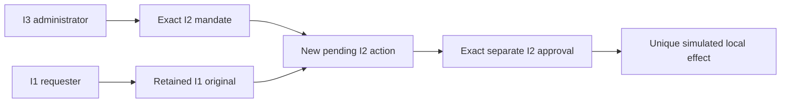

# Biba and trusted actions in Rust

Biba is Swarm’s reference integrity rule. Mermaid diagrams, trust boundaries,
storage contracts and remaining integration gaps are documented in the
[Rust technical architecture](BIBA-RUST.md).

The Rust engine provides the local trusted-actions core through the CLI and
`/trust-actions.html`. Verification and delivery status are retained in the
[BIBA-RUST plan](../plans/migration-rust/PLAN.md). This does not apply Biba to every
Rust mission and is not Linux access control. Effects are strictly simulated.

The 27 October correction in progress applies read mediation to business replies
and replays: an authorized subject receives the I2 object; otherwise the named
`trust-status-ack-v1` procedure returns only `schema_version`, `kind`, `object_id`,
`state`, `content_redacted:true`. This bounds status and identifier; it neither
relabels the object nor grants authority. Effects and evidence remain retained.
Code presence does not establish verification or installation; see the current plan.

## Authority and workflow

The shared monitor uses I0–I3: read requires subject level ≤ object level;
write/invoke require subject level ≥ target level. Configurable local identities
are I1–I3. Unknown tokens never authorize business commands. Caller-supplied
`actor` and `integrity` confer no authority.

Admission is an explicit trusted procedure: an I3 administrator admits a **new**
I2 mandate. An authenticated request within its terms creates a pending I2
object. The original I1 bytes and digest remain intact; the I1 subject is never
promoted. An I2 approver confirms the exact content before an I2 effect service
may commit it. With separation enabled, requester and approver must differ.



CLI bearer: `SWARM_TRUST_TOKEN`; API bearer: `Authorization: Bearer …`. Only its
digest persists. The page keeps the token in memory. Configuration is a local
operator operation; HTTP additionally requires the native session, Host/Origin
and CSRF. It is never authorized by a client level claim. `show`, `export` and
`anchor` are operator audit views; `read-object`/`read-original` are business
reads gated by the strict Biba monitor, including no-read-down.

After initial setup of an unconfigured root, HTTP `config-preview` and
`config-apply`, including replays, require a current I3 identity with the `admin`
role, checked under the Trust lock (shared for preview, exclusive for apply). Cookie alone, I1/I2 or a suspended
identity cannot reconfigure. The modal has a separate Admin token field, cleared
on close. Local CLI remains an owning operator initialization/recovery path,
not delegation to an agent with Root access. Other operator routes and global
isolation are not qualified by this increment.

Unported advanced blocks cannot be edited: null/omission preserve them, and an
existing inactive block may only be resubmitted with identical compact bytes.
Unknown fields, wrong types, misspelled activation and duplicate policy keys
refuse. This compatibility shape check does not port all Go validators/consumers.

## Public contract

The page links to **PAEA checks**, the file-correspondence tool described in the
[PAEA contract](PAEA-CONTRACT.md). Execute and Save use the shared semantic action
foreground/background pair in both themes. Contrast checks await actual CSS
transition completion and sample normal, hover and keyboard-focus states.
`trust-primary-ux.json` exercises real workspace assets with read/preview doubles;
it applies no configuration and does not prove binary-served asset bytes.
See the [record](plans/actions-confiance/paea/INCREMENT-13.md).

```sh
./swarm --root ROOT --json trust show
./swarm --root ROOT --json trust config-preview --input configuration.json
./swarm --root ROOT --json trust config-apply --input configuration.json
./swarm --root ROOT --json trust request --input request.json
```

Configuration supplies `schema_version:1`, `event_id`, `expected_revision`,
`reason`, all four `policy` fields, and every `identity`: `subject`, `token`,
`integrity`, `roles`, optional `disabled`. Roles: `admin`, `requester`, `approver`,
`effect`. Tokens need at least 16 bytes, no whitespace or example placeholder.
Admin previews without applying, then saves and reads back. Tokens are never
read back. The input includes all identities rather than silently retaining
omitted credentials.

| Persisted policy | Default | Zero / technical bound |
| --- | --- | --- |
| `mandate_ttl_seconds` | 3600 s | 0 no default expiry; max 9223372036 s |
| `unknown_reconcile_seconds` | 0 s | 0 immediate; same maximum |
| `evidence_retention_days` | 365 days | min 1; max 9007199254740991 |
| `require_separation` | true | explicit boolean |

Missing fields, null, fractions and out-of-range values refuse. Retention is
recorded, without automatic purge in this core. `show.policy_bounds` exposes
technical formats: state 8 MiB, commands 16 MiB, proof key 32 bytes. These are
representation limits, not business budgets.

`mandate-create` binds subject, actions (`settle`/`grant-access`), resource,
parameters, dates and revision. `request` remains within those terms. `approve`
supplies `action_id`, mandate, digest and every exact parameter; `commit` and
`reconcile` address the protected action. Default connector:
`local-ledger-simulation`. The second, `local-access-simulation` version 1,
accepts `connector.access:{subject,role}` and changes only the simulated access
ledger, never real permissions. Selection is bound to the mandate and approval;
no arbitrary plugin, program or network destination is accepted. The page guides
settlement; the second connector uses CLI/API.

`POST /api/v1/trust-actions?action=OPERATION` shares engine validation;
`GET /api/v1/trust-actions` reads the audit. Read POSTs use `{}`. Historical CLI
remote mode `--server` is not ported here: use local CLI or the protected API,
without fallback to another root.

## Bell-LaPadula confidentiality — policy administration, no runtime control

A Bell-LaPadula confidentiality policy (ordered level + compartments, separate
from Biba integrity) is prepared through the Trust page Admin dialog and the
following operations. **Actual status: administration and diagnostics only.**
No project content is classified and no execution is mediated:
`runtime_enforced:false` and `runtime_authorized:false` are kept in every
response and the interface states it. Do not read them as active protection.

```sh
./swarm --root ROOT --json trust blp-show
./swarm --root ROOT --json trust blp-policy-preview --input policy.json
./swarm --root ROOT --json trust blp-policy-apply --input policy.json
./swarm --root ROOT --json trust blp-check --input diagnostic.json
./swarm --root ROOT --json trust blp-object-attribute --input attribution.json
```

- `blp-show` (read): persisted state, revisioned history and capability.
  Requires a current I3/admin token like every administration operation.
- `blp-policy-preview` (read): validates a complete proposal (`schema_version`,
  `event_id`, `expected_revision`, `expected_trust_revision`, `reason`, `policy`
  with operator-defined `public`→`restricted` levels, compartments and
  clearances). No mutation.
- `blp-policy-apply` (write): revisioned application with attributed evidence;
  a recorded `event_id` replays the retained reply without mutation. A trust
  policy change stales the history: an explicit renewal is required
  (`authority_current:false` signals it).
- `blp-check` (read): diagnostic on **supplied** labels — never a real object
  attribution. Returns the join/refusal and computed output classification,
  without content or third-party labels. `runtime_authorized:false` is NEVER a
  read authorization.
- `blp-object-attribute` (write): current attribution of a classification to
  exact canonical bytes (`canonical_digest` sha256 of the `paea-json-v1` bytes,
  absolute `project_path`, current policy and trust revisions required) by an
  I3/admin operator whose clearance DOMINATES the attributed label
  (`check_read`). Persisted in the revisioned history and RE-READ at every
  consumption; a revision change refuses it (`blp-policy-changed`) until
  re-attribution. It is not a declassification nor a read right: it records the
  classification that authorized control binds to the bytes.

**Reader frontier (PAEA preview/presentation)**: `GET
/api/v1/paea/git-call/preview` and
`GET /api/v1/paea/git-call/approval/presentation` serve a projection containing
classified fields only to a reader authorized by the `paea_reader_verdict`
guard: a valid-shape `Bearer` token, a current policy bound to the Trust
revision, a current attribution of the exact bytes, a dominating clearance.
A policy, attribution or clearance failure keeps the reply
`200 {available:false, reason:paea-reader-*}` with no classified byte —
payload, identifier, digest, error, header, log — even for an enrolled
top-of-catalog reader; an unknown token or a disabled identity instead produces
the typed `authorization_required` refusal (non-success status, 403), also
carrying no classified byte. A bare session stays `200 {available:false,
reason:paea-reader-authentication-required}`: a bare session and enrollment are
never an implicit authorization. `SourceRefJSON` labels and the browser cookie are not
authoritative. A bound-source absence is still answered before the guard (no
classified field exists then). The positive reply carries
`runtime_enforced:false`: prompt-side byte provenance remains the other
actor's open work. The public approval form (`web/paea-approval-form.js`)
connects to this frontier without bypassing it: an ephemeral "Reader token"
input is read at call time, carried as `Authorization: Bearer` on the guarded
read only, then cleared on EVERY exit of the load — success, HTTP or network
error, unbound capability, refused presentation, malformed reply (no storage,
URL or log); `paea-reader-*` refusals stay visible with their exact code and
the "Re-read the presentation" button re-reads the same endpoint after the
credential is corrected; the input carries NO frontend maximum-length cutoff
(the producer-side `credential_valid` shape check enforces a 16-byte minimum,
forbidden whitespace and reserved prefixes, with no maximum — an arbitrary cap
would reject valid tokens; too-short shapes are refused server-side with the
exact typed verdict, never pre-cut); the approval POST stays enrollment-only
(distinct password, never reinterpreted as clearance).

**Minimal startup observations (cookie-only status routes)**: `GET
/api/v1/paea/git-call` and `GET /api/v1/paea/git-call/approval` serve ONLY the
`bound` boolean and literal protocol constants (`schema_version`, `event`)
behind the ordinary session; the `capability` field stays `Null` whenever the
source is bound. NO value derived from the prepared request passes — not the
digests, and not the selected `call`/`service`/`operation` either: a closed
vocabulary does not make the value selected by a classified action constant,
and creates no declassification right (BLP-RET-05). HEAD serves an empty body.
The exact metadata stays readable only through the guarded routes (preview and
presentation) under the current reader verdict. The consuming pages
(`web/paea-effects.js`, `web/paea-consent.js`, `web/paea-approval-form.js`)
render this explicit state (never a blank line nor an unknown-shaped value)
and treat a non-null `capability` as an out-of-contract report that visibly
stops the load (`paea-status-out-of-contract` on the form). The consent page
(`web/paea-consent.html`, `web/paea-consent.js`) connects its classified read
to the same frontier without bypassing it: the exact digest and bound operation
pass only through the guarded presentation read and the preview, with the same
ephemeral reader token read at call time, carried as `Authorization: Bearer` on
those reads only and erased on EVERY exit of the load (no storage, URL or log);
a `paea-reader-*` refusal keeps its exact code visible, the "Relire la
présentation" control re-reads the same endpoints after correcting the
credential, and the consent form stays reachable (enrollment authority is never
reinterpreted as read clearance — the out-of-band digest comparison remains the
operator's decision). Every preview exit also renders a typed terminal state on
the approval status: an unavailable or refused preview is never left "in
flight", and the success wording is only set when the exact frozen-command
metadata is actually displayed. A guarded read that THROWS (HTTP 403,
transport, unreadable JSON) renders the same typed refusal pair as the
`available:false` verdict: a `paea-reader-*` refusal stays an `empty` state
carrying the exact code, any other error raises a visible `error` state —
and every load first purges ALL previous exact projections (presentation and
preview lists, the POST result containers) so no value from an earlier
success survives under a refusal or "no data displayed" wording (defect
reproduced then fixed on 2026-11-01: an HTTP 403 re-read after an authorized
read left both previous digests in the DOM; maintained counterexample
`tests/paea-consent-projection-erasure.cjs`, 11 checks on the real page in
real Chrome, red then green runs retained in the evidence dossier). The
`paea-consent-ui-rust` real-browser qualification now resolves the exact test
binary from the Cargo artifact stream (`cargo test --no-run
--message-format=json`, linked tool `bind_cargo_test_binary.py` +
counter-proofs `test_bind_cargo_test_binary.py`) — no more `rm` purge, no
glob, no global watchdog in the driver, whose two raw channels are streamed
and awaited to their real exits. Driver failure/flush contract (maintained
counterexamples `tests/paea_consent_driver_control.py`, 16 checks over 8
variants, red measured on the 2026-11-01 declared-inputs snapshot then green):
every streamer of BOTH children is tracked and joined after their real exits;
a Rust failure while the harness runs fails immediately without waiting on a
live child; the INVERSE fault is covered symmetrically (2026-11-01): a harness
failure while Rust still waits on the phase marker kills live Rust BEFORE any
wait (the harness primary cause is decided before the kill, so a -9 never
masks it), meaning no wait() ever targets a live child on a failure path in
EITHER direction; cleanup
kills only the two owned Popen children; the verdict requires each channel's
EOF marker (partial flush refused) and refuses any PASS without the complete
raw channel. The counter-proof
`status_does_not_discriminate_two_prepared_intentions` shows that two distinct
prepared intentions produce byte-identical replies on these routes.

Each clearance names an existing, non-disabled identity subject; unknown
subjects refuse. The catalog cannot remove or reorder existing levels: that
would relabel history. No declassification exists: a summary, an empty output
or LLM filtering is not one. Cross-cutting protection (classification of real
content, file/network/provider monitors, exact human declassification) remains
open; tracked in [BLP-APEX](../plans/actions-confiance/BLP-APEX.md).

## Refusals, recovery and evidence

`direct-write`, `elevate` and `elevate-integrity` deny bypasses. Business denials
return `state:denied`, retain attributed evidence and leave mandates/actions/
effects unchanged. Schema/authority/conflict failures remain errors: CLI 2,
identity 4, revision/event/idempotency conflicts 3; HTTP 400/403/409 by cause.
An active unported policy refuses explicitly, never falling back to static
identities. Stopping federation does not turn mapped principals into local ones.

The historical interprocess flock serializes writes. One idempotency key creates
one native entry; conflicting content refuses. `lose_response:true` records
`unknown` after the simulated effect. Another commit cannot duplicate it;
`reconcile` reads the exact native receipt after the configured delay. Observed
revocation prevents a new effect while preserving already committed effects.
After output/close/transmission failure, inspect state with the same identifier.
`trust_publication` preserves known or uncertain outcomes, never client receipt.

The audit counts missing originals rather than assuming their presence.
Historical state, exact originals, v2 exports and schema1 HMAC anchors remain
compatible. Pure `verify` requires `export`, `anchor`, `verification_key` acquired
separately and opens no root. Never trust a key obtained solely from the export.
Reordering, alteration, anchored omission and receipt/parameter inconsistency
refuse. Key loss closes signing without silent regeneration. A pending Go
initialization is preserved and requires explicit recovery rather than overwrite.

This port does not requalify public signatures, federation, sensitive-data
admission, processes or historical laboratories. Their active policies close
mutations. Private files do not isolate the same UID; evidence establishes no
third-party clock, physical immutability or independent acceptance.

Permanent recipe: `tools/verification/recipes/trust-biba-rust.json`, using
`tests/rust_trust_biba.py` and its browser journey. Historical Go evidence stays
historical; only an executed comparison is attributed to Rust.

A retained `null` federation block remains absent and grants no authority. Business commands tolerate only the historical all-zero `policy` placeholder (three zero integers and false separation) to preserve Go fingerprints; it configures nothing. Any other value refuses without mutation.
Duplicate keys also refuse at the top level of configuration and state, before extension selection.
Omitting `policy` from a business command is equivalent to the zero placeholder and configures nothing. Null data/group policy internals and null/zero mandatory durations also refuse in their Go producers; they are not valid historical configurations to reactivate.

## Governance and audit in Admin

Admin configures incompatible requester, approver, executor and administrator
roles and declared principal groups. Preview, save and reopen verify persisted
policy. Current I3 authority is still enforced server-side; labels grant no rights.

Select a transaction to read its linked audit and record this access. The public
evidence panel separates preparation, second-administrator activation, revocation
and private memory availability. Verification requires an independently acquired
pin; a bundle key is never autofilled as authority. See the
[technical contract and diagrams](BIBA-GOVERNANCE-RUST.md).
