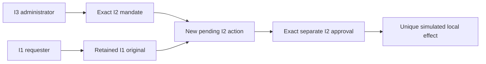

# Biba and trusted actions in Rust

Biba is Swarm’s reference integrity rule. Mermaid diagrams, trust boundaries,
storage contracts and remaining integration gaps are documented in the
[Rust technical architecture](BIBA-RUST.md).

The Rust engine provides the local trusted-actions core through the CLI and
`/trust-actions.html`. Verification and delivery status are retained in the
[BIBA-RUST plan](../plans/migration-rust/PLAN.md). This does not apply Biba to every
Rust mission and is not Linux access control. Effects are strictly simulated.

The 27 October correction in progress applies read mediation to business replies
and replays: an authorized subject receives the I2 object; otherwise the named
`trust-status-ack-v1` procedure returns only `schema_version`, `kind`, `object_id`,
`state`, `content_redacted:true`. This bounds status and identifier; it neither
relabels the object nor grants authority. Effects and evidence remain retained.
Code presence does not establish verification or installation; see the current plan.

## Authority and workflow

The shared monitor uses I0–I3: read requires subject level ≤ object level;
write/invoke require subject level ≥ target level. Configurable local identities
are I1–I3. Unknown tokens never authorize business commands. Caller-supplied
`actor` and `integrity` confer no authority.

Admission is an explicit trusted procedure: an I3 administrator admits a **new**
I2 mandate. An authenticated request within its terms creates a pending I2
object. The original I1 bytes and digest remain intact; the I1 subject is never
promoted. An I2 approver confirms the exact content before an I2 effect service
may commit it. With separation enabled, requester and approver must differ.



CLI bearer: `SWARM_TRUST_TOKEN`; API bearer: `Authorization: Bearer …`. Only its
digest persists. The page keeps the token in memory. Configuration is a local
operator operation; HTTP additionally requires the native session, Host/Origin
and CSRF. It is never authorized by a client level claim. `show`, `export` and
`anchor` are operator audit views; `read-object`/`read-original` are business
reads gated by the strict Biba monitor, including no-read-down.

After initial setup of an unconfigured root, HTTP `config-preview` and
`config-apply`, including replays, require a current I3 identity with the `admin`
role, checked under the Trust lock (shared for preview, exclusive for apply). Cookie alone, I1/I2 or a suspended
identity cannot reconfigure. The modal has a separate Admin token field, cleared
on close. Local CLI remains an owning operator initialization/recovery path,
not delegation to an agent with Root access. Other operator routes and global
isolation are not qualified by this increment.

Unported advanced blocks cannot be edited: null/omission preserve them, and an
existing inactive block may only be resubmitted with identical compact bytes.
Unknown fields, wrong types, misspelled activation and duplicate policy keys
refuse. This compatibility shape check does not port all Go validators/consumers.

## Public contract

The page links to **PAEA checks**, the file-correspondence tool described in the
[PAEA contract](PAEA-CONTRACT.md). Execute and Save use the shared semantic action
foreground/background pair in both themes. Contrast checks await actual CSS
transition completion and sample normal, hover and keyboard-focus states.
`trust-primary-ux.json` exercises real workspace assets with read/preview doubles;
it applies no configuration and does not prove binary-served asset bytes.
See the [record](plans/actions-confiance/paea/INCREMENT-13.md).

```sh
./swarm --root ROOT --json trust show
./swarm --root ROOT --json trust config-preview --input configuration.json
./swarm --root ROOT --json trust config-apply --input configuration.json
./swarm --root ROOT --json trust request --input request.json
```

Configuration supplies `schema_version:1`, `event_id`, `expected_revision`,
`reason`, all four `policy` fields, and every `identity`: `subject`, `token`,
`integrity`, `roles`, optional `disabled`. Roles: `admin`, `requester`, `approver`,
`effect`. Tokens need at least 16 bytes, no whitespace or example placeholder.
Admin previews without applying, then saves and reads back. Tokens are never
read back. The input includes all identities rather than silently retaining
omitted credentials.

| Persisted policy | Default | Zero / technical bound |
| --- | --- | --- |
| `mandate_ttl_seconds` | 3600 s | 0 no default expiry; max 9223372036 s |
| `unknown_reconcile_seconds` | 0 s | 0 immediate; same maximum |
| `evidence_retention_days` | 365 days | min 1; max 9007199254740991 |
| `require_separation` | true | explicit boolean |

Missing fields, null, fractions and out-of-range values refuse. Retention is
recorded, without automatic purge in this core. `show.policy_bounds` exposes
technical formats: state 8 MiB, commands 16 MiB, proof key 32 bytes. These are
representation limits, not business budgets.

`mandate-create` binds subject, actions (`settle`/`grant-access`), resource,
parameters, dates and revision. `request` remains within those terms. `approve`
supplies `action_id`, mandate, digest and every exact parameter; `commit` and
`reconcile` address the protected action. Default connector:
`local-ledger-simulation`. The second, `local-access-simulation` version 1,
accepts `connector.access:{subject,role}` and changes only the simulated access
ledger, never real permissions. Selection is bound to the mandate and approval;
no arbitrary plugin, program or network destination is accepted. The page guides
settlement; the second connector uses CLI/API.

`POST /api/v1/trust-actions?action=OPERATION` shares engine validation;
`GET /api/v1/trust-actions` reads the audit. Read POSTs use `{}`. Historical CLI
remote mode `--server` is not ported here: use local CLI or the protected API,
without fallback to another root.

## Refusals, recovery and evidence

`direct-write`, `elevate` and `elevate-integrity` deny bypasses. Business denials
return `state:denied`, retain attributed evidence and leave mandates/actions/
effects unchanged. Schema/authority/conflict failures remain errors: CLI 2,
identity 4, revision/event/idempotency conflicts 3; HTTP 400/403/409 by cause.
An active unported policy refuses explicitly, never falling back to static
identities. Stopping federation does not turn mapped principals into local ones.

The historical interprocess flock serializes writes. One idempotency key creates
one native entry; conflicting content refuses. `lose_response:true` records
`unknown` after the simulated effect. Another commit cannot duplicate it;
`reconcile` reads the exact native receipt after the configured delay. Observed
revocation prevents a new effect while preserving already committed effects.
After output/close/transmission failure, inspect state with the same identifier.
`trust_publication` preserves known or uncertain outcomes, never client receipt.

The audit counts missing originals rather than assuming their presence.
Historical state, exact originals, v2 exports and schema1 HMAC anchors remain
compatible. Pure `verify` requires `export`, `anchor`, `verification_key` acquired
separately and opens no root. Never trust a key obtained solely from the export.
Reordering, alteration, anchored omission and receipt/parameter inconsistency
refuse. Key loss closes signing without silent regeneration. A pending Go
initialization is preserved and requires explicit recovery rather than overwrite.

This port does not requalify public signatures, federation, sensitive-data
admission, processes or historical laboratories. Their active policies close
mutations. Private files do not isolate the same UID; evidence establishes no
third-party clock, physical immutability or independent acceptance.

Permanent recipe: `tools/verification/recipes/trust-biba-rust.json`, using
`tests/rust_trust_biba.py` and its browser journey. Historical Go evidence stays
historical; only an executed comparison is attributed to Rust.

A retained `null` federation block remains absent and grants no authority. Business commands tolerate only the historical all-zero `policy` placeholder (three zero integers and false separation) to preserve Go fingerprints; it configures nothing. Any other value refuses without mutation.
Duplicate keys also refuse at the top level of configuration and state, before extension selection.
Omitting `policy` from a business command is equivalent to the zero placeholder and configures nothing. Null data/group policy internals and null/zero mandatory durations also refuse in their Go producers; they are not valid historical configurations to reactivate.

## Governance and audit in Admin

Admin configures incompatible requester, approver, executor and administrator
roles and declared principal groups. Preview, save and reopen verify persisted
policy. Current I3 authority is still enforced server-side; labels grant no rights.

Select a transaction to read its linked audit and record this access. The public
evidence panel separates preparation, second-administrator activation, revocation
and private memory availability. Verification requires an independently acquired
pin; a bundle key is never autofilled as authority. See the
[technical contract and diagrams](BIBA-GOVERNANCE-RUST.md).
