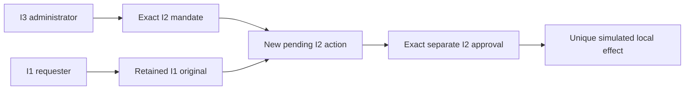

# Biba and trusted actions in Rust

Biba is Swarm’s reference integrity rule. Mermaid diagrams, trust boundaries,
storage contracts and remaining integration gaps are documented in the
[Rust technical architecture](BIBA-RUST.md).

The Rust engine provides the local trusted-actions core through the CLI and
`/trust-actions.html`. Verification and delivery status are retained in the
[BIBA-RUST plan](../plans/migration-rust/PLAN.md). This does not apply Biba to every
Rust mission and is not Linux access control. Effects are strictly simulated.

The 27 October correction in progress applies read mediation to business replies
and replays: an authorized subject receives the I2 object; otherwise the named
`trust-status-ack-v1` procedure returns only `schema_version`, `kind`, `object_id`,
`state`, `content_redacted:true`. This bounds status and identifier; it neither
relabels the object nor grants authority. Effects and evidence remain retained.
Code presence does not establish verification or installation; see the current plan.

## Authority and workflow

The shared monitor uses I0–I3: read requires subject level ≤ object level;
write/invoke require subject level ≥ target level. Configurable local identities
are I1–I3. Unknown tokens never authorize business commands. Caller-supplied
`actor` and `integrity` confer no authority.

Admission is an explicit trusted procedure: an I3 administrator admits a **new**
I2 mandate. An authenticated request within its terms creates a pending I2
object. The original I1 bytes and digest remain intact; the I1 subject is never
promoted. An I2 approver confirms the exact content before an I2 effect service
may commit it. With separation enabled, requester and approver must differ.



CLI bearer: `SWARM_TRUST_TOKEN`; API bearer: `Authorization: Bearer …`. Only its
digest persists. The page keeps the token in memory. Configuration is a local
operator operation; HTTP additionally requires the native session, Host/Origin
and CSRF. It is never authorized by a client level claim. `show`, `export` and
`anchor` are operator audit views; `read-object`/`read-original` are business
reads gated by the strict Biba monitor, including no-read-down.

After initial setup of an unconfigured root, HTTP `config-preview` and
`config-apply`, including replays, require a current I3 identity with the `admin`
role, checked under the Trust lock (shared for preview, exclusive for apply). Cookie alone, I1/I2 or a suspended
identity cannot reconfigure. The modal has a separate Admin token field, cleared
on close. Local CLI remains an owning operator initialization/recovery path,
not delegation to an agent with Root access. Other operator routes and global
isolation are not qualified by this increment.

Unported advanced blocks cannot be edited: null/omission preserve them, and an
existing inactive block may only be resubmitted with identical compact bytes.
Unknown fields, wrong types, misspelled activation and duplicate policy keys
refuse. This compatibility shape check does not port all Go validators/consumers.

## Public contract

The page links to **PAEA checks**, the file-correspondence tool described in the
[PAEA contract](PAEA-CONTRACT.md). Execute and Save use the shared semantic action
foreground/background pair in both themes. Contrast checks await actual CSS
transition completion and sample normal, hover and keyboard-focus states.
`trust-primary-ux.json` exercises real workspace assets with read/preview doubles;
it applies no configuration and does not prove binary-served asset bytes.
See the [record](plans/actions-confiance/paea/INCREMENT-13.md).

```sh
./swarm --root ROOT --json trust show
./swarm --root ROOT --json trust config-preview --input configuration.json
./swarm --root ROOT --json trust config-apply --input configuration.json
./swarm --root ROOT --json trust request --input request.json
```

Configuration supplies `schema_version:1`, `event_id`, `expected_revision`,
`reason`, all four `policy` fields, and every `identity`: `subject`, `token`,
`integrity`, `roles`, optional `disabled`. Roles: `admin`, `requester`, `approver`,
`effect`. Tokens need at least 16 bytes, no whitespace or example placeholder.
Admin previews without applying, then saves and reads back. Tokens are never
read back. The input includes all identities rather than silently retaining
omitted credentials.

| Persisted policy | Default | Zero / technical bound |
| --- | --- | --- |
| `mandate_ttl_seconds` | 3600 s | 0 no default expiry; max 9223372036 s |
| `unknown_reconcile_seconds` | 0 s | 0 immediate; same maximum |
| `evidence_retention_days` | 365 days | min 1; max 9007199254740991 |
| `require_separation` | true | explicit boolean |

Missing fields, null, fractions and out-of-range values refuse. Retention is
recorded, without automatic purge in this core. `show.policy_bounds` exposes
technical formats: state 8 MiB, commands 16 MiB, proof key 32 bytes. These are
representation limits, not business budgets.

`mandate-create` binds subject, actions (`settle`/`grant-access`), resource,
parameters, dates and revision. `request` remains within those terms. `approve`
supplies `action_id`, mandate, digest and every exact parameter; `commit` and
`reconcile` address the protected action. Default connector:
`local-ledger-simulation`. The second, `local-access-simulation` version 1,
accepts `connector.access:{subject,role}` and changes only the simulated access
ledger, never real permissions. Selection is bound to the mandate and approval;
no arbitrary plugin, program or network destination is accepted. The page guides
settlement; the second connector uses CLI/API.

`POST /api/v1/trust-actions?action=OPERATION` shares engine validation;
`GET /api/v1/trust-actions` reads the audit. Read POSTs use `{}`. Historical CLI
remote mode `--server` is not ported here: use local CLI or the protected API,
without fallback to another root.

## Bell-LaPadula confidentiality — policy administration, no runtime control

A Bell-LaPadula confidentiality policy (ordered level + compartments, separate
from Biba integrity) is prepared through the Trust page Admin dialog and the
following operations. **Actual status: administration and diagnostics only.**
No project content is classified and no execution is mediated:
`runtime_enforced:false` and `runtime_authorized:false` are kept in every
response and the interface states it. Do not read them as active protection.

```sh
./swarm --root ROOT --json trust blp-show
./swarm --root ROOT --json trust blp-policy-preview --input policy.json
./swarm --root ROOT --json trust blp-policy-apply --input policy.json
./swarm --root ROOT --json trust blp-check --input diagnostic.json
./swarm --root ROOT --json trust blp-object-attribute --input attribution.json
```

- `blp-show` (read): persisted state, revisioned history and capability.
  Requires a current I3/admin token like every administration operation.
- `blp-policy-preview` (read): validates a complete proposal (`schema_version`,
  `event_id`, `expected_revision`, `expected_trust_revision`, `reason`, `policy`
  with operator-defined `public`→`restricted` levels, compartments and
  clearances). No mutation.
- `blp-policy-apply` (write): revisioned application with attributed evidence;
  a recorded `event_id` replays the retained reply without mutation. A trust
  policy change stales the history: an explicit renewal is required
  (`authority_current:false` signals it).
- `blp-check` (read): diagnostic on **supplied** labels — never a real object
  attribution. Returns the join/refusal and computed output classification,
  without content or third-party labels. `runtime_authorized:false` is NEVER a
  read authorization.
- `blp-object-attribute` (write): current attribution of a classification to
  exact canonical bytes (`canonical_digest` sha256 of the `paea-json-v1` bytes,
  absolute `project_path`, current policy and trust revisions required) by an
  I3/admin operator whose clearance DOMINATES the attributed label
  (`check_read`). Persisted in the revisioned history and RE-READ at every
  consumption; a revision change refuses it (`blp-policy-changed`) until
  re-attribution. It is not a declassification nor a read right: it records the
  classification that authorized control binds to the bytes.

**Reader frontier (PAEA preview/presentation)**: `GET
/api/v1/paea/git-call/preview` and
`GET /api/v1/paea/git-call/approval/presentation` serve a projection containing
classified fields only to a reader authorized by the `paea_reader_verdict`
guard: a valid-shape `Bearer` token, a current policy bound to the Trust
revision, a current attribution of the exact bytes, a dominating clearance.
A policy, attribution or clearance failure keeps the reply
`200 {available:false, reason:paea-reader-*}` with no classified byte —
payload, identifier, digest, error, header, log — even for an enrolled
top-of-catalog reader; an unknown token or a disabled identity instead produces
the typed `authorization_required` refusal (non-success status, 403), also
carrying no classified byte. A bare session stays `200 {available:false,
reason:paea-reader-authentication-required}`: a bare session and enrollment are
never an implicit authorization. `SourceRefJSON` labels and the browser cookie are not
authoritative. A bound-source absence is still answered before the guard (no
classified field exists then). The positive reply carries
`runtime_enforced:false`: prompt-side byte provenance remains the other
actor's open work. The public approval form (`web/paea-approval-form.js`)
connects to this frontier without bypassing it: an ephemeral "Reader token"
input is read at call time, carried as `Authorization: Bearer` on the guarded
read only, then cleared on EVERY exit of the load — success, HTTP or network
error, unbound capability, refused presentation, malformed reply (no storage,
URL or log); `paea-reader-*` refusals stay visible with their exact code and
the "Re-read the presentation" button re-reads the same endpoint after the
credential is corrected; the input carries NO frontend maximum-length cutoff
(the producer-side `credential_valid` shape check enforces a 16-byte minimum,
forbidden whitespace and reserved prefixes, with no maximum — an arbitrary cap
would reject valid tokens; too-short shapes are refused server-side with the
exact typed verdict, never pre-cut); the approval POST stays enrollment-only
(distinct password, never reinterpreted as clearance).

**Reader frontier of the PA-09 reconciliation (`GET|HEAD
/api/v1/paea/reconcile-effects`)**: the reconciliation report is classified —
its findings carry durable effect identifiers (`intent_id`, `action_digest`) —
and the session alone never authorizes it. Three ordered gates: (1) BEFORE any
Root open/settings read/ledger IO, a session without a reader credential
receives the typed 403 refusal carrying ONLY
`paea-reader-authentication-required` (HEAD: empty body); (2) AFTER the service
Root is opened (read-only) and STILL BEFORE any settings read, ledger open or
journal read, a PRESENT credential is decided by the engine's shared identity
precheck (`RootStore::paea_reader_identity_precheck`) against the service
Root's CURRENT trust state: an unknown or disabled token receives the typed
`authorization_required` refusal (403; no settings, ledger or reconciliation
state or error reaches it); an absent trust journal refuses
`paea-reader-policy-required`; a recognized credential proceeds; (3) after the
reconciliation, the current reader verdict (`paea_reader_verdict`) is
evaluated on the exact digest of the report bytes before anything is returned —
it RE-authenticates the credential on a FRESH read of the current state (never
a cached precheck identity) and enforces policy currency, attribution and
clearance; stale policy → `paea-reader-policy-stale`, missing attribution →
`paea-reader-attribution-required`, insufficient clearance →
`paea-reader-access-denied`, all typed 403 refusals without a report byte. No
gate mutates, journals or yields a partial report; recovery goes through the
public operations (policy re-application, re-attribution). Kept counter-example
and fix (2026-11-02, `glm-reconcile-auth-fix-20261102T093323Z`): before this
precheck, a PRESENT but UNKNOWN token observed the ledger-side business error
(409 `paea-effect-reconcile-separate-ledger-required`) instead of the identity
refusal — the exact test
`reconcile_effects_unknown_token_refused_identity_before_ledger_error` (red
reproduced then green, GET+HEAD+non-mutation executed) fixes the contract.

**PA-09 native positive reader witness (real qualified binary)**: this contract
is also proven on the real native ELF by the integration test
`reconcile_effects_native_binary_positive_reader_frontier_empty_ledger`
(`rust/crates/swarm-web/tests/paea_reconcile.rs`, marked `#[ignore]` so the six
default tests stay untouched). It REFUSES a missing qualified binary passed
through the documented `SWARM_ENGINE_BINARY` environment (no hash hardcoded in
the repository; targeted run `cargo test -p swarm-web --test paea_reconcile
reconcile_effects_native_binary_positive_reader_frontier_empty_ledger --
--ignored --exact`, exactly one test executed). The witness starts the real
binary on the configured service Root (port 0, parsed JSON bind event,
really-generated web-session secret read at bind, `/proc/pid/exe` digest equal
to the provided binary's), on two really distinct private fixture roots whose
reconciliation ledger stays explicitly uninitialized, then chains: bare 403
`paea-reader-authentication-required`, known fixture reader before attribution
403 `paea-reader-attribution-required`, public attribution of the exact report
produced by `paea_reconcile_effect_journals`, positive 200 read serving the
expected bytes (empty-body 200 HEAD), unknown 403 `authorization_required`,
recovery 200; the FULL four-file snapshot is compared after EVERY read phase
(pre-attribution refusals included, attribution = the single intentional
public write between two baselines); the two `state.db` files stay
byte-identical across the whole read sequence and the trust journals only move
across the setup's own explicit writes. The child is stopped through a kernel-owned signal channel: a pidfd opened on
the child process identity, with a fallback to the numeric pid of the single
owned, not-yet-reaped child only if `pidfd_open` itself fails (no reusable pid
can then be targeted, the reap is kept in every case, a refused signal is never
masked, never SIGKILL) and asserts the real native shutdown contract: exit 0
and the last stdout line = the `web-stopped` stop-record, with stdout fully
drained AND retained after the bind event. The witness settings request reuses
VERBATIM the revision shown by `engine-settings show`: the `SettingCount`
contract (`rust/crates/swarm-engine/src/engine_settings.rs`) requires a
canonical nonnegative decimal STRING (numbers are refused), so
`expected_revision` is that string itself, never converted to a number — a
numeric conversion produced a schema-invalid request refused as
`settings-request-invalid`. Conservation of the child's raw outputs is carried by the REQUIRED
`SWARM_PAEA_NATIVE_EVIDENCE_DIR` variable: without it the witness refuses to
run (no PASS without retained evidence), with an already-existing path the
reuse is refused BEFORE the spawn (no write, no overwrite of prior evidence),
and the directory is exclusively created 0700 FROM BIRTH
(`DirBuilderExt::mode`, never a 0755-then-chmod window; no ancestor created,
a concurrently created foreign directory can neither be claimed nor
re-permissioned). The test durably conserves the EXACT native stdout/stderr
bytes (`stdout.log`/`stderr.log`: the raw buffer is NEVER searched or
truncated by content — child text resembling a drain annotation stays in the
raw stream), drain failures in producer-side separate states
(`drain-stdout.errors.log`/`drain-stderr.errors.log`, empty on the success
path — any nonempty state there is a hard failure), the REAL exit status
(`exit.json` read from the shared observed-exit slot; `"observed": false`
when the child could not be reaped — never a faked success) and the
binary/argv identity (`spawn.json`, no secret or cookie), on success AND
failure, every file through an exclusive-create 0600 write (private
`.name.partial` temporary, file fsync, EXCLUSIVE `hard_link` publication — an
existing name is never overwritten, a symlink never followed — then
directory fsync and temporary removal; a partial write keeps the original
published file and its cause). On failure, the failure witness reaps the OWN
child through the process-owner Drop (declaration order: the raw witness is
created BEFORE the listener, so the listener drops BEFORE the witness — the
reap records the real exit in the shared slot), joins both drains to EOF
(the pipes close at child death, no blocking), then conserves the COMPLETE
streams and the real exit — the same artifacts as success; if a helper
failed before capture started (e.g. a readiness failure), the witness
conserves what exists and declares the exact frontier (an unwired buffer
means nothing is claimed for that stream), never a full capture that did not
happen. No textual wait, no watchdog, never SIGKILL. On failure, a witness
also prints the retained raw bytes (limit: bytes emitted before the stdout
reader is attached — the pre-announcement window — are outside test capture
and are not claimed). No secret
byte is ever published on those native streams (`web-bound`/`web-outcome`/
`web-stopped` only; the session secret lives only in its file).
The witness's REAL failure path is made exercisable by an EXPLICITLY
TEST-ONLY fault mode owned by this integration test (never the product, the
ELF or any authority): the `SWARM_PAEA_NATIVE_WITNESS_FAULT` variable —
absent = nominal path above, unchanged; the single accepted value
`after-bare-refusal` delivers the `PAEA_NATIVE_EXPECTED_WITNESS_FAILURE`
marker panic after the bare-403 GET+HEAD control and the pre-attribution
refusal snapshot S1 (listener still alive, no report byte served), to
exercise the listener Drop then the witness Drop (graceful SIGINT reap,
drain joins to EOF, complete conservation of the same artifacts); any other
value is refused BEFORE any evidence reservation or spawn; no watchdog,
timer or retry is involved. Evidence for this mode: ACQUIRED — the
supervisor's control run observed the expected 1 FAILED (exit 101) with the
complete retained artifacts (raw stdout/stderr, drain states, real exit,
clean child reap observed). This mode's contract therefore has THREE
outcomes: nominal (variable absent), armed fault `after-bare-refusal`
(expected 1 FAILED, retained artifacts = evidence), invalid value refused
before any spawn. A second, independent TEST-ONLY mode adds the POSITIVE
browser witness: the `SWARM_PAEA_NATIVE_BROWSER_WITNESS` variable — absent
= nominal path unchanged (no browser); the single accepted value `1` = ONE
real headless-browser pass
(`tests/paea_reconcile_native_reader_ui.cjs`, Puppeteer via the same real
install path as `tests/paea_effects_ui.cjs`/`tests/paea_reconcile_reader_ui.cjs`)
against the ALREADY-CONFIGURED native listener, launched after the public
attribution and BEFORE the SIGINT stop; any other value is refused BEFORE
any evidence reservation or spawn — this mode too has THREE outcomes:
nominal (absent), armed witness `1`, invalid value refused before spawn.
The script receives the address, the generated session cookie, the fixture
reader token, a synthetic unknown token, the expected report and its digest
over PRIVATE STDIN JSON (never argv, never a log); a write/flush failure of
that stdin does NOT kill the script: the pipe is closed (EOF), its outputs
and real exit status are collected and conserved first, and only then is
the failure reported with the original IO cause plus the observed exit
(the input is validated BEFORE any browser launches, so no orphan window);
its stdout, stderr and real exit status are conserved as 0600 artifacts of
the evidence directory,
together with a fresh exclusive 0700 subfolder
(`browser-witness-<timestamp>-<suffix>` — never reused, never /tmp) holding
its named assertions and screenshots (never secrets); a nonzero exit fails
the native test, whose unwinding conserves the real native cleanup (graceful
SIGINT + reap, drain joins, raw conservation); the owned browser is closed
by the script's own finally block, event-driven with no global timer and no
arbitrary delay. Real browser assertions: protected effects page served by
the REAL ELF; typed bare refusal with no report byte; fixture token via the
dedicated field + re-read => 200, settlement/git `uninitialized` states
really rendered in the DOM + exact raw JSON, secret field purged; unknown
403 `authorization_required` on the SAME page that just displayed a success
(the purge is thereby proven after a really displayed report, never on a
virgin context) removing ALL report DOM/raw, field purged; exact recovery
200 on that same page; the witness's request ledger retains only the
boolean classification of Authorization headers (presence, Bearer shape,
recognized reader token, known unknown token) — never a value, not even in
a private 0600 artifact, and no post-leak sanitizer exists (the producer
never emits values); FR/EN, etat/sombre, 390/1280 (two justified
combinations), keyboard focus, no console error and no unclassified
network, credentials only on the reconcile GET, no POST and no write from
the browser. The EN capture is taken TWICE: sombre BEFORE the theme toggle,
then etat AFTER it. Evidence for this mode: ACQUIRED on 2026-11-03 on the
qualified ELF (sha e2f0039a…, supervised run: exactly 1 native PASS, Node
exit 0, 14 named checks, 0 unexpected diagnostics, 4 typed 403 refusals, 7
reconcile GETs, classification booleans only, same-page purge after a
visible success, personal visual review of the FR/EN screenshots); the
permanent requalification recipes are
`tools/verification/recipes/paea-native-reader-ui.json` (empty scope,
historical) and
`tools/verification/recipes/paea-native-reader-ui-nonempty.json` (nonempty
scope, distinct id `paea-native-reader-ui-nonempty`, same schema,
environment and i18n check, the same wrapper invoked with
`--report-scope nonempty` requiring marker
`PAEA_NATIVE_READER_UI_NONEMPTY_VERIFIED 14`; execution UNVERIFIED until
Codex personally runs it) (wrapper
`tests/paea_reconcile_native_reader_ui_recipe.py`, managed binary
`{root}/bin/swarm`, evidence parent `{root}/.cache`, explicit report scope
`--report-scope empty|nonempty` (default empty: historically qualified
empty contract unchanged, marker `PAEA_NATIVE_READER_UI_VERIFIED 14`;
nonempty: the dedicated native test
`reconcile_effects_native_binary_positive_reader_frontier_nonempty_ledger`,
kind `paea-native-reader-ui-nonempty-v1`, distinct marker
`PAEA_NATIVE_READER_UI_NONEMPTY_VERIFIED 14`, qualifying the really
rendered settlement finding, the same-page purge of the previously rendered
real identifiers and the identical recovery; an invalid value is refused by
argparse before any directory allocation or cargo spawn); the wrapper runs
`cargo test --manifest-path rust/Cargo.toml --offline
--locked -p swarm-web --test paea_reconcile <test> -- --ignored --exact
--nocapture` with a dedicated CARGO_TARGET_DIR, debug=0, INCREMENTAL=0,
provides SWARM_ENGINE_BINARY and SWARM_PAEA_NATIVE_BROWSER_WITNESS=1, does
NOT create the SWARM_PAEA_NATIVE_EVIDENCE_DIR directory (the Rust `from_env`
requires it nonexistent, exclusive create), conserves the real
stdout/stderr/returncode before any qualification, refuses treating the real
`9 filtered out` as an anomaly, and verifies the two children's artifacts
SEPARATELY at the evidence-dir level: the BROWSER exit metadata
(browser-witness.exit.json, run_dir = the OUTER Rust
browser-witness-<time>-<suffix> dir) and the RUST exit (exit.json + stdout.log
web-bound -> web-stopped last line + empty drain sidecars, the
browser-witness.json living in the nested JS subdirectory); a recipe run is
neither independent review nor global acceptance).
Three opt-in memory guards (`#[ignore]`, no process, no write) exercise the
shared producer loop `drain_to_end`: the raw buffer keeps ALL child bytes
even when the child itself emits the text `\n[stdout drain error:` /
`\n[stderr drain error:` (split across read chunks, non-UTF-8 byte, trailing
line without newline), and a real read error goes ONLY to the separate state
(never into the raw buffer) — the error/content separation is proven on the
real producer code, not a copy.
Only `NotFound`
is an authorized absence for a trust journal (any other error is a hard
failure, never masked). Explicit partial scope: empty report only for the
native test above (the TEST-ONLY browser witness, opt-in
`SWARM_PAEA_NATIVE_BROWSER_WITNESS=1`, exercises the same empty-report scope
on the real rendered page). The native non-empty contract now exists as a
separate dedicated test,
`reconcile_effects_native_binary_positive_reader_frontier_nonempty_ledger`
(same qualified ELF binary via `SWARM_ENGINE_BINARY`, same fresh
out-of-/tmp `SWARM_PAEA_NATIVE_EVIDENCE_DIR` contract): against a REALLY
populated ledger — one settlement effect produced BEFORE any baseline and
before the child through the same public producers (`work.create`,
`config-apply`, `scope_of`, `seed_settlement_effect` on a third private
project root kept open as the work store, the service and ledger staying
two distinct roots) — the test first applies the TEST-ONLY browser-witness
gate under the EXACT contract of the empty sibling (no value is ever
silently ignored): variable absent => the received API-only non-empty
sequence runs UNCHANGED; exact value `1` => ONE real browser witness
(Chromium, shared script `tests/paea_reconcile_native_reader_ui.cjs` in its
CONSISTENT non-empty variant, distinct kind
`paea-native-reader-ui-nonempty-v1`, `report_scope: "nonempty"` metadata,
14 explicit non-empty check names for the mode-specific assertions) runs
between the recovery and the SIGINT stop with the EXACT attributed
non-empty report — the script derives its render model from the report
itself (never invented JSON) and asserts the REAL product render (consistent
settlement sentence, real finding line with the served `intent_id`/
`action_digest`, same-page purge of the previously rendered REAL identifiers
at the unknown refusal then identical recovery); any other value is refused
BEFORE any evidence reservation or spawn, then the test runs the full API
sequence over the NON-EMPTY report:
bare typed 403 with no report byte, known reader before attribution typed
403, the expected report computed by the real public producer
(`paea_reconcile_effect_journals`, settlement destructured as
`Consistent{effect_count:1}` with the finding `verified`, git explicitly
`Uninitialized`, canonical `encode_model` encoding digested in the same
domain as the route), attribution via `blp-object-attribute` on the SERVICE
root with that digest, positive GET 200 with served bytes exactly equal and
fields asserted from the real model (`settlement.state == "consistent"`,
`effectCount == 1`, real `intent_id`/`action_digest`, `verified == true`,
`git.state == "uninitialized"`), empty-200 HEAD, unknown credential typed
403 with no real identifier or state disclosed, recovery 200 with the same
exact bytes, optional browser witness (GET only, between two snapshot
comparisons), SIGINT stop (exit 0, last stdout line `web-stopped`), complete
raw child-output conservation and the four-file witness re-checked after
every read phase. The browser non-empty witness, NOT TESTED at the original lot, is now
backed by a supervisor personal run on pinned ELF320 (fbf41a82…): BOTH
browser witnesses (empty and nonempty) and their exact native tests really
pass (14 named checks each, real settlement finding 1, same-page purge of
the REAL identifiers then identical recovery, Node and native exit 0;
receipt conserved in lot glm-pa09-scope-wrapper-20261103T110700Z);
accordingly the permanent wrapper
`tests/paea_reconcile_native_reader_ui_recipe.py` carries
`--report-scope empty|nonempty` (default empty) and qualifies each scope
through its own kind, exact native test and named-check inventory; the
permanent nonempty recipe JSON now exists
(`tools/verification/recipes/paea-native-reader-ui-nonempty.json`, distinct
id, nonempty marker required) and its execution remains UNVERIFIED until
Codex personally runs it; the wrapper scope increment was personally
received by the supervisor on the pinned actually-active ELF322 (3146c837…)
— both scopes pass, an invalid value exits 2 before any output allocation,
and the retained witnesses refuse the crossed scope (receipt
supervisor-wrapper-receipt.json, lot glm-pa09-scope-wrapper-20261103T110700Z).
The test remains exact `#[ignore]` (never run by
default; opt-in executions only) and the fixture identities remain an
explicit same-UID simulation, never a claimed human enrollment, OS
confinement or acceptance.

**Minimal startup observations (cookie-only status routes)**: `GET
/api/v1/paea/git-call` and `GET /api/v1/paea/git-call/approval` serve ONLY the
`bound` boolean and literal protocol constants (`schema_version`, `event`)
behind the ordinary session; the `capability` field stays `Null` whenever the
source is bound. NO value derived from the prepared request passes — not the
digests, and not the selected `call`/`service`/`operation` either: a closed
vocabulary does not make the value selected by a classified action constant,
and creates no declassification right (BLP-RET-05). HEAD serves an empty body.
The exact metadata stays readable only through the guarded routes (preview and
presentation) under the current reader verdict. The consuming pages
(`web/paea-effects.js`, `web/paea-consent.js`, `web/paea-approval-form.js`)
render this explicit state (never a blank line nor an unknown-shaped value)
and treat a non-null `capability` as an out-of-contract report that visibly
stops the load (`paea-status-out-of-contract` on the form). The consent page
(`web/paea-consent.html`, `web/paea-consent.js`) connects its classified read
to the same frontier without bypassing it: the exact digest and bound operation
pass only through the guarded presentation read and the preview, with the same
ephemeral reader token read at call time, carried as `Authorization: Bearer` on
those reads only and erased on EVERY exit of the load (no storage, URL or log);
a `paea-reader-*` refusal keeps its exact code visible, the "Relire la
présentation" control re-reads the same endpoints after correcting the
credential, and the consent form stays reachable (enrollment authority is never
reinterpreted as read clearance — the out-of-band digest comparison remains the
operator's decision). Every preview exit also renders a typed terminal state on
the approval status: an unavailable or refused preview is never left "in
flight", and the success wording is only set when the exact frozen-command
metadata is actually displayed. A guarded read that THROWS (HTTP 403,
transport, unreadable JSON) renders the same typed refusal pair as the
`available:false` verdict: a `paea-reader-*` refusal stays an `empty` state
carrying the exact code, any other error raises a visible `error` state —
and every load first purges ALL previous exact projections (presentation and
preview lists, the POST result containers) so no value from an earlier
success survives under a refusal or "no data displayed" wording (defect
reproduced then fixed on 2026-11-01: an HTTP 403 re-read after an authorized
read left both previous digests in the DOM; maintained counterexample
`tests/paea-consent-projection-erasure.cjs`, 11 checks on the real page in
real Chrome, red then green runs retained in the evidence dossier). The
`paea-consent-ui-rust` real-browser qualification now resolves the exact test
binary from the Cargo artifact stream (`cargo test --no-run
--message-format=json`, linked tool `bind_cargo_test_binary.py` +
counter-proofs `test_bind_cargo_test_binary.py`) — no more `rm` purge, no
glob, no global watchdog in the driver, whose two raw channels are streamed
and awaited to their real exits. Driver failure/flush contract (maintained
counterexamples `tests/paea_consent_driver_control.py`, 16 checks over 8
variants, red measured on the 2026-11-01 declared-inputs snapshot then green):
every streamer of BOTH children is tracked and joined after their real exits;
a Rust failure while the harness runs fails immediately without waiting on a
live child; the INVERSE fault is covered symmetrically (2026-11-01): a harness
failure while Rust still waits on the phase marker kills live Rust BEFORE any
wait (the harness primary cause is decided before the kill, so a -9 never
masks it), meaning no wait() ever targets a live child on a failure path in
EITHER direction; cleanup
kills only the two owned Popen children; the verdict requires each channel's
EOF marker (partial flush refused) and refuses any PASS without the complete
raw channel. The counter-proof
`status_does_not_discriminate_two_prepared_intentions` shows that two distinct
prepared intentions produce byte-identical replies on these routes.

**Reconciliation report mobile rendering (PA-09)**: the finding rows of both
lists (`#settlement-findings li`, `#git-findings li` in `web/paea.css`) now
wrap anywhere (`overflow-wrap:anywhere`) instead of overflowing the card and
the viewport. Real defect reproduced then conserved (native browser witness,
receipt
`glm-pa09-nonempty-overflow-guard-20261103T052147Z/supervisor-receipt.json`):
on the real page served by the qualified ELF, in EN/390/sombre, the document
overflowed by 260 px (scrollWidth 650 vs innerWidth 390) and the finding row
by 306 px (564 vs 258 available) — the long canonical `intent`/`effect`
digests were clipped at the right edge while the 14 functional checks
passed; the earlier overflow assertion only covered the page BEFORE the
populated report, hence the named post-positive and post-recovery guard
(numeric metrics only, private screenshot before the failure) delivered in
the previous lot. The fix is generic on the real textbox contract: full
wrapping of the identifiers, NO truncation, ellipsis, mask or scrollbar; the
DOM and the technical report keep the exact integral bytes (no product JS
changed), FR/EN, both themes and the semantic tokens stay unchanged.
Recovery path: the supervisor validation run expects the guard green at
both real boundaries (fr/1280 and en/390) with still exactly 14 named
checks, then the empty canonical regression (shared script); no global
acceptance is claimed by this lot.

Each clearance names an existing, non-disabled identity subject; unknown
subjects refuse. The catalog cannot remove or reorder existing levels: that
would relabel history. No declassification exists: a summary, an empty output
or LLM filtering is not one. Cross-cutting protection (classification of real
content, file/network/provider monitors, exact human declassification) remains
open; tracked in [BLP-APEX](../plans/actions-confiance/BLP-APEX.md).

## Refusals, recovery and evidence

`direct-write`, `elevate` and `elevate-integrity` deny bypasses. Business denials
return `state:denied`, retain attributed evidence and leave mandates/actions/
effects unchanged. Schema/authority/conflict failures remain errors: CLI 2,
identity 4, revision/event/idempotency conflicts 3; HTTP 400/403/409 by cause.
An active unported policy refuses explicitly, never falling back to static
identities. Stopping federation does not turn mapped principals into local ones.

The historical interprocess flock serializes writes. One idempotency key creates
one native entry; conflicting content refuses. `lose_response:true` records
`unknown` after the simulated effect. Another commit cannot duplicate it;
`reconcile` reads the exact native receipt after the configured delay. Observed
revocation prevents a new effect while preserving already committed effects.
After output/close/transmission failure, inspect state with the same identifier.
`trust_publication` preserves known or uncertain outcomes, never client receipt.

The audit counts missing originals rather than assuming their presence.
Historical state, exact originals, v2 exports and schema1 HMAC anchors remain
compatible. Pure `verify` requires `export`, `anchor`, `verification_key` acquired
separately and opens no root. Never trust a key obtained solely from the export.
Reordering, alteration, anchored omission and receipt/parameter inconsistency
refuse. Key loss closes signing without silent regeneration. A pending Go
initialization is preserved and requires explicit recovery rather than overwrite.

This port does not requalify public signatures, federation, sensitive-data
admission, processes or historical laboratories. Their active policies close
mutations. Private files do not isolate the same UID; evidence establishes no
third-party clock, physical immutability or independent acceptance.

Permanent recipe: `tools/verification/recipes/trust-biba-rust.json`, using
`tests/rust_trust_biba.py` and its browser journey. Historical Go evidence stays
historical; only an executed comparison is attributed to Rust.

Companion permanent recipe: `tools/verification/recipes/preparation-dialogue-history-rust.json`
with `tests/rust_preparation_dialogue.py`. Current contract asserted by its checks:
`prepare dialogue ID` and `GET /api/v1/preparations/dialogue` observe historical
active turns (pending/running/stopping) read-only — exact SQL status served,
private prompt never published, SQL snapshot unchanged, CLI and HTTP 200 equal —
with no stop, adoption, signal or provider call; corrupt rows still refuse
without writing. Only a native envelope bound to another Root refuses
(`preparation-turn-owner-mismatch`), a contract covered by the `preparation_calls`
engine tests and out of scope for this core test. The 3 November 2026 fix
replaces the stale refusal expectation
`preparation-dialogue-active-unported`, obsolete since the limit was lifted;
expected core marker `DIALOGUE_PASS 41` (execution: supervisor, after sources
stabilize).

This recipe's browser journey (`tests/rust_preparation_dialogue_browser.py`)
states its fixture precondition: the private provider configuration is
published empty (`providers{}`, atomic write) at owned-Root birth, before the
HTTP server and the witness state — the shared helper would otherwise write a
CLI-eligible fixture provider, and the product keeps the strict history reader
only with no configured provider. Before any browser, the real public
`/api/v1/preparations/capabilities` endpoint is asserted disabled with no
provider; no interception fabricates this result. The configured-calls journey
remains covered by the `preparation-calls-rust` recipe and is not repeated
here.

Reconciliation of 3 November 2026 for the two preparation recipes
(`preparation-calls-rust.json`, `preparation-legacy-replay-rust.json`) on
their shared engine step `retained-root-faults` (`cargo test --manifest-path
rust/Cargo.toml -p swarm-engine --test preparation_calls -- --nocapture`):
the real assertion inventory — not an operator choice — now carries seven
named guards. The expectation moves from `running 6 tests`/`6 passed` to
`running 7 tests`/`7 passed`; the former name
`legacy_active_replay_remains_explicitly_unported`, carried by no test
anymore, becomes `legacy_active_replay_is_readonly_without_native_authority`
— reading an exact active historical replay is an observation without worker
adoption: dispatch and worker claim refuse
(`preparation-call-private-invalid`), the row and its reserved budget stay
unchanged; and the seventh guard
`confidential_admission_is_fixed_authenticated_and_never_dispatchable` joins
the expectation: fixed-context admission is authenticated, attributed and
re-readable, but it is not a provider send (zero turns, zero reservations,
`runtime_authorized:false`). The five other named guards, the commands, the
environment and the other steps stay unchanged; historical failures and
earlier evidence are kept as-is. Ground-truth witness: the supervisor
control run, seven guards PASS, exit 0 (`supervisor-legacy-marker-control/`
in lot `glm-pa09-nonempty-recipe-manifest-20261103T115459Z`). GLM edits: the
reconciled recipes' execution was UNVERIFIED until Codex personally ran
them (`recipe.py run` then `verify`) — personal receipt since acquired, see
the receipt paragraph below.

Memory-fixture prerequisite wiring, same date: the supervisor's personal run
of the full `preparation-calls-rust` recipe on pinned ELF322 failed at the
first stage, before the browser, on `KeyError: SWARM_PROJECT_MEMORY_SEEDER`
(`tests/rust_project_memory_source.py:26` via `seed_lesson` in
`tests/rust_preparation_calls.py:131`); the original failure is retained (lot
`glm-preparation-legacy-recipe-markers-20261103T120909Z`,
`supervisor-full-recipes/preparation-calls-rust/`). BOTH preparation recipes
therefore gain, before their public journeys, the two already-qualified
prerequisites of the `blp-preparation-provenance-public` recipe, taken
verbatim: the `fixture-placement-guard` test (`cargo test --example
memory_source_fixture`, expecting `explicit_fixture_area_guard_retains_refusals`,
`1 passed; 0 failed` — the guard refuses roots outside the configured area,
nested, wrong-prefixed or live, and any /tmp) and the `fixture-memory-sidecar`
build of the native fixture writer (`cargo build --example
memory_source_fixture`). The environment now carries
`SWARM_PROJECT_MEMORY_SEEDER={root}/.cache/blp-verification-target/debug/examples/memory_source_fixture`
— the actual path produced by those steps — and
`CARGO_TARGET_DIR={root}/.cache/blp-verification-target`, a dedicated test
target consistent with the seeder, distinct from the
`.cache/rust-native-version846-target` production builds; no all-features
flag, no production ELF rebuild or substitution, the source binary remaining
supplied externally through `SWARM_PREPARATION_UI_BINARY`. The actually
consumed fixture source `tests/fixture_area.py` joins the declared
inventory. The seven named guards and every functional assertion stay
unchanged; the test scripts are not modified to skip seeding. Execution of
the rewired recipes: first UNVERIFIED
until Codex personally ran them; since personally received (receipt
paragraph below).

Producer count reconciliation, same date: the supervisor's rewired run
really passed the placement guard (`1 passed; 0 failed`), the sidecar build
(exit 0) and then the full public CLI+HTTP+browser journey (real exit 0: 35
named core assertions, including the `browser-public-journey` check, and
the browser marker `PREPARATION_CALLS_BROWSER_PASS 48`); the recipe aborted
(exit 1) solely on the stale `PREPARATION_CALLS_PASS 34` expectation.
Established cause: the producer `tests/rust_preparation_calls.py` prints
`PREPARATION_CALLS_PASS` followed by the dynamic number of named checks
(line 144); the named `browser-public-journey` check (line 143, inside the
`--browser` journey) raises the real core inventory to 35. BOTH recipes'
expectations therefore move to `PREPARATION_CALLS_PASS 35`; the 48 browser
marker and every other assertion stay unchanged. Retained evidence (pinned
ELF322 3146c837…, lot
`glm-preparation-memory-fixture-wiring-20261103T124003Z`):
`supervisor-full-recipes/preparation-calls-rust/` (`step-0003.stdout`,
`step-0003.json`, `result.json`), `supervisor-next-boundary.json` and the
retained witness `supervisor-retained-calls35`. Earlier historical failures
stay intact; at that stage the recipes were not yet fully verified (the
`transport`, `engine-budget-policy`, `retained-root-faults` stages and the
legacy recipe were not executed in that run) — Codex's personal full runs
have since been received (receipt paragraph below).

Engine filter reconciliation, same date: the supervisor's continued run then
really passed `transport` (4 tests) and the `engine-budget-policy` step
itself (exit 0); the recipe aborted solely on the stale `running 7 tests`/
`7 passed` expectation. Real observed inventory (`step-0005.stdout`, pinned
ELF322 3146c837…): 18 named tests, all PASS, 0 failed, 0 ignored, 735
filtered — the `--lib preparation_call` filter now selects six module
groups: 5 `level_tests`, 2 `cli::level_tests`, 3 `preparation_call_budget`,
4 `engine_settings::preparation_calls`, 2 `legacy`, 2
`confidentiality_tests`. The step's expectation moves to `running 18 tests`/
`18 passed; 0 failed` and now carries the complete named inventory of all 18
tests; commands, environment, prerequisites and other steps stay unchanged.
Evidence retained in lot `glm-preparation-calls-count-20261103T132200Z`
(`step-0005.stdout/.stderr/.json`, `result.json`,
`supervisor-next-boundary.json`); historical failure preserved. At that stage the recipe was
still not fully verified: `retained-root-faults` (7 guards) and the full
legacy recipe remained pending Codex's personal execution — since received
(receipt paragraph below).

Personal receipt of both recipes, same date: Codex personally ran and then
verified the two complete recipes (`recipe.py run` then `verify`, four real
exit codes 0) on the pinned ELF322
3146c83791e9cd5e98f264d3d4af0bdf2fc6ee9fb246d145dcc88fd8c4cc313a, with
stable sources and production. `preparation-calls-rust`, 6 steps: placement
guard 1 PASS, public 35 assertions + browser 48, transport 4, engine 18,
retained-root-faults 7. `preparation-legacy-replay-rust`, 5 steps: guard 1,
public legacy replay 33 — exact terminal replay, preserved event conflicts,
READ-ONLY observation of active pending/running/stopping turns with
reserved/estimated ledgers unchanged, no row or ledger write, no provider
contact — then public 35 + browser 48 and root-faults 7; both `verify`
return `integrity VERIFIED, recorded_status PASS`. Evidence retained outside
the cache, lot `glm-preparation-engine-count-20261103T140800Z`:
`supervisor-receipt.json`,
`supervisor-full-recipes/preparation-calls-rust/result.json`,
`supervisor-full-recipes/preparation-legacy-replay-rust/result.json`,
`supervisor-full-recipes/preparation-calls-rust-verify.stdout`,
`supervisor-full-recipes/preparation-legacy-replay-rust-verify.stdout`,
retained journeys under `supervisor-retained-journeys/`. Receipt scope:
owned inert Roots and a local fake provider; neither global PAEA, human
enrollment, independent review, production confinement nor acceptance of the
protected human version dialogue; the foreign admin JS differs, no
whole-workspace equivalence. The intermediate historical failures of the
earlier lots stay preserved as-is.

The public HTTP classification of the four BF-16a dialogue reader refusals
(`blp-dialogue-authentication-required`, `blp-dialogue-policy-required`,
`blp-dialogue-policy-stale`, `blp-dialogue-access-denied`) is regressed by the
test `service::status_tests::blp_dialogue_reader_refusals_are_forbidden_and_cleanup_stays_server_error`
(`rust/crates/swarm-web/src/service/status_tests.rs`): refusals reach the HTTP
layer wrapped by the dialogue route's real adapter
(`root("preparation-read", …)`, service/preparations.rs), so they are classified
in the `Self::Root{operation,cause}` branch of `status()` — the four exact
codes, under the real `preparation-read` operation and the strict
`RootStoreError::Refused` variant, yield 403 with the stable code preserved. A
close/rollback failure carrying the same refused primary stays 500 in its
`root-cleanup` family with both typed causes retained through the wrapper; the
test really inspects those two causes and also witnesses that the same code
under an unrelated operation and a neighbor code (reconcile family) stay 500:
an internal fault is never disguised as a caller refusal, and the dialogue
contract does not leak outside its gate. Honest limit: this is a pure
conversion regression — no Root/DB/process, not a real GET, no end-to-end
producer coverage (the guard's refusal decisions stay covered by the engine
dialogue tests); execution: supervisor, never the editor.

**UNVERIFIED (pending Codex's personal execution)** — First real HTTP boundary
added: `tests/blp_dialogue_reader_public.py` replays, on one owned Root with an
inert local provider double, a genuinely answered turn through the public
producer (prepare create/budget/send), then bootstraps trust and admits the
same intent through public operations (config-apply, blp-policy-apply,
per-slice attribution, blp-preparation-admit). Before the injection, a bare GET
on `/api/v1/preparations/dialogue` must stay 200 (legacy zero-matched path);
after, the same bare GET refuses 403 `blp-dialogue-authentication-required`
without any private byte, and the cleared reader re-reads 200 the exact same
nonempty answer with the private prompt absent; readonly SQL/journal/capsule
snapshots stay identical around each GET. If the public admission refuses the
existing turn, the script stops at that exact refusal with its raw retained
evidence instead of fabricating a success. Out of scope, deferred: recipe,
HEAD, stale/revoked/malformed — later bounded lots after Codex's execution.

A retained `null` federation block remains absent and grants no authority. Business commands tolerate only the historical all-zero `policy` placeholder (three zero integers and false separation) to preserve Go fingerprints; it configures nothing. Any other value refuses without mutation.
Duplicate keys also refuse at the top level of configuration and state, before extension selection.
Omitting `policy` from a business command is equivalent to the zero placeholder and configures nothing. Null data/group policy internals and null/zero mandatory durations also refuse in their Go producers; they are not valid historical configurations to reactivate.

## Governance and audit in Admin

Admin configures incompatible requester, approver, executor and administrator
roles and declared principal groups. Preview, save and reopen verify persisted
policy. Current I3 authority is still enforced server-side; labels grant no rights.

Select a transaction to read its linked audit and record this access. The public
evidence panel separates preparation, second-administrator activation, revocation
and private memory availability. Verification requires an independently acquired
pin; a bundle key is never autofilled as authority. See the
[technical contract and diagrams](BIBA-GOVERNANCE-RUST.md).
