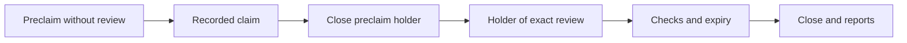

# WIP — Gi producer candidate transition

Source reviewed and SDK compilation succeeded; functional verification remains open: do not merge as accepted.

First checkpoint7088121 counterexample R09-CUSTODY-1 is resolved at source through distinct holders. sources::request acquires/refreshes the preclaim candidate outside SQL; its callback retains preparation/claim transactions and records known Work/claim before close. sources::job then acquires custody of the actually recorded running review outside SQL; its callback retains owner/freshness/clock/expiry/history checks. No equality/I0/budget/TTL protection or limit removed. Errors after claim do not imply rollback.

Reviewer09 APPROVE_SOURCE_ONLY: SHA6b3d83798f27900c0c035197cf96ef41e870693c99adeef52a15b554e0fc9263. Source5c0e1ab29b4eb87673b126f2314c34d5c8ef343d5ca957894d8a8b567f1ff14a; private evidence /run/media/fpizzi/SWARM/swarm-evidence/root00-gi-custody-transition-u41ymcya. One separator blank line removed; no other function body changed.

Still required: actual healthy managed witness before wrong/nonrunning review and cleanup retaining knownWork, then controlled recovery. No functional test/W/SDK/F/installation/acceptance performed for this candidate. Failed Work w-83e055eae3e47c27a0f5043c, last observed rev14/calls0, is untouched. Historical scenarios are not replayed.

## Compile-only observation —16November2026

One offline/locked engine `--lib --no-run` build returned0; no test body executed. Actual engine test=true/features=[],558effective workspace inputs matched947declared candidate bytes archived before Cargo and reread. Frozen temporary ELF9b1d5baae0f4f20a305527dcbce611681a243632f367db41cf603a4df2e43f1c, source commit86c29e91f28dc3df016b8bdcf4d7a4ef01be6b8a. Root receipt82046168701a3ca30654254617955bc5ad2b9cdcd77f9e8335dfede4aba73dae in `/run/media/fpizzi/SWARM/swarm-evidence/root00-sdk5c-build-3l38zm8u`. Scope is compile/borrow checking and workspace test-profile observations, not complete per-unit/compiler/registry/generated authentication, managed witness, W/F, production or installed version. Documentation does not rebuild or rename SDK source.

## Source checkpoint after storage recovery

Managed preparer SHA-256 6a357d1f4f31fb5dd70629c54eea31cfb53425e731cc59dcbdc9b0ddb29fd7ad: two GLM proposals and bounded principal corrections,09 APPROVE_SOURCE_ONLY (receipt 9be1ec21b08420aeab808b9bf8bc7750c6d0f8a7e4b7a68afd59a6e2304de29f). WIP source checkpoint only, no runtime/W/SDK/F or installation claim. Reserve recovered by verified archival of64historical proofs; CLI5f restored locally, full hash reread and787effective inputs unchanged. Separate managed trial allocation follows capacity/provenance admission; no historical campaign replay. Original failures preserved. Erratum: LF[10] correct in both proposals; no delimiter defect.
