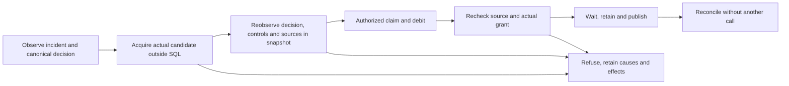

# GI-MR-RECOVERY-01 — controlled managed native reviewer retry

State at 2026-11-16T16:34:57.759745+00:00: proposed plan, not implemented/tested, pending independent specification audit. Owner: Swarm00; one bounded GLM production packet at a time. Existing human Swarm-plan authority only; no X/cloud/billing/live DB scope.

## Need and evidence

Reuse the current synthetic Work attempt, complete candidate and controls after a reviewer protocol error, through an explicit canonical planner correction. Keep the original failure and consumption. The principal supplied an ordinary reply to a managed decoder; the actual first W correctly failed with review-reply-noncanonical-field. Work w-091168d1977007fbe4807a52, revision19, calls1of2; no second call. Prior successful unchanged inputs are not replayed.

Primary sources read16November: review_preview.rs; task_validation/review_candidate.rs, managed_execution.rs and observation.rs; review_recovery.rs; planning_decision.rs retry_review; planning_scope_context.rs; native_review_context.rs original reader/canonical acknowledgement; reviewer_native/claim.rs. Actual excerpts/hashes supplied to GLM: `/run/media/fpizzi/SWARM/swarm-evidence/root00-managed-preparer-cq1joyiy/managed-recovery-contract-glm/context.txt`, SHA42e7a0a347a221ec3c790150572b7c3bb9e37167e83ca88b4012016cd677f10c. No Rust source changed for this plan. Original failure/frame/certificate/capture: `/run/media/fpizzi/SWARM/swarm-evidence/root00-managed-preparer-cq1joyiy/managed-W-adapter-glm/FAILED-W-ORIGINALS`; preparation receipt f8da5f816643a0a516c1bc022f503df3891708c139f2ce124a384351b828d644.

Source-only fences: Fresh acquisition rejects a retained error; review_recovery excludes managed repository; prepared preview additionally rejects recovery+candidate. No equivalent recovery established in the examined path, not an exhaustive public-operation audit. Canonical planning review-retry decision and actual input acknowledgement remain mandatory; reconciliation, new event or corrected program grant no authority. Fixture correction retained WIP9ee825966e5ca226ee02e72509426a6c3c41f415, not merged/executed after09REQUEST_CHANGES.

## Required contracts

MRR-01: retain original private error, certificate, capture, typed classification and history; a non-verdict is never PASS/acceptance.

MRR-02: authoritative Root/DB-instance/attempt/producer/contract/decision/ack snapshots; no JSON/hash/common UID/error-string authority. Initial observations carry coordinates only.

MRR-03: acquire/refresh/close actual complete candidate owner outside SQL/settings locks. Explicit internal retry purpose, never automatic Some(error) authority. Reobserve decision and source bindings in consuming transaction.

MRR-04: bind candidate commit, original control-plan mapping/job/receipt/source and managed protocol to the current complete candidate. Do not read managed artifacts by ordinary Root paths before custody. Preserve actual freshness/funding/grant/wait/close/cancellation/publication/cause contracts.

MRR-05: current Work only1→2calls, no reset/increase/replacement mission. Reuse unchanged worker/report/control evidence; revalidate only justified drift.

MRR-06: preserve Fresh/Claimed/RecordedOpinion and ordinary paths, no request-supplied mode/fallback. Refuse missing decision, wrong ack/original/attempt/candidate/control/instance/source/policy, uncertain owner/cleanup and exhausted quota.

MRR-07: every post-claim error preserves known/uncertain effects: Work/revision/debit, unconfirmed commit, grant/wait/close/publication and secondary causes. Err never proves no mutation. A pre-claim refusal creates no call debit or Work mutation; diagnostics and any prepared immutable artifacts retain their actual state, never a claim of globally absent effects.

Proposed flow, not implemented:

## Next bounded lot and acceptance

1. Read GLM SOURCE_MISSING functions and consumers; retain hashes and establish whether changed task.next affects source binding. First GLM proposal is not code adoption.
2. Compare verified data observation + held custody + transactional recheck with existing job-source reuse. Select only a route preserving authority; never just delete three guards. Specification audit precedes patch.
3. One bounded GLM production packet on reserved functions, principal integration, independent byte-bound policy/docstring/error review. FR/EN documentation and permanent recipe in same increment.
4. Declare regression before execution: valid witness before fault; explicit Roots/counters. Either separate comparable witness/fault-recovery fixtures with max_calls2 at birth, or one fixture initially allocated3calls. Never reset between witness/fault/retry or raise the existing Work cap. Inert data/provider only.
5. Prove real decision reception, authorized application and effect: retained error, applicable retry, same controls/candidate, exactly one new debit. Refusal/recovery matrix; no historical campaigns or unchanged passing suites.
6. Only after actual Rust changes: justified targeted compile/checks, separate SDK/CLI profiles, pre-execution source archive/metadata, fresh20GiB reserve plus allocation and externally held volume through publications. Existing compile-only PASS stays historical.
7. Resume current Work only with genuinely ported protocol and verified public decision. Commit/PR/checks/main/local installation remain separate verified stages; no WIP merge or fabricated acceptance. RETEX then next independent lot.

Resume after acceptable spec audit, actual missing-source reads, reservations and fresh space admission. No additional human decision identified now; any real missing authority must be evidenced.

### 16 November design review — MRR-D01 through D03 remain open

The complete GLM design `7d9395f620c8968b054cce3ce233763f413fd8b78336ae6d4ac22577737e6b6f` was read and independently reviewed by09 (turn01a1e549-078d-7500-8e80-ed0ec154d46a). Verified data → custody outside SQL → transactional recheck is a viable route, but this proposal is not sufficient for a complete patch. MRR-D01: cover the running post-claim job, its immediate archived error and identical context reconstruction. MRR-D02: carry corrective guidance into the managed prompt outside quote evidence. MRR-D03: preserve explicit holder purpose during pre-claim refresh, then use the proper running holder for rechecks without new admission after mutation.

First delegated production increment: context assembly only in `review_preview/inputs.rs`, shared with the ordinary path, with inert content/absence/refusal tests. It unlocks no admission guard and proves no managed retry. Custody and post-claim port remain open. Current Work19 and calls1/2 unchanged; no second W or historical campaign replay.

### MRR-D02 prerequisite — source/helper verified, managed retry not ported

`append_recovery_context` in `review_preview/inputs.rs` shares ordinary and managed corrective context. Guidance remains outside quote materials/catalogue and precedes encoding and the full prompt cap. Source `9a8cebf74b4c6cfdb380fd45a3148152d78e096bf9267dbe56b4baafc658d93f`; independent09 APPROVE_SOURCE_ONLY (turn01a1e550-c91b-7451-8583-e2c2adf6cc83). Three new inert tests PASS (unchanged absence; complete directive with unchanged materials; nonobject refusal after a valid witness), Cargo `--lib` filter `root_store::review_preview::inputs::tests::recovery_`. Evidence and effective source inventory: `/run/media/fpizzi/SWARM/swarm-evidence/root00-managed-preparer-cq1joyiy/prompt-prerequisite-check-01/`. Library-test profile, stable sources; no production build, installation, retry admission or complete managed-flow verification.

Bounded principal supplementation addressed GLM reasoning latency without final patch, with no duplicate call or added cap. Its final answer after531.299s proposed the same shared context; fully read and compared. Its “exactly once” docstring would not establish idempotence and was not adopted. Exact declared usage67451tokens,59693completion; no price or Codex quota inferred. The reviewed/tested principal version remains unchanged after PASS. MRR-D01/D03, full-flow MRR-D02 and P2 stay open. Work19/calls1/2 unchanged. No historical replay, second W, service, provider or acceptance.

### 2026-11-16T19:58:13.549186+00:00 — external storage absent; GLM handoff unavailable

Incident STORAGE-EXT-DISCONNECTED-GLM-20261116: SWARM mount absent and no current block device with UUID144f255c-3c71-43aa-9ae6-c46a6e5b8a9f. Owned GLM client2840506 remained sleeping; observed stream1065528bytes had no new frame for9391seconds. Reading its retained FD returned EIO; no fragment copy could be rescued. Exact client stopped through pidfd/SIGTERM; client and parent2840493 subsequently absent. Wrapper39927 exited1 because final CHILD.json publication under the absent mount failed; no fallback directory created. Server outcome/consumption unknown; no retry. SSE-freeze and device-disappearance causes are not established or conflated.

Local diagnosis `.cache/glm-detached-storage-20261116-sjobqe_z/DIAGNOSIS.json`, SHA256`0ecb452f039f359194c5c1dd47814cef372042db9207c3ec02dcc46c9dfbd8f0`. Source checkpoint565880c6b7debe8ed4da4f6e63ea82dec5be6e16 and clean tracked CI checkout rechecked; no new test/build/provider/Git operation. Earlier PASS/transfer evidence remains historical and needs external readback after reconnection. No code/data-loss conclusion inferred. Resume: Fabrice reconnects disk; root checks identity/mount/rw then readable originals/hashes and partial outcome before one bounded new packet. No writes under absent mount or weakened20GiBguard. No supervision turn observed here17:11→19:54; active configuration proves no execution, scheduler/network cause unknown.

### 2026-11-16T21:31:51.903182+00:00 — volume returned, reserve restored; SKYNET unavailable

Same expected-UUID SWARM volume is ext4/rw again. Original context SHAa883e775… and retained3PASS/558source summaries match;16local packet source hashes unchanged. Old recovered stream1019904bytes versus1065528observed before disappearance (45624difference), no DONE or final content: partial evidence retained, no complete model answer or usage established. [External readback](/run/media/fpizzi/SWARM/swarm-evidence/root00-managed-preparer-cq1joyiy/VOLUME-RETURN-READBACK-20261116.json). This bounded check does not revalidate the entire external corpus or close Lexar.

Host reserve restored to25.54GiB through only the authorized default-builder unused-cache prune, exact command without--all. Docker reports7.098GB; image/volume IDs and container state/StartedAt preserved. [Before/after](/run/media/fpizzi/SWARM/swarm-evidence/root00-returned-volume-cache-tyeks6tm/result.json). No code, data, image, container or volume removed by this operation.

New smaller2file GLM packet, distinct from frozen call, exited naturally2/URLError DNS after0.038s. `chat.skynet.cossi.internet` fails resolution (getent2), valid control `openai.com` resolves (0), Wi-Fi connected/Ethernet unavailable; precise network/VPN/DNS cause unestablished. No retry, network/hosts/VPN change, test/build or Git mutation. [Diagnosis](/run/media/fpizzi/SWARM/swarm-evidence/root00-managed-preparer-cq1joyiy/managed-review-purpose-glm/DNS-DIAGNOSIS.json). Fabrice/network operator restores internal DNS/reachability; root rechecks precondition and hashes before one bounded packet. No patch received; MRR-D01/D03/full lifecycle remain open.

### 2026-11-16T22:17:46.225443+00:00 — owned-purpose MRR-D03 prerequisite: source reviewed, compile only

Two files integrated in CI checkout: `task_validation/review_candidate.rs` SHA256`2c4e9e72aaa63ee96f628431f6c218252609a161584b98f79618bbcb3a783918`, `managed_execution.rs` SHA256`e98ca58abb3c9f94f052930e9ac7c89edfe9baf82d980039617b579220fc5b56`. GLM returned a complete proposal after495.539s, declared usage122240tokens; no pricing or Codex quota inferred. Root reconstructed hunks against exact original blocks (one incorrect doc context corrected), denied implicit ReviewerRetry construction by legacy mapping, derived purpose before acquisition and explicitly refused legacy preview for a retry holder. Independent09 APPROVE_SOURCE_ONLY, turn01a1e66b-2350-73f2-9b48-fa159ded1571; primary `/run/media/fpizzi/SWARM/swarm-evidence/root00-managed-preparer-cq1joyiy/managed-review-purpose-glm/REVIEW09-PURPOSE-PRIMARY.json`.

Owned purpose/record project borrowed ReviewSource; explicit helpers preserve purpose across acquisition, preparation and refresh. Private acquire_for_retry/preview_for_retry hooks remain unwired to public operations/claim. Recovery remains observation data, never permission; Root original/canonical-decision verification and consuming rechecks remain required. No policy, count, authority, source digest or control/candidate binding change. New/modified functions documented; typed causes and paired rollback/close reviewed.

Cargo `--lib --no-run --offline --locked` exited0, default library-test profile without extra features, 558effective inputs archived/read back; sources stable before/after. Test ELF`738db0f581eb36080c77d8eccfa208c8cb0084720ebb428baedb6cd36791221e` retained as0400nonexecutable proof in `/run/media/fpizzi/SWARM/swarm-evidence/root00-managed-preparer-cq1joyiy/purpose-prerequisite-compile-01`. **Zero test bodies executed**, no functional PASS inferred. Earlier3helper tests retained/reused only for unchanged scope, not replayed. No installation/acceptance: incomplete preparatory packet and no current production image qualified for this contract. MRR-D01, behavioral MRR-D03, W/SDK/F and P2 stay open.

Recipe limitation: derived runner docstring retained “missing tests” wording although argv/count/summary explicitly state --no-run/0. Prose proves no executed check. Actual runner and archived copy remain unchanged; correct a future recipe’s documentation before use, no replay to replace this evidence.

### 2026-11-16T22:46:04.660216+00:00 — Root core source staged for independent review

The complete GLM final was read:489.927s, reported116659tokens (18283input,98376output); no Codex quota or price inferred. Shared ordinary/managed recovery observer and held-candidate consumer applied in two source files, SHA256 `37e2336e638c269b2e8201e68ad1de53bfc10d5491337c8a24ebe2197803bd5f` / `2fcd4ec52cf8b5c8a14f44d840a14d912e8528a2024bcbf27f2f4b06830bb2d1`. Material alias maps are compared with the actual complete assembled map; legitimate Root receipt reads remain. Public initial acquisition still uses Fresh and remains unwired; no functional managed retry or authority established.

Raw malformed proposal retained; first exact-block reconstruction refused before edits, then omitted context/backtick corrected. Actual Option<BTreeMap> read in models.rs:886, exact map equality used. `/run/media/fpizzi/SWARM/swarm-evidence/root00-managed-preparer-cq1joyiy/managed-recovery-core-glm/ROOT-CURATION.json` retains limits. Independent09 review requested for these bytes and all three axes/consumers. No new test/build/service/provider; Work19/calls1/2 unchanged, no historical replay. Compilation and behavioral verification still required before fix/install claims.

### 2026-11-16T22:48:44.350543+00:00 — Root core source reviewed; compile-only evidence

Independent09 APPROVE_SOURCE_ONLY turn01a1e689-669e-7651-9d0d-2d508059c20c; primary `/run/media/fpizzi/SWARM/swarm-evidence/root00-managed-preparer-cq1joyiy/managed-recovery-core-glm/REVIEW09-CORE-PRIMARY.json`. Ordinary core preserved; managed path retains original/decision/inbox/receipt and exact assembled artifact map checks. Cargo --lib --no-run exited0 in1m10s;558stable effective inputs, test ELF `b8b23d37703f6dae761fe6cb25afbc00a60b085c801003990e099815fd866d72`,0400non-executable proof `/run/media/fpizzi/SWARM/swarm-evidence/root00-managed-preparer-cq1joyiy/root-core-compile-01`. **0test bodies**, no public retry, installation or acceptance. Initial Fresh acquisition remains unwired. Next packet: observe Root recovery in a short snapshot, close it before custody, select explicit purpose, then transactionally reverify at consumer; no new admission refresh after mutation.

### 2026-11-16T22:55:23.720079+00:00 — MRR-T01: W recipe remains blocked

Actual draft tests/rust_managed_review_w.py SHA256`8be2ddaefa446076b44891bf109afb05c8498853f4d37da4caa9ce4068666b4a` claims acknowledgement in its docstring, but only calls review-reconcile then review-inputs/review; no planning.step/claim/decide exists. Amend using actual proposal/frozen-program helpers and the public planner route; no SQL edits or fabricated ACK. Actual failed Work19/calls1of2 lacks managed_tasks/candidate_commit verdict fields, so native-managed-current-review-unported is not asserted as its blocker without observation.

Future verification: distinct valid managed witness with compared preconditions before fault; old failure preview refusal before ACK without mutation; actual delivered/applied corrective decision and next outside evidence; source drift refusal/restoration; one new debit1→2, no controls replay, running/gate/process/publication/close and reconciliation without another debit. Revalidate planner/scope budgets, admission and production profile first. No test/new fixture/planner/provider/review executed here.

### 2026-11-16T22:57:30.874336+00:00 — initial retry selector integrated, not exercised

Complete GLM final read (200.709s, reported59723tokens); review_candidate.rs SHA256`aa7e287de65743ad49685afd5ce0e4914556634498c5605e25061f71ad581744`. Private observer checks actual managed Work/revision and original/decision core in a short snapshot; rollback/close precede custody, only Some selects ReviewerRetry, errors never become Fresh fallback. Consumer rechecks core and assembled map. Independent09 APPROVE_SOURCE_ONLY turn01a1e693-2ecd-7c72-a858-aa4ddbea1e8e; additional read/close refusals possible, no runtime equivalence inferred.

No build/test/flow yet for this selector, no new reviewer call; Work19/calls1of2 unchanged. Next: save WIP, qualify current normal production profile and amend/review MRR-T01 recipe before execution. No full-fix/install/acceptance claim or WIP merge.

### 2026-11-16T23:03:33.384875+00:00 — current normal candidate qualified; old Work read unchanged

Selector saved+pushed WIP`1e4713cfbcc5db1e37ea61a93292d4281f0085d2`. Default production profile without fixture features SHA256`30910bc926edb286d3315a850a1198a8cfa010cd1df70dce53b1cde4baddc96d`,787effective inputs, actual commit/modified=false metadata and local CLI version verified, before-source archive read back and inputs stable. Evidence `/run/media/fpizzi/SWARM/swarm-evidence/root00-managed-preparer-cq1joyiy/managed-retry-normal-build-01`. No installation/service or functional retry proof.

Our readonly01 preflight used relative-path qualification from the canonical rather than CI cwd (56wrong-checkout differences,0actualCI differences). Original diagnosis kept;02 changes cwd, reuses same qualified image without rebuild/bypass. Two public readonly children reaped/closed0: Work equals original failure,revision19/reviewer1of2,planning2of3activations/2of3decisions,child1of2ready/unpaused/no lease. No invented enabled field; inspect actual presence/route contracts.

One GLM W witness/retry recipe packet active (`/run/media/fpizzi/SWARM/swarm-evidence/root00-managed-preparer-cq1joyiy/managed-w-retry-recipe-glm`), no new fixture review/planning/provider invoked. MRR-T01, behavioral/error/close proof,SDK/F and delivery remain open; no WIP merge.

### 2026-11-16T23:26:28.117389+00:00 — real native witness succeeded; managed dispatcher blocks recovery

W recipe SHA`6e3811f4c246a590c8d2f0b70b9c5a40b388f62ccc80cf7648a9c56e0a9d6a73`,09source-reviewed after root/diagnostic-channel corrections. Distinct healthy managed witness actually passed: review`review-ae0631ee471aeddcbdaf3688`,calls0→1,task submitted/not accepted,15proof files read back and8CLI children reaped/closed0. Receipt SHA`a180991a04064687579193e80ae0c132c33dd8e48d850d0f385384227828a06e`. Normal30910bc9…; no SDK/F/install.

Old Work first refused missing canonical correction without Work/ledger changes. Actual planning.step then invoked the inert provider, but planning_decision.rs::decide still rejects managed review-retry: planning-decision-managed-operation-unported. Actual Work21,reviewer1of2 unchanged,planner3of3activations/2of3decisions; claim planning-claim-9da3d9c4e37f597ec10aca8f is terminal **Refused** by readonly normalized record. Primary channels/owners `/run/media/fpizzi/SWARM/swarm-evidence/root00-managed-preparer-cq1joyiy/managed-retry-original-failure-01`; no second reviewer or control replay.

MRR-D04: an implemented leaf does not prove dispatcher admission. Port shared entry while preserving original/control/repository/decision/custody guards, inspect whole dispatcher+callers. apply_planning_receipt preserves terminal business refusal: never reinterpret through reconcile after a code fix. Original exhausted Work stays open with history; supported resumption and actually missing budget authority required, no reset/refund or replacement Root labelled recovered. Independent corrective work remains authorized.

### 2026-11-16T23:37:37.308213+00:00 — MRR-D04 dispatcher source port reviewed

GLM(195.124s,reported66895tokens) proposed one file planning_decision.rs SHA256`ee8bf54a7eacc0dc4404d0a69781253eaf75ceb1ef08c608f143e6fdf1b4c51e`. Only functional change adds managed review-retry capability; other kinds stay refused. Repository observation,budgets/fences,pending/delivered inputs,native original and retry_review checks remain. Scope: instruction+ACK on candidate Work, no grant/process/production retry/source lease. Chronology kept in plan, operational source comment curated. Independent09 APPROVE_SOURCE_ONLY turn01a1e6b7-368c-7583-b56f-6d1188ed52b2. No build/test yet after this edit.

Public quota proposal actually preview-valid: globalactivations3→4,child2→3;reviewermax2/all consumption preserved,Work21 unchanged. SWARM managed-retry-quota-preview-01. **Not authorized/applied**: explicit human authority still required for an increase. If authorized, read actual applied revision then public child-scoped planning.resume with corrected-code reason(new generation/input,no reset); never reinterpret terminalRefused. Prepare bounded stage resumption without replaying unchanged healthy reviewer witness merely to relabel proof.

### MRR-D05 — closed-evidence preflight, 17 November 2026

Full GLM driver(reported121281tokens,542.911s) rejected/not applied for incorrect schemas and unsafe terminal ownership. Bounded root00 supplement: tests/rust_managed_resume_evidence.py and tests/test_rust_managed_resume_evidence.py. Reads closed files only, no CLI/RootDB/quota/provider/activation/authority. Positive64files/15proofs/43helpers/787sources, dispatcher-only change;30910bc9 witness remains historical, normalfec4 has not executed recovery.

Seven healthy_witness guards initially PASS. Independent09 REQUEST_CHANGES count-binding P2 reproduced FAIL before correction then1PASS afterwards; previous7unaffected guards not replayed. Source6143b0ada8f21412788dd35dee3875997c7459a9adb644120397fdb78f11b912, testbf3d5649292c47ff21828d2d7f2c998d0f5228911fab17e1a2f5af6573107cac. Delta review09 turn01a1e6e0-487f-74d2-9f71-c65a47f7bf19 APPROVE_SOURCE_ONLY. No full corruption coverage claimed for closed_failure/profile_bridge.

Three axes: receipt/protocol oracles rather than configurable policy; nontrivial functions documented; IO/JSON/refusal causes propagate without empty success. No concurrent-writer confinement/runtime qualification. Principal initially mistook work_final file pin for inline Work; real-evidence refusal retained, corrected from producer. Evidence on SWARM: swarm-evidence/root00-managed-preparer-cq1joyiy/managed-resume-evidence-preflight-01.

Earlier recovery plan corrected BEFORE mutation: do NOT planning.resume. Childgeneration7 already supersedes native refusal6; resume would change source-authority epoch and invalidate controls. Proposed public quota3to4/child2to3 still NOT AUTHORIZED/NOT APPLIED, usage preserved. Existing human question pending; heartbeat/time is no answer. Original Work lastobserved21/reviewer1of2/planner3of3, terminalRefused preserved. Supervised continuation driver remains to prepare/review under these preconditions. No runtime,main merge,installation/global acceptance claim.

### D05 — exact counter types, 17 November 2026

Bool True accepted as1 reproduced FAILf51251,then exact int required for both receipt counts and final Work count. Two targetedPASS040f2f,previous7guards reused,no runtime/CLI/provider. Independent09 delta01a1e6ea-afb4-7253-a055-1332ce9f19ee APPROVE_SOURCE_ONLY; bool case reaches receipt guard,final Work bool branch lacks separate coverage. Source0dc1e8f4…,test71177b19…. Schema validation,not operator policy; existing docstrings/errors remain coherent. Driver/runtime/quota remain open and not authorized. Bounded WIP,no main merge or installation.

### D06 — pure post-quota comparator, 17 November 2026

Two new files tests/rust_managed_resume_quota.py and test_rust_managed_resume_quota.py compare supplied dictionaries only,noIO/CLI/Root/provider/quota/derived authority. GLM reported98541tokens/434.766s,971line proposal fully read then curated: models.rs omitted scalar zeros, distinct apply/preview audit metadata, Work-bound consumption, omitted timeoutzero and exact text.rs Go trim. Initial3FAIL then2FAIL counterexamples retained. +1 is finite fixture oracle,zeros/Unicode are wire/protocol contracts,not operator policy. Public/nontrivial docstrings current,stable refusals/original malformed-shape causes. Not full QuotaChange validation.

One21synthetic-test PASS campaign on sourcebadc8bbc…/test7bd690f0… retained at SWARM managed-resume-postquota-pure-glm/final-source-check-01 with names/channels/stable input pins,plus SYNTHETIC AFTER dictionary built from originalJSON. No actual Work changed. Independent09 initialP2 turn01a1e6f2: false remaining100to101 accepted; reproducedFAILc5bc1f then tied max(limit-consumption,0). Two targetedPASSa87ae0(remainder+Go trim after function-boundary restoration),other cases reused without replaying21. Current source4e028ffd…/test2c8ee447… APPROVE_SOURCE_ONLY09 delta01a1e6f4-f824-76d2-bb32-e159a4f9192f.

Dictionary consistency proves no human permission,quota application,identity or runtime recovery. Quota3to4/child2to3 still NOT AUTHORIZED/NOT APPLIED,original Work lastobserved21/reviewer1of2/planner3of3; terminalRefused,controls/attempts preserved. No planning.resume/reset/main merge/build/version_history/installation:evidence tooling only,not product delivery. Supervised driver/runtime/SDK/F/custody/delivery remain open.
