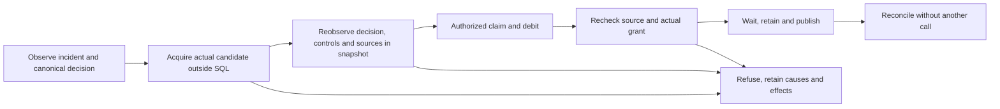

# GI-MR-RECOVERY-01 — controlled managed native reviewer retry

State at 2026-11-16T16:34:57.759745+00:00: proposed plan, not implemented/tested, pending independent specification audit. Owner: Swarm00; one bounded GLM production packet at a time. Existing human Swarm-plan authority only; no X/cloud/billing/live DB scope.

## Need and evidence

Reuse the current synthetic Work attempt, complete candidate and controls after a reviewer protocol error, through an explicit canonical planner correction. Keep the original failure and consumption. The principal supplied an ordinary reply to a managed decoder; the actual first W correctly failed with review-reply-noncanonical-field. Work w-091168d1977007fbe4807a52, revision19, calls1of2; no second call. Prior successful unchanged inputs are not replayed.

Primary sources read16November: review_preview.rs; task_validation/review_candidate.rs, managed_execution.rs and observation.rs; review_recovery.rs; planning_decision.rs retry_review; planning_scope_context.rs; native_review_context.rs original reader/canonical acknowledgement; reviewer_native/claim.rs. Actual excerpts/hashes supplied to GLM: `/run/media/fpizzi/SWARM/swarm-evidence/root00-managed-preparer-cq1joyiy/managed-recovery-contract-glm/context.txt`, SHA42e7a0a347a221ec3c790150572b7c3bb9e37167e83ca88b4012016cd677f10c. No Rust source changed for this plan. Original failure/frame/certificate/capture: `/run/media/fpizzi/SWARM/swarm-evidence/root00-managed-preparer-cq1joyiy/managed-W-adapter-glm/FAILED-W-ORIGINALS`; preparation receipt f8da5f816643a0a516c1bc022f503df3891708c139f2ce124a384351b828d644.

Source-only fences: Fresh acquisition rejects a retained error; review_recovery excludes managed repository; prepared preview additionally rejects recovery+candidate. No equivalent recovery established in the examined path, not an exhaustive public-operation audit. Canonical planning review-retry decision and actual input acknowledgement remain mandatory; reconciliation, new event or corrected program grant no authority. Fixture correction retained WIP9ee825966e5ca226ee02e72509426a6c3c41f415, not merged/executed after09REQUEST_CHANGES.

## Required contracts

MRR-01: retain original private error, certificate, capture, typed classification and history; a non-verdict is never PASS/acceptance.

MRR-02: authoritative Root/DB-instance/attempt/producer/contract/decision/ack snapshots; no JSON/hash/common UID/error-string authority. Initial observations carry coordinates only.

MRR-03: acquire/refresh/close actual complete candidate owner outside SQL/settings locks. Explicit internal retry purpose, never automatic Some(error) authority. Reobserve decision and source bindings in consuming transaction.

MRR-04: bind candidate commit, original control-plan mapping/job/receipt/source and managed protocol to the current complete candidate. Do not read managed artifacts by ordinary Root paths before custody. Preserve actual freshness/funding/grant/wait/close/cancellation/publication/cause contracts.

MRR-05: current Work only1→2calls, no reset/increase/replacement mission. Reuse unchanged worker/report/control evidence; revalidate only justified drift.

MRR-06: preserve Fresh/Claimed/RecordedOpinion and ordinary paths, no request-supplied mode/fallback. Refuse missing decision, wrong ack/original/attempt/candidate/control/instance/source/policy, uncertain owner/cleanup and exhausted quota.

MRR-07: every post-claim error preserves known/uncertain effects: Work/revision/debit, unconfirmed commit, grant/wait/close/publication and secondary causes. Err never proves no mutation. A pre-claim refusal creates no call debit or Work mutation; diagnostics and any prepared immutable artifacts retain their actual state, never a claim of globally absent effects.

Proposed flow, not implemented:

## Next bounded lot and acceptance

1. Read GLM SOURCE_MISSING functions and consumers; retain hashes and establish whether changed task.next affects source binding. First GLM proposal is not code adoption.
2. Compare verified data observation + held custody + transactional recheck with existing job-source reuse. Select only a route preserving authority; never just delete three guards. Specification audit precedes patch.
3. One bounded GLM production packet on reserved functions, principal integration, independent byte-bound policy/docstring/error review. FR/EN documentation and permanent recipe in same increment.
4. Declare regression before execution: valid witness before fault; explicit Roots/counters. Either separate comparable witness/fault-recovery fixtures with max_calls2 at birth, or one fixture initially allocated3calls. Never reset between witness/fault/retry or raise the existing Work cap. Inert data/provider only.
5. Prove real decision reception, authorized application and effect: retained error, applicable retry, same controls/candidate, exactly one new debit. Refusal/recovery matrix; no historical campaigns or unchanged passing suites.
6. Only after actual Rust changes: justified targeted compile/checks, separate SDK/CLI profiles, pre-execution source archive/metadata, fresh20GiB reserve plus allocation and externally held volume through publications. Existing compile-only PASS stays historical.
7. Resume current Work only with genuinely ported protocol and verified public decision. Commit/PR/checks/main/local installation remain separate verified stages; no WIP merge or fabricated acceptance. RETEX then next independent lot.

Resume after acceptable spec audit, actual missing-source reads, reservations and fresh space admission. No additional human decision identified now; any real missing authority must be evidenced.
