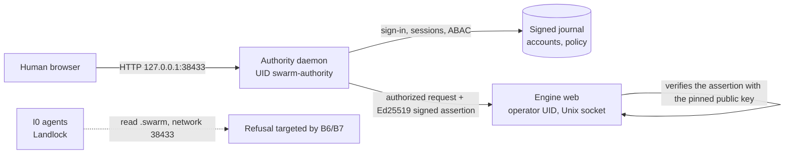

# Cockpit access — Phase B: separate authority, accounts and ABAC

[Français](../../../plans/acces-cockpit/PHASE-B-AUTORITE.md)

Status: **plan, not executed**. Written on 31 October 2026 after phase A
(single-use link, sign-out, key rotation; recipe
`tools/verification/recipes/web-login-ticket-rust.json`). The assistant runs no
`sudo` command; they will be prepared, reviewed and then run by the operator.

## Why a phase B

Phase A improves ergonomics without moving the boundary: the
`.swarm/web-session-*` key remains a secret of the same UID as the agents.

Finding verified in code (`swarm-biba-linux/src/lib.rs`, `Sandbox::prepare_bound`,
called by `native_provider_biba.rs` for agent, planning, reviewer, validation
and CLI preparation): I0 agents read the whole filesystem **except**
`<root>/.swarm`, write only to their workspace, and the network is not
restricted (`net:0`). They therefore cannot read the owner key. Real
remainders: (a) an agent can reach `127.0.0.1:38433` (without the key it only
gets `/login`); (b) `/proc/<pid>/cmdline` is readable: the single-use link
passed to `xdg-open` is visible there until consumed (under a second in
practice); (c) browser cookie stores in the home directory are readable;
(d) a program started by hand under the operator UID is not confined. The
human/agent separation thus still rests on a same-UID secret (EP-07: "same UID
+ 0600 insufficient"). Correction: a first version of this plan wrongly stated
that agents could read the owner key.

Real state of the enrollment authority (mapped on 31 October 2026): libraries
run in-process by one-shot CLI commands; a single `personal-account-v1`
account; password checked on every call, no session; no daemon, socket or
distinct UID; `SO_PASSCRED` channel tested in fixtures only; installation
without a dedicated system account.

## Target architecture

Target, not delivered. Principles:

1. **The daemon is the only HTTP entry point of the cockpit.** It serves
   `/login`, holds sessions, evaluates ABAC, then relays to the engine.
2. **The engine only trusts an assertion signed** by the daemon's private key
   (unreadable by the operator UID). A request without a valid assertion is
   refused; the HTTP owner key is retired once enabled.
3. **Agents can neither read the secrets nor reach the engine**: `.swarm/` is
   already unreadable to them; the network and `/proc` leaks remain (increment
   B7, complement to plan BT01–BT05).
4. **No permissive fallback**: daemon absent ⇒ cockpit unavailable with a
   diagnostic, never a silent return to the owner key (EP-08).

## ABAC model

| Dimension | Attributes | Source |
| --- | --- | --- |
| Subject | account, roles (`viewer`, `operator`, `approver`, `admin`), integrity I1–I3, free attributes (team, projects), authentication method, session age | Daemon signed journal |
| Action | `read`, `write`, `apply`, `approve`, `admin` | Route → action table, versioned with the engine |
| Resource | route family, mission, object integrity | Route table + attributes supplied by the engine |
| Environment | loopback, time, policy revision | Daemon |

Decision: `Allow | Deny(cause)`, deny by default. Ordered, revised rules
(preview, apply with expected revision, history). Biba invariants
(`check_biba`) and requester/approver separation still apply on top and cannot
be disabled by a rule. Shipped profiles: `viewer` (read), `operator`
(read/write), `admin` (settings, accounts, policy).

## Increments

| Lot | Content | Exit criteria | Opens / closes |
| --- | --- | --- | --- |
| B0 | Operator decisions below; written threat model | Decisions recorded here | — |
| B1 | Reviewed install script (`deploy/authority/install.sh`): `useradd --system swarm-authority`, `/var/lib/swarm-authority` 0700, hardened systemd unit (`NoNewPrivileges`, `ProtectSystem=strict`, `PrivateTmp`, `RestrictAddressFamilies=AF_UNIX AF_INET`), socket `/run/swarm-authority/`; `swarm-enrollment-bootstrap` declaration (service_uid ≠ controller_uid) | Idempotent script, verified dry run, documented uninstall; run by the operator | UX1, EP-07 (partial) |
| B2 | `swarm-authority` binary: SEQPACKET listener + `SO_PEERCRED` admission (`swarm-linux-identity-channel`), signed journal, clean stop | Daemon under its UID, non-admitted peer refused, restart without loss | EP-06, EP-08 |
| B3 | Multiple accounts in the signed journal (create, disable, reset, revoke; lineage kept); first admin bootstrapped outside the agent channel | First account only through authorized bootstrap; replay/concurrency refused | EP-01, UX2, UX6 |
| B4 | Daemon-held sessions: hashed random token, absolute and idle expiry, linearized revocation | Lifetimes as Admin settings (EP-09); revocation effective on the next request | EP-04, EP-05 |
| B5 | Daemon as HTTP front: account + password `/login`, relay to the engine over a Unix socket, signed assertion checked by the engine; HTTP owner key retired | Request without assertion refused; owner fallback only through a local `sudo` command | EP-02, EP-03 |
| B6 | ABAC engine in the daemon + route table; Biba and separation invariants | Viewer write → 403; permissive rule cannot bypass Biba; preview without mutation | UX5 |
| B7 | **Assessed on 31 October 2026, not adopted as is.** (a) Link out of argv: the default browser is snap Chromium, which cannot read hidden home directories; any location it reads is also readable by agents, and hiding `/proc` would break providers. Accepted remainder: theft by racing `/proc/*/cmdline`, visible (the browser shows "already used"), removed by B5 (password, no secret in argv). (b) Network: Landlock filters by port, not address, and agent OTEL telemetry targets the cockpit port (`telemetry_endpoint.rs:354`); blocking that port would break telemetry. The key stays unreadable (`.swarm` excluded) | Remainders documented here and in `SECURITY.md` | EP-07 (unchanged) |
| B8 | Admin: Accounts, Sessions, Policy tabs; user menu; real attribution of writes (former A4, literals `preparation_organization.rs:103`, `trust_store.rs:109`) | FR/EN, both themes, mobile, keyboard; history kept | UX3, UX7 |
| B9 | Personal API keys (scope, lifetime, revocation) for scripts | Hashed token, refused after revocation | — |

Each increment: failing test first, general fix, permanent recipe, FR/EN
documentation, verified local installation.

## Operator decisions (B0) — taken on 31 October 2026

Chosen: (1) daemon as HTTP front; (2) `.swarm/` reads denied to I0 agents; (3) first admin through a single-use code via `sudo`; (4) owner key kept only as a local `sudo` fallback. B7 remains useful but is no longer urgent: confined agents cannot read the owner key.

Options presented:

1. **Front**: daemon as HTTP front (recommended, above) or engine querying the
   daemon on each request (simpler, but the engine under the operator UID stays
   the gatekeeper and an agent reading its memory bypasses everything).
2. **Agent read confinement (B7)**: deny `.swarm/` reads to I0 agents — already
   the case, verified after the decision.
3. **First admin bootstrap**: local command `sudo -u swarm-authority
   swarm-authority bootstrap` printing a single-use code (recommended), or a
   bootstrap file prepared offline.
4. **Fallback**: owner key kept only as a local `sudo` command (recommended),
   or removed.

## B2 technical specification (inventory of 31 October 2026)

Reused building blocks, as they exist:

- **Installation declaration**: `swarm_enrollment_bootstrap::Document`
  (`service_uid` ≠ `controller_uid`, disjoint configuration and witness
  directories, pins) loaded by `loader::load(path, digest)`, which refuses when
  euid is not `service_uid` and opens private directories without following links.
- **Signed journal**: `swarm_enrollment_state::Journal` / `sign_change`
  (`enroll`/`revoke`, Ed25519, CAS on `Head`). It already handles N ids; a
  revoked id never comes back. Only the `personal.rs` layer pins
  `personal-account-v1`: B3 parameterizes it per account.
- **Password verifier**: `credentials::create`/`verify` (Argon2id, explicit
  costs to expose as an Admin setting, EP-09).
- **Kernel channel**: `swarm_linux_identity_channel::configure` (SEQPACKET,
  `SO_PASSCRED`, `SO_PASSPIDFD`); no listener exists. Current admission only
  accepts a controller spawned by the service itself.

B2 design decisions:

1. New binary crate `swarm-authority` (Rust), with no engine dependency.
2. Startup: `load` the declaration; refuse when euid differs from
   `service_uid`; no fallback.
3. HTTP front (B5) on the cockpit address; relay to the engine over a Unix
   socket created by the engine in a `0750` directory of group
   `swarm-authority` — to be qualified.
4. New admission path for the local control socket: `SO_PEERCRED` uid =
   `controller_uid` **and** proof of a human secret (password or bootstrap
   code); UID alone never suffices since agents share the operator UID.
5. **B2.1 status: done** (31 October 2026) — crate `rust/crates/swarm-authority`, `swarm-authority check --declaration … --pin … --json`, tests `tests/check.rs` 2/2. Protected fixtures live under `~/.local/state/swarm-protected-fixtures`: the loader refuses any group-writable ancestor, and `ChatGPT/` and `swarm/` are `775`.
6. **B2.2 status: done** (1 November 2026) — `Journal::snapshot` (verified head + active ids, read-only) in `swarm-enrollment-state`; registry `swarm_authority::accounts`: multiple accounts `account/<subject>/<nonce>` (roles `viewer|operator|approver|admin`, integrity 1–3, free attributes, Argon2id verifier), creation, oracle-free verification, password change by new generation then revocation, disabling, listing without secret material. Tests `tests/accounts.rs` and `tests/snapshot.rs`. Still open: rollback witness (EP-06), Argon2 costs as an Admin setting (EP-09), sessions, listener.
7. **B4 status (library): done** (1 November 2026) — `swarm_authority::config` (session lifetimes and Argon2 costs: shipped defaults in `config/authority-defaults.json`, operator override `authority.json` in the configuration directory, invalid file refused without fallback) and `swarm_authority::sessions` (random `as1-` token, only its SHA-256 kept in memory; absolute and idle expiry; disabled account or new password ⇒ session refused on the next request; sign-out; per-subject revocation). Tests `tests/sessions.rs`. A daemon restart signs everyone out (no session secret on disk).
8. **Chosen B5 design**: the daemon listens on the cockpit address, serves `/login` and sessions, then relays to the engine listening on an internal loopback address. Each relayed request carries an Ed25519 assertion signed by the daemon (subject, roles, integrity, method, path, body digest, timestamp, nonce); the engine verifies it with the pinned public key and refuses without it. An agent can reach the internal port but cannot sign (key unreadable). Unix socket to be reassessed if needed.
9. **B5.1 status: done** — `swarm_authority::assertion`: Ed25519 signing (`X-Swarm-Assertion: v1.<claims>.<signature>`), pure verification (pinned key, method/path/body digest, freshness window and nonce memory supplied by the caller). Tests `tests/assertion.rs`. Remaining: B5.2 (engine: window setting, pinned public key, refusal without assertion) and B5.3 (daemon HTTP listener and relay).
10. **B5.2 status: done, not installed** — v52 settings (`web_access_mode` owner-key|authority, `web_authority_public_key`, `web_assertion_max_age_seconds`, Admin group “Server and access”); the server reads them at start in `from_open_store` (production `swarm-rust web` path included). In `authority` mode every protected route requires a valid assertion (exact host, signature, bound request, freshness, single use) and the owner cookie opens nothing; a pre-v52 Root keeps owner-key. Test `swarm-web/tests/authority_access.rs`. **Deliberately not installed**: without the daemon (B5.3), switching to `authority` would close the cockpit; recovery = CLI `engine-settings apply` back to owner-key.
11. Slices: B2.1 crate + declaration loading + `check` command; B2.2 account
   journal (fixture, current UID as `service_uid`); B2.3 minimal HTTP listener
   `/login` + session; then B1 (`sudo` script) once the binary exists.

## Privileged commands (prepared in B1, run by the operator)

Provisional list, to be frozen and reviewed in the script:
`useradd --system --home /var/lib/swarm-authority --shell /usr/sbin/nologin swarm-authority`,
`install -d -o swarm-authority -m 0700 /var/lib/swarm-authority`,
`install -m 0644 swarm-authority.service /etc/systemd/system/`,
`systemctl daemon-reload && systemctl enable --now swarm-authority`.

## Limits

- root, or the operator with `sudo`, remains all-powerful; phase B protects
  against agents, not against the machine administrator.
- Agent network confinement (B7) only covers processes launched by Swarm under
  Landlock; a program started by hand by the operator is not confined.
- Docker (`compose.yaml`, one service under the operator UID) is not covered;
  a container variant is out of scope for this plan.
