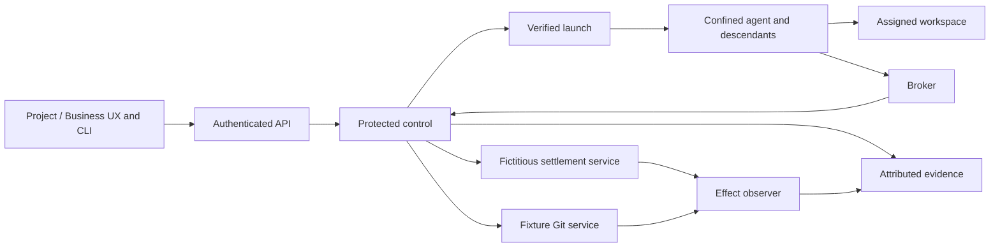

# PAEA — adopted APEX plan and execution record

[Français](../../../plans/actions-confiance/PAEA-APEX.md) ·
APEX queue (`../../APEX-QUEUE.md`, local tracking outside this publication) · AC-02 (`securite-execution-apex.md`, local tracking outside this publication)

## Authority and objective

October26 update: “fini push compile” authorizes compilation, scoped PAEA
commit/push and local delivery under standing authority. The compilation ban is
lifted; business authority and protected prerequisites remain unchanged.
See [increment 15](paea/INCREMENT-15.md).

On October 25, 2026 the user requested implementation of PA-00 through PA-13.
Root Codex owns integration. No implicit delegation or parallel execution.
Rust migration priority and prerequisites remain applicable. No commit, push,
real payment, external deployment or resumption of paused missions is granted.

Demonstrate for BOTH fictitious billing and software development that each
observed protected effect matches an authorization still valid for its exact
content at commitment. Activation is per project; missing required protection
denies the affected operation. The final target is experimental E3 with an
independent evaluator, a second implementation and preregistered comparison.
This is neither certification nor C3/C4 deployment authority.

The original PAEA v0.2 DOCX/PDF under `docs/security/` remain historical and
unchanged. Contract, code, local tests, installation and independent evaluation
must retain separate states.

The subsequently supplied [operational guide](../../../security/PAEA_v0.2_Guide_Operationnel.docx)
is a working implementation reference with [mapping and clarifications](paea/GUIDE-INTEGRATION.md).
Its examples replace neither versioned schemas nor session authority.

## Architecture and shared contracts

Reusing only in-process checks cannot protect control files/secrets from an
agent with the same UID. Retain existing kernels but separate agent execution,
protected control, effect services and observation under distinct trust boundaries.



Target architecture, not evidence of implementation. Control and keys stay
outside the agent domain under a distinct account. The first Linux profile covers
namespaces, mounts, privileges, FDs, processes and network. Authenticated peer UID
alone establishes no mandate. Bind the opened project instance, principal,
workload, scope and current authority. AC-02 policies retain SQLite persistence
and YAML exchange; existing global JSON settings are not silently relocated.
Admin/API/CLI share authoritative validation and effective values.

- Proposals are non-authoritative; control supplies admission context.
- Version schemas/canonicalization; reject duplicate/ambiguous/unknown fields.
- Derive business intent independently of transport request keys.
- Payment binds invoice ID/version, exact integer amount, currency and resolved
  account. Git binds assigned repository, direct ref, expected old OID, immutable
  candidate and existing checks/review/engine decision.
- Bind exact action, ordered sources and control versions. Relevant changes
  invalidate approval.
- Serialize current authority/revocation with effect commitment. Git/SQLite are
  not made atomic by an API call: retain durable intent and reconcile CAS updates.
- UNKNOWN is neither no-effect failure nor success; block potentially duplicating
  commitments until compatible reconciliation. Preserve prior effects/consumption.
- Legacy Trust paths must use protected control or explicitly refuse in protected
  projects. Errors preserve causes, safe codes and known/uncertain publication.

```text
PROPOSED → ADMITTED → APPROVAL_PENDING → AUTHORIZED → COMMIT_REQUESTED
COMMIT_REQUESTED → COMMITTED | DENIED | UNKNOWN
UNKNOWN → RECONCILED_COMMITTED | RECONCILED_NOT_COMMITTED
```

### PAEA-ERR-01

PAEA v0.2 §6.2 option (b): a content-bound single-use token can still be consumed
for the FIRST time after local revocation when the effect service does not check
that revocation. Uniqueness alone does not prove I17. Also require current
status/epoch under commitment order or disclose/prove propagation limits and
suspend uncovered critical use. Owner: PAEA author/effect control. Observable:
issue token → effective revocation → first redemption denied without effect.
Specified erratum; distributed evidence remains in PA-03/PA-12.

## Work packages and acceptance

| Package | Owner and dependencies | Work and observable output |
|---|---|---|
| PA-00 Baseline | Root Codex; current plans/source | Inventory Git/runtime, reservations, 17 invariants, evidence/resources and both controls. Bind exact bytes; never inherit Rust qualification from Go. |
| PA-01 Contracts | Codex; PA-00 | Schemas, canonicalization/vectors, business intents, commit order, errors, public operations, migration and bilingual diagrams. Testable contracts for both domains; data library grants nothing. |
| PA-02 Authority | Identity/integration; PA-01 + required IA3 output | Reuse enrollment/instances; separate control/keys, bind opened project, current mandates/approvals/revocation and shared Admin/API/CLI settings. Valid admission and attributed denials; missing protection fails closed. |
| PA-03 Effect services | Trust/managed repository; PA-01/02 | Separate fictitious ledger and conditional Git promotion, immutable candidate/checks/review, last-use authority, semantic uniqueness, durable intent and reconciliation. T04/05/06 in both journeys; new request keys never duplicate effects. |
| PA-04 Confinement | AC-02/A3; PA-02 + AC-02 prerequisites | Every launch/recovery/descendant; mounts/FS/FD/env/signals/detached processes, before untrusted code. Valid control and bypass test for each inventoried path. |
| PA-05 Network/secrets | AC-02/A4; PA-04 + AC-02/A2 | Mandatory broker, IPv4/6/DNS/redirects/sockets/persistent connections, control-side secrets, effective destination/labels, model/dependency/artifact flows. Valid traffic and zero observed forbidden sensitive bytes. |
| PA-06 Composition | Identity/Memory; PA-02/05 + required MEM-P2…P4 | Preserve instruction/data separation, provenance/versions/integrity/confidentiality over read/summary/transmission/compaction. Attenuated delegation and authenticated peers. No instruction/authority promotion in the defined scenarios. |
| PA-07 Tools/time | Launch/catalogue; PA-01/02/04 | Bind effective binary/schema/config, readmission on mutation, monotonic local leases and epochs/generations across restart. Inventory and ACS mapping only claim actual coverage. |
| PA-08 UX/approval | UX/integration; PA-02…07 interfaces | Admin with each policy; exact consequences/content/approver, visible denial/UNKNOWN, configured/applied/observed distinction, separate UX builds and measured vigilance. Both public journeys, FR/EN/themes/mobile/keyboard/focus/error/recovery. |
| PA-09 Evidence | Verification; PA-02…08, collect from first increment | Link proposal/admission/approval/commit/observation, preserve originals, separate key acquisition, detect tampering/omission/replay/rollback. Independent verification without believing agent reports. |
| PA-10 Local E2 | Codex + separate-context required review; PA-03…09 | Same candidate, actual no-fixture profiles, isolated CLI/API/browser, legacy bypass denial, supported build/install, process/hash/assets/version/FR-EN notes. Bounded E2 statement, not E3 closure. |
| PA-11 Prepare E3 | Sponsor + third-party team + evaluator | Designate independent roles; second effect boundary without Swarm control code, common schemas/vectors, preregister corpus/models/budgets/faults/metrics, B2/ablations and reserved attacks. Accepted resources and protocol before campaigns. |
| PA-12 E3 campaigns | Evaluator; PA-10/11 | T01…22/adaptive, direct effect oracles, equal-condition Swarm/B2/second implementation, ablations, authorized harmless human trials, full report and acknowledged defect handoff. |
| PA-13 Corrections/RETEX | Codex + evaluator; PA-12 | Reproduce, fix shared contracts, requalify affected earlier packages/verdicts, deliver verified candidate, final retrospective and learning transmission. Any required unresolved criterion keeps the program open. |

AC-02 retains Rust qualification prerequisites. Independent contract/protocol
preparation can proceed. Preserve IA3 → protected memory use → IA4 handoffs;
whole IA5/MEM-P5 closure is not an added circular dependency.

## Assurance and experimental protocol

| Invariant | Packages | Tests | Required observation |
|---|---|---|---|
| I01 Model non-authority | 01/02/06 | T01/T02 | Hostile contents cannot create permission. |
| I02 Identity/delegation | 02/06 | T03/T14 | Attributed principal and attenuated child rights. |
| I03 Provenance/flows | 05/06 | T02/T18 | Actual received context retains labels and versions. |
| I04 Exact approval | 01/03/08 | T04/T20 | Approved canonical content equals consumed action. |
| I05 Last-use authority | 02/03 | T05/T17 | Current authority at ordered commitment. |
| I06 Mediation | 04/05 | T07/T19 | Closed path inventory with actual enforcement. |
| I07 Secrets | 02/05 | T08/T17 | No critical unbounded effect credential in agent domain. |
| I08 Business uniqueness | 01/03 | T06/T09 | Same derived intent cannot repeat with a new key. |
| I09 UNKNOWN/recovery | 03/09 | T06/T21 | Reconcile service state without duplication/fabricated success. |
| I10 Human supervision | 08/12 | T10/T22 | Attributed qualified decisions and evaluated vigilance limits. |
| I11 Independent evidence | 09/12 | T12/T21 | Separate observer/anchors and attributable bounded proof. |
| I12 Safe failure | 03/04/05 | T10/T16 | No new sensitive effect without required preconditions; C4 excluded. |
| I13 Egress/confidentiality | 05/06 | T13/T19 | Effective destination and actually received bytes. |
| I14 A2A | 06 | T14/T18 | Peer, mandate, audience and reception linked. |
| I15 Tool qualification | 07 | T15/T20 | Changed effective tool requires readmission. |
| I16 Time/order | 02/03/07 | T16/T05 | Control clock/epochs, never agent-declared time. |
| I17 Sink revocation | 02/03/05 | T17/T21 | First redemption of pre-issued token fails after effective revocation. |

Abbreviated operational requirements from the register (each line must be tied
to an owner, an application point, an effect oracle and tests; I06 covers
mediation, I02/I04/I05 authority, I12 safe reaction — these obligations are not
interchangeable): I01 no agent, memory or tool content creates or extends a
permission · I02 authenticated principal and descendant rights included in the
parent's actually delegable rights · I03 every consumed context keeps
provenance/labels; untrusted data cannot drive a privileged command flow · I04
the digest of an approved canonical/versioned action matches the one consumed
at the sink · I05 policy, mandate and revocations are checked at the commitment
point · I06 every inventoried protected path goes through a barrier that is
unavoidable in the declared model · I07 agent/descendants hold neither a master
key nor an unbounded effect capability · I08 no duplicated effect for the same
business intent when uniqueness is required · I09 UNKNOWN requires
consultation/reconciliation before a new commitment risking duplication · I10
qualified approver, distinct when required, decision tied to the act and
controlled vigilance load · I11 event, candidate, decision and effect tied to
attributable evidence with its limits · I12 on failure, no new unauthorized
sensitive effect; physical safety per the safety analysis · I13 every egress of
sensitive data to network, model or third-party channel goes through
destination/label control · I14 authenticated A2A message/delegation, tied to a
reduced mandate with provenance preserved; mTLS or signature channel per the
model · I15 effective tool and schema tied to an admitted manifest; a relevant
change blocks until readmission · I16 local durations based on monotonic time;
concurrency decisions on transactional epochs/sequences, never agent time · I17
a pre-issued token cannot commit after effective revocation; otherwise a
declared propagation limit and the critical action suspended.

State per invariant: the per-invariant closure matrix (owner, application
point, oracle, tests, implemented/locally verified/independently accepted
state, gap class, required authority) is maintained in
[paea/evidence/20261028-acquisition81-mvfdts57/glm-closure-inventory-20261029T201336Z/invariant-matrix.json](../../../plans/actions-confiance/paea/evidence/20261028-acquisition81-mvfdts57/glm-closure-inventory-20261029T201336Z/invariant-matrix.json),
single source of the detailed state; recovery synthesis in
[POINT-ETAPE-20261029.md](../../../plans/actions-confiance/paea/POINT-ETAPE-20261029.md).
State summary as of 31 October 2026: local partial verification I01, I04, I05,
I08, I09, I12, I16, I17; incomplete candidates I06, I13 (BT02, egress not
confined); human/OS prerequisites I02, I07, I10; missing design I14 (A2A);
partial provenance I03; independent acceptance 0/17 (I11).

T11 additionally covers changed policy/source/candidate and stale proof. T09
includes split/cumulative effects across agents. Establish a valid control before
each injection. Read before/after service state; HTTP200/exit0/PASS labels alone
are insufficient. PA-01 local cases are not executed T01…T22 campaigns.

Keep forbidden effects, business/software success, false refusals, recovery/UNKNOWN,
p50/p95/p99 latency, cost/consumption/operator load and coverage separate.
Preregister volumes and budgets without universal magic numbers. Statistical
intervals require their assumptions. Publish low/no benefit against B2 honestly.

### Adaptive campaigns T18–T22

Extended campaigns; adaptive attacks must be built by a team that did not author
the system, then repeated per the [E3 protocol](../../../plans/actions-confiance/paea/E3-PROTOCOL.md)
(preregistration, valid control before each fault, separate observer).

| Test | Extended method | Verifiable result |
|---|---|---|
| T18 — multi-agent | Multi-turn, tool renaming, source→target context, label loss, summary/compaction. | No instruction promotion and no out-of-mandate effect. |
| T19 — paths | Fuzzing of FS paths, DNS, HTTP, symlinks, redirects, FDs, port-forward, IPC and bounded side channels. | No unmediated consequence path in the inventory. |
| T20 — canonicalization | JSON mutation, numbers, Unicode, ordering, business aliases, MCP schema, ambiguous encodings. | Same act ⇒ same representation, different act ⇒ distinct digest, or explicit rejection. |
| T21 — chaos | Crash between decision and commit, cut before/after effect, retries, restart and key rotations. | Effect accounting without double commitment or fabricated success. |
| T22 — human | Authorized campaign with false positives, harmless trap actions, overload and four-eyes control. | Measured vigilance; invalid approvals refused at the sink. |

Per-invariant coverage (from the matrix above): T18 → I03/I14; T19 → I06/I13;
T20 → I04/I15; T21 → I09/I11/I17; T22 → I10. These campaigns are E3 scope
(PA-11/PA-12, independent evaluator); no local trial of PA-01…PA-10 replaces
them.

## Delivery and current state

Every increment retains exact inputs/candidate, policy/function-doc/error/document
reviews, actual compiler/features/binary/assets, permanent recipes and fresh
integrity-verified evidence. Changed inputs invalidate affected proofs. No arbitrary
global watchdog, erased history, fabricated acceptance or implicit paid calls.
Use replan with original cause, changed precondition, authorized action and observed
effect, then resume the objective.

Milestones: M0 baseline; M1 both controlled effects; M2 mediation; M3 composition;
M4 installed local E2; M5 independent E3 campaigns; M6 re-evaluated corrections and
final retrospective. Program remains open after M4. Disabling project protection
requires an authorized decision; no automatic permissive fallback.

### Current state — 31 October 2026

Locally delivered unique candidate: `bin/swarm` SHA-256
`1d3f9da1408a82b14b5ae5d76328b58c52f1f92051824af52f1d413be8dd41fd`
(v0.1.1-dev.267). Bounded local E2 declaration **emitted** on 31 October 2026:
[DECLARATION-E2.md](../../../plans/actions-confiance/paea/evidence/claude-e2-arbitrage-20261031T135859Z/DECLARATION-E2.md)
— settlement 6/6 and chain 4/4 PASS VERIFIED on the regen-5 fixture; it closes
only the PA-10 stage; its seven explicit open criteria remain in force: no
independent acceptance, no real human enrollment, no distinct-UID separation,
no egress confinement, no E3 closure, I15/ACS inventory pending, fictitious
SQLite effects. Independent acceptance: 0/17 invariants, unchanged. PAEA17
triage (5 parts):
[TRIAGE-PAEA17.md](../../../plans/actions-confiance/paea/evidence/claude-e2-arbitrage-20261031T135859Z/TRIAGE-PAEA17.md).
Main blockers = human/OS
prerequisites (newuidmap/newgidmap, real enrollment, E3 evaluator, distinct
supervisor arbitration); detailed matrix in
[invariant-matrix.json](../../../plans/actions-confiance/paea/evidence/20261028-acquisition81-mvfdts57/glm-closure-inventory-20261029T201336Z/invariant-matrix.json).
Note: the "current installed binary: dev.263 90c3bf90…" line of
[POINT-ETAPE-20261029.md](../../../plans/actions-confiance/paea/POINT-ETAPE-20261029.md)
is superseded by the dev.267 candidate above.

October 25: PA-00 and PA-01 are partially implemented. The
`swarm-protection-contract` library, schema, fourteen vectors and public offline
`protection canonicalize` command cover data for both domains. This command
grants no authority and activates no protection. Complete authenticated mandate,
authority, approval and receipt contracts, and active CLI/API operations, remain
to be finalized with their protected producers. The [PA-11/E3 protocol](paea/E3-PROTOCOL.md)
is drafted, not preregistered. The user confirmed having no independent evaluator
or third-party team. No GLM/SKYNET call or delegation occurred in this increment.

The [retained recipe](../../../plans/actions-confiance/paea/evidence/20261025-contract-qekt2uwo/recipe-01/result.json)
ran 5 Python tests, 17 Rust contract tests and 4 CLI tests: 26 passed, zero failed.
Evidence integrity was verified. Clippy and Rustdoc also passed for the library
alone. These results establish no T01…T22 campaign, effect service, confinement or
E2/E3 qualification. The recipe inventory is declarative, not the full effective
compiler graph. Later documentation corrections are reviewed separately; original
evidence and corresponding executable inputs remain preserved.

### Replan: concurrent session and no compilation

The user is working in another session and requested avoiding compilation. No new
Cargo, Rustdoc, build, installation or restart will be launched by this conversation
under that instruction. Its last Rustdoc check had completed. Inspection found the
concurrent SCALING-S2 work in the Rust plan and effective managed-repository changes;
they remain with their owner. No other session's process is interrupted.

The instance observed before this instruction ran `v0.1.1-dev.65`; this PAEA
increment is not declared installed. Local integration owns delivery. Resume after
the instruction is lifted and the shared checkout is available, with full candidate
review and the supported delivery path. Global migration and required IA3 handoffs
remain open in inspected plans; AC-02 prerequisites remain in force. This foundation
starts no account, privilege, confinement or effect-service changes.

Owned files: this bilingual plan/contract, isolated library, schema/vectors/tests/
recipe, CLI `protection` module, targeted `swarm-cli/src/lib.rs` connections,
Cargo dependencies, bilingual `version_history.json` note, queue entry and own
evidence. No engine Trust, launch, supervision, active policy or live mission file
is reserved here. Preserve unrelated changes in shared files.

The [increment review](paea/INCREMENT-01.md) retains tested scope, all three review
axes, limits and resumption conditions. PA-00…PA-13 and its final retrospective
remain open.

### Increment02 — authorized GLM contribution, without compilation

The user's “go next avec glm” authorizes targeted internal GLM contribution.
The no-compilation instruction remains active. The
[new public recipe](paea/INCREMENT-02.md) ran four tests and 88 invocations against
the existing binary: 16 document refusals and one output failure, with valid
controls/recovery. Evidence PASS/VERIFIED; no Rust edits or installation.
The usable GLM contribution covers the raw decoder only. Exhausted first call
and failed first recipe remain preserved with verified recovery. PA-00/01 and
previous resumption conditions stay open.

### Increment03 — routing refusals with GLM

[Two tests added](paea/INCREMENT-03.md): six public tests total, 248 invocations,
69 expected refusals with exact recovery in both domains and FR/EN. Existing
binary stable, no compilation or restart. GLM proposal corrected before execution,
originals retained. PA-00/01 partial; IA3/Rust/AC-02/E3 dependencies unchanged.
No full program lot closed.

### Increment04 — export consumer and corrected GLM method

[Correspondence tool implemented](paea/INCREMENT-04.md): nine named tests,
42 CLI observations across both domains, no compilation or installation.
No semantic admission/authority/effect established; PA-09 only started.
User correction removes default GLM client cap: nine local HTTP tests and actual
request without limit fields retained. PA-00/01 and Rust/IA3/AC-02/E3 prerequisites
remain open.

### Increment05 — Rust comparison, not qualified

[Rust sources and three tests written](paea/INCREMENT-05.md), no compilation or
Rust test execution. New Python extension withdrawn after explicit user correction,
originals preserved. No CLI/API integration, installation or authority verdict.
PA-01/08/09 remain partial; qualification and IA3/AC-02 prerequisites open.

### Increment06 — Rust CLI integration, not qualified

[Compare command and four CLI tests written](paea/INCREMENT-06.md), without
compilation or execution. Existing reader, two named files, output schema and
FR/EN help; recipe updated, not run. No project/effect/approval activated.
No-compilation persists; PA-01/08/09 and qualification remain open.

### Increment07 — receipt/action/lifecycle source contract

[Rust checker and four tests written](paea/INCREMENT-07.md), uncompiled/unexecuted.
Reuses action/intent digests, expected sink and UNKNOWN/reconciliation lifecycle;
no authenticated receipt or effect service delivered. PA-01/03/09 and PA-02/AC-02
prerequisites stay open. No project activated.

### Increment08 — receipt checker CLI consumer

The user resumed the program and explicitly reconfirmed **no compilation or
restart**. [Rust CLI adapter and four tests written](paea/INCREMENT-08.md),
uncompiled/unexecuted: two files, explicit sink/prior state, canonical recomputation
and binding/lifecycle checks. FR/EN help, schema, recipe and contract updated;
authority, authenticity and effect remain unestablished. No GLM call or service
started. Output-error tests are isolated outside the caller checkout; their effect
is unverified. PA-01/03/09, qualification, installation, protected dependencies and
RETEX remain open. Next proof: affected targets and recipe on frozen inputs after
explicit lifting of the instruction.

### Increment09 — verification loop on an existing candidate

[14 public tests passed, 618 invocations](paea/INCREMENT-09.md), 167 expected
refusals, recipe PASS and integrity VERIFIED. Existing dev75 candidate from
another session frozen without compilation/restart here. All 432 effective input
archive members verified; eight PAEA inputs match observed sources. Two
increment-08 Rust assertions corrected to `failure.code`, unexecuted by Cargo.
Second loop: justified transitive Identity `serde`, removed temporal schema
descriptions and reexamined earlier lots without rewriting originals. PAEA-OBS-01
retains standalone report limitations with the applied transcript mitigation.
Six invariants have local structural observations; **0/17 demonstrated end to end**.
Protected PA-02/03/08/09, installation, E2/E3 and RETEX remain open. No-compilation/
restart instruction stays active: Rust tests after explicit lifting, effects after
protected IA3/PA-02 output, E3 with required third parties.

### Increment10 — PAEA-OBS-01 implemented in source

[Standalone v2 report and seven tests written](paea/INCREMENT-10.md): exact raw
document/receipt hashes, canonicalization and the same binding/lifecycle checker.
New `receipt-report` command; v1 `check-receipt` shape retained in source, v1 inputs
unchanged. No new right, effect or dependency. FR/EN help/schema/recipe/local notes/
contract updated. **Uncompiled/unexecuted/uninstalled** under the active instruction.
Existing dev75 witness records v1 control, absent new route and recovery without
a build. PAEA-OBS-01 remains functionally unverified; increment-09 proofs retain
their archived source scope and do not qualify new code. PA-01/09/program open.


### Increment11 — explicit UX request

After asking how to use the tests, the user explicitly requested adding UX access.
PA-08 now explicitly includes a menu entry. [First journey written](paea/INCREMENT-11.md):
**PAEA checks** in the native cockpit and Trusted actions; select action/receipt,
explicit service/state, correspondence check, visible refusal/UNKNOWN and v2 report.
Authenticated API uses the shared pure checker with no effect or activated
protection. Browser component is separately verifiable; native route, actual
binary assets and installation remain unqualified under no compilation/restart.
Two HTTP Rust tests written and permanent browser recipe added. PA-08 remains
partial: protected approvals/configured-applied-observed, both UX products and
vigilance still require PA-02…07 interfaces and the planned experiments.


### Increment12 — qualification on an existing candidate

[Public and actual-CLI screen evidence](paea/INCREMENT-12.md): dev77 candidate
built by the other session, frozen without compilation/restart here. 434 effective
archive members verified, seven PAEA inputs match. 18 public tests passed, 973
invocations including 268 expected refusals; local v2 OBS-01 distinction verified,
v1 preserved. Screen: 174 assertions and 48 actual CLI calls through an HTTP fixture
bridge, FR/EN and both domains; no fabricated checker response. After another
session changed the catalogue, component replay passed 219 assertions/40 simulated
requests. Three recipes PASS, integrity VERIFIED. This bridge is not native HTTP: its two Rust tests, served
assets, installation and protected approvals remain open. Original 09…11 proofs
are preserved; no seventeen-invariant/E2/E3/RETEX closure.


### Increment13 — operational guide and UX journey

The user supplied the operational guide to inform implementation.
[Complete mapping](paea/GUIDE-INTEGRATION.md) retains the original, maps chapters
to owners/plan/proofs and defines three dossiers plus target UX. Existing file
checking stays partial. Functional priority: effect card/owner/boundary/oracle
and three recipes in both pilots, preserving PA-02/03 and Rust/AC-02 prerequisites.
ERR-01 also applies to guide7.1; pedagogical JSON/figures do not replace schemas;
project+invoice intent requires protected project-unique debt resolution before
the sink. IAM/industrial execution remains out of scope. The [increment record](paea/INCREMENT-13.md)
also retains bounded PAEA-UX-02 contrast work, normal/hover/keyboard tests and
component-versus-installed-binary distinction.

### Increment14 — two laboratory effects and separate observation

[Operational dossier](paea/OPERATIONAL-PILOT.md): payment/Git cards, missing
authorities, access graph and three executable recipes without a build.
SQLite and Git branch+canonical-marker transactions produce effects in 26
isolated roots; separate oracle process reads no receipt/decision journal.
**7 tests PASS, 132 subprocesses, recipe PASS/integrity VERIFIED**. T04, lost reply
and revocation before first use exercised in both domains with controls/recovery;
these are fixture orders, not distributed evidence. Git negative witness:
context-ignoring replay guard triggers the expected failing assertion.
PAEA-GUIDE-03 reproduces two entries for raw aliases without a business registry;
counterexample retained, protected debt resolution required before PA-03.
[Record and limits](paea/INCREMENT-14.md). Common UID/simulated authority: **0/17
end-to-end invariants**, protected PA-02/03, campaign menu, native qualification,
installation/E2/E3/RETEX open. No build or restart.

### Increment15 — native qualification and authorized delivery

The user lifts the compilation ban. Checkout and targeted worktree on the
published base: **5 Python and45 Rust tests PASS**, including the two previously
unrun HTTP tests. Normal dev79 build prepared before any stop; real executable
and embedded assets in the browser: **237 assertions/12 configurations**,24
expected refusals, no unexpected diagnostics. Eight protected assets match
sources; FR/EN/themes/mobile, Version dialog, Git link and focus verified.
PAEA returns to the cockpit independently of Biba.
[Evidence, publication scope and delivery](paea/INCREMENT-15.md); generated local
result retains actual remote commit and active version/PID/hash. Correspondence
menu is qualified; lab campaigns remain outside UX. This delivery closes neither
protected PA-02/03, the **17 invariants**, nor program E2/E3/RETEX.

### Increment16 — explicit debt identity

[Decision and criteria](paea/INCREMENT-16.md): preserve the v1 hash and resolve
supplier/reference to a stable debt object before admission. Pure library and
offline CLI reject collisions/stale versions; a separate fixture observation
checks one effect for two aliases. Supplied snapshots remain unauthenticated;
revision continuity and protected authority remain open.

Increment 16 verified and installed as **dev82**: 37 contract tests, 2 public tests
(33 calls), 8 fixture-effect scenarios and 26 live-instance checks PASS; browser
failure guard verified with an expected failure after a valid control. Sources
remain uncommitted; no new protected assurance or E2/E3 closure.

### Increment17 — invoice resolution from the menu

[Contract, decision and evidence](paea/INCREMENT-17.md): PA-08 exposes the shared
resolver from PAEA checks, with a dedicated help/download page. Closed native API,
exact i64 values, refusal/recovery and explicit non-authority markers. Receipt
correspondence remains available; no protected registry activation.

Increment 17 delivered on **dev87**: 4 schema/4 HTTP tests, 219 component checks,
452 native assertions on dev86 with 448 identical delivery inputs, 30 actual
dev87 checks PASS. Build version/commit/date differences and bounded proof reuse
are retained. Clippy/Rustdoc PASS; script-loss guards verified after controls.
PAEA changes remain uncommitted; protected registries/approvals and E2/E3 open.

Publication requested on 26 October: isolated increments-16/17 commit, without
push or a new delivery; see the publication follow-up at the end of report 17.
The precommit statements above retain their historical scope.

### Increment18 — GLM resumed

“reprends glm” authorizes a targeted internal contribution on delivered invoice
resolution/API/UI contracts. [Criteria and follow-up](paea/INCREMENT-18.md): each
finding must be reproduced or refuted, then corrected/verified when justified.
Protected handoffs and assurance limits remain open.

Increment 18 verified: one complete GLM contribution, two new exact Rust tests
PASS on stable frozen inputs, 28 native encoding assertions PASS. Four recipe
inventories corrected; no established product defect, product change or new
installation attributed to this slice. Full suites/protected guarantees stay open.

### Increment19 — menu comparison with GLM

[Slice, criteria and evidence](paea/INCREMENT-19.md): expose the existing shared
comparator through native API/PAEA page, both domains, value-free report and exact
export. GLM proposes validation/rendering; Codex integrates/verifies existing and
new journeys and delivers locally. Protected authority remains unchanged.


Increment 19 installed locally as **dev95**: menu comparison, shared API/CLI,
report without values. Two schema/seven HTTP tests PASS; 1,310 browser assertions,
12 configurations × three views, 62 actual native refusals/recovery; 34 real live
delivery checks PASS. GLM returned HTTP 504 with no usable contribution; Codex
implemented and verified the connection. [Slice result and retrospective](paea/INCREMENT-19.md)
retain build refusals, qualified normal-candidate reuse, hashes and limits.
No commit/push. IA3/AC-02/human authorities, E2/E3 and protected acceptance remain open.


Next decision: the user authorizes committing increment 19, then continuing
directly with Codex, **without GLM**. Preserve protected prerequisites, rights
and budgets; select the next slice from the plan's actual state.


### Increment20 — ready-to-download examples

[Direct slice without GLM](paea/INCREMENT-20.md): eight versioned fictional files,
help in all three views and actual native checks after completed downloads.
No automatic selection/submission; protected assurance unchanged.


Increment20 implemented without GLM and installed as **dev96**: eight examples
from all three help panels, 1,743 native assertions, 36 journeys/120 downloads,
and 40 live checks PASS.
Increment19 commit `f41003488`; no increment20 commit/push. Supported one-off
qualified normal-candidate activation preserves source configuration; concurrent
reviewer compilation (`Capture::new`, dev97 attempt) remains open. [Results and
resumption](paea/INCREMENT-20.md). No protected assurance added.


The user then requests committing installed increment20. Isolated Git recording,
without push or another delivery; dev96 results/limits remain in the
[increment20 record](paea/INCREMENT-20.md).


### Increment21 — exact action inspection

[Direct slice](paea/INCREMENT-21.md): byte-bound shared report, CLI/API and readable
terms/context/sources from the menu. No approval/effect; preserve canonical
contracts and qualify all four views.


Increment21 installed as **dev101**: **Inspect an action** in the PAEA menu, common
CLI/API report, exact terms/context/sources/revisions. Nine targeted tests,2,265
native assertions (four views),48 example journeys/144 downloads,87 native refusals
and46 live checks/20 assets PASS. [Slice result and retrospective](paea/INCREMENT-21.md)
retain initial freshness refusal, dev100/dev101 profiles/hashes and review scope.
No GLM, commit or push. IA3/AC02/humans, E2/E3 and0/17 protected invariants stay open.


User requests commit21 then next. Commit `72e0e32dc`,40 files,108 foreign staged
entries preserved,no push. [Increment22](paea/INCREMENT-22.md) connects supplied approval
binding to exact action/policy data,without protected activation.


Increment22 installed as **dev107**: **Compare a supplied approval** menu, common
CLI/API two-file-bound report,explicit match/mismatch/invalid refusal.11namedtests,
10generationchecks,3,086nativeassertions,60journeys/192downloads,113refusals and
52livechecks/23assets PASS. Primary1.28:1transitioncontrast reproduced and fixed
on the shared five-view component;36observations,min9.096:1. [Results/retrospective](paea/INCREMENT-22.md)
retain failures,recovery,profiles/hashes. No GLM/commit22/push; IA3/AC02/humans,
E2/E3 and0/17remainopen.


### Increment23 — laboratory campaigns in the menu

Commit22 `51a3ac828`,42files,108foreign staged paths preserved, no push.
[Slice23](paea/INCREMENT-23.md): explicit reproduction command and campaign
report reader from the menu; eight scenarios and preserved counterexample.
No web execution or protected activation is attributed to this slice.


Increment23 installed **dev109**: Laboratory campaigns menu,explicit command
and local report reader. Eight real tests,506nativeassertions,12downloads and
56livechecks/25assets PASS. Exact qualified normal candidate activated once,
source configuration preserved; concurrent engine compilation remains open.
[RETEX/evidence](paea/INCREMENT-23.md). No commit23/push; protected PA-02/03,
browser campaign execution,E2/E3 and0/17invariants stay open.


### Increment24 — revocation/commit contention

Commit23 `97933d8b7`, 27 files, 108 foreign staged entries preserved.
[Qualification 24](paea/INCREMENT-24.md): extend T05/T17 to real overlapping
processes in both fixtures, contention refusal and explicit recovery. Criteria
and limits retained; no new protection or server installation claimed.


Qualification24 verified: four real SQLite/Git contentions with controls, four
expected early-release assertion failures and public eight-case campaign
PASS/VERIFIED. Pinned dev109 protection sources match its effective profile;
dev112 observed separately, without intervention by this slice. Recipe stream
defects corrected/originals retained, derived inventories completed; unchanged
browser not replayed. [Review/slice RETEX24](paea/INCREMENT-24.md). Protected
0/17 invariants, IA3/AC-02, humans, E2/E3 and final programme remain open.


### Increment25 — original laboratory evidence integrity

Commit24 `079635b29`,14 files,108 foreign staged paths preserved.
[Slice25](paea/INCREMENT-25.md): reproduced PAEA-EVIDENCE-25 on a copy (deleted
oracle, old export still possible); v2 call index and explicitly pinned inventory
with original-file verification. Keep report v1, no inferred authenticity or new
protection. Results pending recipe; programme remains open.


Slice25 verified: eight effect tests, eleven verifier regressions/68CLI checks,
1020observation and10recipe files bound,197v2calls. Final recipes and24contention
guard PASS/VERIFIED. Missing oracle refuses export; publication uncertainty is
UNKNOWN with expected pin and verified recovery. Forged-new-pin counterexample
retained; simulated authority/0of17protected, IA3/AC-02/humans/E2/E3/final RETEX
remain open. [Review/limits25](paea/INCREMENT-25.md). Checkout tooling, report v1
and server unchanged; no build/install/commit/push.


### Increment26 — native current-authority control core

PA-02 resumed directly by Codex without GLM. [Increment26](paea/INCREMENT-26.md):
retained connection to existing signed authority, exact current checks held
through real configuration/witness storage, revocation refusals and UNKNOWN
after possible effect. Library core only; no service activation or inferred
human identity. Protected transport/bootstrap, PA-03, E2/E3 and 0/17 global
invariants remain open.


Increment26 verified:41named tests, recipe PASS/VERIFIED,17effective local sources
matched for the normal build and four crates without test-fixtures; Rustdoc PASS.
Revocation ordering, UNKNOWN after effect, both causes and exact-event recovery
observed. [Review/RETEX26](paea/INCREMENT-26.md). No normal CLI consumer, hence no
installed service from this core; protected transport/bootstrap and local personal
authentication remain unconnected. PA-02 partial;0/17/E2/E3/final RETEX open.


### Increment27 — pinned startup and native preflight

Commit26 `cbd6fecd7`,15files,108foreign staged paths preserved.
[Increment27](paea/INCREMENT-27.md): closed v2, independent checkpoint and real
current-enrollment verification through the normal CLI, without starting a
service. 42 named tests and Rustdoc verified; dev.123 installed, parallel dev.124 observed,
normal profiles bound to served SHA, both CLI replays and 56 browser checks pass; protected human
identity/transport, PA-03, E2/E3 and0/17global invariants remain open.


### Increment28 — personal-secret knowledge

[Increment28](paea/INCREMENT-28.md): exact-record/context Argon2id v19 contract,
explicit parameters, guarded workspace and opaque typed knowledge proof.
Verification/integration in progress; no account/session/transport created. Next:
one-time bootstrap storage, actual service/authentication and UX, PA-03/04… .
Knowing a secret never implies consent or business rights. Continuous autonomous
technical work authorized; actual human enrollment and E3 roles remain independent.


### Increment29 — one-time consumption and current account

[Increment29](paea/INCREMENT-29.md): retained signed-journal atomic batch,
indivisible bootstrap revocation/account creation, exact replayable proposal,
current authentication held through usage and outcome preserved after errors.
Recipe/review/delivery in progress. Fixtures are not actual human enrollment;
service/transport, Admin/UX settings, separate account and confinement follow.


### Increment30 — exact personal recovery codec

[Increment30](paea/INCREMENT-30.md): canonical private proposal export/restore,
independent-root/exact-shape checking, signature preview without current state/IO,
and retained base64 causes. Initial3then strengthened3tests pass;39test recipe,
review/delivery pending.29has35verified tests but28/29delivery remains open after
changing foreign effective inputs. Next coordinator must protect durable intent/
checkpoint and fsync/recovery before service exposure. Human/confinement/E2/E3 remain open.


30 qualification:39named tests/7steps,6frozen CLI harness tests and56live readonly
assertions plus missing-script refusal PASS; normal495-source dev128installed and
Version FR/EN verified. [Details](paea/INCREMENT-30.md).28/29historical limits retained.
31private files is next, followed by protected intent/checkpoint coordinator.
PA-02partial;0/17global invariants; human/confinement/E2/E3/PA13remain open.


31private-documents implementation: shared descriptor IO, publication phase and
retained release errors, exact CAS/private files; old Store lock binding also
reviewed. [State31](paea/INCREMENT-31.md).43test qualification pending; not an active service.


31qualified/installed dev129:43named tests/5steps,6CLI harness tests,56readonly UI
assertions+fault refusal, Rustdoc and497-source normal profile verified. Shared
lock substitution regression closed locally; [details](paea/INCREMENT-31.md).
Continue [32](paea/INCREMENT-32.md), still planned; human/service/confinement/E2/E3open.


[32](paea/INCREMENT-32.md) implementation: protected exact intent before consumption,
checkpoint after ack, paired cancellation, current held auth after file release.
First5tests PASS; expanded31test recipe, review and delivery pending. No endpoint
or human enrollment claimed. PA-02partial/global0of17 unchanged.


32library qualification PASS:32tests, Rustdoc, FR/ENdiagrams, normal499-source
profile. Installation remains OPEN after launcher refused concurrent candidate
inventory change; dev129last verified. [Details32](paea/INCREMENT-32.md). Continue
[33](paea/INCREMENT-33.md)independently, retain pending delivery/PA-02/E2/E3/global0of17.


[33](paea/INCREMENT-33.md) implemented typed composition of held personal account
and business authority, exact principal/install binding and nested effect outcomes.
Private Debug counterexample fixed;14tests+1double-held-authority targeted PASS.
38test recipe/current normal delivery pending. No actual service/human/OS confinement.


[34](paea/INCREMENT-34.md) implemented pinned composite declaration/shared physical
loader and actual two-source opening, no account init/listener.16bootstrap+4startup
scenarios verified; aggregate59test recipe/review/delivery pending. Partial cleanup
errors preserved, actual production routing/service UID/confinement/E2/E3stillopen.


34internal APIs verified/included in installed dev136:59named tests/10steps, current
Rustdoc,515-source nofixture profile,6CLI harness tests,56live readonly checks+fault
guard. [Details](paea/INCREMENT-34.md).32/33pending delivery now additive evidence.
Continue35protected signer/lifecycle; no personal listener/actual human/OSconfinement,
PA-02partial/global0of17/E2/E3/PA13remainopen.


35started: protected signing-key loading, before lifecycle; global acceptance unchanged. [Plan35](paea/INCREMENT-35.md).


35protected signer verified/installed dev137:12namedtests,Rustdoc,516-source normal
profile,dalekzeroize,6CLI harness cases,56UIassertions+failureguard. [Proof35](paea/INCREMENT-35.md). Continue36owned lifecycle; no global acceptance/human/service.


36owned personal lifecycle started; [plan36](paea/INCREMENT-36.md), global acceptance unchanged.


36owned lifecycle verified/installed v0.1.1-dev.142:43namedtests,normal
519-input profile,6CLIharness,56UI+faultguard,currentconsolidatedFR/ENnotes.
[Proof36](paea/INCREMENT-36.md). Continue37native personal lifecycle; transport/UX/
OSseparation/passwordrotation/E2/E3/PA13/global0of17remainopen.


37native personal lifecycle started; [plan37](paea/INCREMENT-37.md), global acceptance unchanged.


37aoptionguard delivered/behaviorchecked147,7frozen145+named147guard+56UI,privateRustdoc. Currentglobal13sourcequalification stillopen; [details37](paea/INCREMENT-37.md). Continue37bpersonalCLI; global0of17/E2/E3/PA13open.


37b personal CLI delivered/verified154:32tests/7stable steps,7native default-binary journeys and56UI; [proof/limits37](paea/INCREMENT-37.md). Next38: protected initial provisioning then transport/UX. PA02partial,global0of17/E2/E3/PA13open.


38started: initial material before protected publication/recovery; [plan38](paea/INCREMENT-38.md). No implicit grant/service/human.


38initialmaterial verified/delivered156:27tests/4steps,1native generatedmaterialjourney,56UI; [proof/limits38](paea/INCREMENT-38.md). Next39guarded private read then publication/recovery. No installed publisher/service/human/confinement;global0of17/E2/E3/PA13open.


39guarded private read started before seedpublication; [plan39](paea/INCREMENT-39.md). Separate from existing nonsecretread.


39private reader/writeprecheck delivered157:51composedchecks(21reused+30fresh),7normalCLI,56UI; [proof/limits39](paea/INCREMENT-39.md). OriginalmanifestFAILkept.40publication/recovery next;global0of17/E2/E3/PA13open.


40protected operatorpackage started before41servicepublication; [plan40](paea/INCREMENT-40.md). Independentpin,noheadadoption.


41explicitpackage durability started;40deliveryOPENafter normalrefusals,157lastqualified. [Plan41](paea/INCREMENT-41.md).42servicepublicationnext,global0of17unchanged.


42service-onlyartifact started:personalkey/signedevents,operatorsecretsexcluded;[plan42](paea/INCREMENT-42.md).43publication/current40-41deliveryopen.


42: service-only handoff and local **v0.1.1-dev.165** delivery verified (18 library,7 CLI,56 browser plus script refusal).43file publication next, global0of17unchanged. [Plan42](paea/INCREMENT-42.md).


43private service-file publication started. [Plan43](paea/INCREMENT-43.md).


44publicCLIadapterfor43publisher started, shared delivery pending. [Plan44](paea/INCREMENT-44.md).


43/44locallydelivered **dev168**:50librarytests (6supplement),8CLIjourneys/59commands,7olderpersonaljourneys,56UIchecks plus scriptrefusal; actualprofile/ELF/assets/Versionverified. No human/separateUID/listener/E2/E3/globalinvariantacceptance. [Plan44](paea/INCREMENT-44.md).


45actualLinuxdiagnostic started;44historical168delivery, currentlock/cataloguerequalification afterconcurrentdrift. [Plan45](paea/INCREMENT-45.md).

43/44 requalification completed on dev174:50fresh library cases,8CLI/59commands,7regressions,56UI+guard,561-input/no-fixture profile and common actual ELF verified. Earlier evidence and concurrent refusals retained. [Details44](paea/INCREMENT-44.md).45Linux observation verified; uidmap installation requires local administrator authentication. No global invariant or OS separation acquired.

46 private request and personal service core started independently of missing Linux helpers; [plan46](paea/INCREMENT-46.md). No endpoint/separateUID/human/global acceptance gained.

46library19cases qualified;47public binding excluding secrets, response/after-effect cause retention24Rust cases and Rustdoc PASS; public delivery still to connect. [Plan47](paea/INCREMENT-47.md).

48bound consumer verified:29Rust+3schema/5steps, canonical/request/pins/history/Change checks, AfterUse counterexample corrected. [Plan48](paea/INCREMENT-48.md).49native operator adapter/grouped local delivery next; serviceUID/transport/human/global remain open.

46…49 locally delivered/verified **dev175**:39Rust+3schema,5new native journeys/56commands,8installation,7personal,56UI+guard,571-input/no-fixture profile and common actual ELF. [Evidence49](paea/INCREMENT-49.md).50attributed channel/client next; UIDhelpers/admin/human/E2/E3/PA13 and0of17 remain open.

50replan: Rustix getter PID0representation risk,4consumers identified;3old175gates refuse but report errno0, no effect. Raw-safe getter/diagnostics implemented, qualification/delivery pending. [Plan50](paea/INCREMENT-50.md). Resume channel after this shared prerequisite; globals unchanged.

Increment 50 delivered and verified in **dev180**: 4 engine + 6 CLI tests, strict Rustdoc, 5 personal journeys / 56 commands, 3 valid witnesses + 3 invisible-PID refusals, 56 UI checks and failed-script guard; 581-input normal profile and same actual ELF. [Evidence and limits](paea/INCREMENT-50.md). Resume attributed channel; UID, human, E2/E3, PA-13 and 0/17 globals remain open.

51: isolated Linux boundary verified as a library, nine Rust cases + two fixture journeys, strict Rustdoc and ABI/ownership review; no public consumer yet. [Evidence51](paea/INCREMENT-51.md). Resume52 admission/integration/grouped delivery; dev180 remains this task's latest qualified delivery, UID/human/globals open.

51–52foundations delivered/verified in **dev185**:41Rust+3schema,2fixturejourneys,5operator/56commands,3gates,56UI+guard;587-inputprofile/57owninputs, newlibrarynofixture andsameactualELF. [Evidence52](paea/INCREMENT-52.md). Protectedrole/exactpacket/UIDprecondition linkedaslibrary; completeadmission/daemon/realdistinctUID/human/E2/E3/PA13/global0of17 remainopen.53reservedUIDhypothesisnext,thenresumeintegration.

Increment 53 ongoing: [valid UID representation](paea/INCREMENT-53.md). Contract tests qualified; driver, native flow and delivery still require verification. Channel admission and global acceptance remain open.

Increment53 verified locally dev189:101targetedRust/8Go parents/3schema,9installation/5operator/7personal+3guards,3gates,56UI+guard; [evidence and limits](paea/INCREMENT-53.md). PA-02/global0of17 remain open; protected public preparation then channel next.

[Increment54](paea/INCREMENT-54.md) installed/verified dev192: private canonical request preflight without material generation;8Rust+3schema,5new journeys/84commands,9installation/5operator/7personal+3guards,2fixture-role guards,56UI+guard and3peer gates. PA-02/global0of17 remain open; public operator package/service export next.

[Increment55](paea/INCREMENT-55.md) installed/verified dev200:pinned operator package read, deterministic private service export/reconciliation;6journeys/154commands on200,56UI+guard,3gates. Historical199 regressions reuse unchanged PAEA/CLI bytes without all-200 ELF aggregation. PA-02/global0of17 open;protected initial creation then channel remain next.

[Increment56](paea/INCREMENT-56.md) started:immutable private anchor before public generation/publication; distinguish protected locator from independent pin without circular evidence. No new verified global criterion.

[Increment56](paea/INCREMENT-56.md) installed/verified dev201:immutable private anchor/CLI,5journeys/67commands,regressions6export/5preflight/9install/5call/7personal+3guards,56UI+guard and3gates.37targetedRust/16Python schema methods, no global percentage. Next57:durable intent before generation then pinned package/recovery. PA-02/global0of17 open.

[Increment57](paea/INCREMENT-57.md) started:durable intent before generation, anchor before package, existing private reservations and reconciliation without regeneration. Request pin binds exact input bytes; no service/human/current mandate created.


[Increment57](paea/INCREMENT-57.md) installed/verified dev205: durable intent before generation, anchor before package and reconciliation without regeneration;46targeted Rust/6schema methods/12swaps,6new journeys/113commands,regressions and56UI+guard on the same default ELF631/64. Orphan remediation and service-domain handoff next; PA-02/global0of17/E2/E3/PA13/RETEX open.


[Increment58](paea/INCREMENT-58.md) underway: kernel packet bound to retained UID and expected namespace objects before decode/dispatch, Reply and cleanup preserved;49targeted Rust/3schema, local delivery pending. Independent domain approval, daemon and actual separate UIDs open.


[Increment58](paea/INCREMENT-58.md) locally verified dev206 then current207 bound to identical65PAEA inputs:51distinct Rust/3schema; native call/personal206 retained separately, fresh207 UI56+guard and peer; default profile636/65. Only foreign runtime-health asset differs. No new daemon or actual distinct-UID business success; least-privilege launch and ptrace permission next. PA-02/global0of17/E2/E3/PA13/RETEX open.


[Increment59](paea/INCREMENT-59.md) started: bind kernel packet subject to independently spawned Child, not request PID or connection creator; retain ALL58checks. No daemon/ptrace permission/actual separate UID acquired.


[Increment59](paea/INCREMENT-59.md) locally verified dev208: conditional Child anchor retains ALL58checks;27Rust, default637/65,5call/7personal/3pairs/56UI+guards on same ELF. Native atomic creation next; launcher/daemon/actual UIDs/E2/E3/PA13/RETEX/global0of17 open.


[Increment60](paea/INCREMENT-60.md) atomic library verified:35distinct Rust,6source/3Rustdocpages, traced CLONE_PIDFD. Delivery pending: three profile refusals for concurrently changed shared inputs;208 retained. Resume after producer stability, no rebuild loop. Consumer/daemon/UID/human/E2/E3/RETEX/global0of17 open.


[Increment60](paea/INCREMENT-60.md) atomic library delivered/verified v0.1.1-dev.209:35distinct Rust,6sources/3Rustdocpages, traced CLONE_PIDFD, default645/67 and existing paths on same ELF. Consumer/daemon/actual UIDs/human/E2/E3/PA13/RETEX/global0of17 open.


[Increment61](paea/INCREMENT-61.md) single-packet response library verified:27distinct Rust(9new),4sources/4Rustdocpages; actualEPIPE/EMSGSIZE/EAGAIN and recovery. Delivery pending25concurrently changed Web inputs;209 retained. Resume qualified common candidate/68PAEA inputs without rebuild loop. Daemon/UID/human/E2/E3/PA13/RETEX/global0of17 open.


[Increment62](paea/INCREMENT-62.md) locally qualifies namespace-owner permission:2Rust tests/6phases, refusal outside childuserns then owned-child access with parentCapEff0. Same externalUID, no actual separation. Native fixture error retained, frozen proof and altered-copy refusal. Tests only, no62runtime version;61awaits stable candidate. PA02/global0of17/E2/E3/PA13/RETEX open.


[Increment61](paea/INCREMENT-61.md) single-packet response delivered/verified v0.1.1-dev.211:27distinct Rust(9new),4sources/4Rustdocpages, actualEPIPE/isolatedSIGPIPE, default650/68, existing native flows and56UI+guard on same ELF. Composition/daemon/actualUID/human/E2/E3/PA13/RETEX/global0of17 open.

[Increment63](paea/INCREMENT-63.md) one controlled exchange delivered/verified **v0.1.1-dev.215**:45distinct Rust/7new,3sources/4pages Rustdoc, default profile653/69, existing native CLI and56UI+guard on same ELF. Library qualification; daemon/actualUID/human/confinement/E2/E3/PA13/RETEX/global0of17open.

[Increment64](paea/INCREMENT-64.md) nativeLinux/CLI/API/page delivered/verified **v0.1.1-dev.216**:10Rust,111component/60installed/56Version+guards,37native/52CLI/16HTTP, default665/81 andsameELF. Metadataobservation only; UID/human/confinement/daemon/E2/E3/PA13/RETEX/global0of17open.

PA-03 resumption: [effect service integration decision](paea/PA03-SERVICE-INTEGRATION.md), inspected sources and conditional sequence. Analysis only; no additional protected effect or delivery established.

[Increment65](../../../plans/actions-confiance/paea/INCREMENT-65.md): separate exact PAEA permission, library verified and compiled in **v0.1.1-dev.218**, 8 PAEA + 3 Trust tests + 3 compile refusals, strict Rustdoc and 56 Version/UI checks + guard. Normal 671-input profile, same actual ELF. No protected effect service activated; PA02/03, 0 of 17, E2/E3/PA13/RETEX remain open.

[Increment66](../../../plans/actions-confiance/paea/INCREMENT-66.md): separate fictitious settlement reference kernel installed and verified in **v0.1.1-dev.220**; 12 Rust tests, strict Rustdoc, 56 Version/UI assertions plus script guard. Normal profile 677 inputs, actual matching ELF. Enabled separation refuses pending attributed admission; no protected daemon activated. PA02/03 partial, 0/17/E2/E3/PA13/RETEX remain open.

[Increment67](../../../plans/actions-confiance/paea/INCREMENT-67.md) verified/installed **v0.1.1-dev.221**: four inconsistent receipt metadata cases reproduced then refused; 13 Rust tests, strict Rustdoc, 56 Version/UI assertions plus script guard, normal 677 inputs and matching ELF. No receipt authenticity or global protection inferred; PA02/03/0 of 17/E2/E3/PA13/RETEX remain open.

[Increment68](../../../plans/actions-confiance/paea/INCREMENT-68.md): six real Git experiments qualify prepared-lock/direct-ref/commit-abort primitives after a no-deref counterexample. Tests only; no new native service or delivery number, 221 retained. Durable intent, native runner and reconciliation remain required; PA03/global stay open.

[Increment69](../../../plans/actions-confiance/paea/INCREMENT-69.md): native Git protocol library delivered/verified in **v0.1.1-dev.222**; 8 native cases/strict Rustdoc, 56 Version/UI assertions plus script guard, normal 678 inputs and matching live ELF. Persistent Interrupted cancellation replay reproduced then corrected; real publication without ACK remains uncertain. No Git effect service or admission activated; PA02/03/0 of 17/E2/E3/PA13/RETEX open.

### Increment70 — durable Git intents

Six native journal tests and nine real Git protocol cases PASS, plus strict
Rustdoc; core04/protocol05 evidence retained under `paea/evidence/20261028-git-intent70-tjriu_vr`.
Explicit journal provisioning, business-key uniqueness across transport/content
aliases, restart, real COMMIT uncertainty, two-connection race and corruption
refusal verified. A composed fixture observes committed SQL before Git COMMIT,
then keeps the original pending intent after lost ACK and reopen. This is not
protected admission, service activation or terminal effect reconciliation. Source-managed version223 installed via exact prepared candidate; actual ELF
7143f8c23550d1e00d4ec89f7fb7bec40ed7a38ca3af209ad2dee704d388592f, PID3128318
verified. Normal679 inputs,479 shared with tests04 (notes-only difference), no
fixture profile. Version08:56 assertions plus failed-script guard PASS/VERIFIED,
25 protected assets/compiled notes, FR light/EN dark, commit/dirty/focus checked.
No installed public consumer invokes the new journal or generic Git flow.
PA02/03 remain partial; 0/17 protected invariants, E2/E3 and final RETEX remain open.

### Increment71 — latest native candidate and historical originals

The shared publication reader now checks every earlier native original even for
latest-event replay. Actual223 public counterexample retained: replay accepted an
altered old certificate while Work read refused. New native reader tests05 PASS
(three named tests, six cumulative assertions and strict Rustdoc; VERIFIED), with
real two-publication inert fixture. Normal CLI08 PASS/VERIFIED: old/latest certificates refuse latest replay,
restore/recover, and Work/event/worker/provider state stays unchanged. Version225
installed via exact prepared ELF bba13470359ddfb0fecc17b958935ccab77dbc74ec40253c853288acab1aa8f5;
680 normal inputs/480 common with tests05, notes-only delta, no fixture features.
Version10:56 live assertions/25 protected assets/compiled notes, FR/EN and
script-failure guard PASS/VERIFIED. [Increment71](../../../plans/actions-confiance/paea/INCREMENT-71.md) · [Continuity71](../../../plans/actions-confiance/paea/CONTINUITE-71.md). No PAEA service authority, repository-id association, UID
isolation or global closure inferred; PA02/03partial,0/17,PA13/RETEX open.

### Increment72 — private Git resource binding

An explicitly provisioned immutable declaration binds retained service/project/
private bare directory identities, the operator's journal pin and actual managed
repository request digest. Resource ID is service-derived, never a proposal path.
Five native tests03 and strict Rustdoc PASS/VERIFIED: NOREPLACE/reopen, current
candidate, wrong context, substitution, symlink and canonical corruption/refusal/
recovery. Version229 installed via exact prepared ELF 1e2384be40e0383520204fa86bad0cb56f578316330b44626e4ca2ae4a93285e;681 normal inputs/481 common with tests03, notes-only delta, no fixture features. Version06:56 live assertions and script-failure guard PASS/VERIFIED,25 protected assets/compiled FR/EN notes. [Increment72](../../../plans/actions-confiance/paea/INCREMENT-72.md) · [Continuity72](../../../plans/actions-confiance/paea/CONTINUITE-72.md). No transfer, current mandate,
OLD/direct-ref condition, Git COMMIT, protected daemon or final reconciliation
inferred. PA02/03partial,0/17 and PA13/final RETEX remain open.

### Increment73 — actual SQLite writer and Git format

Three unit02 tests and six normal-library integration03 tests PASS/VERIFIED,
strict Rustdoc included. The internal reader requires actual main Write state,
rejects deferred/read/no writer, retains the caller transaction and checks the
same native candidate/binding without nested BEGIN. Private bare SHA1/SHA256
compatibility is observed before transfer or intent; mismatch refuses.
Version230 installed, exact prepared ELF 0b8cf6947596da380ed2f9ee862ed80597f949b2d3607d2147a787fd0d051287;681 normal inputs/481 common with integration03, notes-only delta, no fixtures. Version06:56 live assertions and script-failure guard PASS/VERIFIED,25 compiled assets/notes FR/EN. Internal writer helpers still have no normal public effect consumer. [Increment73](../../../plans/actions-confiance/paea/INCREMENT-73.md) · [Continuity73](../../../plans/actions-confiance/paea/CONTINUITE-73.md). No object transfer, current authority,
ref commitment or terminal reconciliation inferred; PA02/03partial,0/17,
PA13/final RETEX remain open.


### Increment74 — real pack protocol without ref movement

Six real-Git assertions PASS/VERIFIED: native71 candidate read by normal CLI230,
disk export/import and connectivity, repeat without ref movement, incompatible
format, truncated/corrupt packs and recovery, missing OID refusal. Partial writes
after failure remain inventoried. Protocol experiment only; native transfer,
current service authority and commitment remain to implement. No product bytes
changed, so no new build or installation;230 evidence stays separate.
[Increment74](../../../plans/actions-confiance/paea/INCREMENT-74.md) ·
[Continuity74](../../../plans/actions-confiance/paea/CONTINUITE-74.md).
PA02/03 partial,0/17,PA13/final RETEX open.


### Increment75 — native disk pack primitive delivered

Six real-Git integration cases and six native binding/format regression cases
PASS/VERIFIED, strict Rustdoc included. Fixed export/import streams to files,
refuses aliasing/overwrite, retains partial errors and typed process recovery.
Saved Git command/deadline setup shared byte-for-byte. Version231 installed with
exact prepared ELF `ce4750b00da3e8ff7723b51f64b944bf3def76d0f8961eef5415c2e9bee7c387`;682 normal inputs/482 common with
core02, no differences/features fixtures. Version06:56 live assertions and script
guard PASS/VERIFIED, protected assets/compiled notes FR/EN, screenshots inspected.
[Increment75](../../../plans/actions-confiance/paea/INCREMENT-75.md) ·
[Continuity75](../../../plans/actions-confiance/paea/CONTINUITE-75.md).
Native protected-service transfer/current authority/ref commitment remain open;
PA02/03 partial,0/17,PA13/final RETEX open.


### Increment76 — pack sync failure channels and primary cause retained

Actual normal-library counterexample FAIL/VERIFIED before repair; one synthetic
unit composition, two existing wrapper regressions and seven native integration
cases + strict Rustdoc PASS/VERIFIED.
Both actual kernel sync errors retain stdout/stderr identity through Box/IO;
primary process ownership and recovery survive. Version232 installed, exact ELF
`7cb94d74a30343d472f20e94f5786f9cfefff4b02415fb2afaf3f8733a0f52d7`;682 normal inputs/482 common with tests, no differences,
no fixtures. Version06:56 live assertions + script guard PASS/VERIFIED, compiled
assets/notes FR/EN, screenshots inspected. [Increment76](../../../plans/actions-confiance/paea/INCREMENT-76.md) · [Continuity76](../../../plans/actions-confiance/paea/CONTINUITE-76.md).
Protected-service transfer, current authority/ref commit, PA02/03 partial,0/17,
PA13/final RETEX remain open.


### Increment77 — owned native Git source custody

An opaque Root/parents/bare/shared-lane guard rechecks physical ancestry, lock inode
and native snapshot. Seven normal-library integration cases + strict Rustdoc
PASS/VERIFIED on fresh source77 and read-only71 fixtures. Actual writer BUSY,
repository-capability close, wrong contexts and bare/lock substitution/refusal/
restoration, source close/writer recovery and unchanged project DB verified.
Initial build refused a shared CLI history linkage defect; original retained,
concurrent owner's corrected normal build reused without duplicate restart, then
fresh core03 qualification. Version233 active, exact ELF `b11b4bafabff1d3bf5d216fdb44f5614fb69a41a61b3b72e8623bc2a80b385cf`;
687 normal inputs/486 common, no differences, no fixtures. Version06:56 live
assertions + script guard PASS/VERIFIED, compiled assets/notes FR/EN and screenshots.
[Increment77](../../../plans/actions-confiance/paea/INCREMENT-77.md) · [Continuity77](../../../plans/actions-confiance/paea/CONTINUITE-77.md).
Private file/job lifecycle, protected transfer/admission/ref commit and context
mutation witness remain open; PA02/03 partial,0/17,PA13/final RETEX remain open.


### Increment78 — source inspection in actual writer and renewed context

One actual-writer unit and eight normal-library integration cases PASS/VERIFIED,
strict Rustdoc included; targeted unit03 rerun on the updated context/helper.
No/read transaction refuses, actual same-connection WRITE succeeds without nested
BEGIN, independent writer BUSY/rollback/recovery. Public settings preview/apply
with identical values preserves the candidate but advances revision: old source
refuses, fresh source/reopen recovers with history retained. Version234 installed,
exact ELF `883cdb18c7f1574c4b3f6207791960062874721fe7a8e5848f55cc6c09192dc9`;687normal inputs/486common, no differences,
no fixtures. Version06:56live assertions+script guard PASS/VERIFIED, compiled
assets/notes FR/EN and screenshots. [Increment78](../../../plans/actions-confiance/paea/INCREMENT-78.md) · [Continuity78](../../../plans/actions-confiance/paea/CONTINUITE-78.md).
Private file/job lifecycle, protected transfer/admission/intent/ref commitment and
reconciliation remain open; PA02/03partial,0/17,PA13/final RETEX open.


### Increment79 — private pack files, owning job pending

Four named unit tests and strict Rustdoc PASS/VERIFIED: exclusive private files,
link/refusal recovery, real-Git streaming through retained parents, substituted
pack inode refusal/restoration. Exact commit object, digest/size and unchanged
refs checked. Installed v0.1.1-dev.236, ELF `087df5a966e2c4d346505b11c0e4c01aa96c49a2a50516249150b80c4cf363e4`;
688 normal inputs/487 common,
zero differences, no fixtures. 56 live browser assertions and expected script
failure guard PASS/VERIFIED, compiled FR/EN notes/assets and screenshots checked.
Unit cfg(test) coverage is distinct from normal production and service evidence.
[Increment79](../../../plans/actions-confiance/paea/INCREMENT-79.md) · [Continuity79](../../../plans/actions-confiance/paea/CONTINUITE-79.md).
Owning transfer job, current admission/intent/ref commit/reconciliation pending;
PA02/03 partial, 0/17 global invariants, PA13/final RETEX remain open.


### Increment80 — owned object-preparation job, protected acquisition pending

Seven distinct units/strict Rustdoc PASS/VERIFIED: actual native candidate import,
external object/pack/hash/ref assertions, refusal/new-job recovery and source lane,
close returns owner until actual Child reap, exact metadata/pack error envelopes,
actual ECHILD stays blocked, unknown mutable wrapper stays protected. Original
core01 concurrency-witness failure retained; three jobs now sequential. Installed
v0.1.1-dev.237, ELF `9d3346aebb56f76fdb1d58415475aef500e7f569d01258081afcb00f8e7fb272`; 690 normal inputs,
489 common, two documentation deltas: two-line module header and one concurrent Conductor
release-note clarification, otherwise identical bodies/fields; current strict docs. No fixtures. 56 live browser
assertions and expected script failure guard PASS/VERIFIED, compiled FR/EN assets.
[Increment80](../../../plans/actions-confiance/paea/INCREMENT-80.md) · [Continuity80](../../../plans/actions-confiance/paea/CONTINUITE-80.md).
Job is internal/cfg(test) evidence, no protected runtime consumer. Source acquisition
before handoff and service-root staging custody still need a protected builder;
admission/intent/ref commit/reconciliation, PA13/final RETEX and0/17 remain open.

### Increment81 — source acquisition in the owner and service staging (candidate not delivered)

Lot recorded in
[Increment81](../../../plans/actions-confiance/paea/INCREMENT-81.md) ·
[Continuity81](../../../plans/actions-confiance/paea/CONTINUITE-81.md),
evidence `paea/evidence/20261028-acquisition81-mvfdts57`: FS guard extracted
into an internal Root factory (existing declaration verified, job created
Pending), staging anchored to the real service Root, read-only gates reproduced
red then green on one component, recipe collector bounded to the actually
compiled inputs (depfiles frozen before `--no-run`). Global qualification
refused: another session's sources (engine dependency
`swarm-biba-linux`/`kernel.rs`, Cockpit files of `root_store.rs`) appeared
after the declared freezes; no installation81 — v237 remains the last delivered
version, installed during lot 80. This lot must not be presented as finished;
recovery condition unchanged (stable-source window + full recipe + protected
service wiring + administrator/UID prerequisites).

**Number 82**: no lot attributed — no `INCREMENT-82.md` or `CONTINUITE-82.md`
file exists under `paea/`, and no mention of an exercise numbered 82 was found
in this journal or the evidence folders as of 31 October 2026; the preserved
numbering runs from 81 to 83. Recorded as observed, without reconstruction.

### Increment83 — Git-ref promotion under current authority

Protected CONTINUITE-80 wiring: service effect journal (intents pre-required),
Commit/Reconcile preparation mirroring the settlement pattern (policy attributed
to the real Trust at Commit, historical context at Reconcile), consumption under
`with_paea_action` (current identity plan, effect role under IMMEDIATE tx +
Trust, Biba I2, separations refused at Commit). Commit: durable intent reserved
BEFORE any Git, exact OLD under lock via `run_git_reference_transaction`, crash
recovery (ref already at candidate → recorded), actually observed OID, uncertain
COMMIT preserved. Reconcile: read-only, explicit `ReconciledNotCommitted`.
4 integration tests PASS on the live native writer78b fixture, real
transfer82→promotion business order exercised; permanent recipe
`paea-owned-git-promote` PASS/VERIFIED; FR/EN doc; FR/EN note at the top of
version_history. **v0.1.1-dev.246 installed**, real ELF
`b23ac01e6644b70de4d1619dedc5358871ea77fd93ea793faead9172f0637235`
(/proc/exe verified), version + FR/EN notes served verified through the
authenticated protected endpoint. No service accepted: UID separation, human
enrollment, independent approval, public-flow wiring still required;
PA02/03 partial, 0/17, PA13/final RETEX open.
[Increment83](../../../plans/actions-confiance/paea/INCREMENT-83.md).

### Increment84 — PA-09 verifier reconciling the real effect journals

`RootStore::paea_reconcile_effect_journals(&ledger)` (read-only,
`paea_effect_reconcile.rs` module): reconciliation by recomputation of the two
domains' REAL durable journals (settlement on a separate ledger, git-promote +
intents on the service). Schema checked against the producer's exact DDL
(explicit `Uninitialized` / `Corrupt{codes}` without repair), independent
canonicalization of stored intent bytes, digest/intent_id/domain binding, plus
for settlement the provisioned debt + authority form + timestamp, for git the
durable-intent-before-Git join + receipt columns. Report v1
`Uninitialized | Consistent{effect_count, findings} | Corrupt{codes}`, exact
refusal codes. 3 integration tests PASS on the live native writer78b fixture
(consistent journals + Uninitialized; altered digest detected in both domains;
missing intent detected); permanent recipe `paea-effect-reconcile`; FR/EN
PAEA-GIT-TRANSACTION doc. `verified=true` = recomputed match, not authenticity
(a same-UID consistent writer remains undetectable: open prerequisites). No
service accepted, no authority; complete PA-09 (external anchors, independent
review) stays open; PA02/03 partial, 0/17, PA13/final RETEX open.
[Increment84](../../../plans/actions-confiance/paea/INCREMENT-84.md).

### Increment85 — public CLI consumer of the PA-09 verifier

First real public path of verifier 84: `swarm-rust paea reconcile-effects
LEDGER --root ROOT --json` (read-only, no effect, no authority). Separation
guard inside the verifier itself: two physically distinct roots required via
instance identity (directory + database), otherwise
`paea-effect-reconcile-separate-ledger-required` — a single storage cannot
provide both sides of the reconciliation. Binding added `expected_old_oid`
durable intent ↔ git receipt `old_oid` (`paea-effect-reconcile-git-old-oid`,
coverage gap of 84). Strict CLI: execution options refused without opening,
paired closures (`RootCleanup`), report retained if a closure fails.
4 engine tests + 3 CLI tests PASS; recipe `paea-effect-reconcile` extended
(CLI inputs, CLI step); FR/EN PAEA-GIT-TRANSACTION doc up to date. Local
qualification: establishes neither authenticity, nor web/UX wiring, nor
complete PA-09; open prerequisites unchanged.
[Increment85](../../../plans/actions-confiance/paea/INCREMENT-85.md).

### Increment86 — public web consumer of the PA-09 verifier

Second public path of verifier 85: `GET /api/v1/paea/reconcile-effects`
(swarm-web, authenticated session, read-only, no effect, no authority). The
separate ledger root becomes a persisted operator setting — versioned setting
v49 `paea_settlement_ledger_root` (v48 pattern: policy module for canonical
absolute-path form, explicit adoption required, catalog v6, defaults carrying
the field), consumed by the endpoint: 501 without adopted setting, 409 shared
root, explicit `uninitialized` report for a designated uninitialized ledger,
POST/body/query refusal without opening. Admin: field in "Storage and Git" +
FR error labels. i18n coverage review: real gaps fixed in `locales/en.json`
(v49 labels + two missing pre-existing catalog pairs). Pre-existing defect
fixed: malformed `assert_eq!` macro in `swarm-web/tests/live.rs` blocking web
test compilation. 17 settings lib tests + 3 web tests + 3 CLI tests + 4 engine
tests PASS; recipe extended (web and settings steps). Local qualification:
establishes neither authenticity nor complete PA-09; open prerequisites
unchanged. [Increment86](../../../plans/actions-confiance/paea/INCREMENT-86.md).

### Increment87 — real Admin inspection, Trust revision and acquisition test serialization

Gap 86 closed: real browser visual inspection of the Admin modal on service
v250 (real login/flows, v49 field rendered in "Storage and Git (5)", PNG
screenshot + authenticated DOM, `admin-visual-86/`). Two test-contract defects
fixed (no src/ code): `tests/paea_git_transfer_call.rs` hardcoded signed Trust
revision 1 instead of the retained fixture's real revision (47) —
`paea-git-transfer-trust-revision`; promote/reconcile pattern applied (revision
read after config-apply), 2/2 PASS. `tests/paea_git_repository.rs` in
parallel: `apply_settings` (exclusive non-blocking reservation, correct
product) against shared readers of the same fixture → `local-storage`;
`SOURCE_FIXTURE_MUTEX` serialization of the two mutating tests + event_id tied
to the observed revision (a static event_id caused `settings-event-conflict`
on the second run), 7/7 PASS stable in parallel. Manifest regression fixed:
`paea-native-git-source-context.json` no longer declared the `SWARM_PAEA_*`
fixtures the historical core02 evidence passed via the environment; 6-step
recipe PASS/VERIFIED. Recipe `paea-owned-git-transfer-reconcile`:
4 steps PASS/VERIFIED. No binary installed (v250 unchanged); complete PA-09,
independent review, global acceptance stay open.
[Increment87](../../../plans/actions-confiance/paea/INCREMENT-87.md).

### Increment88 — guarded CLI consumer of the transfer call (two interactive phases)

Consumer wiring of `paea_git_transfer_call`: new CLI command
`swarm-rust paea transfer-call SERVICE PROJECT WORK CHILD PIN STAGING
DECLARATION --input REQUESTFILE`, two-phase pattern of `trust enrollment-call`
(memory witnesses held live during the out-of-band provisioning of the exact
permission, private stdin frame `swarm-trust-source-v1` pin+password, enrolled
operator declaration, Reconcile operation without ref effect). Explicit
closures and retained causes on every outcome; no auto-grant, account or
remote adoption. `CliError::PaeaTransfer` variant, dispatch, USAGE + FR/EN
help. Two verification defects fixed in contract: grammar indices at 9
positions in `run()` (`path` NotFound failure established by instrumentation
then fixed) and frame length (password always present after the separator for
the call, `paea-transfer-call-frame` refusal before consumption otherwise).
2 real CLI tests PASS (exact consumption once; frame refusal without
consumption or Trust mutation); new recipe `paea-transfer-call-cli-rust.json`
2 steps PASS/VERIFIED (08:38 UTC). FR/EN docs § guarded CLI consumer. No
service installation, no commit/push; web/API wiring, real Commit
(CONTINUITE-80), complete PA-09, independent review and global acceptance stay
open. [Increment88](../../../plans/actions-confiance/paea/INCREMENT-88.md).

### Increment89 — guarded CLI consumer of reference promotion (CONTINUITE-80 wiring)

Gap 83 closed for the CLI part: new command
`swarm-rust paea promote-call commit|reconcile SERVICE PROJECT WORK CHILD PIN
DECLARATION --input REQUESTFILE`, same two-phase pattern as increment 88
(out-of-band provisioning of the exact permission, private stdin frame,
enrolled declaration). Explicit protocol operation; differentiated result
`recorded`/`reconciled_not_committed` (explicit negative, never an empty
success). For Commit, real ref transaction with exact OLD; the
qualified-transfer-then-promotion business order is reproduced by the harness
(the transfer consumes the current signed permission before CLI promotion).
`CliError::PaeaPromote` variant, dispatch, USAGE + FR/EN help. Two
grammar-index defects fixed (operation pos[2], roots pos[3]/pos[4]),
established by direct binary reproduction without instrumentation. 3 real CLI
tests PASS (commit once with rev-parse of the real ref; negative
reconciliation; frame refusal without consumption or Trust mutation); recipe
extended 5 steps PASS/VERIFIED (08:45 UTC). FR/EN docs § promotion CLI
consumer. No commit/push; web/API wiring, UID separation, human enrollment,
independent approval, complete PA-09 and global acceptance stay open.
[Increment89](../../../plans/actions-confiance/paea/INCREMENT-89.md).

### Increment90 — guarded web consumer of the transfer/promote call

The "CLI first, web next" limit of increments 85/86/89 closed: transfer call
and promotion are joined to the enrolled web path by extending the
single-intent mechanism (`TrustEnrollmentSource`), not a settings field. The
project root, absent from the prepared state (only `RootBinding` inode
witnesses), is a trusted startup input given to
`PaeaGitCallSource::new_transfer|new_promote`, never a request field; the bind
(`open_git_call`/`bind_git_call`) compares BOTH prepared witnesses
(`binding_matches`, new on both prepared calls — transport only) to the
actually opened roots before any session publication, never replacing the
engine recheck under held authority. Route
`POST /api/v1/paea/git-call?call=transfer|promote`
(`Authorization: Enrollment <base64url>` header, body = exact canonical bytes
compared to `action_digest`), one-shot consumption
`call_paea_git_transfer|promote` with recheck of both writable roots, paired
closures without cause loss (`HttpServiceError::GitCallSource` variant,
`close()` joining git_call + enrollment + binding),
`RootStoreError::PaeaGitTransferCall|PromoteCall` variants. One defect fixed
by replan: harness did not retain the service TempDir (bind refused "path"
after directory removal), established by direct probe. 3 real web tests PASS
(refusal without source, bind refusal on wrong root before publication,
complete one-shot exact consumption); recipe `paea-git-call-web-rust` PASS 3/3
VERIFIED, evidence `evidence/20261029-git-call-web-mvfdts57`. FR/EN docs §
guarded web consumer. No commit/push; `capability()` UX surface, UID
separation, human enrollment, independent approval, complete PA-09, PA-11/12
(E3) and global acceptance stay open.
[Increment90](../../../plans/actions-confiance/paea/INCREMENT-90.md).

### Increment91 — web capability observation of the git-call

Gap 90 closed: `GET /api/v1/paea/git-call`, under the same session/Host/CSRF
guard, returns the `paea-git-call-status` v1 JSON view — `bound:false` + null
capability without a bound source (explicit 200, never a refusal), otherwise
the public startup capability (scope, call, service, operation, root_digest,
action_digest). No root IO, no consumption, no secret: the operator
distinguishes configured/applied/observed without spending the prepared
one-shot call, on the `identity_authentication.held_enrollment` pattern of the
show-trust view. `#[allow(dead_code)]` of `capability()` removed. Tests:
without source → `bound:false`; with source → exact capability (action_digest
captured before the source move); one-shot unchanged. 3/3 PASS; recipe re-run
PASS/VERIFIED, evidence `evidence/20261029-git-call-status-mvfdts57`. FR/EN
docs § observation. No commit/push; browser surface, UID separation, human
enrollment, independent approval, complete PA-09, PA-11/12 (E3) and global
acceptance stay open.
[Increment91](../../../plans/actions-confiance/paea/INCREMENT-91.md).

### Increment92 — guarded CLI consumer of the settlement call

Gap 91 closed: the settlement call was the third guarded PAEA call without a
public consumer. New two-phase CLI module `paea settlement-call
commit|reconcile PROJECT LEDGER DECLARATION --input REQUESTFILE`
(transfer/promote pattern): PROJECT opened first (IMMEDIATE fence of the
current plan), LEDGER second (consuming root), witnesses held during
preparation, public event `paea-settlement-prepared` (service payment.settle,
authority:false, restart_reusable:false), private stdin frame
`swarm-trust-source-v1` (shared grammar, secret never emitted), then real
consumption `ledger.call_paea_settlement` under held authority — commit = one
exact ledger effect (recorded/replayed), reconcile = pure read
(reconciled_not_committed). Paired closures, RootCleanup-chained causes;
`paea-settlement-action` carries preparation refusals (including
separate-ledger-required), `paea-settlement-call-frame/-input/-startup` refuse
before any consumption. Tests: 3/3 PASS (commit once with durable effect,
negative reconciliation without row, wrong frame without consumption or Trust
mutation); recipe `paea-settlement-call-cli-rust.json` PASS/VERIFIED, evidence
`evidence/20261029-settlement-call-cli-mvfdts57`. FR/EN docs § settlement CLI
consumer. No commit/push; UID separation, human enrollment, independent
approval, complete PA-09, PA-11/12 (E3) and global acceptance stay open.
[Increment92](../../../plans/actions-confiance/paea/INCREMENT-92.md).

### Increment93 — browser surface of effect states (PA-08)

Gap 92 closed: git-call capability (91) and PA-09 reconciliation (86) were
readable only via raw HTTP. New page `/paea-effects.html` + `/paea-effects.js`
in the "PAEA verifications" family (argued reversible design decision, per
PRODUCT-ARCHITECTURE/UI-DESIGN: product coherence, reused qualified UI
contract, read-only surface) — read-only consumption of the two observation
GETs, detailed capability when prepared (bound, scope, reason, service,
operation, digests), PA-09 report per domain (uninitialized/consistent/
corrupt, findings per intent_id with verified and refusal codes), raw report
folded in native `details`, real refusals shown with exact code (never a fake
success), no POST or effect button, `paea.html` hub linked, FR/EN (24 keys),
themes, keyboard, mobile. Tests: 2/2 Rust page tests (served under session,
403 without session, no POST, EN keys); real browser qualification 5 checks
(explicit empty states FR/EN, exact visible refusal, theme toggled, keyboard
≥ 44 px, 1280/390 px without overflow, anonymous refusal page+API
`web-access-refused`, triage `expected_denials=8` / `unexpected_diagnostics=0`).
Permanent recipe `paea-effects-ui.json` 4 steps PASS/VERIFIED (i18n --check,
page tests, fresh binary with re-touch of embedded assets, real browser),
evidence `evidence/20261029-paea-effects-ui-recipe-mvfdts57`. Defect fixed by
replan: triage of the test's expected refusals (fixture without ledger →
"path" refusal from the RootStore) established as real behavior, not a product
defect. FR/EN docs § browser surface. No commit/push; UID separation, human
enrollment, independent approval, complete PA-09, PA-11/12 (E3) and global
acceptance stay open.
[Increment93](../../../plans/actions-confiance/paea/INCREMENT-93.md). Local
install v257 (verified ELF, "Modified compiled entries: 0"); real service:
page + two endpoints served under session, real `uninitialized` report in both
domains, real browser hub→page with explicit FR/EN states (evidence
`evidence/20261029-paea-effects-live-mvfdts57`).

### Increment94 — PA10 scope binding of chain/revocation tests to the delivered profile (qualification, partial)

Bounded fingerprint-linked inventory (no compilation, no rebuild): the chain/revocation
harnesses invoke `CARGO_BIN_EXE_swarm-rust`; exercised test ELF
`.cache/paea-verification-target/debug/swarm-rust` sha256 `a3a1785e64407ede7b16bb8da7d9e3550c201aa4cd1a644683e977fc4407cede`
(version metadata `devel`, injected only in the delivery chain), separate harness ELFs
`paea_promote-90473ecaf0852c19` = `48691c12fdedb37a…` (identical to the previous lot's FINAL, no
rebuild) and `paea_transfer-ada84372b954e684` = `8af31d4275a965052242b31e9471607cf27fae0f795ed1a6f314c05d74eaaf67`.
cargo-json features observed `[]` for harness and rebuilt CLI in the same dev graph; the swarm-cli
`test-fixtures` feature gates only authority `[[example]]`s, so no alternate profile exists to qualify.
Active service: PID226484, `/proc/226484/exe → bin/swarm` sha256
`47d317460026727498a1b93a0b752f1a06c21247e9a11e96842f0c53ad28907a` = deploy/local-build.json
`binary_sha256` = re-hashed candidate `bin/swarm.candidate-qym11ckf` (v0.1.1-dev.257/86c5ab2f3) —
matched by digest, not name/version. Source comparison (755-path union re-hashed, 0 missing):
record↔recipe common sources 512/512 identical; record↔fresh worktree 713/713 identical (no rebuild
justified by test-only changes); recipe↔fresh 554/554 identical. Record-only paths (swarm-web,
swarm-wire-json, biba, configs) do not enter the test compile graph; recipe-only entries are
tests/tools absent from production effective_inputs by construction. What remains open for PA10:
no independent qualified profile (verify_native_profile conventions) matches the installed ELF —
build04 = `b11b4bafabff…` (43 source diffs), profile-current = `37c681a88c2a…` (21 diffs, no injected
metadata); the installed ELF has only the delivery-chain's self-declared record. Next bounded step:
run the maintained `tools/verification/verify_native_profile.py` against the installed build graph.
The tests do not prove the installed binary's behavior (no test executed `bin/swarm`), nor E2/E3,
independence, real enrollment/confinement/accepted service. Evidence
`evidence/20261028-acquisition81-mvfdts57/glm-profile-binding-20261029T175501Z`
(inventory.json + fresh-sources.json + FINAL). No commit/push; harness scope limits
(fixture authority, no UID separation/human presence) unchanged.

### Increment95 — PA10: qualified profile bound to the delivered ELF (qualification, verified)

Resolution of the named gap from Increment94, without new collection or compilation: the
delivery evidence `deploy/local-build.json` → `.cache/local-delivery/rust-udnrqsq4/build/`
already contains `profile/result.json` status `VERIFIED_DEFAULT_NATIVE_PROFILE` bound to the
delivered ELF `47d317460026727498a1b93a0b752f1a06c21247e9a11e96842f0c53ad28907a` (`bin/swarm`,
v0.1.1-dev.257/86c5ab2f3, managed service PID226484 verified via `/proc/exe` and re-hash), with
the producer candidate `VERIFIED_NATIVE_CANDIDATE` (stable git, forgery ignored, cold root not
created). Authenticity established by digests: `profile/method.py` ≡ current maintained tool
(`a64a2135…`, hash recorded in the record's `effective_inputs`); effective-sources archive
matches its proof (405f6342…) and 713/713 inputs re-hashed against the current worktree (0
diffs); `.cargo/config.toml`/`rust/Cargo.toml`/`Cargo.lock` identical to the record. Suspected
then resolved discrepancy: the declared metadata hash (7a5a8b22…) covers the exact bytes of
`SWARM_NATIVE_BUILD_METADATA`, while the persisted file adds a trailing `\n` (723fcb50…) —
no result.json editing. Independent re-verification from raw data: 204 `compiler-artifact`
units re-read — no `test-fixtures`/`test-util` feature, no test/example unit, 4 core units
`features=[]`/`test=false`, fingerprints `rustflags=[]`; dev-deps (tempfile, nix,
rusqlite+functions, `swarm-enrollment-config/test-fixtures` via swarm-enrollment-authority
`[dev-dependencies]`) are absent from all 204 units — Increment94's "same graph" conclusion
is now established, no longer assumed. Retained limits: dev-dep exclusion proof rests on the
`cargo build` contract plus unit absence (not a Cargo resolve read); final C flags outside
the tool's declared scope; the tool is not independent human review. PA10 gap resolved;
PAEA17 (invariants, identity, UID, enrollment, independence) remains open. Evidence
`evidence/20261028-acquisition81-mvfdts57/glm-native-profile-20261029T181332Z`
(evidence.json + FINAL.md) and the cited, unaltered delivery evidence root. No commit/push;
no restart (service already compliant); other processes preserved.

### Increment96 — Closure inventory: exact 17-invariant matrix (decision, GLM)

Bounded decision task (GLM only, dossier
`evidence/20261028-acquisition81-mvfdts57/glm-closure-inventory-20261029T201336Z`):
reconciling the 17 invariants of the register (matrix above, lines I01–I17) with the
evidence actually retained. The full 17-line matrix (`invariant-matrix.json` in the
dossier, validated as 17 unique IDs) reuses the register's exact IDs and labels and
distinguishes for each invariant: implemented state, local verification (evidence +
digests + scope), independent acceptance, precise gap/action, owner, required
authority, and possible independent task.

Gap-class summary (test/increment counts are not a percentage):
- **Real partial local verification** (simulated auth, same-UID, designated ELF
  `47d31746…`): I01, I04, I05 (lab), I08, I09 (recomputation), I12, I16 (lab),
  I17 (promote); qualified profile bound to the ELF (Increment95) for build
  provenance (I03 partial).
- **Candidate, not complete**: I06/I13 (BT02 candidate, internet egress NOT
  confined, same-UID outside writer NOT frozen; Biba transverse session owns it).
- **NOT TESTED per the label / real prerequisite**: I02, I07, I10 (enrollment,
  secrets, human approver), I03 (execution provenance), I14 (A2A).
- **External acceptance**: I11 — evaluator/team absent (per the sponsor's finding),
  E3 not pre-registered, PA-09 external anchors open. No invariant is independently
  accepted: NON ÉTABLI everywhere.
- Pending human/OS prerequisites: newuidmap/newgidmap (local administrator),
  distinct-UID launcher/ptrace decision (`followup-cross-uid-namespace.json`, OPEN),
  real enrollment/IA3 outputs, E3 evaluator, supervisor arbitration on PA-10 E2 /
  PAEA17.

Recommended next bounded task (within rights, no compilation): replicate the proven
revocation-at-consumption test from promote
(`promote_call_cli_revoked_current_authority_refuses_without_effect_then_recovers`,
revocation-check dossier 2789aff3…) on the **settlement-call** path of the same
designated ELF: revocation via public `config-apply` before the private frame, refusal
before consumption, debt intact, VERIFIED recipe. Input/result/evidence/end are
specified in the matrix. This reconciliation does not close PAEA; PAEA17 remains
open; handed to the supervisor. No commit/push.

### Increment97 — I17: current-authority revocation at delivered-binary settlement-call consumption (verification, GLM)

Bounded task recommended by matrix 96 (GLM only, dossier
`evidence/20261028-acquisition81-mvfdts57/glm-settlement-revocation-20261029T204333Z`):
replicating the proven revocation-at-consumption window from promote (revocation-check
increment) on the **settlement-call** path of the same designated ELF `bin/swarm`
SHA-256 `47d31746…` (re-hashed at every spawn). Changes confined to the test harness
`rust/crates/swarm-cli/tests/paea_settlement_delivered.rs`: new `invoke_between`
(promote motif: window open between the public `paea-settlement-prepared` event and
the private frame, grant bound to the explicitly supplied revision) and the named test
`delivered_settlement_revoked_current_authority_refuses_without_effect_then_recovers`.
The two existing `invoke` consumers are unchanged (3/3 PASS on the ELF).

One real three-window case on fresh owned roots: (1) revocation through the public
project `config-apply` operation between preparation and consumption — the still-signed
grant refuses with the exact code `paea-settlement-trust-revision` (the settlement CLI
surfaces the exact backend refusal as `failure.code`, with no promote-style envelope;
JSON witness retained); (2) same revoked state with a grant re-issued at the revoked
revision — exact refusal `paea-settlement-effect-role`; no effect row, provisioned
debt intact (v2, 420000, EUR, account-17), current revision unchanged beyond the
explicit revocation itself; (3) public restore then one fresh legitimate consumption
exactly once: `recorded`, replayed=false, one durable effect bound to the terms, public
`reconcile-effects` journal `consistent` with exactly one verified row. TEST-only
compilation was required (the matrix's "no compilation" assumption was not acquired):
the delivered binary `47d31746…` and production inputs are unchanged, no production
rebuild/restart. Permanent recipe `paea-delivered-settlement-cli-rust.json` extended
with the third step
`settlement-cli-delivered-revoked-current-authority-refuses-then-recovers`,
PASS/VERIFIED, fresh evidence under `recipe-run` in the dossier. Scope: simulated
fixture authority, same-UID; neither real human enrollment, UID separation, real
payment nor independent acceptance — I17 remains "partial local verification" per the
matrix, now exercised on BOTH promote AND settlement-call; PAEA17 remains open; handed
to the supervisor, no commit/push.

### Increment98 — I08: ledger business uniqueness under contention of two settlement CLI instances (verification, GLM)

Bounded task recommended by the I17 supervisor receipt (GLM alone, dossier
`evidence/20261028-acquisition81-mvfdts57/glm-settlement-contention-20261029T211341Z`):
prove that two normal public `settlement-call` processes of the same designated
ELF `bin/swarm` SHA-256 `47d31746…` (re-hashed at every spawn and after the run:
unchanged) consuming the SAME fictitious debt/invoice/ledger never produce more
than one business effect. No product change: the already-delivered engine
contract (IMMEDIATE ledger reservation, `invoice_id UNIQUE`, replay of the same
canonical intent, explicit `paea-settlement-business-intent-conflict` refusal on
incompatible terms) is exercised, not modified; TEST-only compilation was
required, no production rebuild. Named test
`delivered_settlement_two_cli_instances_same_business_terms_single_effect`
(`rust/crates/swarm-cli/tests/paea_settlement_delivered.rs`, `#[ignore]`,
explicit execution via the recipe): one owned project/ledger root set with the
documented provisioned debt; BOTH CLI processes prepare concurrently
(simultaneously live preparations, same terms and same request document,
identical canonical `action_digest` and distinct per-preparation `root_digest`
nonce witnesses) then consume their private frames after an explicit
`std::sync::Barrier` harness barrier (no sleep, no assumed ordering); no
config-apply or revocation inside the contention window (not an expired-grant
test). Pre-window valid witness: the existing sequential case
`delivered_settlement_commit_replay_reconcile_once` (same fixture grants, same
provisioning, fresh separate roots) remains the first step of the same recipe.
Observed verdict (real test PASS, fresh `recipe-run` evidence in the dossier):
exactly one durable effect (`effectCount` 1), exact provisioned debt terms
(v7, 420000, EUR, account-17) settled once; the losing process either replays
the same durable `intent_id` (`replayed=true`, same `action_digest`) or keeps
its explicit refusal as terminal evidence (a
`paea-settlement-business-intent-conflict` after the winning replay is
admissible; two distinct effects or zero effects fail); public
`reconcile-effects` reconciliation `consistent`, `verified=true`, plus SQL
read-only reads through connections opened separately from the CLI.
Refusals/busy are retained with their exact cause, never converted into an
empty PASS. Recipe `paea-delivered-settlement-cli-rust.json` extended with the
fourth step
`settlement-cli-delivered-two-instance-contention-single-effect`,
PASS/VERIFIED. Harness defect fixed in the same increment (no product defect):
the first verdict assumed spawn order — it failed intermittently (about 1 run
in 5) when cli-2 won the race while the product honored the contract (1 effect,
winner `replayed=false`, loser `replayed=true`, same `intent_id`); the verdict
now identifies the winner from its receipt instead of the spawn order, and 8
consecutive runs PASS with both race orders observed. Ancillary diagnostic
finding: the v3 declaration fixture must stay alive until the CLI process exits
(the referenced layout directories vanish with its `_root`, otherwise a
deterministic `paea-settlement-call-startup` refusal) — contract documented in
`provision`. Scope: explicitly simulated fixture authority, same-UID,
fictitious data; no proof of UID separation, human enrollment, real payment,
cross-UID OS contention or independent acceptance — I08 remains "partial local
verification" per the matrix; PAEA17 remains open; handed to the supervisor,
no commit/push.

### Increment99 — I04: signed agreement for ANOTHER preparation refused at settlement-call consumption, zero effect (verification, GLM)

Bounded task recommended by the supervisor (GLM alone, dossier
`evidence/20261028-acquisition81-mvfdts57/glm-exact-agreement-20261029T214031Z`,
I17/I08 prerequisites not reopened): prove that a valid, current signed
agreement (not expired, no stale revision, correct frame and startup, correct
project/Trust) issued for ANOTHER preparation is refused at consumption of the
same delivered ELF `bin/swarm` SHA-256 `47d31746…` (re-hashed before/after the
run: unchanged) with ZERO effect, and that recovery with the preparation's own
exact agreement yields exactly one legitimate effect. No product change: the
delivered authority chain (`exact_action` compares the exact signed permission
— root/service/operation/action digest — against the held preparation's
permission; an `Error::Permission` refusal happens BEFORE any business
callback) is exercised, not modified; TEST-only compilation, no production
rebuild. Named test
`delivered_settlement_wrong_agreement_refuses_without_effect_then_recovers`
(`rust/crates/swarm-cli/tests/paea_settlement_delivered.rs`, `#[ignore]`,
explicit execution via the recipe): TWO individually legitimate preparations,
same project/same Trust/same revision — preparation A on ledger 1 (original
document, provisioned debt invoice-17/v7/420000/EUR/account-17) and preparation
B on a second dedicated ledger of the same project (alternate document rebuilt
by re-serialization then re-decoding through `swarm_protection_contract`:
invoice-18/v8/420001/EUR/account-18, debt provisioned separately because the
documented initialization refuses an already-initialized ledger and debts are
never rewritten — real constraint respected, no invented field/protocol).
Preparation A is consumed with B's exact signed agreement provisioned at its
declaration: exact refusal observed `paea-settlement-authority` with safe cause
`enrollment-control:permission` (permission block, not an expired grant, not
`paea-settlement-trust-revision`, not root/password/format), zero effects on
BOTH ledgers, debts intact. Prior valid witness on separate data: step 1 of the
same recipe (`delivered_settlement_commit_replay_reconcile_once`). Recovery: a
new compliant preparation A (same canonical action as A, fresh root_digest)
with its own exact agreement → `recorded`, `replayed=false`, exactly one
durable effect on ledger 1 bound to the original provisioned terms, ledger B
stays at zero effects, debts unchanged, public `reconcile-effects` report
`consistent`, `effectCount` 1, `verified=true`. Recipe
`paea-delivered-settlement-cli-rust.json` extended with the fifth step
`settlement-cli-delivered-wrong-agreement-refuses-then-recovers` (mandatory
assertions: binary witness, `agreement-mismatch-refusal`,
`enrollment-control:permission`), 5 steps PASS, `recipe.py verify` → VERIFIED,
fresh `recipe-run/` evidence in the dossier. Harness defects fixed in the same
increment (no product defect): (1) the first version consumed the recovery with
the alternate terms against the originally provisioned debt — legitimate
product refusal `paea-settlement-debt-incompatible` (one debt per invoice,
terms never rewritten) reproduced, then the scenario was restructured into two
contract-compliant ledgers; (2) the recovery permission cannot equal the
refusal-window one (per-preparation `root_digest` nonce) — the assertion binds
the canonical action digest, not the resource. 4 consecutive PASS runs. Scope:
explicitly simulated fixture authority, same-UID, fictitious data; no UID
separation, human enrollment, real payment or independent acceptance evidence —
I04 remains "partial local verification"; PAEA17 remains open; handed to the
supervisor, no commit/push.

### Increment100 — I09: lost response after commit (harness really breaks its stdout channel), recovery without a second effect (verification, GLM)

Task recommended by the supervisor (GLM alone, dossier
`evidence/20261028-acquisition81-mvfdts57/glm-fix-pipe-handshake-20261029T220620Z`,
prerequisites I17/I08/I99 not reopened): exercise invariant I09 "Reconcile
service state without duplication/fabricated success" on the settlement-call
path of the same delivered ELF `bin/swarm` SHA-256 `47d31746…` (re-hashed at
every spawn and after the run: unchanged). No product change: the already
delivered contract (the final receipt write on a broken stdout returns the
explicit `paea-settlement-call-output` error, the durable effect is retained
and replaying a new `paea settlement-call commit` with the same terms returns
`recorded`, `replayed=true`, without a second effect or debt mutation) is
exercised, not modified; TEST-only compilation, no production rebuild.

Harness defect fixed in the same increment (no product defect, cause proven by
two /proc observations and retained in
`glm-lost-response-20261029T215241Z/HANDSHAKE-REPRODUCER.json`): the test's
"drained" block called `read_to_string` on the held stdout reader BEFORE
sending the stdin frame — the CLI child awaited that frame and the harness
awaited stdout EOF: a cross-channel wait with no possible progress. The
channel break is now real without draining (take then drop of the harness-held
stdout reader, the child keeps its write end), and consumption goes through
the new test-only path `Prepared::consume_without_stdout` (frame → explicit
stdin close for EOF → wait/reap of the child with its exact stderr retained, no
stdout reading; the normal `Prepared::consume` is unchanged and refuses a
taken reader). Reproducer targets the real channel order, no sleep or
arbitrary timeout; previously blocked runs were terminated via pidfd
(fixtures/tmp only), no in-place rerun.

Named test
`delivered_settlement_lost_stdout_after_commit_replays_without_second_effect`
(`rust/crates/swarm-cli/tests/paea_settlement_delivered.rs`, `#[ignore]`,
explicit recipe execution): legitimate live preparation validated, no prior
effect, the harness breaks its own stdout channel (drop without draining),
answers the preparation's exact frame and closes stdin: the CLI completes the
commit (one durable effect observed independently through a separately opened
read-only SQL read, provisioned debt intact) but its final receipt write fails
on the actually broken channel — exact stderr JSON `paea-settlement-call-output`
with exit 2 (no hidden success), no line after the prepared event; public
`paea reconcile-effects`: `consistent` journal, `effectCount` 1,
`verified=true`. Recovery: a new preparation (fresh `root_digest` nonce,
different pid) consumed normally with its exact agreement → `recorded`,
`replayed=true`, same `intent_id`/`action_digest`/receipt, unchanged ledger (1
effect), unchanged debt. Permanent recipe
`paea-delivered-settlement-cli-rust.json` extended with the sixth step
`settlement-cli-delivered-lost-stdout-after-commit-replays-without-second-effect`
(mandatory assertions: designated binary witness,
`lost-response-code paea-settlement-call-output durable-effects 1`, settlement-call
commit argv), PASS run, `recipe.py verify` → VERIFIED, fresh `recipe-run/`
evidence in the dossier. Scope: explicitly simulated fixture authority,
same-UID, fictitious data; no UID separation, human enrollment, real payment or
independent acceptance evidence — I09 moves from "recomputation" to "real
partial local verification" in the matrix sense (I1x open item unchanged);
PAEA17 remains open; handed to the supervisor, no commit/push.

### Increment101 — I15/PA07: real tool substitution at consumption (verification, GLM)

Bounded task (GLM only, dossier
`evidence/20261028-acquisition81-mvfdts57/glm-tool-substitution-20261029T221416Z`)
: exercise invariant I15 "Admitted manifest → executable/schema observed;
mutation forces re-admission" against the real PRODUCT barrier, not a test
harness SHA. Barrier qualified in sources: admission
(`agent_launch_preflight::observe`,
`rust/crates/swarm-engine/src/agent_launch_preflight.rs`) SHA-256-hashes the
provider executable (absolute file, executable bit, (dev,ino,len,mtime)
identity compared before/after/path →
`agent-provider-changed-during-observation`) and records it in the admitted
scope; consumption replays the check — at the queued boundary
(`agent_execution_preflight::inspect`, Queued/Child stage, called by
`RootStore::prepare_agent_gate`) as well as before execution
(`agent_execution_gate::fresh`) — via `agent_launch_preflight::recheck`, which
refuses `agent-preflight-input-changed` when the executable digest changed;
the queued-boundary inspector first re-hashes the observed scope and refuses
`agent-execution-preflight-changed`. Other consumers of the same receipt:
review (`review-guard-preparation-changed`) and planning
(`planning-gate-preparation-changed`). No live/installed artifact modified.

Named test
`preflight_admitted_provider_artifact_mutation_refuses_before_consumption_and_recovers`
(`rust/crates/swarm-engine/src/agent_execution_preflight.rs`): valid witness =
test-owned provider copy under the fixture root (`fixture-provider`, never a
shared binary), `providers.json` published, `prepare_agent_launch` admitted
with a `preflight` receipt verdict "compatible", `inspect`/Queued control OK
before mutation; then in-place mutation of the exact bytes of the ACTUALLY
admitted artifact (digest verified different); the next consumption is refused
with the exact code `agent-execution-preflight-changed` (engine product
barrier), admission SQL snapshot (agents, reservations, events, agent_logs,
works) identical before/after the refusal — no effect, no mutation —; exact
byte restoration → the same `inspect`/Queued revalidates (legitimate recovery,
not a forced re-admission). No product change: the contract already existed,
it is now proven on the living admitted artifact. Dedicated permanent recipe
`tools/verification/recipes/paea-i15-tool-substitution-rust.json` (named test,
`--exact`), fresh PASS run, `recipe.py verify` → VERIFIED, `fresh-recipe-run/`
evidence in the dossier. Scope: test-owned fixture, same-UID, fictitious data;
no human-enrollment, UID-separation, real-payment or independent-acceptance
evidence; I15 moves from "harness observation" to "real local verification of
the product barrier" (I1x open item unchanged); PAEA17 remains open; handed to
the supervisor, no commit/push.

### Increment102 — I15/PA07: effective contract of `tool_manifest_digest` (bounded scoping, GLM)

Bounded task (GLM only, dossier
`evidence/20261028-acquisition81-mvfdts57/glm-tool-manifest-contract-20261029T223044Z`):
determine the minimal producer→validation→persisted→admission→consumer
contract of the `tool_manifest_digest` field (`AdmissionContext`,
swarm-protection-contract) and deliver one assignable fix for the next
package. Qualified finding: the field is **dormant** — shape-only validation
(64 lowercase hex, `swarm-identity-contract::digest`, applied by
`AdmissionContext::validate`), no engine producer, no admission or
invalidation control; actual consumers = paea-json-v1 canonicalization (the
field changes `action_digest`, never `intent_id`), comparison
(`/context/tool_manifest_digest`), inspection, web display. No dynamic
tool-manifest registry exists in this flow; tools actually admitted remain
covered by the Increment101 preflight barrier (executable + configuration +
model scope). Local offline proof (Python oracle
`tools/paea/make_contract_vectors.py`): manifest mutation `b`×64 → `c`×64
changes `action_digest` (`d09b83…` → `3733c3…`) without changing `intent_id`
(`a1dcd5…`) — the "Existing retains the original bytes" business rule stays
the reauthorization barrier. Suite `swarm-protection-contract --test
contract`: 17 passed. Retained fix (Route A, smallest covering the real
call): attribute the field at preparation from the non-secret effective
provider-configuration bytes already admitted by the I15 barrier
(`providers.json`, `ai-connections.json`, `native_model_sources` scope,
static adapter flags), preimage `paea-tool-manifest-v1` + canonical JSON,
owner = engine (mirror of `policy::attribute`, never a model assertion);
refuse missing/invalid source; Reconcile keeps the historical declared
field. Bounded fallback route: "declared unverified" documentation without a
producer. Full contract, exact preimage, required named test and minimal
file list in the dossier's `CONTRAT-BORNE.md` + `SOURCE-BINDING.json`. Scope:
scoping required for the I15 fix, no product change, no refactor; PAEA17 and
I1x remain open; no commit/push.

### Increment103 — I15/PA07: real settlement binding of `tool_manifest_digest`, preparation AND consumption (verification, GLM)

Bounded task (GLM alone, dossier
`evidence/20261028-acquisition81-mvfdts57/glm-manifest-binding-20261029T224756Z`):
authoritatively bind the tool context for settlement — preparation AND
consumption — without a false barrier. **Qualified structural refusal of the
previous lot's Route A (not adopted, confirmed against real sources)**:
settlement consumes no tools — `paea_settle` → `settlement_locked` is a SQL
ledger record, with no provider launch and no `providers.json`/
`ai-connections.json` read (those belong to the agent-launch flow; the
admitted→consumption barrier was already proven in Increment101); the only
"declared tools" candidate on the Trust side (`data_policy.tools/providers`)
is dormant and refused at activation (`trust-active-extension-not-ported`,
`trust/state.rs:196`); `context.sources` has no engine consumer. Hashing the
ambient provider configuration would have filled a dormant field with a
dependency this effect never consumes: no fake producer was implemented.

**Real binding proven** (named test
`settlement_declared_tool_manifest_binding_and_existing_intent_refusal`,
`rust/crates/swarm-engine/tests/paea_settlement.rs`, 1 passed): the declared
field enters the paea-json-v1 canonical bytes (`canonicalize:84` →
`action_digest`); the exact action digest is bound inside the signed
permission resource `paea-action-v1/…/{operation}/{action_digest}`
(`paea_action.rs Request::permission:72`); the prepared request is frozen in
memory only (restart-destroyed): any post-preparation document mutation
forces re-preparation; a mutated manifest yields a different `action_digest`
for the same `intent_id` and consumption refuses with
`paea-settlement-business-intent-conflict` (retained `Known` observation,
**zero new effects**), then Reconcile replays with the historical field. The
consumption-time recheck of engine-attributed fields (`policy_revision/
policy_digest`) exists and remains proven (`current_actor:73` →
`paea-settlement-policy-stale`). **Honest limit**: `tool_manifest_digest`
remains a transported, form-validated declaration (64 hex) with no engine
producer — the missing link is precisely the absence of any tool consumer in
settlement, not a missing hook.

Dedicated permanent recipe
`tools/verification/recipes/paea-i15-manifest-binding-rust.json` (schema v1,
named test `--exact`): fresh run **PASS** (`source_stable=true`),
`recipe.py verify` → **VERIFIED**; declared-inputs archive SHA-256
`9dada4b0847500c886cab96b9562d2d7954d2e3e2b789030580597d9b3841358`. Suites:
`paea_settlement` 14 passed (0 failed), `swarm-protection-contract --test
contract` 17 passed (0 regressions). tmpfs ENOSPC incident (`/tmp` full):
only our identified cache removed, failed run retained
(`failed-run-tmpfs-enospc/`), recipe relocated to `/home`. Source binding in
the dossier's `SOURCE-BINDING.json`. Scope: settlement only, no pattern copy
into Git before its own proof; PAEA17 and I1x remain open; no
commit/push/installation.

### Increment104 — I16/PA-07: two-domain logical decision order, evidence receipt (verification, GLM)

Bounded task (GLM alone, dossier
`evidence/20261028-acquisition81-mvfdts57/glm-order-receipt-20261030T075024Z`)
: complete the interrupted I16 receipt after a PASS proof, without re-running
tests or opening another front. Scenario and recipe were already delivered by
the previous lot (`glm-order-check-20261029T231755Z`); this package
establishes its verifiable receipt: re-read of the real assertions,
comparison of current inputs to the retained ones, SHA of the actually
exercised binary compared to its retained profile, FINAL/SOURCE-BINDING and
same-increment documentation.

**Proof**: permanent recipe `paea-delivered-chain-cli-rust.json`, 4 steps
exit 0, `recipe.py verify` → **VERIFIED**, `source_stable=true`; named step
`promote-cli-composed-git-settlement-order` (composed test
`composed_git_settlement_stale_preparations_refuse_then_fresh_recover`,
`tests/paea_promote.rs:1259`): "1 passed; 0 failed". Two live preparations
(Git promotion + settlement) at the SAME Trust revision, public `config-apply`
change between preparations and consumptions; exact refusals
`paea-git-promote-trust-revision` (`paea_git_promote_call.rs:628`, before any
publication, reference unchanged) and `paea-settlement-trust-revision`
(`paea_settlement/policy.rs:81`, before any effect, debt unchanged); fresh
recoveries with exact cardinality (1 Git effect = exact candidate, 1
settlement effect bound to the provisioned terms); read-only
`paea reconcile-effects`: both journals `consistent`, 1 verified each, bound
to the recorded intents.

**Binding**: exercised binary `bin/swarm` SHA-256
`47d317460026727498a1b93a0b752f1a06c21247e9a11e96842f0c53ad28907a` — recipe
pin, `delivered-binary-witness` at every spawn, hash re-verified at receipt
time: identical. **No recompilation**: `inputs.before.json` ==
`inputs.after.json` (550 keys) and current sources identical to the frozen
declared inputs. Outputs preserved: `p16-run.log` copied (identical SHA at
both paths), complete `recipe-evidence/`.

**Exact limits**: fixture authority, same UID, fictitious SQLite and fixture
Git; local order ≠ distributed — each refusal decided by the current state at
its own consumption, no claimed cross-service atomicity. Not proven: real
enrollment, independence/UID, global acceptance. I16 remains open on
generations/epochs and stale leases after recovery (one next independent
technical task proposed, not started). I15 manifest settlement remains
declared with no real tool consumer, not reopened. No commit/push/installation.

### Increment105 — I16/PA-07: stale lease/generation after holder reopen, one verified case (verification, GLM)

Bounded task (GLM alone, dossier
`evidence/20261028-acquisition81-mvfdts57/glm-lease-case-20261030T090908Z`,
resumed after the previous batch's DNS 500 incident, incident preserved in
`status.json`, no historical research redone): complete ONE stale
lease/generation test after holder reopen, on the established inputs
(`planning_native.rs` live()/check()/fence and `planning_decision.rs` fence,
public `planning_control.rs` pause/resume bumping each scope generation by
one and clearing holder/until), planner/lifecycle scope only, distinct from
Git/settlement effects (the composed two-domain order remains Increment104,
not rerun).

**Evidence** (named test `lease_reopen_case`,
`tests/rust_planning_lease_reopen.py`, PASS run13; permanent recipe
`paea-i16-lease-reopen-rust.json`, 1 step exit 0, `recipe.py verify` →
**VERIFIED**, `source_stable=true`): frozen qualified native binary
`.cache/rust-migration-binaries/swarm-rust-1a021b7e…` (sha256
`1a021b7e…e3e1`) with the bound `no_fixture_feature` profile witness; one
owned inactive Root, one inert provider held at an owned UNIX-socket barrier
(SO_PEERCRED, persisted `permitted` row with exact pids), public CLI
operations only. Order dictated by the product contract, cause established at
run8: a run holder self-refuses at its own `live()` fence
(`planning-provider-process … stale_lease`) as soon as pause/resume clears
its lease, and a reopened scope keeps no lease to expire — therefore: frozen
holder (SIGSTOP) → actual initial lease expiry observed via `expiry_ns` (no
sleep, no agent clock) → stale replays refused before any new durable effect
(`planning-run-already-recorded` for the exact recorded run replay,
`stale_lease` for preview/renew carrying the current revision plus the old
holder/generation; the `mutation_guard` revision guard precedes the fence) →
public pause/resume (witness generation 1 → 3, holder/until cleared and
omitted from public JSON) → stale token refused again (`stale_lease` at the
reopened generation) → holder released, terminal `refused` disposition from
its own fence, wait bounded by the saved
`agent_supervision_poll_interval_ms` cadence (not a watchdog), the
`require_claim_available` registry releasing execution ownership only at a
terminal disposition → legitimate acquisition exactly once (generation 4),
second claim → `lease_busy`. Cause and before/after state verified at every
refusal (work/snapshot/ledger, provider marker unchanged); original ledger
compared exactly, the new claim adding exactly one reservation.

**Exact limits**: fixture authority, same UID, fictitious SQLite, inert
provider; planner/lifecycle proof (leases/generations after reopen), not a
Git/settlement effect, not authenticated identity, not installation, not
independent acceptance; distributed limits remain separate. Test-only: no
product change, no build, no installation. FR/EN documentation in the same
increment (recipes README, POINT-ETAPE, APEX FR/EN). No commit/push.

### Increment106 — I04/PA-08: protected preview of the prepared action, addressed to the approver (delivery, GLM)

First real connection of the exact approval path: a read route GET/HEAD
`/api/v1/paea/git-call/preview` (ordinary session/Host/CSRF gate) presents the
exact prepared action held by the engine (`PaeaGitCallAuthority`, source bound
at startup), addressed to a future approver — creating no right, consuming no
one-shot call, capturing no consent, simulating no human. Content: existing
public `capability`; declared `proposal` and `context` verbatim (no parallel
model — same `swarm-protection-contract` structures); canonical identity
recomputed in place by `canonicalize(proposal, context)` with the
preparation's own canonicalization, compared to the bound action_digest
(`digest_matches`, a mismatch stays reported, never normalized); current
physical witness state of both roots (`roots_bound`); observed Trust revision
of the project (`trust_revision`, new presentation-only read
`RootStore::trust_revision()` distinguishing an absent journal from a readable
revision) beside the declared one (`trust_revision_current`). Without a bound
source: explicit 200 `available:false` +
`reason:paea-git-call-preview-source-unavailable` (not an empty success).
Explicit limits in the reply: `consent:none-captured`, `consumption:none`,
`human_presence:not-established`. No secret displayed; a hash/proposal is
never presented as an agreement.

**Evidence** (permanent recipe `paea-git-call-preview-rust.json`, 4 steps,
fresh PASS then `recipe.py verify` → **VERIFIED**, `source_stable=true`;
directory `evidence/20261028-acquisition81-mvfdts57/glm-approval-preview-20261030T094105Z/recipe-preview-run`):
- `preview_route_reports_explicit_absence_without_source`: explicit absence
  without source + typed refusals (POST without source, GET with body, GET
  with query).
- `preview_route_presents_exact_bound_action_with_current_state` (--ignored,
  retained native source fixture `/tmp/swarm-model83-lne5t7vx`, PASS of
  `source-fixture-regen`, work `w-971652946e893cc0092551fc`): complete exact
  preview, digest_matches, current revisions equal, and POST
  `/api/v1/paea/git-call` still `bound:true` afterwards (the preview consumed
  nothing). Replan note: the same fixture first returned NotFound on the
  `current_managed_git_publication` helper; new evidence — the delivered test
  `composed_git_settlement_stale_preparations_refuse_then_fresh_recover`
  passes on the same fixture (5.5 s) then the preview test passes under
  identical preconditions; earlier failure not reproducible, no product
  change on that cause.
- `paea_effects_page`: `paea-effects.html` page extended (section "Preview of
  the prepared action — addressed to the approver", both etat/sombre themes,
  FR/EN via the `locales/en.json` catalog + `i18n:build`, no consent button);
  real browser qualification `tests/paea_effects_ui_recipe.py` →
  `PAEA_EFFECTS_UI_BROWSER_VERIFIED 7` (7 checks: preview explicitly
  unavailable without source in both languages, no consent control, 403
  refusal without session).

**Exact limits**: presentation preview only — no consent captured, no grant,
no identity created, no human-identity fixture on a live base, the one-shot
call remains consumable only through the existing guarded path; the Trust
revision is read without holding the journal flock (documented observation);
the source fixture lives on tmpfs (path persisted in the directory's
`source-fixture/`, regenerable by the documented
`tests/rust_native_first_publication.py` path). Real consent on this same
action (next slice) is not started. No commit/push; PA08/PAEA stay open.

### Increment114 — I04/PA08: bound-preview browser qualification, fresh then stale, and the delivered profile's Version dialog (recovery, GLM)

> Numbering erratum (2026-10-31): this entry was duplicated under number 104 —
> the first Increment104 (I16/PA-07) is unchanged. Chronological execution
> between Increments106 and 107; evidence folders unchanged.

Factual recovery of the interrupted
`glm-preview-bound-browser-20261030T102610Z` lot (client and supervisor
vanished without exit/FINAL; stop cause not established). **Blocker cause
established**: the lot's last action was `cargo build -p swarm-web --tests`;
ten orphaned ~270 MB linker files stamped 12:30:48 prove a link interrupted
en masse on a full disk (SHA-256 fingerprints preserved in the recovery lot,
files removed only after preservation). The test binary serving the fixture
server had therefore never been linked with the corrected
`web/paea-effects.js` — rerunning the browser on the old binary would only
have proven the old asset.

**Missing boundary n°1 rebuilt**: build bounded to the two required test
binaries (`--test paea_git_call --test paea_effects_page --no-run`, recipe
environment, offline/locked); the fresh
`paea_git_call-f9e094d8c7f76673` binary (sha256
`bdb9ed6b0121dfea2096b01f8cb5a4fe2da53a860e1316f952c1b5dab153b8aa`) contains
the corrected asset (byte check: FR message "Aperçu exact", `git-call/preview`
route, preview DOM ids). Real browser qualification
`tests/paea_preview_bound_ui_recipe.py` on that exact binary: **PASS**
(2 checks: fresh — exact digest/declared terms presented FR/EN, both themes,
no consent control, no overflow at 1280/390 px; stale — visible error FR/EN
after a real public Trust `config-apply`, revision 60→61, no normalization,
one-shot call never consumed); `preview_bound_serves_real_browser_session
... ok`, zero unexpected diagnostics, screenshots
`preview-{fresh,stale}-{fr,en}.png`.

**Two harness defects fixed** (neither product nor protection):
`tests/paea_preview_bound_ui_recipe.py` launched the Node harness before the
Rust test that publishes `server.json` (guaranteed ENOENT, reproduced) —
ordering reversed and Rust output archived on every path;
`tests/paea_preview_bound_ui.cjs` aligned with the delivered EN catalog
("engine-held") and with the expected-denial classification of
GET `/api/v1/paea/reconcile-effects` (500 without a usable ledger root +
URL-less console duplicates), same classification as the unbound harness
`tests/paea_effects_ui.cjs`. Attempts preserved:
`browser-run-attempt1-en-assert/`, `browser-run-attempt2-reconcile-500-classification/`.

**Permanent recipe** `paea-git-call-preview-rust.json`: 4 steps **PASS**
fresh (`source_stable=true`), `recipe.py verify` → **VERIFIED**
(`recipe-run/`). **Delivered profile's Version dialog**: local managed server
(`swarm.sh start`, exercised binary verified `bin/swarm` =
`25ee2f54b42ebb388f2306a7ad691afeb25931ec0b9f00ac50c6c0e0ed2519dc`,
**v0.1.1-dev.259**, commit 6706e201, modified=true) — real
`/api/v1/native-version` journey (403 without session, 200 with) and real
browser dialog FR and EN: version, commit + dirty marker `*`, build date,
GitHub links (commit, release, release commits), embedded FR/EN notes
(336 items, PA08 preview increment included), zero page errors; screenshots
`version-dialog-dev259-{fr,en}.png`, archived payload
`native-version-dev259.json`.

**Exact limits**: the historical reference ELF dev.257 (`47d31746…`) has been
replaced by locally delivered dev.258 then dev.259 — the Version dialog
reference is dev.259; dev.257 proofs remain historically valid for their lot;
the browser qualification runs on the debug test binary `bdb9ed6b…` (recipe,
not the installed binary); no real consent, PA08/PAEA stay open; no commit/push.

### Increment115 — I04/PA08: captured-exact-agreement consumption guard — authenticated Trust approver bound to the canonical Git action bytes (production, GLM)

> Numbering erratum (2026-10-31): this entry was duplicated under number 105 —
> the first Increment105 (I16/PA-07) is unchanged. Chronological execution
> between Increments106 and 107; evidence folders unchanged.

Bounded PA08/I04-I10 lot
(`glm-consent-binding-20261030T133845Z`): the agreement consumer binds an
authenticated Trust approver's exact identity/mandate and the engine-held
canonical action (digest/intent/terms/scope) and checks freshness (current
revision) at last use, before any root opens. **No parallel approval system,
no absence→permission fallback, no auto-grant**: the guard reuses only the
existing Trust producers (mandate-create with bearer I3 admin, request
requiring the bearer subject, approve requiring the approver role +
separation of duties + exact terms — denials preserved), and the absence of
an agreement refuses with the typed `paea-git-call-agreement` code (capturing
an agreement is not a Git execution; the effect still requires the unchanged
existing authority, witness/plan/policy). **Fixture authentication is labeled
simulated** — a local session or fixture password proves no human consent;
real human enrollment and approval by that person remain required for any
live execution and acceptance.

**Engine** (`rust/crates/swarm-engine/src/root_store/paea_git_agreement.rs`,
new, Linux): the `RootStore::paea_git_agreement_match(action_bytes)`
observation under a shared flock — a match requires a current-revision
`approve`/`approved` proof (freshness atomic within the same locked read),
the retained original whose digest hashes back to `original_digest` (else
`paea-git-agreement-original-altered`), the same `content_digest` and the
same approver as the proof, and binding to the exact bytes via P1
(originals == action_bytes) or the fixed P2 recipe
`paea-git-agreement-v1` (canonical `repository.promote`:
resource `{project}/{repository}/{ref}/{candidate}` under the `name`
grammar, amount 1, currency `OID`, beneficiary = old OID). Replays and
denials (wrong role, wrong terms) never match. 5 named tests green
(`root_store::paea_git_agreement`, `--test-threads=1`).

**Web** (`rust/crates/swarm-web/src/service/paea_git_call.rs`): guard in
`call()` after the digest check, before any `RootStore::open` — the browser
provides neither authority nor a replacement action. 3 new named tests +
2 adapted, sequential (shared fixture; parallel execution excluded from
evidence): absence → typed refusal without effect; wrong-role and wrong-terms
producer denials → no agreement; approval replay → Trust state unchanged;
single consumption with the agreement; Trust revision change (real
`config-apply`) → agreement void, typed refusal, fresh compliant recovery.
`git_call_http_consumes_exact_transfer_once` adapted to the guard (real
agreement capture before the successful POST).

**Permanent recipe** `paea-git-call-agreement-rust.json`: 6 steps **PASS**
fresh (`source_stable=true`), `recipe.py verify` → **VERIFIED**
(`recipe-agreement/`). Disk: diagnosed before building (~2.5 GB free),
cleanup restricted to our regenerable cache (`debug/incremental`, >40 MB
artifacts stale >30 min, fingerprints preserved), above 3 GB free after.

**Exact limits**: isolated-fixture execution with labeled simulated auth —
no real human enrollment, no approval by a real person, no live database, no
independent acceptance; the authenticated-approver binding still has to be
proven on real enrollment for live execution; PA08/PAEA stay open; no
commit/push.

### Increment116 — I05/PA08: exact-agreement freshness at last use — public revocation between lookup and Git effect refuses without publication (production, GLM)

> Numbering erratum (2026-10-31): this entry was duplicated under number 106 —
> the first Increment106 (I04/PA-08) is unchanged. Chronological execution
> between Increments106 and 107; evidence folders unchanged.

Bounded lot PA08/I05 (`glm-last-use-network-20261030T164710Z`, resumed after a
network outage): the remaining window between the transport-side agreement
lookup (shared flock released, `paea-git-call-agreement`) and the engine
consumption was open — a mandate revocation could interleave, the commit-time
`current_actor` recheck validating only revision+policy digest, not the
mandate state.

**Engine**
(`rust/crates/swarm-engine/src/root_store/paea_git_promote_call.rs`):
`Operation::Commit` now revalidates the exact agreement
(`paea_git_agreement_match` over the prepared call's canonical bytes)
**under the already-held shared Trust reservation** at the consumption point,
before `effect::commit`. Exclusion is by construction: any Trust write
(revocation) requires the exclusive flock, impossible while the promote holds
the shared reservation — no sleep, no second synchronization. Typed durable
refusal `paea-git-promote-agreement-stale`, with no reference publication and
no effect row; `Reconcile` observes the journal and requires no agreement.
The revalidation consults the same canonical bytes and the same Trust state
revision the lookup consulted — the consulted/revalidated revision link is
the same lock and the same bounded read (`trust::operations::active`:
revoked, temporal bounds, current revision).

**Named counter-order**
`promote_call_refuses_mandate_revoked_after_agreement_then_readmits_once`
(`rust/crates/swarm-engine/tests/paea_git_promote_call.rs`, `--ignored`,
retained native fixture regenerated by the documented producer — zero
compilation): real agreement chain (mandate-create/request/approve,
beneficiary = seeded OLD OID) → match Some → public revocation **without**
any revision change → commit refuses `paea-git-promote-agreement-stale`,
bare ref unchanged (no publication) → re-admission + freshly linked
agreement → `Recorded replayed:false`, ref `refs/heads/release` at the
candidate → identical replay `replayed:true` (exactly once). Harness:
generalized `seed_agreement` (real Trust chain, run-unique ids),
`effect_config_agreement` idempotent across fresh/retained regimes
(revision 0 + stable id / current revision + per-run id — CLI INCREMENT-87
precedent); the two pre-existing Commit tests now seed a valid agreement —
the product contract requires an agreement at every commit, no per-id
exception, guard not bypassed.

**Targeted regressions green**: suite `paea_git_promote_call --ignored`
5 passed (22.79 s); lib `root_store::paea_git_agreement` 6 passed (1.86 s).

**Permanent recipe** `paea-git-call-agreement-last-use-rust.json`
(fresh-verify expected `source_stable=true`): 3 steps — exact counter-order,
promote regressions, agreement lib tests; `paea-git-call-agreement-rust.json`
updated (5→6 lib tests). The lot's `SOURCE-BINDING.json` links the
consent-binding lot's original proofs (`recipe-agreement/result.json/`,
historical, unchanged) to the current sources (hashes at binding time).

**Exact limits**: fixture authority with labeled simulated auth (isolated
bearer tokens), same UID, no real human enrollment nor approval by a real
person — required for any live execution, does not block this independent
check; isolated fixture through supported public operations, no live
database; no global acceptance; no commit/push.

### Increment107 — I04/PA-08: exact engine agreement terms exposed in the protected preview (implementation, GLM)

Second tranche of the exact approval path: the `agreement_terms` field of
`GET /api/v1/paea/git-call/preview` exposes, for THE canonical bytes of the
prepared action (the same ones the preview already recomputes and compares to
the bound digest), the terms the existing agreement guard
(`paea_git_agreement_match`) recognizes — derived engine-side by the fixed
`paea-git-agreement-v1` recipe through `RootStore::paea_git_agreement_terms`
(read-only, same shared reservation and validated state as the guard; public
type `PaeaGitAgreementTerms` exported by swarm-engine), never computed,
amended or selected by the browser. Content: `binding:"recipe"` when the
action is a canonical `repository.promote` whose identity fits the Trust
resource grammar (`resource={project}/{repository}/{ref}/{candidate}`,
`amount_minor=1`, `currency="OID"`, `beneficiary=expected_old_oid`, current
`revision`, empty placeholder `action_id`/`content_digest`); explicit `null`
when no recipe derives (P1 binding through exact command bytes only) — the
honest state, never a synthesized fallback; typed error
`paea-git-call-preview-terms` when the engine refuses (integrity), never
converted to an empty success.

**Journey proven** (`approver_ux_preview_terms_then_existing_trust_channel_captures_agreement`,
`--ignored`, linked native fixture): the approver reads the preview terms →
real wrong-role refusal by the existing approve guard (`denied`) → refused
drifted terms (amount drifted from the preview) → exact approval with the
preview-derived terms verbatim through the PROJECT root's real Trust
producers → `paea_git_agreement_match` recognizes the agreement on exactly
those canonical bytes; another candidate (`e`×40) never matched; no Git
effect, no consumption, no consent captured by the preview.

**Observed boundary, routed (not implemented here)**: the HTTP
`/api/v1/trust-actions` route serves the SERVICE root (the web service's
`self.root`) and refuses a business bearer before any identity resolution
(`authorization_required`); routing the authenticated approver channel to the
prepared action's project root is the NEXT tranche (consent integration). No
UI form, no new approve route, no policy change.

**Evidence**: native fixture regenerated through the documented
`tests/rust_native_first_publication.py` path (retained binary b11b4baf…
sha-verified, qualified profile c7a5f1a1… verified, 35 frozen helpers intact,
0 compilation, `owned_inert_fixture_birth` proven, `result.json`
PASS/task_accepted/paid_provider=false) — the earlier lots' tmpfs roots
(approval-preview, last-use-network) lost from /tmp are preserved as archives
with no historical `result.json` edit. Permanent recipe
`paea-git-call-agreement-terms-rust.json` (5 steps: engine agreement+terms
7/7, explicit absence, exact-terms preview, terms→capture→guard journey,
i18n catalog) **fresh PASS then VERIFIED** (`source_stable=true`); targeted
regressions green: web agreement suite 4/4 (refusal without agreement,
consumption with agreement, void after revision change, exact transfer once).
FR/EN documentation in the same increment (recipes README, POINT-ETAPE #12,
APEX FR/EN).

**Exact limits**: labeled simulated auth (isolated fixture bearers), no human
presence, no real enrollment, no independent acceptance; the preview stays a
presentation — it captures no consent; no commit/push; backend262 remains a
valid historical receipt but does not prove this helper (this lot's tests run
on current sources).

### Increment108 — I04/PA-08: exact agreement terms delivered and installed locally (delivery, GLM)

Correcting a false limit of Increment107: "no product binary modified" did
not mean "nothing to deliver" — the audit of the v262 profile's 715 effective
entries (PID 714638, `1bd71fb5…`) showed the 4 terms files
(`paea_git_agreement.rs`, `paea_git_call_preview.rs`, `root_store.rs`,
`lib.rs`) differed there from the Codex-tested bytes (`v262-gap-audit.json`
in glm-terms-delivery-20261030T200154Z): the helper and the API field were
not in the active delivery.

**Delivery through the supported path**: `./swarm.sh build` → qualified
`v0.1.1-dev.263` without fixtures (`VERIFIED_NATIVE_CANDIDATE` +
`VERIFIED_DEFAULT_NATIVE_PROFILE`, no_fixture/empty-features flags, 715
effective sources archived and member-verified, terms bytes `a039a2d5…`/
`29c75597…` bound to the profile and the archive, `native_build_metadata`
present), build finished BEFORE any stop; then
`./swarm.sh restart --prepared-build 90c3bf90…` → active service PID 1052200,
served version v263, running ELF = delivered file (SHA verified).
`version_history.json`: honest FR/EN item #339 (exposure scope + limits),
served byte-equal by `/api/v1/native-version`.

**Actually served surface** (owned local session via `session_request`, same
UID, no forged identity): `/api/v1/native-version` 200 v263 with 339 FR/EN
notes; `/api/v1/paea/git-call/preview` 200
`{available:false, reason:paea-git-call-preview-source-unavailable}` on the
live base with no bound source — explicit unavailability, no fixture injected
to display terms; `/api/v1/paea/git-call` 200 `bound:false`; login FR/EN
distinct bodies; allowlist assets 200; everything else 403. Public Version
journey PASS (12 assertions, `version-public/`), text dialogue
`Swarm v0.1.1-dev.263 (commit 6706e201…; modified=true; built=…; provenance=injected)`.

**Evidence reused, not replayed**: the 5 terms recipe steps (PASS/VERIFIED,
`source_stable=true`, Codex rerun 195927Z) were not re-executed; all 536
declared inputs of that rerun re-hashed byte-identical to the delivery — the
proof stays bound to the same bytes.

**Exact limits**: delivered profile is dev/debug (supported-path contract),
no release build; the `agreement_terms` field with real values remains proven
by the Codex source-linked tests and the engine/web debug tests on these
bytes, NOT by the live HTTP surface (no bound source); no HTTP consent capture
(trust-actions still serves the SERVICE root); the approver route to the
PROJECT root is not started; no human presence, no commit/push, no global
acceptance.

### Increment109 — I04/PA-08: bound approval route (RETEX of the GLM tranche, journal debt settled)

RETEX of the previous tranche (GLM implementation, retained evidence in
`evidence/20261028-acquisition81-mvfdts57/glm-approval-fresh-fixture-20261030T204930Z/`
and `claude-verify-recipe-20261031T0715Z/`), absent from this journal at its
increment: single protected route `POST /api/v1/paea/git-call/approval`
(frozen bytes compared sha256 before any root open, Enrollment identifier,
Biba-mediated `trust-status-ack-v1` response), observation
`GET …/approval` (capability digest-only), preparation
`PaeaGitCallSource::prepare_approval`, permanent recipe
`paea-git-call-approval-rust.json` (5 steps) run fresh then VERIFIED
(`source_stable=true`) by independent Claude verification. The point of the
increment is the debt: every delivered tranche gets its APEX entry in the
same increment; missing entries are settled as early as possible, without
rewriting history.

### Increment110 — I04/PA-08: approver-consent browser surface (implementation, Claude)

The approval channel receives its real operator surface:
`/paea-consent.html` + `/paea-consent.js`, hub link, embedded asset entries
(`native_admin.rs`), i18n catalog (`web/i18n-en.js` + `locales/en.json`
synchronized), embedded-asset test
`rust/crates/swarm-web/tests/paea_consent_page.rs` (2 tests green, exit 0:
presence under session, single EMPTY-body POST + Enrollment identifier
required in the script — the deliberate opposite of the effects page's
no-POST guard; file input absence enforced; no-session refusal 403; EN
catalog), real server bind with approval
`NativeHttpServer::bind_git_call_with_approval` (mirror of
`open_git_call_with_approval`, chained closures kept), real browser harness
`paea_consent_browser.rs` + `tests/paea_consent_ui.cjs` + driver
`tests/paea_consent_ui_recipe.py` + permanent recipe
`tools/verification/recipes/paea-consent-ui-rust.json` — **PASS then
VERIFIED** (source_stable=true, evidence `/tmp/paea-consent-recipe-run8`,
independent Claude verification): really bound server, capability + exact
prepared action + FR/EN both-themes form without overflow; non-empty body
(drifted bytes, good password) → visible typed refusal
`paea-git-call-approval-request` via page-origin fetch; empty body + wrong
password → `authorization_required`, FR/EN; project Trust journal
byte-identical after each refusal; approval never consumed; Chrome console
echoes of the expected refusals counted one for one.

**Qualified design decision (authoritative route contract)**: the route
`POST /api/v1/paea/git-call/approval` requires an EMPTY body — the frozen
command is held server-side by the bound approval
(`paea_git_call_approval.rs`: any non-empty body refuses
`paea-git-call-approval-request` before any root open). The form therefore
carries no command bytes (no file input): it submits only the operator's
personal enrolled password (`Authorization: Enrollment <base64url>`) on an
empty body. The out-of-band comparison remains the `request_digest`
displayed by the capability: the human verifies out of band that the digest
matches the command they accept — the route cannot compare on their behalf
a byte it never receives. The correct password consumes the one-shot
approval; the browser qualification therefore deliberately stops at the two
typed refusals, never consuming.

**Exact limits**: tmpfs fixture regenerated via
`tests/rust_native_first_publication.py` (the retained root of the
approval-preview tranche purged at reboot); labeled simulated auth, no human
presence, no real enrollment, no Git call, no global acceptance; no
commit/push. Contract rediscovery during qualification: the page first
built on bytes transport (file input) was redone on the real empty-body
held-by-service contract — one single increment, page + harness + asset
test corrected together (no transmitted-bytes trace remains).

### Increment111 — I04/PA-08: browser qualification of the consumed approval form, fresh then stale (qualification, GLM)

The already-implemented form (`web/paea-approval-form.js`, the
"Approbation" section of `paea-effects.html`, route
`POST /api/v1/paea/git-call/approval` in `paea_git_call_approval.rs`) is
qualified end to end on the conserved contract (empty body, frozen command
held server-side, no command bytes transported) — no redesign, no product
code changed. Real `--ignored` test `approval_form_serves_real_browser_session`
(`paea_git_call.rs`): really bound native server (retained source fixture,
ordinary persisted session), real Chrome against the served resources, one
explicit empty-body consumption through the form with the labeled fixture
password (simulated auth), then a real public Trust `config-apply`
(revision 62 → 63) and stale-state observation. Four exact harness checks:
authorized projection FR/EN without private fields (no command field
exposed), replay at current revision = recorded 200 `trust-status-ack-v1`
ack (the retained reply of the same original call, never a second fresh
approval), real staleness = visible FR/EN error with no confirmation
solicited and no normalization, and the post-stale typed 403 refusal over
the same real channel (the held enrolled authority is bound to the consumed
revision — engine contract proven by `authentication.rs` and the sibling
route test: the replay path is unreachable after the stale mutation, never
a re-consumption or re-approval). Five expected denials classified, zero
unexpected diagnostics, clean owned shutdown (`phase2.done` → stop marker →
`serve_until` drained and verified closed).

**First causes fixed (observed failure chain, one at a time)**: (1) the
browser test's identity reconstruction omitted the `agreement-admin` bearer
→ empty token → `format` refusal by `prepare_identities` — aligned with the
two already-proven sibling reconstructions; (2) the harness attempted a
replay AFTER the stale mutation expecting 200, contradicting the proven
engine contract — the replay moved before the stale phase and the
post-stale refusal is classified as an expected typed denial (armed flag,
response + console echo classified one for one); (3) the non-atomic marker
write (`writeFileSync`, truncate-then-write window) raced the Rust 100ms
poll ("marker present but not ours" with correct final bytes) — atomic
tmp+rename publication and a tolerant `phase2.ready` wait; (4) the fourth
check was never pushed and `phase2.done` never published — the owned
protocol could not complete even on harness success (latent debt discovered
at qualification); (5) the driver treated a Rust exit 0 during browser
close as a death (fail-fast on any exit) — fail-fast restricted to nonzero
exit (the real success ordering: owned shutdown completes as soon as
`phase2.done` is consumed, browser still closing) and both channels fully
drained before any verdict.

**Permanent recipe** `paea-approval-form-rust.json`: 6 fresh PASS steps
(evidence `qualif-20261031T103528Z`,
`evidence/20261028-acquisition81-mvfdts57/`), integrity **VERIFIED** by
`recipe.py verify`, `inputs.before == inputs.after` (source stability),
executed binary resolved from the CargoJSON `compiler-artifact` stream
(`paea_git_call-f9e094d8c7f76673`, sha256
`ee27866310e65c462b4bdd47d0578c13a25b2600619bf8ba72541ecd67508562`,
before/after digests identical). Intermediate attempts kept intact
(091848/101406 included, no deletion or overwrite). **Exact limits**: labeled
simulated auth, no human presence, no real enrollment, no Git call, no
global acceptance; product code unchanged — no `./swarm.sh` delivery
required (the qualified asset and route are already embedded in the
installed `bin/swarm` binary dated 31 October 10:25, local service running
on it); no commit/push.

### Increment112 — I15/PA-07: mutation forces re-admission — retained admission is a dead end, re-admission binds the mutated digest (verification, Claude)

Bounded task 3 (Claude only, dossier
`evidence/claude-i15-readmission-20261031T100227Z/`, continuing the "mutation
forces re-admission" path left open by Increment101): prove at the product
level that, after the real mutation of an admitted provider artifact, the
retained admission is a **dead end** — the only legitimate continuations are
cancellation (settling the stale intention) or a **fresh admission** that
re-observes the current bytes and binds the new digest. Increment101 proved
mutation → typed refusal → restore-recovery; it did not prove the forced
re-admission.

Named test
`preflight_admitted_artifact_mutation_forces_fresh_admission_binding_mutated_digest`
(`rust/crates/swarm-engine/src/agent_execution_preflight.rs`, `tests` module,
fixture identical to Increment101: test-owned provider copy `fixture-provider`,
`providers.json` published, admission `session` → work revision 3) — a
7-control sequence: (1) after in-place mutation (digest verified different),
`inspect`/Queued refuses `agent-execution-preflight-changed`, admission SQL
snapshot unchanged; (2) replaying the SAME event id returns `created:false`
with the agent still `queued` and the retained scope unchanged — replay never
re-observes (`agent_launch::existing`: identical request bytes → replayed row,
no fresh observation), so the retained admission cannot heal itself; (3) a
parallel admission with a new event id on the same workspace is refused
`agent-launch-workspace-busy` while the stale row is still queued — the lane
is occupied, no parallel bypass; (4) `RootStore::cancel_queued_agent("session")`
settles the stale intention: agent `interrupted`/`stop_kind operateur`/
`desired stop`/nonempty `ended`, activity "Démarrage annulé avant prise en
charge", task blocked, work revision 4, all reservations `released`; (5) the
re-admission with new event id `readmit` + `expected_revision 4` succeeds
(`created:true`), the task moves to `running` with a fresh recorded attempt,
and the new preflight scope **differs** from the original scope — the mutated
digest is now the bound observation; (6) symmetry closure: restoring the
original bytes then `inspect`/Queued on the NEW agent refuses
`agent-execution-preflight-changed` — the re-admission bound the mutated
bytes, not the original ones; (7) the cancelled row can never be consumed
again (`inspect` refuses: terminal state / desired stop).

**Permanent recipe** `tools/verification/recipes/paea-i15-tool-substitution-rust.json`
extended to 2 steps (both named tests `--exact`, inputs extended to
`agent_store.rs` and `root_store.rs`): fresh run **PASS** (2/2 steps,
`source_stable=true`), `recipe.py verify` → **VERIFIED**, raw evidence
(stdout/stderr/real exit, declared-inputs tar) under `recipe-run/`. **Exact
limits**: test-owned fixture, same-UID, fictitious data; no human enrollment,
UID separation, real payment or independent acceptance; local proof of the
product barrier — remaining I15 criteria (inventory/ACS matching) and PAEA17
stay open; no commit/push.

### Increment113 — PA-10 E2 arbitration: both domains re-proven on the current candidate, bounded E2 declaration emitted (verification, Claude)

**Single candidate**: `bin/swarm` SHA-256 `1d3f9da1408a82b14b5ae5d76328b58c52f1f92051824af52f1d413be8dd41fd`
(v0.1.1-dev.267, 6706e201b + local 31-10 work, built 2026-10-31T11:57Z), profile
`VERIFIED_DEFAULT_NATIVE_PROFILE` bound to the same SHA, `bin/swarm` bytes cmp-identical to the
profile's archived candidate, native service PID 358364 executing exactly that file (full identity
chain in `claude-e2-arbitrage-20261031T135859Z/IDENTITY.md`). The Increment94–97 domain proofs were
on ELF `47d31746…` (dev.257); PA-10 requires the same candidate — both recipes were re-pinned and
re-run on `1d3f9da1…`.

**Settlement domain**: `paea-delivered-settlement-cli-rust` re-pinned (binary witness + 6
`required_stdout` fragments), fresh run 6/6 PASS, `source_stable=true`, 18/18 witness spawns re-hashed
`1d3f9da1…`, `recipe.py verify` → **VERIFIED** (`recipe-settlement-run/`).

**Git/chain domain — fixture blockage and root cause**: the 29-10 source fixture pointed at a dead
`/tmp` tmpfs root (known lifecycle); initial failure retained (`recipe-chain-run/`, panic
`paea_promote.rs:209` `Err value: path`). The documented regeneration path
(`rust_native_first_publication.py`) on the current candidate fails systematically: both managed-auto
scenario watch agents die in ~0.3 s, tasks blocked, scenario suspended
(`awaiting-managed-auto-provider-0`) — reproduced twice (regen-2, regen-4), failures and artifacts
retained. Native-completion capture: `PermissionError: [Errno 1] Operation not permitted` at
`socket.socket(socket.AF_UNIX,…)` inside the provider program. Cause: the Biba sandbox made mandatory
for providers by 6706e201b (`native_provider_exec.rs` unconditional prepare+enforce; the 28-10
b11b4baf had **no** `swarm_biba_linux` symbols) by design denies `socket`/`socketpair` AF_UNIX
(`swarm-biba-linux/src/kernel.rs:62-66`, "an outside Unix service must not become a same-UID authority
bypass") while `rust_managed_auto_worker.py` requires the provider to reach `watch-provider.sock`.
Causal isolation confirmed: regen-5 with the retained binary `b11b4baf…` (no provider sandbox) + its
verified profile (`rust-4ptnbjhy`, profile sha256 `c7a5f1a1…` — the original fixture's exact
combination, hashes verified in its inputs) runs the same scenario to `NATIVE_MANAGED_AUTO_PASS`.
**Finding to transmit**: the (legitimate) product hardening makes the fixture scenario's control
channel impossible for a confined provider; the scenario must either drop the provider socket or
document this limit explicitly.

**Git/chain domain — proof on the current candidate**: regenerated fixture `source-fixture-regen-5/`
(full PASS), re-pinned and re-pointed recipe (`recipe-chain-repointed-regen5.json`, input + env
`SWARM_PAEA_SOURCE_FIXTURE`), fresh run 4/4 PASS (`source_stable=true`, spawn witnesses `1d3f9da1…`),
`recipe.py verify` → **VERIFIED** (`recipe-chain-run-2/`).

**Bounded E2 declaration emitted** (`DECLARATION-E2.md`): per PA-10 "two installed flows, bounded E2
declaration and explicit open criteria; no E3 closure". Scope: single candidate `1d3f9da1…`, two
installed flows (native web service PID 358364 + business CLI), both domains PASS + VERIFIED. Explicit
open criteria: no independent acceptance (E3/third-party team absent, 25-10 finding), no real human
enrollment (simulated fixtures), no distinct-UID separation (newuidmap absent), no egress confinement,
M5/M6 open, I15/ACS inventory awaiting external inputs. Separate **PAEA17 triage** (`TRIAGE-PAEA17.md`,
5 volets with states and next steps). The 31-10 interference incident (running a live fixture's
provider against its control socket, collapsing regen-2) is documented and retained; rule recorded:
never run a live fixture's provider against its control socket.

**Exact limits**: isolated fixtures, same-UID, fictitious data, no real payment, no live database, no
independent acceptance; the fixture-regeneration binary differs from the recipe-proven candidate
(29-10 precedent, combination identical to the original); no commit/push; PAEA17 (0/17 invariants
independently accepted) and PAEA remain open.

**Durability addendum (same increment, 31-10)**: systematic sweep — all 16
permanent recipes pinning `SWARM_PAEA_SOURCE_FIXTURE` (7 fixture dirs) pointed
at dead `/tmp` roots; canonical recipes `paea-delivered-chain-cli-rust.json`
and `paea-transfer-call-cli-rust.json` are re-pointed to
`source-fixture-regen-5/`, fresh canonical run 4/4 PASS + verify VERIFIED
(`recipe-chain-run-3-canonical/`); the regenerate/never-copy lifecycle rule is
written into `tools/verification/README.md`; 14 other recipes remain to be
re-pointed (conditions recorded).

**Correction (same day, operator interdiction)**: fixture roots must not live
in `/tmp` — creation is now routed by `rust_agent_model_route.fixture_root()`
under `<repo>/.swarm-fixtures/` (gitignored, 0700, internal AF_UNIX socket
95 bytes < kernel limit), consumed by `Fixture.__init__` (227 scripts) and
`rust_native_http_cli.py`. Durable fixture `source-fixture-regen-6-repo-root/`
(full PASS, control socket bound inside the root); both canonical recipes
re-pointed to it: chain 4/4 PASS + VERIFIED (`recipe-chain-run-4-durable/`),
transfer 8/8 PASS + VERIFIED (`recipe-transfer-run-durable/`). About 120 other
test scripts remain to migrate off `/tmp` (follow-up recorded). Evidence:
`claude-e2-arbitrage-20261031T135859Z` folder.
